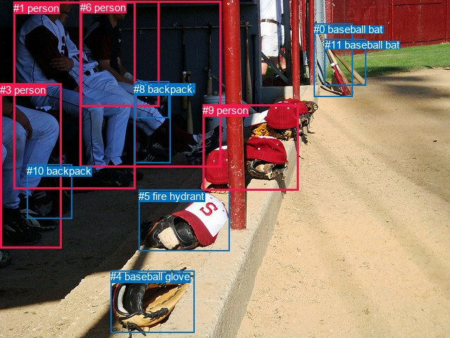
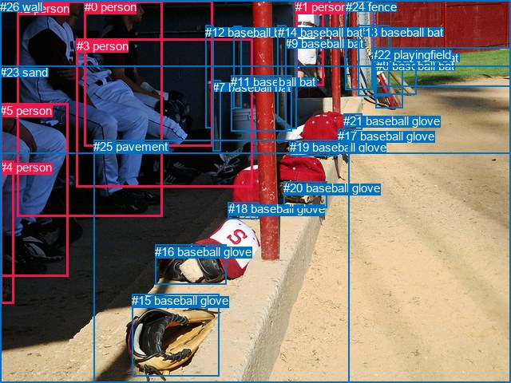

# 图片 1914：2406339.jpg

随机样本序号：38。图片 SHA256：`731fc25ddb12d91a6799cc9f96308c7afe48fdcfc98f75967d1217e46ce3c285`。

红色框表示人，蓝色框表示其他物体。两个模式分别保留自身框编号，可依据位置比较对应对象。

## 自动检测框与输出

人的框编号：`[1, 2, 3, 6, 9]`。状态：`ok`。

### 自动检测全部物体框

| 编号 | 类别 | 是否为人 | 检测分数 | 像素坐标 xyxy |
|---|---|---|---|---|
| 0 | baseball bat | False | 0.9988 | 446.3, 33.4, 501.6, 137.8 |
| 1 | person | True | 0.9975 | 19.0, 2.5, 192.9, 268.7 |
| 2 | person | True | 0.9911 | 113.8, 1.9, 314.9, 237.1 |
| 3 | person | True | 0.9743 | 0.0, 118.6, 87.1, 352.7 |
| 4 | baseball glove | False | 0.9113 | 157.1, 384.1, 276.9, 472.5 |
| 5 | fire hydrant | False | 0.8909 | 197.0, 269.9, 326.4, 356.9 |
| 6 | person | True | 0.8808 | 114.4, 1.9, 226.7, 152.0 |
| 7 | backpack | False | 0.8203 | 193.3, 115.6, 240.4, 167.8 |
| 8 | backpack | False | 0.5433 | 190.4, 118.5, 242.5, 231.3 |
| 9 | person | True | 0.4893 | 288.0, 148.0, 424.4, 270.9 |
| 10 | backpack | False | 0.4735 | 38.4, 233.9, 102.9, 310.3 |
| 11 | baseball bat | False | 0.4365 | 461.8, 55.3, 520.4, 121.6 |

### 自动检测 Top50 人相关候选

评分物体对：132；人相关物体对：90；输出关系：50。

| 排名 | 主语编号与类别 | 关系 | 宾语编号与类别 | 类型 | 人与人 | 排序分数 | 原始融合 logit |
|---|---|---|---|---|---|---|---|
| 1 | #3 person | wearing | #10 backpack | semantic | False | 0.99033 | 4.6294 |
| 2 | #2 person | wearing | #8 backpack | semantic | False | 0.98249 | 4.0276 |
| 3 | #2 person | wearing | #7 backpack | semantic | False | 0.97724 | 3.7597 |
| 4 | #1 person | wearing | #10 backpack | semantic | False | 0.95505 | 3.0562 |
| 5 | #6 person | wearing | #7 backpack | semantic | False | 0.93697 | 2.6991 |
| 6 | #1 person | sitting on | #8 backpack | semantic | False | 0.93109 | 2.6036 |
| 7 | #2 person | wearing | #6 person | semantic | True | 0.92882 | 2.5686 |
| 8 | #3 person | sitting on | #1 person | semantic | True | 0.92528 | 2.5163 |
| 9 | #6 person | wearing | #8 backpack | semantic | False | 0.90143 | 2.2132 |
| 10 | #3 person | in | #10 backpack | spatial | False | 0.89035 | 2.0943 |
| 11 | #10 backpack | on | #3 person | spatial | False | 0.88522 | 2.0428 |
| 12 | #2 person | on | #7 backpack | spatial | False | 0.87511 | 1.9470 |
| 13 | #2 person | in | #6 person | spatial | True | 0.87410 | 1.9377 |
| 14 | #2 person | on | #8 backpack | spatial | False | 0.86856 | 1.8883 |
| 15 | #1 person | sitting on | #6 person | semantic | True | 0.86374 | 1.8467 |
| 16 | #6 person | sitting on | #2 person | semantic | True | 0.86124 | 1.8256 |
| 17 | #1 person | sitting on | #2 person | semantic | True | 0.84112 | 1.6666 |
| 18 | #6 person | on | #7 backpack | spatial | False | 0.83254 | 1.6037 |
| 19 | #1 person | sitting on | #3 person | semantic | True | 0.79451 | 1.3523 |
| 20 | #8 backpack | on | #2 person | spatial | False | 0.79283 | 1.3421 |
| 21 | #1 person | on | #10 backpack | spatial | False | 0.78397 | 1.2890 |
| 22 | #10 backpack | on | #1 person | spatial | False | 0.77998 | 1.2656 |
| 23 | #6 person | on | #8 backpack | spatial | False | 0.77392 | 1.2306 |
| 24 | #9 person | on | #5 fire hydrant | spatial | False | 0.77006 | 1.2087 |
| 25 | #6 person | sitting on | #1 person | semantic | True | 0.75164 | 1.1074 |
| 26 | #1 person | on | #8 backpack | spatial | False | 0.75073 | 1.1025 |
| 27 | #9 person | lying on | #5 fire hydrant | semantic | False | 0.74353 | 1.0644 |
| 28 | #2 person | sitting on | #1 person | semantic | True | 0.73651 | 1.0279 |
| 29 | #6 person | on | #2 person | spatial | True | 0.72609 | 0.9749 |
| 30 | #1 person | in | #6 person | spatial | True | 0.72324 | 0.9606 |
| 31 | #5 fire hydrant | on | #9 person | spatial | False | 0.69562 | 0.8265 |
| 32 | #5 fire hydrant | lying on | #9 person | semantic | False | 0.69297 | 0.8140 |
| 33 | #3 person | beside | #1 person | spatial | True | 0.64214 | 0.5847 |
| 34 | #8 backpack | wearing | #2 person | semantic | False | 0.63771 | 0.5654 |
| 35 | #1 person | on | #2 person | spatial | True | 0.61285 | 0.4593 |
| 36 | #1 person | wearing | #7 backpack | semantic | False | 0.60458 | 0.4246 |
| 37 | #1 person | beside | #3 person | spatial | True | 0.58242 | 0.3327 |
| 38 | #6 person | beside | #1 person | spatial | True | 0.53842 | 0.1540 |
| 39 | #7 backpack | on | #2 person | spatial | False | 0.53684 | 0.1476 |
| 40 | #2 person | sitting on | #9 person | semantic | True | 0.47663 | -0.0935 |
| 41 | #10 backpack | wearing | #3 person | semantic | False | 0.47446 | -0.1022 |
| 42 | #2 person | on | #1 person | spatial | True | 0.40773 | -0.3733 |
| 43 | #8 backpack | on | #6 person | spatial | False | 0.35748 | -0.5863 |
| 44 | #10 backpack | sitting on | #1 person | semantic | False | 0.34804 | -0.6277 |
| 45 | #0 baseball bat | leaning on | #9 person | spatial | False | 0.30138 | -0.8407 |
| 46 | #8 backpack | wearing | #6 person | semantic | False | 0.29409 | -0.8756 |
| 47 | #7 backpack | on | #6 person | spatial | False | 0.28279 | -0.9306 |
| 48 | #1 person | on | #7 backpack | spatial | False | 0.26531 | -1.0185 |
| 49 | #8 backpack | beside | #1 person | spatial | False | 0.26202 | -1.0355 |
| 50 | #1 person | sitting on | #9 person | semantic | True | 0.24853 | -1.1065 |

### 自动检测逐条人相关 GT 核验

R@50：0.00%；命中 0/4。

| GT 主语编号 | GT 关系 | GT 宾语编号 | 结果阶段 | 匹配预测主语编号 | 匹配预测宾语编号 |
|---|---|---|---|---|---|
| 0 | beside | 3 | wrong_predicate | [2, 6] | [2] |
| 0 | looking at | 22 | endpoint_missing_or_wrong_class | [2, 6] | [] |
| 2 | looking at | 22 | endpoint_missing_or_wrong_class | [1] | [] |
| 2 | attached to | 26 | endpoint_missing_or_wrong_class | [1] | [] |

## 真实框与输出

人的框编号：`[0, 1, 2, 3, 4, 5]`。

### 真实框全部物体框

| 编号 | 类别 | 是否为人 | 检测分数 | 像素坐标 xyxy |
|---|---|---|---|---|
| 0 | person | True | GT | 106.0, 0.0, 267.0, 184.0 |
| 1 | person | True | GT | 370.0, 0.0, 405.0, 108.0 |
| 2 | person | True | GT | 22.0, 2.0, 203.0, 272.0 |
| 3 | person | True | GT | 96.0, 49.0, 317.0, 235.0 |
| 4 | person | True | GT | 0.0, 201.0, 17.0, 380.0 |
| 5 | person | True | GT | 0.0, 130.0, 85.0, 347.0 |
| 6 | baseball bat | False | GT | 293.0, 33.0, 303.0, 135.0 |
| 7 | baseball bat | False | GT | 266.0, 101.0, 276.0, 190.0 |
| 8 | baseball bat | False | GT | 471.0, 74.0, 505.0, 136.0 |
| 9 | baseball bat | False | GT | 357.0, 46.0, 371.0, 162.0 |
| 10 | baseball bat | False | GT | 468.0, 64.0, 521.0, 119.0 |
| 11 | baseball bat | False | GT | 289.0, 94.0, 365.0, 164.0 |
| 12 | baseball bat | False | GT | 257.0, 32.0, 267.0, 160.0 |
| 13 | baseball bat | False | GT | 449.0, 32.0, 488.0, 120.0 |
| 14 | baseball bat | False | GT | 348.0, 32.0, 359.0, 153.0 |
| 15 | baseball glove | False | GT | 165.0, 368.0, 274.0, 471.0 |
| 16 | baseball glove | False | GT | 194.0, 307.0, 283.0, 357.0 |
| 17 | baseball glove | False | GT | 423.0, 162.0, 441.0, 182.0 |
| 18 | baseball glove | False | GT | 286.0, 253.0, 325.0, 274.0 |
| 19 | baseball glove | False | GT | 363.0, 176.0, 423.0, 196.0 |
| 20 | baseball glove | False | GT | 355.0, 227.0, 409.0, 260.0 |
| 21 | baseball glove | False | GT | 430.0, 143.0, 453.0, 163.0 |
| 22 | playingfield | False | GT | 465.0, 60.0, 640.0, 109.0 |
| 23 | sand | False | GT | 0.0, 82.0, 640.0, 480.0 |
| 24 | fence | False | GT | 433.0, 0.0, 469.0, 112.0 |
| 25 | pavement | False | GT | 117.0, 175.0, 437.0, 480.0 |
| 26 | wall | False | GT | 0.0, 0.0, 640.0, 192.0 |

### 真实框 Top50 人相关候选

评分物体对：702；人相关物体对：282；输出关系：50。

| 排名 | 主语编号与类别 | 关系 | 宾语编号与类别 | 类型 | 人与人 | 排序分数 | 原始融合 logit |
|---|---|---|---|---|---|---|---|
| 1 | #5 person | wearing | #4 person | semantic | True | 0.98823 | 4.4300 |
| 2 | #0 person | sitting on | #3 person | semantic | True | 0.98805 | 4.4150 |
| 3 | #1 person | leaning on | #26 wall | spatial | False | 0.97982 | 3.8827 |
| 4 | #2 person | sitting on | #23 sand | semantic | False | 0.97553 | 3.6856 |
| 5 | #2 person | sitting on | #3 person | semantic | True | 0.97450 | 3.6431 |
| 6 | #0 person | leaning on | #26 wall | spatial | False | 0.97377 | 3.6144 |
| 7 | #0 person | leaning on | #12 baseball bat | spatial | False | 0.97326 | 3.5944 |
| 8 | #0 person | sitting on | #23 sand | semantic | False | 0.97269 | 3.5728 |
| 9 | #3 person | sitting on | #23 sand | semantic | False | 0.96554 | 3.3330 |
| 10 | #5 person | sitting on | #23 sand | semantic | False | 0.95985 | 3.1741 |
| 11 | #1 person | looking at | #23 sand | semantic | False | 0.94439 | 2.8321 |
| 12 | #3 person | on | #23 sand | spatial | False | 0.92314 | 2.4858 |
| 13 | #0 person | sitting on | #26 wall | semantic | False | 0.91641 | 2.3946 |
| 14 | #2 person | sitting on | #25 pavement | semantic | False | 0.91319 | 2.3532 |
| 15 | #2 person | on | #23 sand | spatial | False | 0.91100 | 2.3259 |
| 16 | #0 person | on | #3 person | spatial | True | 0.90700 | 2.2775 |
| 17 | #5 person | sitting on | #2 person | semantic | True | 0.89761 | 2.1709 |
| 18 | #5 person | in | #4 person | spatial | True | 0.89473 | 2.1400 |
| 19 | #1 person | standing on | #26 wall | semantic | False | 0.88357 | 2.0267 |
| 20 | #0 person | on | #23 sand | spatial | False | 0.87559 | 1.9513 |
| 21 | #2 person | sitting on | #0 person | semantic | True | 0.87062 | 1.9064 |
| 22 | #5 person | on | #23 sand | spatial | False | 0.85313 | 1.7594 |
| 23 | #1 person | on | #23 sand | spatial | False | 0.85084 | 1.7412 |
| 24 | #3 person | leaning on | #12 baseball bat | spatial | False | 0.84972 | 1.7324 |
| 25 | #3 person | sitting on | #25 pavement | semantic | False | 0.84254 | 1.6772 |
| 26 | #0 person | sitting on | #12 baseball bat | semantic | False | 0.82968 | 1.5833 |
| 27 | #3 person | leaning on | #26 wall | spatial | False | 0.82243 | 1.5329 |
| 28 | #2 person | on | #3 person | spatial | True | 0.81644 | 1.4924 |
| 29 | #1 person | standing on | #9 baseball bat | semantic | False | 0.81524 | 1.4844 |
| 30 | #0 person | sitting on | #25 pavement | semantic | False | 0.79567 | 1.3595 |
| 31 | #2 person | leaning on | #26 wall | spatial | False | 0.79398 | 1.3491 |
| 32 | #4 person | on | #5 person | spatial | True | 0.79330 | 1.3449 |
| 33 | #1 person | leaning on | #9 baseball bat | spatial | False | 0.76891 | 1.2022 |
| 34 | #3 person | sitting on | #0 person | semantic | True | 0.75987 | 1.1520 |
| 35 | #2 person | sitting on | #26 wall | semantic | False | 0.74365 | 1.0650 |
| 36 | #2 person | sitting on | #5 person | semantic | True | 0.73213 | 1.0055 |
| 37 | #5 person | beside | #2 person | spatial | True | 0.68459 | 0.7750 |
| 38 | #2 person | on | #25 pavement | spatial | False | 0.66939 | 0.7054 |
| 39 | #0 person | sitting on | #2 person | semantic | True | 0.66512 | 0.6862 |
| 40 | #3 person | leaning on | #6 baseball bat | spatial | False | 0.63124 | 0.5376 |
| 41 | #3 person | sitting on | #26 wall | semantic | False | 0.59835 | 0.3986 |
| 42 | #3 person | on | #25 pavement | spatial | False | 0.59415 | 0.3812 |
| 43 | #5 person | sitting on | #25 pavement | semantic | False | 0.57228 | 0.2912 |
| 44 | #2 person | beside | #0 person | spatial | True | 0.54948 | 0.1986 |
| 45 | #9 baseball bat | holding | #1 person | semantic | False | 0.54862 | 0.1951 |
| 46 | #1 person | leaning on | #14 baseball bat | spatial | False | 0.51625 | 0.0650 |
| 47 | #3 person | holding | #12 baseball bat | semantic | False | 0.50770 | 0.0308 |
| 48 | #3 person | beside | #0 person | spatial | True | 0.48761 | -0.0496 |
| 49 | #2 person | beside | #5 person | spatial | True | 0.47015 | -0.1195 |
| 50 | #1 person | standing on | #14 baseball bat | semantic | False | 0.46130 | -0.1551 |

### 真实框逐条人相关 GT 核验

R@50：0.00%；命中 0/4。

| GT 主语编号 | GT 关系 | GT 宾语编号 | 结果阶段 | 匹配预测主语编号 | 匹配预测宾语编号 |
|---|---|---|---|---|---|
| 0 | beside | 3 | wrong_predicate | [0] | [3] |
| 0 | looking at | 22 | wrong_predicate | [0] | [22] |
| 2 | looking at | 22 | wrong_predicate | [2] | [22] |
| 2 | attached to | 26 | wrong_predicate | [2] | [26] |

## 全部人相关 GT

| 主语编号与类别 | 关系 | 宾语编号与类别 |
|---|---|---|
| #0 person | beside | #3 person |
| #0 person | looking at | #22 playingfield |
| #2 person | looking at | #22 playingfield |
| #2 person | attached to | #26 wall |

原始记录、全部人相关物体对的两项预测与分项分数见 [逐图证据 JSON](../evidence/cases/1914.json)。全部56类 logits 保留于本机 HOR/output/random500/logits/。

<!-- HOR_COMPLETE_RESULTS -->

## 六组条件的完整输出对照

以下保留同一图片三种框与候选模式、两种谓词输出规则的全部 Top50。框编号各自在所属模式内解释。

### 自动检测框完整枚举：空间与语义各保留一个谓词

| 排名 | 主语编号与类别 | 谓词 | 宾语编号与类别 | 分组 | 排序分数 | predicate logit | pair logit |
|---|---|---|---|---|---|---|---|
| 1 | #3 person | wearing | #10 backpack | semantic | 0.9903339 | 4.2837787 | 0.3456283 |
| 2 | #2 person | wearing | #8 backpack | semantic | 0.9824944 | 3.9754949 | 0.0520812 |
| 3 | #2 person | wearing | #7 backpack | semantic | 0.9772385 | 3.6437402 | 0.1159210 |
| 4 | #1 person | wearing | #10 backpack | semantic | 0.9550493 | 2.8907070 | 0.1654916 |
| 5 | #6 person | wearing | #7 backpack | semantic | 0.9369743 | 2.4134655 | 0.2856473 |
| 6 | #1 person | sitting on | #8 backpack | semantic | 0.9310920 | 2.8288865 | -0.2253013 |
| 7 | #2 person | wearing | #6 person | semantic | 0.9288158 | 3.0623798 | -0.4937405 |
| 8 | #3 person | sitting on | #1 person | semantic | 0.9252792 | 3.4516778 | -0.9353412 |
| 9 | #6 person | wearing | #8 backpack | semantic | 0.9014260 | 2.3224397 | -0.1092691 |
| 10 | #3 person | in | #10 backpack | spatial | 0.8903477 | 1.7486701 | 0.3456283 |
| 11 | #10 backpack | on | #3 person | spatial | 0.8852214 | 2.5317593 | -0.4889262 |
| 12 | #2 person | on | #7 backpack | spatial | 0.8751139 | 1.8310308 | 0.1159210 |
| 13 | #2 person | in | #6 person | spatial | 0.8741036 | 2.4314804 | -0.4937405 |
| 14 | #2 person | on | #8 backpack | spatial | 0.8685578 | 1.8361859 | 0.0520812 |
| 15 | #1 person | sitting on | #6 person | semantic | 0.8637436 | 2.4887900 | -0.6420527 |
| 16 | #6 person | sitting on | #2 person | semantic | 0.8612358 | 2.6361938 | -0.8106014 |
| 17 | #1 person | sitting on | #2 person | semantic | 0.8411211 | 2.6663327 | -0.9997392 |
| 18 | #6 person | on | #7 backpack | spatial | 0.8325359 | 1.3180604 | 0.2856473 |
| 19 | #1 person | sitting on | #3 person | semantic | 0.7945089 | 2.2660694 | -0.9137481 |
| 20 | #8 backpack | on | #2 person | spatial | 0.7928314 | 1.8519702 | -0.5098926 |
| 21 | #1 person | on | #10 backpack | spatial | 0.7839708 | 1.1234665 | 0.1654916 |
| 22 | #10 backpack | on | #1 person | spatial | 0.7799826 | 1.5126538 | -0.2470893 |
| 23 | #6 person | on | #8 backpack | spatial | 0.7739184 | 1.3398395 | -0.1092691 |
| 24 | #9 person | on | #5 fire hydrant | spatial | 0.7700611 | 1.9405060 | -0.7318494 |
| 25 | #6 person | sitting on | #1 person | semantic | 0.7516418 | 2.0223198 | -0.9149323 |
| 26 | #1 person | on | #8 backpack | spatial | 0.7507264 | 1.3277917 | -0.2253013 |
| 27 | #9 person | lying on | #5 fire hydrant | semantic | 0.7435271 | 1.7962313 | -0.7318494 |
| 28 | #2 person | sitting on | #1 person | semantic | 0.7365135 | 1.9621530 | -0.9342278 |
| 29 | #6 person | on | #2 person | spatial | 0.7260897 | 1.7854738 | -0.8106014 |
| 30 | #1 person | in | #6 person | spatial | 0.7232405 | 1.6026454 | -0.6420527 |
| 31 | #5 fire hydrant | on | #9 person | spatial | 0.6956230 | 1.4198027 | -0.5932618 |
| 32 | #5 fire hydrant | lying on | #9 person | semantic | 0.6929664 | 1.4072862 | -0.5932618 |
| 33 | #3 person | beside | #1 person | spatial | 0.6421391 | 1.5200019 | -0.9353412 |
| 34 | #8 backpack | wearing | #2 person | semantic | 0.6377059 | 1.0753136 | -0.5098926 |
| 35 | #1 person | on | #2 person | spatial | 0.6128497 | 1.4590459 | -0.9997392 |
| 36 | #1 person | wearing | #7 backpack | semantic | 0.6045751 | 0.6902871 | -0.2657220 |
| 37 | #1 person | beside | #3 person | spatial | 0.5824199 | 1.2464633 | -0.9137481 |
| 38 | #6 person | beside | #1 person | spatial | 0.5384217 | 1.0689225 | -0.9149323 |
| 39 | #7 backpack | on | #2 person | spatial | 0.5368373 | 0.6230941 | -0.4754774 |
| 40 | #2 person | sitting on | #9 person | semantic | 0.4766344 | 0.5267701 | -0.6203007 |
| 41 | #10 backpack | wearing | #3 person | semantic | 0.4744612 | 0.3866820 | -0.4889262 |
| 42 | #2 person | on | #1 person | spatial | 0.4077335 | 0.5608850 | -0.9342278 |
| 43 | #8 backpack | on | #6 person | spatial | 0.3574783 | 0.1917677 | -0.7780934 |
| 44 | #10 backpack | sitting on | #1 person | semantic | 0.3480433 | -0.3805618 | -0.2470893 |
| 45 | #0 baseball bat | leaning on | #9 person | spatial | 0.3013842 | 0.1492352 | -0.9899503 |
| 46 | #8 backpack | wearing | #6 person | semantic | 0.2940932 | -0.0974932 | -0.7780934 |
| 47 | #7 backpack | on | #6 person | spatial | 0.2827938 | -0.2853775 | -0.6452678 |
| 48 | #1 person | on | #7 backpack | spatial | 0.2653115 | -0.7528198 | -0.2657220 |
| 49 | #8 backpack | beside | #1 person | spatial | 0.2620227 | -0.3751106 | -0.6603714 |
| 50 | #1 person | sitting on | #9 person | semantic | 0.2485325 | -0.4692616 | -0.6371925 |

GT 命中：0/4，R@50=0.00%。

| GT主语 | GT谓词 | GT宾语 | 结果阶段 | 匹配主语框 | 匹配宾语框 |
|---|---|---|---|---|---|
| 0 | beside | 3 | wrong_predicate | [2, 6] | [2] |
| 0 | looking at | 22 | endpoint_missing_or_wrong_class | [2, 6] | [] |
| 2 | looking at | 22 | endpoint_missing_or_wrong_class | [1] | [] |
| 2 | attached to | 26 | endpoint_missing_or_wrong_class | [1] | [] |

### 自动检测框完整枚举：每对只保留一个谓词

| 排名 | 主语编号与类别 | 谓词 | 宾语编号与类别 | 分组 | 排序分数 | predicate logit | pair logit |
|---|---|---|---|---|---|---|---|
| 1 | #3 person | wearing | #10 backpack | single | 0.9903339 | 4.2837787 | 0.3456283 |
| 2 | #2 person | wearing | #8 backpack | single | 0.9824944 | 3.9754949 | 0.0520812 |
| 3 | #2 person | wearing | #7 backpack | single | 0.9772385 | 3.6437402 | 0.1159210 |
| 4 | #1 person | wearing | #10 backpack | single | 0.9550493 | 2.8907070 | 0.1654916 |
| 5 | #6 person | wearing | #7 backpack | single | 0.9369743 | 2.4134655 | 0.2856473 |
| 6 | #1 person | sitting on | #8 backpack | single | 0.9310920 | 2.8288865 | -0.2253013 |
| 7 | #2 person | wearing | #6 person | single | 0.9288158 | 3.0623798 | -0.4937405 |
| 8 | #3 person | sitting on | #1 person | single | 0.9252792 | 3.4516778 | -0.9353412 |
| 9 | #6 person | wearing | #8 backpack | single | 0.9014260 | 2.3224397 | -0.1092691 |
| 10 | #10 backpack | on | #3 person | single | 0.8852214 | 2.5317593 | -0.4889262 |
| 11 | #1 person | sitting on | #6 person | single | 0.8637436 | 2.4887900 | -0.6420527 |
| 12 | #6 person | sitting on | #2 person | single | 0.8612358 | 2.6361938 | -0.8106014 |
| 13 | #1 person | sitting on | #2 person | single | 0.8411211 | 2.6663327 | -0.9997392 |
| 14 | #1 person | sitting on | #3 person | single | 0.7945089 | 2.2660694 | -0.9137481 |
| 15 | #8 backpack | on | #2 person | single | 0.7928314 | 1.8519702 | -0.5098926 |
| 16 | #10 backpack | on | #1 person | single | 0.7799826 | 1.5126538 | -0.2470893 |
| 17 | #9 person | on | #5 fire hydrant | single | 0.7700611 | 1.9405060 | -0.7318494 |
| 18 | #6 person | sitting on | #1 person | single | 0.7516418 | 2.0223198 | -0.9149323 |
| 19 | #2 person | sitting on | #1 person | single | 0.7365135 | 1.9621530 | -0.9342278 |
| 20 | #5 fire hydrant | on | #9 person | single | 0.6956230 | 1.4198027 | -0.5932618 |
| 21 | #1 person | wearing | #7 backpack | single | 0.6045751 | 0.6902871 | -0.2657220 |
| 22 | #7 backpack | on | #2 person | single | 0.5368373 | 0.6230941 | -0.4754774 |
| 23 | #2 person | sitting on | #9 person | single | 0.4766344 | 0.5267701 | -0.6203007 |
| 24 | #8 backpack | on | #6 person | single | 0.3574783 | 0.1917677 | -0.7780934 |
| 25 | #0 baseball bat | leaning on | #9 person | single | 0.3013842 | 0.1492352 | -0.9899503 |
| 26 | #7 backpack | on | #6 person | single | 0.2827938 | -0.2853775 | -0.6452678 |
| 27 | #8 backpack | beside | #1 person | single | 0.2620227 | -0.3751106 | -0.6603714 |
| 28 | #1 person | sitting on | #9 person | single | 0.2485325 | -0.4692616 | -0.6371925 |
| 29 | #2 person | wearing | #5 fire hydrant | single | 0.2419319 | -0.4849210 | -0.6571957 |
| 30 | #0 baseball bat | leaning on | #2 person | single | 0.2333430 | -0.2378101 | -0.9517195 |
| 31 | #1 person | wearing | #5 fire hydrant | single | 0.2170542 | -0.4731851 | -0.8097312 |
| 32 | #3 person | sitting on | #6 person | single | 0.2136369 | -0.1322494 | -1.1708915 |
| 33 | #3 person | looking at | #2 person | single | 0.1949158 | -0.2412758 | -1.1771035 |
| 34 | #2 person | beside | #3 person | single | 0.1824026 | -0.3225608 | -1.1775932 |
| 35 | #3 person | sitting on | #9 person | single | 0.1661735 | -0.9040582 | -0.7089345 |
| 36 | #2 person | wearing | #10 backpack | single | 0.1651389 | -1.1585913 | -0.4618869 |
| 37 | #6 person | beside | #3 person | single | 0.1649357 | -0.0824161 | -1.5395370 |
| 38 | #9 person | on | #0 baseball bat | single | 0.1648785 | -0.6057811 | -1.0165870 |
| 39 | #3 person | wearing | #5 fire hydrant | single | 0.1633499 | -0.5347981 | -1.0987134 |
| 40 | #9 person | lying on | #8 backpack | single | 0.1581511 | -0.5805154 | -1.0915341 |
| 41 | #3 person | sitting on | #8 backpack | single | 0.1500357 | -0.6076365 | -1.1266847 |
| 42 | #9 person | on | #4 baseball glove | single | 0.1418131 | -0.6851654 | -1.1151469 |
| 43 | #5 fire hydrant | on | #2 person | single | 0.1340220 | -0.6848755 | -1.1809802 |
| 44 | #6 person | looking at | #9 person | single | 0.1338890 | -0.7803035 | -1.0866984 |
| 45 | #9 person | beside | #2 person | single | 0.1337759 | -0.6441393 | -1.2238380 |
| 46 | #9 person | beside | #1 person | single | 0.1242929 | -0.7670481 | -1.1853428 |
| 47 | #6 person | looking at | #5 fire hydrant | single | 0.1205033 | -0.7300575 | -1.2576150 |
| 48 | #11 baseball bat | leaning on | #9 person | single | 0.1140391 | -1.0032151 | -1.0469164 |
| 49 | #7 backpack | beside | #1 person | single | 0.1128623 | -1.3847349 | -0.6770970 |
| 50 | #0 baseball bat | leaning on | #1 person | single | 0.1104930 | -1.0147102 | -1.0710050 |

GT 命中：0/4，R@50=0.00%。

| GT主语 | GT谓词 | GT宾语 | 结果阶段 | 匹配主语框 | 匹配宾语框 |
|---|---|---|---|---|---|
| 0 | beside | 3 | wrong_predicate | [2, 6] | [2] |
| 0 | looking at | 22 | endpoint_missing_or_wrong_class | [2, 6] | [] |
| 2 | looking at | 22 | endpoint_missing_or_wrong_class | [1] | [] |
| 2 | attached to | 26 | endpoint_missing_or_wrong_class | [1] | [] |

### 真实框完整枚举：空间与语义各保留一个谓词

| 排名 | 主语编号与类别 | 谓词 | 宾语编号与类别 | 分组 | 排序分数 | predicate logit | pair logit |
|---|---|---|---|---|---|---|---|
| 1 | #5 person | wearing | #4 person | semantic | 0.9882255 | 3.9711308 | 0.4588381 |
| 2 | #0 person | sitting on | #3 person | semantic | 0.9880497 | 4.4387918 | -0.0238142 |
| 3 | #1 person | leaning on | #26 wall | spatial | 0.9798210 | 4.0733285 | -0.1906022 |
| 4 | #2 person | sitting on | #23 sand | semantic | 0.9755308 | 4.0897460 | -0.4041771 |
| 5 | #2 person | sitting on | #3 person | semantic | 0.9744959 | 3.8490157 | -0.2059361 |
| 6 | #0 person | leaning on | #26 wall | spatial | 0.9737727 | 3.9944940 | -0.3801141 |
| 7 | #0 person | leaning on | #12 baseball bat | spatial | 0.9732589 | 4.0876670 | -0.4932182 |
| 8 | #0 person | sitting on | #23 sand | semantic | 0.9726908 | 4.0174823 | -0.4446408 |
| 9 | #3 person | sitting on | #23 sand | semantic | 0.9655445 | 3.8008189 | -0.4677975 |
| 10 | #5 person | sitting on | #23 sand | semantic | 0.9598468 | 3.6684680 | -0.4943977 |
| 11 | #1 person | looking at | #23 sand | semantic | 0.9443877 | 3.3269229 | -0.4947903 |
| 12 | #3 person | on | #23 sand | spatial | 0.9231417 | 2.9536161 | -0.4677975 |
| 13 | #0 person | sitting on | #26 wall | semantic | 0.9164120 | 2.7746801 | -0.3801141 |
| 14 | #2 person | sitting on | #25 pavement | semantic | 0.9131893 | 2.8710108 | -0.5177982 |
| 15 | #2 person | on | #23 sand | spatial | 0.9110005 | 2.7300897 | -0.4041771 |
| 16 | #0 person | on | #3 person | spatial | 0.9069985 | 2.3013401 | -0.0238142 |
| 17 | #5 person | sitting on | #2 person | semantic | 0.8976063 | 3.1266351 | -0.9557295 |
| 18 | #5 person | in | #4 person | spatial | 0.8947325 | 1.6811829 | 0.4588381 |
| 19 | #1 person | standing on | #26 wall | semantic | 0.8835685 | 2.2172680 | -0.1906022 |
| 20 | #0 person | on | #23 sand | spatial | 0.8755869 | 2.3959284 | -0.4446408 |
| 21 | #2 person | sitting on | #0 person | semantic | 0.8706175 | 2.7776527 | -0.8712229 |
| 22 | #5 person | on | #23 sand | spatial | 0.8531328 | 2.2537847 | -0.4943977 |
| 23 | #1 person | on | #23 sand | spatial | 0.8508410 | 2.2360024 | -0.4947903 |
| 24 | #3 person | leaning on | #12 baseball bat | spatial | 0.8497168 | 2.4269619 | -0.6945802 |
| 25 | #3 person | sitting on | #25 pavement | semantic | 0.8425398 | 2.5519762 | -0.8747276 |
| 26 | #0 person | sitting on | #12 baseball bat | semantic | 0.8296769 | 2.0765572 | -0.4932182 |
| 27 | #3 person | leaning on | #26 wall | spatial | 0.8224336 | 2.1185217 | -0.5855985 |
| 28 | #2 person | on | #3 person | spatial | 0.8164413 | 1.6983566 | -0.2059361 |
| 29 | #1 person | standing on | #9 baseball bat | semantic | 0.8152415 | 1.9292173 | -0.4447822 |
| 30 | #0 person | sitting on | #25 pavement | semantic | 0.7956726 | 2.0675440 | -0.7080799 |
| 31 | #2 person | leaning on | #26 wall | spatial | 0.7939754 | 2.0415964 | -0.6925397 |
| 32 | #4 person | on | #5 person | spatial | 0.7932952 | 1.8141456 | -0.4692417 |
| 33 | #1 person | leaning on | #9 baseball bat | spatial | 0.7689101 | 1.6469498 | -0.4447822 |
| 34 | #3 person | sitting on | #0 person | semantic | 0.7598701 | 1.9109359 | -0.7589688 |
| 35 | #2 person | sitting on | #26 wall | semantic | 0.7436539 | 1.7575870 | -0.6925397 |
| 36 | #2 person | sitting on | #5 person | semantic | 0.7321323 | 1.8628025 | -0.8573349 |
| 37 | #5 person | beside | #2 person | spatial | 0.6845948 | 1.7306986 | -0.9557295 |
| 38 | #2 person | on | #25 pavement | spatial | 0.6693866 | 1.2232103 | -0.5177982 |
| 39 | #0 person | sitting on | #2 person | semantic | 0.6651193 | 1.5859728 | -0.8997807 |
| 40 | #3 person | leaning on | #6 baseball bat | spatial | 0.6312450 | 1.3853874 | -0.8478260 |
| 41 | #3 person | sitting on | #26 wall | semantic | 0.5983506 | 0.9841957 | -0.5855985 |
| 42 | #3 person | on | #25 pavement | spatial | 0.5941508 | 1.2558789 | -0.8747276 |
| 43 | #5 person | sitting on | #25 pavement | semantic | 0.5722828 | 1.0564594 | -0.7652884 |
| 44 | #2 person | beside | #0 person | spatial | 0.5494793 | 1.0697899 | -0.8712229 |
| 45 | #9 baseball bat | holding | #1 person | semantic | 0.5486164 | 0.8006668 | -0.6055849 |
| 46 | #1 person | leaning on | #14 baseball bat | spatial | 0.5162461 | 0.4987855 | -0.4337781 |
| 47 | #3 person | holding | #12 baseball bat | semantic | 0.5076978 | 0.7253737 | -0.6945802 |
| 48 | #3 person | beside | #0 person | spatial | 0.4876076 | 0.7093892 | -0.7589688 |
| 49 | #2 person | beside | #5 person | spatial | 0.4701526 | 0.7378035 | -0.8573349 |
| 50 | #1 person | standing on | #14 baseball bat | semantic | 0.4613043 | 0.2786851 | -0.4337781 |

GT 命中：0/4，R@50=0.00%。

| GT主语 | GT谓词 | GT宾语 | 结果阶段 | 匹配主语框 | 匹配宾语框 |
|---|---|---|---|---|---|
| 0 | beside | 3 | wrong_predicate | [0] | [3] |
| 0 | looking at | 22 | wrong_predicate | [0] | [22] |
| 2 | looking at | 22 | wrong_predicate | [2] | [22] |
| 2 | attached to | 26 | wrong_predicate | [2] | [26] |

### 真实框完整枚举：每对只保留一个谓词

| 排名 | 主语编号与类别 | 谓词 | 宾语编号与类别 | 分组 | 排序分数 | predicate logit | pair logit |
|---|---|---|---|---|---|---|---|
| 1 | #5 person | wearing | #4 person | single | 0.9882255 | 3.9711308 | 0.4588381 |
| 2 | #0 person | sitting on | #3 person | single | 0.9880497 | 4.4387918 | -0.0238142 |
| 3 | #1 person | leaning on | #26 wall | single | 0.9798210 | 4.0733285 | -0.1906022 |
| 4 | #2 person | sitting on | #23 sand | single | 0.9755308 | 4.0897460 | -0.4041771 |
| 5 | #2 person | sitting on | #3 person | single | 0.9744959 | 3.8490157 | -0.2059361 |
| 6 | #0 person | leaning on | #26 wall | single | 0.9737727 | 3.9944940 | -0.3801141 |
| 7 | #0 person | leaning on | #12 baseball bat | single | 0.9732589 | 4.0876670 | -0.4932182 |
| 8 | #0 person | sitting on | #23 sand | single | 0.9726908 | 4.0174823 | -0.4446408 |
| 9 | #3 person | sitting on | #23 sand | single | 0.9655445 | 3.8008189 | -0.4677975 |
| 10 | #5 person | sitting on | #23 sand | single | 0.9598468 | 3.6684680 | -0.4943977 |
| 11 | #1 person | looking at | #23 sand | single | 0.9443877 | 3.3269229 | -0.4947903 |
| 12 | #2 person | sitting on | #25 pavement | single | 0.9131893 | 2.8710108 | -0.5177982 |
| 13 | #5 person | sitting on | #2 person | single | 0.8976063 | 3.1266351 | -0.9557295 |
| 14 | #2 person | sitting on | #0 person | single | 0.8706175 | 2.7776527 | -0.8712229 |
| 15 | #3 person | leaning on | #12 baseball bat | single | 0.8497168 | 2.4269619 | -0.6945802 |
| 16 | #3 person | sitting on | #25 pavement | single | 0.8425398 | 2.5519762 | -0.8747276 |
| 17 | #3 person | leaning on | #26 wall | single | 0.8224336 | 2.1185217 | -0.5855985 |
| 18 | #1 person | standing on | #9 baseball bat | single | 0.8152415 | 1.9292173 | -0.4447822 |
| 19 | #0 person | sitting on | #25 pavement | single | 0.7956726 | 2.0675440 | -0.7080799 |
| 20 | #2 person | leaning on | #26 wall | single | 0.7939754 | 2.0415964 | -0.6925397 |
| 21 | #4 person | on | #5 person | single | 0.7932952 | 1.8141456 | -0.4692417 |
| 22 | #3 person | sitting on | #0 person | single | 0.7598701 | 1.9109359 | -0.7589688 |
| 23 | #2 person | sitting on | #5 person | single | 0.7321323 | 1.8628025 | -0.8573349 |
| 24 | #0 person | sitting on | #2 person | single | 0.6651193 | 1.5859728 | -0.8997807 |
| 25 | #3 person | leaning on | #6 baseball bat | single | 0.6312450 | 1.3853874 | -0.8478260 |
| 26 | #5 person | sitting on | #25 pavement | single | 0.5722828 | 1.0564594 | -0.7652884 |
| 27 | #9 baseball bat | holding | #1 person | single | 0.5486164 | 0.8006668 | -0.6055849 |
| 28 | #1 person | leaning on | #14 baseball bat | single | 0.5162461 | 0.4987855 | -0.4337781 |
| 29 | #1 person | leaning on | #24 fence | single | 0.4558763 | 0.3241653 | -0.5011206 |
| 30 | #3 person | sitting on | #2 person | single | 0.4265534 | 0.6230364 | -0.9189637 |
| 31 | #2 person | wearing | #4 person | single | 0.3828402 | -0.5463877 | 0.0688772 |
| 32 | #14 baseball bat | holding | #1 person | single | 0.3017476 | 0.0527768 | -0.8917667 |
| 33 | #1 person | wearing | #19 baseball glove | single | 0.2763156 | -0.2255802 | -0.7372313 |
| 34 | #3 person | wearing | #18 baseball glove | single | 0.2641099 | -0.0707231 | -0.9539926 |
| 35 | #2 person | wearing | #18 baseball glove | single | 0.2352546 | 0.0937243 | -1.2725990 |
| 36 | #9 baseball bat | looking at | #0 person | single | 0.2279053 | -0.2490554 | -0.9711215 |
| 37 | #1 person | standing on | #11 baseball bat | single | 0.2226008 | -0.3011079 | -0.9494661 |
| 38 | #12 baseball bat | holding | #3 person | single | 0.2078004 | -0.8218555 | -0.5163799 |
| 39 | #9 baseball bat | looking at | #2 person | single | 0.2022758 | -0.2391629 | -1.1329678 |
| 40 | #0 person | leaning on | #7 baseball bat | single | 0.2021595 | -0.4319482 | -0.9409037 |
| 41 | #3 person | holding | #7 baseball bat | single | 0.1982834 | -0.3149052 | -1.0821526 |
| 42 | #1 person | looking at | #0 person | single | 0.1895854 | -0.4091640 | -1.0435424 |
| 43 | #1 person | wearing | #20 baseball glove | single | 0.1785775 | -0.8746035 | -0.6514118 |
| 44 | #1 person | standing on | #25 pavement | single | 0.1725296 | -0.8516231 | -0.7161814 |
| 45 | #2 person | wearing | #16 baseball glove | single | 0.1705149 | -0.5340466 | -1.0479357 |
| 46 | #4 person | on | #23 sand | single | 0.1677199 | -0.9039426 | -0.6979311 |
| 47 | #6 baseball bat | holding | #3 person | single | 0.1652584 | -0.9379988 | -0.6816133 |
| 48 | #11 baseball bat | beside | #0 person | single | 0.1646235 | -0.7701557 | -0.8540658 |
| 49 | #0 person | wearing | #18 baseball glove | single | 0.1616641 | -0.4795132 | -1.1663849 |
| 50 | #5 person | sitting on | #3 person | single | 0.1581785 | -0.9446807 | -0.7271630 |

GT 命中：0/4，R@50=0.00%。

| GT主语 | GT谓词 | GT宾语 | 结果阶段 | 匹配主语框 | 匹配宾语框 |
|---|---|---|---|---|---|
| 0 | beside | 3 | wrong_predicate | [0] | [3] |
| 0 | looking at | 22 | wrong_predicate | [0] | [22] |
| 2 | looking at | 22 | wrong_predicate | [2] | [22] |
| 2 | attached to | 26 | wrong_predicate | [2] | [26] |

### 真实框400候选：空间与语义各保留一个谓词

| 排名 | 主语编号与类别 | 谓词 | 宾语编号与类别 | 分组 | 排序分数 | predicate logit | pair logit |
|---|---|---|---|---|---|---|---|
| 1 | #0 person | sitting on | #3 person | semantic | 0.9884687 | 4.4749084 | -0.0238142 |
| 2 | #5 person | wearing | #4 person | semantic | 0.9880881 | 3.9593949 | 0.4588381 |
| 3 | #2 person | sitting on | #23 sand | semantic | 0.9802030 | 4.3064094 | -0.4041771 |
| 4 | #1 person | leaning on | #26 wall | spatial | 0.9798893 | 4.0767894 | -0.1906022 |
| 5 | #0 person | sitting on | #23 sand | semantic | 0.9765538 | 4.1739631 | -0.4446408 |
| 6 | #0 person | leaning on | #26 wall | spatial | 0.9752906 | 4.0556655 | -0.3801141 |
| 7 | #2 person | sitting on | #3 person | semantic | 0.9743462 | 3.8430085 | -0.2059361 |
| 8 | #3 person | sitting on | #23 sand | semantic | 0.9736573 | 4.0776658 | -0.4677975 |
| 9 | #5 person | sitting on | #23 sand | semantic | 0.9710019 | 4.0054975 | -0.4943977 |
| 10 | #0 person | leaning on | #12 baseball bat | spatial | 0.9660646 | 3.8419929 | -0.4932182 |
| 11 | #1 person | looking at | #23 sand | semantic | 0.9557889 | 3.5683503 | -0.4947903 |
| 12 | #2 person | sitting on | #25 pavement | semantic | 0.9373383 | 3.2230926 | -0.5177982 |
| 13 | #0 person | sitting on | #26 wall | semantic | 0.9126503 | 2.7265477 | -0.3801141 |
| 14 | #3 person | on | #23 sand | spatial | 0.9065334 | 2.7398210 | -0.4677975 |
| 15 | #1 person | standing on | #26 wall | semantic | 0.8982415 | 2.3684387 | -0.1906022 |
| 16 | #0 person | leaning on | #3 person | spatial | 0.8912663 | 2.1275558 | -0.0238142 |
| 17 | #2 person | on | #23 sand | spatial | 0.8883219 | 2.4778905 | -0.4041771 |
| 18 | #3 person | sitting on | #25 pavement | semantic | 0.8862904 | 2.9281254 | -0.8747276 |
| 19 | #5 person | sitting on | #2 person | semantic | 0.8742664 | 2.8949494 | -0.9557295 |
| 20 | #2 person | sitting on | #0 person | semantic | 0.8739713 | 2.8077602 | -0.8712229 |
| 21 | #0 person | sitting on | #25 pavement | semantic | 0.8737155 | 2.6422977 | -0.7080799 |
| 22 | #5 person | in | #4 person | spatial | 0.8709345 | 1.4504089 | 0.4588381 |
| 23 | #0 person | on | #23 sand | spatial | 0.8551893 | 2.2205362 | -0.4446408 |
| 24 | #1 person | on | #23 sand | spatial | 0.8415172 | 2.1643510 | -0.4947903 |
| 25 | #3 person | leaning on | #12 baseball bat | spatial | 0.8327292 | 2.2996750 | -0.6945802 |
| 26 | #5 person | on | #23 sand | spatial | 0.8289580 | 2.0726581 | -0.4943977 |
| 27 | #3 person | leaning on | #26 wall | spatial | 0.8267147 | 2.1481185 | -0.5855985 |
| 28 | #2 person | leaning on | #26 wall | spatial | 0.8218762 | 2.2216501 | -0.6925397 |
| 29 | #0 person | sitting on | #12 baseball bat | semantic | 0.7992685 | 1.8749471 | -0.4932182 |
| 30 | #2 person | on | #3 person | spatial | 0.7659843 | 1.3917098 | -0.2059361 |
| 31 | #2 person | sitting on | #26 wall | semantic | 0.7648406 | 1.8719435 | -0.6925397 |
| 32 | #3 person | sitting on | #0 person | semantic | 0.7301733 | 1.7544708 | -0.7589688 |
| 33 | #4 person | on | #5 person | spatial | 0.7267260 | 1.4473162 | -0.4692417 |
| 34 | #1 person | standing on | #9 baseball bat | semantic | 0.7138447 | 1.3589129 | -0.4447822 |
| 35 | #5 person | sitting on | #25 pavement | semantic | 0.6944053 | 1.5860844 | -0.7652884 |
| 36 | #2 person | on | #25 pavement | spatial | 0.6907054 | 1.3212171 | -0.5177982 |
| 37 | #2 person | sitting on | #5 person | semantic | 0.6671987 | 1.5528769 | -0.8573349 |
| 38 | #0 person | sitting on | #2 person | semantic | 0.6522695 | 1.5288105 | -0.8997807 |
| 39 | #3 person | on | #25 pavement | spatial | 0.6214676 | 1.3705101 | -0.8747276 |
| 40 | #3 person | leaning on | #6 baseball bat | spatial | 0.6074476 | 1.2844219 | -0.8478260 |
| 41 | #5 person | beside | #2 person | spatial | 0.6018364 | 1.3688521 | -0.9557295 |
| 42 | #3 person | sitting on | #26 wall | semantic | 0.5830752 | 0.9210086 | -0.5855985 |
| 43 | #1 person | leaning on | #9 baseball bat | spatial | 0.5759946 | 0.7511339 | -0.4447822 |
| 44 | #2 person | beside | #0 person | spatial | 0.5343252 | 1.0087399 | -0.8712229 |
| 45 | #0 person | on | #25 pavement | spatial | 0.4912226 | 0.6729665 | -0.7080799 |
| 46 | #1 person | standing on | #25 pavement | semantic | 0.4202816 | 0.3945637 | -0.7161814 |
| 47 | #3 person | beside | #0 person | spatial | 0.4058744 | 0.3779221 | -0.7589688 |
| 48 | #3 person | sitting on | #2 person | semantic | 0.4002934 | 0.5147209 | -0.9189637 |
| 49 | #1 person | standing on | #14 baseball bat | semantic | 0.3742458 | -0.0802670 | -0.4337781 |
| 50 | #4 person | on | #23 sand | spatial | 0.3655390 | 0.1465282 | -0.6979311 |

GT 命中：0/4，R@50=0.00%。

| GT主语 | GT谓词 | GT宾语 | 结果阶段 | 匹配主语框 | 匹配宾语框 |
|---|---|---|---|---|---|
| 0 | beside | 3 | wrong_predicate | [0] | [3] |
| 0 | looking at | 22 | wrong_predicate | [0] | [22] |
| 2 | looking at | 22 | wrong_predicate | [2] | [22] |
| 2 | attached to | 26 | wrong_predicate | [2] | [26] |

### 真实框400候选：每对只保留一个谓词

| 排名 | 主语编号与类别 | 谓词 | 宾语编号与类别 | 分组 | 排序分数 | predicate logit | pair logit |
|---|---|---|---|---|---|---|---|
| 1 | #0 person | sitting on | #3 person | single | 0.9884687 | 4.4749084 | -0.0238142 |
| 2 | #5 person | wearing | #4 person | single | 0.9880881 | 3.9593949 | 0.4588381 |
| 3 | #2 person | sitting on | #23 sand | single | 0.9802030 | 4.3064094 | -0.4041771 |
| 4 | #1 person | leaning on | #26 wall | single | 0.9798893 | 4.0767894 | -0.1906022 |
| 5 | #0 person | sitting on | #23 sand | single | 0.9765538 | 4.1739631 | -0.4446408 |
| 6 | #0 person | leaning on | #26 wall | single | 0.9752906 | 4.0556655 | -0.3801141 |
| 7 | #2 person | sitting on | #3 person | single | 0.9743462 | 3.8430085 | -0.2059361 |
| 8 | #3 person | sitting on | #23 sand | single | 0.9736573 | 4.0776658 | -0.4677975 |
| 9 | #5 person | sitting on | #23 sand | single | 0.9710019 | 4.0054975 | -0.4943977 |
| 10 | #0 person | leaning on | #12 baseball bat | single | 0.9660646 | 3.8419929 | -0.4932182 |
| 11 | #1 person | looking at | #23 sand | single | 0.9557889 | 3.5683503 | -0.4947903 |
| 12 | #2 person | sitting on | #25 pavement | single | 0.9373383 | 3.2230926 | -0.5177982 |
| 13 | #3 person | sitting on | #25 pavement | single | 0.8862904 | 2.9281254 | -0.8747276 |
| 14 | #5 person | sitting on | #2 person | single | 0.8742664 | 2.8949494 | -0.9557295 |
| 15 | #2 person | sitting on | #0 person | single | 0.8739713 | 2.8077602 | -0.8712229 |
| 16 | #0 person | sitting on | #25 pavement | single | 0.8737155 | 2.6422977 | -0.7080799 |
| 17 | #3 person | leaning on | #12 baseball bat | single | 0.8327292 | 2.2996750 | -0.6945802 |
| 18 | #3 person | leaning on | #26 wall | single | 0.8267147 | 2.1481185 | -0.5855985 |
| 19 | #2 person | leaning on | #26 wall | single | 0.8218762 | 2.2216501 | -0.6925397 |
| 20 | #3 person | sitting on | #0 person | single | 0.7301733 | 1.7544708 | -0.7589688 |
| 21 | #4 person | on | #5 person | single | 0.7267260 | 1.4473162 | -0.4692417 |
| 22 | #1 person | standing on | #9 baseball bat | single | 0.7138447 | 1.3589129 | -0.4447822 |
| 23 | #5 person | sitting on | #25 pavement | single | 0.6944053 | 1.5860844 | -0.7652884 |
| 24 | #2 person | sitting on | #5 person | single | 0.6671987 | 1.5528769 | -0.8573349 |
| 25 | #0 person | sitting on | #2 person | single | 0.6522695 | 1.5288105 | -0.8997807 |
| 26 | #3 person | leaning on | #6 baseball bat | single | 0.6074476 | 1.2844219 | -0.8478260 |
| 27 | #1 person | standing on | #25 pavement | single | 0.4202816 | 0.3945637 | -0.7161814 |
| 28 | #3 person | sitting on | #2 person | single | 0.4002934 | 0.5147209 | -0.9189637 |
| 29 | #1 person | standing on | #14 baseball bat | single | 0.3742458 | -0.0802670 | -0.4337781 |
| 30 | #4 person | on | #23 sand | single | 0.3655390 | 0.1465282 | -0.6979311 |
| 31 | #1 person | leaning on | #24 fence | single | 0.3364730 | -0.1779308 | -0.5011206 |
| 32 | #2 person | wearing | #4 person | single | 0.2853869 | -0.9867725 | 0.0688772 |
| 33 | #9 baseball bat | holding | #1 person | single | 0.2770575 | -0.3535199 | -0.6055849 |
| 34 | #9 baseball bat | looking at | #0 person | single | 0.2340162 | -0.2146492 | -0.9711215 |
| 35 | #9 baseball bat | looking at | #2 person | single | 0.2027685 | -0.2361121 | -1.1329678 |
| 36 | #3 person | leaning on | #7 baseball bat | single | 0.1940238 | -0.3419209 | -1.0821526 |
| 37 | #1 person | standing on | #11 baseball bat | single | 0.1885004 | -0.5103173 | -0.9494661 |
| 38 | #1 person | looking at | #0 person | single | 0.1858742 | -0.4335027 | -1.0435424 |
| 39 | #2 person | wearing | #16 baseball glove | single | 0.1831135 | -0.4474583 | -1.0479357 |
| 40 | #2 person | wearing | #18 baseball glove | single | 0.1727234 | -0.2938490 | -1.2725990 |
| 41 | #5 person | sitting on | #26 wall | single | 0.1725522 | -0.5083179 | -1.0593280 |
| 42 | #3 person | wearing | #16 baseball glove | single | 0.1720979 | -0.6962385 | -0.8745931 |
| 43 | #3 person | wearing | #18 baseball glove | single | 0.1699169 | -0.6322241 | -0.9539926 |
| 44 | #11 baseball bat | beside | #0 person | single | 0.1644178 | -0.7716525 | -0.8540658 |
| 45 | #5 person | sitting on | #3 person | single | 0.1608027 | -0.9251046 | -0.7271630 |
| 46 | #1 person | looking at | #2 person | single | 0.1529590 | -0.4616766 | -1.2499024 |
| 47 | #12 baseball bat | holding | #3 person | single | 0.1475932 | -1.2372243 | -0.5163799 |
| 48 | #26 wall | beside | #0 person | single | 0.1431085 | -1.0550435 | -0.7346647 |
| 49 | #11 baseball bat | beside | #3 person | single | 0.1428075 | -1.1308067 | -0.6613587 |
| 50 | #14 baseball bat | holding | #1 person | single | 0.1355807 | -0.9607239 | -0.8917667 |

GT 命中：0/4，R@50=0.00%。

| GT主语 | GT谓词 | GT宾语 | 结果阶段 | 匹配主语框 | 匹配宾语框 |
|---|---|---|---|---|---|
| 0 | beside | 3 | wrong_predicate | [0] | [3] |
| 0 | looking at | 22 | wrong_predicate | [0] | [22] |
| 2 | looking at | 22 | wrong_predicate | [2] | [22] |
| 2 | attached to | 26 | wrong_predicate | [2] | [26] |
