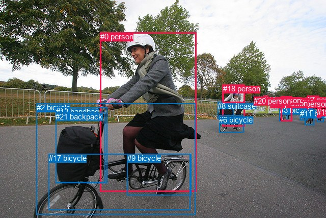
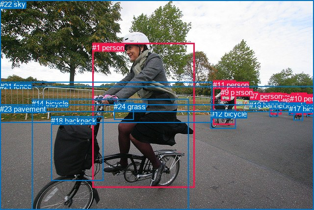

# 图片 1919：2406484.jpg

随机样本序号：330。图片 SHA256：`58869aab26773098433074432a7f042d395d33d1c0f8c293df3168b7e8ec2bc8`。

红色框表示人，蓝色框表示其他物体。两个模式分别保留自身框编号，可依据位置比较对应对象。

## 自动检测框与输出

人的框编号：`[0, 1, 4, 7, 13, 14, 15, 16, 18, 19, 20]`。状态：`ok`。

### 自动检测全部物体框

| 编号 | 类别 | 是否为人 | 检测分数 | 像素坐标 xyxy |
|---|---|---|---|---|
| 0 | person | True | 0.9990 | 196.6, 63.4, 386.0, 375.6 |
| 1 | person | True | 0.9989 | 436.4, 165.5, 480.8, 247.7 |
| 2 | bicycle | False | 0.9882 | 72.0, 202.1, 383.3, 420.8 |
| 3 | bicycle | False | 0.9659 | 548.9, 207.5, 564.8, 237.9 |
| 4 | person | True | 0.9599 | 551.2, 188.4, 573.6, 237.2 |
| 5 | bicycle | False | 0.9232 | 598.7, 213.5, 616.7, 244.7 |
| 6 | bicycle | False | 0.9050 | 430.0, 225.9, 478.3, 259.9 |
| 7 | person | True | 0.8262 | 602.2, 187.5, 626.7, 231.5 |
| 8 | suitcase | False | 0.7343 | 427.3, 199.0, 459.0, 232.8 |
| 9 | bicycle | False | 0.7293 | 249.9, 301.2, 375.1, 382.1 |
| 10 | bicycle | False | 0.7051 | 622.8, 214.3, 635.2, 238.7 |
| 11 | bicycle | False | 0.6151 | 589.2, 214.2, 603.3, 235.3 |
| 12 | handbag | False | 0.6089 | 109.7, 210.3, 210.1, 358.7 |
| 13 | person | True | 0.5751 | 592.3, 193.0, 607.4, 210.7 |
| 14 | person | True | 0.5567 | 572.9, 194.6, 583.5, 207.5 |
| 15 | person | True | 0.5086 | 531.1, 194.2, 543.9, 206.2 |
| 16 | person | True | 0.4996 | 518.0, 187.5, 526.6, 204.7 |
| 17 | bicycle | False | 0.4434 | 95.9, 301.1, 373.8, 411.5 |
| 18 | person | True | 0.4102 | 437.8, 165.4, 480.6, 201.8 |
| 19 | person | True | 0.3928 | 622.2, 210.9, 630.1, 230.6 |
| 20 | person | True | 0.3628 | 498.4, 189.3, 518.1, 204.9 |
| 21 | backpack | False | 0.3579 | 109.3, 219.9, 207.0, 357.1 |

### 自动检测 Top50 人相关候选

评分物体对：462；人相关物体对：352；输出关系：50。

| 排名 | 主语编号与类别 | 关系 | 宾语编号与类别 | 类型 | 人与人 | 排序分数 | 原始融合 logit |
|---|---|---|---|---|---|---|---|
| 1 | #1 person | riding | #6 bicycle | semantic | False | 0.99688 | 5.7670 |
| 2 | #0 person | riding | #2 bicycle | semantic | False | 0.99539 | 5.3743 |
| 3 | #0 person | riding | #17 bicycle | semantic | False | 0.99367 | 5.0563 |
| 4 | #1 person | wearing | #18 person | semantic | True | 0.99160 | 4.7710 |
| 5 | #4 person | riding | #3 bicycle | semantic | False | 0.99129 | 4.7351 |
| 6 | #7 person | riding | #5 bicycle | semantic | False | 0.98705 | 4.3334 |
| 7 | #1 person | pushing | #8 suitcase | semantic | False | 0.98436 | 4.1422 |
| 8 | #1 person | on | #6 bicycle | spatial | False | 0.97943 | 3.8632 |
| 9 | #13 person | riding | #11 bicycle | semantic | False | 0.97462 | 3.6481 |
| 10 | #7 person | riding | #11 bicycle | semantic | False | 0.97404 | 3.6249 |
| 11 | #0 person | on | #2 bicycle | spatial | False | 0.96666 | 3.3671 |
| 12 | #19 person | riding | #10 bicycle | semantic | False | 0.96570 | 3.3377 |
| 13 | #0 person | holding | #12 handbag | semantic | False | 0.95855 | 3.1411 |
| 14 | #1 person | in | #18 person | spatial | True | 0.95761 | 3.1175 |
| 15 | #0 person | on | #17 bicycle | spatial | False | 0.95275 | 3.0040 |
| 16 | #13 person | riding | #5 bicycle | semantic | False | 0.94969 | 2.9380 |
| 17 | #18 person | riding | #6 bicycle | semantic | False | 0.94582 | 2.8598 |
| 18 | #4 person | on | #3 bicycle | spatial | False | 0.93499 | 2.6660 |
| 19 | #1 person | on | #8 suitcase | spatial | False | 0.93089 | 2.6005 |
| 20 | #18 person | riding | #8 suitcase | semantic | False | 0.92947 | 2.5785 |
| 21 | #7 person | on | #5 bicycle | spatial | False | 0.92557 | 2.5205 |
| 22 | #19 person | riding | #5 bicycle | semantic | False | 0.92010 | 2.4437 |
| 23 | #0 person | holding | #21 backpack | semantic | False | 0.91073 | 2.3226 |
| 24 | #10 bicycle | wearing | #19 person | semantic | False | 0.90569 | 2.2621 |
| 25 | #14 person | riding | #11 bicycle | semantic | False | 0.87867 | 1.9799 |
| 26 | #13 person | on | #11 bicycle | spatial | False | 0.87710 | 1.9652 |
| 27 | #16 person | wearing | #20 person | semantic | True | 0.87445 | 1.9409 |
| 28 | #7 person | on | #11 bicycle | spatial | False | 0.87351 | 1.9323 |
| 29 | #7 person | riding | #10 bicycle | semantic | False | 0.86534 | 1.8604 |
| 30 | #16 person | on | #20 person | spatial | True | 0.86021 | 1.8170 |
| 31 | #18 person | on | #8 suitcase | spatial | False | 0.85696 | 1.7903 |
| 32 | #0 person | wearing | #9 bicycle | semantic | False | 0.83902 | 1.6509 |
| 33 | #7 person | wearing | #13 person | semantic | True | 0.81473 | 1.4810 |
| 34 | #13 person | on | #5 bicycle | spatial | False | 0.80826 | 1.4387 |
| 35 | #16 person | wearing | #15 person | semantic | True | 0.80347 | 1.4081 |
| 36 | #14 person | riding | #3 bicycle | semantic | False | 0.79456 | 1.3526 |
| 37 | #19 person | on | #10 bicycle | spatial | False | 0.78580 | 1.2998 |
| 38 | #18 person | on | #6 bicycle | spatial | False | 0.78020 | 1.2669 |
| 39 | #7 person | riding | #6 bicycle | semantic | False | 0.77394 | 1.2307 |
| 40 | #7 person | riding | #19 person | semantic | True | 0.77288 | 1.2247 |
| 41 | #4 person | riding | #6 bicycle | semantic | False | 0.74642 | 1.0796 |
| 42 | #4 person | holding | #14 person | semantic | True | 0.73786 | 1.0349 |
| 43 | #10 bicycle | in | #19 person | spatial | False | 0.73013 | 0.9953 |
| 44 | #4 person | riding | #11 bicycle | semantic | False | 0.70951 | 0.8930 |
| 45 | #4 person | riding | #5 bicycle | semantic | False | 0.68118 | 0.7592 |
| 46 | #14 person | on | #11 bicycle | spatial | False | 0.67532 | 0.7324 |
| 47 | #19 person | on | #5 bicycle | spatial | False | 0.66392 | 0.6808 |
| 48 | #15 person | riding | #3 bicycle | semantic | False | 0.64522 | 0.5981 |
| 49 | #19 person | riding | #6 bicycle | semantic | False | 0.63020 | 0.5331 |
| 50 | #4 person | wearing | #15 person | semantic | True | 0.60967 | 0.4459 |

### 自动检测逐条人相关 GT 核验

R@50：66.67%；命中 2/3。

| GT 主语编号 | GT 关系 | GT 宾语编号 | 结果阶段 | 匹配预测主语编号 | 匹配预测宾语编号 |
|---|---|---|---|---|---|
| 1 | riding | 14 | hit50 | [0] | [2] |
| 9 | in front of | 11 | endpoint_missing_or_wrong_class | [] | [1] |
| 11 | riding | 12 | hit50 | [1] | [6] |

## 真实框与输出

人的框编号：`[0, 1, 2, 3, 4, 5, 6, 7, 8, 9, 10, 11]`。

### 真实框全部物体框

| 编号 | 类别 | 是否为人 | 检测分数 | 像素坐标 xyxy |
|---|---|---|---|---|
| 0 | person | True | GT | 583.0, 199.0, 588.0, 207.0 |
| 1 | person | True | GT | 188.0, 88.0, 397.0, 382.0 |
| 2 | person | True | GT | 520.0, 187.0, 527.0, 204.0 |
| 3 | person | True | GT | 551.0, 188.0, 573.0, 232.0 |
| 4 | person | True | GT | 530.0, 195.0, 545.0, 207.0 |
| 5 | person | True | GT | 593.0, 188.0, 625.0, 232.0 |
| 6 | person | True | GT | 575.0, 197.0, 583.0, 207.0 |
| 7 | person | True | GT | 510.0, 187.0, 521.0, 206.0 |
| 8 | person | True | GT | 621.0, 194.0, 640.0, 232.0 |
| 9 | person | True | GT | 450.0, 179.0, 469.0, 205.0 |
| 10 | person | True | GT | 591.0, 192.0, 606.0, 210.0 |
| 11 | person | True | GT | 434.0, 164.0, 480.0, 253.0 |
| 12 | bicycle | False | GT | 429.0, 223.0, 480.0, 261.0 |
| 13 | bicycle | False | GT | 626.0, 212.0, 640.0, 236.0 |
| 14 | bicycle | False | GT | 65.0, 202.0, 384.0, 427.0 |
| 15 | bicycle | False | GT | 599.0, 211.0, 618.0, 244.0 |
| 16 | bicycle | False | GT | 550.0, 206.0, 567.0, 237.0 |
| 17 | bicycle | False | GT | 589.0, 213.0, 603.0, 234.0 |
| 18 | backpack | False | GT | 104.0, 237.0, 211.0, 368.0 |
| 19 | banner | False | GT | 508.0, 205.0, 527.0, 223.0 |
| 20 | tree | False | GT | 0.0, 0.0, 640.0, 228.0 |
| 21 | fence | False | GT | 0.0, 167.0, 432.0, 249.0 |
| 22 | sky | False | GT | 0.0, 0.0, 640.0, 177.0 |
| 23 | pavement | False | GT | 0.0, 213.0, 640.0, 427.0 |
| 24 | grass | False | GT | 232.0, 208.0, 272.0, 244.0 |

### 真实框 Top50 人相关候选

评分物体对：600；人相关物体对：444；输出关系：50。

| 排名 | 主语编号与类别 | 关系 | 宾语编号与类别 | 类型 | 人与人 | 排序分数 | 原始融合 logit |
|---|---|---|---|---|---|---|---|
| 1 | #11 person | riding | #12 bicycle | semantic | False | 0.99742 | 5.9559 |
| 2 | #1 person | riding | #14 bicycle | semantic | False | 0.99716 | 5.8617 |
| 3 | #11 person | wearing | #9 person | semantic | True | 0.99152 | 4.7618 |
| 4 | #3 person | riding | #16 bicycle | semantic | False | 0.98796 | 4.4078 |
| 5 | #1 person | riding | #23 pavement | semantic | False | 0.98459 | 4.1571 |
| 6 | #11 person | on | #12 bicycle | spatial | False | 0.98194 | 3.9961 |
| 7 | #1 person | wearing | #24 grass | semantic | False | 0.98063 | 3.9246 |
| 8 | #3 person | crossing | #23 pavement | semantic | False | 0.97774 | 3.7823 |
| 9 | #1 person | on | #14 bicycle | spatial | False | 0.97312 | 3.5891 |
| 10 | #11 person | riding | #23 pavement | semantic | False | 0.96997 | 3.4750 |
| 11 | #5 person | riding | #15 bicycle | semantic | False | 0.96668 | 3.3676 |
| 12 | #1 person | on | #23 pavement | spatial | False | 0.95539 | 3.0643 |
| 13 | #5 person | crossing | #23 pavement | semantic | False | 0.94606 | 2.8645 |
| 14 | #11 person | on | #23 pavement | spatial | False | 0.94531 | 2.8499 |
| 15 | #11 person | in | #9 person | spatial | True | 0.93330 | 2.6386 |
| 16 | #8 person | riding | #13 bicycle | semantic | False | 0.92353 | 2.4913 |
| 17 | #3 person | on | #16 bicycle | spatial | False | 0.92028 | 2.4462 |
| 18 | #5 person | wearing | #10 person | semantic | True | 0.90461 | 2.2495 |
| 19 | #7 person | standing on | #19 banner | semantic | False | 0.89532 | 2.1463 |
| 20 | #8 person | crossing | #23 pavement | semantic | False | 0.89196 | 2.1109 |
| 21 | #3 person | on | #23 pavement | spatial | False | 0.87794 | 1.9730 |
| 22 | #5 person | on | #23 pavement | spatial | False | 0.87491 | 1.9451 |
| 23 | #5 person | riding | #17 bicycle | semantic | False | 0.87167 | 1.9158 |
| 24 | #7 person | on | #19 banner | spatial | False | 0.83179 | 1.5984 |
| 25 | #1 person | holding | #18 backpack | semantic | False | 0.81556 | 1.4866 |
| 26 | #8 person | on | #23 pavement | spatial | False | 0.80269 | 1.4032 |
| 27 | #1 person | riding | #12 bicycle | semantic | False | 0.76423 | 1.1760 |
| 28 | #5 person | on | #15 bicycle | spatial | False | 0.73087 | 0.9990 |
| 29 | #10 person | riding | #17 bicycle | semantic | False | 0.72133 | 0.9510 |
| 30 | #2 person | standing on | #19 banner | semantic | False | 0.71965 | 0.9427 |
| 31 | #8 person | riding | #12 bicycle | semantic | False | 0.71395 | 0.9146 |
| 32 | #11 person | riding | #14 bicycle | semantic | False | 0.71050 | 0.8978 |
| 33 | #5 person | in | #10 person | spatial | True | 0.69903 | 0.8427 |
| 34 | #8 person | on | #13 bicycle | spatial | False | 0.69362 | 0.8171 |
| 35 | #1 person | in | #24 grass | spatial | False | 0.64860 | 0.6129 |
| 36 | #9 person | riding | #12 bicycle | semantic | False | 0.64579 | 0.6006 |
| 37 | #4 person | walking on | #23 pavement | semantic | False | 0.60859 | 0.4414 |
| 38 | #4 person | on | #23 pavement | spatial | False | 0.59387 | 0.3800 |
| 39 | #3 person | riding | #12 bicycle | semantic | False | 0.58030 | 0.3240 |
| 40 | #7 person | walking on | #23 pavement | semantic | False | 0.57809 | 0.3150 |
| 41 | #2 person | walking on | #23 pavement | semantic | False | 0.57558 | 0.3047 |
| 42 | #2 person | wearing | #7 person | semantic | True | 0.53784 | 0.1517 |
| 43 | #5 person | on | #17 bicycle | spatial | False | 0.51061 | 0.0425 |
| 44 | #10 person | riding | #15 bicycle | semantic | False | 0.50977 | 0.0391 |
| 45 | #10 person | on | #17 bicycle | spatial | False | 0.50910 | 0.0364 |
| 46 | #2 person | on | #7 person | spatial | True | 0.49193 | -0.0323 |
| 47 | #7 person | on | #23 pavement | spatial | False | 0.49110 | -0.0356 |
| 48 | #5 person | riding | #12 bicycle | semantic | False | 0.48928 | -0.0429 |
| 49 | #16 bicycle | pushing | #3 person | semantic | False | 0.47706 | -0.0918 |
| 50 | #8 person | riding | #15 bicycle | semantic | False | 0.47255 | -0.1099 |

### 真实框逐条人相关 GT 核验

R@50：66.67%；命中 2/3。

| GT 主语编号 | GT 关系 | GT 宾语编号 | 结果阶段 | 匹配预测主语编号 | 匹配预测宾语编号 |
|---|---|---|---|---|---|
| 1 | riding | 14 | hit50 | [1] | [14] |
| 9 | in front of | 11 | wrong_predicate | [9] | [11] |
| 11 | riding | 12 | hit50 | [11] | [12] |

## 全部人相关 GT

| 主语编号与类别 | 关系 | 宾语编号与类别 |
|---|---|---|
| #1 person | riding | #14 bicycle |
| #9 person | in front of | #11 person |
| #11 person | riding | #12 bicycle |

原始记录、全部人相关物体对的两项预测与分项分数见 [逐图证据 JSON](../evidence/cases/1919.json)。全部56类 logits 保留于本机 HOR/output/random500/logits/。

<!-- HOR_COMPLETE_RESULTS -->

## 六组条件的完整输出对照

以下保留同一图片三种框与候选模式、两种谓词输出规则的全部 Top50。框编号各自在所属模式内解释。

### 自动检测框完整枚举：空间与语义各保留一个谓词

| 排名 | 主语编号与类别 | 谓词 | 宾语编号与类别 | 分组 | 排序分数 | predicate logit | pair logit |
|---|---|---|---|---|---|---|---|
| 1 | #1 person | riding | #6 bicycle | semantic | 0.9968808 | 5.0251079 | 0.7419145 |
| 2 | #0 person | riding | #2 bicycle | semantic | 0.9953873 | 4.7929292 | 0.5813842 |
| 3 | #0 person | riding | #17 bicycle | semantic | 0.9936711 | 4.7290807 | 0.3272018 |
| 4 | #1 person | wearing | #18 person | semantic | 0.9915991 | 4.1048808 | 0.6661019 |
| 5 | #4 person | riding | #3 bicycle | semantic | 0.9912947 | 4.9035211 | -0.1684493 |
| 6 | #7 person | riding | #5 bicycle | semantic | 0.9870472 | 4.6043191 | -0.2709187 |
| 7 | #1 person | pushing | #8 suitcase | semantic | 0.9843609 | 3.6069064 | 0.5353115 |
| 8 | #1 person | on | #6 bicycle | spatial | 0.9794317 | 3.1213040 | 0.7419145 |
| 9 | #13 person | riding | #11 bicycle | semantic | 0.9746194 | 4.0690284 | -0.4209635 |
| 10 | #7 person | riding | #11 bicycle | semantic | 0.9740394 | 3.9457326 | -0.3208576 |
| 11 | #0 person | on | #2 bicycle | spatial | 0.9666597 | 2.7856960 | 0.5813842 |
| 12 | #19 person | riding | #10 bicycle | semantic | 0.9657006 | 3.7010922 | -0.3633630 |
| 13 | #0 person | holding | #12 handbag | semantic | 0.9585547 | 3.0592871 | 0.0817674 |
| 14 | #1 person | in | #18 person | spatial | 0.9576087 | 2.4513931 | 0.6661019 |
| 15 | #0 person | on | #17 bicycle | spatial | 0.9527546 | 2.6767998 | 0.3272018 |
| 16 | #13 person | riding | #5 bicycle | semantic | 0.9496911 | 3.3495269 | -0.4115726 |
| 17 | #18 person | riding | #6 bicycle | semantic | 0.9458244 | 3.2306285 | -0.3708013 |
| 18 | #4 person | on | #3 bicycle | spatial | 0.9349880 | 2.8344092 | -0.1684493 |
| 19 | #1 person | on | #8 suitcase | spatial | 0.9308936 | 2.0651860 | 0.5353115 |
| 20 | #18 person | riding | #8 suitcase | semantic | 0.9294677 | 2.9394898 | -0.3609473 |
| 21 | #7 person | on | #5 bicycle | spatial | 0.9255673 | 2.7914305 | -0.2709187 |
| 22 | #19 person | riding | #5 bicycle | semantic | 0.9201001 | 2.7428150 | -0.2991068 |
| 23 | #0 person | holding | #21 backpack | semantic | 0.9107341 | 2.3913708 | -0.0687387 |
| 24 | #10 bicycle | wearing | #19 person | semantic | 0.9056926 | 2.6705875 | -0.4084471 |
| 25 | #14 person | riding | #11 bicycle | semantic | 0.8786667 | 2.3939381 | -0.4140735 |
| 26 | #13 person | on | #11 bicycle | spatial | 0.8770983 | 2.3861971 | -0.4209635 |
| 27 | #16 person | wearing | #20 person | semantic | 0.8744469 | 1.9700737 | -0.0292111 |
| 28 | #7 person | on | #11 bicycle | spatial | 0.8735090 | 2.2532053 | -0.3208576 |
| 29 | #7 person | riding | #10 bicycle | semantic | 0.8653392 | 2.1754799 | -0.3151171 |
| 30 | #16 person | on | #20 person | spatial | 0.8602087 | 1.8462353 | -0.0292111 |
| 31 | #18 person | on | #8 suitcase | spatial | 0.8569586 | 2.1512022 | -0.3609473 |
| 32 | #0 person | wearing | #9 bicycle | semantic | 0.8390164 | 2.1244345 | -0.4735065 |
| 33 | #7 person | wearing | #13 person | semantic | 0.8147255 | 1.6319909 | -0.1509783 |
| 34 | #13 person | on | #5 bicycle | spatial | 0.8082559 | 1.8502893 | -0.4115726 |
| 35 | #16 person | wearing | #15 person | semantic | 0.8034654 | 1.6267285 | -0.2186328 |
| 36 | #14 person | riding | #3 bicycle | semantic | 0.7945571 | 1.7346182 | -0.3820015 |
| 37 | #19 person | on | #10 bicycle | spatial | 0.7857972 | 1.6631389 | -0.3633630 |
| 38 | #18 person | on | #6 bicycle | spatial | 0.7802032 | 1.6376519 | -0.3708013 |
| 39 | #7 person | riding | #6 bicycle | semantic | 0.7739376 | 1.9976201 | -0.7669400 |
| 40 | #7 person | riding | #19 person | semantic | 0.7728820 | 1.5484505 | -0.3237934 |
| 41 | #4 person | riding | #6 bicycle | semantic | 0.7464174 | 1.5782976 | -0.4987024 |
| 42 | #4 person | holding | #14 person | semantic | 0.7378639 | 1.3550143 | -0.3201189 |
| 43 | #10 bicycle | in | #19 person | spatial | 0.7301289 | 1.4037242 | -0.4084471 |
| 44 | #4 person | riding | #11 bicycle | semantic | 0.7095118 | 1.2727423 | -0.3797281 |
| 45 | #4 person | riding | #5 bicycle | semantic | 0.6811822 | 1.1817360 | -0.4225259 |
| 46 | #14 person | on | #11 bicycle | spatial | 0.6753227 | 1.1464324 | -0.4140735 |
| 47 | #19 person | on | #5 bicycle | spatial | 0.6639227 | 0.9799314 | -0.2991068 |
| 48 | #15 person | riding | #3 bicycle | semantic | 0.6452180 | 0.9867353 | -0.3886506 |
| 49 | #19 person | riding | #6 bicycle | semantic | 0.6302030 | 1.3375673 | -0.8044796 |
| 50 | #4 person | wearing | #15 person | semantic | 0.6096665 | 0.6088881 | -0.1629773 |

GT 命中：2/3，R@50=66.67%。

| GT主语 | GT谓词 | GT宾语 | 结果阶段 | 匹配主语框 | 匹配宾语框 |
|---|---|---|---|---|---|
| 1 | riding | 14 | hit50 | [0] | [2] |
| 9 | in front of | 11 | endpoint_missing_or_wrong_class | [] | [1] |
| 11 | riding | 12 | hit50 | [1] | [6] |

### 自动检测框完整枚举：每对只保留一个谓词

| 排名 | 主语编号与类别 | 谓词 | 宾语编号与类别 | 分组 | 排序分数 | predicate logit | pair logit |
|---|---|---|---|---|---|---|---|
| 1 | #1 person | riding | #6 bicycle | single | 0.9968808 | 5.0251079 | 0.7419145 |
| 2 | #0 person | riding | #2 bicycle | single | 0.9953873 | 4.7929292 | 0.5813842 |
| 3 | #0 person | riding | #17 bicycle | single | 0.9936711 | 4.7290807 | 0.3272018 |
| 4 | #1 person | wearing | #18 person | single | 0.9915991 | 4.1048808 | 0.6661019 |
| 5 | #4 person | riding | #3 bicycle | single | 0.9912947 | 4.9035211 | -0.1684493 |
| 6 | #7 person | riding | #5 bicycle | single | 0.9870472 | 4.6043191 | -0.2709187 |
| 7 | #1 person | pushing | #8 suitcase | single | 0.9843609 | 3.6069064 | 0.5353115 |
| 8 | #13 person | riding | #11 bicycle | single | 0.9746194 | 4.0690284 | -0.4209635 |
| 9 | #7 person | riding | #11 bicycle | single | 0.9740394 | 3.9457326 | -0.3208576 |
| 10 | #19 person | riding | #10 bicycle | single | 0.9657006 | 3.7010922 | -0.3633630 |
| 11 | #0 person | holding | #12 handbag | single | 0.9585547 | 3.0592871 | 0.0817674 |
| 12 | #13 person | riding | #5 bicycle | single | 0.9496911 | 3.3495269 | -0.4115726 |
| 13 | #18 person | riding | #6 bicycle | single | 0.9458244 | 3.2306285 | -0.3708013 |
| 14 | #18 person | riding | #8 suitcase | single | 0.9294677 | 2.9394898 | -0.3609473 |
| 15 | #19 person | riding | #5 bicycle | single | 0.9201001 | 2.7428150 | -0.2991068 |
| 16 | #0 person | holding | #21 backpack | single | 0.9107341 | 2.3913708 | -0.0687387 |
| 17 | #10 bicycle | wearing | #19 person | single | 0.9056926 | 2.6705875 | -0.4084471 |
| 18 | #14 person | riding | #11 bicycle | single | 0.8786667 | 2.3939381 | -0.4140735 |
| 19 | #16 person | wearing | #20 person | single | 0.8744469 | 1.9700737 | -0.0292111 |
| 20 | #7 person | riding | #10 bicycle | single | 0.8653392 | 2.1754799 | -0.3151171 |
| 21 | #0 person | wearing | #9 bicycle | single | 0.8390164 | 2.1244345 | -0.4735065 |
| 22 | #7 person | wearing | #13 person | single | 0.8147255 | 1.6319909 | -0.1509783 |
| 23 | #16 person | wearing | #15 person | single | 0.8034654 | 1.6267285 | -0.2186328 |
| 24 | #14 person | riding | #3 bicycle | single | 0.7945571 | 1.7346182 | -0.3820015 |
| 25 | #7 person | riding | #6 bicycle | single | 0.7739376 | 1.9976201 | -0.7669400 |
| 26 | #7 person | riding | #19 person | single | 0.7728820 | 1.5484505 | -0.3237934 |
| 27 | #4 person | riding | #6 bicycle | single | 0.7464174 | 1.5782976 | -0.4987024 |
| 28 | #4 person | holding | #14 person | single | 0.7378639 | 1.3550143 | -0.3201189 |
| 29 | #4 person | riding | #11 bicycle | single | 0.7095118 | 1.2727423 | -0.3797281 |
| 30 | #4 person | riding | #5 bicycle | single | 0.6811822 | 1.1817360 | -0.4225259 |
| 31 | #15 person | riding | #3 bicycle | single | 0.6452180 | 0.9867353 | -0.3886506 |
| 32 | #19 person | riding | #6 bicycle | single | 0.6302030 | 1.3375673 | -0.8044796 |
| 33 | #4 person | wearing | #15 person | single | 0.6096665 | 0.6088881 | -0.1629773 |
| 34 | #16 person | riding | #8 suitcase | single | 0.6072356 | 0.6596417 | -0.2239349 |
| 35 | #0 person | riding | #6 bicycle | single | 0.5910006 | 1.7289982 | -1.3608947 |
| 36 | #13 person | wearing | #14 person | single | 0.5827347 | 0.6924696 | -0.3584599 |
| 37 | #16 person | riding | #6 bicycle | single | 0.5729697 | 0.8627048 | -0.5687271 |
| 38 | #7 person | riding | #8 suitcase | single | 0.5556227 | 0.8081427 | -0.5847272 |
| 39 | #19 person | riding | #11 bicycle | single | 0.5516331 | 0.5868745 | -0.3796030 |
| 40 | #3 bicycle | riding | #4 person | single | 0.5501828 | 1.1195984 | -0.9181892 |
| 41 | #19 person | riding | #8 suitcase | single | 0.5278147 | 0.8316364 | -0.7202629 |
| 42 | #15 person | on | #20 person | single | 0.5159478 | 0.1210136 | -0.0572007 |
| 43 | #4 person | pushing | #8 suitcase | single | 0.4908951 | 0.2673135 | -0.3037372 |
| 44 | #14 person | riding | #5 bicycle | single | 0.4841234 | 0.3844218 | -0.4479494 |
| 45 | #20 person | riding | #6 bicycle | single | 0.4824106 | 0.3861318 | -0.4565186 |
| 46 | #14 person | riding | #6 bicycle | single | 0.4823968 | 0.8627048 | -0.9331465 |
| 47 | #15 person | on | #16 person | single | 0.4582986 | 0.0060930 | -0.1732869 |
| 48 | #4 person | wearing | #20 person | single | 0.4573658 | -0.1206732 | -0.0502789 |
| 49 | #20 person | wearing | #15 person | single | 0.4568569 | 0.2204170 | -0.3934194 |
| 50 | #20 person | on | #16 person | single | 0.4450939 | 0.1032314 | -0.3237452 |

GT 命中：2/3，R@50=66.67%。

| GT主语 | GT谓词 | GT宾语 | 结果阶段 | 匹配主语框 | 匹配宾语框 |
|---|---|---|---|---|---|
| 1 | riding | 14 | hit50 | [0] | [2] |
| 9 | in front of | 11 | endpoint_missing_or_wrong_class | [] | [1] |
| 11 | riding | 12 | hit50 | [1] | [6] |

### 真实框完整枚举：空间与语义各保留一个谓词

| 排名 | 主语编号与类别 | 谓词 | 宾语编号与类别 | 分组 | 排序分数 | predicate logit | pair logit |
|---|---|---|---|---|---|---|---|
| 1 | #11 person | riding | #12 bicycle | semantic | 0.9974160 | 5.2068772 | 0.7489873 |
| 2 | #1 person | riding | #14 bicycle | semantic | 0.9971616 | 5.3316398 | 0.5300220 |
| 3 | #11 person | wearing | #9 person | semantic | 0.9915220 | 4.0490632 | 0.7126986 |
| 4 | #3 person | riding | #16 bicycle | semantic | 0.9879643 | 4.6647458 | -0.2569827 |
| 5 | #1 person | riding | #23 pavement | semantic | 0.9845887 | 4.3760495 | -0.2189283 |
| 6 | #11 person | on | #12 bicycle | spatial | 0.9819448 | 3.2471137 | 0.7489873 |
| 7 | #1 person | wearing | #24 grass | semantic | 0.9806325 | 3.6571250 | 0.2674778 |
| 8 | #3 person | crossing | #23 pavement | semantic | 0.9777363 | 3.7621303 | 0.0201530 |
| 9 | #1 person | on | #14 bicycle | spatial | 0.9731198 | 3.0590949 | 0.5300220 |
| 10 | #11 person | riding | #23 pavement | semantic | 0.9699689 | 3.5919671 | -0.1169357 |
| 11 | #5 person | riding | #15 bicycle | semantic | 0.9666756 | 3.6986489 | -0.3310754 |
| 12 | #1 person | on | #23 pavement | spatial | 0.9553947 | 3.2832007 | -0.2189283 |
| 13 | #5 person | crossing | #23 pavement | semantic | 0.9460646 | 2.8332810 | 0.0312419 |
| 14 | #11 person | on | #23 pavement | spatial | 0.9453129 | 2.9668226 | -0.1169357 |
| 15 | #11 person | in | #9 person | spatial | 0.9333047 | 1.9258990 | 0.7126986 |
| 16 | #8 person | riding | #13 bicycle | semantic | 0.9235306 | 2.8323560 | -0.3410422 |
| 17 | #3 person | on | #16 bicycle | spatial | 0.9202811 | 2.7031550 | -0.2569827 |
| 18 | #5 person | wearing | #10 person | semantic | 0.9046090 | 2.3990145 | -0.1494969 |
| 19 | #7 person | standing on | #19 banner | semantic | 0.8953215 | 2.4568863 | -0.3105963 |
| 20 | #8 person | crossing | #23 pavement | semantic | 0.8919616 | 2.0524726 | 0.0584641 |
| 21 | #3 person | on | #23 pavement | spatial | 0.8779357 | 1.9528723 | 0.0201530 |
| 22 | #5 person | on | #23 pavement | spatial | 0.8749148 | 1.9138894 | 0.0312419 |
| 23 | #5 person | riding | #17 bicycle | semantic | 0.8716707 | 2.2926679 | -0.3768563 |
| 24 | #7 person | on | #19 banner | spatial | 0.8317946 | 1.9089961 | -0.3105963 |
| 25 | #1 person | holding | #18 backpack | semantic | 0.8155603 | 1.7077961 | -0.2212434 |
| 26 | #8 person | on | #23 pavement | spatial | 0.8026909 | 1.3447342 | 0.0584641 |
| 27 | #1 person | riding | #12 bicycle | semantic | 0.7642263 | 2.4152322 | -1.2392409 |
| 28 | #5 person | on | #15 bicycle | spatial | 0.7308683 | 1.3301082 | -0.3310754 |
| 29 | #10 person | riding | #17 bicycle | semantic | 0.7213257 | 1.4001937 | -0.4491468 |
| 30 | #2 person | standing on | #19 banner | semantic | 0.7196488 | 1.2774119 | -0.3346918 |
| 31 | #8 person | riding | #12 bicycle | semantic | 0.7139505 | 1.6323714 | -0.7177227 |
| 32 | #11 person | riding | #14 bicycle | semantic | 0.7105049 | 1.8718796 | -0.9740422 |
| 33 | #5 person | in | #10 person | spatial | 0.6990300 | 0.9921799 | -0.1494969 |
| 34 | #8 person | on | #13 bicycle | spatial | 0.6936186 | 1.1581335 | -0.3410422 |
| 35 | #1 person | in | #24 grass | spatial | 0.6486039 | 0.3454304 | 0.2674778 |
| 36 | #9 person | riding | #12 bicycle | semantic | 0.6457915 | 1.1036792 | -0.5030880 |
| 37 | #4 person | walking on | #23 pavement | semantic | 0.6085925 | 0.4575591 | -0.0161596 |
| 38 | #4 person | on | #23 pavement | spatial | 0.5938706 | 0.3961492 | -0.0161596 |
| 39 | #3 person | riding | #12 bicycle | semantic | 0.5803013 | 0.7937260 | -0.4697155 |
| 40 | #7 person | walking on | #23 pavement | semantic | 0.5780948 | 0.3943663 | -0.0794091 |
| 41 | #2 person | walking on | #23 pavement | semantic | 0.5755790 | 0.3612647 | -0.0566142 |
| 42 | #2 person | wearing | #7 person | semantic | 0.5378428 | 0.2438889 | -0.0922278 |
| 43 | #5 person | on | #17 bicycle | spatial | 0.5106142 | 0.4193196 | -0.3768563 |
| 44 | #10 person | riding | #15 bicycle | semantic | 0.5097739 | 0.4652882 | -0.4261876 |
| 45 | #10 person | on | #17 bicycle | spatial | 0.5091010 | 0.4855547 | -0.4491468 |
| 46 | #2 person | on | #7 person | spatial | 0.4919272 | 0.0599337 | -0.0922278 |
| 47 | #7 person | on | #23 pavement | spatial | 0.4910989 | 0.0438008 | -0.0794091 |
| 48 | #5 person | riding | #12 bicycle | semantic | 0.4892777 | 0.6427808 | -0.6856765 |
| 49 | #16 bicycle | pushing | #3 person | semantic | 0.4770608 | 0.7178054 | -0.8096266 |
| 50 | #8 person | riding | #15 bicycle | semantic | 0.4725489 | 0.2171054 | -0.3270204 |

GT 命中：2/3，R@50=66.67%。

| GT主语 | GT谓词 | GT宾语 | 结果阶段 | 匹配主语框 | 匹配宾语框 |
|---|---|---|---|---|---|
| 1 | riding | 14 | hit50 | [1] | [14] |
| 9 | in front of | 11 | wrong_predicate | [9] | [11] |
| 11 | riding | 12 | hit50 | [11] | [12] |

### 真实框完整枚举：每对只保留一个谓词

| 排名 | 主语编号与类别 | 谓词 | 宾语编号与类别 | 分组 | 排序分数 | predicate logit | pair logit |
|---|---|---|---|---|---|---|---|
| 1 | #11 person | riding | #12 bicycle | single | 0.9974160 | 5.2068772 | 0.7489873 |
| 2 | #1 person | riding | #14 bicycle | single | 0.9971616 | 5.3316398 | 0.5300220 |
| 3 | #11 person | wearing | #9 person | single | 0.9915220 | 4.0490632 | 0.7126986 |
| 4 | #3 person | riding | #16 bicycle | single | 0.9879643 | 4.6647458 | -0.2569827 |
| 5 | #1 person | riding | #23 pavement | single | 0.9845887 | 4.3760495 | -0.2189283 |
| 6 | #1 person | wearing | #24 grass | single | 0.9806325 | 3.6571250 | 0.2674778 |
| 7 | #3 person | crossing | #23 pavement | single | 0.9777363 | 3.7621303 | 0.0201530 |
| 8 | #11 person | riding | #23 pavement | single | 0.9699689 | 3.5919671 | -0.1169357 |
| 9 | #5 person | riding | #15 bicycle | single | 0.9666756 | 3.6986489 | -0.3310754 |
| 10 | #5 person | crossing | #23 pavement | single | 0.9460646 | 2.8332810 | 0.0312419 |
| 11 | #8 person | riding | #13 bicycle | single | 0.9235306 | 2.8323560 | -0.3410422 |
| 12 | #5 person | wearing | #10 person | single | 0.9046090 | 2.3990145 | -0.1494969 |
| 13 | #7 person | standing on | #19 banner | single | 0.8953215 | 2.4568863 | -0.3105963 |
| 14 | #8 person | crossing | #23 pavement | single | 0.8919616 | 2.0524726 | 0.0584641 |
| 15 | #5 person | riding | #17 bicycle | single | 0.8716707 | 2.2926679 | -0.3768563 |
| 16 | #1 person | holding | #18 backpack | single | 0.8155603 | 1.7077961 | -0.2212434 |
| 17 | #1 person | riding | #12 bicycle | single | 0.7642263 | 2.4152322 | -1.2392409 |
| 18 | #10 person | riding | #17 bicycle | single | 0.7213257 | 1.4001937 | -0.4491468 |
| 19 | #2 person | standing on | #19 banner | single | 0.7196488 | 1.2774119 | -0.3346918 |
| 20 | #8 person | riding | #12 bicycle | single | 0.7139505 | 1.6323714 | -0.7177227 |
| 21 | #11 person | riding | #14 bicycle | single | 0.7105049 | 1.8718796 | -0.9740422 |
| 22 | #9 person | riding | #12 bicycle | single | 0.6457915 | 1.1036792 | -0.5030880 |
| 23 | #4 person | walking on | #23 pavement | single | 0.6085925 | 0.4575591 | -0.0161596 |
| 24 | #3 person | riding | #12 bicycle | single | 0.5803013 | 0.7937260 | -0.4697155 |
| 25 | #7 person | walking on | #23 pavement | single | 0.5780948 | 0.3943663 | -0.0794091 |
| 26 | #2 person | walking on | #23 pavement | single | 0.5755790 | 0.3612647 | -0.0566142 |
| 27 | #2 person | wearing | #7 person | single | 0.5378428 | 0.2438889 | -0.0922278 |
| 28 | #10 person | riding | #15 bicycle | single | 0.5097739 | 0.4652882 | -0.4261876 |
| 29 | #5 person | riding | #12 bicycle | single | 0.4892777 | 0.6427808 | -0.6856765 |
| 30 | #16 bicycle | pushing | #3 person | single | 0.4770608 | 0.7178054 | -0.8096266 |
| 31 | #8 person | riding | #15 bicycle | single | 0.4725489 | 0.2171054 | -0.3270204 |
| 32 | #2 person | riding | #12 bicycle | single | 0.4691545 | 0.4071822 | -0.5307211 |
| 33 | #18 backpack | attached to | #1 person | single | 0.4674990 | 0.4783335 | -0.6085211 |
| 34 | #5 person | in | #20 tree | single | 0.4650397 | 0.2741995 | -0.4142691 |
| 35 | #7 person | carrying | #2 person | single | 0.4503706 | 0.0677786 | -0.2669520 |
| 36 | #5 person | pushing | #8 person | single | 0.4417069 | 0.1461797 | -0.3804173 |
| 37 | #9 person | on | #11 person | single | 0.4371927 | 0.6970625 | -0.9496257 |
| 38 | #7 person | riding | #12 bicycle | single | 0.4201601 | 0.1395378 | -0.4616538 |
| 39 | #6 person | walking on | #23 pavement | single | 0.4184405 | -0.2766590 | -0.0525196 |
| 40 | #13 bicycle | riding | #8 person | single | 0.4149888 | 0.1007719 | -0.4441514 |
| 41 | #5 person | looking at | #1 person | single | 0.4050844 | 0.9120622 | -1.2963862 |
| 42 | #10 person | standing on | #23 pavement | single | 0.3949875 | -0.3078370 | -0.1185582 |
| 43 | #3 person | looking at | #1 person | single | 0.3868827 | 0.9221721 | -1.3826066 |
| 44 | #4 person | in | #20 tree | single | 0.3753913 | -0.0449662 | -0.4641904 |
| 45 | #8 person | looking at | #1 person | single | 0.3732069 | 0.7577705 | -1.2762542 |
| 46 | #17 bicycle | pushing | #5 person | single | 0.3710862 | 0.1159821 | -0.6435418 |
| 47 | #11 person | looking at | #1 person | single | 0.3697712 | 0.3682189 | -0.9014176 |
| 48 | #3 person | pushing | #17 bicycle | single | 0.3681896 | -0.0644836 | -0.4755077 |
| 49 | #8 person | in | #20 tree | single | 0.3573863 | -0.1122313 | -0.4744954 |
| 50 | #6 person | wearing | #0 person | single | 0.3511700 | -0.3351436 | -0.2787566 |

GT 命中：2/3，R@50=66.67%。

| GT主语 | GT谓词 | GT宾语 | 结果阶段 | 匹配主语框 | 匹配宾语框 |
|---|---|---|---|---|---|
| 1 | riding | 14 | hit50 | [1] | [14] |
| 9 | in front of | 11 | wrong_predicate | [9] | [11] |
| 11 | riding | 12 | hit50 | [11] | [12] |

### 真实框400候选：空间与语义各保留一个谓词

| 排名 | 主语编号与类别 | 谓词 | 宾语编号与类别 | 分组 | 排序分数 | predicate logit | pair logit |
|---|---|---|---|---|---|---|---|
| 1 | #11 person | riding | #12 bicycle | semantic | 0.9974141 | 5.2061429 | 0.7489873 |
| 2 | #1 person | riding | #14 bicycle | semantic | 0.9971602 | 5.3311515 | 0.5300220 |
| 3 | #11 person | wearing | #9 person | semantic | 0.9914725 | 4.0431952 | 0.7126986 |
| 4 | #3 person | riding | #16 bicycle | semantic | 0.9872241 | 4.6043191 | -0.2569827 |
| 5 | #1 person | riding | #23 pavement | semantic | 0.9836444 | 4.3156238 | -0.2189283 |
| 6 | #11 person | on | #12 bicycle | spatial | 0.9821369 | 3.2580032 | 0.7489873 |
| 7 | #3 person | crossing | #23 pavement | semantic | 0.9802097 | 3.8824229 | 0.0201530 |
| 8 | #1 person | wearing | #24 grass | semantic | 0.9756302 | 3.4222627 | 0.2674778 |
| 9 | #1 person | on | #14 bicycle | spatial | 0.9731198 | 3.0590949 | 0.5300220 |
| 10 | #11 person | riding | #23 pavement | semantic | 0.9681503 | 3.5312963 | -0.1169357 |
| 11 | #5 person | riding | #15 bicycle | semantic | 0.9626167 | 3.5795064 | -0.3310754 |
| 12 | #5 person | crossing | #23 pavement | semantic | 0.9583102 | 3.1036754 | 0.0312419 |
| 13 | #1 person | on | #23 pavement | spatial | 0.9532462 | 3.2339077 | -0.2189283 |
| 14 | #11 person | on | #23 pavement | spatial | 0.9421169 | 2.9066401 | -0.1169357 |
| 15 | #11 person | in | #9 person | spatial | 0.9335110 | 1.9292178 | 0.7126986 |
| 16 | #3 person | on | #16 bicycle | spatial | 0.9194786 | 2.6922655 | -0.2569827 |
| 17 | #8 person | riding | #13 bicycle | semantic | 0.9073666 | 2.6229391 | -0.3410422 |
| 18 | #8 person | crossing | #23 pavement | semantic | 0.9056348 | 2.2030001 | 0.0584641 |
| 19 | #5 person | wearing | #10 person | semantic | 0.8982198 | 2.3270960 | -0.1494969 |
| 20 | #7 person | standing on | #19 banner | semantic | 0.8966901 | 2.4715738 | -0.3105963 |
| 21 | #5 person | on | #23 pavement | spatial | 0.8847277 | 2.0067410 | 0.0312419 |
| 22 | #3 person | on | #23 pavement | spatial | 0.8755509 | 1.9308033 | 0.0201530 |
| 23 | #5 person | riding | #17 bicycle | semantic | 0.8540315 | 2.1434336 | -0.3768563 |
| 24 | #7 person | on | #19 banner | spatial | 0.8091947 | 1.7553825 | -0.3105963 |
| 25 | #8 person | on | #23 pavement | spatial | 0.8086578 | 1.3828478 | 0.0584641 |
| 26 | #1 person | holding | #18 backpack | semantic | 0.7947537 | 1.5750651 | -0.2212434 |
| 27 | #8 person | riding | #12 bicycle | semantic | 0.7711520 | 1.9325504 | -0.7177227 |
| 28 | #1 person | riding | #12 bicycle | semantic | 0.7587165 | 2.3848968 | -1.2392409 |
| 29 | #5 person | on | #15 bicycle | spatial | 0.7260506 | 1.3057513 | -0.3310754 |
| 30 | #2 person | standing on | #19 banner | semantic | 0.7242151 | 1.3001590 | -0.3346918 |
| 31 | #11 person | riding | #14 bicycle | semantic | 0.7165555 | 1.9014816 | -0.9740422 |
| 32 | #8 person | in | #13 bicycle | spatial | 0.6931934 | 1.1561337 | -0.3410422 |
| 33 | #5 person | in | #10 person | spatial | 0.6723866 | 0.8684964 | -0.1494969 |
| 34 | #9 person | riding | #12 bicycle | semantic | 0.6593793 | 1.1636176 | -0.5030880 |
| 35 | #10 person | riding | #17 bicycle | semantic | 0.6505617 | 1.0706558 | -0.4491468 |
| 36 | #1 person | in | #24 grass | spatial | 0.6040585 | 0.1549268 | 0.2674778 |
| 37 | #5 person | in | #20 tree | spatial | 0.5787128 | 0.7317605 | -0.4142691 |
| 38 | #3 person | riding | #12 bicycle | semantic | 0.5730450 | 0.7640014 | -0.4697155 |
| 39 | #5 person | riding | #12 bicycle | semantic | 0.5342979 | 0.8230839 | -0.6856765 |
| 40 | #4 person | in | #20 tree | spatial | 0.4983574 | 0.4576197 | -0.4641904 |
| 41 | #5 person | on | #17 bicycle | spatial | 0.4935649 | 0.3511147 | -0.3768563 |
| 42 | #8 person | in | #20 tree | spatial | 0.4848330 | 0.4138088 | -0.4744954 |
| 43 | #2 person | wearing | #7 person | semantic | 0.4685964 | -0.0335522 | -0.0922278 |
| 44 | #10 person | on | #17 bicycle | spatial | 0.4552015 | 0.2694712 | -0.4491468 |
| 45 | #18 backpack | attached to | #1 person | spatial | 0.4487594 | 0.4028368 | -0.6085211 |
| 46 | #3 person | in | #20 tree | spatial | 0.4428144 | 0.2403440 | -0.4700920 |
| 47 | #10 person | in | #20 tree | spatial | 0.4364204 | 0.0699749 | -0.3256774 |
| 48 | #2 person | on | #19 banner | spatial | 0.4322367 | 0.0619607 | -0.3346918 |
| 49 | #5 person | looking at | #1 person | semantic | 0.4274391 | 1.0040789 | -1.2963862 |
| 50 | #2 person | on | #7 person | spatial | 0.4234662 | -0.2163324 | -0.0922278 |

GT 命中：2/3，R@50=66.67%。

| GT主语 | GT谓词 | GT宾语 | 结果阶段 | 匹配主语框 | 匹配宾语框 |
|---|---|---|---|---|---|
| 1 | riding | 14 | hit50 | [1] | [14] |
| 9 | in front of | 11 | wrong_predicate | [9] | [11] |
| 11 | riding | 12 | hit50 | [11] | [12] |

### 真实框400候选：每对只保留一个谓词

| 排名 | 主语编号与类别 | 谓词 | 宾语编号与类别 | 分组 | 排序分数 | predicate logit | pair logit |
|---|---|---|---|---|---|---|---|
| 1 | #11 person | riding | #12 bicycle | single | 0.9974141 | 5.2061429 | 0.7489873 |
| 2 | #1 person | riding | #14 bicycle | single | 0.9971602 | 5.3311515 | 0.5300220 |
| 3 | #11 person | wearing | #9 person | single | 0.9914725 | 4.0431952 | 0.7126986 |
| 4 | #3 person | riding | #16 bicycle | single | 0.9872241 | 4.6043191 | -0.2569827 |
| 5 | #1 person | riding | #23 pavement | single | 0.9836444 | 4.3156238 | -0.2189283 |
| 6 | #3 person | crossing | #23 pavement | single | 0.9802097 | 3.8824229 | 0.0201530 |
| 7 | #1 person | wearing | #24 grass | single | 0.9756302 | 3.4222627 | 0.2674778 |
| 8 | #11 person | riding | #23 pavement | single | 0.9681503 | 3.5312963 | -0.1169357 |
| 9 | #5 person | riding | #15 bicycle | single | 0.9626167 | 3.5795064 | -0.3310754 |
| 10 | #5 person | crossing | #23 pavement | single | 0.9583102 | 3.1036754 | 0.0312419 |
| 11 | #8 person | riding | #13 bicycle | single | 0.9073666 | 2.6229391 | -0.3410422 |
| 12 | #8 person | crossing | #23 pavement | single | 0.9056348 | 2.2030001 | 0.0584641 |
| 13 | #5 person | wearing | #10 person | single | 0.8982198 | 2.3270960 | -0.1494969 |
| 14 | #7 person | standing on | #19 banner | single | 0.8966901 | 2.4715738 | -0.3105963 |
| 15 | #5 person | riding | #17 bicycle | single | 0.8540315 | 2.1434336 | -0.3768563 |
| 16 | #1 person | holding | #18 backpack | single | 0.7947537 | 1.5750651 | -0.2212434 |
| 17 | #8 person | riding | #12 bicycle | single | 0.7711520 | 1.9325504 | -0.7177227 |
| 18 | #1 person | riding | #12 bicycle | single | 0.7587165 | 2.3848968 | -1.2392409 |
| 19 | #2 person | standing on | #19 banner | single | 0.7242151 | 1.3001590 | -0.3346918 |
| 20 | #11 person | riding | #14 bicycle | single | 0.7165555 | 1.9014816 | -0.9740422 |
| 21 | #9 person | riding | #12 bicycle | single | 0.6593793 | 1.1636176 | -0.5030880 |
| 22 | #10 person | riding | #17 bicycle | single | 0.6505617 | 1.0706558 | -0.4491468 |
| 23 | #5 person | in | #20 tree | single | 0.5787128 | 0.7317605 | -0.4142691 |
| 24 | #3 person | riding | #12 bicycle | single | 0.5730450 | 0.7640014 | -0.4697155 |
| 25 | #5 person | riding | #12 bicycle | single | 0.5342979 | 0.8230839 | -0.6856765 |
| 26 | #4 person | in | #20 tree | single | 0.4983574 | 0.4576197 | -0.4641904 |
| 27 | #8 person | in | #20 tree | single | 0.4848330 | 0.4138088 | -0.4744954 |
| 28 | #2 person | wearing | #7 person | single | 0.4685964 | -0.0335522 | -0.0922278 |
| 29 | #18 backpack | attached to | #1 person | single | 0.4487594 | 0.4028368 | -0.6085211 |
| 30 | #3 person | in | #20 tree | single | 0.4428144 | 0.2403440 | -0.4700920 |
| 31 | #10 person | in | #20 tree | single | 0.4364204 | 0.0699749 | -0.3256774 |
| 32 | #5 person | looking at | #1 person | single | 0.4274391 | 1.0040789 | -1.2963862 |
| 33 | #10 person | riding | #15 bicycle | single | 0.4207553 | 0.1065140 | -0.4261876 |
| 34 | #16 bicycle | pushing | #3 person | single | 0.4103405 | 0.4470687 | -0.8096266 |
| 35 | #3 person | looking at | #1 person | single | 0.4017545 | 0.9844465 | -1.3826066 |
| 36 | #8 person | riding | #15 bicycle | single | 0.3990067 | -0.0825853 | -0.3270204 |
| 37 | #11 person | looking at | #1 person | single | 0.3984835 | 0.4896297 | -0.9014176 |
| 38 | #7 person | carrying | #2 person | single | 0.3934309 | -0.1659613 | -0.2669520 |
| 39 | #8 person | looking at | #1 person | single | 0.3878855 | 0.8200450 | -1.2762542 |
| 40 | #7 person | riding | #12 bicycle | single | 0.3770871 | -0.0402765 | -0.4616538 |
| 41 | #13 bicycle | riding | #8 person | single | 0.3726197 | -0.0768433 | -0.4441514 |
| 42 | #9 person | on | #11 person | single | 0.3669199 | 0.4041724 | -0.9496257 |
| 43 | #7 person | in | #20 tree | single | 0.3592914 | 0.0199714 | -0.5984124 |
| 44 | #5 person | pushing | #8 person | single | 0.3485645 | -0.2449379 | -0.3804173 |
| 45 | #7 person | looking at | #1 person | single | 0.3378853 | 0.8528166 | -1.5255489 |
| 46 | #6 person | in | #20 tree | single | 0.3323089 | -0.3378048 | -0.3599557 |
| 47 | #2 person | in | #20 tree | single | 0.3282156 | -0.1989636 | -0.5173032 |
| 48 | #17 bicycle | pushing | #5 person | single | 0.3103929 | -0.1547413 | -0.6435418 |
| 49 | #13 bicycle | looking at | #1 person | single | 0.3090096 | 0.4818940 | -1.2866476 |
| 50 | #10 person | on | #5 person | single | 0.3085771 | -0.3535824 | -0.4531977 |

GT 命中：2/3，R@50=66.67%。

| GT主语 | GT谓词 | GT宾语 | 结果阶段 | 匹配主语框 | 匹配宾语框 |
|---|---|---|---|---|---|
| 1 | riding | 14 | hit50 | [1] | [14] |
| 9 | in front of | 11 | wrong_predicate | [9] | [11] |
| 11 | riding | 12 | hit50 | [11] | [12] |
