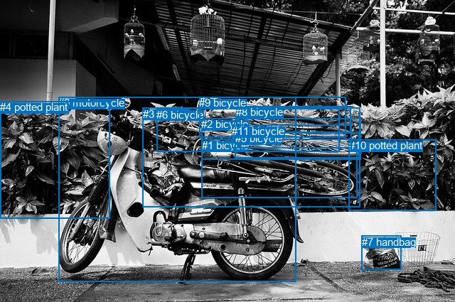
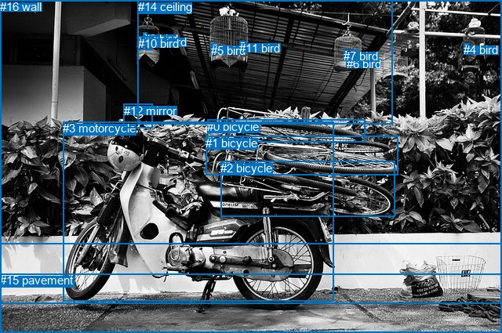

# 图片 1929：2407206.jpg

随机样本序号：25。图片 SHA256：`2875fc00637b25e6a8308de0fa574072b49df8f0a588e56a18e34f27f25a01ed`。

红色框表示人，蓝色框表示其他物体。两个模式分别保留自身框编号，可依据位置比较对应对象。

## 自动检测框与输出

人的框编号：`[]`。状态：`no_person`。

### 自动检测全部物体框

| 编号 | 类别 | 是否为人 | 检测分数 | 像素坐标 xyxy |
|---|---|---|---|---|
| 0 | motorcycle | False | 0.9988 | 82.2, 136.4, 416.6, 396.0 |
| 1 | bicycle | False | 0.9369 | 283.6, 195.6, 502.1, 278.5 |
| 2 | bicycle | False | 0.8891 | 283.2, 166.2, 507.9, 224.2 |
| 3 | bicycle | False | 0.8585 | 200.8, 151.6, 506.8, 291.1 |
| 4 | potted plant | False | 0.7374 | 0.0, 142.3, 154.0, 307.5 |
| 5 | bicycle | False | 0.7077 | 330.7, 186.4, 505.4, 222.1 |
| 6 | bicycle | False | 0.6396 | 220.4, 152.8, 477.3, 213.6 |
| 7 | handbag | False | 0.6214 | 508.7, 331.8, 564.5, 380.0 |
| 8 | bicycle | False | 0.5330 | 332.3, 149.2, 493.7, 186.4 |
| 9 | bicycle | False | 0.4838 | 280.3, 136.2, 487.0, 193.0 |
| 10 | potted plant | False | 0.4690 | 490.8, 196.5, 613.7, 296.4 |
| 11 | bicycle | False | 0.3863 | 326.4, 175.9, 495.0, 208.5 |

### 自动检测 Top50 人相关候选

评分物体对：0；人相关物体对：0；输出关系：0。

| 排名 | 主语编号与类别 | 关系 | 宾语编号与类别 | 类型 | 人与人 | 排序分数 | 原始融合 logit |
|---|---|---|---|---|---|---|---|

### 自动检测逐条人相关 GT 核验

本图没有人相关 GT，R@50 无分母；预测候选继续展示。

## 真实框与输出

人的框编号：`[]`。

### 真实框全部物体框

| 编号 | 类别 | 是否为人 | 检测分数 | 像素坐标 xyxy |
|---|---|---|---|---|
| 0 | bicycle | False | GT | 264.0, 153.0, 465.0, 181.0 |
| 1 | bicycle | False | GT | 262.0, 174.0, 507.0, 224.0 |
| 2 | bicycle | False | GT | 281.0, 206.0, 503.0, 277.0 |
| 3 | motorcycle | False | GT | 80.0, 155.0, 425.0, 384.0 |
| 4 | bird | False | GT | 591.0, 55.0, 597.0, 64.0 |
| 5 | bird | False | GT | 269.0, 56.0, 279.0, 65.0 |
| 6 | bird | False | GT | 442.0, 73.0, 448.0, 78.0 |
| 7 | bird | False | GT | 438.0, 63.0, 457.0, 74.0 |
| 8 | bird | False | GT | 183.0, 41.0, 188.0, 48.0 |
| 9 | bird | False | GT | 194.0, 45.0, 202.0, 55.0 |
| 10 | bird | False | GT | 176.0, 47.0, 195.0, 64.0 |
| 11 | bird | False | GT | 305.0, 53.0, 314.0, 65.0 |
| 12 | mirror | False | GT | 158.0, 133.0, 195.0, 164.0 |
| 13 | tree | False | GT | 0.0, 0.0, 640.0, 311.0 |
| 14 | ceiling | False | GT | 176.0, 0.0, 500.0, 159.0 |
| 15 | pavement | False | GT | 0.0, 349.0, 640.0, 425.0 |
| 16 | wall | False | GT | 0.0, 0.0, 640.0, 387.0 |

### 真实框 Top50 人相关候选

评分物体对：0；人相关物体对：0；输出关系：0。

| 排名 | 主语编号与类别 | 关系 | 宾语编号与类别 | 类型 | 人与人 | 排序分数 | 原始融合 logit |
|---|---|---|---|---|---|---|---|

### 真实框逐条人相关 GT 核验

本图没有人相关 GT，R@50 无分母；预测候选继续展示。

## 全部人相关 GT

| 主语编号与类别 | 关系 | 宾语编号与类别 |
|---|---|---|

原始记录、全部人相关物体对的两项预测与分项分数见 [逐图证据 JSON](../evidence/cases/1929.json)。全部56类 logits 保留于本机 HOR/output/random500/logits/。

<!-- HOR_COMPLETE_RESULTS -->

## 六组条件的完整输出对照

以下保留同一图片三种框与候选模式、两种谓词输出规则的全部 Top50。框编号各自在所属模式内解释。

### 自动检测框完整枚举：空间与语义各保留一个谓词

| 排名 | 主语编号与类别 | 谓词 | 宾语编号与类别 | 分组 | 排序分数 | predicate logit | pair logit |
|---|---|---|---|---|---|---|---|

没有人相关 GT，本条件的召回率无分母。

### 自动检测框完整枚举：每对只保留一个谓词

| 排名 | 主语编号与类别 | 谓词 | 宾语编号与类别 | 分组 | 排序分数 | predicate logit | pair logit |
|---|---|---|---|---|---|---|---|

没有人相关 GT，本条件的召回率无分母。

### 真实框完整枚举：空间与语义各保留一个谓词

| 排名 | 主语编号与类别 | 谓词 | 宾语编号与类别 | 分组 | 排序分数 | predicate logit | pair logit |
|---|---|---|---|---|---|---|---|

没有人相关 GT，本条件的召回率无分母。

### 真实框完整枚举：每对只保留一个谓词

| 排名 | 主语编号与类别 | 谓词 | 宾语编号与类别 | 分组 | 排序分数 | predicate logit | pair logit |
|---|---|---|---|---|---|---|---|

没有人相关 GT，本条件的召回率无分母。

### 真实框400候选：空间与语义各保留一个谓词

| 排名 | 主语编号与类别 | 谓词 | 宾语编号与类别 | 分组 | 排序分数 | predicate logit | pair logit |
|---|---|---|---|---|---|---|---|

没有人相关 GT，本条件的召回率无分母。

### 真实框400候选：每对只保留一个谓词

| 排名 | 主语编号与类别 | 谓词 | 宾语编号与类别 | 分组 | 排序分数 | predicate logit | pair logit |
|---|---|---|---|---|---|---|---|

没有人相关 GT，本条件的召回率无分母。
