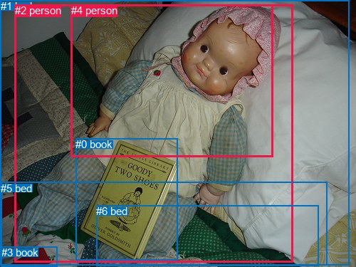
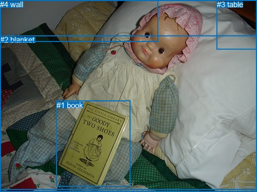

# 图片 1933：2407295.jpg

随机样本序号：255。图片 SHA256：`80852258acdde20a64ea977b3e992dbf72111cd3b5750b2a611f34a3b552b8c5`。

红色框表示人，蓝色框表示其他物体。两个模式分别保留自身框编号，可依据位置比较对应对象。

## 自动检测框与输出

人的框编号：`[2, 4]`。状态：`ok`。

### 自动检测全部物体框

| 编号 | 类别 | 是否为人 | 检测分数 | 像素坐标 xyxy |
|---|---|---|---|---|
| 0 | book | False | 0.9594 | 106.3, 194.3, 249.9, 365.2 |
| 1 | bed | False | 0.9511 | 0.9, 0.0, 491.0, 372.3 |
| 2 | person | True | 0.8462 | 20.6, 6.5, 411.3, 368.9 |
| 3 | book | False | 0.4486 | 1.7, 346.3, 80.1, 374.7 |
| 4 | person | True | 0.4314 | 99.9, 6.3, 383.6, 220.2 |
| 5 | bed | False | 0.4162 | 1.2, 255.6, 459.6, 372.7 |
| 6 | bed | False | 0.3518 | 135.0, 288.1, 447.8, 373.4 |

### 自动检测 Top50 人相关候选

评分物体对：42；人相关物体对：22；输出关系：44。

| 排名 | 主语编号与类别 | 关系 | 宾语编号与类别 | 类型 | 人与人 | 排序分数 | 原始融合 logit |
|---|---|---|---|---|---|---|---|
| 1 | #2 person | lying on | #1 bed | semantic | False | 0.98949 | 4.5449 |
| 2 | #4 person | lying on | #1 bed | semantic | False | 0.97747 | 3.7702 |
| 3 | #2 person | wearing | #4 person | semantic | True | 0.97051 | 3.4939 |
| 4 | #2 person | on | #1 bed | spatial | False | 0.96277 | 3.2528 |
| 5 | #2 person | holding | #0 book | semantic | False | 0.95875 | 3.1461 |
| 6 | #4 person | on | #1 bed | spatial | False | 0.93513 | 2.6683 |
| 7 | #4 person | holding | #0 book | semantic | False | 0.92725 | 2.5452 |
| 8 | #4 person | on | #2 person | spatial | True | 0.91400 | 2.3634 |
| 9 | #2 person | lying on | #5 bed | semantic | False | 0.91332 | 2.3549 |
| 10 | #4 person | lying on | #5 bed | semantic | False | 0.89456 | 2.1382 |
| 11 | #2 person | lying on | #6 bed | semantic | False | 0.84959 | 1.7314 |
| 12 | #0 book | on | #2 person | spatial | False | 0.83121 | 1.5943 |
| 13 | #2 person | on | #5 bed | spatial | False | 0.82869 | 1.5763 |
| 14 | #4 person | wearing | #2 person | semantic | True | 0.81031 | 1.4520 |
| 15 | #2 person | in | #4 person | spatial | True | 0.79369 | 1.3473 |
| 16 | #4 person | on | #5 bed | spatial | False | 0.78603 | 1.3012 |
| 17 | #4 person | lying on | #6 bed | semantic | False | 0.75368 | 1.1183 |
| 18 | #2 person | on | #6 bed | spatial | False | 0.74250 | 1.0590 |
| 19 | #4 person | on | #6 bed | spatial | False | 0.71289 | 0.9095 |
| 20 | #0 book | holding | #2 person | semantic | False | 0.69118 | 0.8057 |
| 21 | #2 person | on | #0 book | spatial | False | 0.52952 | 0.1182 |
| 22 | #0 book | beside | #4 person | spatial | False | 0.43989 | -0.2416 |
| 23 | #2 person | wearing | #3 book | semantic | False | 0.41511 | -0.3429 |
| 24 | #5 bed | in | #2 person | spatial | False | 0.32156 | -0.7466 |
| 25 | #3 book | on | #2 person | spatial | False | 0.27612 | -0.9638 |
| 26 | #4 person | on | #0 book | spatial | False | 0.27148 | -0.9871 |
| 27 | #6 bed | in | #2 person | spatial | False | 0.26885 | -1.0005 |
| 28 | #0 book | holding | #4 person | semantic | False | 0.23795 | -1.1640 |
| 29 | #1 bed | in | #2 person | spatial | False | 0.19202 | -1.4369 |
| 30 | #2 person | on | #3 book | spatial | False | 0.16820 | -1.5984 |
| 31 | #1 bed | in | #4 person | spatial | False | 0.16330 | -1.6339 |
| 32 | #1 bed | holding | #2 person | semantic | False | 0.13561 | -1.8523 |
| 33 | #5 bed | beside | #4 person | spatial | False | 0.11125 | -2.0780 |
| 34 | #1 bed | holding | #4 person | semantic | False | 0.11083 | -2.0823 |
| 35 | #5 bed | holding | #2 person | semantic | False | 0.10476 | -2.1454 |
| 36 | #6 bed | in | #4 person | spatial | False | 0.09434 | -2.2617 |
| 37 | #3 book | lying on | #2 person | semantic | False | 0.07732 | -2.4793 |
| 38 | #6 bed | holding | #2 person | semantic | False | 0.06157 | -2.7240 |
| 39 | #3 book | on | #4 person | spatial | False | 0.03639 | -3.2764 |
| 40 | #5 bed | holding | #4 person | semantic | False | 0.03442 | -3.3342 |
| 41 | #6 bed | holding | #4 person | semantic | False | 0.03185 | -3.4143 |
| 42 | #4 person | wearing | #3 book | semantic | False | 0.03183 | -3.4149 |
| 43 | #4 person | on | #3 book | spatial | False | 0.01762 | -4.0210 |
| 44 | #3 book | wearing | #4 person | semantic | False | 0.00810 | -4.8078 |

### 自动检测逐条人相关 GT 核验

本图没有人相关 GT，R@50 无分母；预测候选继续展示。

## 真实框与输出

人的框编号：`[]`。

### 真实框全部物体框

| 编号 | 类别 | 是否为人 | 检测分数 | 像素坐标 xyxy |
|---|---|---|---|---|
| 0 | bed | False | GT | 0.0, 1.0, 500.0, 371.0 |
| 1 | book | False | GT | 110.0, 197.0, 253.0, 365.0 |
| 2 | blanket | False | GT | 0.0, 69.0, 500.0, 375.0 |
| 3 | table | False | GT | 422.0, 0.0, 500.0, 96.0 |
| 4 | wall | False | GT | 0.0, 0.0, 308.0, 81.0 |

### 真实框 Top50 人相关候选

评分物体对：0；人相关物体对：0；输出关系：0。

| 排名 | 主语编号与类别 | 关系 | 宾语编号与类别 | 类型 | 人与人 | 排序分数 | 原始融合 logit |
|---|---|---|---|---|---|---|---|

### 真实框逐条人相关 GT 核验

本图没有人相关 GT，R@50 无分母；预测候选继续展示。

## 全部人相关 GT

| 主语编号与类别 | 关系 | 宾语编号与类别 |
|---|---|---|

原始记录、全部人相关物体对的两项预测与分项分数见 [逐图证据 JSON](../evidence/cases/1933.json)。全部56类 logits 保留于本机 HOR/output/random500/logits/。

<!-- HOR_COMPLETE_RESULTS -->

## 六组条件的完整输出对照

以下保留同一图片三种框与候选模式、两种谓词输出规则的全部 Top50。框编号各自在所属模式内解释。

### 自动检测框完整枚举：空间与语义各保留一个谓词

| 排名 | 主语编号与类别 | 谓词 | 宾语编号与类别 | 分组 | 排序分数 | predicate logit | pair logit |
|---|---|---|---|---|---|---|---|
| 1 | #2 person | lying on | #1 bed | semantic | 0.9894900 | 4.2044377 | 0.3404244 |
| 2 | #4 person | lying on | #1 bed | semantic | 0.9774716 | 3.7225490 | 0.0476480 |
| 3 | #2 person | wearing | #4 person | semantic | 0.9705150 | 3.7641053 | -0.2701639 |
| 4 | #2 person | on | #1 bed | spatial | 0.9627735 | 2.9123745 | 0.3404244 |
| 5 | #2 person | holding | #0 book | semantic | 0.9587548 | 3.3930354 | -0.2469350 |
| 6 | #4 person | on | #1 bed | spatial | 0.9351276 | 2.6206136 | 0.0476480 |
| 7 | #4 person | holding | #0 book | semantic | 0.9272496 | 2.9706602 | -0.4254726 |
| 8 | #4 person | on | #2 person | spatial | 0.9139960 | 2.6148796 | -0.2514469 |
| 9 | #2 person | lying on | #5 bed | semantic | 0.9133249 | 2.4589300 | -0.1040052 |
| 10 | #4 person | lying on | #5 bed | semantic | 0.8945578 | 2.6692114 | -0.5310441 |
| 11 | #2 person | lying on | #6 bed | semantic | 0.8495890 | 2.1277361 | -0.3963550 |
| 12 | #0 book | on | #2 person | spatial | 0.8312139 | 2.0760760 | -0.4818214 |
| 13 | #2 person | on | #5 bed | spatial | 0.8286851 | 1.6803422 | -0.1040052 |
| 14 | #4 person | wearing | #2 person | semantic | 0.8103098 | 1.7034712 | -0.2514469 |
| 15 | #2 person | in | #4 person | spatial | 0.7936870 | 1.6174588 | -0.2701639 |
| 16 | #4 person | on | #5 bed | spatial | 0.7860324 | 1.8322172 | -0.5310441 |
| 17 | #4 person | lying on | #6 bed | semantic | 0.7536807 | 1.7668076 | -0.6484672 |
| 18 | #2 person | on | #6 bed | spatial | 0.7425017 | 1.4553671 | -0.3963550 |
| 19 | #4 person | on | #6 bed | spatial | 0.7128943 | 1.5579500 | -0.6484672 |
| 20 | #0 book | holding | #2 person | semantic | 0.6911850 | 1.2874866 | -0.4818214 |
| 21 | #2 person | on | #0 book | spatial | 0.5295151 | 0.3651328 | -0.2469350 |
| 22 | #0 book | beside | #4 person | spatial | 0.4398872 | 0.4429626 | -0.6845826 |
| 23 | #2 person | wearing | #3 book | semantic | 0.4151105 | 0.7268524 | -1.0697306 |
| 24 | #5 bed | in | #2 person | spatial | 0.3215638 | -0.0345650 | -0.7120296 |
| 25 | #3 book | on | #2 person | spatial | 0.2761153 | -0.1271601 | -0.8366535 |
| 26 | #4 person | on | #0 book | spatial | 0.2714764 | -0.5616722 | -0.4254726 |
| 27 | #6 bed | in | #2 person | spatial | 0.2688462 | -0.2563744 | -0.7441100 |
| 28 | #0 book | holding | #4 person | semantic | 0.2379490 | -0.4793744 | -0.6845826 |
| 29 | #1 bed | in | #2 person | spatial | 0.1920241 | -0.6275468 | -0.8093647 |
| 30 | #2 person | on | #3 book | spatial | 0.1682031 | -0.5286851 | -1.0697306 |
| 31 | #1 bed | in | #4 person | spatial | 0.1632985 | -0.9424019 | -0.6914855 |
| 32 | #1 bed | holding | #2 person | semantic | 0.1356079 | -1.0428939 | -0.8093647 |
| 33 | #5 bed | beside | #4 person | spatial | 0.1112501 | -1.1566875 | -0.9213479 |
| 34 | #1 bed | holding | #4 person | semantic | 0.1108262 | -1.3908443 | -0.6914855 |
| 35 | #5 bed | holding | #2 person | semantic | 0.1047622 | -1.4333665 | -0.7120296 |
| 36 | #6 bed | in | #4 person | spatial | 0.0943438 | -1.2580261 | -1.0036883 |
| 37 | #3 book | lying on | #2 person | semantic | 0.0773194 | -1.6426849 | -0.8366535 |
| 38 | #6 bed | holding | #2 person | semantic | 0.0615722 | -1.9798846 | -0.7441100 |
| 39 | #3 book | on | #4 person | spatial | 0.0363911 | -1.9743395 | -1.3020215 |
| 40 | #5 bed | holding | #4 person | semantic | 0.0344175 | -2.4128194 | -0.9213479 |
| 41 | #6 bed | holding | #4 person | semantic | 0.0318521 | -2.4105935 | -1.0036883 |
| 42 | #4 person | wearing | #3 book | semantic | 0.0318316 | -1.5466135 | -1.8683329 |
| 43 | #4 person | on | #3 book | spatial | 0.0176187 | -2.1526856 | -1.8683329 |
| 44 | #3 book | wearing | #4 person | semantic | 0.0080997 | -3.5057702 | -1.3020215 |

没有人相关 GT，本条件的召回率无分母。

### 自动检测框完整枚举：每对只保留一个谓词

| 排名 | 主语编号与类别 | 谓词 | 宾语编号与类别 | 分组 | 排序分数 | predicate logit | pair logit |
|---|---|---|---|---|---|---|---|
| 1 | #2 person | lying on | #1 bed | single | 0.9894900 | 4.2044377 | 0.3404244 |
| 2 | #4 person | lying on | #1 bed | single | 0.9774716 | 3.7225490 | 0.0476480 |
| 3 | #2 person | wearing | #4 person | single | 0.9705150 | 3.7641053 | -0.2701639 |
| 4 | #2 person | holding | #0 book | single | 0.9587548 | 3.3930354 | -0.2469350 |
| 5 | #4 person | holding | #0 book | single | 0.9272496 | 2.9706602 | -0.4254726 |
| 6 | #4 person | on | #2 person | single | 0.9139960 | 2.6148796 | -0.2514469 |
| 7 | #2 person | lying on | #5 bed | single | 0.9133249 | 2.4589300 | -0.1040052 |
| 8 | #4 person | lying on | #5 bed | single | 0.8945578 | 2.6692114 | -0.5310441 |
| 9 | #2 person | lying on | #6 bed | single | 0.8495890 | 2.1277361 | -0.3963550 |
| 10 | #0 book | on | #2 person | single | 0.8312139 | 2.0760760 | -0.4818214 |
| 11 | #4 person | lying on | #6 bed | single | 0.7536807 | 1.7668076 | -0.6484672 |
| 12 | #0 book | beside | #4 person | single | 0.4398872 | 0.4429626 | -0.6845826 |
| 13 | #2 person | wearing | #3 book | single | 0.4151105 | 0.7268524 | -1.0697306 |
| 14 | #5 bed | in | #2 person | single | 0.3215638 | -0.0345650 | -0.7120296 |
| 15 | #3 book | on | #2 person | single | 0.2761153 | -0.1271601 | -0.8366535 |
| 16 | #6 bed | in | #2 person | single | 0.2688462 | -0.2563744 | -0.7441100 |
| 17 | #1 bed | in | #2 person | single | 0.1920241 | -0.6275468 | -0.8093647 |
| 18 | #1 bed | in | #4 person | single | 0.1632985 | -0.9424019 | -0.6914855 |
| 19 | #5 bed | beside | #4 person | single | 0.1112501 | -1.1566875 | -0.9213479 |
| 20 | #6 bed | in | #4 person | single | 0.0943438 | -1.2580261 | -1.0036883 |
| 21 | #3 book | on | #4 person | single | 0.0363911 | -1.9743395 | -1.3020215 |
| 22 | #4 person | wearing | #3 book | single | 0.0318316 | -1.5466135 | -1.8683329 |

没有人相关 GT，本条件的召回率无分母。

### 真实框完整枚举：空间与语义各保留一个谓词

| 排名 | 主语编号与类别 | 谓词 | 宾语编号与类别 | 分组 | 排序分数 | predicate logit | pair logit |
|---|---|---|---|---|---|---|---|

没有人相关 GT，本条件的召回率无分母。

### 真实框完整枚举：每对只保留一个谓词

| 排名 | 主语编号与类别 | 谓词 | 宾语编号与类别 | 分组 | 排序分数 | predicate logit | pair logit |
|---|---|---|---|---|---|---|---|

没有人相关 GT，本条件的召回率无分母。

### 真实框400候选：空间与语义各保留一个谓词

| 排名 | 主语编号与类别 | 谓词 | 宾语编号与类别 | 分组 | 排序分数 | predicate logit | pair logit |
|---|---|---|---|---|---|---|---|

没有人相关 GT，本条件的召回率无分母。

### 真实框400候选：每对只保留一个谓词

| 排名 | 主语编号与类别 | 谓词 | 宾语编号与类别 | 分组 | 排序分数 | predicate logit | pair logit |
|---|---|---|---|---|---|---|---|

没有人相关 GT，本条件的召回率无分母。
