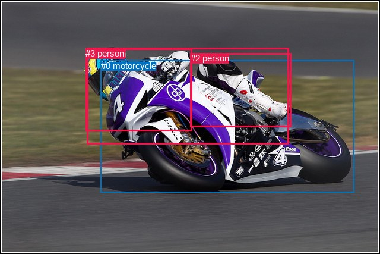
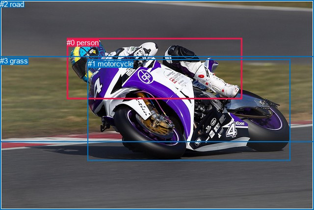

# 图片 1950：2408290.jpg

随机样本序号：367。图片 SHA256：`bcba74c342f0fa997cd0e58ff8fd780a7e4f9ad8d64f040962bc760e103cedba`。

红色框表示人，蓝色框表示其他物体。两个模式分别保留自身框编号，可依据位置比较对应对象。

## 自动检测框与输出

人的框编号：`[1, 2, 3]`。状态：`ok`。

### 自动检测全部物体框

| 编号 | 类别 | 是否为人 | 检测分数 | 像素坐标 xyxy |
|---|---|---|---|---|
| 0 | motorcycle | False | 0.9986 | 169.7, 101.9, 596.2, 323.8 |
| 1 | person | True | 0.9819 | 146.8, 80.6, 486.2, 242.9 |
| 2 | person | True | 0.6603 | 320.9, 89.4, 490.0, 214.0 |
| 3 | person | True | 0.3715 | 144.2, 81.3, 323.6, 220.3 |

### 自动检测 Top50 人相关候选

评分物体对：12；人相关物体对：12；输出关系：24。

| 排名 | 主语编号与类别 | 关系 | 宾语编号与类别 | 类型 | 人与人 | 排序分数 | 原始融合 logit |
|---|---|---|---|---|---|---|---|
| 1 | #1 person | riding | #0 motorcycle | semantic | False | 0.97782 | 3.7860 |
| 2 | #3 person | riding | #0 motorcycle | semantic | False | 0.96461 | 3.3052 |
| 3 | #2 person | riding | #0 motorcycle | semantic | False | 0.95068 | 2.9589 |
| 4 | #2 person | riding | #1 person | semantic | True | 0.85921 | 1.8088 |
| 5 | #3 person | riding | #1 person | semantic | True | 0.85100 | 1.7425 |
| 6 | #1 person | wearing | #2 person | semantic | True | 0.80355 | 1.4087 |
| 7 | #1 person | on | #0 motorcycle | spatial | False | 0.79366 | 1.3471 |
| 8 | #2 person | on | #1 person | spatial | True | 0.75702 | 1.1364 |
| 9 | #1 person | wearing | #3 person | semantic | True | 0.74666 | 1.0809 |
| 10 | #3 person | wearing | #2 person | semantic | True | 0.69536 | 0.8253 |
| 11 | #3 person | on | #0 motorcycle | spatial | False | 0.66490 | 0.6852 |
| 12 | #2 person | on | #0 motorcycle | spatial | False | 0.64558 | 0.5996 |
| 13 | #3 person | on | #1 person | spatial | True | 0.61574 | 0.4715 |
| 14 | #2 person | riding | #3 person | semantic | True | 0.53669 | 0.1470 |
| 15 | #2 person | on | #3 person | spatial | True | 0.24886 | -1.1047 |
| 16 | #1 person | in | #2 person | spatial | True | 0.18310 | -1.4955 |
| 17 | #1 person | in | #3 person | spatial | True | 0.17563 | -1.5463 |
| 18 | #3 person | on | #2 person | spatial | True | 0.07428 | -2.5227 |
| 19 | #0 motorcycle | in | #1 person | spatial | False | 0.01457 | -4.2144 |
| 20 | #0 motorcycle | in | #3 person | spatial | False | 0.01154 | -4.4505 |
| 21 | #0 motorcycle | riding | #1 person | semantic | False | 0.00931 | -4.6669 |
| 22 | #0 motorcycle | in | #2 person | spatial | False | 0.00912 | -4.6879 |
| 23 | #0 motorcycle | riding | #3 person | semantic | False | 0.00384 | -5.5591 |
| 24 | #0 motorcycle | riding | #2 person | semantic | False | 0.00283 | -5.8663 |

### 自动检测逐条人相关 GT 核验

R@50：66.67%；命中 2/3。

| GT 主语编号 | GT 关系 | GT 宾语编号 | 结果阶段 | 匹配预测主语编号 | 匹配预测宾语编号 |
|---|---|---|---|---|---|
| 0 | on | 1 | hit50 | [1] | [0] |
| 0 | on back of | 1 | wrong_predicate | [1] | [0] |
| 0 | riding | 1 | hit50 | [1] | [0] |

## 真实框与输出

人的框编号：`[0]`。

### 真实框全部物体框

| 编号 | 类别 | 是否为人 | 检测分数 | 像素坐标 xyxy |
|---|---|---|---|---|
| 0 | person | True | GT | 136.0, 78.0, 493.0, 202.0 |
| 1 | motorcycle | False | GT | 179.0, 121.0, 591.0, 326.0 |
| 2 | road | False | GT | 0.0, 0.0, 640.0, 427.0 |
| 3 | grass | False | GT | 0.0, 115.0, 640.0, 289.0 |

### 真实框 Top50 人相关候选

评分物体对：12；人相关物体对：6；输出关系：12。

| 排名 | 主语编号与类别 | 关系 | 宾语编号与类别 | 类型 | 人与人 | 排序分数 | 原始融合 logit |
|---|---|---|---|---|---|---|---|
| 1 | #0 person | riding | #1 motorcycle | semantic | False | 0.98929 | 4.5254 |
| 2 | #0 person | on | #1 motorcycle | spatial | False | 0.96108 | 3.2066 |
| 3 | #0 person | riding | #2 road | semantic | False | 0.92165 | 2.4650 |
| 4 | #0 person | on | #2 road | spatial | False | 0.91178 | 2.3356 |
| 5 | #0 person | on | #3 grass | spatial | False | 0.62211 | 0.4985 |
| 6 | #0 person | riding | #3 grass | semantic | False | 0.61645 | 0.4745 |
| 7 | #3 grass | beside | #0 person | spatial | False | 0.18425 | -1.4878 |
| 8 | #1 motorcycle | riding | #0 person | semantic | False | 0.13938 | -1.8205 |
| 9 | #1 motorcycle | in | #0 person | spatial | False | 0.10328 | -2.1613 |
| 10 | #2 road | on | #0 person | spatial | False | 0.03536 | -3.3062 |
| 11 | #3 grass | holding | #0 person | semantic | False | 0.02229 | -3.7811 |
| 12 | #2 road | playing | #0 person | semantic | False | 0.01777 | -4.0125 |

### 真实框逐条人相关 GT 核验

R@50：66.67%；命中 2/3。

| GT 主语编号 | GT 关系 | GT 宾语编号 | 结果阶段 | 匹配预测主语编号 | 匹配预测宾语编号 |
|---|---|---|---|---|---|
| 0 | on | 1 | hit50 | [0] | [1] |
| 0 | on back of | 1 | wrong_predicate | [0] | [1] |
| 0 | riding | 1 | hit50 | [0] | [1] |

## 全部人相关 GT

| 主语编号与类别 | 关系 | 宾语编号与类别 |
|---|---|---|
| #0 person | on | #1 motorcycle |
| #0 person | on back of | #1 motorcycle |
| #0 person | riding | #1 motorcycle |

原始记录、全部人相关物体对的两项预测与分项分数见 [逐图证据 JSON](../evidence/cases/1950.json)。全部56类 logits 保留于本机 HOR/output/random500/logits/。

<!-- HOR_COMPLETE_RESULTS -->

## 六组条件的完整输出对照

以下保留同一图片三种框与候选模式、两种谓词输出规则的全部 Top50。框编号各自在所属模式内解释。

### 自动检测框完整枚举：空间与语义各保留一个谓词

| 排名 | 主语编号与类别 | 谓词 | 宾语编号与类别 | 分组 | 排序分数 | predicate logit | pair logit |
|---|---|---|---|---|---|---|---|
| 1 | #1 person | riding | #0 motorcycle | semantic | 0.9778178 | 4.0687842 | -0.2827511 |
| 2 | #3 person | riding | #0 motorcycle | semantic | 0.9646073 | 3.4087319 | -0.1035154 |
| 3 | #2 person | riding | #0 motorcycle | semantic | 0.9506802 | 3.1095304 | -0.1506777 |
| 4 | #2 person | riding | #1 person | semantic | 0.8592125 | 2.5209002 | -0.7121363 |
| 5 | #3 person | riding | #1 person | semantic | 0.8509992 | 2.4563193 | -0.7138600 |
| 6 | #1 person | wearing | #2 person | semantic | 0.8035548 | 2.0291176 | -0.6204558 |
| 7 | #1 person | on | #0 motorcycle | spatial | 0.7936569 | 1.6298623 | -0.2827511 |
| 8 | #2 person | on | #1 person | spatial | 0.7570210 | 1.8485518 | -0.7121363 |
| 9 | #1 person | wearing | #3 person | semantic | 0.7466601 | 1.9762335 | -0.8953555 |
| 10 | #3 person | wearing | #2 person | semantic | 0.6953644 | 1.7862053 | -0.9608855 |
| 11 | #3 person | on | #0 motorcycle | spatial | 0.6649007 | 0.7887263 | -0.1035154 |
| 12 | #2 person | on | #0 motorcycle | spatial | 0.6455752 | 0.7503233 | -0.1506777 |
| 13 | #3 person | on | #1 person | spatial | 0.6157449 | 1.1853862 | -0.7138600 |
| 14 | #2 person | riding | #3 person | semantic | 0.5366919 | 1.1927319 | -1.0457000 |
| 15 | #2 person | on | #3 person | spatial | 0.2488634 | -0.0589833 | -1.0457000 |
| 16 | #1 person | in | #2 person | spatial | 0.1830989 | -0.8750355 | -0.6204558 |
| 17 | #1 person | in | #3 person | spatial | 0.1756278 | -0.6508994 | -0.8953555 |
| 18 | #3 person | on | #2 person | spatial | 0.0742805 | -1.5618370 | -0.9608855 |
| 19 | #0 motorcycle | in | #1 person | spatial | 0.0145655 | -3.3286762 | -0.8857533 |
| 20 | #0 motorcycle | in | #3 person | spatial | 0.0115384 | -3.6618910 | -0.7885796 |
| 21 | #0 motorcycle | riding | #1 person | semantic | 0.0093138 | -3.7811482 | -0.8857533 |
| 22 | #0 motorcycle | in | #2 person | spatial | 0.0091216 | -3.7472978 | -0.9406493 |
| 23 | #0 motorcycle | riding | #3 person | semantic | 0.0038374 | -4.7705269 | -0.7885796 |
| 24 | #0 motorcycle | riding | #2 person | semantic | 0.0028253 | -4.9256630 | -0.9406493 |

GT 命中：2/3，R@50=66.67%。

| GT主语 | GT谓词 | GT宾语 | 结果阶段 | 匹配主语框 | 匹配宾语框 |
|---|---|---|---|---|---|
| 0 | on | 1 | hit50 | [1] | [0] |
| 0 | on back of | 1 | wrong_predicate | [1] | [0] |
| 0 | riding | 1 | hit50 | [1] | [0] |

### 自动检测框完整枚举：每对只保留一个谓词

| 排名 | 主语编号与类别 | 谓词 | 宾语编号与类别 | 分组 | 排序分数 | predicate logit | pair logit |
|---|---|---|---|---|---|---|---|
| 1 | #1 person | riding | #0 motorcycle | single | 0.9778178 | 4.0687842 | -0.2827511 |
| 2 | #3 person | riding | #0 motorcycle | single | 0.9646073 | 3.4087319 | -0.1035154 |
| 3 | #2 person | riding | #0 motorcycle | single | 0.9506802 | 3.1095304 | -0.1506777 |
| 4 | #2 person | riding | #1 person | single | 0.8592125 | 2.5209002 | -0.7121363 |
| 5 | #3 person | riding | #1 person | single | 0.8509992 | 2.4563193 | -0.7138600 |
| 6 | #1 person | wearing | #2 person | single | 0.8035548 | 2.0291176 | -0.6204558 |
| 7 | #1 person | wearing | #3 person | single | 0.7466601 | 1.9762335 | -0.8953555 |
| 8 | #3 person | wearing | #2 person | single | 0.6953644 | 1.7862053 | -0.9608855 |
| 9 | #2 person | riding | #3 person | single | 0.5366919 | 1.1927319 | -1.0457000 |
| 10 | #0 motorcycle | in | #1 person | single | 0.0145655 | -3.3286762 | -0.8857533 |
| 11 | #0 motorcycle | in | #3 person | single | 0.0115384 | -3.6618910 | -0.7885796 |
| 12 | #0 motorcycle | in | #2 person | single | 0.0091216 | -3.7472978 | -0.9406493 |

GT 命中：1/3，R@50=33.33%。

| GT主语 | GT谓词 | GT宾语 | 结果阶段 | 匹配主语框 | 匹配宾语框 |
|---|---|---|---|---|---|
| 0 | on | 1 | wrong_predicate | [1] | [0] |
| 0 | on back of | 1 | wrong_predicate | [1] | [0] |
| 0 | riding | 1 | hit50 | [1] | [0] |

### 真实框完整枚举：空间与语义各保留一个谓词

| 排名 | 主语编号与类别 | 谓词 | 宾语编号与类别 | 分组 | 排序分数 | predicate logit | pair logit |
|---|---|---|---|---|---|---|---|
| 1 | #0 person | riding | #1 motorcycle | semantic | 0.9892852 | 4.6065173 | -0.0811626 |
| 2 | #0 person | on | #1 motorcycle | spatial | 0.9610824 | 3.2877765 | -0.0811626 |
| 3 | #0 person | riding | #2 road | semantic | 0.9216483 | 2.8966923 | -0.4317362 |
| 4 | #0 person | on | #2 road | spatial | 0.9117826 | 2.7673345 | -0.4317362 |
| 5 | #0 person | on | #3 grass | spatial | 0.6221126 | 1.8210387 | -1.3225137 |
| 6 | #0 person | riding | #3 grass | semantic | 0.6164450 | 1.7969999 | -1.3225137 |
| 7 | #3 grass | beside | #0 person | spatial | 0.1842512 | -0.3758912 | -1.1119153 |
| 8 | #1 motorcycle | riding | #0 person | semantic | 0.1393798 | -0.9641688 | -0.8562823 |
| 9 | #1 motorcycle | in | #0 person | spatial | 0.1032756 | -1.3050652 | -0.8562823 |
| 10 | #2 road | on | #0 person | spatial | 0.0353600 | -1.9980161 | -1.3081582 |
| 11 | #3 grass | holding | #0 person | semantic | 0.0222891 | -2.6691990 | -1.1119153 |
| 12 | #2 road | playing | #0 person | semantic | 0.0177675 | -2.7042990 | -1.3081582 |

GT 命中：2/3，R@50=66.67%。

| GT主语 | GT谓词 | GT宾语 | 结果阶段 | 匹配主语框 | 匹配宾语框 |
|---|---|---|---|---|---|
| 0 | on | 1 | hit50 | [0] | [1] |
| 0 | on back of | 1 | wrong_predicate | [0] | [1] |
| 0 | riding | 1 | hit50 | [0] | [1] |

### 真实框完整枚举：每对只保留一个谓词

| 排名 | 主语编号与类别 | 谓词 | 宾语编号与类别 | 分组 | 排序分数 | predicate logit | pair logit |
|---|---|---|---|---|---|---|---|
| 1 | #0 person | riding | #1 motorcycle | single | 0.9892852 | 4.6065173 | -0.0811626 |
| 2 | #0 person | riding | #2 road | single | 0.9216483 | 2.8966923 | -0.4317362 |
| 3 | #0 person | on | #3 grass | single | 0.6221126 | 1.8210387 | -1.3225137 |
| 4 | #3 grass | beside | #0 person | single | 0.1842512 | -0.3758912 | -1.1119153 |
| 5 | #1 motorcycle | riding | #0 person | single | 0.1393798 | -0.9641688 | -0.8562823 |
| 6 | #2 road | on | #0 person | single | 0.0353600 | -1.9980161 | -1.3081582 |

GT 命中：1/3，R@50=33.33%。

| GT主语 | GT谓词 | GT宾语 | 结果阶段 | 匹配主语框 | 匹配宾语框 |
|---|---|---|---|---|---|
| 0 | on | 1 | wrong_predicate | [0] | [1] |
| 0 | on back of | 1 | wrong_predicate | [0] | [1] |
| 0 | riding | 1 | hit50 | [0] | [1] |

### 真实框400候选：空间与语义各保留一个谓词

| 排名 | 主语编号与类别 | 谓词 | 宾语编号与类别 | 分组 | 排序分数 | predicate logit | pair logit |
|---|---|---|---|---|---|---|---|
| 1 | #0 person | riding | #1 motorcycle | semantic | 0.9892852 | 4.6065173 | -0.0811626 |
| 2 | #0 person | on | #1 motorcycle | spatial | 0.9610824 | 3.2877765 | -0.0811626 |
| 3 | #0 person | riding | #2 road | semantic | 0.9216483 | 2.8966923 | -0.4317362 |
| 4 | #0 person | on | #2 road | spatial | 0.9117826 | 2.7673345 | -0.4317362 |
| 5 | #0 person | on | #3 grass | spatial | 0.6208318 | 1.8155937 | -1.3225137 |
| 6 | #0 person | riding | #3 grass | semantic | 0.6093639 | 1.7671528 | -1.3225137 |
| 7 | #3 grass | beside | #0 person | spatial | 0.1842381 | -0.3759780 | -1.1119153 |
| 8 | #1 motorcycle | riding | #0 person | semantic | 0.1393944 | -0.9640465 | -0.8562823 |
| 9 | #1 motorcycle | in | #0 person | spatial | 0.1035448 | -1.3021612 | -0.8562823 |
| 10 | #2 road | on | #0 person | spatial | 0.0362341 | -1.9726889 | -1.3081582 |
| 11 | #3 grass | holding | #0 person | semantic | 0.0225216 | -2.6585846 | -1.1119153 |
| 12 | #2 road | playing | #0 person | semantic | 0.0176323 | -2.7120731 | -1.3081582 |

GT 命中：2/3，R@50=66.67%。

| GT主语 | GT谓词 | GT宾语 | 结果阶段 | 匹配主语框 | 匹配宾语框 |
|---|---|---|---|---|---|
| 0 | on | 1 | hit50 | [0] | [1] |
| 0 | on back of | 1 | wrong_predicate | [0] | [1] |
| 0 | riding | 1 | hit50 | [0] | [1] |

### 真实框400候选：每对只保留一个谓词

| 排名 | 主语编号与类别 | 谓词 | 宾语编号与类别 | 分组 | 排序分数 | predicate logit | pair logit |
|---|---|---|---|---|---|---|---|
| 1 | #0 person | riding | #1 motorcycle | single | 0.9892852 | 4.6065173 | -0.0811626 |
| 2 | #0 person | riding | #2 road | single | 0.9216483 | 2.8966923 | -0.4317362 |
| 3 | #0 person | on | #3 grass | single | 0.6208318 | 1.8155937 | -1.3225137 |
| 4 | #3 grass | beside | #0 person | single | 0.1842381 | -0.3759780 | -1.1119153 |
| 5 | #1 motorcycle | riding | #0 person | single | 0.1393944 | -0.9640465 | -0.8562823 |
| 6 | #2 road | on | #0 person | single | 0.0362341 | -1.9726889 | -1.3081582 |

GT 命中：1/3，R@50=33.33%。

| GT主语 | GT谓词 | GT宾语 | 结果阶段 | 匹配主语框 | 匹配宾语框 |
|---|---|---|---|---|---|
| 0 | on | 1 | wrong_predicate | [0] | [1] |
| 0 | on back of | 1 | wrong_predicate | [0] | [1] |
| 0 | riding | 1 | hit50 | [0] | [1] |
