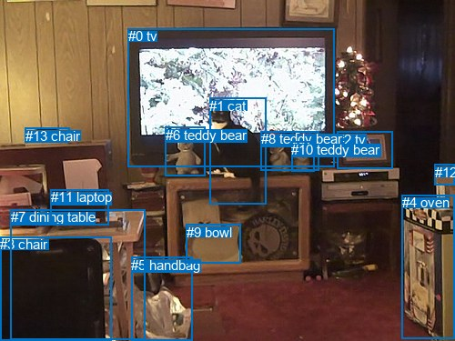
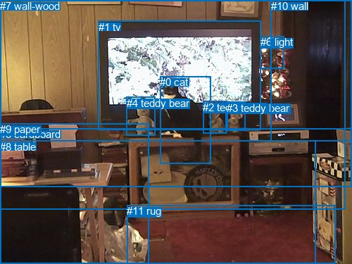

# 图片 1960：2408809.jpg

随机样本序号：224。图片 SHA256：`890ec704106d94ac3ab6bb9d8d8a2382905989b5be4090604b87ac97a25f256a`。

红色框表示人，蓝色框表示其他物体。两个模式分别保留自身框编号，可依据位置比较对应对象。

## 自动检测框与输出

人的框编号：`[]`。状态：`no_person`。

### 自动检测全部物体框

| 编号 | 类别 | 是否为人 | 检测分数 | 像素坐标 xyxy |
|---|---|---|---|---|
| 0 | tv | False | 0.9939 | 140.6, 31.3, 367.9, 183.4 |
| 1 | cat | False | 0.9798 | 230.0, 107.8, 292.8, 224.7 |
| 2 | tv | False | 0.9642 | 370.4, 144.5, 431.7, 185.6 |
| 3 | chair | False | 0.9386 | 0.4, 260.3, 122.2, 375.0 |
| 4 | oven | False | 0.8605 | 441.9, 214.5, 499.1, 372.4 |
| 5 | handbag | False | 0.7329 | 144.4, 282.5, 211.1, 374.6 |
| 6 | teddy bear | False | 0.7230 | 181.8, 139.9, 225.9, 193.2 |
| 7 | dining table | False | 0.5726 | 11.8, 230.0, 159.4, 373.6 |
| 8 | teddy bear | False | 0.5049 | 286.7, 144.3, 350.0, 187.5 |
| 9 | bowl | False | 0.4789 | 204.6, 246.8, 265.0, 289.6 |
| 10 | teddy bear | False | 0.4712 | 320.1, 155.7, 345.7, 189.0 |
| 11 | laptop | False | 0.4611 | 55.8, 208.5, 119.3, 247.9 |
| 12 | sink | False | 0.4312 | 477.6, 180.9, 499.9, 203.6 |
| 13 | chair | False | 0.3840 | 28.0, 140.8, 76.5, 156.8 |

### 自动检测 Top50 人相关候选

评分物体对：0；人相关物体对：0；输出关系：0。

| 排名 | 主语编号与类别 | 关系 | 宾语编号与类别 | 类型 | 人与人 | 排序分数 | 原始融合 logit |
|---|---|---|---|---|---|---|---|

### 自动检测逐条人相关 GT 核验

本图没有人相关 GT，R@50 无分母；预测候选继续展示。

## 真实框与输出

人的框编号：`[]`。

### 真实框全部物体框

| 编号 | 类别 | 是否为人 | 检测分数 | 像素坐标 xyxy |
|---|---|---|---|---|
| 0 | cat | False | GT | 227.0, 108.0, 299.0, 232.0 |
| 1 | tv | False | GT | 140.0, 30.0, 371.0, 184.0 |
| 2 | teddy bear | False | GT | 288.0, 144.0, 321.0, 190.0 |
| 3 | teddy bear | False | GT | 322.0, 145.0, 348.0, 186.0 |
| 4 | teddy bear | False | GT | 180.0, 138.0, 221.0, 193.0 |
| 5 | cardboard | False | GT | 0.0, 182.0, 500.0, 265.0 |
| 6 | light | False | GT | 370.0, 51.0, 404.0, 97.0 |
| 7 | wall-wood | False | GT | 0.0, 0.0, 490.0, 298.0 |
| 8 | table | False | GT | 0.0, 200.0, 448.0, 375.0 |
| 9 | paper | False | GT | 0.0, 175.0, 212.0, 375.0 |
| 10 | wall | False | GT | 385.0, 0.0, 500.0, 200.0 |
| 11 | rug | False | GT | 180.0, 291.0, 477.0, 375.0 |

### 真实框 Top50 人相关候选

评分物体对：0；人相关物体对：0；输出关系：0。

| 排名 | 主语编号与类别 | 关系 | 宾语编号与类别 | 类型 | 人与人 | 排序分数 | 原始融合 logit |
|---|---|---|---|---|---|---|---|

### 真实框逐条人相关 GT 核验

本图没有人相关 GT，R@50 无分母；预测候选继续展示。

## 全部人相关 GT

| 主语编号与类别 | 关系 | 宾语编号与类别 |
|---|---|---|

原始记录、全部人相关物体对的两项预测与分项分数见 [逐图证据 JSON](../evidence/cases/1960.json)。全部56类 logits 保留于本机 HOR/output/random500/logits/。

<!-- HOR_COMPLETE_RESULTS -->

## 六组条件的完整输出对照

以下保留同一图片三种框与候选模式、两种谓词输出规则的全部 Top50。框编号各自在所属模式内解释。

### 自动检测框完整枚举：空间与语义各保留一个谓词

| 排名 | 主语编号与类别 | 谓词 | 宾语编号与类别 | 分组 | 排序分数 | predicate logit | pair logit |
|---|---|---|---|---|---|---|---|

没有人相关 GT，本条件的召回率无分母。

### 自动检测框完整枚举：每对只保留一个谓词

| 排名 | 主语编号与类别 | 谓词 | 宾语编号与类别 | 分组 | 排序分数 | predicate logit | pair logit |
|---|---|---|---|---|---|---|---|

没有人相关 GT，本条件的召回率无分母。

### 真实框完整枚举：空间与语义各保留一个谓词

| 排名 | 主语编号与类别 | 谓词 | 宾语编号与类别 | 分组 | 排序分数 | predicate logit | pair logit |
|---|---|---|---|---|---|---|---|

没有人相关 GT，本条件的召回率无分母。

### 真实框完整枚举：每对只保留一个谓词

| 排名 | 主语编号与类别 | 谓词 | 宾语编号与类别 | 分组 | 排序分数 | predicate logit | pair logit |
|---|---|---|---|---|---|---|---|

没有人相关 GT，本条件的召回率无分母。

### 真实框400候选：空间与语义各保留一个谓词

| 排名 | 主语编号与类别 | 谓词 | 宾语编号与类别 | 分组 | 排序分数 | predicate logit | pair logit |
|---|---|---|---|---|---|---|---|

没有人相关 GT，本条件的召回率无分母。

### 真实框400候选：每对只保留一个谓词

| 排名 | 主语编号与类别 | 谓词 | 宾语编号与类别 | 分组 | 排序分数 | predicate logit | pair logit |
|---|---|---|---|---|---|---|---|

没有人相关 GT，本条件的召回率无分母。
