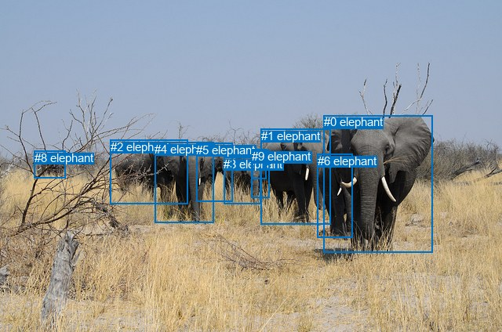
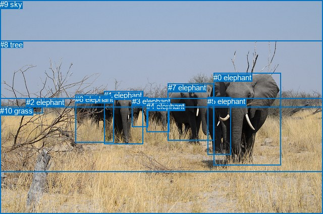

# 图片 1968：2409027.jpg

随机样本序号：96。图片 SHA256：`e12af9d5e9ab35d17cf432951532ca019cdec750c85c902f891e05a0b7a50d06`。

红色框表示人，蓝色框表示其他物体。两个模式分别保留自身框编号，可依据位置比较对应对象。

## 自动检测框与输出

人的框编号：`[]`。状态：`no_person`。

### 自动检测全部物体框

| 编号 | 类别 | 是否为人 | 检测分数 | 像素坐标 xyxy |
|---|---|---|---|---|
| 0 | elephant | False | 0.9990 | 412.6, 147.0, 551.1, 322.0 |
| 1 | elephant | False | 0.9988 | 332.7, 164.7, 421.8, 286.3 |
| 2 | elephant | False | 0.9939 | 140.6, 178.6, 239.0, 260.5 |
| 3 | elephant | False | 0.9921 | 285.3, 200.6, 333.0, 260.2 |
| 4 | elephant | False | 0.9841 | 197.3, 181.5, 272.1, 284.3 |
| 5 | elephant | False | 0.9762 | 250.4, 182.7, 296.8, 257.2 |
| 6 | elephant | False | 0.9551 | 404.7, 196.8, 449.1, 303.5 |
| 7 | elephant | False | 0.6875 | 320.8, 191.1, 343.5, 252.8 |
| 8 | elephant | False | 0.5145 | 43.7, 192.7, 83.1, 227.5 |
| 9 | elephant | False | 0.3794 | 321.0, 190.8, 339.5, 228.2 |

### 自动检测 Top50 人相关候选

评分物体对：0；人相关物体对：0；输出关系：0。

| 排名 | 主语编号与类别 | 关系 | 宾语编号与类别 | 类型 | 人与人 | 排序分数 | 原始融合 logit |
|---|---|---|---|---|---|---|---|

### 自动检测逐条人相关 GT 核验

本图没有人相关 GT，R@50 无分母；预测候选继续展示。

## 真实框与输出

人的框编号：`[]`。

### 真实框全部物体框

| 编号 | 类别 | 是否为人 | 检测分数 | 像素坐标 xyxy |
|---|---|---|---|---|
| 0 | elephant | False | GT | 423.0, 145.0, 556.0, 328.0 |
| 1 | elephant | False | GT | 206.0, 180.0, 283.0, 285.0 |
| 2 | elephant | False | GT | 52.0, 194.0, 85.0, 224.0 |
| 3 | elephant | False | GT | 262.0, 192.0, 294.0, 251.0 |
| 4 | elephant | False | GT | 290.0, 202.0, 335.0, 261.0 |
| 5 | elephant | False | GT | 411.0, 192.0, 457.0, 306.0 |
| 6 | elephant | False | GT | 149.0, 188.0, 225.0, 283.0 |
| 7 | elephant | False | GT | 333.0, 165.0, 424.0, 279.0 |
| 8 | tree | False | GT | 0.0, 80.0, 640.0, 341.0 |
| 9 | sky | False | GT | 0.0, 0.0, 640.0, 196.0 |
| 10 | grass | False | GT | 0.0, 211.0, 640.0, 424.0 |

### 真实框 Top50 人相关候选

评分物体对：0；人相关物体对：0；输出关系：0。

| 排名 | 主语编号与类别 | 关系 | 宾语编号与类别 | 类型 | 人与人 | 排序分数 | 原始融合 logit |
|---|---|---|---|---|---|---|---|

### 真实框逐条人相关 GT 核验

本图没有人相关 GT，R@50 无分母；预测候选继续展示。

## 全部人相关 GT

| 主语编号与类别 | 关系 | 宾语编号与类别 |
|---|---|---|

原始记录、全部人相关物体对的两项预测与分项分数见 [逐图证据 JSON](../evidence/cases/1968.json)。全部56类 logits 保留于本机 HOR/output/random500/logits/。

<!-- HOR_COMPLETE_RESULTS -->

## 六组条件的完整输出对照

以下保留同一图片三种框与候选模式、两种谓词输出规则的全部 Top50。框编号各自在所属模式内解释。

### 自动检测框完整枚举：空间与语义各保留一个谓词

| 排名 | 主语编号与类别 | 谓词 | 宾语编号与类别 | 分组 | 排序分数 | predicate logit | pair logit |
|---|---|---|---|---|---|---|---|

没有人相关 GT，本条件的召回率无分母。

### 自动检测框完整枚举：每对只保留一个谓词

| 排名 | 主语编号与类别 | 谓词 | 宾语编号与类别 | 分组 | 排序分数 | predicate logit | pair logit |
|---|---|---|---|---|---|---|---|

没有人相关 GT，本条件的召回率无分母。

### 真实框完整枚举：空间与语义各保留一个谓词

| 排名 | 主语编号与类别 | 谓词 | 宾语编号与类别 | 分组 | 排序分数 | predicate logit | pair logit |
|---|---|---|---|---|---|---|---|

没有人相关 GT，本条件的召回率无分母。

### 真实框完整枚举：每对只保留一个谓词

| 排名 | 主语编号与类别 | 谓词 | 宾语编号与类别 | 分组 | 排序分数 | predicate logit | pair logit |
|---|---|---|---|---|---|---|---|

没有人相关 GT，本条件的召回率无分母。

### 真实框400候选：空间与语义各保留一个谓词

| 排名 | 主语编号与类别 | 谓词 | 宾语编号与类别 | 分组 | 排序分数 | predicate logit | pair logit |
|---|---|---|---|---|---|---|---|

没有人相关 GT，本条件的召回率无分母。

### 真实框400候选：每对只保留一个谓词

| 排名 | 主语编号与类别 | 谓词 | 宾语编号与类别 | 分组 | 排序分数 | predicate logit | pair logit |
|---|---|---|---|---|---|---|---|

没有人相关 GT，本条件的召回率无分母。
