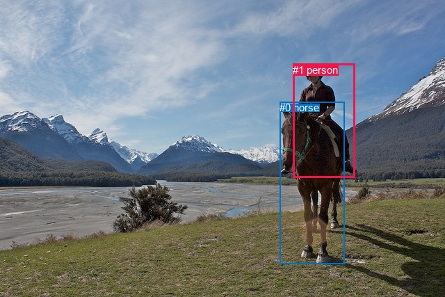
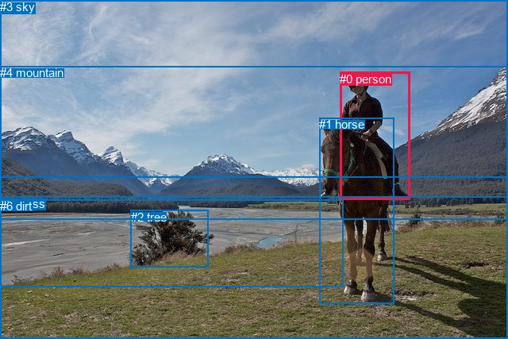

# 图片 1983：2409607.jpg

随机样本序号：18。图片 SHA256：`bcd2855bf9a530b8b0ab52345abb01acaeffa69c3516aed8722c84b7769f61bc`。

红色框表示人，蓝色框表示其他物体。两个模式分别保留自身框编号，可依据位置比较对应对象。

## 自动检测框与输出

人的框编号：`[1]`。状态：`ok`。

### 自动检测全部物体框

| 编号 | 类别 | 是否为人 | 检测分数 | 像素坐标 xyxy |
|---|---|---|---|---|
| 0 | horse | False | 0.9995 | 402.2, 146.3, 495.5, 379.8 |
| 1 | person | True | 0.9983 | 421.1, 91.7, 510.6, 255.4 |

### 自动检测 Top50 人相关候选

评分物体对：2；人相关物体对：2；输出关系：4。

| 排名 | 主语编号与类别 | 关系 | 宾语编号与类别 | 类型 | 人与人 | 排序分数 | 原始融合 logit |
|---|---|---|---|---|---|---|---|
| 1 | #1 person | riding | #0 horse | semantic | False | 0.97023 | 3.4839 |
| 2 | #1 person | on | #0 horse | spatial | False | 0.41234 | -0.3543 |
| 3 | #0 horse | carrying | #1 person | semantic | False | 0.12763 | -1.9221 |
| 4 | #0 horse | in | #1 person | spatial | False | 0.00318 | -5.7470 |

### 自动检测逐条人相关 GT 核验

R@50：33.33%；命中 1/3。

| GT 主语编号 | GT 关系 | GT 宾语编号 | 结果阶段 | 匹配预测主语编号 | 匹配预测宾语编号 |
|---|---|---|---|---|---|
| 0 | sitting on | 1 | wrong_predicate | [1] | [0] |
| 0 | riding | 1 | hit50 | [1] | [0] |
| 0 | over | 5 | endpoint_missing_or_wrong_class | [1] | [] |

## 真实框与输出

人的框编号：`[0]`。

### 真实框全部物体框

| 编号 | 类别 | 是否为人 | 检测分数 | 像素坐标 xyxy |
|---|---|---|---|---|
| 0 | person | True | GT | 428.0, 91.0, 516.0, 252.0 |
| 1 | horse | False | GT | 402.0, 148.0, 496.0, 383.0 |
| 2 | tree | False | GT | 165.0, 265.0, 263.0, 337.0 |
| 3 | sky | False | GT | 0.0, 0.0, 640.0, 223.0 |
| 4 | mountain | False | GT | 0.0, 83.0, 640.0, 276.0 |
| 5 | grass | False | GT | 0.0, 248.0, 640.0, 427.0 |
| 6 | dirt | False | GT | 0.0, 251.0, 433.0, 361.0 |

### 真实框 Top50 人相关候选

评分物体对：42；人相关物体对：12；输出关系：24。

| 排名 | 主语编号与类别 | 关系 | 宾语编号与类别 | 类型 | 人与人 | 排序分数 | 原始融合 logit |
|---|---|---|---|---|---|---|---|
| 1 | #0 person | riding | #1 horse | semantic | False | 0.99466 | 5.2275 |
| 2 | #0 person | on | #1 horse | spatial | False | 0.96868 | 3.4316 |
| 3 | #1 horse | carrying | #0 person | semantic | False | 0.87179 | 1.9169 |
| 4 | #0 person | on | #5 grass | spatial | False | 0.53651 | 0.1463 |
| 5 | #0 person | riding | #5 grass | semantic | False | 0.48160 | -0.0736 |
| 6 | #3 sky | over | #0 person | spatial | False | 0.47481 | -0.1008 |
| 7 | #1 horse | in | #0 person | spatial | False | 0.32102 | -0.7491 |
| 8 | #0 person | wearing | #3 sky | semantic | False | 0.31547 | -0.7747 |
| 9 | #2 tree | beside | #0 person | spatial | False | 0.21119 | -1.3178 |
| 10 | #0 person | wearing | #4 mountain | semantic | False | 0.19537 | -1.4155 |
| 11 | #6 dirt | beside | #0 person | spatial | False | 0.19179 | -1.4384 |
| 12 | #0 person | in | #3 sky | spatial | False | 0.12478 | -1.9480 |
| 13 | #0 person | on | #6 dirt | spatial | False | 0.11756 | -2.0157 |
| 14 | #0 person | riding | #6 dirt | semantic | False | 0.10273 | -2.1672 |
| 15 | #5 grass | beside | #0 person | spatial | False | 0.10150 | -2.1806 |
| 16 | #0 person | in | #4 mountain | spatial | False | 0.06106 | -2.7329 |
| 17 | #4 mountain | beside | #0 person | spatial | False | 0.04604 | -3.0312 |
| 18 | #5 grass | holding | #0 person | semantic | False | 0.03692 | -3.2613 |
| 19 | #2 tree | looking at | #0 person | semantic | False | 0.02260 | -3.7671 |
| 20 | #6 dirt | looking at | #0 person | semantic | False | 0.02121 | -3.8319 |
| 21 | #0 person | wearing | #2 tree | semantic | False | 0.01377 | -4.2714 |
| 22 | #0 person | in | #2 tree | spatial | False | 0.01308 | -4.3239 |
| 23 | #3 sky | holding | #0 person | semantic | False | 0.01303 | -4.3275 |
| 24 | #4 mountain | looking at | #0 person | semantic | False | 0.00630 | -5.0605 |

### 真实框逐条人相关 GT 核验

R@50：33.33%；命中 1/3。

| GT 主语编号 | GT 关系 | GT 宾语编号 | 结果阶段 | 匹配预测主语编号 | 匹配预测宾语编号 |
|---|---|---|---|---|---|
| 0 | sitting on | 1 | wrong_predicate | [0] | [1] |
| 0 | riding | 1 | hit50 | [0] | [1] |
| 0 | over | 5 | wrong_predicate | [0] | [5] |

## 全部人相关 GT

| 主语编号与类别 | 关系 | 宾语编号与类别 |
|---|---|---|
| #0 person | sitting on | #1 horse |
| #0 person | riding | #1 horse |
| #0 person | over | #5 grass |

原始记录、全部人相关物体对的两项预测与分项分数见 [逐图证据 JSON](../evidence/cases/1983.json)。全部56类 logits 保留于本机 HOR/output/random500/logits/。

<!-- HOR_COMPLETE_RESULTS -->

## 六组条件的完整输出对照

以下保留同一图片三种框与候选模式、两种谓词输出规则的全部 Top50。框编号各自在所属模式内解释。

### 自动检测框完整枚举：空间与语义各保留一个谓词

| 排名 | 主语编号与类别 | 谓词 | 宾语编号与类别 | 分组 | 排序分数 | predicate logit | pair logit |
|---|---|---|---|---|---|---|---|
| 1 | #1 person | riding | #0 horse | semantic | 0.9702256 | 3.2071710 | 0.2767063 |
| 2 | #1 person | on | #0 horse | spatial | 0.4123398 | -0.6310072 | 0.2767063 |
| 3 | #0 horse | carrying | #1 person | semantic | 0.1276287 | -1.2846148 | -0.6374751 |
| 4 | #0 horse | in | #1 person | spatial | 0.0031822 | -5.1095080 | -0.6374751 |

GT 命中：1/3，R@50=33.33%。

| GT主语 | GT谓词 | GT宾语 | 结果阶段 | 匹配主语框 | 匹配宾语框 |
|---|---|---|---|---|---|
| 0 | sitting on | 1 | wrong_predicate | [1] | [0] |
| 0 | riding | 1 | hit50 | [1] | [0] |
| 0 | over | 5 | endpoint_missing_or_wrong_class | [1] | [] |

### 自动检测框完整枚举：每对只保留一个谓词

| 排名 | 主语编号与类别 | 谓词 | 宾语编号与类别 | 分组 | 排序分数 | predicate logit | pair logit |
|---|---|---|---|---|---|---|---|
| 1 | #1 person | riding | #0 horse | single | 0.9702256 | 3.2071710 | 0.2767063 |
| 2 | #0 horse | carrying | #1 person | single | 0.1276287 | -1.2846148 | -0.6374751 |

GT 命中：1/3，R@50=33.33%。

| GT主语 | GT谓词 | GT宾语 | 结果阶段 | 匹配主语框 | 匹配宾语框 |
|---|---|---|---|---|---|
| 0 | sitting on | 1 | wrong_predicate | [1] | [0] |
| 0 | riding | 1 | hit50 | [1] | [0] |
| 0 | over | 5 | endpoint_missing_or_wrong_class | [1] | [] |

### 真实框完整枚举：空间与语义各保留一个谓词

| 排名 | 主语编号与类别 | 谓词 | 宾语编号与类别 | 分组 | 排序分数 | predicate logit | pair logit |
|---|---|---|---|---|---|---|---|
| 1 | #0 person | riding | #1 horse | semantic | 0.9946615 | 4.9661469 | 0.2613202 |
| 2 | #0 person | on | #1 horse | spatial | 0.9686784 | 3.1703072 | 0.2613202 |
| 3 | #1 horse | carrying | #0 person | semantic | 0.8717894 | 2.5463114 | -0.6294377 |
| 4 | #0 person | on | #5 grass | spatial | 0.5365079 | 0.9360833 | -0.7897913 |
| 5 | #0 person | riding | #5 grass | semantic | 0.4816000 | 0.7161579 | -0.7897913 |
| 6 | #3 sky | over | #0 person | spatial | 0.4748147 | 1.0797820 | -1.1806087 |
| 7 | #1 horse | in | #0 person | spatial | 0.3210227 | -0.1196380 | -0.6294377 |
| 8 | #0 person | wearing | #3 sky | semantic | 0.3154657 | 0.3246822 | -1.0993710 |
| 9 | #2 tree | beside | #0 person | spatial | 0.2111896 | -0.1670160 | -1.1507536 |
| 10 | #0 person | wearing | #4 mountain | semantic | 0.1953659 | -0.2184639 | -1.1970497 |
| 11 | #6 dirt | beside | #0 person | spatial | 0.1917899 | -0.2600617 | -1.1783601 |
| 12 | #0 person | in | #3 sky | spatial | 0.1247762 | -0.8485870 | -1.0993710 |
| 13 | #0 person | on | #6 dirt | spatial | 0.1175623 | -1.0424960 | -0.9732239 |
| 14 | #0 person | riding | #6 dirt | semantic | 0.1027303 | -1.1940250 | -0.9732239 |
| 15 | #5 grass | beside | #0 person | spatial | 0.1015026 | -0.9937012 | -1.1869383 |
| 16 | #0 person | in | #4 mountain | spatial | 0.0610586 | -1.5358694 | -1.1970497 |
| 17 | #4 mountain | beside | #0 person | spatial | 0.0460372 | -2.0320082 | -0.9991661 |
| 18 | #5 grass | holding | #0 person | semantic | 0.0369239 | -2.0743351 | -1.1869383 |
| 19 | #2 tree | looking at | #0 person | semantic | 0.0225963 | -2.6163599 | -1.1507536 |
| 20 | #6 dirt | looking at | #0 person | semantic | 0.0212083 | -2.6535654 | -1.1783601 |
| 21 | #0 person | wearing | #2 tree | semantic | 0.0137702 | -2.2648149 | -2.0065651 |
| 22 | #0 person | in | #2 tree | spatial | 0.0130755 | -2.3172905 | -2.0065651 |
| 23 | #3 sky | holding | #0 person | semantic | 0.0130290 | -3.1468558 | -1.1806087 |
| 24 | #4 mountain | looking at | #0 person | semantic | 0.0063027 | -4.0612841 | -0.9991661 |

GT 命中：1/3，R@50=33.33%。

| GT主语 | GT谓词 | GT宾语 | 结果阶段 | 匹配主语框 | 匹配宾语框 |
|---|---|---|---|---|---|
| 0 | sitting on | 1 | wrong_predicate | [0] | [1] |
| 0 | riding | 1 | hit50 | [0] | [1] |
| 0 | over | 5 | wrong_predicate | [0] | [5] |

### 真实框完整枚举：每对只保留一个谓词

| 排名 | 主语编号与类别 | 谓词 | 宾语编号与类别 | 分组 | 排序分数 | predicate logit | pair logit |
|---|---|---|---|---|---|---|---|
| 1 | #0 person | riding | #1 horse | single | 0.9946615 | 4.9661469 | 0.2613202 |
| 2 | #1 horse | carrying | #0 person | single | 0.8717894 | 2.5463114 | -0.6294377 |
| 3 | #0 person | on | #5 grass | single | 0.5365079 | 0.9360833 | -0.7897913 |
| 4 | #3 sky | over | #0 person | single | 0.4748147 | 1.0797820 | -1.1806087 |
| 5 | #0 person | wearing | #3 sky | single | 0.3154657 | 0.3246822 | -1.0993710 |
| 6 | #2 tree | beside | #0 person | single | 0.2111896 | -0.1670160 | -1.1507536 |
| 7 | #0 person | wearing | #4 mountain | single | 0.1953659 | -0.2184639 | -1.1970497 |
| 8 | #6 dirt | beside | #0 person | single | 0.1917899 | -0.2600617 | -1.1783601 |
| 9 | #0 person | on | #6 dirt | single | 0.1175623 | -1.0424960 | -0.9732239 |
| 10 | #5 grass | beside | #0 person | single | 0.1015026 | -0.9937012 | -1.1869383 |
| 11 | #4 mountain | beside | #0 person | single | 0.0460372 | -2.0320082 | -0.9991661 |
| 12 | #0 person | wearing | #2 tree | single | 0.0137702 | -2.2648149 | -2.0065651 |

GT 命中：1/3，R@50=33.33%。

| GT主语 | GT谓词 | GT宾语 | 结果阶段 | 匹配主语框 | 匹配宾语框 |
|---|---|---|---|---|---|
| 0 | sitting on | 1 | wrong_predicate | [0] | [1] |
| 0 | riding | 1 | hit50 | [0] | [1] |
| 0 | over | 5 | wrong_predicate | [0] | [5] |

### 真实框400候选：空间与语义各保留一个谓词

| 排名 | 主语编号与类别 | 谓词 | 宾语编号与类别 | 分组 | 排序分数 | predicate logit | pair logit |
|---|---|---|---|---|---|---|---|
| 1 | #0 person | riding | #1 horse | semantic | 0.9946615 | 4.9661469 | 0.2613202 |
| 2 | #0 person | on | #1 horse | spatial | 0.9686784 | 3.1703072 | 0.2613202 |
| 3 | #1 horse | carrying | #0 person | semantic | 0.8686544 | 2.5185504 | -0.6294377 |
| 4 | #0 person | on | #5 grass | spatial | 0.5303739 | 0.9114366 | -0.7897913 |
| 5 | #3 sky | over | #0 person | spatial | 0.4761335 | 1.0850701 | -1.1806087 |
| 6 | #0 person | riding | #5 grass | semantic | 0.4740923 | 0.6860676 | -0.7897913 |
| 7 | #1 horse | in | #0 person | spatial | 0.3213845 | -0.1179786 | -0.6294377 |
| 8 | #0 person | wearing | #3 sky | semantic | 0.3160996 | 0.3276157 | -1.0993710 |
| 9 | #2 tree | beside | #0 person | spatial | 0.2111896 | -0.1670160 | -1.1507536 |
| 10 | #0 person | wearing | #4 mountain | semantic | 0.1920409 | -0.2397532 | -1.1970497 |
| 11 | #6 dirt | beside | #0 person | spatial | 0.1918011 | -0.2599893 | -1.1783601 |
| 12 | #0 person | in | #3 sky | spatial | 0.1247762 | -0.8485870 | -1.0993710 |
| 13 | #0 person | on | #6 dirt | spatial | 0.1226267 | -0.9945641 | -0.9732239 |
| 14 | #0 person | riding | #6 dirt | semantic | 0.1041369 | -1.1788573 | -0.9732239 |
| 15 | #5 grass | beside | #0 person | spatial | 0.1001413 | -1.0087178 | -1.1869383 |
| 16 | #0 person | in | #4 mountain | spatial | 0.0608449 | -1.5396030 | -1.1970497 |
| 17 | #4 mountain | beside | #0 person | spatial | 0.0466999 | -2.0170205 | -0.9991661 |
| 18 | #5 grass | holding | #0 person | semantic | 0.0368714 | -2.0758123 | -1.1869383 |
| 19 | #2 tree | looking at | #0 person | semantic | 0.0225934 | -2.6164908 | -1.1507536 |
| 20 | #6 dirt | looking at | #0 person | semantic | 0.0212119 | -2.6533911 | -1.1783601 |
| 21 | #0 person | wearing | #2 tree | semantic | 0.0136067 | -2.2769265 | -2.0065651 |
| 22 | #0 person | in | #2 tree | spatial | 0.0132277 | -2.3055637 | -2.0065651 |
| 23 | #3 sky | holding | #0 person | semantic | 0.0129721 | -3.1512871 | -1.1806087 |
| 24 | #4 mountain | looking at | #0 person | semantic | 0.0063057 | -4.0608048 | -0.9991661 |

GT 命中：1/3，R@50=33.33%。

| GT主语 | GT谓词 | GT宾语 | 结果阶段 | 匹配主语框 | 匹配宾语框 |
|---|---|---|---|---|---|
| 0 | sitting on | 1 | wrong_predicate | [0] | [1] |
| 0 | riding | 1 | hit50 | [0] | [1] |
| 0 | over | 5 | wrong_predicate | [0] | [5] |

### 真实框400候选：每对只保留一个谓词

| 排名 | 主语编号与类别 | 谓词 | 宾语编号与类别 | 分组 | 排序分数 | predicate logit | pair logit |
|---|---|---|---|---|---|---|---|
| 1 | #0 person | riding | #1 horse | single | 0.9946615 | 4.9661469 | 0.2613202 |
| 2 | #1 horse | carrying | #0 person | single | 0.8686544 | 2.5185504 | -0.6294377 |
| 3 | #0 person | on | #5 grass | single | 0.5303739 | 0.9114366 | -0.7897913 |
| 4 | #3 sky | over | #0 person | single | 0.4761335 | 1.0850701 | -1.1806087 |
| 5 | #0 person | wearing | #3 sky | single | 0.3160996 | 0.3276157 | -1.0993710 |
| 6 | #2 tree | beside | #0 person | single | 0.2111896 | -0.1670160 | -1.1507536 |
| 7 | #0 person | wearing | #4 mountain | single | 0.1920409 | -0.2397532 | -1.1970497 |
| 8 | #6 dirt | beside | #0 person | single | 0.1918011 | -0.2599893 | -1.1783601 |
| 9 | #0 person | on | #6 dirt | single | 0.1226267 | -0.9945641 | -0.9732239 |
| 10 | #5 grass | beside | #0 person | single | 0.1001413 | -1.0087178 | -1.1869383 |
| 11 | #4 mountain | beside | #0 person | single | 0.0466999 | -2.0170205 | -0.9991661 |
| 12 | #0 person | wearing | #2 tree | single | 0.0136067 | -2.2769265 | -2.0065651 |

GT 命中：1/3，R@50=33.33%。

| GT主语 | GT谓词 | GT宾语 | 结果阶段 | 匹配主语框 | 匹配宾语框 |
|---|---|---|---|---|---|
| 0 | sitting on | 1 | wrong_predicate | [0] | [1] |
| 0 | riding | 1 | hit50 | [0] | [1] |
| 0 | over | 5 | wrong_predicate | [0] | [5] |
