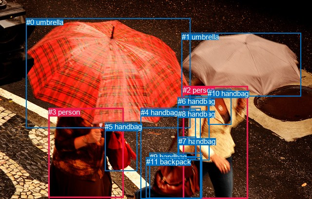
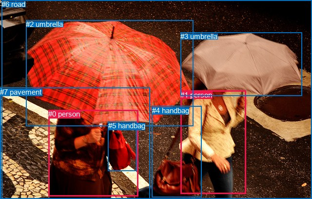

# 图片 1986：2409643.jpg

随机样本序号：152。图片 SHA256：`552bc04a6d870c41f098aa958c302904992e7816ad665a39a6b757fe47d5623a`。

红色框表示人，蓝色框表示其他物体。两个模式分别保留自身框编号，可依据位置比较对应对象。

## 自动检测框与输出

人的框编号：`[2, 3]`。状态：`ok`。

### 自动检测全部物体框

| 编号 | 类别 | 是否为人 | 检测分数 | 像素坐标 xyxy |
|---|---|---|---|---|
| 0 | umbrella | False | 0.9996 | 53.9, 37.3, 390.5, 262.3 |
| 1 | umbrella | False | 0.9991 | 372.8, 67.1, 617.8, 197.7 |
| 2 | person | True | 0.9987 | 375.1, 176.1, 508.3, 408.0 |
| 3 | person | True | 0.9985 | 99.1, 221.3, 253.8, 405.9 |
| 4 | handbag | False | 0.9735 | 288.8, 221.6, 411.8, 407.8 |
| 5 | handbag | False | 0.8617 | 215.3, 251.5, 281.8, 350.9 |
| 6 | handbag | False | 0.7939 | 364.7, 199.1, 429.5, 328.7 |
| 7 | handbag | False | 0.6926 | 366.2, 280.6, 402.4, 321.7 |
| 8 | handbag | False | 0.5764 | 364.6, 224.8, 401.9, 326.2 |
| 9 | handbag | False | 0.5736 | 306.7, 313.4, 414.4, 406.3 |
| 10 | handbag | False | 0.5424 | 426.0, 183.0, 474.6, 255.5 |
| 11 | backpack | False | 0.5423 | 299.8, 322.6, 412.2, 406.7 |

### 自动检测 Top50 人相关候选

评分物体对：132；人相关物体对：42；输出关系：50。

| 排名 | 主语编号与类别 | 关系 | 宾语编号与类别 | 类型 | 人与人 | 排序分数 | 原始融合 logit |
|---|---|---|---|---|---|---|---|
| 1 | #3 person | holding | #0 umbrella | semantic | False | 0.99108 | 4.7107 |
| 2 | #2 person | wearing | #10 handbag | semantic | False | 0.98731 | 4.3540 |
| 3 | #2 person | holding | #1 umbrella | semantic | False | 0.97724 | 3.7597 |
| 4 | #2 person | carrying | #9 handbag | semantic | False | 0.97501 | 3.6641 |
| 5 | #2 person | carrying | #11 backpack | semantic | False | 0.97259 | 3.5692 |
| 6 | #2 person | holding | #0 umbrella | semantic | False | 0.96169 | 3.2231 |
| 7 | #3 person | carrying | #5 handbag | semantic | False | 0.95513 | 3.0581 |
| 8 | #2 person | pulling | #4 handbag | semantic | False | 0.94705 | 2.8840 |
| 9 | #2 person | carrying | #8 handbag | semantic | False | 0.92764 | 2.5510 |
| 10 | #2 person | wearing | #6 handbag | semantic | False | 0.92528 | 2.5163 |
| 11 | #3 person | holding | #1 umbrella | semantic | False | 0.88016 | 1.9939 |
| 12 | #2 person | wearing | #7 handbag | semantic | False | 0.87601 | 1.9552 |
| 13 | #2 person | in | #10 handbag | spatial | False | 0.82908 | 1.5791 |
| 14 | #10 handbag | on | #2 person | spatial | False | 0.78806 | 1.3133 |
| 15 | #3 person | holding | #4 handbag | semantic | False | 0.71470 | 0.9183 |
| 16 | #2 person | in | #1 umbrella | spatial | False | 0.71237 | 0.9069 |
| 17 | #3 person | in | #0 umbrella | spatial | False | 0.70036 | 0.8490 |
| 18 | #2 person | in | #6 handbag | spatial | False | 0.68908 | 0.7958 |
| 19 | #6 handbag | on | #2 person | spatial | False | 0.62625 | 0.5162 |
| 20 | #2 person | walking on | #3 person | semantic | True | 0.58031 | 0.3240 |
| 21 | #5 handbag | hanging from | #3 person | spatial | False | 0.57967 | 0.3214 |
| 22 | #2 person | in | #11 backpack | spatial | False | 0.57514 | 0.3029 |
| 23 | #2 person | in | #9 handbag | spatial | False | 0.57441 | 0.2998 |
| 24 | #2 person | in | #0 umbrella | spatial | False | 0.54705 | 0.1888 |
| 25 | #3 person | walking on | #2 person | semantic | True | 0.54549 | 0.1825 |
| 26 | #1 umbrella | over | #2 person | spatial | False | 0.49954 | -0.0018 |
| 27 | #2 person | in | #8 handbag | spatial | False | 0.48016 | -0.0794 |
| 28 | #2 person | in | #7 handbag | spatial | False | 0.46838 | -0.1266 |
| 29 | #3 person | in | #5 handbag | spatial | False | 0.46493 | -0.1405 |
| 30 | #7 handbag | on | #2 person | spatial | False | 0.45707 | -0.1721 |
| 31 | #2 person | on | #4 handbag | spatial | False | 0.42513 | -0.3017 |
| 32 | #9 handbag | carrying | #2 person | semantic | False | 0.36017 | -0.5746 |
| 33 | #3 person | holding | #11 backpack | semantic | False | 0.35958 | -0.5772 |
| 34 | #3 person | holding | #9 handbag | semantic | False | 0.34774 | -0.6290 |
| 35 | #4 handbag | carrying | #2 person | semantic | False | 0.34317 | -0.6492 |
| 36 | #5 handbag | carrying | #3 person | semantic | False | 0.34304 | -0.6498 |
| 37 | #3 person | beside | #2 person | spatial | True | 0.33374 | -0.6913 |
| 38 | #8 handbag | on | #2 person | spatial | False | 0.32550 | -0.7286 |
| 39 | #11 backpack | carrying | #2 person | semantic | False | 0.31657 | -0.7696 |
| 40 | #1 umbrella | holding | #2 person | semantic | False | 0.29650 | -0.8640 |
| 41 | #9 handbag | on | #2 person | spatial | False | 0.27873 | -0.9508 |
| 42 | #0 umbrella | over | #3 person | spatial | False | 0.27217 | -0.9836 |
| 43 | #11 backpack | on | #2 person | spatial | False | 0.26157 | -1.0378 |
| 44 | #2 person | carrying | #5 handbag | semantic | False | 0.25876 | -1.0524 |
| 45 | #3 person | holding | #8 handbag | semantic | False | 0.24944 | -1.1016 |
| 46 | #3 person | in | #1 umbrella | spatial | False | 0.24681 | -1.1157 |
| 47 | #2 person | beside | #3 person | spatial | True | 0.23312 | -1.1908 |
| 48 | #3 person | wearing | #6 handbag | semantic | False | 0.23187 | -1.1978 |
| 49 | #4 handbag | on | #2 person | spatial | False | 0.22114 | -1.2590 |
| 50 | #10 handbag | wearing | #2 person | semantic | False | 0.22008 | -1.2652 |

### 自动检测逐条人相关 GT 核验

R@50：40.00%；命中 2/5。

| GT 主语编号 | GT 关系 | GT 宾语编号 | 结果阶段 | 匹配预测主语编号 | 匹配预测宾语编号 |
|---|---|---|---|---|---|
| 0 | holding | 2 | hit50 | [3] | [0] |
| 0 | holding | 5 | wrong_predicate | [3] | [5] |
| 0 | on | 7 | endpoint_missing_or_wrong_class | [3] | [] |
| 1 | holding | 3 | hit50 | [2] | [1] |
| 1 | carrying | 4 | wrong_predicate | [2] | [4] |

## 真实框与输出

人的框编号：`[0, 1]`。

### 真实框全部物体框

| 编号 | 类别 | 是否为人 | 检测分数 | 像素坐标 xyxy |
|---|---|---|---|---|
| 0 | person | True | GT | 99.0, 225.0, 283.0, 402.0 |
| 1 | person | True | GT | 370.0, 186.0, 504.0, 398.0 |
| 2 | umbrella | False | GT | 53.0, 41.0, 396.0, 258.0 |
| 3 | umbrella | False | GT | 370.0, 66.0, 619.0, 197.0 |
| 4 | handbag | False | GT | 312.0, 218.0, 414.0, 405.0 |
| 5 | handbag | False | GT | 222.0, 249.0, 281.0, 350.0 |
| 6 | road | False | GT | 3.0, 0.0, 640.0, 408.0 |
| 7 | pavement | False | GT | 0.0, 180.0, 308.0, 408.0 |

### 真实框 Top50 人相关候选

评分物体对：56；人相关物体对：26；输出关系：50。

| 排名 | 主语编号与类别 | 关系 | 宾语编号与类别 | 类型 | 人与人 | 排序分数 | 原始融合 logit |
|---|---|---|---|---|---|---|---|
| 1 | #0 person | holding | #2 umbrella | semantic | False | 0.99284 | 4.9321 |
| 2 | #0 person | carrying | #5 handbag | semantic | False | 0.98308 | 4.0625 |
| 3 | #0 person | crossing | #7 pavement | semantic | False | 0.97889 | 3.8364 |
| 4 | #1 person | crossing | #6 road | semantic | False | 0.96776 | 3.4018 |
| 5 | #0 person | walking on | #6 road | semantic | False | 0.96110 | 3.2070 |
| 6 | #5 handbag | hanging from | #0 person | spatial | False | 0.95551 | 3.0670 |
| 7 | #1 person | holding | #3 umbrella | semantic | False | 0.94959 | 2.9359 |
| 8 | #1 person | crossing | #7 pavement | semantic | False | 0.92856 | 2.5648 |
| 9 | #1 person | holding | #4 handbag | semantic | False | 0.92190 | 2.4685 |
| 10 | #1 person | holding | #2 umbrella | semantic | False | 0.90101 | 2.2085 |
| 11 | #0 person | on | #7 pavement | spatial | False | 0.86232 | 1.8347 |
| 12 | #0 person | in | #6 road | spatial | False | 0.85860 | 1.8037 |
| 13 | #0 person | pulling | #4 handbag | semantic | False | 0.85223 | 1.7522 |
| 14 | #1 person | in | #6 road | spatial | False | 0.80935 | 1.4458 |
| 15 | #0 person | holding | #3 umbrella | semantic | False | 0.79040 | 1.3274 |
| 16 | #0 person | in | #2 umbrella | spatial | False | 0.76233 | 1.1655 |
| 17 | #5 handbag | carrying | #0 person | semantic | False | 0.66115 | 0.6684 |
| 18 | #4 handbag | carrying | #1 person | semantic | False | 0.64037 | 0.5770 |
| 19 | #0 person | in | #5 handbag | spatial | False | 0.60793 | 0.4386 |
| 20 | #4 handbag | hanging from | #1 person | spatial | False | 0.57759 | 0.3129 |
| 21 | #1 person | walking on | #0 person | semantic | True | 0.52817 | 0.1128 |
| 22 | #1 person | in | #3 umbrella | spatial | False | 0.50428 | 0.0171 |
| 23 | #3 umbrella | over | #1 person | spatial | False | 0.44329 | -0.2278 |
| 24 | #0 person | wearing | #1 person | semantic | True | 0.43623 | -0.2565 |
| 25 | #2 umbrella | carrying | #0 person | semantic | False | 0.34875 | -0.6245 |
| 26 | #1 person | on | #7 pavement | spatial | False | 0.33786 | -0.6729 |
| 27 | #1 person | on | #4 handbag | spatial | False | 0.33496 | -0.6858 |
| 28 | #3 umbrella | carrying | #1 person | semantic | False | 0.33418 | -0.6893 |
| 29 | #7 pavement | beside | #0 person | spatial | False | 0.32333 | -0.7385 |
| 30 | #4 handbag | carrying | #0 person | semantic | False | 0.31674 | -0.7688 |
| 31 | #4 handbag | hanging from | #0 person | spatial | False | 0.31329 | -0.7848 |
| 32 | #2 umbrella | over | #0 person | spatial | False | 0.31327 | -0.7849 |
| 33 | #1 person | in | #2 umbrella | spatial | False | 0.30476 | -0.8247 |
| 34 | #0 person | in | #1 person | spatial | True | 0.28939 | -0.8984 |
| 35 | #1 person | beside | #0 person | spatial | True | 0.24083 | -1.1481 |
| 36 | #0 person | on | #4 handbag | spatial | False | 0.21889 | -1.2721 |
| 37 | #1 person | carrying | #5 handbag | semantic | False | 0.17973 | -1.5182 |
| 38 | #0 person | in | #3 umbrella | spatial | False | 0.17154 | -1.5747 |
| 39 | #6 road | beside | #0 person | spatial | False | 0.13531 | -1.8548 |
| 40 | #7 pavement | holding | #0 person | semantic | False | 0.06934 | -2.5969 |
| 41 | #2 umbrella | holding | #1 person | semantic | False | 0.05474 | -2.8489 |
| 42 | #2 umbrella | on | #1 person | spatial | False | 0.05435 | -2.8564 |
| 43 | #3 umbrella | holding | #0 person | semantic | False | 0.04355 | -3.0893 |
| 44 | #6 road | beside | #1 person | spatial | False | 0.04266 | -3.1108 |
| 45 | #5 handbag | hanging from | #1 person | spatial | False | 0.04155 | -3.1383 |
| 46 | #3 umbrella | on | #0 person | spatial | False | 0.03809 | -3.2290 |
| 47 | #5 handbag | carrying | #1 person | semantic | False | 0.03696 | -3.2601 |
| 48 | #6 road | holding | #0 person | semantic | False | 0.03183 | -3.4149 |
| 49 | #1 person | in | #5 handbag | spatial | False | 0.02407 | -3.7025 |
| 50 | #7 pavement | beside | #1 person | spatial | False | 0.01949 | -3.9182 |

### 真实框逐条人相关 GT 核验

R@50：60.00%；命中 3/5。

| GT 主语编号 | GT 关系 | GT 宾语编号 | 结果阶段 | 匹配预测主语编号 | 匹配预测宾语编号 |
|---|---|---|---|---|---|
| 0 | holding | 2 | hit50 | [0] | [2] |
| 0 | holding | 5 | wrong_predicate | [0] | [5] |
| 0 | on | 7 | hit50 | [0] | [7] |
| 1 | holding | 3 | hit50 | [1] | [3] |
| 1 | carrying | 4 | wrong_predicate | [1] | [4] |

## 全部人相关 GT

| 主语编号与类别 | 关系 | 宾语编号与类别 |
|---|---|---|
| #0 person | holding | #2 umbrella |
| #0 person | holding | #5 handbag |
| #0 person | on | #7 pavement |
| #1 person | holding | #3 umbrella |
| #1 person | carrying | #4 handbag |

原始记录、全部人相关物体对的两项预测与分项分数见 [逐图证据 JSON](../evidence/cases/1986.json)。全部56类 logits 保留于本机 HOR/output/random500/logits/。

<!-- HOR_COMPLETE_RESULTS -->

## 六组条件的完整输出对照

以下保留同一图片三种框与候选模式、两种谓词输出规则的全部 Top50。框编号各自在所属模式内解释。

### 自动检测框完整枚举：空间与语义各保留一个谓词

| 排名 | 主语编号与类别 | 谓词 | 宾语编号与类别 | 分组 | 排序分数 | predicate logit | pair logit |
|---|---|---|---|---|---|---|---|
| 1 | #3 person | holding | #0 umbrella | semantic | 0.9910820 | 4.5251060 | 0.1856193 |
| 2 | #2 person | wearing | #10 handbag | semantic | 0.9873075 | 4.1679244 | 0.1860466 |
| 3 | #2 person | holding | #1 umbrella | semantic | 0.9772391 | 3.5020022 | 0.2576885 |
| 4 | #2 person | carrying | #9 handbag | semantic | 0.9750128 | 3.7175393 | -0.0534536 |
| 5 | #2 person | carrying | #11 backpack | semantic | 0.9725939 | 3.6596875 | -0.0904837 |
| 6 | #2 person | holding | #0 umbrella | semantic | 0.9616937 | 3.6541057 | -0.4310240 |
| 7 | #3 person | carrying | #5 handbag | semantic | 0.9551303 | 3.5024400 | -0.4443548 |
| 8 | #2 person | pulling | #4 handbag | semantic | 0.9470502 | 3.4265189 | -0.5425107 |
| 9 | #2 person | carrying | #8 handbag | semantic | 0.9276380 | 2.8567443 | -0.3057847 |
| 10 | #2 person | wearing | #6 handbag | semantic | 0.9252799 | 2.5383406 | -0.0219934 |
| 11 | #3 person | holding | #1 umbrella | semantic | 0.8801558 | 2.6856170 | -0.6917108 |
| 12 | #2 person | wearing | #7 handbag | semantic | 0.8760125 | 2.1442938 | -0.1890947 |
| 13 | #2 person | in | #10 handbag | spatial | 0.8290836 | 1.3930998 | 0.1860466 |
| 14 | #10 handbag | on | #2 person | spatial | 0.7880634 | 1.8113074 | -0.4980160 |
| 15 | #3 person | holding | #4 handbag | semantic | 0.7146972 | 2.1209688 | -1.2026609 |
| 16 | #2 person | in | #1 umbrella | spatial | 0.7123665 | 0.6492167 | 0.2576885 |
| 17 | #3 person | in | #0 umbrella | spatial | 0.7003577 | 0.6633821 | 0.1856193 |
| 18 | #2 person | in | #6 handbag | spatial | 0.6890821 | 0.8178248 | -0.0219934 |
| 19 | #6 handbag | on | #2 person | spatial | 0.6262521 | 0.9653058 | -0.4491343 |
| 20 | #2 person | walking on | #3 person | semantic | 0.5803071 | 1.6249437 | -1.3009094 |
| 21 | #5 handbag | hanging from | #3 person | spatial | 0.5796667 | 1.2608409 | -0.9394352 |
| 22 | #2 person | in | #11 backpack | spatial | 0.5751431 | 0.3933501 | -0.0904837 |
| 23 | #2 person | in | #9 handbag | spatial | 0.5744057 | 0.3533030 | -0.0534536 |
| 24 | #2 person | in | #0 umbrella | spatial | 0.5470527 | 0.6197934 | -0.4310240 |
| 25 | #3 person | walking on | #2 person | semantic | 0.5454906 | 1.6159401 | -1.4334731 |
| 26 | #1 umbrella | over | #2 person | spatial | 0.4995411 | 0.6606541 | -0.6624897 |
| 27 | #2 person | in | #8 handbag | spatial | 0.4801647 | 0.2264018 | -0.3057847 |
| 28 | #2 person | in | #7 handbag | spatial | 0.4683805 | 0.0624475 | -0.1890947 |
| 29 | #3 person | in | #5 handbag | spatial | 0.4649302 | 0.3038449 | -0.4443548 |
| 30 | #7 handbag | on | #2 person | spatial | 0.4570750 | 0.1688867 | -0.3410103 |
| 31 | #2 person | on | #4 handbag | spatial | 0.4251321 | 0.2407703 | -0.5425107 |
| 32 | #9 handbag | carrying | #2 person | semantic | 0.3601725 | 0.2859726 | -0.8605883 |
| 33 | #3 person | holding | #11 backpack | semantic | 0.3595825 | 0.5820141 | -1.1591904 |
| 34 | #3 person | holding | #9 handbag | semantic | 0.3477384 | 0.5351253 | -1.1641204 |
| 35 | #4 handbag | carrying | #2 person | semantic | 0.3431684 | 0.3935223 | -1.0427287 |
| 36 | #5 handbag | carrying | #3 person | semantic | 0.3430419 | 0.2896676 | -0.9394352 |
| 37 | #3 person | beside | #2 person | spatial | 0.3337366 | 0.7421403 | -1.4334731 |
| 38 | #8 handbag | on | #2 person | spatial | 0.3255040 | 0.0674338 | -0.7960249 |
| 39 | #11 backpack | carrying | #2 person | semantic | 0.3165675 | 0.1124153 | -0.8820069 |
| 40 | #1 umbrella | holding | #2 person | semantic | 0.2964967 | -0.2015467 | -0.6624897 |
| 41 | #9 handbag | on | #2 person | spatial | 0.2787254 | -0.0902047 | -0.8605883 |
| 42 | #0 umbrella | over | #3 person | spatial | 0.2721734 | 0.2959085 | -1.2795320 |
| 43 | #11 backpack | on | #2 person | spatial | 0.2615672 | -0.1558318 | -0.8820069 |
| 44 | #2 person | carrying | #5 handbag | semantic | 0.2587620 | 0.2935629 | -1.3459758 |
| 45 | #3 person | holding | #8 handbag | semantic | 0.2494432 | 0.4586949 | -1.5602790 |
| 46 | #3 person | in | #1 umbrella | spatial | 0.2468095 | -0.4239907 | -0.6917108 |
| 47 | #2 person | beside | #3 person | spatial | 0.2331156 | 0.1101079 | -1.3009094 |
| 48 | #3 person | wearing | #6 handbag | semantic | 0.2318680 | 0.5016165 | -1.6994097 |
| 49 | #4 handbag | on | #2 person | spatial | 0.2211404 | -0.2163043 | -1.0427287 |
| 50 | #10 handbag | wearing | #2 person | semantic | 0.2200835 | -0.7671638 | -0.4980160 |

GT 命中：2/5，R@50=40.00%。

| GT主语 | GT谓词 | GT宾语 | 结果阶段 | 匹配主语框 | 匹配宾语框 |
|---|---|---|---|---|---|
| 0 | holding | 2 | hit50 | [3] | [0] |
| 0 | holding | 5 | wrong_predicate | [3] | [5] |
| 0 | on | 7 | endpoint_missing_or_wrong_class | [3] | [] |
| 1 | holding | 3 | hit50 | [2] | [1] |
| 1 | carrying | 4 | wrong_predicate | [2] | [4] |

### 自动检测框完整枚举：每对只保留一个谓词

| 排名 | 主语编号与类别 | 谓词 | 宾语编号与类别 | 分组 | 排序分数 | predicate logit | pair logit |
|---|---|---|---|---|---|---|---|
| 1 | #3 person | holding | #0 umbrella | single | 0.9910820 | 4.5251060 | 0.1856193 |
| 2 | #2 person | wearing | #10 handbag | single | 0.9873075 | 4.1679244 | 0.1860466 |
| 3 | #2 person | holding | #1 umbrella | single | 0.9772391 | 3.5020022 | 0.2576885 |
| 4 | #2 person | carrying | #9 handbag | single | 0.9750128 | 3.7175393 | -0.0534536 |
| 5 | #2 person | carrying | #11 backpack | single | 0.9725939 | 3.6596875 | -0.0904837 |
| 6 | #2 person | holding | #0 umbrella | single | 0.9616937 | 3.6541057 | -0.4310240 |
| 7 | #3 person | carrying | #5 handbag | single | 0.9551303 | 3.5024400 | -0.4443548 |
| 8 | #2 person | pulling | #4 handbag | single | 0.9470502 | 3.4265189 | -0.5425107 |
| 9 | #2 person | carrying | #8 handbag | single | 0.9276380 | 2.8567443 | -0.3057847 |
| 10 | #2 person | wearing | #6 handbag | single | 0.9252799 | 2.5383406 | -0.0219934 |
| 11 | #3 person | holding | #1 umbrella | single | 0.8801558 | 2.6856170 | -0.6917108 |
| 12 | #2 person | wearing | #7 handbag | single | 0.8760125 | 2.1442938 | -0.1890947 |
| 13 | #10 handbag | on | #2 person | single | 0.7880634 | 1.8113074 | -0.4980160 |
| 14 | #3 person | holding | #4 handbag | single | 0.7146972 | 2.1209688 | -1.2026609 |
| 15 | #6 handbag | on | #2 person | single | 0.6262521 | 0.9653058 | -0.4491343 |
| 16 | #2 person | walking on | #3 person | single | 0.5803071 | 1.6249437 | -1.3009094 |
| 17 | #5 handbag | hanging from | #3 person | single | 0.5796667 | 1.2608409 | -0.9394352 |
| 18 | #3 person | walking on | #2 person | single | 0.5454906 | 1.6159401 | -1.4334731 |
| 19 | #1 umbrella | over | #2 person | single | 0.4995411 | 0.6606541 | -0.6624897 |
| 20 | #7 handbag | on | #2 person | single | 0.4570750 | 0.1688867 | -0.3410103 |
| 21 | #9 handbag | carrying | #2 person | single | 0.3601725 | 0.2859726 | -0.8605883 |
| 22 | #3 person | holding | #11 backpack | single | 0.3595825 | 0.5820141 | -1.1591904 |
| 23 | #3 person | holding | #9 handbag | single | 0.3477384 | 0.5351253 | -1.1641204 |
| 24 | #4 handbag | carrying | #2 person | single | 0.3431684 | 0.3935223 | -1.0427287 |
| 25 | #8 handbag | on | #2 person | single | 0.3255040 | 0.0674338 | -0.7960249 |
| 26 | #11 backpack | carrying | #2 person | single | 0.3165675 | 0.1124153 | -0.8820069 |
| 27 | #0 umbrella | over | #3 person | single | 0.2721734 | 0.2959085 | -1.2795320 |
| 28 | #2 person | carrying | #5 handbag | single | 0.2587620 | 0.2935629 | -1.3459758 |
| 29 | #3 person | holding | #8 handbag | single | 0.2494432 | 0.4586949 | -1.5602790 |
| 30 | #3 person | wearing | #6 handbag | single | 0.2318680 | 0.5016165 | -1.6994097 |
| 31 | #3 person | wearing | #7 handbag | single | 0.1817622 | 0.0730410 | -1.5774945 |
| 32 | #3 person | wearing | #10 handbag | single | 0.1094080 | -0.2198219 | -1.8769802 |
| 33 | #0 umbrella | on | #2 person | single | 0.0909073 | -0.9058249 | -1.3967824 |
| 34 | #4 handbag | on | #3 person | single | 0.0571547 | -1.2323692 | -1.5707722 |
| 35 | #11 backpack | on | #3 person | single | 0.0325290 | -1.6645362 | -1.7280186 |
| 36 | #9 handbag | on | #3 person | single | 0.0293509 | -1.7560263 | -1.7426164 |
| 37 | #5 handbag | carrying | #2 person | single | 0.0282754 | -1.6559691 | -1.8811102 |
| 38 | #7 handbag | on | #3 person | single | 0.0230446 | -2.2729356 | -1.4740757 |
| 39 | #6 handbag | on | #3 person | single | 0.0136943 | -2.2038035 | -2.0731859 |
| 40 | #1 umbrella | on | #3 person | single | 0.0136007 | -1.7966161 | -2.4873254 |
| 41 | #8 handbag | on | #3 person | single | 0.0095892 | -2.6086020 | -2.0288806 |
| 42 | #10 handbag | on | #3 person | single | 0.0076911 | -2.6796019 | -2.1803651 |

GT 命中：2/5，R@50=40.00%。

| GT主语 | GT谓词 | GT宾语 | 结果阶段 | 匹配主语框 | 匹配宾语框 |
|---|---|---|---|---|---|
| 0 | holding | 2 | hit50 | [3] | [0] |
| 0 | holding | 5 | wrong_predicate | [3] | [5] |
| 0 | on | 7 | endpoint_missing_or_wrong_class | [3] | [] |
| 1 | holding | 3 | hit50 | [2] | [1] |
| 1 | carrying | 4 | wrong_predicate | [2] | [4] |

### 真实框完整枚举：空间与语义各保留一个谓词

| 排名 | 主语编号与类别 | 谓词 | 宾语编号与类别 | 分组 | 排序分数 | predicate logit | pair logit |
|---|---|---|---|---|---|---|---|
| 1 | #0 person | holding | #2 umbrella | semantic | 0.9928405 | 4.3800092 | 0.5521287 |
| 2 | #0 person | carrying | #5 handbag | semantic | 0.9830847 | 4.1593890 | -0.0969075 |
| 3 | #0 person | crossing | #7 pavement | semantic | 0.9788854 | 4.4274783 | -0.5910330 |
| 4 | #1 person | crossing | #6 road | semantic | 0.9677597 | 4.3058333 | -0.9040670 |
| 5 | #0 person | walking on | #6 road | semantic | 0.9610968 | 3.5418077 | -0.3348101 |
| 6 | #5 handbag | hanging from | #0 person | spatial | 0.9555115 | 3.7884326 | -0.7214186 |
| 7 | #1 person | holding | #3 umbrella | semantic | 0.9495911 | 3.5009046 | -0.5650419 |
| 8 | #1 person | crossing | #7 pavement | semantic | 0.9285625 | 4.2433772 | -1.6785629 |
| 9 | #1 person | holding | #4 handbag | semantic | 0.9219049 | 3.5621848 | -1.0936697 |
| 10 | #1 person | holding | #2 umbrella | semantic | 0.9010141 | 3.4052720 | -1.1967283 |
| 11 | #0 person | on | #7 pavement | spatial | 0.8623238 | 2.4257588 | -0.5910330 |
| 12 | #0 person | in | #6 road | spatial | 0.8586025 | 2.1385412 | -0.3348101 |
| 13 | #0 person | pulling | #4 handbag | semantic | 0.8522272 | 2.6443481 | -0.8921707 |
| 14 | #1 person | in | #6 road | spatial | 0.8093482 | 2.3498478 | -0.9040670 |
| 15 | #0 person | holding | #3 umbrella | semantic | 0.7904029 | 1.7393246 | -0.4119689 |
| 16 | #0 person | in | #2 umbrella | spatial | 0.7623320 | 0.6133785 | 0.5521287 |
| 17 | #5 handbag | carrying | #0 person | semantic | 0.6611471 | 1.3898287 | -0.7214186 |
| 18 | #4 handbag | carrying | #1 person | semantic | 0.6403695 | 1.8559432 | -1.2789752 |
| 19 | #0 person | in | #5 handbag | spatial | 0.6079259 | 0.5355096 | -0.0969075 |
| 20 | #4 handbag | hanging from | #1 person | spatial | 0.5775872 | 1.5918517 | -1.2789752 |
| 21 | #1 person | walking on | #0 person | semantic | 0.5281747 | 1.7317610 | -1.6189427 |
| 22 | #1 person | in | #3 umbrella | spatial | 0.5042830 | 0.5821743 | -0.5650419 |
| 23 | #3 umbrella | over | #1 person | spatial | 0.4432939 | 0.9076781 | -1.1354828 |
| 24 | #0 person | wearing | #1 person | semantic | 0.4362267 | 1.1047993 | -1.3612896 |
| 25 | #2 umbrella | carrying | #0 person | semantic | 0.3487488 | 0.5074964 | -1.1320400 |
| 26 | #1 person | on | #7 pavement | spatial | 0.3378577 | 1.0057073 | -1.6785629 |
| 27 | #1 person | on | #4 handbag | spatial | 0.3349638 | 0.4078507 | -1.0936697 |
| 28 | #3 umbrella | carrying | #1 person | semantic | 0.3341812 | 0.4461489 | -1.1354828 |
| 29 | #7 pavement | beside | #0 person | spatial | 0.3233297 | 0.4668665 | -1.2053778 |
| 30 | #4 handbag | carrying | #0 person | semantic | 0.3167390 | 0.6750112 | -1.4438101 |
| 31 | #4 handbag | hanging from | #0 person | spatial | 0.3132903 | 0.6590285 | -1.4438101 |
| 32 | #2 umbrella | over | #0 person | spatial | 0.3132673 | 0.3471518 | -1.1320400 |
| 33 | #1 person | in | #2 umbrella | spatial | 0.3047567 | 0.3719802 | -1.1967283 |
| 34 | #0 person | in | #1 person | spatial | 0.2893861 | 0.4629221 | -1.3612896 |
| 35 | #1 person | beside | #0 person | spatial | 0.2408282 | 0.4707985 | -1.6189427 |
| 36 | #0 person | on | #4 handbag | spatial | 0.2188917 | -0.3799663 | -0.8921707 |
| 37 | #1 person | carrying | #5 handbag | semantic | 0.1797332 | 0.3488851 | -1.8670412 |
| 38 | #0 person | in | #3 umbrella | spatial | 0.1715413 | -1.1627741 | -0.4119689 |
| 39 | #6 road | beside | #0 person | spatial | 0.1353117 | -0.4068499 | -1.4479382 |
| 40 | #7 pavement | holding | #0 person | semantic | 0.0693381 | -1.3915234 | -1.2053778 |
| 41 | #2 umbrella | holding | #1 person | semantic | 0.0547363 | -1.0164156 | -1.8325206 |
| 42 | #2 umbrella | on | #1 person | spatial | 0.0543503 | -1.0239019 | -1.8325206 |
| 43 | #3 umbrella | holding | #0 person | semantic | 0.0435503 | -0.8124437 | -2.2768686 |
| 44 | #6 road | beside | #1 person | spatial | 0.0426630 | -1.1570778 | -1.9537466 |
| 45 | #5 handbag | hanging from | #1 person | spatial | 0.0415544 | -1.0260842 | -2.1122260 |
| 46 | #3 umbrella | on | #0 person | spatial | 0.0380898 | -0.9521058 | -2.2768686 |
| 47 | #5 handbag | carrying | #1 person | semantic | 0.0369639 | -1.1479218 | -2.1122260 |
| 48 | #6 road | holding | #0 person | semantic | 0.0318328 | -1.9669697 | -1.4479382 |
| 49 | #1 person | in | #5 handbag | spatial | 0.0240686 | -1.8354411 | -1.8670412 |
| 50 | #7 pavement | beside | #1 person | spatial | 0.0194887 | -1.5641012 | -2.3541374 |

GT 命中：3/5，R@50=60.00%。

| GT主语 | GT谓词 | GT宾语 | 结果阶段 | 匹配主语框 | 匹配宾语框 |
|---|---|---|---|---|---|
| 0 | holding | 2 | hit50 | [0] | [2] |
| 0 | holding | 5 | wrong_predicate | [0] | [5] |
| 0 | on | 7 | hit50 | [0] | [7] |
| 1 | holding | 3 | hit50 | [1] | [3] |
| 1 | carrying | 4 | wrong_predicate | [1] | [4] |

### 真实框完整枚举：每对只保留一个谓词

| 排名 | 主语编号与类别 | 谓词 | 宾语编号与类别 | 分组 | 排序分数 | predicate logit | pair logit |
|---|---|---|---|---|---|---|---|
| 1 | #0 person | holding | #2 umbrella | single | 0.9928405 | 4.3800092 | 0.5521287 |
| 2 | #0 person | carrying | #5 handbag | single | 0.9830847 | 4.1593890 | -0.0969075 |
| 3 | #0 person | crossing | #7 pavement | single | 0.9788854 | 4.4274783 | -0.5910330 |
| 4 | #1 person | crossing | #6 road | single | 0.9677597 | 4.3058333 | -0.9040670 |
| 5 | #0 person | walking on | #6 road | single | 0.9610968 | 3.5418077 | -0.3348101 |
| 6 | #5 handbag | hanging from | #0 person | single | 0.9555115 | 3.7884326 | -0.7214186 |
| 7 | #1 person | holding | #3 umbrella | single | 0.9495911 | 3.5009046 | -0.5650419 |
| 8 | #1 person | crossing | #7 pavement | single | 0.9285625 | 4.2433772 | -1.6785629 |
| 9 | #1 person | holding | #4 handbag | single | 0.9219049 | 3.5621848 | -1.0936697 |
| 10 | #1 person | holding | #2 umbrella | single | 0.9010141 | 3.4052720 | -1.1967283 |
| 11 | #0 person | pulling | #4 handbag | single | 0.8522272 | 2.6443481 | -0.8921707 |
| 12 | #0 person | holding | #3 umbrella | single | 0.7904029 | 1.7393246 | -0.4119689 |
| 13 | #4 handbag | carrying | #1 person | single | 0.6403695 | 1.8559432 | -1.2789752 |
| 14 | #1 person | walking on | #0 person | single | 0.5281747 | 1.7317610 | -1.6189427 |
| 15 | #3 umbrella | over | #1 person | single | 0.4432939 | 0.9076781 | -1.1354828 |
| 16 | #0 person | wearing | #1 person | single | 0.4362267 | 1.1047993 | -1.3612896 |
| 17 | #2 umbrella | carrying | #0 person | single | 0.3487488 | 0.5074964 | -1.1320400 |
| 18 | #7 pavement | beside | #0 person | single | 0.3233297 | 0.4668665 | -1.2053778 |
| 19 | #4 handbag | carrying | #0 person | single | 0.3167390 | 0.6750112 | -1.4438101 |
| 20 | #1 person | carrying | #5 handbag | single | 0.1797332 | 0.3488851 | -1.8670412 |
| 21 | #6 road | beside | #0 person | single | 0.1353117 | -0.4068499 | -1.4479382 |
| 22 | #2 umbrella | holding | #1 person | single | 0.0547363 | -1.0164156 | -1.8325206 |
| 23 | #3 umbrella | holding | #0 person | single | 0.0435503 | -0.8124437 | -2.2768686 |
| 24 | #6 road | beside | #1 person | single | 0.0426630 | -1.1570778 | -1.9537466 |
| 25 | #5 handbag | hanging from | #1 person | single | 0.0415544 | -1.0260842 | -2.1122260 |
| 26 | #7 pavement | beside | #1 person | single | 0.0194887 | -1.5641012 | -2.3541374 |

GT 命中：2/5，R@50=40.00%。

| GT主语 | GT谓词 | GT宾语 | 结果阶段 | 匹配主语框 | 匹配宾语框 |
|---|---|---|---|---|---|
| 0 | holding | 2 | hit50 | [0] | [2] |
| 0 | holding | 5 | wrong_predicate | [0] | [5] |
| 0 | on | 7 | wrong_predicate | [0] | [7] |
| 1 | holding | 3 | hit50 | [1] | [3] |
| 1 | carrying | 4 | wrong_predicate | [1] | [4] |

### 真实框400候选：空间与语义各保留一个谓词

| 排名 | 主语编号与类别 | 谓词 | 宾语编号与类别 | 分组 | 排序分数 | predicate logit | pair logit |
|---|---|---|---|---|---|---|---|
| 1 | #0 person | holding | #2 umbrella | semantic | 0.9927984 | 4.3741002 | 0.5521287 |
| 2 | #0 person | carrying | #5 handbag | semantic | 0.9839838 | 4.2149110 | -0.0969075 |
| 3 | #0 person | crossing | #7 pavement | semantic | 0.9788854 | 4.4274783 | -0.5910330 |
| 4 | #1 person | crossing | #6 road | semantic | 0.9677597 | 4.3058333 | -0.9040670 |
| 5 | #0 person | walking on | #6 road | semantic | 0.9610968 | 3.5418077 | -0.3348101 |
| 6 | #5 handbag | hanging from | #0 person | spatial | 0.9580007 | 3.8486133 | -0.7214186 |
| 7 | #1 person | holding | #3 umbrella | semantic | 0.9495911 | 3.5009046 | -0.5650419 |
| 8 | #1 person | crossing | #7 pavement | semantic | 0.9285625 | 4.2433772 | -1.6785629 |
| 9 | #1 person | holding | #4 handbag | semantic | 0.9219049 | 3.5621848 | -1.0936697 |
| 10 | #1 person | holding | #2 umbrella | semantic | 0.9010141 | 3.4052720 | -1.1967283 |
| 11 | #0 person | on | #7 pavement | spatial | 0.8629689 | 2.4312038 | -0.5910330 |
| 12 | #0 person | in | #6 road | spatial | 0.8581991 | 2.1352224 | -0.3348101 |
| 13 | #0 person | pulling | #4 handbag | semantic | 0.8444876 | 2.5841751 | -0.8921707 |
| 14 | #1 person | in | #6 road | spatial | 0.8098598 | 2.3531666 | -0.9040670 |
| 15 | #0 person | holding | #3 umbrella | semantic | 0.7904029 | 1.7393246 | -0.4119689 |
| 16 | #0 person | in | #2 umbrella | spatial | 0.7623320 | 0.6133785 | 0.5521287 |
| 17 | #5 handbag | carrying | #0 person | semantic | 0.6673383 | 1.4175897 | -0.7214186 |
| 18 | #4 handbag | carrying | #1 person | semantic | 0.6401011 | 1.8547783 | -1.2789752 |
| 19 | #0 person | in | #5 handbag | spatial | 0.6071345 | 0.5321908 | -0.0969075 |
| 20 | #4 handbag | hanging from | #1 person | spatial | 0.5775871 | 1.5918512 | -1.2789752 |
| 21 | #1 person | walking on | #0 person | semantic | 0.5285498 | 1.7332664 | -1.6189427 |
| 22 | #1 person | in | #3 umbrella | spatial | 0.5093158 | 0.6023092 | -0.5650419 |
| 23 | #3 umbrella | over | #1 person | spatial | 0.4500775 | 0.9351254 | -1.1354828 |
| 24 | #0 person | wearing | #1 person | semantic | 0.4376702 | 1.1106668 | -1.3612896 |
| 25 | #2 umbrella | carrying | #0 person | semantic | 0.3484842 | 0.5063314 | -1.1320400 |
| 26 | #1 person | on | #7 pavement | spatial | 0.3378577 | 1.0057073 | -1.6785629 |
| 27 | #1 person | on | #4 handbag | spatial | 0.3349638 | 0.4078507 | -1.0936697 |
| 28 | #3 umbrella | carrying | #1 person | semantic | 0.3282898 | 0.4195528 | -1.1354828 |
| 29 | #7 pavement | beside | #0 person | spatial | 0.3233045 | 0.4667511 | -1.2053778 |
| 30 | #4 handbag | hanging from | #0 person | spatial | 0.3132903 | 0.6590285 | -1.4438101 |
| 31 | #2 umbrella | over | #0 person | spatial | 0.3126989 | 0.3445082 | -1.1320400 |
| 32 | #4 handbag | carrying | #0 person | semantic | 0.3107618 | 0.6472497 | -1.4438101 |
| 33 | #1 person | in | #2 umbrella | spatial | 0.2991140 | 0.3452077 | -1.1967283 |
| 34 | #0 person | in | #1 person | spatial | 0.2893861 | 0.4629221 | -1.3612896 |
| 35 | #1 person | beside | #0 person | spatial | 0.2408177 | 0.4707408 | -1.6189427 |
| 36 | #0 person | on | #4 handbag | spatial | 0.2179622 | -0.3854108 | -0.8921707 |
| 37 | #1 person | carrying | #5 handbag | semantic | 0.1797332 | 0.3488851 | -1.8670412 |
| 38 | #0 person | in | #3 umbrella | spatial | 0.1717772 | -1.1611147 | -0.4119689 |
| 39 | #6 road | beside | #0 person | spatial | 0.1353033 | -0.4069219 | -1.4479382 |
| 40 | #7 pavement | holding | #0 person | semantic | 0.0691477 | -1.3944776 | -1.2053778 |
| 41 | #2 umbrella | holding | #1 person | semantic | 0.0547363 | -1.0164156 | -1.8325206 |
| 42 | #2 umbrella | on | #1 person | spatial | 0.0543503 | -1.0239019 | -1.8325206 |
| 43 | #3 umbrella | holding | #0 person | semantic | 0.0445688 | -0.7882609 | -2.2768686 |
| 44 | #6 road | beside | #1 person | spatial | 0.0426635 | -1.1570635 | -1.9537466 |
| 45 | #5 handbag | hanging from | #1 person | spatial | 0.0409593 | -1.0411291 | -2.1122260 |
| 46 | #3 umbrella | on | #0 person | spatial | 0.0389013 | -0.9301820 | -2.2768686 |
| 47 | #5 handbag | carrying | #1 person | semantic | 0.0364935 | -1.1612198 | -2.1122260 |
| 48 | #6 road | holding | #0 person | semantic | 0.0318783 | -1.9654927 | -1.4479382 |
| 49 | #1 person | in | #5 handbag | spatial | 0.0240394 | -1.8366857 | -1.8670412 |
| 50 | #7 pavement | beside | #1 person | spatial | 0.0194885 | -1.5641124 | -2.3541374 |

GT 命中：3/5，R@50=60.00%。

| GT主语 | GT谓词 | GT宾语 | 结果阶段 | 匹配主语框 | 匹配宾语框 |
|---|---|---|---|---|---|
| 0 | holding | 2 | hit50 | [0] | [2] |
| 0 | holding | 5 | wrong_predicate | [0] | [5] |
| 0 | on | 7 | hit50 | [0] | [7] |
| 1 | holding | 3 | hit50 | [1] | [3] |
| 1 | carrying | 4 | wrong_predicate | [1] | [4] |

### 真实框400候选：每对只保留一个谓词

| 排名 | 主语编号与类别 | 谓词 | 宾语编号与类别 | 分组 | 排序分数 | predicate logit | pair logit |
|---|---|---|---|---|---|---|---|
| 1 | #0 person | holding | #2 umbrella | single | 0.9927984 | 4.3741002 | 0.5521287 |
| 2 | #0 person | carrying | #5 handbag | single | 0.9839838 | 4.2149110 | -0.0969075 |
| 3 | #0 person | crossing | #7 pavement | single | 0.9788854 | 4.4274783 | -0.5910330 |
| 4 | #1 person | crossing | #6 road | single | 0.9677597 | 4.3058333 | -0.9040670 |
| 5 | #0 person | walking on | #6 road | single | 0.9610968 | 3.5418077 | -0.3348101 |
| 6 | #5 handbag | hanging from | #0 person | single | 0.9580007 | 3.8486133 | -0.7214186 |
| 7 | #1 person | holding | #3 umbrella | single | 0.9495911 | 3.5009046 | -0.5650419 |
| 8 | #1 person | crossing | #7 pavement | single | 0.9285625 | 4.2433772 | -1.6785629 |
| 9 | #1 person | holding | #4 handbag | single | 0.9219049 | 3.5621848 | -1.0936697 |
| 10 | #1 person | holding | #2 umbrella | single | 0.9010141 | 3.4052720 | -1.1967283 |
| 11 | #0 person | pulling | #4 handbag | single | 0.8444876 | 2.5841751 | -0.8921707 |
| 12 | #0 person | holding | #3 umbrella | single | 0.7904029 | 1.7393246 | -0.4119689 |
| 13 | #4 handbag | carrying | #1 person | single | 0.6401011 | 1.8547783 | -1.2789752 |
| 14 | #1 person | walking on | #0 person | single | 0.5285498 | 1.7332664 | -1.6189427 |
| 15 | #3 umbrella | over | #1 person | single | 0.4500775 | 0.9351254 | -1.1354828 |
| 16 | #0 person | wearing | #1 person | single | 0.4376702 | 1.1106668 | -1.3612896 |
| 17 | #2 umbrella | carrying | #0 person | single | 0.3484842 | 0.5063314 | -1.1320400 |
| 18 | #7 pavement | beside | #0 person | single | 0.3233045 | 0.4667511 | -1.2053778 |
| 19 | #4 handbag | hanging from | #0 person | single | 0.3132903 | 0.6590285 | -1.4438101 |
| 20 | #1 person | carrying | #5 handbag | single | 0.1797332 | 0.3488851 | -1.8670412 |
| 21 | #6 road | beside | #0 person | single | 0.1353033 | -0.4069219 | -1.4479382 |
| 22 | #2 umbrella | holding | #1 person | single | 0.0547363 | -1.0164156 | -1.8325206 |
| 23 | #3 umbrella | holding | #0 person | single | 0.0445688 | -0.7882609 | -2.2768686 |
| 24 | #6 road | beside | #1 person | single | 0.0426635 | -1.1570635 | -1.9537466 |
| 25 | #5 handbag | hanging from | #1 person | single | 0.0409593 | -1.0411291 | -2.1122260 |
| 26 | #7 pavement | beside | #1 person | single | 0.0194885 | -1.5641124 | -2.3541374 |

GT 命中：2/5，R@50=40.00%。

| GT主语 | GT谓词 | GT宾语 | 结果阶段 | 匹配主语框 | 匹配宾语框 |
|---|---|---|---|---|---|
| 0 | holding | 2 | hit50 | [0] | [2] |
| 0 | holding | 5 | wrong_predicate | [0] | [5] |
| 0 | on | 7 | wrong_predicate | [0] | [7] |
| 1 | holding | 3 | hit50 | [1] | [3] |
| 1 | carrying | 4 | wrong_predicate | [1] | [4] |
