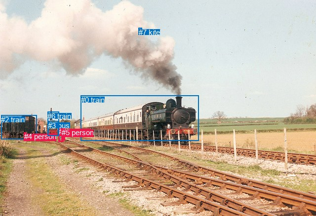
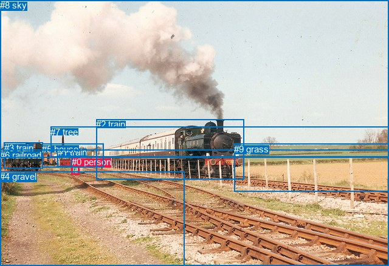

# 图片 2018：2411180.jpg

随机样本序号：27。图片 SHA256：`d4ae9927147f078532176e55567930fbfde714fe88b91eab7a9e793da355f8aa`。

红色框表示人，蓝色框表示其他物体。两个模式分别保留自身框编号，可依据位置比较对应对象。

## 自动检测框与输出

人的框编号：`[1, 4, 5]`。状态：`ok`。

### 自动检测全部物体框

| 编号 | 类别 | 是否为人 | 检测分数 | 像素坐标 xyxy |
|---|---|---|---|---|
| 0 | train | False | 0.9994 | 164.0, 193.7, 402.7, 286.0 |
| 1 | person | True | 0.9924 | 118.7, 258.4, 128.7, 287.3 |
| 2 | train | False | 0.8609 | 2.4, 233.7, 74.6, 282.2 |
| 3 | bus | False | 0.8394 | 97.1, 245.8, 118.8, 275.9 |
| 4 | person | True | 0.8324 | 48.8, 268.5, 53.4, 283.2 |
| 5 | person | True | 0.6521 | 124.7, 260.3, 131.1, 285.0 |
| 6 | train | False | 0.4610 | 96.4, 227.0, 119.1, 275.4 |
| 7 | kite | False | 0.3644 | 280.6, 56.7, 287.5, 64.4 |

### 自动检测 Top50 人相关候选

评分物体对：56；人相关物体对：36；输出关系：50。

| 排名 | 主语编号与类别 | 关系 | 宾语编号与类别 | 类型 | 人与人 | 排序分数 | 原始融合 logit |
|---|---|---|---|---|---|---|---|
| 1 | #4 person | on | #2 train | spatial | False | 0.95414 | 3.0352 |
| 2 | #1 person | looking at | #0 train | semantic | False | 0.89330 | 2.1249 |
| 3 | #5 person | looking at | #0 train | semantic | False | 0.89002 | 2.0909 |
| 4 | #1 person | wearing | #5 person | semantic | True | 0.88584 | 2.0489 |
| 5 | #5 person | beside | #0 train | spatial | False | 0.84738 | 1.7142 |
| 6 | #1 person | beside | #0 train | spatial | False | 0.84366 | 1.6857 |
| 7 | #0 train | pulling | #4 person | semantic | False | 0.83572 | 1.6267 |
| 8 | #2 train | on | #4 person | spatial | False | 0.77181 | 1.2186 |
| 9 | #4 person | on | #0 train | spatial | False | 0.77171 | 1.2180 |
| 10 | #5 person | wearing | #1 person | semantic | True | 0.75248 | 1.1119 |
| 11 | #1 person | in | #5 person | spatial | True | 0.68830 | 0.7922 |
| 12 | #5 person | in | #1 person | spatial | True | 0.66987 | 0.7076 |
| 13 | #1 person | pushing | #3 bus | semantic | False | 0.60854 | 0.4412 |
| 14 | #0 train | on | #4 person | spatial | False | 0.51945 | 0.0778 |
| 15 | #4 person | holding | #2 train | semantic | False | 0.50923 | 0.0369 |
| 16 | #4 person | on | #6 train | spatial | False | 0.50006 | 0.0002 |
| 17 | #2 train | carrying | #4 person | semantic | False | 0.49645 | -0.0142 |
| 18 | #5 person | walking on | #2 train | semantic | False | 0.46130 | -0.1551 |
| 19 | #1 person | walking on | #2 train | semantic | False | 0.45849 | -0.1664 |
| 20 | #1 person | pushing | #6 train | semantic | False | 0.42667 | -0.2954 |
| 21 | #3 bus | pushing | #1 person | semantic | False | 0.40314 | -0.3924 |
| 22 | #1 person | beside | #3 bus | spatial | False | 0.37100 | -0.5279 |
| 23 | #1 person | beside | #2 train | spatial | False | 0.35414 | -0.6009 |
| 24 | #5 person | beside | #2 train | spatial | False | 0.34659 | -0.6341 |
| 25 | #3 bus | pushing | #5 person | semantic | False | 0.31382 | -0.7823 |
| 26 | #1 person | beside | #6 train | spatial | False | 0.30093 | -0.8429 |
| 27 | #5 person | walking on | #3 bus | semantic | False | 0.29364 | -0.8778 |
| 28 | #4 person | on | #3 bus | spatial | False | 0.29320 | -0.8799 |
| 29 | #4 person | holding | #0 train | semantic | False | 0.26658 | -1.0121 |
| 30 | #5 person | beside | #3 bus | spatial | False | 0.23158 | -1.1994 |
| 31 | #6 train | on | #4 person | spatial | False | 0.17994 | -1.5168 |
| 32 | #3 bus | pulling | #4 person | semantic | False | 0.17619 | -1.5424 |
| 33 | #5 person | walking on | #6 train | semantic | False | 0.16988 | -1.5865 |
| 34 | #5 person | walking on | #4 person | semantic | True | 0.16698 | -1.6072 |
| 35 | #1 person | walking on | #4 person | semantic | True | 0.15366 | -1.7062 |
| 36 | #5 person | beside | #6 train | spatial | False | 0.14870 | -1.7448 |
| 37 | #4 person | holding | #6 train | semantic | False | 0.12061 | -1.9867 |
| 38 | #3 bus | on | #4 person | spatial | False | 0.11908 | -2.0011 |
| 39 | #0 train | pulling | #1 person | semantic | False | 0.11435 | -2.0471 |
| 40 | #3 bus | on | #1 person | spatial | False | 0.09847 | -2.2143 |
| 41 | #0 train | pulling | #5 person | semantic | False | 0.09241 | -2.2845 |
| 42 | #3 bus | on | #5 person | spatial | False | 0.07264 | -2.5468 |
| 43 | #6 train | pulling | #4 person | semantic | False | 0.05704 | -2.8052 |
| 44 | #1 person | looking at | #7 kite | semantic | False | 0.04648 | -3.0211 |
| 45 | #4 person | wearing | #3 bus | semantic | False | 0.04338 | -3.0934 |
| 46 | #5 person | looking at | #7 kite | semantic | False | 0.04190 | -3.1297 |
| 47 | #5 person | on | #4 person | spatial | True | 0.04179 | -3.1325 |
| 48 | #1 person | on | #4 person | spatial | True | 0.03682 | -3.2641 |
| 49 | #0 train | on | #1 person | spatial | False | 0.03318 | -3.3721 |
| 50 | #2 train | pulling | #1 person | semantic | False | 0.03183 | -3.4148 |

### 自动检测逐条人相关 GT 核验

R@50：0.00%；命中 0/1。

| GT 主语编号 | GT 关系 | GT 宾语编号 | 结果阶段 | 匹配预测主语编号 | 匹配预测宾语编号 |
|---|---|---|---|---|---|
| 0 | standing on | 6 | endpoint_missing_or_wrong_class | [1] | [] |

## 真实框与输出

人的框编号：`[0]`。

### 真实框全部物体框

| 编号 | 类别 | 是否为人 | 检测分数 | 像素坐标 xyxy |
|---|---|---|---|---|
| 0 | person | True | GT | 118.0, 258.0, 131.0, 287.0 |
| 1 | train | False | GT | 95.0, 242.0, 119.0, 274.0 |
| 2 | train | False | GT | 158.0, 196.0, 401.0, 295.0 |
| 3 | train | False | GT | 7.0, 235.0, 70.0, 278.0 |
| 4 | gravel | False | GT | 0.0, 282.0, 304.0, 438.0 |
| 5 | house | False | GT | 69.0, 237.0, 171.0, 276.0 |
| 6 | railroad | False | GT | 0.0, 247.0, 640.0, 438.0 |
| 7 | tree | False | GT | 83.0, 209.0, 640.0, 259.0 |
| 8 | sky | False | GT | 0.0, 0.0, 640.0, 259.0 |
| 9 | grass | False | GT | 385.0, 237.0, 640.0, 316.0 |

### 真实框 Top50 人相关候选

评分物体对：90；人相关物体对：18；输出关系：36。

| 排名 | 主语编号与类别 | 关系 | 宾语编号与类别 | 类型 | 人与人 | 排序分数 | 原始融合 logit |
|---|---|---|---|---|---|---|---|
| 1 | #0 person | walking on | #6 railroad | semantic | False | 0.92728 | 2.5457 |
| 2 | #0 person | beside | #2 train | spatial | False | 0.91610 | 2.3905 |
| 3 | #0 person | walking on | #4 gravel | semantic | False | 0.91444 | 2.3690 |
| 4 | #0 person | on | #4 gravel | spatial | False | 0.88366 | 2.0276 |
| 5 | #0 person | walking on | #2 train | semantic | False | 0.87484 | 1.9445 |
| 6 | #0 person | on | #6 railroad | spatial | False | 0.86882 | 1.8906 |
| 7 | #0 person | walking on | #5 house | semantic | False | 0.84246 | 1.6766 |
| 8 | #0 person | walking on | #1 train | semantic | False | 0.81063 | 1.4541 |
| 9 | #0 person | beside | #5 house | spatial | False | 0.80737 | 1.4330 |
| 10 | #0 person | beside | #1 train | spatial | False | 0.75306 | 1.1150 |
| 11 | #0 person | beside | #3 train | spatial | False | 0.47117 | -0.1155 |
| 12 | #0 person | walking on | #3 train | semantic | False | 0.46734 | -0.1308 |
| 13 | #1 train | pushing | #0 person | semantic | False | 0.13971 | -1.8177 |
| 14 | #1 train | beside | #0 person | spatial | False | 0.13490 | -1.8583 |
| 15 | #5 house | pushing | #0 person | semantic | False | 0.11754 | -2.0159 |
| 16 | #4 gravel | beside | #0 person | spatial | False | 0.08285 | -2.4043 |
| 17 | #5 house | on | #0 person | spatial | False | 0.07780 | -2.4726 |
| 18 | #2 train | pulling | #0 person | semantic | False | 0.06216 | -2.7139 |
| 19 | #0 person | looking at | #9 grass | semantic | False | 0.03683 | -3.2638 |
| 20 | #2 train | beside | #0 person | spatial | False | 0.03221 | -3.4027 |
| 21 | #0 person | beside | #9 grass | spatial | False | 0.02927 | -3.5013 |
| 22 | #3 train | pulling | #0 person | semantic | False | 0.02241 | -3.7757 |
| 23 | #0 person | in | #7 tree | spatial | False | 0.02098 | -3.8429 |
| 24 | #6 railroad | beside | #0 person | spatial | False | 0.01878 | -3.9561 |
| 25 | #0 person | looking at | #8 sky | semantic | False | 0.01770 | -4.0163 |
| 26 | #3 train | beside | #0 person | spatial | False | 0.01625 | -4.1031 |
| 27 | #4 gravel | holding | #0 person | semantic | False | 0.01618 | -4.1074 |
| 28 | #8 sky | over | #0 person | spatial | False | 0.01418 | -4.2418 |
| 29 | #0 person | looking at | #7 tree | semantic | False | 0.01301 | -4.3290 |
| 30 | #6 railroad | holding | #0 person | semantic | False | 0.01276 | -4.3485 |
| 31 | #0 person | in | #8 sky | spatial | False | 0.01181 | -4.4274 |
| 32 | #9 grass | beside | #0 person | spatial | False | 0.00888 | -4.7149 |
| 33 | #9 grass | holding | #0 person | semantic | False | 0.00163 | -6.4147 |
| 34 | #7 tree | beside | #0 person | spatial | False | 0.00123 | -6.7019 |
| 35 | #8 sky | falling off | #0 person | semantic | False | 0.00103 | -6.8796 |
| 36 | #7 tree | playing | #0 person | semantic | False | 0.00043 | -7.7502 |

### 真实框逐条人相关 GT 核验

R@50：0.00%；命中 0/1。

| GT 主语编号 | GT 关系 | GT 宾语编号 | 结果阶段 | 匹配预测主语编号 | 匹配预测宾语编号 |
|---|---|---|---|---|---|
| 0 | standing on | 6 | wrong_predicate | [0] | [6] |

## 全部人相关 GT

| 主语编号与类别 | 关系 | 宾语编号与类别 |
|---|---|---|
| #0 person | standing on | #6 railroad |

原始记录、全部人相关物体对的两项预测与分项分数见 [逐图证据 JSON](../evidence/cases/2018.json)。全部56类 logits 保留于本机 HOR/output/random500/logits/。

<!-- HOR_COMPLETE_RESULTS -->

## 六组条件的完整输出对照

以下保留同一图片三种框与候选模式、两种谓词输出规则的全部 Top50。框编号各自在所属模式内解释。

### 自动检测框完整枚举：空间与语义各保留一个谓词

| 排名 | 主语编号与类别 | 谓词 | 宾语编号与类别 | 分组 | 排序分数 | predicate logit | pair logit |
|---|---|---|---|---|---|---|---|
| 1 | #4 person | on | #2 train | spatial | 0.9541391 | 3.1324258 | -0.0972283 |
| 2 | #1 person | looking at | #0 train | semantic | 0.8932952 | 2.4432292 | -0.3183782 |
| 3 | #5 person | looking at | #0 train | semantic | 0.8900193 | 2.3809552 | -0.2900169 |
| 4 | #1 person | wearing | #5 person | semantic | 0.8858354 | 2.2756424 | -0.2267523 |
| 5 | #5 person | beside | #0 train | spatial | 0.8473829 | 2.0042377 | -0.2900169 |
| 6 | #1 person | beside | #0 train | spatial | 0.8436636 | 2.0041223 | -0.3183782 |
| 7 | #0 train | pulling | #4 person | semantic | 0.8357152 | 1.8320894 | -0.2054031 |
| 8 | #2 train | on | #4 person | spatial | 0.7718108 | 0.9713011 | 0.2472632 |
| 9 | #4 person | on | #0 train | spatial | 0.7717075 | 1.6232872 | -0.4053093 |
| 10 | #5 person | wearing | #1 person | semantic | 0.7524796 | 1.2758660 | -0.1639850 |
| 11 | #1 person | in | #5 person | spatial | 0.6883035 | 1.0189524 | -0.2267523 |
| 12 | #5 person | in | #1 person | spatial | 0.6698722 | 0.8715920 | -0.1639850 |
| 13 | #1 person | pushing | #3 bus | semantic | 0.6085386 | 0.9891772 | -0.5480040 |
| 14 | #0 train | on | #4 person | spatial | 0.5194465 | 0.2832284 | -0.2054031 |
| 15 | #4 person | holding | #2 train | semantic | 0.5092263 | 0.1341376 | -0.0972283 |
| 16 | #4 person | on | #6 train | spatial | 0.5000591 | 0.7087917 | -0.7085555 |
| 17 | #2 train | carrying | #4 person | semantic | 0.4964506 | -0.2614608 | 0.2472632 |
| 18 | #5 person | walking on | #2 train | semantic | 0.4613007 | 0.5568228 | -0.7119302 |
| 19 | #1 person | walking on | #2 train | semantic | 0.4584867 | 0.5417705 | -0.7082069 |
| 20 | #1 person | pushing | #6 train | semantic | 0.4266725 | 0.5982881 | -0.8937284 |
| 21 | #3 bus | pushing | #1 person | semantic | 0.4031445 | 0.0259752 | -0.4183552 |
| 22 | #1 person | beside | #3 bus | spatial | 0.3709979 | 0.0200658 | -0.5480040 |
| 23 | #1 person | beside | #2 train | spatial | 0.3541436 | 0.1073322 | -0.7082069 |
| 24 | #5 person | beside | #2 train | spatial | 0.3465922 | 0.0778775 | -0.7119302 |
| 25 | #3 bus | pushing | #5 person | semantic | 0.3138172 | -0.3350329 | -0.4473004 |
| 26 | #1 person | beside | #6 train | spatial | 0.3009292 | 0.0508513 | -0.8937284 |
| 27 | #5 person | walking on | #3 bus | semantic | 0.2936371 | -0.3519354 | -0.5258492 |
| 28 | #4 person | on | #3 bus | spatial | 0.2931965 | 0.1677284 | -1.0476381 |
| 29 | #4 person | holding | #0 train | semantic | 0.2665779 | -0.6067457 | -0.4053093 |
| 30 | #5 person | beside | #3 bus | spatial | 0.2315846 | -0.6735363 | -0.5258492 |
| 31 | #6 train | on | #4 person | spatial | 0.1799364 | -1.5579276 | 0.0411491 |
| 32 | #3 bus | pulling | #4 person | semantic | 0.1761858 | -1.6280980 | 0.0856923 |
| 33 | #5 person | walking on | #6 train | semantic | 0.1698809 | -0.7100062 | -0.8764656 |
| 34 | #5 person | walking on | #4 person | semantic | 0.1669787 | -1.0801468 | -0.5270461 |
| 35 | #1 person | walking on | #4 person | semantic | 0.1536595 | -1.1794589 | -0.5267240 |
| 36 | #5 person | beside | #6 train | spatial | 0.1486988 | -0.8683774 | -0.8764656 |
| 37 | #4 person | holding | #6 train | semantic | 0.1206112 | -1.2781000 | -0.7085555 |
| 38 | #3 bus | on | #4 person | spatial | 0.1190824 | -2.0868411 | 0.0856923 |
| 39 | #0 train | pulling | #1 person | semantic | 0.1143494 | -0.5448627 | -1.5022008 |
| 40 | #3 bus | on | #1 person | spatial | 0.0984694 | -1.7959924 | -0.4183552 |
| 41 | #0 train | pulling | #5 person | semantic | 0.0924107 | -0.7855570 | -1.4989921 |
| 42 | #3 bus | on | #5 person | spatial | 0.0726429 | -2.0994825 | -0.4473004 |
| 43 | #6 train | pulling | #4 person | semantic | 0.0570424 | -2.8463755 | 0.0411491 |
| 44 | #1 person | looking at | #7 kite | semantic | 0.0464797 | -1.6027577 | -1.4183878 |
| 45 | #4 person | wearing | #3 bus | semantic | 0.0433813 | -2.0457387 | -1.0476381 |
| 46 | #5 person | looking at | #7 kite | semantic | 0.0418984 | -1.7535627 | -1.3761430 |
| 47 | #5 person | on | #4 person | spatial | 0.0417879 | -2.6054158 | -0.5270461 |
| 48 | #1 person | on | #4 person | spatial | 0.0368229 | -2.7373941 | -0.5267240 |
| 49 | #0 train | on | #1 person | spatial | 0.0331787 | -1.8699033 | -1.5022008 |
| 50 | #2 train | pulling | #1 person | semantic | 0.0318349 | -1.9740672 | -1.4407725 |

GT 命中：0/1，R@50=0.00%。

| GT主语 | GT谓词 | GT宾语 | 结果阶段 | 匹配主语框 | 匹配宾语框 |
|---|---|---|---|---|---|
| 0 | standing on | 6 | endpoint_missing_or_wrong_class | [1] | [] |

### 自动检测框完整枚举：每对只保留一个谓词

| 排名 | 主语编号与类别 | 谓词 | 宾语编号与类别 | 分组 | 排序分数 | predicate logit | pair logit |
|---|---|---|---|---|---|---|---|
| 1 | #4 person | on | #2 train | single | 0.9541391 | 3.1324258 | -0.0972283 |
| 2 | #1 person | looking at | #0 train | single | 0.8932952 | 2.4432292 | -0.3183782 |
| 3 | #5 person | looking at | #0 train | single | 0.8900193 | 2.3809552 | -0.2900169 |
| 4 | #1 person | wearing | #5 person | single | 0.8858354 | 2.2756424 | -0.2267523 |
| 5 | #0 train | pulling | #4 person | single | 0.8357152 | 1.8320894 | -0.2054031 |
| 6 | #2 train | on | #4 person | single | 0.7718108 | 0.9713011 | 0.2472632 |
| 7 | #4 person | on | #0 train | single | 0.7717075 | 1.6232872 | -0.4053093 |
| 8 | #5 person | wearing | #1 person | single | 0.7524796 | 1.2758660 | -0.1639850 |
| 9 | #1 person | pushing | #3 bus | single | 0.6085386 | 0.9891772 | -0.5480040 |
| 10 | #4 person | on | #6 train | single | 0.5000591 | 0.7087917 | -0.7085555 |
| 11 | #5 person | walking on | #2 train | single | 0.4613007 | 0.5568228 | -0.7119302 |
| 12 | #1 person | walking on | #2 train | single | 0.4584867 | 0.5417705 | -0.7082069 |
| 13 | #1 person | pushing | #6 train | single | 0.4266725 | 0.5982881 | -0.8937284 |
| 14 | #3 bus | pushing | #1 person | single | 0.4031445 | 0.0259752 | -0.4183552 |
| 15 | #3 bus | pushing | #5 person | single | 0.3138172 | -0.3350329 | -0.4473004 |
| 16 | #5 person | walking on | #3 bus | single | 0.2936371 | -0.3519354 | -0.5258492 |
| 17 | #4 person | on | #3 bus | single | 0.2931965 | 0.1677284 | -1.0476381 |
| 18 | #6 train | on | #4 person | single | 0.1799364 | -1.5579276 | 0.0411491 |
| 19 | #3 bus | pulling | #4 person | single | 0.1761858 | -1.6280980 | 0.0856923 |
| 20 | #5 person | walking on | #6 train | single | 0.1698809 | -0.7100062 | -0.8764656 |
| 21 | #5 person | walking on | #4 person | single | 0.1669787 | -1.0801468 | -0.5270461 |
| 22 | #1 person | walking on | #4 person | single | 0.1536595 | -1.1794589 | -0.5267240 |
| 23 | #0 train | pulling | #1 person | single | 0.1143494 | -0.5448627 | -1.5022008 |
| 24 | #0 train | pulling | #5 person | single | 0.0924107 | -0.7855570 | -1.4989921 |
| 25 | #1 person | looking at | #7 kite | single | 0.0464797 | -1.6027577 | -1.4183878 |
| 26 | #5 person | looking at | #7 kite | single | 0.0418984 | -1.7535627 | -1.3761430 |
| 27 | #2 train | pulling | #1 person | single | 0.0318349 | -1.9740672 | -1.4407725 |
| 28 | #6 train | on | #1 person | single | 0.0289065 | -2.2335901 | -1.2807647 |
| 29 | #2 train | pulling | #5 person | single | 0.0202555 | -2.4253447 | -1.4535196 |
| 30 | #7 kite | on | #4 person | single | 0.0151674 | -2.1086645 | -2.0646601 |
| 31 | #6 train | pushing | #5 person | single | 0.0137236 | -2.9821651 | -1.2926536 |
| 32 | #4 person | on | #1 person | single | 0.0096004 | -3.0273161 | -1.6089885 |
| 33 | #7 kite | on | #5 person | single | 0.0067634 | -2.2975454 | -2.6918943 |
| 34 | #7 kite | on | #1 person | single | 0.0067316 | -2.2835207 | -2.7106740 |
| 35 | #4 person | on | #5 person | single | 0.0066967 | -3.3734379 | -1.6259866 |
| 36 | #4 person | pushing | #7 kite | single | 0.0020621 | -4.2984471 | -1.8835273 |

GT 命中：0/1，R@50=0.00%。

| GT主语 | GT谓词 | GT宾语 | 结果阶段 | 匹配主语框 | 匹配宾语框 |
|---|---|---|---|---|---|
| 0 | standing on | 6 | endpoint_missing_or_wrong_class | [1] | [] |

### 真实框完整枚举：空间与语义各保留一个谓词

| 排名 | 主语编号与类别 | 谓词 | 宾语编号与类别 | 分组 | 排序分数 | predicate logit | pair logit |
|---|---|---|---|---|---|---|---|
| 1 | #0 person | walking on | #6 railroad | semantic | 0.9272848 | 2.9249582 | -0.3792479 |
| 2 | #0 person | beside | #2 train | spatial | 0.9160976 | 2.6638165 | -0.2733473 |
| 3 | #0 person | walking on | #4 gravel | semantic | 0.9144358 | 3.0062141 | -0.6371744 |
| 4 | #0 person | on | #4 gravel | spatial | 0.8836622 | 2.6647515 | -0.6371744 |
| 5 | #0 person | walking on | #2 train | semantic | 0.8748427 | 2.2178206 | -0.2733473 |
| 6 | #0 person | on | #6 railroad | spatial | 0.8688219 | 2.2698298 | -0.3792479 |
| 7 | #0 person | walking on | #5 house | semantic | 0.8424580 | 2.3682494 | -0.6916178 |
| 8 | #0 person | walking on | #1 train | semantic | 0.8106333 | 2.0131612 | -0.5590305 |
| 9 | #0 person | beside | #5 house | spatial | 0.8073660 | 2.1246028 | -0.6916178 |
| 10 | #0 person | beside | #1 train | spatial | 0.7530627 | 1.6740441 | -0.5590305 |
| 11 | #0 person | beside | #3 train | spatial | 0.4711690 | 0.6142864 | -0.7297386 |
| 12 | #0 person | walking on | #3 train | semantic | 0.4673405 | 0.5989141 | -0.7297386 |
| 13 | #1 train | pushing | #0 person | semantic | 0.1397135 | -1.1170468 | -0.7006247 |
| 14 | #1 train | beside | #0 person | spatial | 0.1348985 | -1.1576996 | -0.7006247 |
| 15 | #5 house | pushing | #0 person | semantic | 0.1175407 | -1.3575203 | -0.6584076 |
| 16 | #4 gravel | beside | #0 person | spatial | 0.0828466 | -0.5826263 | -1.8216575 |
| 17 | #5 house | on | #0 person | spatial | 0.0778013 | -1.8141947 | -0.6584076 |
| 18 | #2 train | pulling | #0 person | semantic | 0.0621609 | -1.2217779 | -1.4920746 |
| 19 | #0 person | looking at | #9 grass | semantic | 0.0368327 | -1.7331133 | -1.5307281 |
| 20 | #2 train | beside | #0 person | spatial | 0.0322117 | -1.9106095 | -1.4920746 |
| 21 | #0 person | beside | #9 grass | spatial | 0.0292743 | -1.9706042 | -1.5307281 |
| 22 | #3 train | pulling | #0 person | semantic | 0.0224078 | -2.3351669 | -1.4405166 |
| 23 | #0 person | in | #7 tree | spatial | 0.0209813 | -1.9443018 | -1.8986179 |
| 24 | #6 railroad | beside | #0 person | spatial | 0.0187788 | -2.1477327 | -1.8083345 |
| 25 | #0 person | looking at | #8 sky | semantic | 0.0177001 | -1.8589907 | -2.1573370 |
| 26 | #3 train | beside | #0 person | spatial | 0.0162527 | -2.6625946 | -1.4405166 |
| 27 | #4 gravel | holding | #0 person | semantic | 0.0161837 | -2.2857773 | -1.8216575 |
| 28 | #8 sky | over | #0 person | spatial | 0.0141777 | -2.1990595 | -2.0427489 |
| 29 | #0 person | looking at | #7 tree | semantic | 0.0130089 | -2.4304087 | -1.8986179 |
| 30 | #6 railroad | holding | #0 person | semantic | 0.0127617 | -2.5401256 | -1.8083345 |
| 31 | #0 person | in | #8 sky | spatial | 0.0118050 | -2.2700191 | -2.1573370 |
| 32 | #9 grass | beside | #0 person | spatial | 0.0088808 | -2.6193948 | -2.0955529 |
| 33 | #9 grass | holding | #0 person | semantic | 0.0016346 | -4.3191724 | -2.0955529 |
| 34 | #7 tree | beside | #0 person | spatial | 0.0012271 | -4.4332194 | -2.2686820 |
| 35 | #8 sky | falling off | #0 person | semantic | 0.0010275 | -4.8368449 | -2.0427489 |
| 36 | #7 tree | playing | #0 person | semantic | 0.0004305 | -5.4814978 | -2.2686820 |

GT 命中：0/1，R@50=0.00%。

| GT主语 | GT谓词 | GT宾语 | 结果阶段 | 匹配主语框 | 匹配宾语框 |
|---|---|---|---|---|---|
| 0 | standing on | 6 | wrong_predicate | [0] | [6] |

### 真实框完整枚举：每对只保留一个谓词

| 排名 | 主语编号与类别 | 谓词 | 宾语编号与类别 | 分组 | 排序分数 | predicate logit | pair logit |
|---|---|---|---|---|---|---|---|
| 1 | #0 person | walking on | #6 railroad | single | 0.9272848 | 2.9249582 | -0.3792479 |
| 2 | #0 person | beside | #2 train | single | 0.9160976 | 2.6638165 | -0.2733473 |
| 3 | #0 person | walking on | #4 gravel | single | 0.9144358 | 3.0062141 | -0.6371744 |
| 4 | #0 person | walking on | #5 house | single | 0.8424580 | 2.3682494 | -0.6916178 |
| 5 | #0 person | walking on | #1 train | single | 0.8106333 | 2.0131612 | -0.5590305 |
| 6 | #0 person | beside | #3 train | single | 0.4711690 | 0.6142864 | -0.7297386 |
| 7 | #1 train | pushing | #0 person | single | 0.1397135 | -1.1170468 | -0.7006247 |
| 8 | #5 house | pushing | #0 person | single | 0.1175407 | -1.3575203 | -0.6584076 |
| 9 | #4 gravel | beside | #0 person | single | 0.0828466 | -0.5826263 | -1.8216575 |
| 10 | #2 train | pulling | #0 person | single | 0.0621609 | -1.2217779 | -1.4920746 |
| 11 | #0 person | looking at | #9 grass | single | 0.0368327 | -1.7331133 | -1.5307281 |
| 12 | #3 train | pulling | #0 person | single | 0.0224078 | -2.3351669 | -1.4405166 |
| 13 | #0 person | in | #7 tree | single | 0.0209813 | -1.9443018 | -1.8986179 |
| 14 | #6 railroad | beside | #0 person | single | 0.0187788 | -2.1477327 | -1.8083345 |
| 15 | #0 person | looking at | #8 sky | single | 0.0177001 | -1.8589907 | -2.1573370 |
| 16 | #8 sky | over | #0 person | single | 0.0141777 | -2.1990595 | -2.0427489 |
| 17 | #9 grass | beside | #0 person | single | 0.0088808 | -2.6193948 | -2.0955529 |
| 18 | #7 tree | beside | #0 person | single | 0.0012271 | -4.4332194 | -2.2686820 |

GT 命中：0/1，R@50=0.00%。

| GT主语 | GT谓词 | GT宾语 | 结果阶段 | 匹配主语框 | 匹配宾语框 |
|---|---|---|---|---|---|
| 0 | standing on | 6 | wrong_predicate | [0] | [6] |

### 真实框400候选：空间与语义各保留一个谓词

| 排名 | 主语编号与类别 | 谓词 | 宾语编号与类别 | 分组 | 排序分数 | predicate logit | pair logit |
|---|---|---|---|---|---|---|---|
| 1 | #0 person | walking on | #6 railroad | semantic | 0.9308533 | 2.9791193 | -0.3792479 |
| 2 | #0 person | walking on | #4 gravel | semantic | 0.9185795 | 3.0603752 | -0.6371744 |
| 3 | #0 person | beside | #2 train | spatial | 0.9160976 | 2.6638165 | -0.2733473 |
| 4 | #0 person | on | #4 gravel | spatial | 0.8836622 | 2.6647515 | -0.6371744 |
| 5 | #0 person | walking on | #2 train | semantic | 0.8748427 | 2.2178206 | -0.2733473 |
| 6 | #0 person | on | #6 railroad | spatial | 0.8688219 | 2.2698298 | -0.3792479 |
| 7 | #0 person | walking on | #5 house | semantic | 0.8460190 | 2.3953300 | -0.6916178 |
| 8 | #0 person | walking on | #1 train | semantic | 0.8106333 | 2.0131612 | -0.5590305 |
| 9 | #0 person | beside | #5 house | spatial | 0.8073660 | 2.1246028 | -0.6916178 |
| 10 | #0 person | beside | #1 train | spatial | 0.7530627 | 1.6740441 | -0.5590305 |
| 11 | #0 person | beside | #3 train | spatial | 0.4636639 | 0.5841374 | -0.7297386 |
| 12 | #0 person | walking on | #3 train | semantic | 0.4606056 | 0.5718336 | -0.7297386 |
| 13 | #1 train | pushing | #0 person | semantic | 0.1379163 | -1.1320808 | -0.7006247 |
| 14 | #1 train | beside | #0 person | spatial | 0.1366572 | -1.1427119 | -0.7006247 |
| 15 | #5 house | pushing | #0 person | semantic | 0.1129403 | -1.4026458 | -0.6584076 |
| 16 | #4 gravel | beside | #0 person | spatial | 0.0805972 | -0.6126022 | -1.8216575 |
| 17 | #5 house | on | #0 person | spatial | 0.0767286 | -1.8292403 | -0.6584076 |
| 18 | #2 train | pulling | #0 person | semantic | 0.0612897 | -1.2368205 | -1.4920746 |
| 19 | #0 person | looking at | #9 grass | semantic | 0.0368451 | -1.7327647 | -1.5307281 |
| 20 | #2 train | beside | #0 person | spatial | 0.0317468 | -1.9256265 | -1.4920746 |
| 21 | #0 person | beside | #9 grass | spatial | 0.0292727 | -1.9706621 | -1.5307281 |
| 22 | #3 train | pulling | #0 person | semantic | 0.0230763 | -2.3050871 | -1.4405166 |
| 23 | #0 person | in | #7 tree | spatial | 0.0205049 | -1.9677558 | -1.8986179 |
| 24 | #6 railroad | beside | #0 person | spatial | 0.0187778 | -2.1477904 | -1.8083345 |
| 25 | #0 person | looking at | #8 sky | semantic | 0.0179574 | -1.8442934 | -2.1573370 |
| 26 | #4 gravel | holding | #0 person | semantic | 0.0159691 | -2.2993457 | -1.8216575 |
| 27 | #3 train | beside | #0 person | spatial | 0.0157794 | -2.6926281 | -1.4405166 |
| 28 | #8 sky | over | #0 person | spatial | 0.0136136 | -2.2402303 | -2.0427489 |
| 29 | #0 person | looking at | #7 tree | semantic | 0.0131967 | -2.4158857 | -1.8986179 |
| 30 | #6 railroad | holding | #0 person | semantic | 0.0127385 | -2.5419722 | -1.8083345 |
| 31 | #0 person | in | #8 sky | spatial | 0.0117760 | -2.2725081 | -2.1573370 |
| 32 | #9 grass | beside | #0 person | spatial | 0.0086203 | -2.6494281 | -2.0955529 |
| 33 | #9 grass | holding | #0 person | semantic | 0.0016029 | -4.3387866 | -2.0955529 |
| 34 | #7 tree | beside | #0 person | spatial | 0.0011687 | -4.4820452 | -2.2686820 |
| 35 | #8 sky | falling off | #0 person | semantic | 0.0010245 | -4.8397923 | -2.0427489 |
| 36 | #7 tree | playing | #0 person | semantic | 0.0004203 | -5.5054040 | -2.2686820 |

GT 命中：0/1，R@50=0.00%。

| GT主语 | GT谓词 | GT宾语 | 结果阶段 | 匹配主语框 | 匹配宾语框 |
|---|---|---|---|---|---|
| 0 | standing on | 6 | wrong_predicate | [0] | [6] |

### 真实框400候选：每对只保留一个谓词

| 排名 | 主语编号与类别 | 谓词 | 宾语编号与类别 | 分组 | 排序分数 | predicate logit | pair logit |
|---|---|---|---|---|---|---|---|
| 1 | #0 person | walking on | #6 railroad | single | 0.9308533 | 2.9791193 | -0.3792479 |
| 2 | #0 person | walking on | #4 gravel | single | 0.9185795 | 3.0603752 | -0.6371744 |
| 3 | #0 person | beside | #2 train | single | 0.9160976 | 2.6638165 | -0.2733473 |
| 4 | #0 person | walking on | #5 house | single | 0.8460190 | 2.3953300 | -0.6916178 |
| 5 | #0 person | walking on | #1 train | single | 0.8106333 | 2.0131612 | -0.5590305 |
| 6 | #0 person | beside | #3 train | single | 0.4636639 | 0.5841374 | -0.7297386 |
| 7 | #1 train | pushing | #0 person | single | 0.1379163 | -1.1320808 | -0.7006247 |
| 8 | #5 house | pushing | #0 person | single | 0.1129403 | -1.4026458 | -0.6584076 |
| 9 | #4 gravel | beside | #0 person | single | 0.0805972 | -0.6126022 | -1.8216575 |
| 10 | #2 train | pulling | #0 person | single | 0.0612897 | -1.2368205 | -1.4920746 |
| 11 | #0 person | looking at | #9 grass | single | 0.0368451 | -1.7327647 | -1.5307281 |
| 12 | #3 train | pulling | #0 person | single | 0.0230763 | -2.3050871 | -1.4405166 |
| 13 | #0 person | in | #7 tree | single | 0.0205049 | -1.9677558 | -1.8986179 |
| 14 | #6 railroad | beside | #0 person | single | 0.0187778 | -2.1477904 | -1.8083345 |
| 15 | #0 person | looking at | #8 sky | single | 0.0179574 | -1.8442934 | -2.1573370 |
| 16 | #8 sky | over | #0 person | single | 0.0136136 | -2.2402303 | -2.0427489 |
| 17 | #9 grass | beside | #0 person | single | 0.0086203 | -2.6494281 | -2.0955529 |
| 18 | #7 tree | beside | #0 person | single | 0.0011687 | -4.4820452 | -2.2686820 |

GT 命中：0/1，R@50=0.00%。

| GT主语 | GT谓词 | GT宾语 | 结果阶段 | 匹配主语框 | 匹配宾语框 |
|---|---|---|---|---|---|
| 0 | standing on | 6 | wrong_predicate | [0] | [6] |
