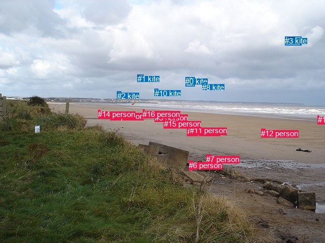
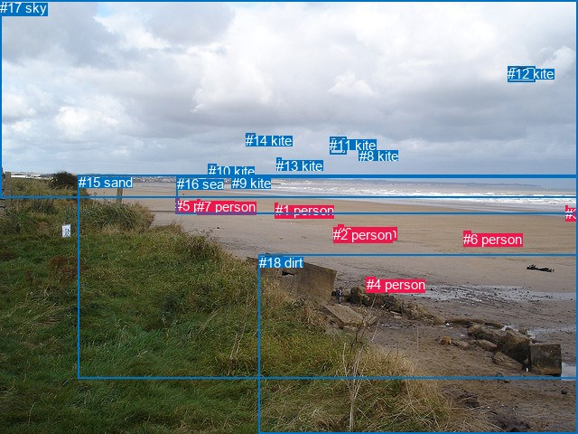

# 图片 2020：2411218.jpg

随机样本序号：192。图片 SHA256：`227fb6bfdc2acff13936f2e0c931d6d237447cd6b1ea29e836aed263f66a052e`。

红色框表示人，蓝色框表示其他物体。两个模式分别保留自身框编号，可依据位置比较对应对象。

## 自动检测框与输出

人的框编号：`[4, 5, 6, 7, 9, 11, 12, 13, 14, 15, 16]`。状态：`ok`。

### 自动检测全部物体框

| 编号 | 类别 | 是否为人 | 检测分数 | 像素坐标 xyxy |
|---|---|---|---|---|
| 0 | kite | False | 0.9965 | 365.4, 152.2, 384.0, 170.2 |
| 1 | kite | False | 0.9956 | 270.9, 147.2, 282.0, 157.7 |
| 2 | kite | False | 0.9953 | 230.7, 180.8, 238.8, 190.7 |
| 3 | kite | False | 0.9919 | 561.2, 72.3, 593.6, 89.9 |
| 4 | person | True | 0.9785 | 368.8, 251.4, 373.9, 265.5 |
| 5 | person | True | 0.9759 | 304.9, 223.9, 308.9, 231.3 |
| 6 | person | True | 0.9645 | 372.3, 317.9, 379.1, 336.7 |
| 7 | person | True | 0.9595 | 406.3, 305.9, 416.3, 316.2 |
| 8 | kite | False | 0.9296 | 398.3, 163.5, 406.8, 173.7 |
| 9 | person | True | 0.9205 | 217.9, 220.9, 222.3, 227.6 |
| 10 | kite | False | 0.9125 | 304.9, 175.7, 311.3, 181.6 |
| 11 | person | True | 0.8900 | 373.6, 249.1, 378.5, 261.2 |
| 12 | person | True | 0.8826 | 514.2, 254.9, 522.0, 263.3 |
| 13 | person | True | 0.8552 | 625.8, 228.1, 628.1, 233.2 |
| 14 | person | True | 0.7444 | 193.4, 217.4, 197.2, 223.0 |
| 15 | person | True | 0.5007 | 323.0, 236.4, 330.9, 241.4 |
| 16 | person | True | 0.4696 | 281.1, 216.8, 284.4, 220.1 |

### 自动检测 Top50 人相关候选

评分物体对：272；人相关物体对：242；输出关系：50。

| 排名 | 主语编号与类别 | 关系 | 宾语编号与类别 | 类型 | 人与人 | 排序分数 | 原始融合 logit |
|---|---|---|---|---|---|---|---|
| 1 | #4 person | flying over | #10 kite | semantic | False | 0.91125 | 2.3290 |
| 2 | #11 person | flying over | #10 kite | semantic | False | 0.90245 | 2.2248 |
| 3 | #4 person | flying over | #8 kite | semantic | False | 0.89250 | 2.1165 |
| 4 | #11 person | flying over | #8 kite | semantic | False | 0.88264 | 2.0176 |
| 5 | #9 person | flying over | #2 kite | semantic | False | 0.87972 | 1.9898 |
| 6 | #4 person | flying over | #1 kite | semantic | False | 0.87756 | 1.9695 |
| 7 | #4 person | flying over | #0 kite | semantic | False | 0.85300 | 1.7584 |
| 8 | #11 person | flying over | #1 kite | semantic | False | 0.85151 | 1.7465 |
| 9 | #4 person | holding | #11 person | semantic | True | 0.84109 | 1.6663 |
| 10 | #5 person | flying over | #10 kite | semantic | False | 0.83970 | 1.6560 |
| 11 | #12 person | flying over | #8 kite | semantic | False | 0.83214 | 1.6009 |
| 12 | #6 person | holding | #7 person | semantic | True | 0.83064 | 1.5902 |
| 13 | #16 person | flying over | #2 kite | semantic | False | 0.82645 | 1.5606 |
| 14 | #11 person | flying over | #0 kite | semantic | False | 0.82640 | 1.5603 |
| 15 | #12 person | flying over | #3 kite | semantic | False | 0.82596 | 1.5573 |
| 16 | #12 person | flying over | #0 kite | semantic | False | 0.82276 | 1.5352 |
| 17 | #5 person | flying over | #1 kite | semantic | False | 0.80593 | 1.4238 |
| 18 | #16 person | flying over | #10 kite | semantic | False | 0.80334 | 1.4073 |
| 19 | #15 person | flying over | #0 kite | semantic | False | 0.79786 | 1.3729 |
| 20 | #5 person | flying over | #2 kite | semantic | False | 0.79083 | 1.3300 |
| 21 | #15 person | flying over | #8 kite | semantic | False | 0.77575 | 1.2411 |
| 22 | #14 person | flying over | #2 kite | semantic | False | 0.76378 | 1.1735 |
| 23 | #15 person | flying over | #10 kite | semantic | False | 0.75976 | 1.1514 |
| 24 | #6 person | on | #7 person | spatial | True | 0.75141 | 1.1062 |
| 25 | #15 person | flying over | #1 kite | semantic | False | 0.74728 | 1.0841 |
| 26 | #12 person | flying over | #1 kite | semantic | False | 0.74492 | 1.0717 |
| 27 | #16 person | flying over | #1 kite | semantic | False | 0.73055 | 0.9974 |
| 28 | #5 person | flying over | #0 kite | semantic | False | 0.72608 | 0.9748 |
| 29 | #4 person | flying over | #2 kite | semantic | False | 0.72514 | 0.9701 |
| 30 | #11 person | flying over | #2 kite | semantic | False | 0.71071 | 0.8988 |
| 31 | #9 person | flying over | #1 kite | semantic | False | 0.70967 | 0.8938 |
| 32 | #4 person | in | #11 person | spatial | True | 0.70855 | 0.8884 |
| 33 | #11 person | beside | #4 person | spatial | True | 0.69983 | 0.8465 |
| 34 | #5 person | flying over | #8 kite | semantic | False | 0.69490 | 0.8231 |
| 35 | #4 person | flying over | #3 kite | semantic | False | 0.69220 | 0.8104 |
| 36 | #9 person | walking on | #14 person | semantic | True | 0.68718 | 0.7870 |
| 37 | #14 person | walking on | #9 person | semantic | True | 0.66878 | 0.7027 |
| 38 | #12 person | flying over | #10 kite | semantic | False | 0.66223 | 0.6732 |
| 39 | #15 person | flying over | #2 kite | semantic | False | 0.66097 | 0.6676 |
| 40 | #11 person | flying over | #3 kite | semantic | False | 0.65700 | 0.6499 |
| 41 | #12 person | flying over | #2 kite | semantic | False | 0.64962 | 0.6174 |
| 42 | #9 person | flying over | #10 kite | semantic | False | 0.62926 | 0.5290 |
| 43 | #13 person | flying over | #3 kite | semantic | False | 0.60108 | 0.4100 |
| 44 | #14 person | flying over | #1 kite | semantic | False | 0.59828 | 0.3983 |
| 45 | #14 person | flying over | #10 kite | semantic | False | 0.56265 | 0.2519 |
| 46 | #16 person | flying over | #0 kite | semantic | False | 0.55745 | 0.2308 |
| 47 | #16 person | flying over | #8 kite | semantic | False | 0.52950 | 0.1181 |
| 48 | #9 person | walking on | #16 person | semantic | True | 0.48000 | -0.0800 |
| 49 | #15 person | walking on | #5 person | semantic | True | 0.47375 | -0.1051 |
| 50 | #15 person | flying over | #3 kite | semantic | False | 0.46786 | -0.1287 |

### 自动检测逐条人相关 GT 核验

R@50：0.00%；命中 0/1。

| GT 主语编号 | GT 关系 | GT 宾语编号 | 结果阶段 | 匹配预测主语编号 | 匹配预测宾语编号 |
|---|---|---|---|---|---|
| 2 | on | 15 | endpoint_missing_or_wrong_class | [4] | [] |

## 真实框与输出

人的框编号：`[0, 1, 2, 3, 4, 5, 6, 7]`。

### 真实框全部物体框

| 编号 | 类别 | 是否为人 | 检测分数 | 像素坐标 xyxy |
|---|---|---|---|---|
| 0 | person | True | GT | 374.0, 249.0, 380.0, 261.0 |
| 1 | person | True | GT | 305.0, 224.0, 308.0, 231.0 |
| 2 | person | True | GT | 369.0, 251.0, 374.0, 266.0 |
| 3 | person | True | GT | 626.0, 228.0, 628.0, 234.0 |
| 4 | person | True | GT | 406.0, 306.0, 416.0, 316.0 |
| 5 | person | True | GT | 194.0, 219.0, 198.0, 223.0 |
| 6 | person | True | GT | 513.0, 256.0, 522.0, 263.0 |
| 7 | person | True | GT | 218.0, 220.0, 221.0, 228.0 |
| 8 | kite | False | GT | 398.0, 164.0, 408.0, 172.0 |
| 9 | kite | False | GT | 257.0, 194.0, 266.0, 207.0 |
| 10 | kite | False | GT | 231.0, 181.0, 239.0, 190.0 |
| 11 | kite | False | GT | 365.0, 152.0, 383.0, 171.0 |
| 12 | kite | False | GT | 562.0, 73.0, 592.0, 90.0 |
| 13 | kite | False | GT | 306.0, 175.0, 311.0, 180.0 |
| 14 | kite | False | GT | 272.0, 147.0, 282.0, 158.0 |
| 15 | sand | False | GT | 87.0, 193.0, 640.0, 418.0 |
| 16 | sea | False | GT | 196.0, 195.0, 640.0, 236.0 |
| 17 | sky | False | GT | 0.0, 0.0, 640.0, 218.0 |
| 18 | dirt | False | GT | 287.0, 282.0, 640.0, 480.0 |

### 真实框 Top50 人相关候选

评分物体对：342；人相关物体对：232；输出关系：50。

| 排名 | 主语编号与类别 | 关系 | 宾语编号与类别 | 类型 | 人与人 | 排序分数 | 原始融合 logit |
|---|---|---|---|---|---|---|---|
| 1 | #4 person | on | #18 dirt | spatial | False | 0.97585 | 3.6992 |
| 2 | #3 person | in | #16 sea | spatial | False | 0.96978 | 3.4686 |
| 3 | #0 person | on | #15 sand | spatial | False | 0.96859 | 3.4287 |
| 4 | #7 person | on | #15 sand | spatial | False | 0.96844 | 3.4239 |
| 5 | #6 person | on | #15 sand | spatial | False | 0.96830 | 3.4191 |
| 6 | #2 person | on | #15 sand | spatial | False | 0.96811 | 3.4130 |
| 7 | #5 person | on | #15 sand | spatial | False | 0.96582 | 3.3413 |
| 8 | #0 person | running on | #15 sand | semantic | False | 0.96381 | 3.2822 |
| 9 | #1 person | walking on | #15 sand | semantic | False | 0.96316 | 3.2637 |
| 10 | #2 person | running on | #15 sand | semantic | False | 0.96302 | 3.2596 |
| 11 | #5 person | walking on | #15 sand | semantic | False | 0.96105 | 3.2057 |
| 12 | #4 person | on | #15 sand | spatial | False | 0.96093 | 3.2025 |
| 13 | #3 person | on | #15 sand | spatial | False | 0.95970 | 3.1702 |
| 14 | #7 person | walking on | #15 sand | semantic | False | 0.95802 | 3.1276 |
| 15 | #1 person | on | #15 sand | spatial | False | 0.95749 | 3.1147 |
| 16 | #4 person | lying on | #18 dirt | semantic | False | 0.93438 | 2.6560 |
| 17 | #6 person | standing on | #15 sand | semantic | False | 0.91158 | 2.3331 |
| 18 | #3 person | running on | #15 sand | semantic | False | 0.90860 | 2.2967 |
| 19 | #4 person | lying on | #15 sand | semantic | False | 0.90518 | 2.2561 |
| 20 | #6 person | on | #18 dirt | spatial | False | 0.86001 | 1.8153 |
| 21 | #1 person | in | #16 sea | spatial | False | 0.85821 | 1.8005 |
| 22 | #1 person | walking on | #16 sea | semantic | False | 0.81613 | 1.4903 |
| 23 | #3 person | playing with | #16 sea | semantic | False | 0.80379 | 1.4102 |
| 24 | #7 person | in | #16 sea | spatial | False | 0.76988 | 1.2076 |
| 25 | #7 person | walking on | #16 sea | semantic | False | 0.76438 | 1.1769 |
| 26 | #2 person | walking on | #16 sea | semantic | False | 0.73920 | 1.0418 |
| 27 | #2 person | beside | #0 person | spatial | True | 0.73469 | 1.0185 |
| 28 | #2 person | walking on | #18 dirt | semantic | False | 0.72308 | 0.9598 |
| 29 | #5 person | in | #16 sea | spatial | False | 0.71183 | 0.9043 |
| 30 | #2 person | flying over | #13 kite | semantic | False | 0.69824 | 0.8389 |
| 31 | #6 person | lying on | #18 dirt | semantic | False | 0.69783 | 0.8370 |
| 32 | #0 person | walking on | #16 sea | semantic | False | 0.69264 | 0.8125 |
| 33 | #2 person | walking on | #0 person | semantic | True | 0.69066 | 0.8032 |
| 34 | #0 person | walking on | #18 dirt | semantic | False | 0.67720 | 0.7409 |
| 35 | #2 person | flying over | #14 kite | semantic | False | 0.66331 | 0.6781 |
| 36 | #5 person | walking on | #16 sea | semantic | False | 0.66277 | 0.6757 |
| 37 | #0 person | flying over | #13 kite | semantic | False | 0.61938 | 0.4869 |
| 38 | #2 person | on | #18 dirt | spatial | False | 0.61327 | 0.4611 |
| 39 | #0 person | flying over | #14 kite | semantic | False | 0.58830 | 0.3569 |
| 40 | #0 person | on | #18 dirt | spatial | False | 0.56727 | 0.2707 |
| 41 | #2 person | in | #16 sea | spatial | False | 0.56163 | 0.2478 |
| 42 | #0 person | beside | #2 person | spatial | True | 0.55476 | 0.2199 |
| 43 | #0 person | in | #16 sea | spatial | False | 0.55257 | 0.2111 |
| 44 | #2 person | flying over | #11 kite | semantic | False | 0.47645 | -0.0943 |
| 45 | #0 person | walking on | #2 person | semantic | True | 0.46894 | -0.1244 |
| 46 | #16 sea | in | #3 person | spatial | False | 0.44911 | -0.2043 |
| 47 | #2 person | flying over | #8 kite | semantic | False | 0.43659 | -0.2550 |
| 48 | #1 person | flying over | #14 kite | semantic | False | 0.39751 | -0.4158 |
| 49 | #5 person | on | #18 dirt | spatial | False | 0.39543 | -0.4245 |
| 50 | #5 person | walking on | #18 dirt | semantic | False | 0.39158 | -0.4407 |

### 真实框逐条人相关 GT 核验

R@50：100.00%；命中 1/1。

| GT 主语编号 | GT 关系 | GT 宾语编号 | 结果阶段 | 匹配预测主语编号 | 匹配预测宾语编号 |
|---|---|---|---|---|---|
| 2 | on | 15 | hit50 | [2] | [15] |

## 全部人相关 GT

| 主语编号与类别 | 关系 | 宾语编号与类别 |
|---|---|---|
| #2 person | on | #15 sand |

原始记录、全部人相关物体对的两项预测与分项分数见 [逐图证据 JSON](../evidence/cases/2020.json)。全部56类 logits 保留于本机 HOR/output/random500/logits/。

<!-- HOR_COMPLETE_RESULTS -->

## 六组条件的完整输出对照

以下保留同一图片三种框与候选模式、两种谓词输出规则的全部 Top50。框编号各自在所属模式内解释。

### 自动检测框完整枚举：空间与语义各保留一个谓词

| 排名 | 主语编号与类别 | 谓词 | 宾语编号与类别 | 分组 | 排序分数 | predicate logit | pair logit |
|---|---|---|---|---|---|---|---|
| 1 | #4 person | flying over | #10 kite | semantic | 0.9112540 | 2.4856272 | -0.1565835 |
| 2 | #11 person | flying over | #10 kite | semantic | 0.9024528 | 2.4555049 | -0.2307248 |
| 3 | #4 person | flying over | #8 kite | semantic | 0.8925002 | 2.1858511 | -0.0693126 |
| 4 | #11 person | flying over | #8 kite | semantic | 0.8826355 | 2.1257915 | -0.1081634 |
| 5 | #9 person | flying over | #2 kite | semantic | 0.8797214 | 2.3653235 | -0.3755287 |
| 6 | #4 person | flying over | #1 kite | semantic | 0.8775623 | 2.0943794 | -0.1248332 |
| 7 | #4 person | flying over | #0 kite | semantic | 0.8530048 | 1.7646961 | -0.0063305 |
| 8 | #11 person | flying over | #1 kite | semantic | 0.8515141 | 1.9439235 | -0.1973970 |
| 9 | #4 person | holding | #11 person | semantic | 0.8410871 | 1.8726039 | -0.2062650 |
| 10 | #5 person | flying over | #10 kite | semantic | 0.8396961 | 1.7642045 | -0.1082358 |
| 11 | #12 person | flying over | #8 kite | semantic | 0.8321417 | 1.9447527 | -0.3438701 |
| 12 | #6 person | holding | #7 person | semantic | 0.8306396 | 2.0958180 | -0.5056511 |
| 13 | #16 person | flying over | #2 kite | semantic | 0.8264457 | 2.0028615 | -0.4422181 |
| 14 | #11 person | flying over | #0 kite | semantic | 0.8263977 | 1.6142707 | -0.0539613 |
| 15 | #12 person | flying over | #3 kite | semantic | 0.8259593 | 1.7651572 | -0.2079006 |
| 16 | #12 person | flying over | #0 kite | semantic | 0.8227635 | 1.8844471 | -0.3492633 |
| 17 | #5 person | flying over | #1 kite | semantic | 0.8059297 | 1.5529213 | -0.1291451 |
| 18 | #16 person | flying over | #10 kite | semantic | 0.8033379 | 1.7342982 | -0.3270097 |
| 19 | #15 person | flying over | #0 kite | semantic | 0.7978552 | 1.4940596 | -0.1211170 |
| 20 | #5 person | flying over | #2 kite | semantic | 0.7908332 | 1.6729794 | -0.3430241 |
| 21 | #15 person | flying over | #8 kite | semantic | 0.7757517 | 1.4642754 | -0.2231966 |
| 22 | #14 person | flying over | #2 kite | semantic | 0.7637812 | 1.5842099 | -0.4106867 |
| 23 | #15 person | flying over | #10 kite | semantic | 0.7597601 | 1.1928396 | -0.0414748 |
| 24 | #6 person | on | #7 person | spatial | 0.7514139 | 1.6118188 | -0.5056511 |
| 25 | #15 person | flying over | #1 kite | semantic | 0.7472753 | 1.1618118 | -0.0776792 |
| 26 | #12 person | flying over | #1 kite | semantic | 0.7449201 | 1.4929838 | -0.4212837 |
| 27 | #16 person | flying over | #1 kite | semantic | 0.7305527 | 1.3124676 | -0.3150392 |
| 28 | #5 person | flying over | #0 kite | semantic | 0.7260792 | 1.2541285 | -0.2793086 |
| 29 | #4 person | flying over | #2 kite | semantic | 0.7251360 | 1.5230756 | -0.5529925 |
| 30 | #11 person | flying over | #2 kite | semantic | 0.7107063 | 1.5229836 | -0.6241666 |
| 31 | #9 person | flying over | #1 kite | semantic | 0.7096695 | 1.2839732 | -0.3901942 |
| 32 | #4 person | in | #11 person | spatial | 0.7085497 | 1.0946155 | -0.2062650 |
| 33 | #11 person | beside | #4 person | spatial | 0.6998273 | 1.1216021 | -0.2751264 |
| 34 | #5 person | flying over | #8 kite | semantic | 0.6949043 | 1.2240987 | -0.4009500 |
| 35 | #4 person | flying over | #3 kite | semantic | 0.6922035 | 1.3444939 | -0.5340527 |
| 36 | #9 person | walking on | #14 person | semantic | 0.6871824 | 1.0020452 | -0.2150653 |
| 37 | #14 person | walking on | #9 person | semantic | 0.6687790 | 0.8455958 | -0.1429281 |
| 38 | #12 person | flying over | #10 kite | semantic | 0.6622252 | 1.2526846 | -0.5794580 |
| 39 | #15 person | flying over | #2 kite | semantic | 0.6609733 | 1.0411854 | -0.3735510 |
| 40 | #11 person | flying over | #3 kite | semantic | 0.6569962 | 1.2243133 | -0.5743767 |
| 41 | #12 person | flying over | #2 kite | semantic | 0.6496210 | 1.2517939 | -0.6344202 |
| 42 | #9 person | flying over | #10 kite | semantic | 0.6292576 | 0.9834909 | -0.4544577 |
| 43 | #13 person | flying over | #3 kite | semantic | 0.6010826 | 1.2240372 | -0.8140593 |
| 44 | #14 person | flying over | #1 kite | semantic | 0.5982755 | 0.8631878 | -0.4649031 |
| 45 | #14 person | flying over | #10 kite | semantic | 0.5626472 | 0.8031282 | -0.5512156 |
| 46 | #16 person | flying over | #0 kite | semantic | 0.5574467 | 0.7732515 | -0.5424454 |
| 47 | #16 person | flying over | #8 kite | semantic | 0.5294957 | 0.7729750 | -0.6548553 |
| 48 | #9 person | walking on | #16 person | semantic | 0.4800027 | 0.1596155 | -0.2396472 |
| 49 | #15 person | walking on | #5 person | semantic | 0.4737495 | 0.2316589 | -0.3367578 |
| 50 | #15 person | flying over | #3 kite | semantic | 0.4678625 | 0.5927653 | -0.7214928 |

GT 命中：0/1，R@50=0.00%。

| GT主语 | GT谓词 | GT宾语 | 结果阶段 | 匹配主语框 | 匹配宾语框 |
|---|---|---|---|---|---|
| 2 | on | 15 | endpoint_missing_or_wrong_class | [4] | [] |

### 自动检测框完整枚举：每对只保留一个谓词

| 排名 | 主语编号与类别 | 谓词 | 宾语编号与类别 | 分组 | 排序分数 | predicate logit | pair logit |
|---|---|---|---|---|---|---|---|
| 1 | #4 person | flying over | #10 kite | single | 0.9112540 | 2.4856272 | -0.1565835 |
| 2 | #11 person | flying over | #10 kite | single | 0.9024528 | 2.4555049 | -0.2307248 |
| 3 | #4 person | flying over | #8 kite | single | 0.8925002 | 2.1858511 | -0.0693126 |
| 4 | #11 person | flying over | #8 kite | single | 0.8826355 | 2.1257915 | -0.1081634 |
| 5 | #9 person | flying over | #2 kite | single | 0.8797214 | 2.3653235 | -0.3755287 |
| 6 | #4 person | flying over | #1 kite | single | 0.8775623 | 2.0943794 | -0.1248332 |
| 7 | #4 person | flying over | #0 kite | single | 0.8530048 | 1.7646961 | -0.0063305 |
| 8 | #11 person | flying over | #1 kite | single | 0.8515141 | 1.9439235 | -0.1973970 |
| 9 | #4 person | holding | #11 person | single | 0.8410871 | 1.8726039 | -0.2062650 |
| 10 | #5 person | flying over | #10 kite | single | 0.8396961 | 1.7642045 | -0.1082358 |
| 11 | #12 person | flying over | #8 kite | single | 0.8321417 | 1.9447527 | -0.3438701 |
| 12 | #6 person | holding | #7 person | single | 0.8306396 | 2.0958180 | -0.5056511 |
| 13 | #16 person | flying over | #2 kite | single | 0.8264457 | 2.0028615 | -0.4422181 |
| 14 | #11 person | flying over | #0 kite | single | 0.8263977 | 1.6142707 | -0.0539613 |
| 15 | #12 person | flying over | #3 kite | single | 0.8259593 | 1.7651572 | -0.2079006 |
| 16 | #12 person | flying over | #0 kite | single | 0.8227635 | 1.8844471 | -0.3492633 |
| 17 | #5 person | flying over | #1 kite | single | 0.8059297 | 1.5529213 | -0.1291451 |
| 18 | #16 person | flying over | #10 kite | single | 0.8033379 | 1.7342982 | -0.3270097 |
| 19 | #15 person | flying over | #0 kite | single | 0.7978552 | 1.4940596 | -0.1211170 |
| 20 | #5 person | flying over | #2 kite | single | 0.7908332 | 1.6729794 | -0.3430241 |
| 21 | #15 person | flying over | #8 kite | single | 0.7757517 | 1.4642754 | -0.2231966 |
| 22 | #14 person | flying over | #2 kite | single | 0.7637812 | 1.5842099 | -0.4106867 |
| 23 | #15 person | flying over | #10 kite | single | 0.7597601 | 1.1928396 | -0.0414748 |
| 24 | #15 person | flying over | #1 kite | single | 0.7472753 | 1.1618118 | -0.0776792 |
| 25 | #12 person | flying over | #1 kite | single | 0.7449201 | 1.4929838 | -0.4212837 |
| 26 | #16 person | flying over | #1 kite | single | 0.7305527 | 1.3124676 | -0.3150392 |
| 27 | #5 person | flying over | #0 kite | single | 0.7260792 | 1.2541285 | -0.2793086 |
| 28 | #4 person | flying over | #2 kite | single | 0.7251360 | 1.5230756 | -0.5529925 |
| 29 | #11 person | flying over | #2 kite | single | 0.7107063 | 1.5229836 | -0.6241666 |
| 30 | #9 person | flying over | #1 kite | single | 0.7096695 | 1.2839732 | -0.3901942 |
| 31 | #11 person | beside | #4 person | single | 0.6998273 | 1.1216021 | -0.2751264 |
| 32 | #5 person | flying over | #8 kite | single | 0.6949043 | 1.2240987 | -0.4009500 |
| 33 | #4 person | flying over | #3 kite | single | 0.6922035 | 1.3444939 | -0.5340527 |
| 34 | #9 person | walking on | #14 person | single | 0.6871824 | 1.0020452 | -0.2150653 |
| 35 | #14 person | walking on | #9 person | single | 0.6687790 | 0.8455958 | -0.1429281 |
| 36 | #12 person | flying over | #10 kite | single | 0.6622252 | 1.2526846 | -0.5794580 |
| 37 | #15 person | flying over | #2 kite | single | 0.6609733 | 1.0411854 | -0.3735510 |
| 38 | #11 person | flying over | #3 kite | single | 0.6569962 | 1.2243133 | -0.5743767 |
| 39 | #12 person | flying over | #2 kite | single | 0.6496210 | 1.2517939 | -0.6344202 |
| 40 | #9 person | flying over | #10 kite | single | 0.6292576 | 0.9834909 | -0.4544577 |
| 41 | #13 person | flying over | #3 kite | single | 0.6010826 | 1.2240372 | -0.8140593 |
| 42 | #14 person | flying over | #1 kite | single | 0.5982755 | 0.8631878 | -0.4649031 |
| 43 | #14 person | flying over | #10 kite | single | 0.5626472 | 0.8031282 | -0.5512156 |
| 44 | #16 person | flying over | #0 kite | single | 0.5574467 | 0.7732515 | -0.5424454 |
| 45 | #16 person | flying over | #8 kite | single | 0.5294957 | 0.7729750 | -0.6548553 |
| 46 | #9 person | walking on | #16 person | single | 0.4800027 | 0.1596155 | -0.2396472 |
| 47 | #15 person | walking on | #5 person | single | 0.4737495 | 0.2316589 | -0.3367578 |
| 48 | #15 person | flying over | #3 kite | single | 0.4678625 | 0.5927653 | -0.7214928 |
| 49 | #9 person | flying over | #0 kite | single | 0.4666439 | 0.5629506 | -0.6965736 |
| 50 | #5 person | walking on | #15 person | single | 0.4575659 | 0.1776652 | -0.3478109 |

GT 命中：0/1，R@50=0.00%。

| GT主语 | GT谓词 | GT宾语 | 结果阶段 | 匹配主语框 | 匹配宾语框 |
|---|---|---|---|---|---|
| 2 | on | 15 | endpoint_missing_or_wrong_class | [4] | [] |

### 真实框完整枚举：空间与语义各保留一个谓词

| 排名 | 主语编号与类别 | 谓词 | 宾语编号与类别 | 分组 | 排序分数 | predicate logit | pair logit |
|---|---|---|---|---|---|---|---|
| 1 | #4 person | on | #18 dirt | spatial | 0.9758538 | 3.5634913 | 0.1356917 |
| 2 | #3 person | in | #16 sea | spatial | 0.9697818 | 3.6665368 | -0.1979107 |
| 3 | #0 person | on | #15 sand | spatial | 0.9685889 | 3.4265037 | 0.0021774 |
| 4 | #7 person | on | #15 sand | spatial | 0.9684425 | 3.2574248 | 0.1664534 |
| 5 | #6 person | on | #15 sand | spatial | 0.9682965 | 3.2740479 | 0.1450626 |
| 6 | #2 person | on | #15 sand | spatial | 0.9681079 | 3.3772101 | 0.0357780 |
| 7 | #5 person | on | #15 sand | spatial | 0.9658201 | 3.1479487 | 0.1933893 |
| 8 | #0 person | running on | #15 sand | semantic | 0.9638143 | 3.2800584 | 0.0021774 |
| 9 | #1 person | walking on | #15 sand | semantic | 0.9631625 | 3.1657438 | 0.0979632 |
| 10 | #2 person | running on | #15 sand | semantic | 0.9630173 | 3.2238445 | 0.0357780 |
| 11 | #5 person | walking on | #15 sand | semantic | 0.9610464 | 3.0122628 | 0.1933893 |
| 12 | #4 person | on | #15 sand | spatial | 0.9609264 | 3.3158698 | -0.1134195 |
| 13 | #3 person | on | #15 sand | spatial | 0.9596970 | 3.3004036 | -0.1302121 |
| 14 | #7 person | walking on | #15 sand | semantic | 0.9580156 | 2.9611120 | 0.1664534 |
| 15 | #1 person | on | #15 sand | spatial | 0.9574934 | 3.0166945 | 0.0979632 |
| 16 | #4 person | lying on | #18 dirt | semantic | 0.9343811 | 2.5203285 | 0.1356917 |
| 17 | #6 person | standing on | #15 sand | semantic | 0.9115793 | 2.1880093 | 0.1450626 |
| 18 | #3 person | running on | #15 sand | semantic | 0.9086047 | 2.4269271 | -0.1302121 |
| 19 | #4 person | lying on | #15 sand | semantic | 0.9051771 | 2.3695383 | -0.1134195 |
| 20 | #6 person | on | #18 dirt | spatial | 0.8600051 | 2.1451778 | -0.3298454 |
| 21 | #1 person | in | #16 sea | spatial | 0.8582058 | 2.0345273 | -0.2340598 |
| 22 | #1 person | walking on | #16 sea | semantic | 0.8161255 | 1.7243743 | -0.2340598 |
| 23 | #3 person | playing with | #16 sea | semantic | 0.8037925 | 1.6080794 | -0.1979107 |
| 24 | #7 person | in | #16 sea | spatial | 0.7698811 | 1.6136947 | -0.4060543 |
| 25 | #7 person | walking on | #16 sea | semantic | 0.7643841 | 1.5829220 | -0.4060543 |
| 26 | #2 person | walking on | #16 sea | semantic | 0.7391976 | 1.2248511 | -0.1830492 |
| 27 | #2 person | beside | #0 person | spatial | 0.7346859 | 1.2204199 | -0.2018914 |
| 28 | #2 person | walking on | #18 dirt | semantic | 0.7230774 | 1.4625845 | -0.5028061 |
| 29 | #5 person | in | #16 sea | spatial | 0.7118286 | 1.2789268 | -0.3746451 |
| 30 | #2 person | flying over | #13 kite | semantic | 0.6982393 | 0.9794559 | -0.1405287 |
| 31 | #6 person | lying on | #18 dirt | semantic | 0.6978323 | 1.1668425 | -0.3298454 |
| 32 | #0 person | walking on | #16 sea | semantic | 0.6926377 | 1.0021844 | -0.1897044 |
| 33 | #2 person | walking on | #0 person | semantic | 0.6906628 | 1.0051112 | -0.2018914 |
| 34 | #0 person | walking on | #18 dirt | semantic | 0.6771954 | 1.2669983 | -0.5260855 |
| 35 | #2 person | flying over | #14 kite | semantic | 0.6633132 | 0.7995882 | -0.1214942 |
| 36 | #5 person | walking on | #16 sea | semantic | 0.6627738 | 1.0503249 | -0.3746451 |
| 37 | #0 person | flying over | #13 kite | semantic | 0.6193784 | 0.7090073 | -0.2220963 |
| 38 | #2 person | on | #18 dirt | spatial | 0.6132704 | 0.9638863 | -0.5028061 |
| 39 | #0 person | flying over | #14 kite | semantic | 0.5882974 | 0.5591421 | -0.2022109 |
| 40 | #0 person | on | #18 dirt | spatial | 0.5672699 | 0.7968063 | -0.5260855 |
| 41 | #2 person | in | #16 sea | spatial | 0.5616345 | 0.4308476 | -0.1830492 |
| 42 | #0 person | beside | #2 person | spatial | 0.5547601 | 0.4963794 | -0.2764570 |
| 43 | #0 person | in | #16 sea | spatial | 0.5525680 | 0.4007564 | -0.1897044 |
| 44 | #2 person | flying over | #11 kite | semantic | 0.4764537 | -0.1025567 | 0.0083019 |
| 45 | #0 person | walking on | #2 person | semantic | 0.4689376 | 0.1520472 | -0.2764570 |
| 46 | #16 sea | in | #3 person | spatial | 0.4491091 | 0.5102749 | -0.7145455 |
| 47 | #2 person | flying over | #8 kite | semantic | 0.4365899 | -0.1923308 | -0.0626828 |
| 48 | #1 person | flying over | #14 kite | semantic | 0.3975131 | -0.2828588 | -0.1329793 |
| 49 | #5 person | on | #18 dirt | spatial | 0.3954332 | 0.4345527 | -0.8590832 |
| 50 | #5 person | walking on | #18 dirt | semantic | 0.3915802 | 0.4184084 | -0.8590832 |

GT 命中：1/1，R@50=100.00%。

| GT主语 | GT谓词 | GT宾语 | 结果阶段 | 匹配主语框 | 匹配宾语框 |
|---|---|---|---|---|---|
| 2 | on | 15 | hit50 | [2] | [15] |

### 真实框完整枚举：每对只保留一个谓词

| 排名 | 主语编号与类别 | 谓词 | 宾语编号与类别 | 分组 | 排序分数 | predicate logit | pair logit |
|---|---|---|---|---|---|---|---|
| 1 | #4 person | on | #18 dirt | single | 0.9758538 | 3.5634913 | 0.1356917 |
| 2 | #3 person | in | #16 sea | single | 0.9697818 | 3.6665368 | -0.1979107 |
| 3 | #0 person | on | #15 sand | single | 0.9685889 | 3.4265037 | 0.0021774 |
| 4 | #7 person | on | #15 sand | single | 0.9684425 | 3.2574248 | 0.1664534 |
| 5 | #6 person | on | #15 sand | single | 0.9682965 | 3.2740479 | 0.1450626 |
| 6 | #2 person | on | #15 sand | single | 0.9681079 | 3.3772101 | 0.0357780 |
| 7 | #5 person | on | #15 sand | single | 0.9658201 | 3.1479487 | 0.1933893 |
| 8 | #1 person | walking on | #15 sand | single | 0.9631625 | 3.1657438 | 0.0979632 |
| 9 | #4 person | on | #15 sand | single | 0.9609264 | 3.3158698 | -0.1134195 |
| 10 | #3 person | on | #15 sand | single | 0.9596970 | 3.3004036 | -0.1302121 |
| 11 | #6 person | on | #18 dirt | single | 0.8600051 | 2.1451778 | -0.3298454 |
| 12 | #1 person | in | #16 sea | single | 0.8582058 | 2.0345273 | -0.2340598 |
| 13 | #7 person | in | #16 sea | single | 0.7698811 | 1.6136947 | -0.4060543 |
| 14 | #2 person | walking on | #16 sea | single | 0.7391976 | 1.2248511 | -0.1830492 |
| 15 | #2 person | beside | #0 person | single | 0.7346859 | 1.2204199 | -0.2018914 |
| 16 | #2 person | walking on | #18 dirt | single | 0.7230774 | 1.4625845 | -0.5028061 |
| 17 | #5 person | in | #16 sea | single | 0.7118286 | 1.2789268 | -0.3746451 |
| 18 | #2 person | flying over | #13 kite | single | 0.6982393 | 0.9794559 | -0.1405287 |
| 19 | #0 person | walking on | #16 sea | single | 0.6926377 | 1.0021844 | -0.1897044 |
| 20 | #0 person | walking on | #18 dirt | single | 0.6771954 | 1.2669983 | -0.5260855 |
| 21 | #2 person | flying over | #14 kite | single | 0.6633132 | 0.7995882 | -0.1214942 |
| 22 | #0 person | flying over | #13 kite | single | 0.6193784 | 0.7090073 | -0.2220963 |
| 23 | #0 person | flying over | #14 kite | single | 0.5882974 | 0.5591421 | -0.2022109 |
| 24 | #0 person | beside | #2 person | single | 0.5547601 | 0.4963794 | -0.2764570 |
| 25 | #2 person | flying over | #11 kite | single | 0.4764537 | -0.1025567 | 0.0083019 |
| 26 | #16 sea | in | #3 person | single | 0.4491091 | 0.5102749 | -0.7145455 |
| 27 | #2 person | flying over | #8 kite | single | 0.4365899 | -0.1923308 | -0.0626828 |
| 28 | #1 person | flying over | #14 kite | single | 0.3975131 | -0.2828588 | -0.1329793 |
| 29 | #5 person | on | #18 dirt | single | 0.3954332 | 0.4345527 | -0.8590832 |
| 30 | #0 person | flying over | #11 kite | single | 0.3899081 | -0.4032350 | -0.0444634 |
| 31 | #1 person | flying over | #10 kite | single | 0.3633884 | -0.2234917 | -0.3371958 |
| 32 | #6 person | flying over | #11 kite | single | 0.3594701 | -0.2224340 | -0.3552305 |
| 33 | #7 person | walking on | #18 dirt | single | 0.3499474 | 0.2318401 | -0.8511103 |
| 34 | #6 person | flying over | #12 kite | single | 0.3381431 | -0.4622169 | -0.2093636 |
| 35 | #6 person | flying over | #14 kite | single | 0.3362552 | -0.2524576 | -0.4275697 |
| 36 | #0 person | flying over | #8 kite | single | 0.3345649 | -0.5830445 | -0.1045656 |
| 37 | #2 person | flying over | #10 kite | single | 0.3244688 | -0.1933041 | -0.5400061 |
| 38 | #1 person | walking on | #18 dirt | single | 0.3168818 | 0.0001416 | -0.7682807 |
| 39 | #6 person | flying over | #8 kite | single | 0.3073033 | -0.4630647 | -0.3496922 |
| 40 | #7 person | walking on | #5 person | single | 0.2805194 | -0.7281249 | -0.2137618 |
| 41 | #2 person | flying over | #12 kite | single | 0.2781247 | -0.4320412 | -0.5217415 |
| 42 | #0 person | flying over | #10 kite | single | 0.2708225 | -0.3736596 | -0.6167941 |
| 43 | #3 person | on | #18 dirt | single | 0.2692051 | 0.0329113 | -1.0315707 |
| 44 | #6 person | in | #16 sea | single | 0.2627624 | -0.7052135 | -0.3264465 |
| 45 | #7 person | looking at | #14 kite | single | 0.2548307 | -0.6787653 | -0.3942468 |
| 46 | #1 person | flying over | #11 kite | single | 0.2426006 | -0.8684616 | -0.2700129 |
| 47 | #0 person | walking on | #4 person | single | 0.2419646 | -0.5565815 | -0.5853569 |
| 48 | #0 person | flying over | #12 kite | single | 0.2244663 | -0.6724682 | -0.5673576 |
| 49 | #7 person | flying over | #10 kite | single | 0.2157882 | -0.9144306 | -0.3759512 |
| 50 | #2 person | walking on | #4 person | single | 0.2116233 | -0.7431498 | -0.5720184 |

GT 命中：1/1，R@50=100.00%。

| GT主语 | GT谓词 | GT宾语 | 结果阶段 | 匹配主语框 | 匹配宾语框 |
|---|---|---|---|---|---|
| 2 | on | 15 | hit50 | [2] | [15] |

### 真实框400候选：空间与语义各保留一个谓词

| 排名 | 主语编号与类别 | 谓词 | 宾语编号与类别 | 分组 | 排序分数 | predicate logit | pair logit |
|---|---|---|---|---|---|---|---|
| 1 | #4 person | on | #18 dirt | spatial | 0.9758538 | 3.5634913 | 0.1356917 |
| 2 | #7 person | on | #15 sand | spatial | 0.9699147 | 3.3067164 | 0.1664534 |
| 3 | #3 person | in | #16 sea | spatial | 0.9695867 | 3.6598992 | -0.1979107 |
| 4 | #0 person | on | #15 sand | spatial | 0.9685889 | 3.4265037 | 0.0021774 |
| 5 | #6 person | on | #15 sand | spatial | 0.9682965 | 3.2740479 | 0.1450626 |
| 6 | #2 person | on | #15 sand | spatial | 0.9681079 | 3.3772101 | 0.0357780 |
| 7 | #5 person | on | #15 sand | spatial | 0.9658201 | 3.1479487 | 0.1933893 |
| 8 | #0 person | running on | #15 sand | semantic | 0.9638143 | 3.2800584 | 0.0021774 |
| 9 | #1 person | walking on | #15 sand | semantic | 0.9631625 | 3.1657438 | 0.0979632 |
| 10 | #2 person | running on | #15 sand | semantic | 0.9630173 | 3.2238445 | 0.0357780 |
| 11 | #5 person | walking on | #15 sand | semantic | 0.9611589 | 3.0152740 | 0.1933893 |
| 12 | #7 person | walking on | #15 sand | semantic | 0.9601408 | 3.0152740 | 0.1664534 |
| 13 | #3 person | on | #15 sand | spatial | 0.9596970 | 3.3004036 | -0.1302121 |
| 14 | #4 person | on | #15 sand | spatial | 0.9594586 | 3.2774658 | -0.1134195 |
| 15 | #1 person | on | #15 sand | spatial | 0.9574934 | 3.0166945 | 0.0979632 |
| 16 | #4 person | lying on | #18 dirt | semantic | 0.9343811 | 2.5203285 | 0.1356917 |
| 17 | #6 person | standing on | #15 sand | semantic | 0.9151781 | 2.2335033 | 0.1450626 |
| 18 | #3 person | running on | #15 sand | semantic | 0.9086047 | 2.4269271 | -0.1302121 |
| 19 | #4 person | lying on | #15 sand | semantic | 0.9077246 | 2.3995824 | -0.1134195 |
| 20 | #6 person | on | #18 dirt | spatial | 0.8593482 | 2.1397328 | -0.3298454 |
| 21 | #1 person | in | #16 sea | spatial | 0.8582058 | 2.0345273 | -0.2340598 |
| 22 | #1 person | walking on | #16 sea | semantic | 0.8078582 | 1.6702127 | -0.2340598 |
| 23 | #3 person | playing with | #16 sea | semantic | 0.7991645 | 1.5789909 | -0.1979107 |
| 24 | #7 person | in | #16 sea | spatial | 0.7710550 | 1.6203322 | -0.4060543 |
| 25 | #7 person | walking on | #16 sea | semantic | 0.7643841 | 1.5829220 | -0.4060543 |
| 26 | #2 person | walking on | #16 sea | semantic | 0.7449568 | 1.2549424 | -0.1830492 |
| 27 | #2 person | beside | #0 person | spatial | 0.7346971 | 1.2204776 | -0.2018914 |
| 28 | #2 person | walking on | #18 dirt | semantic | 0.7230774 | 1.4625845 | -0.5028061 |
| 29 | #5 person | in | #16 sea | spatial | 0.7063059 | 1.2521544 | -0.3746451 |
| 30 | #2 person | flying over | #13 kite | semantic | 0.6982408 | 0.9794636 | -0.1405287 |
| 31 | #6 person | lying on | #18 dirt | semantic | 0.6978274 | 1.1668186 | -0.3298454 |
| 32 | #2 person | walking on | #0 person | semantic | 0.6906628 | 1.0051112 | -0.2018914 |
| 33 | #0 person | walking on | #16 sea | semantic | 0.6868427 | 0.9751039 | -0.1897044 |
| 34 | #0 person | walking on | #18 dirt | semantic | 0.6771954 | 1.2669983 | -0.5260855 |
| 35 | #2 person | flying over | #14 kite | semantic | 0.6633132 | 0.7995882 | -0.1214942 |
| 36 | #5 person | walking on | #16 sea | semantic | 0.6621006 | 1.0473142 | -0.3746451 |
| 37 | #0 person | flying over | #13 kite | semantic | 0.6264384 | 0.7390637 | -0.2220963 |
| 38 | #2 person | on | #18 dirt | spatial | 0.6132704 | 0.9638863 | -0.5028061 |
| 39 | #0 person | flying over | #14 kite | semantic | 0.5882955 | 0.5591345 | -0.2022109 |
| 40 | #0 person | on | #18 dirt | spatial | 0.5659328 | 0.7913613 | -0.5260855 |
| 41 | #0 person | beside | #2 person | spatial | 0.5621657 | 0.5264130 | -0.2764570 |
| 42 | #2 person | in | #16 sea | spatial | 0.5616345 | 0.4308476 | -0.1830492 |
| 43 | #0 person | in | #16 sea | spatial | 0.5517473 | 0.3974376 | -0.1897044 |
| 44 | #2 person | flying over | #11 kite | semantic | 0.4764573 | -0.1025424 | 0.0083019 |
| 45 | #0 person | walking on | #2 person | semantic | 0.4756869 | 0.1791282 | -0.2764570 |
| 46 | #16 sea | in | #3 person | spatial | 0.4499304 | 0.5135937 | -0.7145455 |
| 47 | #2 person | flying over | #8 kite | semantic | 0.4365903 | -0.1923289 | -0.0626828 |
| 48 | #1 person | flying over | #14 kite | semantic | 0.3975115 | -0.2828655 | -0.1329793 |
| 49 | #5 person | on | #18 dirt | spatial | 0.3967356 | 0.4399977 | -0.8590832 |
| 50 | #5 person | walking on | #18 dirt | semantic | 0.3915802 | 0.4184084 | -0.8590832 |

GT 命中：1/1，R@50=100.00%。

| GT主语 | GT谓词 | GT宾语 | 结果阶段 | 匹配主语框 | 匹配宾语框 |
|---|---|---|---|---|---|
| 2 | on | 15 | hit50 | [2] | [15] |

### 真实框400候选：每对只保留一个谓词

| 排名 | 主语编号与类别 | 谓词 | 宾语编号与类别 | 分组 | 排序分数 | predicate logit | pair logit |
|---|---|---|---|---|---|---|---|
| 1 | #4 person | on | #18 dirt | single | 0.9758538 | 3.5634913 | 0.1356917 |
| 2 | #7 person | on | #15 sand | single | 0.9699147 | 3.3067164 | 0.1664534 |
| 3 | #3 person | in | #16 sea | single | 0.9695867 | 3.6598992 | -0.1979107 |
| 4 | #0 person | on | #15 sand | single | 0.9685889 | 3.4265037 | 0.0021774 |
| 5 | #6 person | on | #15 sand | single | 0.9682965 | 3.2740479 | 0.1450626 |
| 6 | #2 person | on | #15 sand | single | 0.9681079 | 3.3772101 | 0.0357780 |
| 7 | #5 person | on | #15 sand | single | 0.9658201 | 3.1479487 | 0.1933893 |
| 8 | #1 person | walking on | #15 sand | single | 0.9631625 | 3.1657438 | 0.0979632 |
| 9 | #3 person | on | #15 sand | single | 0.9596970 | 3.3004036 | -0.1302121 |
| 10 | #4 person | on | #15 sand | single | 0.9594586 | 3.2774658 | -0.1134195 |
| 11 | #6 person | on | #18 dirt | single | 0.8593482 | 2.1397328 | -0.3298454 |
| 12 | #1 person | in | #16 sea | single | 0.8582058 | 2.0345273 | -0.2340598 |
| 13 | #7 person | in | #16 sea | single | 0.7710550 | 1.6203322 | -0.4060543 |
| 14 | #2 person | walking on | #16 sea | single | 0.7449568 | 1.2549424 | -0.1830492 |
| 15 | #2 person | beside | #0 person | single | 0.7346971 | 1.2204776 | -0.2018914 |
| 16 | #2 person | walking on | #18 dirt | single | 0.7230774 | 1.4625845 | -0.5028061 |
| 17 | #5 person | in | #16 sea | single | 0.7063059 | 1.2521544 | -0.3746451 |
| 18 | #2 person | flying over | #13 kite | single | 0.6982408 | 0.9794636 | -0.1405287 |
| 19 | #0 person | walking on | #16 sea | single | 0.6868427 | 0.9751039 | -0.1897044 |
| 20 | #0 person | walking on | #18 dirt | single | 0.6771954 | 1.2669983 | -0.5260855 |
| 21 | #2 person | flying over | #14 kite | single | 0.6633132 | 0.7995882 | -0.1214942 |
| 22 | #0 person | flying over | #13 kite | single | 0.6264384 | 0.7390637 | -0.2220963 |
| 23 | #0 person | flying over | #14 kite | single | 0.5882955 | 0.5591345 | -0.2022109 |
| 24 | #0 person | beside | #2 person | single | 0.5621657 | 0.5264130 | -0.2764570 |
| 25 | #2 person | flying over | #11 kite | single | 0.4764573 | -0.1025424 | 0.0083019 |
| 26 | #16 sea | in | #3 person | single | 0.4499304 | 0.5135937 | -0.7145455 |
| 27 | #2 person | flying over | #8 kite | single | 0.4365903 | -0.1923289 | -0.0626828 |
| 28 | #1 person | flying over | #14 kite | single | 0.3975115 | -0.2828655 | -0.1329793 |
| 29 | #5 person | on | #18 dirt | single | 0.3967356 | 0.4399977 | -0.8590832 |
| 30 | #0 person | flying over | #11 kite | single | 0.3827833 | -0.4332876 | -0.0444634 |
| 31 | #6 person | flying over | #11 kite | single | 0.3664165 | -0.1923904 | -0.3552305 |
| 32 | #1 person | flying over | #10 kite | single | 0.3633912 | -0.2234797 | -0.3371958 |
| 33 | #7 person | walking on | #18 dirt | single | 0.3561326 | 0.2589207 | -0.8511103 |
| 34 | #6 person | flying over | #12 kite | single | 0.3448986 | -0.4321761 | -0.2093636 |
| 35 | #6 person | flying over | #14 kite | single | 0.3362550 | -0.2524586 | -0.4275697 |
| 36 | #0 person | flying over | #8 kite | single | 0.3345682 | -0.5830297 | -0.1045656 |
| 37 | #2 person | flying over | #10 kite | single | 0.3244654 | -0.1933193 | -0.5400061 |
| 38 | #1 person | walking on | #18 dirt | single | 0.3168818 | 0.0001416 | -0.7682807 |
| 39 | #6 person | flying over | #8 kite | single | 0.3137366 | -0.4330158 | -0.3496922 |
| 40 | #2 person | flying over | #12 kite | single | 0.2841985 | -0.4019885 | -0.5217415 |
| 41 | #7 person | walking on | #5 person | single | 0.2805194 | -0.7281249 | -0.2137618 |
| 42 | #0 person | flying over | #10 kite | single | 0.2767988 | -0.3436027 | -0.6167941 |
| 43 | #3 person | on | #18 dirt | single | 0.2702776 | 0.0383563 | -1.0315707 |
| 44 | #6 person | in | #16 sea | single | 0.2579266 | -0.7303267 | -0.3264465 |
| 45 | #7 person | looking at | #14 kite | single | 0.2492405 | -0.7084203 | -0.3942468 |
| 46 | #1 person | flying over | #11 kite | single | 0.2398504 | -0.8834870 | -0.2700129 |
| 47 | #0 person | walking on | #4 person | single | 0.2364883 | -0.5866728 | -0.5853569 |
| 48 | #0 person | flying over | #12 kite | single | 0.2297432 | -0.6424041 | -0.5673576 |
| 49 | #2 person | walking on | #1 person | single | 0.2162549 | -0.6498933 | -0.6377325 |
| 50 | #7 person | flying over | #10 kite | single | 0.2132530 | -0.9294763 | -0.3759512 |

GT 命中：1/1，R@50=100.00%。

| GT主语 | GT谓词 | GT宾语 | 结果阶段 | 匹配主语框 | 匹配宾语框 |
|---|---|---|---|---|---|
| 2 | on | 15 | hit50 | [2] | [15] |
