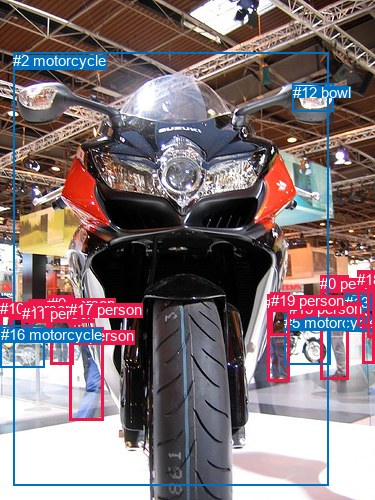
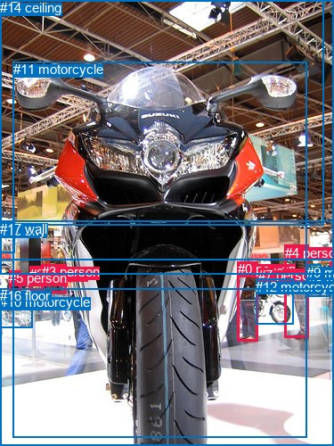

# 图片 2037：2412228.jpg

随机样本序号：263。图片 SHA256：`3ac1735a37375f41662744d2f729d1c04c2b8460b8b1035f4e0c024d8d08d7eb`。

红色框表示人，蓝色框表示其他物体。两个模式分别保留自身框编号，可依据位置比较对应对象。

## 自动检测框与输出

人的框编号：`[0, 1, 3, 4, 6, 7, 8, 9, 10, 11, 14, 15, 17, 18, 19]`。状态：`ok`。

### 自动检测全部物体框

| 编号 | 类别 | 是否为人 | 检测分数 | 像素坐标 xyxy |
|---|---|---|---|---|
| 0 | person | True | 0.9984 | 320.4, 275.1, 348.6, 380.0 |
| 1 | person | True | 0.9942 | 28.7, 299.5, 48.2, 330.3 |
| 2 | motorcycle | False | 0.9913 | 13.4, 52.2, 328.5, 485.2 |
| 3 | person | True | 0.9899 | 47.3, 295.1, 73.6, 330.4 |
| 4 | person | True | 0.9542 | 267.3, 294.4, 289.3, 381.6 |
| 5 | motorcycle | False | 0.8884 | 284.2, 313.9, 330.7, 364.2 |
| 6 | person | True | 0.8356 | 10.4, 303.0, 24.1, 331.0 |
| 7 | person | True | 0.7147 | 69.0, 327.1, 103.1, 420.9 |
| 8 | person | True | 0.6953 | 362.8, 270.5, 375.0, 363.6 |
| 9 | person | True | 0.6736 | 50.3, 295.1, 73.4, 364.3 |
| 10 | person | True | 0.6285 | 0.0, 299.7, 11.3, 330.7 |
| 11 | person | True | 0.6233 | 21.6, 305.1, 32.9, 328.6 |
| 12 | bowl | False | 0.5803 | 292.5, 83.8, 333.2, 111.4 |
| 13 | motorcycle | False | 0.5590 | 345.1, 293.7, 373.1, 331.6 |
| 14 | person | True | 0.5464 | 367.9, 274.1, 374.9, 337.7 |
| 15 | person | True | 0.5355 | 288.8, 299.6, 304.1, 318.1 |
| 16 | motorcycle | False | 0.5314 | 0.7, 325.6, 44.3, 367.7 |
| 17 | person | True | 0.4994 | 69.1, 300.6, 81.3, 324.0 |
| 18 | person | True | 0.4750 | 357.4, 270.8, 374.7, 326.9 |
| 19 | person | True | 0.3741 | 270.9, 292.3, 289.1, 335.6 |

### 自动检测 Top50 人相关候选

评分物体对：380；人相关物体对：360；输出关系：50。

| 排名 | 主语编号与类别 | 关系 | 宾语编号与类别 | 类型 | 人与人 | 排序分数 | 原始融合 logit |
|---|---|---|---|---|---|---|---|
| 1 | #0 person | pushing | #5 motorcycle | semantic | False | 0.98492 | 4.1792 |
| 2 | #9 person | wearing | #3 person | semantic | True | 0.97874 | 3.8293 |
| 3 | #0 person | walking on | #2 motorcycle | semantic | False | 0.97409 | 3.6269 |
| 4 | #6 person | walking on | #16 motorcycle | semantic | False | 0.97220 | 3.5545 |
| 5 | #7 person | walking on | #2 motorcycle | semantic | False | 0.96881 | 3.4359 |
| 6 | #9 person | walking on | #2 motorcycle | semantic | False | 0.96569 | 3.3373 |
| 7 | #0 person | beside | #5 motorcycle | spatial | False | 0.96083 | 3.1998 |
| 8 | #11 person | walking on | #16 motorcycle | semantic | False | 0.95589 | 3.0759 |
| 9 | #4 person | pushing | #5 motorcycle | semantic | False | 0.95252 | 2.9988 |
| 10 | #4 person | wearing | #19 person | semantic | True | 0.94965 | 2.9370 |
| 11 | #1 person | walking on | #16 motorcycle | semantic | False | 0.94678 | 2.8786 |
| 12 | #10 person | walking on | #16 motorcycle | semantic | False | 0.93918 | 2.7371 |
| 13 | #6 person | beside | #16 motorcycle | spatial | False | 0.92430 | 2.5023 |
| 14 | #6 person | walking on | #2 motorcycle | semantic | False | 0.92284 | 2.4816 |
| 15 | #17 person | walking on | #2 motorcycle | semantic | False | 0.92223 | 2.4730 |
| 16 | #14 person | walking on | #13 motorcycle | semantic | False | 0.91160 | 2.3333 |
| 17 | #10 person | beside | #16 motorcycle | spatial | False | 0.91004 | 2.3142 |
| 18 | #9 person | in | #3 person | spatial | True | 0.90520 | 2.2564 |
| 19 | #0 person | beside | #13 motorcycle | spatial | False | 0.90025 | 2.2000 |
| 20 | #0 person | walking on | #13 motorcycle | semantic | False | 0.90023 | 2.1998 |
| 21 | #19 person | walking on | #5 motorcycle | semantic | False | 0.89902 | 2.1864 |
| 22 | #11 person | walking on | #2 motorcycle | semantic | False | 0.89617 | 2.1553 |
| 23 | #8 person | walking on | #13 motorcycle | semantic | False | 0.89258 | 2.1173 |
| 24 | #10 person | walking on | #2 motorcycle | semantic | False | 0.88894 | 2.0799 |
| 25 | #4 person | looking at | #2 motorcycle | semantic | False | 0.88635 | 2.0540 |
| 26 | #11 person | beside | #16 motorcycle | spatial | False | 0.87227 | 1.9212 |
| 27 | #1 person | walking on | #2 motorcycle | semantic | False | 0.86931 | 1.8949 |
| 28 | #1 person | beside | #16 motorcycle | spatial | False | 0.86095 | 1.8232 |
| 29 | #19 person | looking at | #2 motorcycle | semantic | False | 0.85768 | 1.7962 |
| 30 | #3 person | walking on | #2 motorcycle | semantic | False | 0.85669 | 1.7880 |
| 31 | #9 person | walking on | #16 motorcycle | semantic | False | 0.84909 | 1.7275 |
| 32 | #15 person | walking on | #5 motorcycle | semantic | False | 0.83934 | 1.6534 |
| 33 | #4 person | beside | #5 motorcycle | spatial | False | 0.83211 | 1.6006 |
| 34 | #15 person | looking at | #2 motorcycle | semantic | False | 0.82614 | 1.5585 |
| 35 | #0 person | walking on | #16 motorcycle | semantic | False | 0.78849 | 1.3158 |
| 36 | #0 person | beside | #2 motorcycle | spatial | False | 0.78571 | 1.2993 |
| 37 | #15 person | beside | #5 motorcycle | spatial | False | 0.78015 | 1.2666 |
| 38 | #18 person | walking on | #13 motorcycle | semantic | False | 0.77907 | 1.2603 |
| 39 | #4 person | in | #19 person | spatial | True | 0.77774 | 1.2525 |
| 40 | #8 person | beside | #13 motorcycle | spatial | False | 0.76309 | 1.1697 |
| 41 | #2 motorcycle | in front of | #0 person | spatial | False | 0.75514 | 1.1262 |
| 42 | #8 person | wearing | #14 person | semantic | True | 0.74710 | 1.0832 |
| 43 | #17 person | walking on | #16 motorcycle | semantic | False | 0.73952 | 1.0435 |
| 44 | #4 person | walking on | #16 motorcycle | semantic | False | 0.73842 | 1.0378 |
| 45 | #9 person | carrying | #17 person | semantic | True | 0.73832 | 1.0373 |
| 46 | #19 person | beside | #5 motorcycle | spatial | False | 0.73584 | 1.0244 |
| 47 | #9 person | beside | #16 motorcycle | spatial | False | 0.73171 | 1.0033 |
| 48 | #16 motorcycle | parked on | #10 person | semantic | False | 0.73025 | 0.9959 |
| 49 | #0 person | beside | #8 person | spatial | True | 0.72115 | 0.9502 |
| 50 | #7 person | beside | #2 motorcycle | spatial | False | 0.71071 | 0.8988 |

### 自动检测逐条人相关 GT 核验

R@50：0.00%；命中 0/1。

| GT 主语编号 | GT 关系 | GT 宾语编号 | 结果阶段 | 匹配预测主语编号 | 匹配预测宾语编号 |
|---|---|---|---|---|---|
| 8 | in front of | 4 | wrong_predicate | [13] | [0] |

## 真实框与输出

人的框编号：`[0, 1, 2, 3, 4, 5, 6, 7]`。

### 真实框全部物体框

| 编号 | 类别 | 是否为人 | 检测分数 | 像素坐标 xyxy |
|---|---|---|---|---|
| 0 | person | True | GT | 267.0, 293.0, 290.0, 382.0 |
| 1 | person | True | GT | 370.0, 279.0, 375.0, 324.0 |
| 2 | person | True | GT | 33.0, 299.0, 49.0, 328.0 |
| 3 | person | True | GT | 47.0, 296.0, 75.0, 329.0 |
| 4 | person | True | GT | 320.0, 275.0, 347.0, 379.0 |
| 5 | person | True | GT | 10.0, 303.0, 24.0, 329.0 |
| 6 | person | True | GT | 302.0, 298.0, 315.0, 317.0 |
| 7 | person | True | GT | 290.0, 300.0, 305.0, 319.0 |
| 8 | motorcycle | False | GT | 346.0, 306.0, 372.0, 332.0 |
| 9 | motorcycle | False | GT | 344.0, 297.0, 361.0, 307.0 |
| 10 | motorcycle | False | GT | 0.0, 330.0, 36.0, 367.0 |
| 11 | motorcycle | False | GT | 15.0, 69.0, 344.0, 490.0 |
| 12 | motorcycle | False | GT | 287.0, 313.0, 329.0, 364.0 |
| 13 | light | False | GT | 0.0, 0.0, 364.0, 253.0 |
| 14 | ceiling | False | GT | 0.0, 0.0, 375.0, 291.0 |
| 15 | sky | False | GT | 0.0, 250.0, 17.0, 284.0 |
| 16 | floor | False | GT | 0.0, 323.0, 375.0, 500.0 |
| 17 | wall | False | GT | 0.0, 248.0, 375.0, 308.0 |

### 真实框 Top50 人相关候选

评分物体对：306；人相关物体对：216；输出关系：50。

| 排名 | 主语编号与类别 | 关系 | 宾语编号与类别 | 类型 | 人与人 | 排序分数 | 原始融合 logit |
|---|---|---|---|---|---|---|---|
| 1 | #4 person | pushing | #12 motorcycle | semantic | False | 0.99067 | 4.6652 |
| 2 | #4 person | walking on | #11 motorcycle | semantic | False | 0.97811 | 3.7997 |
| 3 | #4 person | walking on | #16 floor | semantic | False | 0.97253 | 3.5667 |
| 4 | #0 person | pushing | #12 motorcycle | semantic | False | 0.96654 | 3.3634 |
| 5 | #4 person | beside | #12 motorcycle | spatial | False | 0.94193 | 2.7863 |
| 6 | #1 person | walking on | #8 motorcycle | semantic | False | 0.93604 | 2.6834 |
| 7 | #0 person | walking on | #11 motorcycle | semantic | False | 0.92981 | 2.5838 |
| 8 | #0 person | walking on | #16 floor | semantic | False | 0.90865 | 2.2972 |
| 9 | #4 person | wearing | #9 motorcycle | semantic | False | 0.90746 | 2.2830 |
| 10 | #5 person | walking on | #16 floor | semantic | False | 0.89746 | 2.1694 |
| 11 | #5 person | pushing | #10 motorcycle | semantic | False | 0.89347 | 2.1266 |
| 12 | #7 person | looking at | #11 motorcycle | semantic | False | 0.88805 | 2.0710 |
| 13 | #2 person | walking on | #11 motorcycle | semantic | False | 0.88379 | 2.0288 |
| 14 | #7 person | pushing | #12 motorcycle | semantic | False | 0.87077 | 1.9078 |
| 15 | #5 person | walking on | #11 motorcycle | semantic | False | 0.86501 | 1.8576 |
| 16 | #6 person | pushing | #12 motorcycle | semantic | False | 0.84932 | 1.7293 |
| 17 | #6 person | looking at | #11 motorcycle | semantic | False | 0.84474 | 1.6939 |
| 18 | #0 person | beside | #12 motorcycle | spatial | False | 0.84092 | 1.6651 |
| 19 | #2 person | walking on | #16 floor | semantic | False | 0.83785 | 1.6423 |
| 20 | #4 person | walking on | #8 motorcycle | semantic | False | 0.83437 | 1.6169 |
| 21 | #3 person | walking on | #11 motorcycle | semantic | False | 0.83433 | 1.6166 |
| 22 | #4 person | beside | #11 motorcycle | spatial | False | 0.82800 | 1.5715 |
| 23 | #3 person | walking on | #16 floor | semantic | False | 0.82044 | 1.5194 |
| 24 | #5 person | beside | #10 motorcycle | spatial | False | 0.81440 | 1.4788 |
| 25 | #7 person | beside | #12 motorcycle | spatial | False | 0.78439 | 1.2914 |
| 26 | #6 person | beside | #12 motorcycle | spatial | False | 0.77961 | 1.2634 |
| 27 | #1 person | on | #8 motorcycle | spatial | False | 0.77579 | 1.2413 |
| 28 | #4 person | on | #16 floor | spatial | False | 0.76588 | 1.1852 |
| 29 | #2 person | walking on | #10 motorcycle | semantic | False | 0.73218 | 1.0057 |
| 30 | #0 person | beside | #11 motorcycle | spatial | False | 0.72825 | 0.9857 |
| 31 | #2 person | walking on | #17 wall | semantic | False | 0.69544 | 0.8257 |
| 32 | #5 person | walking on | #17 wall | semantic | False | 0.69448 | 0.8211 |
| 33 | #4 person | beside | #8 motorcycle | spatial | False | 0.68310 | 0.7681 |
| 34 | #4 person | walking on | #17 wall | semantic | False | 0.64371 | 0.5915 |
| 35 | #4 person | in | #9 motorcycle | spatial | False | 0.63814 | 0.5673 |
| 36 | #6 person | walking on | #16 floor | semantic | False | 0.62992 | 0.5319 |
| 37 | #0 person | on | #16 floor | spatial | False | 0.62675 | 0.5183 |
| 38 | #3 person | beside | #11 motorcycle | spatial | False | 0.62114 | 0.4944 |
| 39 | #2 person | beside | #10 motorcycle | spatial | False | 0.61154 | 0.4538 |
| 40 | #4 person | walking on | #10 motorcycle | semantic | False | 0.60616 | 0.4312 |
| 41 | #3 person | walking on | #17 wall | semantic | False | 0.58907 | 0.3601 |
| 42 | #5 person | on | #16 floor | spatial | False | 0.57997 | 0.3227 |
| 43 | #7 person | walking on | #16 floor | semantic | False | 0.55618 | 0.2257 |
| 44 | #3 person | on | #16 floor | spatial | False | 0.54346 | 0.1743 |
| 45 | #2 person | carrying | #3 person | semantic | True | 0.52440 | 0.0977 |
| 46 | #2 person | beside | #11 motorcycle | spatial | False | 0.52222 | 0.0889 |
| 47 | #1 person | walking on | #17 wall | semantic | False | 0.51433 | 0.0573 |
| 48 | #3 person | beside | #10 motorcycle | spatial | False | 0.46374 | -0.1453 |
| 49 | #1 person | looking at | #11 motorcycle | semantic | False | 0.45787 | -0.1689 |
| 50 | #3 person | walking on | #10 motorcycle | semantic | False | 0.45545 | -0.1787 |

### 真实框逐条人相关 GT 核验

R@50：0.00%；命中 0/1。

| GT 主语编号 | GT 关系 | GT 宾语编号 | 结果阶段 | 匹配预测主语编号 | 匹配预测宾语编号 |
|---|---|---|---|---|---|
| 8 | in front of | 4 | wrong_predicate | [8] | [4] |

## 全部人相关 GT

| 主语编号与类别 | 关系 | 宾语编号与类别 |
|---|---|---|
| #8 motorcycle | in front of | #4 person |

原始记录、全部人相关物体对的两项预测与分项分数见 [逐图证据 JSON](../evidence/cases/2037.json)。全部56类 logits 保留于本机 HOR/output/random500/logits/。

<!-- HOR_COMPLETE_RESULTS -->

## 六组条件的完整输出对照

以下保留同一图片三种框与候选模式、两种谓词输出规则的全部 Top50。框编号各自在所属模式内解释。

### 自动检测框完整枚举：空间与语义各保留一个谓词

| 排名 | 主语编号与类别 | 谓词 | 宾语编号与类别 | 分组 | 排序分数 | predicate logit | pair logit |
|---|---|---|---|---|---|---|---|
| 1 | #0 person | pushing | #5 motorcycle | semantic | 0.9849198 | 3.4859586 | 0.6932197 |
| 2 | #9 person | wearing | #3 person | semantic | 0.9787378 | 3.8318038 | -0.0024735 |
| 3 | #0 person | walking on | #2 motorcycle | semantic | 0.9740896 | 3.5416951 | 0.0851643 |
| 4 | #6 person | walking on | #16 motorcycle | semantic | 0.9721991 | 3.2890081 | 0.2654819 |
| 5 | #7 person | walking on | #2 motorcycle | semantic | 0.9688088 | 3.9629741 | -0.5270428 |
| 6 | #9 person | walking on | #2 motorcycle | semantic | 0.9656852 | 3.5988688 | -0.2616088 |
| 7 | #0 person | beside | #5 motorcycle | spatial | 0.9608272 | 2.5065947 | 0.6932197 |
| 8 | #11 person | walking on | #16 motorcycle | semantic | 0.9558869 | 2.8195901 | 0.2562932 |
| 9 | #4 person | pushing | #5 motorcycle | semantic | 0.9525209 | 2.4330153 | 0.5658073 |
| 10 | #4 person | wearing | #19 person | semantic | 0.9496462 | 3.0831366 | -0.1461203 |
| 11 | #1 person | walking on | #16 motorcycle | semantic | 0.9467759 | 2.5698285 | 0.3087225 |
| 12 | #10 person | walking on | #16 motorcycle | semantic | 0.9391822 | 2.8707128 | -0.1335864 |
| 13 | #6 person | beside | #16 motorcycle | spatial | 0.9243027 | 2.2368145 | 0.2654819 |
| 14 | #6 person | walking on | #2 motorcycle | semantic | 0.9228389 | 3.0722780 | -0.5907196 |
| 15 | #17 person | walking on | #2 motorcycle | semantic | 0.9222264 | 2.8887482 | -0.4157595 |
| 16 | #14 person | walking on | #13 motorcycle | semantic | 0.9115991 | 2.5788040 | -0.2454858 |
| 17 | #10 person | beside | #16 motorcycle | spatial | 0.9100427 | 2.4477425 | -0.1335864 |
| 18 | #9 person | in | #3 person | spatial | 0.9052040 | 2.2589064 | -0.0024735 |
| 19 | #0 person | beside | #13 motorcycle | spatial | 0.9002501 | 1.7816873 | 0.4183190 |
| 20 | #0 person | walking on | #13 motorcycle | semantic | 0.9002274 | 1.7814345 | 0.4183190 |
| 21 | #19 person | walking on | #5 motorcycle | semantic | 0.8990203 | 1.7453222 | 0.4410637 |
| 22 | #11 person | walking on | #2 motorcycle | semantic | 0.8961665 | 2.8044815 | -0.6491439 |
| 23 | #8 person | walking on | #13 motorcycle | semantic | 0.8925769 | 2.1936803 | -0.0763434 |
| 24 | #10 person | walking on | #2 motorcycle | semantic | 0.8889357 | 2.6825833 | -0.6026676 |
| 25 | #4 person | looking at | #2 motorcycle | semantic | 0.8863479 | 2.1329031 | -0.0789346 |
| 26 | #11 person | beside | #16 motorcycle | spatial | 0.8722723 | 1.6649070 | 0.2562932 |
| 27 | #1 person | walking on | #2 motorcycle | semantic | 0.8693133 | 2.4840145 | -0.5891141 |
| 28 | #1 person | beside | #16 motorcycle | spatial | 0.8609499 | 1.5144796 | 0.3087225 |
| 29 | #19 person | looking at | #2 motorcycle | semantic | 0.8576797 | 2.1007204 | -0.3045700 |
| 30 | #3 person | walking on | #2 motorcycle | semantic | 0.8566863 | 2.2929444 | -0.5049087 |
| 31 | #9 person | walking on | #16 motorcycle | semantic | 0.8490901 | 1.0923743 | 0.6351081 |
| 32 | #15 person | walking on | #5 motorcycle | semantic | 0.8393449 | 1.3300939 | 0.3232680 |
| 33 | #4 person | beside | #5 motorcycle | spatial | 0.8321091 | 1.0348415 | 0.5658073 |
| 34 | #15 person | looking at | #2 motorcycle | semantic | 0.8261378 | 2.0275297 | -0.4690306 |
| 35 | #0 person | walking on | #16 motorcycle | semantic | 0.7884867 | 1.1103954 | 0.2054327 |
| 36 | #0 person | beside | #2 motorcycle | spatial | 0.7857140 | 1.2141171 | 0.0851643 |
| 37 | #15 person | beside | #5 motorcycle | spatial | 0.7801540 | 0.9432960 | 0.3232680 |
| 38 | #18 person | walking on | #13 motorcycle | semantic | 0.7790719 | 1.7016702 | -0.4414043 |
| 39 | #4 person | in | #19 person | spatial | 0.7777365 | 1.3986444 | -0.1461203 |
| 40 | #8 person | beside | #13 motorcycle | spatial | 0.7630935 | 1.2460585 | -0.0763434 |
| 41 | #2 motorcycle | in front of | #0 person | spatial | 0.7551395 | 1.9171438 | -0.7909302 |
| 42 | #8 person | wearing | #14 person | semantic | 0.7471030 | 1.3163357 | -0.2331152 |
| 43 | #17 person | walking on | #16 motorcycle | semantic | 0.7395151 | 0.5311637 | 0.5122865 |
| 44 | #4 person | walking on | #16 motorcycle | semantic | 0.7384245 | 0.7899427 | 0.2478533 |
| 45 | #9 person | carrying | #17 person | semantic | 0.7383233 | 1.1211376 | -0.0838656 |
| 46 | #19 person | beside | #5 motorcycle | spatial | 0.7358384 | 0.5833859 | 0.4410637 |
| 47 | #9 person | beside | #16 motorcycle | spatial | 0.7317135 | 0.3682256 | 0.6351081 |
| 48 | #16 motorcycle | parked on | #10 person | semantic | 0.7302488 | 1.7072988 | -0.7114135 |
| 49 | #0 person | beside | #8 person | spatial | 0.7211485 | 0.7854953 | 0.1646705 |
| 50 | #7 person | beside | #2 motorcycle | spatial | 0.7107053 | 1.4258547 | -0.5270428 |

GT 命中：0/1，R@50=0.00%。

| GT主语 | GT谓词 | GT宾语 | 结果阶段 | 匹配主语框 | 匹配宾语框 |
|---|---|---|---|---|---|
| 8 | in front of | 4 | wrong_predicate | [13] | [0] |

### 自动检测框完整枚举：每对只保留一个谓词

| 排名 | 主语编号与类别 | 谓词 | 宾语编号与类别 | 分组 | 排序分数 | predicate logit | pair logit |
|---|---|---|---|---|---|---|---|
| 1 | #0 person | pushing | #5 motorcycle | single | 0.9849198 | 3.4859586 | 0.6932197 |
| 2 | #9 person | wearing | #3 person | single | 0.9787378 | 3.8318038 | -0.0024735 |
| 3 | #0 person | walking on | #2 motorcycle | single | 0.9740896 | 3.5416951 | 0.0851643 |
| 4 | #6 person | walking on | #16 motorcycle | single | 0.9721991 | 3.2890081 | 0.2654819 |
| 5 | #7 person | walking on | #2 motorcycle | single | 0.9688088 | 3.9629741 | -0.5270428 |
| 6 | #9 person | walking on | #2 motorcycle | single | 0.9656852 | 3.5988688 | -0.2616088 |
| 7 | #11 person | walking on | #16 motorcycle | single | 0.9558869 | 2.8195901 | 0.2562932 |
| 8 | #4 person | pushing | #5 motorcycle | single | 0.9525209 | 2.4330153 | 0.5658073 |
| 9 | #4 person | wearing | #19 person | single | 0.9496462 | 3.0831366 | -0.1461203 |
| 10 | #1 person | walking on | #16 motorcycle | single | 0.9467759 | 2.5698285 | 0.3087225 |
| 11 | #10 person | walking on | #16 motorcycle | single | 0.9391822 | 2.8707128 | -0.1335864 |
| 12 | #6 person | walking on | #2 motorcycle | single | 0.9228389 | 3.0722780 | -0.5907196 |
| 13 | #17 person | walking on | #2 motorcycle | single | 0.9222264 | 2.8887482 | -0.4157595 |
| 14 | #14 person | walking on | #13 motorcycle | single | 0.9115991 | 2.5788040 | -0.2454858 |
| 15 | #0 person | beside | #13 motorcycle | single | 0.9002501 | 1.7816873 | 0.4183190 |
| 16 | #19 person | walking on | #5 motorcycle | single | 0.8990203 | 1.7453222 | 0.4410637 |
| 17 | #11 person | walking on | #2 motorcycle | single | 0.8961665 | 2.8044815 | -0.6491439 |
| 18 | #8 person | walking on | #13 motorcycle | single | 0.8925769 | 2.1936803 | -0.0763434 |
| 19 | #10 person | walking on | #2 motorcycle | single | 0.8889357 | 2.6825833 | -0.6026676 |
| 20 | #4 person | looking at | #2 motorcycle | single | 0.8863479 | 2.1329031 | -0.0789346 |
| 21 | #1 person | walking on | #2 motorcycle | single | 0.8693133 | 2.4840145 | -0.5891141 |
| 22 | #19 person | looking at | #2 motorcycle | single | 0.8576797 | 2.1007204 | -0.3045700 |
| 23 | #3 person | walking on | #2 motorcycle | single | 0.8566863 | 2.2929444 | -0.5049087 |
| 24 | #9 person | walking on | #16 motorcycle | single | 0.8490901 | 1.0923743 | 0.6351081 |
| 25 | #15 person | walking on | #5 motorcycle | single | 0.8393449 | 1.3300939 | 0.3232680 |
| 26 | #15 person | looking at | #2 motorcycle | single | 0.8261378 | 2.0275297 | -0.4690306 |
| 27 | #0 person | walking on | #16 motorcycle | single | 0.7884867 | 1.1103954 | 0.2054327 |
| 28 | #18 person | walking on | #13 motorcycle | single | 0.7790719 | 1.7016702 | -0.4414043 |
| 29 | #2 motorcycle | in front of | #0 person | single | 0.7551395 | 1.9171438 | -0.7909302 |
| 30 | #8 person | wearing | #14 person | single | 0.7471030 | 1.3163357 | -0.2331152 |
| 31 | #17 person | walking on | #16 motorcycle | single | 0.7395151 | 0.5311637 | 0.5122865 |
| 32 | #4 person | walking on | #16 motorcycle | single | 0.7384245 | 0.7899427 | 0.2478533 |
| 33 | #9 person | carrying | #17 person | single | 0.7383233 | 1.1211376 | -0.0838656 |
| 34 | #16 motorcycle | parked on | #10 person | single | 0.7302488 | 1.7072988 | -0.7114135 |
| 35 | #0 person | beside | #8 person | single | 0.7211485 | 0.7854953 | 0.1646705 |
| 36 | #14 person | walking on | #18 person | single | 0.7015849 | 1.2337990 | -0.3789429 |
| 37 | #8 person | walking on | #18 person | single | 0.6994658 | 1.1164865 | -0.2717312 |
| 38 | #6 person | beside | #10 person | single | 0.6890872 | 0.9679275 | -0.1720724 |
| 39 | #19 person | walking on | #16 motorcycle | single | 0.6687365 | 0.5176301 | 0.1848459 |
| 40 | #0 person | beside | #18 person | single | 0.6505991 | 0.5137777 | 0.1078959 |
| 41 | #14 person | walking on | #8 person | single | 0.6406384 | 0.9899893 | -0.4118537 |
| 42 | #3 person | walking on | #16 motorcycle | single | 0.6060297 | -0.0014195 | 0.4320733 |
| 43 | #8 person | looking at | #2 motorcycle | single | 0.6006429 | 1.0275459 | -0.6194012 |
| 44 | #17 person | walking on | #5 motorcycle | single | 0.5687958 | 0.1324511 | 0.1444885 |
| 45 | #3 person | walking on | #5 motorcycle | single | 0.5641868 | 0.2437706 | 0.0144009 |
| 46 | #5 motorcycle | beside | #0 person | single | 0.5553539 | 1.0035357 | -0.7812086 |
| 47 | #15 person | walking on | #16 motorcycle | single | 0.5468208 | 0.2167182 | -0.0288849 |
| 48 | #18 person | looking at | #2 motorcycle | single | 0.5468161 | 0.9950142 | -0.8071997 |
| 49 | #0 person | beside | #4 person | single | 0.5269106 | 0.3637552 | -0.2560085 |
| 50 | #9 person | walking on | #5 motorcycle | single | 0.5143069 | -0.1127949 | 0.1700380 |

GT 命中：0/1，R@50=0.00%。

| GT主语 | GT谓词 | GT宾语 | 结果阶段 | 匹配主语框 | 匹配宾语框 |
|---|---|---|---|---|---|
| 8 | in front of | 4 | wrong_predicate | [13] | [0] |

### 真实框完整枚举：空间与语义各保留一个谓词

| 排名 | 主语编号与类别 | 谓词 | 宾语编号与类别 | 分组 | 排序分数 | predicate logit | pair logit |
|---|---|---|---|---|---|---|---|
| 1 | #4 person | pushing | #12 motorcycle | semantic | 0.9906706 | 3.9673371 | 0.6978716 |
| 2 | #4 person | walking on | #11 motorcycle | semantic | 0.9781121 | 3.6560683 | 0.1436195 |
| 3 | #4 person | walking on | #16 floor | semantic | 0.9725261 | 3.6109939 | -0.0443295 |
| 4 | #0 person | pushing | #12 motorcycle | semantic | 0.9665409 | 2.7939124 | 0.5694884 |
| 5 | #4 person | beside | #12 motorcycle | spatial | 0.9419285 | 2.0883818 | 0.6978716 |
| 6 | #1 person | walking on | #8 motorcycle | semantic | 0.9360377 | 3.0452671 | -0.3619051 |
| 7 | #0 person | walking on | #11 motorcycle | semantic | 0.9298110 | 2.5758219 | 0.0079679 |
| 8 | #0 person | walking on | #16 floor | semantic | 0.9086476 | 2.3381577 | -0.0409248 |
| 9 | #4 person | wearing | #9 motorcycle | semantic | 0.9074630 | 1.8014083 | 0.4816366 |
| 10 | #5 person | walking on | #16 floor | semantic | 0.8974634 | 2.5758491 | -0.4064959 |
| 11 | #5 person | pushing | #10 motorcycle | semantic | 0.8934662 | 1.8919382 | 0.2347077 |
| 12 | #7 person | looking at | #11 motorcycle | semantic | 0.8880532 | 2.5383840 | -0.4673767 |
| 13 | #2 person | walking on | #11 motorcycle | semantic | 0.8837906 | 2.6480179 | -0.6191914 |
| 14 | #7 person | pushing | #12 motorcycle | semantic | 0.8707675 | 1.5910606 | 0.3167011 |
| 15 | #5 person | walking on | #11 motorcycle | semantic | 0.8650114 | 2.4960427 | -0.6384906 |
| 16 | #6 person | pushing | #12 motorcycle | semantic | 0.8493237 | 1.6815214 | 0.0477849 |
| 17 | #6 person | looking at | #11 motorcycle | semantic | 0.8447399 | 2.4134865 | -0.7195592 |
| 18 | #0 person | beside | #12 motorcycle | spatial | 0.8409202 | 1.0956020 | 0.5694884 |
| 19 | #2 person | walking on | #16 floor | semantic | 0.8378453 | 2.0071402 | -0.3648579 |
| 20 | #4 person | walking on | #8 motorcycle | semantic | 0.8343708 | 1.1916795 | 0.4252470 |
| 21 | #3 person | walking on | #11 motorcycle | semantic | 0.8343276 | 2.1605511 | -0.5439368 |
| 22 | #4 person | beside | #11 motorcycle | spatial | 0.8279971 | 1.4278784 | 0.1436195 |
| 23 | #3 person | walking on | #16 floor | semantic | 0.8204437 | 1.8386345 | -0.3192780 |
| 24 | #5 person | beside | #10 motorcycle | spatial | 0.8143957 | 1.2441216 | 0.2347077 |
| 25 | #7 person | beside | #12 motorcycle | spatial | 0.7843871 | 0.9747167 | 0.3167011 |
| 26 | #6 person | beside | #12 motorcycle | spatial | 0.7796117 | 1.2156200 | 0.0477849 |
| 27 | #1 person | on | #8 motorcycle | spatial | 0.7757875 | 1.6031895 | -0.3619051 |
| 28 | #4 person | on | #16 floor | spatial | 0.7658805 | 1.2295237 | -0.0443295 |
| 29 | #2 person | walking on | #10 motorcycle | semantic | 0.7321751 | 0.7132583 | 0.2924283 |
| 30 | #0 person | beside | #11 motorcycle | spatial | 0.7282476 | 0.9777818 | 0.0079679 |
| 31 | #2 person | walking on | #17 wall | semantic | 0.6954438 | 1.5467396 | -0.7210450 |
| 32 | #5 person | walking on | #17 wall | semantic | 0.6944771 | 1.5091081 | -0.6879736 |
| 33 | #4 person | beside | #8 motorcycle | spatial | 0.6831046 | 0.3428292 | 0.4252470 |
| 34 | #4 person | walking on | #17 wall | semantic | 0.6437114 | 0.9599810 | -0.3684713 |
| 35 | #4 person | in | #9 motorcycle | spatial | 0.6381434 | 0.0856786 | 0.4816366 |
| 36 | #6 person | walking on | #16 floor | semantic | 0.6299179 | 0.9178481 | -0.3859835 |
| 37 | #0 person | on | #16 floor | spatial | 0.6267455 | 0.5592046 | -0.0409248 |
| 38 | #3 person | beside | #11 motorcycle | spatial | 0.6211362 | 1.0383105 | -0.5439368 |
| 39 | #2 person | beside | #10 motorcycle | spatial | 0.6115354 | 0.1613426 | 0.2924283 |
| 40 | #4 person | walking on | #10 motorcycle | semantic | 0.6061576 | 0.2378054 | 0.1933840 |
| 41 | #3 person | walking on | #17 wall | semantic | 0.5890701 | 1.0352025 | -0.6750801 |
| 42 | #5 person | on | #16 floor | spatial | 0.5799713 | 0.7291517 | -0.4064959 |
| 43 | #7 person | walking on | #16 floor | semantic | 0.5561798 | 0.4439282 | -0.2182559 |
| 44 | #3 person | on | #16 floor | spatial | 0.5434648 | 0.4935770 | -0.3192780 |
| 45 | #2 person | carrying | #3 person | semantic | 0.5243966 | 0.3820710 | -0.2844070 |
| 46 | #2 person | beside | #11 motorcycle | spatial | 0.5222167 | 0.7081170 | -0.6191914 |
| 47 | #1 person | walking on | #17 wall | semantic | 0.5143276 | 0.6861496 | -0.6288235 |
| 48 | #3 person | beside | #10 motorcycle | spatial | 0.4637387 | -0.5608187 | 0.4155184 |
| 49 | #1 person | looking at | #11 motorcycle | semantic | 0.4578696 | 0.6153331 | -0.7842549 |
| 50 | #3 person | walking on | #10 motorcycle | semantic | 0.4554518 | -0.5941849 | 0.4155184 |

GT 命中：0/1，R@50=0.00%。

| GT主语 | GT谓词 | GT宾语 | 结果阶段 | 匹配主语框 | 匹配宾语框 |
|---|---|---|---|---|---|
| 8 | in front of | 4 | wrong_predicate | [8] | [4] |

### 真实框完整枚举：每对只保留一个谓词

| 排名 | 主语编号与类别 | 谓词 | 宾语编号与类别 | 分组 | 排序分数 | predicate logit | pair logit |
|---|---|---|---|---|---|---|---|
| 1 | #4 person | pushing | #12 motorcycle | single | 0.9906706 | 3.9673371 | 0.6978716 |
| 2 | #4 person | walking on | #11 motorcycle | single | 0.9781121 | 3.6560683 | 0.1436195 |
| 3 | #4 person | walking on | #16 floor | single | 0.9725261 | 3.6109939 | -0.0443295 |
| 4 | #0 person | pushing | #12 motorcycle | single | 0.9665409 | 2.7939124 | 0.5694884 |
| 5 | #1 person | walking on | #8 motorcycle | single | 0.9360377 | 3.0452671 | -0.3619051 |
| 6 | #0 person | walking on | #11 motorcycle | single | 0.9298110 | 2.5758219 | 0.0079679 |
| 7 | #0 person | walking on | #16 floor | single | 0.9086476 | 2.3381577 | -0.0409248 |
| 8 | #4 person | wearing | #9 motorcycle | single | 0.9074630 | 1.8014083 | 0.4816366 |
| 9 | #5 person | walking on | #16 floor | single | 0.8974634 | 2.5758491 | -0.4064959 |
| 10 | #5 person | pushing | #10 motorcycle | single | 0.8934662 | 1.8919382 | 0.2347077 |
| 11 | #7 person | looking at | #11 motorcycle | single | 0.8880532 | 2.5383840 | -0.4673767 |
| 12 | #2 person | walking on | #11 motorcycle | single | 0.8837906 | 2.6480179 | -0.6191914 |
| 13 | #7 person | pushing | #12 motorcycle | single | 0.8707675 | 1.5910606 | 0.3167011 |
| 14 | #5 person | walking on | #11 motorcycle | single | 0.8650114 | 2.4960427 | -0.6384906 |
| 15 | #6 person | pushing | #12 motorcycle | single | 0.8493237 | 1.6815214 | 0.0477849 |
| 16 | #6 person | looking at | #11 motorcycle | single | 0.8447399 | 2.4134865 | -0.7195592 |
| 17 | #2 person | walking on | #16 floor | single | 0.8378453 | 2.0071402 | -0.3648579 |
| 18 | #4 person | walking on | #8 motorcycle | single | 0.8343708 | 1.1916795 | 0.4252470 |
| 19 | #3 person | walking on | #11 motorcycle | single | 0.8343276 | 2.1605511 | -0.5439368 |
| 20 | #3 person | walking on | #16 floor | single | 0.8204437 | 1.8386345 | -0.3192780 |
| 21 | #2 person | walking on | #10 motorcycle | single | 0.7321751 | 0.7132583 | 0.2924283 |
| 22 | #2 person | walking on | #17 wall | single | 0.6954438 | 1.5467396 | -0.7210450 |
| 23 | #5 person | walking on | #17 wall | single | 0.6944771 | 1.5091081 | -0.6879736 |
| 24 | #4 person | walking on | #17 wall | single | 0.6437114 | 0.9599810 | -0.3684713 |
| 25 | #6 person | walking on | #16 floor | single | 0.6299179 | 0.9178481 | -0.3859835 |
| 26 | #4 person | walking on | #10 motorcycle | single | 0.6061576 | 0.2378054 | 0.1933840 |
| 27 | #3 person | walking on | #17 wall | single | 0.5890701 | 1.0352025 | -0.6750801 |
| 28 | #7 person | walking on | #16 floor | single | 0.5561798 | 0.4439282 | -0.2182559 |
| 29 | #2 person | carrying | #3 person | single | 0.5243966 | 0.3820710 | -0.2844070 |
| 30 | #1 person | walking on | #17 wall | single | 0.5143276 | 0.6861496 | -0.6288235 |
| 31 | #3 person | beside | #10 motorcycle | single | 0.4637387 | -0.5608187 | 0.4155184 |
| 32 | #1 person | looking at | #11 motorcycle | single | 0.4578696 | 0.6153331 | -0.7842549 |
| 33 | #3 person | beside | #2 person | single | 0.4549605 | 0.0401459 | -0.2207936 |
| 34 | #3 person | walking on | #12 motorcycle | single | 0.4400362 | -0.2301354 | -0.0108797 |
| 35 | #6 person | walking on | #17 wall | single | 0.4389901 | 0.3446231 | -0.5898848 |
| 36 | #1 person | wearing | #9 motorcycle | single | 0.4210035 | 0.1404486 | -0.4591038 |
| 37 | #12 motorcycle | parked on | #4 person | single | 0.3948141 | 0.3552971 | -0.7824176 |
| 38 | #0 person | walking on | #10 motorcycle | single | 0.3928985 | -0.6709251 | 0.2357806 |
| 39 | #4 person | wearing | #6 person | single | 0.3563195 | -0.7291176 | 0.1377430 |
| 40 | #10 motorcycle | parked on | #5 person | single | 0.3506456 | 0.2633877 | -0.8795904 |
| 41 | #7 person | walking on | #17 wall | single | 0.3486036 | -0.0585914 | -0.5665916 |
| 42 | #7 person | walking on | #10 motorcycle | single | 0.3243642 | -0.6814480 | -0.0523391 |
| 43 | #11 motorcycle | in front of | #4 person | single | 0.3235495 | -0.0499635 | -0.6875436 |
| 44 | #0 person | walking on | #17 wall | single | 0.3224573 | -0.1458545 | -0.5966472 |
| 45 | #6 person | walking on | #8 motorcycle | single | 0.3103243 | -0.5851669 | -0.2134365 |
| 46 | #4 person | wearing | #3 person | single | 0.3060726 | -0.7570269 | -0.0615183 |
| 47 | #4 person | beside | #0 person | single | 0.3024130 | -0.5644183 | -0.2714155 |
| 48 | #8 motorcycle | parked on | #1 person | single | 0.2953896 | -0.3382683 | -0.5310818 |
| 49 | #1 person | walking on | #12 motorcycle | single | 0.2895722 | -0.2662196 | -0.6312430 |
| 50 | #1 person | walking on | #16 floor | single | 0.2679324 | -0.2662058 | -0.7389327 |

GT 命中：0/1，R@50=0.00%。

| GT主语 | GT谓词 | GT宾语 | 结果阶段 | 匹配主语框 | 匹配宾语框 |
|---|---|---|---|---|---|
| 8 | in front of | 4 | wrong_predicate | [8] | [4] |

### 真实框400候选：空间与语义各保留一个谓词

| 排名 | 主语编号与类别 | 谓词 | 宾语编号与类别 | 分组 | 排序分数 | predicate logit | pair logit |
|---|---|---|---|---|---|---|---|
| 1 | #4 person | pushing | #12 motorcycle | semantic | 0.9906706 | 3.9673371 | 0.6978716 |
| 2 | #4 person | walking on | #11 motorcycle | semantic | 0.9781121 | 3.6560683 | 0.1436195 |
| 3 | #4 person | walking on | #16 floor | semantic | 0.9724457 | 3.6079831 | -0.0443295 |
| 4 | #0 person | pushing | #12 motorcycle | semantic | 0.9655544 | 2.7638326 | 0.5694884 |
| 5 | #4 person | beside | #12 motorcycle | spatial | 0.9402669 | 2.0584064 | 0.6978716 |
| 6 | #1 person | walking on | #8 motorcycle | semantic | 0.9392048 | 3.0994282 | -0.3619051 |
| 7 | #0 person | walking on | #11 motorcycle | semantic | 0.9298110 | 2.5758219 | 0.0079679 |
| 8 | #4 person | wearing | #9 motorcycle | semantic | 0.9074630 | 1.8014083 | 0.4816366 |
| 9 | #0 person | walking on | #16 floor | semantic | 0.9063748 | 2.3110771 | -0.0409248 |
| 10 | #5 person | walking on | #16 floor | semantic | 0.8999288 | 2.6029301 | -0.4064959 |
| 11 | #5 person | pushing | #10 motorcycle | semantic | 0.8934662 | 1.8919382 | 0.2347077 |
| 12 | #7 person | looking at | #11 motorcycle | semantic | 0.8910099 | 2.5684752 | -0.4673767 |
| 13 | #2 person | walking on | #11 motorcycle | semantic | 0.8837906 | 2.6480179 | -0.6191914 |
| 14 | #7 person | pushing | #12 motorcycle | semantic | 0.8673447 | 1.5609808 | 0.3167011 |
| 15 | #5 person | walking on | #11 motorcycle | semantic | 0.8616385 | 2.4674568 | -0.6384906 |
| 16 | #6 person | pushing | #12 motorcycle | semantic | 0.8454321 | 1.6514297 | 0.0477849 |
| 17 | #6 person | looking at | #11 motorcycle | semantic | 0.8446943 | 2.4131379 | -0.7195592 |
| 18 | #2 person | walking on | #16 floor | semantic | 0.8378453 | 2.0071402 | -0.3648579 |
| 19 | #0 person | beside | #12 motorcycle | spatial | 0.8368573 | 1.0655398 | 0.5694884 |
| 20 | #3 person | walking on | #11 motorcycle | semantic | 0.8343276 | 2.1605511 | -0.5439368 |
| 21 | #4 person | walking on | #8 motorcycle | semantic | 0.8305944 | 1.1645989 | 0.4252470 |
| 22 | #4 person | beside | #11 motorcycle | spatial | 0.8279971 | 1.4278784 | 0.1436195 |
| 23 | #3 person | walking on | #16 floor | semantic | 0.8204437 | 1.8386345 | -0.3192780 |
| 24 | #5 person | beside | #10 motorcycle | spatial | 0.8143957 | 1.2441216 | 0.2347077 |
| 25 | #7 person | beside | #12 motorcycle | spatial | 0.7792743 | 0.9447412 | 0.3167011 |
| 26 | #1 person | on | #8 motorcycle | spatial | 0.7724298 | 1.5839872 | -0.3619051 |
| 27 | #6 person | beside | #12 motorcycle | spatial | 0.7691181 | 1.1555533 | 0.0477849 |
| 28 | #4 person | on | #16 floor | spatial | 0.7658805 | 1.2295237 | -0.0443295 |
| 29 | #2 person | walking on | #10 motorcycle | semantic | 0.7321751 | 0.7132583 | 0.2924283 |
| 30 | #0 person | beside | #11 motorcycle | spatial | 0.7282476 | 0.9777818 | 0.0079679 |
| 31 | #2 person | walking on | #17 wall | semantic | 0.6954438 | 1.5467396 | -0.7210450 |
| 32 | #5 person | walking on | #17 wall | semantic | 0.6941577 | 1.5076032 | -0.6879736 |
| 33 | #4 person | beside | #8 motorcycle | spatial | 0.6765677 | 0.3127961 | 0.4252470 |
| 34 | #4 person | walking on | #17 wall | semantic | 0.6498979 | 0.9870620 | -0.3684713 |
| 35 | #4 person | in | #9 motorcycle | spatial | 0.6389095 | 0.0889974 | 0.4816366 |
| 36 | #6 person | walking on | #16 floor | semantic | 0.6292158 | 0.9148374 | -0.3859835 |
| 37 | #0 person | on | #16 floor | spatial | 0.6254706 | 0.5537591 | -0.0409248 |
| 38 | #3 person | beside | #11 motorcycle | spatial | 0.6211362 | 1.0383105 | -0.5439368 |
| 39 | #4 person | walking on | #10 motorcycle | semantic | 0.6065168 | 0.2393103 | 0.1933840 |
| 40 | #2 person | beside | #10 motorcycle | spatial | 0.6043599 | 0.1312366 | 0.2924283 |
| 41 | #3 person | walking on | #17 wall | semantic | 0.5883412 | 1.0321922 | -0.6750801 |
| 42 | #5 person | on | #16 floor | spatial | 0.5799713 | 0.7291517 | -0.4064959 |
| 43 | #7 person | walking on | #16 floor | semantic | 0.5561798 | 0.4439282 | -0.2182559 |
| 44 | #3 person | on | #16 floor | spatial | 0.5495730 | 0.5182238 | -0.3192780 |
| 45 | #2 person | carrying | #3 person | semantic | 0.5313153 | 0.4098325 | -0.2844070 |
| 46 | #2 person | beside | #11 motorcycle | spatial | 0.5297047 | 0.7381501 | -0.6191914 |
| 47 | #1 person | walking on | #17 wall | semantic | 0.5135755 | 0.6831388 | -0.6288235 |
| 48 | #3 person | beside | #10 motorcycle | spatial | 0.4637550 | -0.5607533 | 0.4155184 |
| 49 | #3 person | walking on | #10 motorcycle | semantic | 0.4621761 | -0.5671039 | 0.4155184 |
| 50 | #1 person | looking at | #11 motorcycle | semantic | 0.4578696 | 0.6153331 | -0.7842549 |

GT 命中：0/1，R@50=0.00%。

| GT主语 | GT谓词 | GT宾语 | 结果阶段 | 匹配主语框 | 匹配宾语框 |
|---|---|---|---|---|---|
| 8 | in front of | 4 | wrong_predicate | [8] | [4] |

### 真实框400候选：每对只保留一个谓词

| 排名 | 主语编号与类别 | 谓词 | 宾语编号与类别 | 分组 | 排序分数 | predicate logit | pair logit |
|---|---|---|---|---|---|---|---|
| 1 | #4 person | pushing | #12 motorcycle | single | 0.9906706 | 3.9673371 | 0.6978716 |
| 2 | #4 person | walking on | #11 motorcycle | single | 0.9781121 | 3.6560683 | 0.1436195 |
| 3 | #4 person | walking on | #16 floor | single | 0.9724457 | 3.6079831 | -0.0443295 |
| 4 | #0 person | pushing | #12 motorcycle | single | 0.9655544 | 2.7638326 | 0.5694884 |
| 5 | #1 person | walking on | #8 motorcycle | single | 0.9392048 | 3.0994282 | -0.3619051 |
| 6 | #0 person | walking on | #11 motorcycle | single | 0.9298110 | 2.5758219 | 0.0079679 |
| 7 | #4 person | wearing | #9 motorcycle | single | 0.9074630 | 1.8014083 | 0.4816366 |
| 8 | #0 person | walking on | #16 floor | single | 0.9063748 | 2.3110771 | -0.0409248 |
| 9 | #5 person | walking on | #16 floor | single | 0.8999288 | 2.6029301 | -0.4064959 |
| 10 | #5 person | pushing | #10 motorcycle | single | 0.8934662 | 1.8919382 | 0.2347077 |
| 11 | #7 person | looking at | #11 motorcycle | single | 0.8910099 | 2.5684752 | -0.4673767 |
| 12 | #2 person | walking on | #11 motorcycle | single | 0.8837906 | 2.6480179 | -0.6191914 |
| 13 | #7 person | pushing | #12 motorcycle | single | 0.8673447 | 1.5609808 | 0.3167011 |
| 14 | #5 person | walking on | #11 motorcycle | single | 0.8616385 | 2.4674568 | -0.6384906 |
| 15 | #6 person | pushing | #12 motorcycle | single | 0.8454321 | 1.6514297 | 0.0477849 |
| 16 | #6 person | looking at | #11 motorcycle | single | 0.8446943 | 2.4131379 | -0.7195592 |
| 17 | #2 person | walking on | #16 floor | single | 0.8378453 | 2.0071402 | -0.3648579 |
| 18 | #3 person | walking on | #11 motorcycle | single | 0.8343276 | 2.1605511 | -0.5439368 |
| 19 | #4 person | walking on | #8 motorcycle | single | 0.8305944 | 1.1645989 | 0.4252470 |
| 20 | #3 person | walking on | #16 floor | single | 0.8204437 | 1.8386345 | -0.3192780 |
| 21 | #2 person | walking on | #10 motorcycle | single | 0.7321751 | 0.7132583 | 0.2924283 |
| 22 | #2 person | walking on | #17 wall | single | 0.6954438 | 1.5467396 | -0.7210450 |
| 23 | #5 person | walking on | #17 wall | single | 0.6941577 | 1.5076032 | -0.6879736 |
| 24 | #4 person | walking on | #17 wall | single | 0.6498979 | 0.9870620 | -0.3684713 |
| 25 | #6 person | walking on | #16 floor | single | 0.6292158 | 0.9148374 | -0.3859835 |
| 26 | #4 person | walking on | #10 motorcycle | single | 0.6065168 | 0.2393103 | 0.1933840 |
| 27 | #3 person | walking on | #17 wall | single | 0.5883412 | 1.0321922 | -0.6750801 |
| 28 | #7 person | walking on | #16 floor | single | 0.5561798 | 0.4439282 | -0.2182559 |
| 29 | #2 person | carrying | #3 person | single | 0.5313153 | 0.4098325 | -0.2844070 |
| 30 | #1 person | walking on | #17 wall | single | 0.5135755 | 0.6831388 | -0.6288235 |
| 31 | #3 person | beside | #10 motorcycle | single | 0.4637550 | -0.5607533 | 0.4155184 |
| 32 | #1 person | looking at | #11 motorcycle | single | 0.4578696 | 0.6153331 | -0.7842549 |
| 33 | #3 person | beside | #2 person | single | 0.4549569 | 0.0401316 | -0.2207936 |
| 34 | #3 person | walking on | #12 motorcycle | single | 0.4396654 | -0.2316403 | -0.0108797 |
| 35 | #6 person | walking on | #17 wall | single | 0.4386194 | 0.3431177 | -0.5898848 |
| 36 | #1 person | wearing | #9 motorcycle | single | 0.4210035 | 0.1404486 | -0.4591038 |
| 37 | #0 person | walking on | #10 motorcycle | single | 0.3993764 | -0.6438446 | 0.2357806 |
| 38 | #12 motorcycle | parked on | #4 person | single | 0.3948069 | 0.3552666 | -0.7824176 |
| 39 | #10 motorcycle | parked on | #5 person | single | 0.3506443 | 0.2633820 | -0.8795904 |
| 40 | #4 person | wearing | #6 person | single | 0.3497817 | -0.7577419 | 0.1377430 |
| 41 | #7 person | walking on | #17 wall | single | 0.3421406 | -0.0871778 | -0.5665916 |
| 42 | #11 motorcycle | in front of | #4 person | single | 0.3300516 | -0.0204082 | -0.6875436 |
| 43 | #7 person | walking on | #10 motorcycle | single | 0.3299942 | -0.6558723 | -0.0523391 |
| 44 | #0 person | walking on | #17 wall | single | 0.3221287 | -0.1473594 | -0.5966472 |
| 45 | #6 person | walking on | #8 motorcycle | single | 0.3103243 | -0.5851669 | -0.2134365 |
| 46 | #4 person | wearing | #3 person | single | 0.3006435 | -0.7827172 | -0.0615183 |
| 47 | #4 person | beside | #0 person | single | 0.2961210 | -0.5944228 | -0.2714155 |
| 48 | #8 motorcycle | parked on | #1 person | single | 0.2953859 | -0.3382859 | -0.5310818 |
| 49 | #1 person | walking on | #12 motorcycle | single | 0.2948618 | -0.2406440 | -0.6312430 |
| 50 | #1 person | walking on | #16 floor | single | 0.2732773 | -0.2391253 | -0.7389327 |

GT 命中：0/1，R@50=0.00%。

| GT主语 | GT谓词 | GT宾语 | 结果阶段 | 匹配主语框 | 匹配宾语框 |
|---|---|---|---|---|---|
| 8 | in front of | 4 | wrong_predicate | [8] | [4] |
