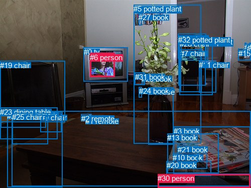
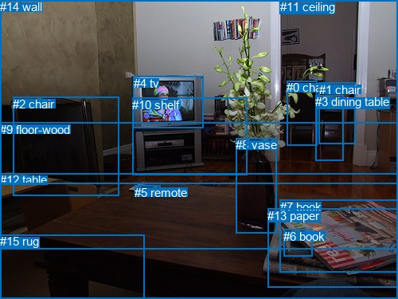

# 图片 2044：2412531.jpg

随机样本序号：129。图片 SHA256：`0a661b59e78b8dd84eccea6177f8a51888c5dbc48fe063c68c76c7300f998c85`。

红色框表示人，蓝色框表示其他物体。两个模式分别保留自身框编号，可依据位置比较对应对象。

## 自动检测框与输出

人的框编号：`[6, 30]`。状态：`ok`。

### 自动检测全部物体框

| 编号 | 类别 | 是否为人 | 检测分数 | 像素坐标 xyxy |
|---|---|---|---|---|
| 0 | tv | False | 0.9979 | 166.8, 94.6, 254.5, 162.8 |
| 1 | remote | False | 0.9941 | 170.0, 233.5, 201.0, 246.3 |
| 2 | remote | False | 0.9933 | 161.7, 227.7, 182.3, 240.0 |
| 3 | book | False | 0.9812 | 346.0, 252.6, 498.1, 347.0 |
| 4 | vase | False | 0.9556 | 295.6, 174.8, 345.7, 289.0 |
| 5 | potted plant | False | 0.9485 | 266.1, 9.1, 400.0, 286.5 |
| 6 | person | True | 0.9119 | 179.3, 105.9, 229.0, 153.4 |
| 7 | chair | False | 0.9040 | 359.1, 98.3, 401.7, 183.0 |
| 8 | dining table | False | 0.8802 | 23.9, 221.8, 500.0, 371.7 |
| 9 | chair | False | 0.8361 | 80.9, 226.4, 122.7, 263.1 |
| 10 | book | False | 0.8314 | 344.4, 305.9, 412.9, 336.9 |
| 11 | chair | False | 0.7653 | 396.1, 121.0, 430.7, 184.3 |
| 12 | bottle | False | 0.7304 | 487.3, 85.9, 490.9, 98.4 |
| 13 | book | False | 0.7104 | 333.3, 266.1, 435.3, 345.9 |
| 14 | chair | False | 0.6850 | 354.2, 67.7, 410.6, 116.4 |
| 15 | microwave | False | 0.6834 | 474.6, 98.0, 500.0, 120.8 |
| 16 | dining table | False | 0.6783 | 1.4, 214.5, 91.4, 254.5 |
| 17 | bottle | False | 0.6469 | 491.8, 87.7, 495.9, 98.4 |
| 18 | bottle | False | 0.6261 | 496.4, 86.0, 499.9, 98.6 |
| 19 | chair | False | 0.6151 | 0.0, 121.7, 129.1, 243.8 |
| 20 | book | False | 0.6034 | 331.7, 321.0, 420.6, 350.5 |
| 21 | book | False | 0.5494 | 353.9, 290.0, 394.5, 323.5 |
| 22 | chair | False | 0.5467 | 14.4, 223.2, 124.3, 373.9 |
| 23 | dining table | False | 0.4579 | 0.0, 214.6, 114.3, 277.9 |
| 24 | book | False | 0.4201 | 276.9, 173.4, 282.4, 194.3 |
| 25 | chair | False | 0.4153 | 24.4, 225.1, 95.5, 288.0 |
| 26 | potted plant | False | 0.4038 | 360.3, 75.1, 414.0, 120.2 |
| 27 | book | False | 0.4005 | 276.4, 26.2, 282.5, 50.4 |
| 28 | chair | False | 0.3943 | 357.6, 78.8, 423.1, 189.9 |
| 29 | book | False | 0.3854 | 282.2, 148.6, 287.6, 169.3 |
| 30 | person | True | 0.3766 | 314.4, 347.3, 498.4, 374.7 |
| 31 | book | False | 0.3681 | 268.8, 144.6, 288.6, 169.7 |
| 32 | potted plant | False | 0.3612 | 355.2, 71.1, 409.1, 170.1 |

### 自动检测 Top50 人相关候选

评分物体对：1056；人相关物体对：126；输出关系：50。

| 排名 | 主语编号与类别 | 关系 | 宾语编号与类别 | 类型 | 人与人 | 排序分数 | 原始融合 logit |
|---|---|---|---|---|---|---|---|
| 1 | #6 person | on | #0 tv | spatial | False | 0.97311 | 3.5887 |
| 2 | #6 person | looking at | #0 tv | semantic | False | 0.93000 | 2.5867 |
| 3 | #30 person | on | #8 dining table | spatial | False | 0.92389 | 2.4965 |
| 4 | #30 person | sitting on | #8 dining table | semantic | False | 0.91246 | 2.3440 |
| 5 | #0 tv | on | #6 person | spatial | False | 0.77481 | 1.2357 |
| 6 | #0 tv | playing with | #6 person | semantic | False | 0.64683 | 0.6052 |
| 7 | #30 person | beside | #3 book | spatial | False | 0.28597 | -0.9150 |
| 8 | #30 person | looking at | #0 tv | semantic | False | 0.28281 | -0.9306 |
| 9 | #6 person | on | #8 dining table | spatial | False | 0.21606 | -1.2888 |
| 10 | #20 book | on | #30 person | spatial | False | 0.16409 | -1.6281 |
| 11 | #30 person | on | #20 book | spatial | False | 0.13451 | -1.8616 |
| 12 | #30 person | holding | #3 book | semantic | False | 0.11279 | -2.0626 |
| 13 | #30 person | beside | #16 dining table | spatial | False | 0.10964 | -2.0945 |
| 14 | #30 person | beside | #23 dining table | spatial | False | 0.10499 | -2.1430 |
| 15 | #6 person | sitting on | #8 dining table | semantic | False | 0.10092 | -2.1870 |
| 16 | #27 book | over | #6 person | spatial | False | 0.09651 | -2.2366 |
| 17 | #30 person | on | #13 book | spatial | False | 0.08718 | -2.3485 |
| 18 | #30 person | looking at | #6 person | semantic | True | 0.07026 | -2.5826 |
| 19 | #3 book | on | #30 person | spatial | False | 0.06222 | -2.7129 |
| 20 | #30 person | holding | #20 book | semantic | False | 0.05932 | -2.7636 |
| 21 | #30 person | sitting on | #23 dining table | semantic | False | 0.05664 | -2.8127 |
| 22 | #30 person | sitting on | #16 dining table | semantic | False | 0.05463 | -2.8511 |
| 23 | #20 book | lying on | #30 person | semantic | False | 0.04860 | -2.9743 |
| 24 | #30 person | on | #22 chair | spatial | False | 0.04564 | -3.0403 |
| 25 | #30 person | beside | #4 vase | spatial | False | 0.04182 | -3.1316 |
| 26 | #13 book | on | #30 person | spatial | False | 0.03766 | -3.2407 |
| 27 | #10 book | on | #30 person | spatial | False | 0.03682 | -3.2643 |
| 28 | #6 person | in | #4 vase | spatial | False | 0.03603 | -3.2868 |
| 29 | #30 person | on | #10 book | spatial | False | 0.03150 | -3.4259 |
| 30 | #30 person | sitting on | #22 chair | semantic | False | 0.03069 | -3.4528 |
| 31 | #19 chair | beside | #6 person | spatial | False | 0.02859 | -3.5257 |
| 32 | #6 person | in | #5 potted plant | spatial | False | 0.02633 | -3.6104 |
| 33 | #6 person | playing | #5 potted plant | semantic | False | 0.02509 | -3.6600 |
| 34 | #30 person | holding | #13 book | semantic | False | 0.02434 | -3.6912 |
| 35 | #8 dining table | in | #30 person | spatial | False | 0.02317 | -3.7413 |
| 36 | #3 book | lying on | #30 person | semantic | False | 0.02286 | -3.7552 |
| 37 | #12 bottle | looking at | #6 person | semantic | False | 0.02164 | -3.8111 |
| 38 | #18 bottle | looking at | #6 person | semantic | False | 0.01982 | -3.9012 |
| 39 | #30 person | beside | #5 potted plant | spatial | False | 0.01935 | -3.9256 |
| 40 | #1 remote | on | #6 person | spatial | False | 0.01809 | -3.9943 |
| 41 | #31 book | on | #6 person | spatial | False | 0.01728 | -4.0405 |
| 42 | #17 bottle | looking at | #6 person | semantic | False | 0.01704 | -4.0550 |
| 43 | #2 remote | on | #6 person | spatial | False | 0.01680 | -4.0694 |
| 44 | #28 chair | looking at | #6 person | semantic | False | 0.01625 | -4.1033 |
| 45 | #30 person | in | #11 chair | spatial | False | 0.01587 | -4.1271 |
| 46 | #6 person | on | #31 book | spatial | False | 0.01557 | -4.1470 |
| 47 | #29 book | on | #6 person | spatial | False | 0.01530 | -4.1645 |
| 48 | #6 person | in | #27 book | spatial | False | 0.01522 | -4.1698 |
| 49 | #27 book | looking at | #6 person | semantic | False | 0.01452 | -4.2177 |
| 50 | #30 person | in | #0 tv | spatial | False | 0.01404 | -4.2514 |

### 自动检测逐条人相关 GT 核验

本图没有人相关 GT，R@50 无分母；预测候选继续展示。

## 真实框与输出

人的框编号：`[]`。

### 真实框全部物体框

| 编号 | 类别 | 是否为人 | 检测分数 | 像素坐标 xyxy |
|---|---|---|---|---|
| 0 | chair | False | GT | 360.0, 101.0, 398.0, 182.0 |
| 1 | chair | False | GT | 401.0, 104.0, 447.0, 181.0 |
| 2 | chair | False | GT | 16.0, 122.0, 149.0, 245.0 |
| 3 | dining table | False | GT | 396.0, 119.0, 431.0, 201.0 |
| 4 | tv | False | GT | 168.0, 96.0, 256.0, 161.0 |
| 5 | remote | False | GT | 169.0, 233.0, 201.0, 247.0 |
| 6 | book | False | GT | 356.0, 288.0, 392.0, 322.0 |
| 7 | book | False | GT | 352.0, 251.0, 500.0, 342.0 |
| 8 | vase | False | GT | 296.0, 173.0, 347.0, 292.0 |
| 9 | floor-wood | False | GT | 0.0, 154.0, 500.0, 313.0 |
| 10 | shelf | False | GT | 166.0, 123.0, 311.0, 220.0 |
| 11 | ceiling | False | GT | 352.0, 0.0, 395.0, 14.0 |
| 12 | table | False | GT | 0.0, 217.0, 500.0, 375.0 |
| 13 | paper | False | GT | 336.0, 262.0, 500.0, 361.0 |
| 14 | wall | False | GT | 0.0, 0.0, 500.0, 230.0 |
| 15 | rug | False | GT | 0.0, 294.0, 182.0, 375.0 |

### 真实框 Top50 人相关候选

评分物体对：0；人相关物体对：0；输出关系：0。

| 排名 | 主语编号与类别 | 关系 | 宾语编号与类别 | 类型 | 人与人 | 排序分数 | 原始融合 logit |
|---|---|---|---|---|---|---|---|

### 真实框逐条人相关 GT 核验

本图没有人相关 GT，R@50 无分母；预测候选继续展示。

## 全部人相关 GT

| 主语编号与类别 | 关系 | 宾语编号与类别 |
|---|---|---|

原始记录、全部人相关物体对的两项预测与分项分数见 [逐图证据 JSON](../evidence/cases/2044.json)。全部56类 logits 保留于本机 HOR/output/random500/logits/。

<!-- HOR_COMPLETE_RESULTS -->

## 六组条件的完整输出对照

以下保留同一图片三种框与候选模式、两种谓词输出规则的全部 Top50。框编号各自在所属模式内解释。

### 自动检测框完整枚举：空间与语义各保留一个谓词

| 排名 | 主语编号与类别 | 谓词 | 宾语编号与类别 | 分组 | 排序分数 | predicate logit | pair logit |
|---|---|---|---|---|---|---|---|
| 1 | #6 person | on | #0 tv | spatial | 0.9731091 | 3.3645835 | 0.2241259 |
| 2 | #6 person | looking at | #0 tv | semantic | 0.9300029 | 2.3626089 | 0.2241259 |
| 3 | #30 person | on | #8 dining table | spatial | 0.9238926 | 2.2680922 | 0.2283581 |
| 4 | #30 person | sitting on | #8 dining table | semantic | 0.9124551 | 2.1156292 | 0.2283581 |
| 5 | #0 tv | on | #6 person | spatial | 0.7748119 | 1.4060178 | -0.1703336 |
| 6 | #0 tv | playing with | #6 person | semantic | 0.6468346 | 0.7754879 | -0.1703336 |
| 7 | #30 person | beside | #3 book | spatial | 0.2859716 | -0.0762796 | -0.8387505 |
| 8 | #30 person | looking at | #0 tv | semantic | 0.2828065 | 0.1873231 | -1.1179056 |
| 9 | #6 person | on | #8 dining table | spatial | 0.2160561 | -0.2826266 | -1.0061725 |
| 10 | #20 book | on | #30 person | spatial | 0.1640922 | -0.5853925 | -1.0426973 |
| 11 | #30 person | on | #20 book | spatial | 0.1345148 | -0.9031024 | -0.9585134 |
| 12 | #30 person | holding | #3 book | semantic | 0.1127903 | -1.2238004 | -0.8387505 |
| 13 | #30 person | beside | #16 dining table | spatial | 0.1096361 | -0.8891768 | -1.2052863 |
| 14 | #30 person | beside | #23 dining table | spatial | 0.1049890 | -0.9203253 | -1.2226553 |
| 15 | #6 person | sitting on | #8 dining table | semantic | 0.1009243 | -1.1808243 | -1.0061725 |
| 16 | #27 book | over | #6 person | spatial | 0.0965133 | -0.9923229 | -1.2442579 |
| 17 | #30 person | on | #13 book | spatial | 0.0871819 | -1.1952686 | -1.1532714 |
| 18 | #30 person | looking at | #6 person | semantic | 0.0702639 | -1.1614995 | -1.4211433 |
| 19 | #3 book | on | #30 person | spatial | 0.0622163 | -1.6568778 | -1.0560238 |
| 20 | #30 person | holding | #20 book | semantic | 0.0593221 | -1.8051057 | -0.9585134 |
| 21 | #30 person | sitting on | #23 dining table | semantic | 0.0566396 | -1.5900846 | -1.2226553 |
| 22 | #30 person | sitting on | #16 dining table | semantic | 0.0546264 | -1.6457765 | -1.2052863 |
| 23 | #20 book | lying on | #30 person | semantic | 0.0486013 | -1.9315851 | -1.0426973 |
| 24 | #30 person | on | #22 chair | spatial | 0.0456389 | -2.1036103 | -0.9366722 |
| 25 | #30 person | beside | #4 vase | spatial | 0.0418237 | -1.7638760 | -1.3676928 |
| 26 | #13 book | on | #30 person | spatial | 0.0376641 | -1.9688661 | -1.2717907 |
| 27 | #10 book | on | #30 person | spatial | 0.0368165 | -2.0405757 | -1.2237216 |
| 28 | #6 person | in | #4 vase | spatial | 0.0360260 | -2.4186954 | -0.8681275 |
| 29 | #30 person | on | #10 book | spatial | 0.0314966 | -2.3539772 | -1.0718948 |
| 30 | #30 person | sitting on | #22 chair | semantic | 0.0306852 | -2.5161374 | -0.9366722 |
| 31 | #19 chair | beside | #6 person | spatial | 0.0285908 | -2.0307360 | -1.4949275 |
| 32 | #6 person | in | #5 potted plant | spatial | 0.0263290 | -2.5114672 | -1.0989347 |
| 33 | #6 person | playing | #5 potted plant | semantic | 0.0250880 | -2.5610232 | -1.0989347 |
| 34 | #30 person | holding | #13 book | semantic | 0.0243353 | -2.5379198 | -1.1532714 |
| 35 | #8 dining table | in | #30 person | spatial | 0.0231738 | -2.4771566 | -1.2641276 |
| 36 | #3 book | lying on | #30 person | semantic | 0.0228619 | -2.6991315 | -1.0560238 |
| 37 | #12 bottle | looking at | #6 person | semantic | 0.0216444 | -2.2280285 | -1.5830975 |
| 38 | #18 bottle | looking at | #6 person | semantic | 0.0198172 | -2.3804891 | -1.5206971 |
| 39 | #30 person | beside | #5 potted plant | spatial | 0.0193491 | -2.9146638 | -1.0109084 |
| 40 | #1 remote | on | #6 person | spatial | 0.0180873 | -2.7177296 | -1.2765647 |
| 41 | #31 book | on | #6 person | spatial | 0.0172848 | -3.1640880 | -0.8764051 |
| 42 | #17 bottle | looking at | #6 person | semantic | 0.0170395 | -2.4970195 | -1.5580163 |
| 43 | #2 remote | on | #6 person | spatial | 0.0168010 | -2.8298552 | -1.2395210 |
| 44 | #28 chair | looking at | #6 person | semantic | 0.0162501 | -2.5756137 | -1.5276597 |
| 45 | #30 person | in | #11 chair | spatial | 0.0158728 | -1.8593957 | -2.2677517 |
| 46 | #6 person | on | #31 book | spatial | 0.0155662 | -2.8070617 | -1.3399005 |
| 47 | #29 book | on | #6 person | spatial | 0.0152993 | -3.2297153 | -0.9348156 |
| 48 | #6 person | in | #27 book | spatial | 0.0152200 | -2.6135690 | -1.5562377 |
| 49 | #27 book | looking at | #6 person | semantic | 0.0145189 | -2.9734185 | -1.2442579 |
| 50 | #30 person | in | #0 tv | spatial | 0.0140438 | -3.1335285 | -1.1179056 |

没有人相关 GT，本条件的召回率无分母。

### 自动检测框完整枚举：每对只保留一个谓词

| 排名 | 主语编号与类别 | 谓词 | 宾语编号与类别 | 分组 | 排序分数 | predicate logit | pair logit |
|---|---|---|---|---|---|---|---|
| 1 | #6 person | on | #0 tv | single | 0.9731091 | 3.3645835 | 0.2241259 |
| 2 | #30 person | on | #8 dining table | single | 0.9238926 | 2.2680922 | 0.2283581 |
| 3 | #0 tv | on | #6 person | single | 0.7748119 | 1.4060178 | -0.1703336 |
| 4 | #30 person | beside | #3 book | single | 0.2859716 | -0.0762796 | -0.8387505 |
| 5 | #30 person | looking at | #0 tv | single | 0.2828065 | 0.1873231 | -1.1179056 |
| 6 | #6 person | on | #8 dining table | single | 0.2160561 | -0.2826266 | -1.0061725 |
| 7 | #20 book | on | #30 person | single | 0.1640922 | -0.5853925 | -1.0426973 |
| 8 | #30 person | on | #20 book | single | 0.1345148 | -0.9031024 | -0.9585134 |
| 9 | #30 person | beside | #16 dining table | single | 0.1096361 | -0.8891768 | -1.2052863 |
| 10 | #30 person | beside | #23 dining table | single | 0.1049890 | -0.9203253 | -1.2226553 |
| 11 | #27 book | over | #6 person | single | 0.0965133 | -0.9923229 | -1.2442579 |
| 12 | #30 person | on | #13 book | single | 0.0871819 | -1.1952686 | -1.1532714 |
| 13 | #30 person | looking at | #6 person | single | 0.0702639 | -1.1614995 | -1.4211433 |
| 14 | #3 book | on | #30 person | single | 0.0622163 | -1.6568778 | -1.0560238 |
| 15 | #30 person | on | #22 chair | single | 0.0456389 | -2.1036103 | -0.9366722 |
| 16 | #30 person | beside | #4 vase | single | 0.0418237 | -1.7638760 | -1.3676928 |
| 17 | #13 book | on | #30 person | single | 0.0376641 | -1.9688661 | -1.2717907 |
| 18 | #10 book | on | #30 person | single | 0.0368165 | -2.0405757 | -1.2237216 |
| 19 | #6 person | in | #4 vase | single | 0.0360260 | -2.4186954 | -0.8681275 |
| 20 | #30 person | on | #10 book | single | 0.0314966 | -2.3539772 | -1.0718948 |
| 21 | #19 chair | beside | #6 person | single | 0.0285908 | -2.0307360 | -1.4949275 |
| 22 | #6 person | in | #5 potted plant | single | 0.0263290 | -2.5114672 | -1.0989347 |
| 23 | #8 dining table | in | #30 person | single | 0.0231738 | -2.4771566 | -1.2641276 |
| 24 | #12 bottle | looking at | #6 person | single | 0.0216444 | -2.2280285 | -1.5830975 |
| 25 | #18 bottle | looking at | #6 person | single | 0.0198172 | -2.3804891 | -1.5206971 |
| 26 | #30 person | beside | #5 potted plant | single | 0.0193491 | -2.9146638 | -1.0109084 |
| 27 | #1 remote | on | #6 person | single | 0.0180873 | -2.7177296 | -1.2765647 |
| 28 | #31 book | on | #6 person | single | 0.0172848 | -3.1640880 | -0.8764051 |
| 29 | #17 bottle | looking at | #6 person | single | 0.0170395 | -2.4970195 | -1.5580163 |
| 30 | #2 remote | on | #6 person | single | 0.0168010 | -2.8298552 | -1.2395210 |
| 31 | #28 chair | looking at | #6 person | single | 0.0162501 | -2.5756137 | -1.5276597 |
| 32 | #30 person | in | #11 chair | single | 0.0158728 | -1.8593957 | -2.2677517 |
| 33 | #6 person | on | #31 book | single | 0.0155662 | -2.8070617 | -1.3399005 |
| 34 | #29 book | on | #6 person | single | 0.0152993 | -3.2297153 | -0.9348156 |
| 35 | #6 person | in | #27 book | single | 0.0152200 | -2.6135690 | -1.5562377 |
| 36 | #32 potted plant | looking at | #6 person | single | 0.0138392 | -2.7122447 | -1.5540679 |
| 37 | #30 person | in | #25 chair | single | 0.0135858 | -2.7145576 | -1.5704957 |
| 38 | #6 person | playing | #2 remote | single | 0.0135351 | -3.1157572 | -1.1730878 |
| 39 | #14 chair | looking at | #6 person | single | 0.0129012 | -2.7299051 | -1.6075478 |
| 40 | #26 potted plant | looking at | #6 person | single | 0.0128387 | -2.7711196 | -1.5712514 |
| 41 | #21 book | on | #30 person | single | 0.0127047 | -2.7999525 | -1.5530438 |
| 42 | #7 chair | looking at | #6 person | single | 0.0125844 | -2.7139006 | -1.6487322 |
| 43 | #6 person | playing | #1 remote | single | 0.0120865 | -3.2270329 | -1.1764700 |
| 44 | #30 person | in | #28 chair | single | 0.0112898 | -2.4180770 | -2.0544224 |
| 45 | #30 person | in | #21 book | single | 0.0109351 | -3.2254515 | -1.2793273 |
| 46 | #30 person | in | #7 chair | single | 0.0104300 | -2.4583471 | -2.0942364 |
| 47 | #6 person | on | #20 book | single | 0.0098654 | -2.8070767 | -1.8017341 |
| 48 | #6 person | on | #3 book | single | 0.0096636 | -3.1185310 | -1.5111504 |
| 49 | #30 person | in | #32 potted plant | single | 0.0092723 | -2.6555996 | -2.0158081 |
| 50 | #6 person | on | #10 book | single | 0.0091804 | -2.9507992 | -1.7306648 |

没有人相关 GT，本条件的召回率无分母。

### 真实框完整枚举：空间与语义各保留一个谓词

| 排名 | 主语编号与类别 | 谓词 | 宾语编号与类别 | 分组 | 排序分数 | predicate logit | pair logit |
|---|---|---|---|---|---|---|---|

没有人相关 GT，本条件的召回率无分母。

### 真实框完整枚举：每对只保留一个谓词

| 排名 | 主语编号与类别 | 谓词 | 宾语编号与类别 | 分组 | 排序分数 | predicate logit | pair logit |
|---|---|---|---|---|---|---|---|

没有人相关 GT，本条件的召回率无分母。

### 真实框400候选：空间与语义各保留一个谓词

| 排名 | 主语编号与类别 | 谓词 | 宾语编号与类别 | 分组 | 排序分数 | predicate logit | pair logit |
|---|---|---|---|---|---|---|---|

没有人相关 GT，本条件的召回率无分母。

### 真实框400候选：每对只保留一个谓词

| 排名 | 主语编号与类别 | 谓词 | 宾语编号与类别 | 分组 | 排序分数 | predicate logit | pair logit |
|---|---|---|---|---|---|---|---|

没有人相关 GT，本条件的召回率无分母。
