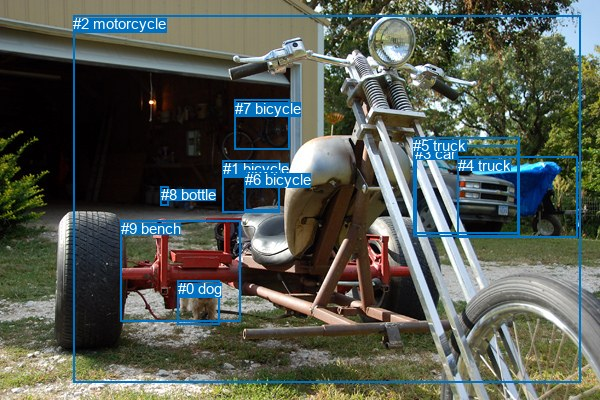
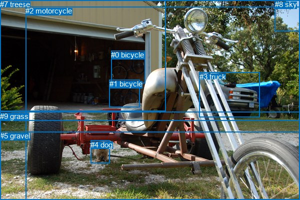

# 图片 2054：2413350.jpg

随机样本序号：118。图片 SHA256：`1bb19f0a2a950a944d178c921fddaddda6f133df6367e9f75ffcaafe2cd43f83`。

红色框表示人，蓝色框表示其他物体。两个模式分别保留自身框编号，可依据位置比较对应对象。

## 自动检测框与输出

人的框编号：`[]`。状态：`no_person`。

### 自动检测全部物体框

| 编号 | 类别 | 是否为人 | 检测分数 | 像素坐标 xyxy |
|---|---|---|---|---|
| 0 | dog | False | 0.9923 | 177.9, 280.3, 219.1, 324.1 |
| 1 | bicycle | False | 0.9578 | 222.8, 160.2, 279.9, 212.5 |
| 2 | motorcycle | False | 0.8680 | 73.1, 15.0, 580.3, 382.5 |
| 3 | car | False | 0.6554 | 415.2, 145.2, 518.4, 233.1 |
| 4 | truck | False | 0.6154 | 457.5, 156.9, 577.2, 237.3 |
| 5 | truck | False | 0.5827 | 413.4, 137.1, 519.3, 236.7 |
| 6 | bicycle | False | 0.4780 | 244.9, 170.9, 279.9, 210.5 |
| 7 | bicycle | False | 0.4194 | 234.7, 99.8, 289.2, 149.4 |
| 8 | bottle | False | 0.3929 | 161.0, 186.2, 168.3, 205.9 |
| 9 | bench | False | 0.3836 | 120.9, 220.1, 240.6, 321.3 |

### 自动检测 Top50 人相关候选

评分物体对：0；人相关物体对：0；输出关系：0。

| 排名 | 主语编号与类别 | 关系 | 宾语编号与类别 | 类型 | 人与人 | 排序分数 | 原始融合 logit |
|---|---|---|---|---|---|---|---|

### 自动检测逐条人相关 GT 核验

本图没有人相关 GT，R@50 无分母；预测候选继续展示。

## 真实框与输出

人的框编号：`[]`。

### 真实框全部物体框

| 编号 | 类别 | 是否为人 | 检测分数 | 像素坐标 xyxy |
|---|---|---|---|---|
| 0 | bicycle | False | GT | 222.0, 101.0, 290.0, 166.0 |
| 1 | bicycle | False | GT | 219.0, 159.0, 280.0, 214.0 |
| 2 | motorcycle | False | GT | 51.0, 13.0, 600.0, 400.0 |
| 3 | truck | False | GT | 399.0, 145.0, 520.0, 235.0 |
| 4 | dog | False | GT | 181.0, 281.0, 219.0, 327.0 |
| 5 | gravel | False | GT | 0.0, 263.0, 600.0, 400.0 |
| 6 | house | False | GT | 0.0, 0.0, 331.0, 222.0 |
| 7 | tree | False | GT | 0.0, 0.0, 600.0, 241.0 |
| 8 | sky | False | GT | 550.0, 0.0, 600.0, 63.0 |
| 9 | grass | False | GT | 0.0, 224.0, 600.0, 400.0 |

### 真实框 Top50 人相关候选

评分物体对：0；人相关物体对：0；输出关系：0。

| 排名 | 主语编号与类别 | 关系 | 宾语编号与类别 | 类型 | 人与人 | 排序分数 | 原始融合 logit |
|---|---|---|---|---|---|---|---|

### 真实框逐条人相关 GT 核验

本图没有人相关 GT，R@50 无分母；预测候选继续展示。

## 全部人相关 GT

| 主语编号与类别 | 关系 | 宾语编号与类别 |
|---|---|---|

原始记录、全部人相关物体对的两项预测与分项分数见 [逐图证据 JSON](../evidence/cases/2054.json)。全部56类 logits 保留于本机 HOR/output/random500/logits/。

<!-- HOR_COMPLETE_RESULTS -->

## 六组条件的完整输出对照

以下保留同一图片三种框与候选模式、两种谓词输出规则的全部 Top50。框编号各自在所属模式内解释。

### 自动检测框完整枚举：空间与语义各保留一个谓词

| 排名 | 主语编号与类别 | 谓词 | 宾语编号与类别 | 分组 | 排序分数 | predicate logit | pair logit |
|---|---|---|---|---|---|---|---|

没有人相关 GT，本条件的召回率无分母。

### 自动检测框完整枚举：每对只保留一个谓词

| 排名 | 主语编号与类别 | 谓词 | 宾语编号与类别 | 分组 | 排序分数 | predicate logit | pair logit |
|---|---|---|---|---|---|---|---|

没有人相关 GT，本条件的召回率无分母。

### 真实框完整枚举：空间与语义各保留一个谓词

| 排名 | 主语编号与类别 | 谓词 | 宾语编号与类别 | 分组 | 排序分数 | predicate logit | pair logit |
|---|---|---|---|---|---|---|---|

没有人相关 GT，本条件的召回率无分母。

### 真实框完整枚举：每对只保留一个谓词

| 排名 | 主语编号与类别 | 谓词 | 宾语编号与类别 | 分组 | 排序分数 | predicate logit | pair logit |
|---|---|---|---|---|---|---|---|

没有人相关 GT，本条件的召回率无分母。

### 真实框400候选：空间与语义各保留一个谓词

| 排名 | 主语编号与类别 | 谓词 | 宾语编号与类别 | 分组 | 排序分数 | predicate logit | pair logit |
|---|---|---|---|---|---|---|---|

没有人相关 GT，本条件的召回率无分母。

### 真实框400候选：每对只保留一个谓词

| 排名 | 主语编号与类别 | 谓词 | 宾语编号与类别 | 分组 | 排序分数 | predicate logit | pair logit |
|---|---|---|---|---|---|---|---|

没有人相关 GT，本条件的召回率无分母。
