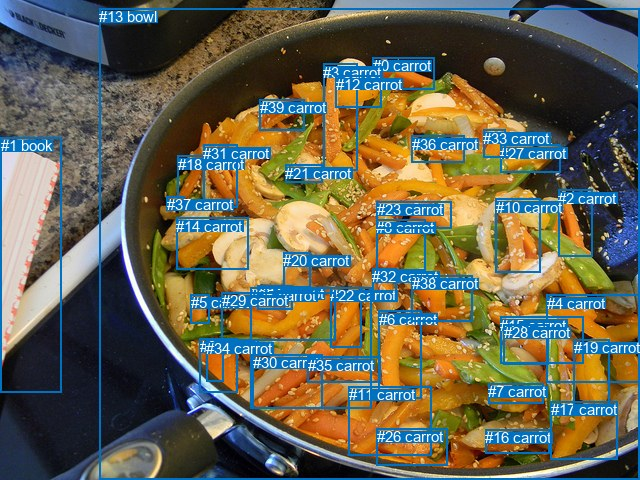
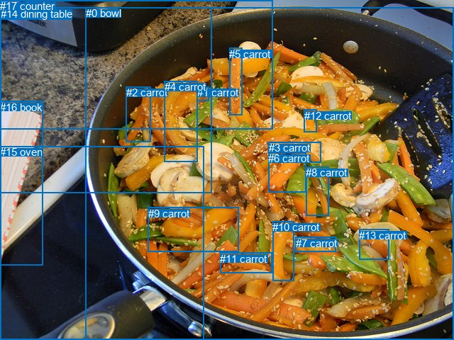

# 图片 2055：2413383.jpg

随机样本序号：468。图片 SHA256：`5713c5b6f027603b4b1a02560bed3c0619df141c0c55d4c91528a16defc05bc3`。

红色框表示人，蓝色框表示其他物体。两个模式分别保留自身框编号，可依据位置比较对应对象。

## 自动检测框与输出

人的框编号：`[]`。状态：`no_person`。

### 自动检测全部物体框

| 编号 | 类别 | 是否为人 | 检测分数 | 像素坐标 xyxy |
|---|---|---|---|---|
| 0 | carrot | False | 0.9581 | 373.0, 57.3, 434.6, 89.9 |
| 1 | book | False | 0.9444 | 0.6, 137.2, 61.8, 393.0 |
| 2 | carrot | False | 0.9303 | 558.1, 190.0, 592.5, 256.3 |
| 3 | carrot | False | 0.9188 | 323.0, 63.7, 357.2, 170.8 |
| 4 | carrot | False | 0.8634 | 546.7, 294.9, 639.9, 382.6 |
| 5 | carrot | False | 0.8461 | 191.0, 294.1, 210.0, 323.0 |
| 6 | carrot | False | 0.8435 | 379.0, 310.9, 421.9, 398.1 |
| 7 | carrot | False | 0.8326 | 488.3, 383.2, 543.5, 403.7 |
| 8 | carrot | False | 0.8260 | 376.4, 219.3, 426.0, 270.7 |
| 9 | carrot | False | 0.8259 | 200.0, 338.3, 237.1, 392.3 |
| 10 | carrot | False | 0.8219 | 495.5, 198.6, 540.4, 272.7 |
| 11 | carrot | False | 0.8089 | 348.9, 386.3, 431.8, 455.5 |
| 12 | carrot | False | 0.8078 | 336.0, 75.9, 381.3, 107.9 |
| 13 | bowl | False | 0.7958 | 99.2, 8.4, 640.0, 480.0 |
| 14 | carrot | False | 0.7723 | 176.4, 217.8, 248.1, 269.9 |
| 15 | carrot | False | 0.7113 | 500.2, 316.7, 583.6, 363.1 |
| 16 | carrot | False | 0.7052 | 485.2, 429.2, 549.8, 453.8 |
| 17 | carrot | False | 0.7014 | 550.9, 401.2, 617.6, 459.6 |
| 18 | carrot | False | 0.6709 | 177.8, 155.5, 204.9, 201.4 |
| 19 | carrot | False | 0.6486 | 573.5, 339.0, 609.3, 406.5 |
| 20 | carrot | False | 0.6356 | 283.2, 252.1, 310.7, 287.5 |
| 21 | carrot | False | 0.6305 | 285.5, 164.6, 322.5, 182.5 |
| 22 | carrot | False | 0.6273 | 330.2, 287.5, 361.2, 347.2 |
| 23 | carrot | False | 0.6163 | 377.0, 201.1, 451.2, 228.8 |
| 24 | carrot | False | 0.5888 | 257.7, 285.2, 292.0, 309.6 |
| 25 | carrot | False | 0.5825 | 250.1, 287.3, 371.3, 409.0 |
| 26 | carrot | False | 0.5506 | 377.0, 428.3, 447.3, 465.9 |
| 27 | carrot | False | 0.5419 | 500.2, 144.8, 560.9, 172.9 |
| 28 | carrot | False | 0.5385 | 504.0, 324.5, 548.4, 364.5 |
| 29 | carrot | False | 0.5346 | 221.8, 292.1, 335.9, 340.8 |
| 30 | carrot | False | 0.5257 | 252.9, 354.4, 322.1, 408.6 |
| 31 | carrot | False | 0.5080 | 203.5, 144.9, 237.7, 208.0 |
| 32 | carrot | False | 0.5060 | 372.5, 268.3, 396.0, 301.5 |
| 33 | carrot | False | 0.5022 | 483.3, 129.6, 505.9, 157.1 |
| 34 | carrot | False | 0.4972 | 206.1, 339.8, 223.5, 381.6 |
| 35 | carrot | False | 0.4963 | 308.0, 356.9, 380.5, 382.5 |
| 36 | carrot | False | 0.4862 | 411.5, 135.8, 464.6, 162.7 |
| 37 | carrot | False | 0.4848 | 166.9, 196.4, 184.6, 209.2 |
| 38 | carrot | False | 0.4742 | 411.8, 275.1, 472.8, 321.5 |
| 39 | carrot | False | 0.4595 | 259.9, 99.4, 304.2, 130.1 |

### 自动检测 Top50 人相关候选

评分物体对：0；人相关物体对：0；输出关系：0。

| 排名 | 主语编号与类别 | 关系 | 宾语编号与类别 | 类型 | 人与人 | 排序分数 | 原始融合 logit |
|---|---|---|---|---|---|---|---|

### 自动检测逐条人相关 GT 核验

本图没有人相关 GT，R@50 无分母；预测候选继续展示。

## 真实框与输出

人的框编号：`[]`。

### 真实框全部物体框

| 编号 | 类别 | 是否为人 | 检测分数 | 像素坐标 xyxy |
|---|---|---|---|---|
| 0 | bowl | False | GT | 121.0, 10.0, 640.0, 480.0 |
| 1 | carrot | False | GT | 278.0, 122.0, 295.0, 142.0 |
| 2 | carrot | False | GT | 178.0, 122.0, 212.0, 200.0 |
| 3 | carrot | False | GT | 379.0, 200.0, 453.0, 229.0 |
| 4 | carrot | False | GT | 232.0, 114.0, 279.0, 229.0 |
| 5 | carrot | False | GT | 323.0, 68.0, 342.0, 163.0 |
| 6 | carrot | False | GT | 378.0, 215.0, 431.0, 271.0 |
| 7 | carrot | False | GT | 417.0, 335.0, 474.0, 356.0 |
| 8 | carrot | False | GT | 431.0, 235.0, 464.0, 305.0 |
| 9 | carrot | False | GT | 209.0, 293.0, 337.0, 356.0 |
| 10 | carrot | False | GT | 384.0, 312.0, 414.0, 396.0 |
| 11 | carrot | False | GT | 310.0, 357.0, 383.0, 386.0 |
| 12 | carrot | False | GT | 429.0, 155.0, 447.0, 187.0 |
| 13 | carrot | False | GT | 506.0, 324.0, 548.0, 367.0 |
| 14 | dining table | False | GT | 1.0, 11.0, 298.0, 273.0 |
| 15 | oven | False | GT | 0.0, 206.0, 288.0, 480.0 |
| 16 | book | False | GT | 0.0, 143.0, 61.0, 375.0 |
| 17 | counter | False | GT | 0.0, 0.0, 384.0, 183.0 |

### 真实框 Top50 人相关候选

评分物体对：0；人相关物体对：0；输出关系：0。

| 排名 | 主语编号与类别 | 关系 | 宾语编号与类别 | 类型 | 人与人 | 排序分数 | 原始融合 logit |
|---|---|---|---|---|---|---|---|

### 真实框逐条人相关 GT 核验

本图没有人相关 GT，R@50 无分母；预测候选继续展示。

## 全部人相关 GT

| 主语编号与类别 | 关系 | 宾语编号与类别 |
|---|---|---|

原始记录、全部人相关物体对的两项预测与分项分数见 [逐图证据 JSON](../evidence/cases/2055.json)。全部56类 logits 保留于本机 HOR/output/random500/logits/。

<!-- HOR_COMPLETE_RESULTS -->

## 六组条件的完整输出对照

以下保留同一图片三种框与候选模式、两种谓词输出规则的全部 Top50。框编号各自在所属模式内解释。

### 自动检测框完整枚举：空间与语义各保留一个谓词

| 排名 | 主语编号与类别 | 谓词 | 宾语编号与类别 | 分组 | 排序分数 | predicate logit | pair logit |
|---|---|---|---|---|---|---|---|

没有人相关 GT，本条件的召回率无分母。

### 自动检测框完整枚举：每对只保留一个谓词

| 排名 | 主语编号与类别 | 谓词 | 宾语编号与类别 | 分组 | 排序分数 | predicate logit | pair logit |
|---|---|---|---|---|---|---|---|

没有人相关 GT，本条件的召回率无分母。

### 真实框完整枚举：空间与语义各保留一个谓词

| 排名 | 主语编号与类别 | 谓词 | 宾语编号与类别 | 分组 | 排序分数 | predicate logit | pair logit |
|---|---|---|---|---|---|---|---|

没有人相关 GT，本条件的召回率无分母。

### 真实框完整枚举：每对只保留一个谓词

| 排名 | 主语编号与类别 | 谓词 | 宾语编号与类别 | 分组 | 排序分数 | predicate logit | pair logit |
|---|---|---|---|---|---|---|---|

没有人相关 GT，本条件的召回率无分母。

### 真实框400候选：空间与语义各保留一个谓词

| 排名 | 主语编号与类别 | 谓词 | 宾语编号与类别 | 分组 | 排序分数 | predicate logit | pair logit |
|---|---|---|---|---|---|---|---|

没有人相关 GT，本条件的召回率无分母。

### 真实框400候选：每对只保留一个谓词

| 排名 | 主语编号与类别 | 谓词 | 宾语编号与类别 | 分组 | 排序分数 | predicate logit | pair logit |
|---|---|---|---|---|---|---|---|

没有人相关 GT，本条件的召回率无分母。
