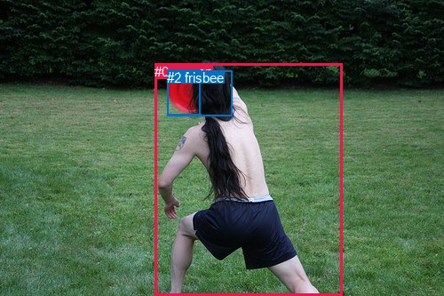
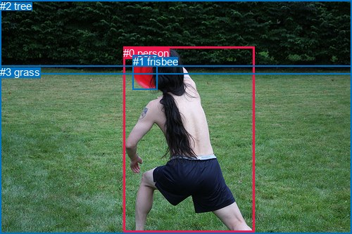

# 图片 2058：2413475.jpg

随机样本序号：287。图片 SHA256：`0ce9a7be0ab9a0f0c59fb937db8da9fd2a9ebe33df5f68db91f86674c71744c5`。

红色框表示人，蓝色框表示其他物体。两个模式分别保留自身框编号，可依据位置比较对应对象。

## 自动检测框与输出

人的框编号：`[0]`。状态：`ok`。

### 自动检测全部物体框

| 编号 | 类别 | 是否为人 | 检测分数 | 像素坐标 xyxy |
|---|---|---|---|---|
| 0 | person | True | 0.9998 | 174.1, 71.8, 385.4, 332.4 |
| 1 | frisbee | False | 0.9759 | 188.2, 78.5, 225.1, 129.3 |
| 2 | frisbee | False | 0.9723 | 188.1, 79.4, 261.5, 130.7 |

### 自动检测 Top50 人相关候选

评分物体对：6；人相关物体对：4；输出关系：8。

| 排名 | 主语编号与类别 | 关系 | 宾语编号与类别 | 类型 | 人与人 | 排序分数 | 原始融合 logit |
|---|---|---|---|---|---|---|---|
| 1 | #0 person | holding | #1 frisbee | semantic | False | 0.98972 | 4.5670 |
| 2 | #0 person | holding | #2 frisbee | semantic | False | 0.98871 | 4.4725 |
| 3 | #0 person | in | #2 frisbee | spatial | False | 0.66418 | 0.6820 |
| 4 | #0 person | in | #1 frisbee | spatial | False | 0.58498 | 0.3433 |
| 5 | #2 frisbee | on | #0 person | spatial | False | 0.33235 | -0.6976 |
| 6 | #1 frisbee | in | #0 person | spatial | False | 0.22164 | -1.2561 |
| 7 | #1 frisbee | holding | #0 person | semantic | False | 0.17347 | -1.5612 |
| 8 | #2 frisbee | holding | #0 person | semantic | False | 0.11409 | -2.0497 |

### 自动检测逐条人相关 GT 核验

R@50：25.00%；命中 1/4。

| GT 主语编号 | GT 关系 | GT 宾语编号 | 结果阶段 | 匹配预测主语编号 | 匹配预测宾语编号 |
|---|---|---|---|---|---|
| 0 | holding | 1 | hit50 | [0] | [1] |
| 0 | catching | 1 | wrong_predicate | [0] | [1] |
| 0 | playing | 1 | wrong_predicate | [0] | [1] |
| 0 | standing on | 3 | endpoint_missing_or_wrong_class | [0] | [] |

## 真实框与输出

人的框编号：`[0]`。

### 真实框全部物体框

| 编号 | 类别 | 是否为人 | 检测分数 | 像素坐标 xyxy |
|---|---|---|---|---|
| 0 | person | True | GT | 175.0, 67.0, 361.0, 330.0 |
| 1 | frisbee | False | GT | 189.0, 79.0, 223.0, 128.0 |
| 2 | tree | False | GT | 0.0, 0.0, 500.0, 106.0 |
| 3 | grass | False | GT | 0.0, 94.0, 500.0, 333.0 |

### 真实框 Top50 人相关候选

评分物体对：12；人相关物体对：6；输出关系：12。

| 排名 | 主语编号与类别 | 关系 | 宾语编号与类别 | 类型 | 人与人 | 排序分数 | 原始融合 logit |
|---|---|---|---|---|---|---|---|
| 1 | #0 person | catching | #1 frisbee | semantic | False | 0.99104 | 4.7063 |
| 2 | #0 person | playing with | #3 grass | semantic | False | 0.98846 | 4.4506 |
| 3 | #0 person | on | #3 grass | spatial | False | 0.96589 | 3.3435 |
| 4 | #0 person | playing | #2 tree | semantic | False | 0.87152 | 1.9145 |
| 5 | #0 person | in | #1 frisbee | spatial | False | 0.81307 | 1.4701 |
| 6 | #1 frisbee | in | #0 person | spatial | False | 0.69379 | 0.8179 |
| 7 | #2 tree | beside | #0 person | spatial | False | 0.64785 | 0.6096 |
| 8 | #0 person | in front of | #2 tree | spatial | False | 0.59932 | 0.4026 |
| 9 | #3 grass | beside | #0 person | spatial | False | 0.53758 | 0.1506 |
| 10 | #1 frisbee | holding | #0 person | semantic | False | 0.50547 | 0.0219 |
| 11 | #2 tree | looking at | #0 person | semantic | False | 0.44302 | -0.2289 |
| 12 | #3 grass | holding | #0 person | semantic | False | 0.24360 | -1.1330 |

### 真实框逐条人相关 GT 核验

R@50：25.00%；命中 1/4。

| GT 主语编号 | GT 关系 | GT 宾语编号 | 结果阶段 | 匹配预测主语编号 | 匹配预测宾语编号 |
|---|---|---|---|---|---|
| 0 | holding | 1 | wrong_predicate | [0] | [1] |
| 0 | catching | 1 | hit50 | [0] | [1] |
| 0 | playing | 1 | wrong_predicate | [0] | [1] |
| 0 | standing on | 3 | wrong_predicate | [0] | [3] |

## 全部人相关 GT

| 主语编号与类别 | 关系 | 宾语编号与类别 |
|---|---|---|
| #0 person | holding | #1 frisbee |
| #0 person | catching | #1 frisbee |
| #0 person | playing | #1 frisbee |
| #0 person | standing on | #3 grass |

原始记录、全部人相关物体对的两项预测与分项分数见 [逐图证据 JSON](../evidence/cases/2058.json)。全部56类 logits 保留于本机 HOR/output/random500/logits/。

<!-- HOR_COMPLETE_RESULTS -->

## 六组条件的完整输出对照

以下保留同一图片三种框与候选模式、两种谓词输出规则的全部 Top50。框编号各自在所属模式内解释。

### 自动检测框完整枚举：空间与语义各保留一个谓词

| 排名 | 主语编号与类别 | 谓词 | 宾语编号与类别 | 分组 | 排序分数 | predicate logit | pair logit |
|---|---|---|---|---|---|---|---|
| 1 | #0 person | holding | #1 frisbee | semantic | 0.9897175 | 4.2651334 | 0.3018424 |
| 2 | #0 person | holding | #2 frisbee | semantic | 0.9887107 | 4.2167678 | 0.2557741 |
| 3 | #0 person | in | #2 frisbee | spatial | 0.6641777 | 0.4261932 | 0.2557741 |
| 4 | #0 person | in | #1 frisbee | spatial | 0.5849833 | 0.0414224 | 0.3018424 |
| 5 | #2 frisbee | on | #0 person | spatial | 0.3323506 | -0.1993618 | -0.4982110 |
| 6 | #1 frisbee | in | #0 person | spatial | 0.2216424 | -0.7362959 | -0.5198249 |
| 7 | #1 frisbee | holding | #0 person | semantic | 0.1734715 | -1.0413966 | -0.5198249 |
| 8 | #2 frisbee | holding | #0 person | semantic | 0.1140865 | -1.5514510 | -0.4982110 |

GT 命中：1/4，R@50=25.00%。

| GT主语 | GT谓词 | GT宾语 | 结果阶段 | 匹配主语框 | 匹配宾语框 |
|---|---|---|---|---|---|
| 0 | holding | 1 | hit50 | [0] | [1] |
| 0 | catching | 1 | wrong_predicate | [0] | [1] |
| 0 | playing | 1 | wrong_predicate | [0] | [1] |
| 0 | standing on | 3 | endpoint_missing_or_wrong_class | [0] | [] |

### 自动检测框完整枚举：每对只保留一个谓词

| 排名 | 主语编号与类别 | 谓词 | 宾语编号与类别 | 分组 | 排序分数 | predicate logit | pair logit |
|---|---|---|---|---|---|---|---|
| 1 | #0 person | holding | #1 frisbee | single | 0.9897175 | 4.2651334 | 0.3018424 |
| 2 | #0 person | holding | #2 frisbee | single | 0.9887107 | 4.2167678 | 0.2557741 |
| 3 | #2 frisbee | on | #0 person | single | 0.3323506 | -0.1993618 | -0.4982110 |
| 4 | #1 frisbee | in | #0 person | single | 0.2216424 | -0.7362959 | -0.5198249 |

GT 命中：1/4，R@50=25.00%。

| GT主语 | GT谓词 | GT宾语 | 结果阶段 | 匹配主语框 | 匹配宾语框 |
|---|---|---|---|---|---|
| 0 | holding | 1 | hit50 | [0] | [1] |
| 0 | catching | 1 | wrong_predicate | [0] | [1] |
| 0 | playing | 1 | wrong_predicate | [0] | [1] |
| 0 | standing on | 3 | endpoint_missing_or_wrong_class | [0] | [] |

### 真实框完整枚举：空间与语义各保留一个谓词

| 排名 | 主语编号与类别 | 谓词 | 宾语编号与类别 | 分组 | 排序分数 | predicate logit | pair logit |
|---|---|---|---|---|---|---|---|
| 1 | #0 person | catching | #1 frisbee | semantic | 0.9910432 | 4.3702788 | 0.3360701 |
| 2 | #0 person | playing with | #3 grass | semantic | 0.9884632 | 4.3765540 | 0.0740532 |
| 3 | #0 person | on | #3 grass | spatial | 0.9658921 | 3.2694721 | 0.0740532 |
| 4 | #0 person | playing | #2 tree | semantic | 0.8715207 | 2.8030357 | -0.8885638 |
| 5 | #0 person | in | #1 frisbee | spatial | 0.8130674 | 1.1339955 | 0.3360701 |
| 6 | #1 frisbee | in | #0 person | spatial | 0.6937910 | 1.3282633 | -0.5103604 |
| 7 | #2 tree | beside | #0 person | spatial | 0.6478533 | 0.7685304 | -0.1589140 |
| 8 | #0 person | in front of | #2 tree | spatial | 0.5993236 | 1.2912116 | -0.8885638 |
| 9 | #3 grass | beside | #0 person | spatial | 0.5375814 | 0.7721162 | -0.6215067 |
| 10 | #1 frisbee | holding | #0 person | semantic | 0.5054724 | 0.5322509 | -0.5103604 |
| 11 | #2 tree | looking at | #0 person | semantic | 0.4430177 | -0.0700097 | -0.1589140 |
| 12 | #3 grass | holding | #0 person | semantic | 0.2436009 | -0.5115314 | -0.6215067 |

GT 命中：1/4，R@50=25.00%。

| GT主语 | GT谓词 | GT宾语 | 结果阶段 | 匹配主语框 | 匹配宾语框 |
|---|---|---|---|---|---|
| 0 | holding | 1 | wrong_predicate | [0] | [1] |
| 0 | catching | 1 | hit50 | [0] | [1] |
| 0 | playing | 1 | wrong_predicate | [0] | [1] |
| 0 | standing on | 3 | wrong_predicate | [0] | [3] |

### 真实框完整枚举：每对只保留一个谓词

| 排名 | 主语编号与类别 | 谓词 | 宾语编号与类别 | 分组 | 排序分数 | predicate logit | pair logit |
|---|---|---|---|---|---|---|---|
| 1 | #0 person | catching | #1 frisbee | single | 0.9910432 | 4.3702788 | 0.3360701 |
| 2 | #0 person | playing with | #3 grass | single | 0.9884632 | 4.3765540 | 0.0740532 |
| 3 | #0 person | playing | #2 tree | single | 0.8715207 | 2.8030357 | -0.8885638 |
| 4 | #1 frisbee | in | #0 person | single | 0.6937910 | 1.3282633 | -0.5103604 |
| 5 | #2 tree | beside | #0 person | single | 0.6478533 | 0.7685304 | -0.1589140 |
| 6 | #3 grass | beside | #0 person | single | 0.5375814 | 0.7721162 | -0.6215067 |

GT 命中：1/4，R@50=25.00%。

| GT主语 | GT谓词 | GT宾语 | 结果阶段 | 匹配主语框 | 匹配宾语框 |
|---|---|---|---|---|---|
| 0 | holding | 1 | wrong_predicate | [0] | [1] |
| 0 | catching | 1 | hit50 | [0] | [1] |
| 0 | playing | 1 | wrong_predicate | [0] | [1] |
| 0 | standing on | 3 | wrong_predicate | [0] | [3] |

### 真实框400候选：空间与语义各保留一个谓词

| 排名 | 主语编号与类别 | 谓词 | 宾语编号与类别 | 分组 | 排序分数 | predicate logit | pair logit |
|---|---|---|---|---|---|---|---|
| 1 | #0 person | catching | #1 frisbee | semantic | 0.9910432 | 4.3702788 | 0.3360701 |
| 2 | #0 person | playing with | #3 grass | semantic | 0.9884632 | 4.3765540 | 0.0740532 |
| 3 | #0 person | on | #3 grass | spatial | 0.9657123 | 3.2640271 | 0.0740532 |
| 4 | #0 person | playing | #2 tree | semantic | 0.8715207 | 2.8030357 | -0.8885638 |
| 5 | #0 person | in | #1 frisbee | spatial | 0.8130674 | 1.1339955 | 0.3360701 |
| 6 | #1 frisbee | in | #0 person | spatial | 0.6937910 | 1.3282633 | -0.5103604 |
| 7 | #2 tree | beside | #0 person | spatial | 0.6478665 | 0.7685881 | -0.1589140 |
| 8 | #0 person | in front of | #2 tree | spatial | 0.5993236 | 1.2912116 | -0.8885638 |
| 9 | #3 grass | beside | #0 person | spatial | 0.5375957 | 0.7721739 | -0.6215067 |
| 10 | #1 frisbee | holding | #0 person | semantic | 0.5062110 | 0.5352054 | -0.5103604 |
| 11 | #2 tree | looking at | #0 person | semantic | 0.4428456 | -0.0707073 | -0.1589140 |
| 12 | #3 grass | holding | #0 person | semantic | 0.2430570 | -0.5144854 | -0.6215067 |

GT 命中：1/4，R@50=25.00%。

| GT主语 | GT谓词 | GT宾语 | 结果阶段 | 匹配主语框 | 匹配宾语框 |
|---|---|---|---|---|---|
| 0 | holding | 1 | wrong_predicate | [0] | [1] |
| 0 | catching | 1 | hit50 | [0] | [1] |
| 0 | playing | 1 | wrong_predicate | [0] | [1] |
| 0 | standing on | 3 | wrong_predicate | [0] | [3] |

### 真实框400候选：每对只保留一个谓词

| 排名 | 主语编号与类别 | 谓词 | 宾语编号与类别 | 分组 | 排序分数 | predicate logit | pair logit |
|---|---|---|---|---|---|---|---|
| 1 | #0 person | catching | #1 frisbee | single | 0.9910432 | 4.3702788 | 0.3360701 |
| 2 | #0 person | playing with | #3 grass | single | 0.9884632 | 4.3765540 | 0.0740532 |
| 3 | #0 person | playing | #2 tree | single | 0.8715207 | 2.8030357 | -0.8885638 |
| 4 | #1 frisbee | in | #0 person | single | 0.6937910 | 1.3282633 | -0.5103604 |
| 5 | #2 tree | beside | #0 person | single | 0.6478665 | 0.7685881 | -0.1589140 |
| 6 | #3 grass | beside | #0 person | single | 0.5375957 | 0.7721739 | -0.6215067 |

GT 命中：1/4，R@50=25.00%。

| GT主语 | GT谓词 | GT宾语 | 结果阶段 | 匹配主语框 | 匹配宾语框 |
|---|---|---|---|---|---|
| 0 | holding | 1 | wrong_predicate | [0] | [1] |
| 0 | catching | 1 | hit50 | [0] | [1] |
| 0 | playing | 1 | wrong_predicate | [0] | [1] |
| 0 | standing on | 3 | wrong_predicate | [0] | [3] |
