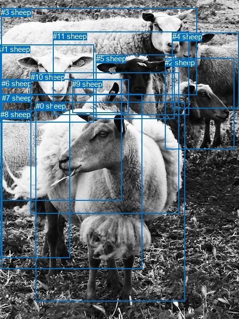
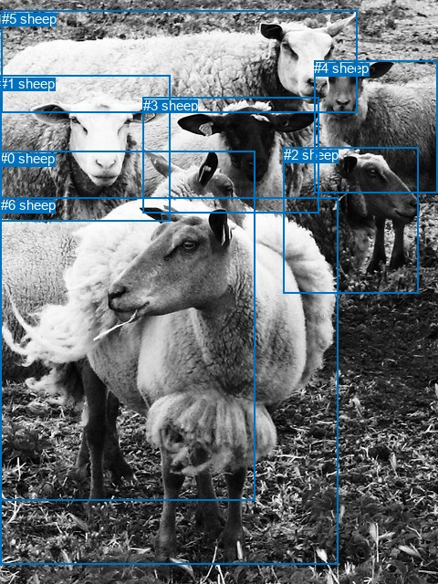

# 图片 2065：2413787.jpg

随机样本序号：433。图片 SHA256：`20698318661eebbdaba9dbcb8cbb6af8cd9e7399f53ed61d57f19f6417cee391`。

红色框表示人，蓝色框表示其他物体。两个模式分别保留自身框编号，可依据位置比较对应对象。

## 自动检测框与输出

人的框编号：`[]`。状态：`no_person`。

### 自动检测全部物体框

| 编号 | 类别 | 是否为人 | 检测分数 | 像素坐标 xyxy |
|---|---|---|---|---|
| 0 | sheep | False | 0.9916 | 71.7, 204.2, 371.7, 604.7 |
| 1 | sheep | False | 0.9877 | 0.0, 89.6, 188.1, 245.0 |
| 2 | sheep | False | 0.9871 | 331.4, 116.5, 470.7, 299.1 |
| 3 | sheep | False | 0.9847 | 2.3, 16.5, 396.0, 190.2 |
| 4 | sheep | False | 0.9835 | 345.9, 65.0, 479.4, 217.5 |
| 5 | sheep | False | 0.9323 | 192.6, 109.5, 350.7, 238.9 |
| 6 | sheep | False | 0.7881 | 2.8, 158.7, 244.0, 402.2 |
| 7 | sheep | False | 0.7728 | 3.8, 188.5, 285.1, 539.6 |
| 8 | sheep | False | 0.4947 | 1.4, 221.5, 140.1, 517.8 |
| 9 | sheep | False | 0.4345 | 145.5, 159.7, 258.3, 226.0 |
| 10 | sheep | False | 0.3978 | 61.6, 145.5, 359.0, 428.2 |
| 11 | sheep | False | 0.3826 | 106.3, 63.9, 379.6, 231.0 |

### 自动检测 Top50 人相关候选

评分物体对：0；人相关物体对：0；输出关系：0。

| 排名 | 主语编号与类别 | 关系 | 宾语编号与类别 | 类型 | 人与人 | 排序分数 | 原始融合 logit |
|---|---|---|---|---|---|---|---|

### 自动检测逐条人相关 GT 核验

本图没有人相关 GT，R@50 无分母；预测候选继续展示。

## 真实框与输出

人的框编号：`[]`。

### 真实框全部物体框

| 编号 | 类别 | 是否为人 | 检测分数 | 像素坐标 xyxy |
|---|---|---|---|---|
| 0 | sheep | False | GT | 0.0, 165.0, 279.0, 548.0 |
| 1 | sheep | False | GT | 0.0, 83.0, 187.0, 243.0 |
| 2 | sheep | False | GT | 311.0, 161.0, 459.0, 321.0 |
| 3 | sheep | False | GT | 157.0, 107.0, 350.0, 233.0 |
| 4 | sheep | False | GT | 344.0, 66.0, 480.0, 211.0 |
| 5 | sheep | False | GT | 2.0, 12.0, 392.0, 123.0 |
| 6 | sheep | False | GT | 1.0, 216.0, 370.0, 618.0 |

### 真实框 Top50 人相关候选

评分物体对：0；人相关物体对：0；输出关系：0。

| 排名 | 主语编号与类别 | 关系 | 宾语编号与类别 | 类型 | 人与人 | 排序分数 | 原始融合 logit |
|---|---|---|---|---|---|---|---|

### 真实框逐条人相关 GT 核验

本图没有人相关 GT，R@50 无分母；预测候选继续展示。

## 全部人相关 GT

| 主语编号与类别 | 关系 | 宾语编号与类别 |
|---|---|---|

原始记录、全部人相关物体对的两项预测与分项分数见 [逐图证据 JSON](../evidence/cases/2065.json)。全部56类 logits 保留于本机 HOR/output/random500/logits/。

<!-- HOR_COMPLETE_RESULTS -->

## 六组条件的完整输出对照

以下保留同一图片三种框与候选模式、两种谓词输出规则的全部 Top50。框编号各自在所属模式内解释。

### 自动检测框完整枚举：空间与语义各保留一个谓词

| 排名 | 主语编号与类别 | 谓词 | 宾语编号与类别 | 分组 | 排序分数 | predicate logit | pair logit |
|---|---|---|---|---|---|---|---|

没有人相关 GT，本条件的召回率无分母。

### 自动检测框完整枚举：每对只保留一个谓词

| 排名 | 主语编号与类别 | 谓词 | 宾语编号与类别 | 分组 | 排序分数 | predicate logit | pair logit |
|---|---|---|---|---|---|---|---|

没有人相关 GT，本条件的召回率无分母。

### 真实框完整枚举：空间与语义各保留一个谓词

| 排名 | 主语编号与类别 | 谓词 | 宾语编号与类别 | 分组 | 排序分数 | predicate logit | pair logit |
|---|---|---|---|---|---|---|---|

没有人相关 GT，本条件的召回率无分母。

### 真实框完整枚举：每对只保留一个谓词

| 排名 | 主语编号与类别 | 谓词 | 宾语编号与类别 | 分组 | 排序分数 | predicate logit | pair logit |
|---|---|---|---|---|---|---|---|

没有人相关 GT，本条件的召回率无分母。

### 真实框400候选：空间与语义各保留一个谓词

| 排名 | 主语编号与类别 | 谓词 | 宾语编号与类别 | 分组 | 排序分数 | predicate logit | pair logit |
|---|---|---|---|---|---|---|---|

没有人相关 GT，本条件的召回率无分母。

### 真实框400候选：每对只保留一个谓词

| 排名 | 主语编号与类别 | 谓词 | 宾语编号与类别 | 分组 | 排序分数 | predicate logit | pair logit |
|---|---|---|---|---|---|---|---|

没有人相关 GT，本条件的召回率无分母。
