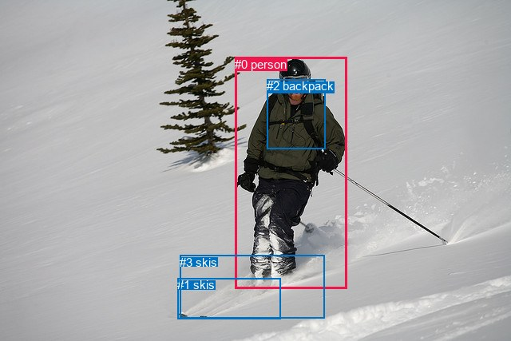
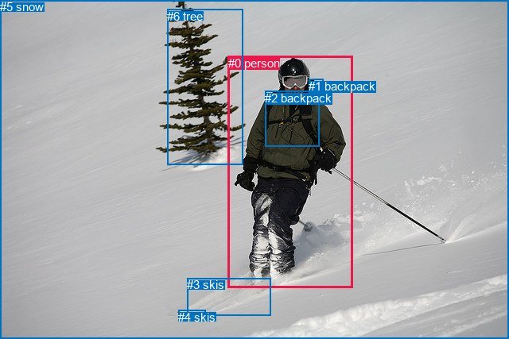

# 图片 2103：2416059.jpg

随机样本序号：371。图片 SHA256：`5e297de4a93c862640de2d457faf184f9881668c0cd479b13371650e860037f2`。

红色框表示人，蓝色框表示其他物体。两个模式分别保留自身框编号，可依据位置比较对应对象。

## 自动检测框与输出

人的框编号：`[0]`。状态：`ok`。

### 自动检测全部物体框

| 编号 | 类别 | 是否为人 | 检测分数 | 像素坐标 xyxy |
|---|---|---|---|---|
| 0 | person | True | 0.9997 | 294.5, 71.7, 434.1, 362.0 |
| 1 | skis | False | 0.9356 | 222.3, 348.2, 351.3, 399.6 |
| 2 | backpack | False | 0.9294 | 334.0, 99.0, 407.1, 186.5 |
| 3 | skis | False | 0.4615 | 225.2, 319.6, 406.4, 398.1 |

### 自动检测 Top50 人相关候选

评分物体对：12；人相关物体对：6；输出关系：12。

| 排名 | 主语编号与类别 | 关系 | 宾语编号与类别 | 类型 | 人与人 | 排序分数 | 原始融合 logit |
|---|---|---|---|---|---|---|---|
| 1 | #0 person | wearing | #2 backpack | semantic | False | 0.98667 | 4.3041 |
| 2 | #0 person | on | #3 skis | spatial | False | 0.97353 | 3.6048 |
| 3 | #0 person | on | #1 skis | spatial | False | 0.97120 | 3.5182 |
| 4 | #0 person | wearing | #3 skis | semantic | False | 0.95394 | 3.0307 |
| 5 | #0 person | wearing | #1 skis | semantic | False | 0.94983 | 2.9408 |
| 6 | #2 backpack | on | #0 person | spatial | False | 0.86751 | 1.8791 |
| 7 | #0 person | in | #2 backpack | spatial | False | 0.85961 | 1.8121 |
| 8 | #3 skis | on | #0 person | spatial | False | 0.35957 | -0.5772 |
| 9 | #1 skis | on | #0 person | spatial | False | 0.29594 | -0.8667 |
| 10 | #2 backpack | wearing | #0 person | semantic | False | 0.14760 | -1.7536 |
| 11 | #3 skis | biting | #0 person | semantic | False | 0.08369 | -2.3933 |
| 12 | #1 skis | biting | #0 person | semantic | False | 0.08189 | -2.4169 |

### 自动检测逐条人相关 GT 核验

R@50：25.00%；命中 1/4。

| GT 主语编号 | GT 关系 | GT 宾语编号 | 结果阶段 | 匹配预测主语编号 | 匹配预测宾语编号 |
|---|---|---|---|---|---|
| 0 | carrying | 2 | wrong_predicate | [0] | [2] |
| 0 | standing on | 3 | wrong_predicate | [0] | [1] |
| 0 | wearing | 3 | hit50 | [0] | [1] |
| 0 | playing | 3 | wrong_predicate | [0] | [1] |

## 真实框与输出

人的框编号：`[0]`。

### 真实框全部物体框

| 编号 | 类别 | 是否为人 | 检测分数 | 像素坐标 xyxy |
|---|---|---|---|---|
| 0 | person | True | GT | 287.0, 71.0, 443.0, 363.0 |
| 1 | backpack | False | GT | 388.0, 100.0, 407.0, 129.0 |
| 2 | backpack | False | GT | 333.0, 115.0, 401.0, 185.0 |
| 3 | skis | False | GT | 235.0, 350.0, 340.0, 397.0 |
| 4 | skis | False | GT | 224.0, 391.0, 258.0, 399.0 |
| 5 | snow | False | GT | 0.0, 0.0, 640.0, 427.0 |
| 6 | tree | False | GT | 210.0, 12.0, 305.0, 207.0 |

### 真实框 Top50 人相关候选

评分物体对：42；人相关物体对：12；输出关系：24。

| 排名 | 主语编号与类别 | 关系 | 宾语编号与类别 | 类型 | 人与人 | 排序分数 | 原始融合 logit |
|---|---|---|---|---|---|---|---|
| 1 | #0 person | wearing | #2 backpack | semantic | False | 0.98544 | 4.2150 |
| 2 | #0 person | wearing | #1 backpack | semantic | False | 0.98445 | 4.1477 |
| 3 | #6 tree | beside | #0 person | spatial | False | 0.97126 | 3.5202 |
| 4 | #0 person | on | #5 snow | spatial | False | 0.96919 | 3.4485 |
| 5 | #0 person | on | #3 skis | spatial | False | 0.95779 | 3.1220 |
| 6 | #0 person | wearing | #3 skis | semantic | False | 0.93996 | 2.7509 |
| 7 | #0 person | going down | #5 snow | semantic | False | 0.92847 | 2.5635 |
| 8 | #1 backpack | on | #0 person | spatial | False | 0.90598 | 2.2656 |
| 9 | #2 backpack | on | #0 person | spatial | False | 0.89348 | 2.1268 |
| 10 | #0 person | on | #4 skis | spatial | False | 0.84440 | 1.6914 |
| 11 | #0 person | on | #1 backpack | spatial | False | 0.81469 | 1.4808 |
| 12 | #0 person | in | #2 backpack | spatial | False | 0.78526 | 1.2966 |
| 13 | #0 person | beside | #6 tree | spatial | False | 0.76046 | 1.1552 |
| 14 | #0 person | holding | #4 skis | semantic | False | 0.75844 | 1.1442 |
| 15 | #6 tree | looking at | #0 person | semantic | False | 0.65257 | 0.6303 |
| 16 | #3 skis | on | #0 person | spatial | False | 0.43622 | -0.2565 |
| 17 | #5 snow | in | #0 person | spatial | False | 0.38797 | -0.4559 |
| 18 | #2 backpack | wearing | #0 person | semantic | False | 0.34326 | -0.6488 |
| 19 | #1 backpack | wearing | #0 person | semantic | False | 0.33361 | -0.6919 |
| 20 | #4 skis | beside | #0 person | spatial | False | 0.31886 | -0.7590 |
| 21 | #0 person | walking on | #6 tree | semantic | False | 0.29090 | -0.8910 |
| 22 | #3 skis | about to hit | #0 person | semantic | False | 0.20402 | -1.3613 |
| 23 | #4 skis | holding | #0 person | semantic | False | 0.08300 | -2.4023 |
| 24 | #5 snow | holding | #0 person | semantic | False | 0.07898 | -2.4563 |

### 真实框逐条人相关 GT 核验

R@50：25.00%；命中 1/4。

| GT 主语编号 | GT 关系 | GT 宾语编号 | 结果阶段 | 匹配预测主语编号 | 匹配预测宾语编号 |
|---|---|---|---|---|---|
| 0 | carrying | 2 | wrong_predicate | [0] | [2] |
| 0 | standing on | 3 | wrong_predicate | [0] | [3] |
| 0 | wearing | 3 | hit50 | [0] | [3] |
| 0 | playing | 3 | wrong_predicate | [0] | [3] |

## 全部人相关 GT

| 主语编号与类别 | 关系 | 宾语编号与类别 |
|---|---|---|
| #0 person | carrying | #2 backpack |
| #0 person | standing on | #3 skis |
| #0 person | wearing | #3 skis |
| #0 person | playing | #3 skis |

原始记录、全部人相关物体对的两项预测与分项分数见 [逐图证据 JSON](../evidence/cases/2103.json)。全部56类 logits 保留于本机 HOR/output/random500/logits/。

<!-- HOR_COMPLETE_RESULTS -->

## 六组条件的完整输出对照

以下保留同一图片三种框与候选模式、两种谓词输出规则的全部 Top50。框编号各自在所属模式内解释。

### 自动检测框完整枚举：空间与语义各保留一个谓词

| 排名 | 主语编号与类别 | 谓词 | 宾语编号与类别 | 分组 | 排序分数 | predicate logit | pair logit |
|---|---|---|---|---|---|---|---|
| 1 | #0 person | wearing | #2 backpack | semantic | 0.9866676 | 4.2398419 | 0.0642989 |
| 2 | #0 person | on | #3 skis | spatial | 0.9735268 | 3.4505420 | 0.1542506 |
| 3 | #0 person | on | #1 skis | spatial | 0.9712021 | 3.4230285 | 0.0952064 |
| 4 | #0 person | wearing | #3 skis | semantic | 0.9539408 | 2.8764243 | 0.1542506 |
| 5 | #0 person | wearing | #1 skis | semantic | 0.9498262 | 2.8455811 | 0.0952064 |
| 6 | #2 backpack | on | #0 person | spatial | 0.8675084 | 2.3538179 | -0.4747124 |
| 7 | #0 person | in | #2 backpack | spatial | 0.8596130 | 1.7477803 | 0.0642989 |
| 8 | #3 skis | on | #0 person | spatial | 0.3595740 | 0.1958213 | -0.7730346 |
| 9 | #1 skis | on | #0 person | spatial | 0.2959449 | -0.0944910 | -0.7721925 |
| 10 | #2 backpack | wearing | #0 person | semantic | 0.1475970 | -1.2788610 | -0.4747124 |
| 11 | #3 skis | biting | #0 person | semantic | 0.0836868 | -1.6202424 | -0.7730346 |
| 12 | #1 skis | biting | #0 person | semantic | 0.0818948 | -1.6446843 | -0.7721925 |

GT 命中：1/4，R@50=25.00%。

| GT主语 | GT谓词 | GT宾语 | 结果阶段 | 匹配主语框 | 匹配宾语框 |
|---|---|---|---|---|---|
| 0 | carrying | 2 | wrong_predicate | [0] | [2] |
| 0 | standing on | 3 | wrong_predicate | [0] | [1] |
| 0 | wearing | 3 | hit50 | [0] | [1] |
| 0 | playing | 3 | wrong_predicate | [0] | [1] |

### 自动检测框完整枚举：每对只保留一个谓词

| 排名 | 主语编号与类别 | 谓词 | 宾语编号与类别 | 分组 | 排序分数 | predicate logit | pair logit |
|---|---|---|---|---|---|---|---|
| 1 | #0 person | wearing | #2 backpack | single | 0.9866676 | 4.2398419 | 0.0642989 |
| 2 | #0 person | on | #3 skis | single | 0.9735268 | 3.4505420 | 0.1542506 |
| 3 | #0 person | on | #1 skis | single | 0.9712021 | 3.4230285 | 0.0952064 |
| 4 | #2 backpack | on | #0 person | single | 0.8675084 | 2.3538179 | -0.4747124 |
| 5 | #3 skis | on | #0 person | single | 0.3595740 | 0.1958213 | -0.7730346 |
| 6 | #1 skis | on | #0 person | single | 0.2959449 | -0.0944910 | -0.7721925 |

GT 命中：0/4，R@50=0.00%。

| GT主语 | GT谓词 | GT宾语 | 结果阶段 | 匹配主语框 | 匹配宾语框 |
|---|---|---|---|---|---|
| 0 | carrying | 2 | wrong_predicate | [0] | [2] |
| 0 | standing on | 3 | wrong_predicate | [0] | [1] |
| 0 | wearing | 3 | wrong_predicate | [0] | [1] |
| 0 | playing | 3 | wrong_predicate | [0] | [1] |

### 真实框完整枚举：空间与语义各保留一个谓词

| 排名 | 主语编号与类别 | 谓词 | 宾语编号与类别 | 分组 | 排序分数 | predicate logit | pair logit |
|---|---|---|---|---|---|---|---|
| 1 | #0 person | wearing | #2 backpack | semantic | 0.9854434 | 4.3719430 | -0.1569040 |
| 2 | #0 person | wearing | #1 backpack | semantic | 0.9844458 | 4.0973639 | 0.0503837 |
| 3 | #6 tree | beside | #0 person | spatial | 0.9712582 | 3.6498895 | -0.1296513 |
| 4 | #0 person | on | #5 snow | spatial | 0.9691857 | 3.1622562 | 0.2862182 |
| 5 | #0 person | on | #3 skis | spatial | 0.9577917 | 3.0252099 | 0.0968049 |
| 6 | #0 person | wearing | #3 skis | semantic | 0.9399616 | 2.6540494 | 0.0968049 |
| 7 | #0 person | going down | #5 snow | semantic | 0.9284749 | 2.2772770 | 0.2862182 |
| 8 | #1 backpack | on | #0 person | spatial | 0.9059840 | 2.6045690 | -0.3390124 |
| 9 | #2 backpack | on | #0 person | spatial | 0.8934838 | 2.6770892 | -0.5502592 |
| 10 | #0 person | on | #4 skis | spatial | 0.8444028 | 1.9318762 | -0.2405167 |
| 11 | #0 person | on | #1 backpack | spatial | 0.8146870 | 1.4303741 | 0.0503837 |
| 12 | #0 person | in | #2 backpack | spatial | 0.7852624 | 1.4535050 | -0.1569040 |
| 13 | #0 person | beside | #6 tree | spatial | 0.7604602 | 2.1456733 | -0.9904692 |
| 14 | #0 person | holding | #4 skis | semantic | 0.7584444 | 1.3846869 | -0.2405167 |
| 15 | #6 tree | looking at | #0 person | semantic | 0.6525671 | 0.7599936 | -0.1296513 |
| 16 | #3 skis | on | #0 person | spatial | 0.4362204 | 0.5219312 | -0.7784469 |
| 17 | #5 snow | in | #0 person | spatial | 0.3879703 | 0.2173352 | -0.6731874 |
| 18 | #2 backpack | wearing | #0 person | semantic | 0.3432610 | -0.0985365 | -0.5502592 |
| 19 | #1 backpack | wearing | #0 person | semantic | 0.3336119 | -0.3528814 | -0.3390124 |
| 20 | #4 skis | beside | #0 person | spatial | 0.3188571 | -0.0447712 | -0.7142579 |
| 21 | #0 person | walking on | #6 tree | semantic | 0.2908989 | 0.0994468 | -0.9904692 |
| 22 | #3 skis | about to hit | #0 person | semantic | 0.2040235 | -0.5828876 | -0.7784469 |
| 23 | #4 skis | holding | #0 person | semantic | 0.0829958 | -1.6880643 | -0.7142579 |
| 24 | #5 snow | holding | #0 person | semantic | 0.0789779 | -1.7831285 | -0.6731874 |

GT 命中：1/4，R@50=25.00%。

| GT主语 | GT谓词 | GT宾语 | 结果阶段 | 匹配主语框 | 匹配宾语框 |
|---|---|---|---|---|---|
| 0 | carrying | 2 | wrong_predicate | [0] | [2] |
| 0 | standing on | 3 | wrong_predicate | [0] | [3] |
| 0 | wearing | 3 | hit50 | [0] | [3] |
| 0 | playing | 3 | wrong_predicate | [0] | [3] |

### 真实框完整枚举：每对只保留一个谓词

| 排名 | 主语编号与类别 | 谓词 | 宾语编号与类别 | 分组 | 排序分数 | predicate logit | pair logit |
|---|---|---|---|---|---|---|---|
| 1 | #0 person | wearing | #2 backpack | single | 0.9854434 | 4.3719430 | -0.1569040 |
| 2 | #0 person | wearing | #1 backpack | single | 0.9844458 | 4.0973639 | 0.0503837 |
| 3 | #6 tree | beside | #0 person | single | 0.9712582 | 3.6498895 | -0.1296513 |
| 4 | #0 person | on | #5 snow | single | 0.9691857 | 3.1622562 | 0.2862182 |
| 5 | #0 person | on | #3 skis | single | 0.9577917 | 3.0252099 | 0.0968049 |
| 6 | #1 backpack | on | #0 person | single | 0.9059840 | 2.6045690 | -0.3390124 |
| 7 | #2 backpack | on | #0 person | single | 0.8934838 | 2.6770892 | -0.5502592 |
| 8 | #0 person | on | #4 skis | single | 0.8444028 | 1.9318762 | -0.2405167 |
| 9 | #0 person | beside | #6 tree | single | 0.7604602 | 2.1456733 | -0.9904692 |
| 10 | #3 skis | on | #0 person | single | 0.4362204 | 0.5219312 | -0.7784469 |
| 11 | #5 snow | in | #0 person | single | 0.3879703 | 0.2173352 | -0.6731874 |
| 12 | #4 skis | beside | #0 person | single | 0.3188571 | -0.0447712 | -0.7142579 |

GT 命中：0/4，R@50=0.00%。

| GT主语 | GT谓词 | GT宾语 | 结果阶段 | 匹配主语框 | 匹配宾语框 |
|---|---|---|---|---|---|
| 0 | carrying | 2 | wrong_predicate | [0] | [2] |
| 0 | standing on | 3 | wrong_predicate | [0] | [3] |
| 0 | wearing | 3 | wrong_predicate | [0] | [3] |
| 0 | playing | 3 | wrong_predicate | [0] | [3] |

### 真实框400候选：空间与语义各保留一个谓词

| 排名 | 主语编号与类别 | 谓词 | 宾语编号与类别 | 分组 | 排序分数 | predicate logit | pair logit |
|---|---|---|---|---|---|---|---|
| 1 | #0 person | wearing | #2 backpack | semantic | 0.9854434 | 4.3719430 | -0.1569040 |
| 2 | #0 person | wearing | #1 backpack | semantic | 0.9845354 | 4.1032319 | 0.0503837 |
| 3 | #6 tree | beside | #0 person | spatial | 0.9712566 | 3.6498313 | -0.1296513 |
| 4 | #0 person | on | #5 snow | spatial | 0.9695091 | 3.1731458 | 0.2862182 |
| 5 | #0 person | on | #3 skis | spatial | 0.9562117 | 2.9868073 | 0.0968049 |
| 6 | #0 person | wearing | #3 skis | semantic | 0.9399616 | 2.6540494 | 0.0968049 |
| 7 | #0 person | going down | #5 snow | semantic | 0.9284749 | 2.2772770 | 0.2862182 |
| 8 | #1 backpack | on | #0 person | spatial | 0.9017005 | 2.5552759 | -0.3390124 |
| 9 | #2 backpack | on | #0 person | spatial | 0.8934838 | 2.6770892 | -0.5502592 |
| 10 | #0 person | on | #4 skis | spatial | 0.8444028 | 1.9318762 | -0.2405167 |
| 11 | #0 person | on | #1 backpack | spatial | 0.8175685 | 1.4495759 | 0.0503837 |
| 12 | #0 person | in | #2 backpack | spatial | 0.7852624 | 1.4535050 | -0.1569040 |
| 13 | #0 person | beside | #6 tree | spatial | 0.7604496 | 2.1456156 | -0.9904692 |
| 14 | #0 person | holding | #4 skis | semantic | 0.7589853 | 1.3876414 | -0.2405167 |
| 15 | #6 tree | looking at | #0 person | semantic | 0.6525671 | 0.7599936 | -0.1296513 |
| 16 | #3 skis | on | #0 person | spatial | 0.4396066 | 0.5356879 | -0.7784469 |
| 17 | #5 snow | in | #0 person | spatial | 0.3879703 | 0.2173352 | -0.6731874 |
| 18 | #2 backpack | wearing | #0 person | semantic | 0.3391351 | -0.1168919 | -0.5502592 |
| 19 | #1 backpack | wearing | #0 person | semantic | 0.3282485 | -0.3771052 | -0.3390124 |
| 20 | #4 skis | beside | #0 person | spatial | 0.3123762 | -0.0747757 | -0.7142579 |
| 21 | #0 person | walking on | #6 tree | semantic | 0.2853446 | 0.0723662 | -0.9904692 |
| 22 | #3 skis | about to hit | #0 person | semantic | 0.2004430 | -0.6050811 | -0.7784469 |
| 23 | #4 skis | holding | #0 person | semantic | 0.0808439 | -1.7166781 | -0.7142579 |
| 24 | #5 snow | holding | #0 person | semantic | 0.0789242 | -1.7838671 | -0.6731874 |

GT 命中：1/4，R@50=25.00%。

| GT主语 | GT谓词 | GT宾语 | 结果阶段 | 匹配主语框 | 匹配宾语框 |
|---|---|---|---|---|---|
| 0 | carrying | 2 | wrong_predicate | [0] | [2] |
| 0 | standing on | 3 | wrong_predicate | [0] | [3] |
| 0 | wearing | 3 | hit50 | [0] | [3] |
| 0 | playing | 3 | wrong_predicate | [0] | [3] |

### 真实框400候选：每对只保留一个谓词

| 排名 | 主语编号与类别 | 谓词 | 宾语编号与类别 | 分组 | 排序分数 | predicate logit | pair logit |
|---|---|---|---|---|---|---|---|
| 1 | #0 person | wearing | #2 backpack | single | 0.9854434 | 4.3719430 | -0.1569040 |
| 2 | #0 person | wearing | #1 backpack | single | 0.9845354 | 4.1032319 | 0.0503837 |
| 3 | #6 tree | beside | #0 person | single | 0.9712566 | 3.6498313 | -0.1296513 |
| 4 | #0 person | on | #5 snow | single | 0.9695091 | 3.1731458 | 0.2862182 |
| 5 | #0 person | on | #3 skis | single | 0.9562117 | 2.9868073 | 0.0968049 |
| 6 | #1 backpack | on | #0 person | single | 0.9017005 | 2.5552759 | -0.3390124 |
| 7 | #2 backpack | on | #0 person | single | 0.8934838 | 2.6770892 | -0.5502592 |
| 8 | #0 person | on | #4 skis | single | 0.8444028 | 1.9318762 | -0.2405167 |
| 9 | #0 person | beside | #6 tree | single | 0.7604496 | 2.1456156 | -0.9904692 |
| 10 | #3 skis | on | #0 person | single | 0.4396066 | 0.5356879 | -0.7784469 |
| 11 | #5 snow | in | #0 person | single | 0.3879703 | 0.2173352 | -0.6731874 |
| 12 | #4 skis | beside | #0 person | single | 0.3123762 | -0.0747757 | -0.7142579 |

GT 命中：0/4，R@50=0.00%。

| GT主语 | GT谓词 | GT宾语 | 结果阶段 | 匹配主语框 | 匹配宾语框 |
|---|---|---|---|---|---|
| 0 | carrying | 2 | wrong_predicate | [0] | [2] |
| 0 | standing on | 3 | wrong_predicate | [0] | [3] |
| 0 | wearing | 3 | wrong_predicate | [0] | [3] |
| 0 | playing | 3 | wrong_predicate | [0] | [3] |
