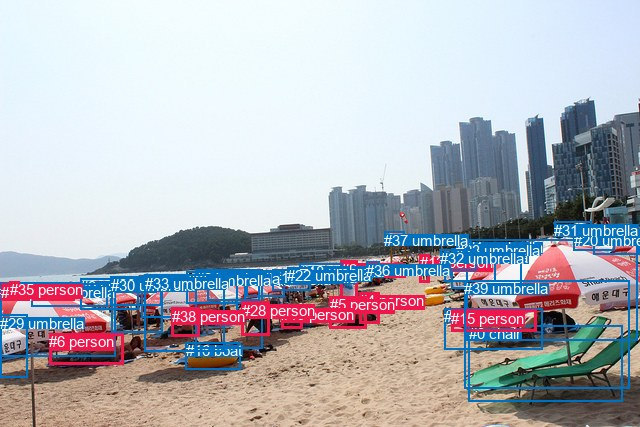
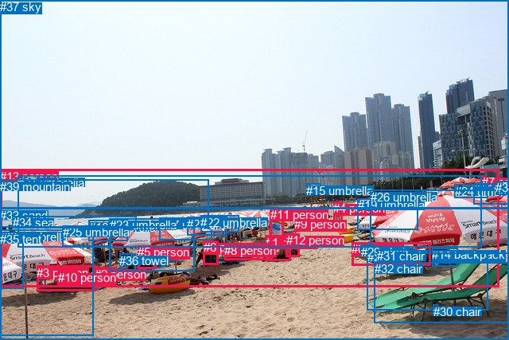

# 图片 2105：2416163.jpg

随机样本序号：130。图片 SHA256：`59ef9c73d5d2460a67189695079bdb5560922e4e1f0c40a346a105d61abf261d`。

红色框表示人，蓝色框表示其他物体。两个模式分别保留自身框编号，可依据位置比较对应对象。

## 自动检测框与输出

人的框编号：`[2, 4, 5, 6, 13, 15, 19, 28, 34, 35, 38]`。状态：`ok`。

### 自动检测全部物体框

| 编号 | 类别 | 是否为人 | 检测分数 | 像素坐标 xyxy |
|---|---|---|---|---|
| 0 | chair | False | 0.9877 | 468.6, 325.5, 622.1, 401.8 |
| 1 | umbrella | False | 0.9776 | 466.6, 239.1, 637.8, 340.6 |
| 2 | person | True | 0.9646 | 340.7, 260.8, 357.4, 310.0 |
| 3 | umbrella | False | 0.9578 | 0.2, 282.8, 116.0, 356.1 |
| 4 | person | True | 0.9483 | 359.5, 292.2, 379.1, 323.8 |
| 5 | person | True | 0.9449 | 329.7, 296.2, 366.1, 328.8 |
| 6 | person | True | 0.9391 | 49.4, 333.1, 123.8, 364.9 |
| 7 | umbrella | False | 0.9251 | 451.6, 248.6, 521.4, 288.9 |
| 8 | chair | False | 0.9241 | 444.0, 308.3, 542.7, 349.3 |
| 9 | umbrella | False | 0.9198 | 80.1, 278.1, 138.4, 309.0 |
| 10 | umbrella | False | 0.9064 | 207.6, 271.6, 259.4, 300.6 |
| 11 | umbrella | False | 0.9025 | 141.6, 275.5, 237.2, 317.3 |
| 12 | umbrella | False | 0.8975 | 246.8, 270.9, 284.8, 296.5 |
| 13 | person | True | 0.8974 | 419.9, 254.2, 429.6, 282.8 |
| 14 | umbrella | False | 0.8763 | 593.4, 229.2, 640.0, 254.2 |
| 15 | person | True | 0.8400 | 451.2, 309.9, 536.5, 332.0 |
| 16 | boat | False | 0.8370 | 185.8, 342.3, 240.9, 369.4 |
| 17 | umbrella | False | 0.8129 | 272.7, 269.1, 310.4, 290.6 |
| 18 | umbrella | False | 0.8121 | 300.0, 263.1, 342.3, 283.2 |
| 19 | person | True | 0.8052 | 281.1, 305.8, 302.5, 328.8 |
| 20 | umbrella | False | 0.7995 | 573.8, 231.6, 614.8, 250.9 |
| 21 | umbrella | False | 0.7980 | 444.1, 249.1, 495.9, 281.3 |
| 22 | umbrella | False | 0.7890 | 287.4, 267.5, 310.7, 284.9 |
| 23 | umbrella | False | 0.7764 | 456.0, 241.6, 471.5, 247.3 |
| 24 | umbrella | False | 0.7679 | 196.0, 269.5, 262.7, 348.9 |
| 25 | umbrella | False | 0.7577 | 186.8, 271.6, 245.2, 303.4 |
| 26 | umbrella | False | 0.7530 | 110.6, 276.2, 161.2, 305.2 |
| 27 | umbrella | False | 0.7484 | 31.5, 283.6, 107.7, 306.3 |
| 28 | person | True | 0.7378 | 241.5, 301.8, 269.2, 335.9 |
| 29 | umbrella | False | 0.7313 | 0.0, 314.5, 27.5, 377.3 |
| 30 | umbrella | False | 0.6964 | 111.3, 277.0, 162.6, 332.0 |
| 31 | umbrella | False | 0.6961 | 554.3, 221.7, 591.4, 236.2 |
| 32 | umbrella | False | 0.6881 | 440.3, 249.7, 476.0, 270.4 |
| 33 | umbrella | False | 0.6807 | 144.6, 274.7, 224.6, 351.2 |
| 34 | person | True | 0.6797 | 1.4, 283.8, 8.8, 290.9 |
| 35 | person | True | 0.6685 | 9.8, 281.3, 19.6, 292.1 |
| 36 | umbrella | False | 0.6576 | 366.1, 261.7, 379.4, 269.4 |
| 37 | umbrella | False | 0.6252 | 384.4, 231.5, 405.0, 239.7 |
| 38 | person | True | 0.6157 | 171.8, 307.7, 199.4, 336.0 |
| 39 | umbrella | False | 0.6014 | 464.0, 280.1, 629.4, 388.8 |

### 自动检测 Top50 人相关候选

评分物体对：1560；人相关物体对：748；输出关系：50。

| 排名 | 主语编号与类别 | 关系 | 宾语编号与类别 | 类型 | 人与人 | 排序分数 | 原始融合 logit |
|---|---|---|---|---|---|---|---|
| 1 | #15 person | lying on | #8 chair | semantic | False | 0.96929 | 3.4521 |
| 2 | #6 person | lying on | #3 umbrella | semantic | False | 0.95776 | 3.1212 |
| 3 | #8 chair | lying on | #15 person | semantic | False | 0.91757 | 2.4098 |
| 4 | #35 person | in | #34 person | spatial | True | 0.88219 | 2.0133 |
| 5 | #15 person | on | #8 chair | spatial | False | 0.86721 | 1.8766 |
| 6 | #38 person | sitting on | #33 umbrella | semantic | False | 0.86390 | 1.8481 |
| 7 | #34 person | looking at | #35 person | semantic | True | 0.86033 | 1.8181 |
| 8 | #35 person | holding | #34 person | semantic | True | 0.85529 | 1.7767 |
| 9 | #34 person | in | #35 person | spatial | True | 0.85457 | 1.7709 |
| 10 | #15 person | lying on | #39 umbrella | semantic | False | 0.81219 | 1.4643 |
| 11 | #15 person | lying on | #1 umbrella | semantic | False | 0.79534 | 1.3574 |
| 12 | #8 chair | on | #15 person | spatial | False | 0.78400 | 1.2891 |
| 13 | #2 person | wearing | #36 umbrella | semantic | False | 0.77900 | 1.2598 |
| 14 | #6 person | lying on | #27 umbrella | semantic | False | 0.75917 | 1.1481 |
| 15 | #3 umbrella | over | #6 person | spatial | False | 0.75425 | 1.1214 |
| 16 | #6 person | beside | #3 umbrella | spatial | False | 0.75031 | 1.1002 |
| 17 | #6 person | lying on | #16 boat | semantic | False | 0.74621 | 1.0785 |
| 18 | #38 person | sitting on | #11 umbrella | semantic | False | 0.73915 | 1.0416 |
| 19 | #2 person | standing on | #18 umbrella | semantic | False | 0.73265 | 1.0081 |
| 20 | #28 person | sitting on | #24 umbrella | semantic | False | 0.71420 | 0.9159 |
| 21 | #38 person | in | #33 umbrella | spatial | False | 0.64057 | 0.5778 |
| 22 | #5 person | sitting on | #4 person | semantic | True | 0.63450 | 0.5516 |
| 23 | #15 person | on | #39 umbrella | spatial | False | 0.62522 | 0.5118 |
| 24 | #2 person | in | #36 umbrella | spatial | False | 0.61247 | 0.4577 |
| 25 | #4 person | sitting on | #5 person | semantic | True | 0.57686 | 0.3099 |
| 26 | #2 person | in | #18 umbrella | spatial | False | 0.57304 | 0.2943 |
| 27 | #2 person | standing on | #5 person | semantic | True | 0.57125 | 0.2870 |
| 28 | #28 person | sitting on | #12 umbrella | semantic | False | 0.57117 | 0.2866 |
| 29 | #4 person | wearing | #36 umbrella | semantic | False | 0.56613 | 0.2661 |
| 30 | #15 person | lying on | #0 chair | semantic | False | 0.56596 | 0.2654 |
| 31 | #6 person | lying on | #33 umbrella | semantic | False | 0.55242 | 0.2105 |
| 32 | #15 person | beside | #1 umbrella | spatial | False | 0.55228 | 0.2099 |
| 33 | #4 person | on | #5 person | spatial | True | 0.54829 | 0.1938 |
| 34 | #38 person | sitting on | #24 umbrella | semantic | False | 0.54496 | 0.1803 |
| 35 | #28 person | sitting on | #10 umbrella | semantic | False | 0.52667 | 0.1068 |
| 36 | #2 person | on | #5 person | spatial | True | 0.52390 | 0.0957 |
| 37 | #39 umbrella | on | #15 person | spatial | False | 0.51679 | 0.0672 |
| 38 | #1 umbrella | on | #15 person | spatial | False | 0.50257 | 0.0103 |
| 39 | #38 person | sitting on | #25 umbrella | semantic | False | 0.46973 | -0.1212 |
| 40 | #28 person | sitting on | #25 umbrella | semantic | False | 0.46741 | -0.1305 |
| 41 | #38 person | lying on | #16 boat | semantic | False | 0.46439 | -0.1427 |
| 42 | #6 person | lying on | #9 umbrella | semantic | False | 0.46376 | -0.1452 |
| 43 | #28 person | in | #24 umbrella | spatial | False | 0.46315 | -0.1477 |
| 44 | #13 person | holding | #37 umbrella | semantic | False | 0.45098 | -0.1967 |
| 45 | #5 person | on | #4 person | spatial | True | 0.44742 | -0.2111 |
| 46 | #6 person | lying on | #11 umbrella | semantic | False | 0.43321 | -0.2688 |
| 47 | #4 person | in | #36 umbrella | spatial | False | 0.41601 | -0.3392 |
| 48 | #35 person | sitting on | #3 umbrella | semantic | False | 0.41430 | -0.3462 |
| 49 | #28 person | in | #12 umbrella | spatial | False | 0.40301 | -0.3929 |
| 50 | #39 umbrella | lying on | #15 person | semantic | False | 0.39599 | -0.4222 |

### 自动检测逐条人相关 GT 核验

R@50：0.00%；命中 0/3。

| GT 主语编号 | GT 关系 | GT 宾语编号 | 结果阶段 | 匹配预测主语编号 | 匹配预测宾语编号 |
|---|---|---|---|---|---|
| 9 | sitting on | 33 | endpoint_missing_or_wrong_class | [] | [] |
| 11 | sitting on | 33 | endpoint_missing_or_wrong_class | [2] | [] |
| 12 | sitting on | 33 | endpoint_missing_or_wrong_class | [4] | [] |

## 真实框与输出

人的框编号：`[0, 1, 2, 3, 4, 5, 6, 7, 8, 9, 10, 11, 12, 13]`。

### 真实框全部物体框

| 编号 | 类别 | 是否为人 | 检测分数 | 像素坐标 xyxy |
|---|---|---|---|---|
| 0 | person | True | GT | 442.0, 304.0, 541.0, 333.0 |
| 1 | person | True | GT | 334.0, 296.0, 365.0, 328.0 |
| 2 | person | True | GT | 119.0, 336.0, 146.0, 353.0 |
| 3 | person | True | GT | 46.0, 334.0, 120.0, 366.0 |
| 4 | person | True | GT | 419.0, 253.0, 430.0, 282.0 |
| 5 | person | True | GT | 173.0, 308.0, 196.0, 337.0 |
| 6 | person | True | GT | 256.0, 302.0, 275.0, 332.0 |
| 7 | person | True | GT | 606.0, 220.0, 610.0, 233.0 |
| 8 | person | True | GT | 282.0, 306.0, 340.0, 327.0 |
| 9 | person | True | GT | 370.0, 273.0, 380.0, 286.0 |
| 10 | person | True | GT | 73.0, 340.0, 97.0, 352.0 |
| 11 | person | True | GT | 340.0, 261.0, 357.0, 313.0 |
| 12 | person | True | GT | 360.0, 293.0, 377.0, 322.0 |
| 13 | person | True | GT | 0.0, 213.0, 627.0, 360.0 |
| 14 | backpack | False | GT | 543.0, 311.0, 575.0, 334.0 |
| 15 | umbrella | False | GT | 385.0, 231.0, 403.0, 239.0 |
| 16 | umbrella | False | GT | 112.0, 277.0, 161.0, 303.0 |
| 17 | umbrella | False | GT | 201.0, 274.0, 267.0, 302.0 |
| 18 | umbrella | False | GT | 595.0, 230.0, 640.0, 256.0 |
| 19 | umbrella | False | GT | 450.0, 249.0, 526.0, 288.0 |
| 20 | umbrella | False | GT | 1.0, 289.0, 117.0, 422.0 |
| 21 | umbrella | False | GT | 235.0, 273.0, 285.0, 296.0 |
| 22 | umbrella | False | GT | 252.0, 271.0, 300.0, 292.0 |
| 23 | umbrella | False | GT | 138.0, 274.0, 245.0, 340.0 |
| 24 | umbrella | False | GT | 572.0, 232.0, 614.0, 249.0 |
| 25 | umbrella | False | GT | 79.0, 283.0, 140.0, 309.0 |
| 26 | umbrella | False | GT | 466.0, 239.0, 640.0, 319.0 |
| 27 | umbrella | False | GT | 22.0, 221.0, 605.0, 310.0 |
| 28 | chair | False | GT | 462.0, 314.0, 613.0, 389.0 |
| 29 | chair | False | GT | 454.0, 308.0, 473.0, 317.0 |
| 30 | chair | False | GT | 545.0, 383.0, 551.0, 394.0 |
| 31 | chair | False | GT | 474.0, 313.0, 521.0, 321.0 |
| 32 | chair | False | GT | 471.0, 329.0, 640.0, 405.0 |
| 33 | sand | False | GT | 0.0, 262.0, 640.0, 427.0 |
| 34 | sea | False | GT | 16.0, 271.0, 172.0, 286.0 |
| 35 | tent | False | GT | 0.0, 292.0, 29.0, 363.0 |
| 36 | towel | False | GT | 150.0, 319.0, 170.0, 341.0 |
| 37 | sky | False | GT | 0.0, 0.0, 640.0, 261.0 |
| 38 | floor | False | GT | 623.0, 227.0, 640.0, 244.0 |
| 39 | mountain | False | GT | 0.0, 226.0, 263.0, 286.0 |

### 真实框 Top50 人相关候选

评分物体对：1560；人相关物体对：910；输出关系：50。

| 排名 | 主语编号与类别 | 关系 | 宾语编号与类别 | 类型 | 人与人 | 排序分数 | 原始融合 logit |
|---|---|---|---|---|---|---|---|
| 1 | #0 person | lying on | #33 sand | semantic | False | 0.99548 | 5.3958 |
| 2 | #8 person | lying on | #33 sand | semantic | False | 0.99352 | 5.0323 |
| 3 | #3 person | lying on | #33 sand | semantic | False | 0.99237 | 4.8678 |
| 4 | #2 person | lying on | #33 sand | semantic | False | 0.99068 | 4.6666 |
| 5 | #1 person | lying on | #33 sand | semantic | False | 0.98722 | 4.3468 |
| 6 | #10 person | lying on | #33 sand | semantic | False | 0.98403 | 4.1209 |
| 7 | #29 chair | lying on | #0 person | semantic | False | 0.98042 | 3.9133 |
| 8 | #12 person | lying on | #33 sand | semantic | False | 0.97973 | 3.8780 |
| 9 | #0 person | on | #33 sand | spatial | False | 0.97335 | 3.5981 |
| 10 | #13 person | on | #33 sand | spatial | False | 0.97121 | 3.5184 |
| 11 | #6 person | sitting on | #33 sand | semantic | False | 0.96785 | 3.4047 |
| 12 | #31 chair | lying on | #0 person | semantic | False | 0.96764 | 3.3980 |
| 13 | #10 person | lying on | #3 person | semantic | True | 0.96618 | 3.3522 |
| 14 | #3 person | wearing | #10 person | semantic | True | 0.96440 | 3.2991 |
| 15 | #11 person | sitting on | #33 sand | semantic | False | 0.95476 | 3.0494 |
| 16 | #4 person | standing on | #33 sand | semantic | False | 0.95350 | 3.0206 |
| 17 | #3 person | lying on | #2 person | semantic | True | 0.95165 | 2.9796 |
| 18 | #8 person | on | #33 sand | spatial | False | 0.94959 | 2.9358 |
| 19 | #3 person | on | #33 sand | spatial | False | 0.94745 | 2.8919 |
| 20 | #5 person | lying on | #33 sand | semantic | False | 0.94624 | 2.8679 |
| 21 | #9 person | sitting on | #33 sand | semantic | False | 0.94288 | 2.8037 |
| 22 | #1 person | on | #33 sand | spatial | False | 0.94095 | 2.7685 |
| 23 | #11 person | on | #33 sand | spatial | False | 0.93288 | 2.6318 |
| 24 | #2 person | on | #33 sand | spatial | False | 0.92640 | 2.5327 |
| 25 | #0 person | lying on | #31 chair | semantic | False | 0.92452 | 2.5055 |
| 26 | #4 person | on | #33 sand | spatial | False | 0.92392 | 2.4969 |
| 27 | #12 person | on | #33 sand | spatial | False | 0.92385 | 2.4959 |
| 28 | #29 chair | on | #0 person | spatial | False | 0.91317 | 2.3529 |
| 29 | #9 person | on | #33 sand | spatial | False | 0.90670 | 2.2740 |
| 30 | #5 person | sitting on | #23 umbrella | semantic | False | 0.90020 | 2.1994 |
| 31 | #3 person | lying on | #20 umbrella | semantic | False | 0.89836 | 2.1792 |
| 32 | #6 person | on | #33 sand | spatial | False | 0.89021 | 2.0929 |
| 33 | #10 person | on | #33 sand | spatial | False | 0.88720 | 2.0625 |
| 34 | #7 person | beside | #18 umbrella | spatial | False | 0.88298 | 2.0209 |
| 35 | #31 chair | on | #0 person | spatial | False | 0.87872 | 1.9804 |
| 36 | #5 person | on | #33 sand | spatial | False | 0.86250 | 1.8362 |
| 37 | #10 person | on | #3 person | spatial | True | 0.84875 | 1.7248 |
| 38 | #7 person | holding | #18 umbrella | semantic | False | 0.84734 | 1.7139 |
| 39 | #3 person | lying on | #13 person | semantic | True | 0.84229 | 1.6754 |
| 40 | #2 person | lying on | #13 person | semantic | True | 0.83568 | 1.6264 |
| 41 | #7 person | on | #24 umbrella | spatial | False | 0.82831 | 1.5737 |
| 42 | #10 person | lying on | #13 person | semantic | True | 0.82457 | 1.5476 |
| 43 | #7 person | on | #33 sand | spatial | False | 0.82393 | 1.5432 |
| 44 | #15 umbrella | in | #13 person | spatial | False | 0.82313 | 1.5377 |
| 45 | #3 person | on | #10 person | spatial | True | 0.81206 | 1.4634 |
| 46 | #0 person | on | #31 chair | spatial | False | 0.80913 | 1.4444 |
| 47 | #27 umbrella | in | #13 person | spatial | False | 0.80863 | 1.4411 |
| 48 | #7 person | holding | #24 umbrella | semantic | False | 0.80530 | 1.4198 |
| 49 | #0 person | on | #29 chair | spatial | False | 0.80068 | 1.3905 |
| 50 | #37 sky | over | #13 person | spatial | False | 0.79983 | 1.3852 |

### 真实框逐条人相关 GT 核验

R@50：66.67%；命中 2/3。

| GT 主语编号 | GT 关系 | GT 宾语编号 | 结果阶段 | 匹配预测主语编号 | 匹配预测宾语编号 |
|---|---|---|---|---|---|
| 9 | sitting on | 33 | hit50 | [9] | [33] |
| 11 | sitting on | 33 | hit50 | [11] | [33] |
| 12 | sitting on | 33 | wrong_predicate | [12] | [33] |

## 全部人相关 GT

| 主语编号与类别 | 关系 | 宾语编号与类别 |
|---|---|---|
| #9 person | sitting on | #33 sand |
| #11 person | sitting on | #33 sand |
| #12 person | sitting on | #33 sand |

原始记录、全部人相关物体对的两项预测与分项分数见 [逐图证据 JSON](../evidence/cases/2105.json)。全部56类 logits 保留于本机 HOR/output/random500/logits/。

<!-- HOR_COMPLETE_RESULTS -->

## 六组条件的完整输出对照

以下保留同一图片三种框与候选模式、两种谓词输出规则的全部 Top50。框编号各自在所属模式内解释。

### 自动检测框完整枚举：空间与语义各保留一个谓词

| 排名 | 主语编号与类别 | 谓词 | 宾语编号与类别 | 分组 | 排序分数 | predicate logit | pair logit |
|---|---|---|---|---|---|---|---|
| 1 | #15 person | lying on | #8 chair | semantic | 0.9692926 | 3.9617047 | -0.5096430 |
| 2 | #6 person | lying on | #3 umbrella | semantic | 0.9577608 | 3.3045602 | -0.1833117 |
| 3 | #8 chair | lying on | #15 person | semantic | 0.9175734 | 3.0001678 | -0.5903434 |
| 4 | #35 person | in | #34 person | spatial | 0.8821855 | 1.7977839 | 0.2155063 |
| 5 | #15 person | on | #8 chair | spatial | 0.8672148 | 2.3861971 | -0.5096430 |
| 6 | #38 person | sitting on | #33 umbrella | semantic | 0.8639025 | 2.5941334 | -0.7460454 |
| 7 | #34 person | looking at | #35 person | semantic | 0.8603339 | 1.6170597 | 0.2010058 |
| 8 | #35 person | holding | #34 person | semantic | 0.8552874 | 1.5611820 | 0.2155063 |
| 9 | #34 person | in | #35 person | spatial | 0.8545682 | 1.5698833 | 0.2010058 |
| 10 | #15 person | lying on | #39 umbrella | semantic | 0.8121935 | 2.0666237 | -0.6022975 |
| 11 | #15 person | lying on | #1 umbrella | semantic | 0.7953418 | 1.8005223 | -0.4430917 |
| 12 | #8 chair | on | #15 person | spatial | 0.7840017 | 1.8794837 | -0.5903434 |
| 13 | #2 person | wearing | #36 umbrella | semantic | 0.7789975 | 1.9556227 | -0.6957890 |
| 14 | #6 person | lying on | #27 umbrella | semantic | 0.7591671 | 1.7997117 | -0.6515927 |
| 15 | #3 umbrella | over | #6 person | spatial | 0.7542512 | 1.8149362 | -0.6935204 |
| 16 | #6 person | beside | #3 umbrella | spatial | 0.7503051 | 1.2835517 | -0.1833117 |
| 17 | #6 person | lying on | #16 boat | semantic | 0.7462126 | 1.5846033 | -0.5060896 |
| 18 | #38 person | sitting on | #11 umbrella | semantic | 0.7391510 | 1.6672492 | -0.6256886 |
| 19 | #2 person | standing on | #18 umbrella | semantic | 0.7326518 | 1.5622072 | -0.5540885 |
| 20 | #28 person | sitting on | #24 umbrella | semantic | 0.7142014 | 1.6522756 | -0.7363980 |
| 21 | #38 person | in | #33 umbrella | spatial | 0.6405671 | 1.3238716 | -0.7460454 |
| 22 | #5 person | sitting on | #4 person | semantic | 0.6344965 | 0.7735729 | -0.2220172 |
| 23 | #15 person | on | #39 umbrella | spatial | 0.6252180 | 1.1140532 | -0.6022975 |
| 24 | #2 person | in | #36 umbrella | spatial | 0.6124669 | 1.1534829 | -0.6957890 |
| 25 | #4 person | sitting on | #5 person | semantic | 0.5768568 | 0.4606586 | -0.1507751 |
| 26 | #2 person | in | #18 umbrella | spatial | 0.5730418 | 0.8483610 | -0.5540885 |
| 27 | #2 person | standing on | #5 person | semantic | 0.5712518 | 0.7298541 | -0.4428939 |
| 28 | #28 person | sitting on | #12 umbrella | semantic | 0.5711737 | 0.8487768 | -0.5621357 |
| 29 | #4 person | wearing | #36 umbrella | semantic | 0.5661309 | 1.0631180 | -0.7970352 |
| 30 | #15 person | lying on | #0 chair | semantic | 0.5659567 | 0.9522762 | -0.6869033 |
| 31 | #6 person | lying on | #33 umbrella | semantic | 0.5524236 | 0.9863901 | -0.7759221 |
| 32 | #15 person | beside | #1 umbrella | spatial | 0.5522767 | 0.6529655 | -0.4430917 |
| 33 | #4 person | on | #5 person | spatial | 0.5482903 | 0.3445401 | -0.1507751 |
| 34 | #38 person | sitting on | #24 umbrella | semantic | 0.5449638 | 1.0413899 | -0.8610474 |
| 35 | #28 person | sitting on | #10 umbrella | semantic | 0.5266673 | 0.6802468 | -0.5734764 |
| 36 | #2 person | on | #5 person | spatial | 0.5238970 | 0.5385547 | -0.4428939 |
| 37 | #39 umbrella | on | #15 person | spatial | 0.5167867 | 0.9028063 | -0.8356342 |
| 38 | #1 umbrella | on | #15 person | spatial | 0.5025748 | 0.4589100 | -0.4486106 |
| 39 | #38 person | sitting on | #25 umbrella | semantic | 0.4697282 | 0.5508366 | -0.6720719 |
| 40 | #28 person | sitting on | #25 umbrella | semantic | 0.4674143 | 0.4816408 | -0.6121684 |
| 41 | #38 person | lying on | #16 boat | semantic | 0.4643907 | 0.2632227 | -0.4059016 |
| 42 | #6 person | lying on | #9 umbrella | semantic | 0.4637579 | 0.7463751 | -0.8915983 |
| 43 | #28 person | in | #24 umbrella | spatial | 0.4631501 | 0.5887308 | -0.7363980 |
| 44 | #13 person | holding | #37 umbrella | semantic | 0.4509777 | 0.3185782 | -0.5152991 |
| 45 | #5 person | on | #4 person | spatial | 0.4474235 | 0.0109305 | -0.2220172 |
| 46 | #6 person | lying on | #11 umbrella | semantic | 0.4332053 | 0.5358315 | -0.8046168 |
| 47 | #4 person | in | #36 umbrella | spatial | 0.4160057 | 0.4578428 | -0.7970352 |
| 48 | #35 person | sitting on | #3 umbrella | semantic | 0.4142973 | -0.1472707 | -0.1989576 |
| 49 | #28 person | in | #12 umbrella | spatial | 0.4030141 | 0.1692138 | -0.5621357 |
| 50 | #39 umbrella | lying on | #15 person | semantic | 0.3959863 | 0.4134169 | -0.8356342 |

GT 命中：0/3，R@50=0.00%。

| GT主语 | GT谓词 | GT宾语 | 结果阶段 | 匹配主语框 | 匹配宾语框 |
|---|---|---|---|---|---|
| 9 | sitting on | 33 | endpoint_missing_or_wrong_class | [] | [] |
| 11 | sitting on | 33 | endpoint_missing_or_wrong_class | [2] | [] |
| 12 | sitting on | 33 | endpoint_missing_or_wrong_class | [4] | [] |

### 自动检测框完整枚举：每对只保留一个谓词

| 排名 | 主语编号与类别 | 谓词 | 宾语编号与类别 | 分组 | 排序分数 | predicate logit | pair logit |
|---|---|---|---|---|---|---|---|
| 1 | #15 person | lying on | #8 chair | single | 0.9692926 | 3.9617047 | -0.5096430 |
| 2 | #6 person | lying on | #3 umbrella | single | 0.9577608 | 3.3045602 | -0.1833117 |
| 3 | #8 chair | lying on | #15 person | single | 0.9175734 | 3.0001678 | -0.5903434 |
| 4 | #35 person | in | #34 person | single | 0.8821855 | 1.7977839 | 0.2155063 |
| 5 | #38 person | sitting on | #33 umbrella | single | 0.8639025 | 2.5941334 | -0.7460454 |
| 6 | #34 person | looking at | #35 person | single | 0.8603339 | 1.6170597 | 0.2010058 |
| 7 | #15 person | lying on | #39 umbrella | single | 0.8121935 | 2.0666237 | -0.6022975 |
| 8 | #15 person | lying on | #1 umbrella | single | 0.7953418 | 1.8005223 | -0.4430917 |
| 9 | #2 person | wearing | #36 umbrella | single | 0.7789975 | 1.9556227 | -0.6957890 |
| 10 | #6 person | lying on | #27 umbrella | single | 0.7591671 | 1.7997117 | -0.6515927 |
| 11 | #3 umbrella | over | #6 person | single | 0.7542512 | 1.8149362 | -0.6935204 |
| 12 | #6 person | lying on | #16 boat | single | 0.7462126 | 1.5846033 | -0.5060896 |
| 13 | #38 person | sitting on | #11 umbrella | single | 0.7391510 | 1.6672492 | -0.6256886 |
| 14 | #2 person | standing on | #18 umbrella | single | 0.7326518 | 1.5622072 | -0.5540885 |
| 15 | #28 person | sitting on | #24 umbrella | single | 0.7142014 | 1.6522756 | -0.7363980 |
| 16 | #5 person | sitting on | #4 person | single | 0.6344965 | 0.7735729 | -0.2220172 |
| 17 | #4 person | sitting on | #5 person | single | 0.5768568 | 0.4606586 | -0.1507751 |
| 18 | #2 person | standing on | #5 person | single | 0.5712518 | 0.7298541 | -0.4428939 |
| 19 | #28 person | sitting on | #12 umbrella | single | 0.5711737 | 0.8487768 | -0.5621357 |
| 20 | #4 person | wearing | #36 umbrella | single | 0.5661309 | 1.0631180 | -0.7970352 |
| 21 | #15 person | lying on | #0 chair | single | 0.5659567 | 0.9522762 | -0.6869033 |
| 22 | #6 person | lying on | #33 umbrella | single | 0.5524236 | 0.9863901 | -0.7759221 |
| 23 | #38 person | sitting on | #24 umbrella | single | 0.5449638 | 1.0413899 | -0.8610474 |
| 24 | #28 person | sitting on | #10 umbrella | single | 0.5266673 | 0.6802468 | -0.5734764 |
| 25 | #39 umbrella | on | #15 person | single | 0.5167867 | 0.9028063 | -0.8356342 |
| 26 | #1 umbrella | on | #15 person | single | 0.5025748 | 0.4589100 | -0.4486106 |
| 27 | #38 person | sitting on | #25 umbrella | single | 0.4697282 | 0.5508366 | -0.6720719 |
| 28 | #28 person | sitting on | #25 umbrella | single | 0.4674143 | 0.4816408 | -0.6121684 |
| 29 | #38 person | lying on | #16 boat | single | 0.4643907 | 0.2632227 | -0.4059016 |
| 30 | #6 person | lying on | #9 umbrella | single | 0.4637579 | 0.7463751 | -0.8915983 |
| 31 | #13 person | holding | #37 umbrella | single | 0.4509777 | 0.3185782 | -0.5152991 |
| 32 | #6 person | lying on | #11 umbrella | single | 0.4332053 | 0.5358315 | -0.8046168 |
| 33 | #35 person | sitting on | #3 umbrella | single | 0.4142973 | -0.1472707 | -0.1989576 |
| 34 | #19 person | sitting on | #17 umbrella | single | 0.3710054 | -0.0148401 | -0.5130659 |
| 35 | #28 person | sitting on | #16 boat | single | 0.3625799 | -0.2374806 | -0.3267038 |
| 36 | #33 umbrella | on | #38 person | single | 0.3327900 | 0.0765576 | -0.7721507 |
| 37 | #28 person | sitting on | #17 umbrella | single | 0.3248330 | -0.1171474 | -0.6145012 |
| 38 | #6 person | lying on | #15 person | single | 0.3194287 | 0.1716971 | -0.9280956 |
| 39 | #6 person | lying on | #29 umbrella | single | 0.3170348 | -0.0662551 | -0.7011772 |
| 40 | #6 person | lying on | #8 chair | single | 0.3146249 | 0.1415582 | -0.9201433 |
| 41 | #19 person | sitting on | #22 umbrella | single | 0.2980367 | -0.3187571 | -0.5379075 |
| 42 | #5 person | wearing | #36 umbrella | single | 0.2955954 | 0.0230174 | -0.8913788 |
| 43 | #38 person | sitting on | #10 umbrella | single | 0.2798927 | -0.2405486 | -0.7044452 |
| 44 | #28 person | sitting on | #11 umbrella | single | 0.2721567 | -0.3548889 | -0.6288187 |
| 45 | #13 person | holding | #32 umbrella | single | 0.2597205 | -0.5086164 | -0.5388051 |
| 46 | #19 person | sitting on | #12 umbrella | single | 0.2563616 | -0.5775452 | -0.4874205 |
| 47 | #5 person | sitting on | #2 person | single | 0.2551064 | -0.4301252 | -0.6414354 |
| 48 | #6 person | lying on | #26 umbrella | single | 0.2464169 | 0.1438351 | -1.2616498 |
| 49 | #6 person | lying on | #30 umbrella | single | 0.2376591 | -0.0973477 | -1.0682091 |
| 50 | #0 chair | on | #15 person | single | 0.2262356 | -0.3492675 | -0.8804232 |

GT 命中：0/3，R@50=0.00%。

| GT主语 | GT谓词 | GT宾语 | 结果阶段 | 匹配主语框 | 匹配宾语框 |
|---|---|---|---|---|---|
| 9 | sitting on | 33 | endpoint_missing_or_wrong_class | [] | [] |
| 11 | sitting on | 33 | endpoint_missing_or_wrong_class | [2] | [] |
| 12 | sitting on | 33 | endpoint_missing_or_wrong_class | [4] | [] |

### 真实框完整枚举：空间与语义各保留一个谓词

| 排名 | 主语编号与类别 | 谓词 | 宾语编号与类别 | 分组 | 排序分数 | predicate logit | pair logit |
|---|---|---|---|---|---|---|---|
| 1 | #0 person | lying on | #33 sand | semantic | 0.9954848 | 5.0447984 | 0.3509728 |
| 2 | #8 person | lying on | #33 sand | semantic | 0.9935187 | 4.8054051 | 0.2269288 |
| 3 | #3 person | lying on | #33 sand | semantic | 0.9923685 | 4.6251903 | 0.2426273 |
| 4 | #2 person | lying on | #33 sand | semantic | 0.9906834 | 4.3840308 | 0.2825741 |
| 5 | #1 person | lying on | #33 sand | semantic | 0.9872175 | 4.2648101 | 0.0819971 |
| 6 | #10 person | lying on | #33 sand | semantic | 0.9840288 | 3.9029527 | 0.2179145 |
| 7 | #29 chair | lying on | #0 person | semantic | 0.9804170 | 4.3231339 | -0.4098172 |
| 8 | #12 person | lying on | #33 sand | semantic | 0.9797268 | 3.7837796 | 0.0941917 |
| 9 | #0 person | on | #33 sand | spatial | 0.9733534 | 3.2471137 | 0.3509728 |
| 10 | #13 person | on | #33 sand | spatial | 0.9712074 | 3.4081416 | 0.1102818 |
| 11 | #6 person | sitting on | #33 sand | semantic | 0.9678508 | 3.1930499 | 0.2116413 |
| 12 | #31 chair | lying on | #0 person | semantic | 0.9676405 | 3.7813964 | -0.3834449 |
| 13 | #10 person | lying on | #3 person | semantic | 0.9661773 | 3.6616502 | -0.3094350 |
| 14 | #3 person | wearing | #10 person | semantic | 0.9643974 | 3.6041684 | -0.3050830 |
| 15 | #11 person | sitting on | #33 sand | semantic | 0.9547577 | 2.9402065 | 0.1092193 |
| 16 | #4 person | standing on | #33 sand | semantic | 0.9534975 | 2.7769723 | 0.2436578 |
| 17 | #3 person | lying on | #2 person | semantic | 0.9516461 | 3.1195793 | -0.1399328 |
| 18 | #8 person | on | #33 sand | spatial | 0.9495890 | 2.7088895 | 0.2269288 |
| 19 | #3 person | on | #33 sand | spatial | 0.9474452 | 2.6492858 | 0.2426273 |
| 20 | #5 person | lying on | #33 sand | semantic | 0.9462374 | 2.7613444 | 0.1065727 |
| 21 | #9 person | sitting on | #33 sand | semantic | 0.9428781 | 2.6092505 | 0.1944986 |
| 22 | #1 person | on | #33 sand | spatial | 0.9409513 | 2.6865311 | 0.0819971 |
| 23 | #11 person | on | #33 sand | spatial | 0.9328821 | 2.5226073 | 0.1092193 |
| 24 | #2 person | on | #33 sand | spatial | 0.9263994 | 2.2500768 | 0.2825741 |
| 25 | #0 person | lying on | #31 chair | semantic | 0.9245239 | 2.9995956 | -0.4941320 |
| 26 | #4 person | on | #33 sand | spatial | 0.9239216 | 2.2532053 | 0.2436578 |
| 27 | #12 person | on | #33 sand | spatial | 0.9238507 | 2.4016633 | 0.0941917 |
| 28 | #29 chair | on | #0 person | spatial | 0.9131677 | 2.7627583 | -0.4098172 |
| 29 | #9 person | on | #33 sand | spatial | 0.9067049 | 2.0795507 | 0.1944986 |
| 30 | #5 person | sitting on | #23 umbrella | semantic | 0.9001999 | 2.8528256 | -0.6533786 |
| 31 | #3 person | lying on | #20 umbrella | semantic | 0.8983624 | 2.5808449 | -0.4016848 |
| 32 | #6 person | on | #33 sand | spatial | 0.8902074 | 1.8812208 | 0.2116413 |
| 33 | #10 person | on | #33 sand | spatial | 0.8872015 | 1.8445549 | 0.2179145 |
| 34 | #7 person | beside | #18 umbrella | spatial | 0.8829756 | 2.2409782 | -0.2200632 |
| 35 | #31 chair | on | #0 person | spatial | 0.8787232 | 2.3638391 | -0.3834449 |
| 36 | #5 person | on | #33 sand | spatial | 0.8624996 | 1.7296348 | 0.1065727 |
| 37 | #10 person | on | #3 person | spatial | 0.8487486 | 2.0342546 | -0.3094350 |
| 38 | #7 person | holding | #18 umbrella | semantic | 0.8473415 | 1.9339638 | -0.2200632 |
| 39 | #3 person | lying on | #13 person | semantic | 0.8422909 | 2.3397813 | -0.6644077 |
| 40 | #2 person | lying on | #13 person | semantic | 0.8356822 | 2.3092604 | -0.6828145 |
| 41 | #7 person | on | #24 umbrella | spatial | 0.8283128 | 1.8359251 | -0.2622088 |
| 42 | #10 person | lying on | #13 person | semantic | 0.8245724 | 2.1888480 | -0.6412089 |
| 43 | #7 person | on | #33 sand | spatial | 0.8239316 | 1.3576503 | 0.1855650 |
| 44 | #15 umbrella | in | #13 person | spatial | 0.8231286 | 1.8031058 | -0.2654164 |
| 45 | #3 person | on | #10 person | spatial | 0.8120596 | 1.7685318 | -0.3050830 |
| 46 | #0 person | on | #31 chair | spatial | 0.8091312 | 1.9385071 | -0.4941320 |
| 47 | #27 umbrella | in | #13 person | spatial | 0.8086287 | 1.8517532 | -0.4106292 |
| 48 | #7 person | holding | #24 umbrella | semantic | 0.8053004 | 1.6819663 | -0.2622088 |
| 49 | #0 person | on | #29 chair | spatial | 0.8006782 | 1.8484950 | -0.4579563 |
| 50 | #37 sky | over | #13 person | spatial | 0.7998293 | 2.1083093 | -0.7230815 |

GT 命中：2/3，R@50=66.67%。

| GT主语 | GT谓词 | GT宾语 | 结果阶段 | 匹配主语框 | 匹配宾语框 |
|---|---|---|---|---|---|
| 9 | sitting on | 33 | hit50 | [9] | [33] |
| 11 | sitting on | 33 | hit50 | [11] | [33] |
| 12 | sitting on | 33 | wrong_predicate | [12] | [33] |

### 真实框完整枚举：每对只保留一个谓词

| 排名 | 主语编号与类别 | 谓词 | 宾语编号与类别 | 分组 | 排序分数 | predicate logit | pair logit |
|---|---|---|---|---|---|---|---|
| 1 | #0 person | lying on | #33 sand | single | 0.9954848 | 5.0447984 | 0.3509728 |
| 2 | #8 person | lying on | #33 sand | single | 0.9935187 | 4.8054051 | 0.2269288 |
| 3 | #3 person | lying on | #33 sand | single | 0.9923685 | 4.6251903 | 0.2426273 |
| 4 | #2 person | lying on | #33 sand | single | 0.9906834 | 4.3840308 | 0.2825741 |
| 5 | #1 person | lying on | #33 sand | single | 0.9872175 | 4.2648101 | 0.0819971 |
| 6 | #10 person | lying on | #33 sand | single | 0.9840288 | 3.9029527 | 0.2179145 |
| 7 | #29 chair | lying on | #0 person | single | 0.9804170 | 4.3231339 | -0.4098172 |
| 8 | #12 person | lying on | #33 sand | single | 0.9797268 | 3.7837796 | 0.0941917 |
| 9 | #13 person | on | #33 sand | single | 0.9712074 | 3.4081416 | 0.1102818 |
| 10 | #6 person | sitting on | #33 sand | single | 0.9678508 | 3.1930499 | 0.2116413 |
| 11 | #31 chair | lying on | #0 person | single | 0.9676405 | 3.7813964 | -0.3834449 |
| 12 | #10 person | lying on | #3 person | single | 0.9661773 | 3.6616502 | -0.3094350 |
| 13 | #3 person | wearing | #10 person | single | 0.9643974 | 3.6041684 | -0.3050830 |
| 14 | #11 person | sitting on | #33 sand | single | 0.9547577 | 2.9402065 | 0.1092193 |
| 15 | #4 person | standing on | #33 sand | single | 0.9534975 | 2.7769723 | 0.2436578 |
| 16 | #3 person | lying on | #2 person | single | 0.9516461 | 3.1195793 | -0.1399328 |
| 17 | #5 person | lying on | #33 sand | single | 0.9462374 | 2.7613444 | 0.1065727 |
| 18 | #9 person | sitting on | #33 sand | single | 0.9428781 | 2.6092505 | 0.1944986 |
| 19 | #0 person | lying on | #31 chair | single | 0.9245239 | 2.9995956 | -0.4941320 |
| 20 | #5 person | sitting on | #23 umbrella | single | 0.9001999 | 2.8528256 | -0.6533786 |
| 21 | #3 person | lying on | #20 umbrella | single | 0.8983624 | 2.5808449 | -0.4016848 |
| 22 | #7 person | beside | #18 umbrella | single | 0.8829756 | 2.2409782 | -0.2200632 |
| 23 | #3 person | lying on | #13 person | single | 0.8422909 | 2.3397813 | -0.6644077 |
| 24 | #2 person | lying on | #13 person | single | 0.8356822 | 2.3092604 | -0.6828145 |
| 25 | #7 person | on | #24 umbrella | single | 0.8283128 | 1.8359251 | -0.2622088 |
| 26 | #10 person | lying on | #13 person | single | 0.8245724 | 2.1888480 | -0.6412089 |
| 27 | #7 person | on | #33 sand | single | 0.8239316 | 1.3576503 | 0.1855650 |
| 28 | #15 umbrella | in | #13 person | single | 0.8231286 | 1.8031058 | -0.2654164 |
| 29 | #27 umbrella | in | #13 person | single | 0.8086287 | 1.8517532 | -0.4106292 |
| 30 | #0 person | on | #29 chair | single | 0.8006782 | 1.8484950 | -0.4579563 |
| 31 | #37 sky | over | #13 person | single | 0.7998293 | 2.1083093 | -0.7230815 |
| 32 | #13 person | beside | #27 umbrella | single | 0.7432576 | 1.6137452 | -0.5507754 |
| 33 | #10 person | lying on | #20 umbrella | single | 0.7290179 | 1.4382358 | -0.4485900 |
| 34 | #1 person | sitting on | #12 person | single | 0.6897433 | 1.0022373 | -0.2033179 |
| 35 | #2 person | lying on | #23 umbrella | single | 0.6697619 | 1.4391890 | -0.7320805 |
| 36 | #0 person | lying on | #13 person | single | 0.6623338 | 1.4043541 | -0.7306420 |
| 37 | #2 person | lying on | #3 person | single | 0.6536490 | 1.1944308 | -0.5593131 |
| 38 | #11 person | standing on | #1 person | single | 0.6528090 | 1.0162773 | -0.3848675 |
| 39 | #1 person | sitting on | #8 person | single | 0.6516352 | 0.9571085 | -0.3308737 |
| 40 | #6 person | sitting on | #21 umbrella | single | 0.6308573 | 1.0112185 | -0.4753221 |
| 41 | #5 person | sitting on | #13 person | single | 0.6131645 | 1.1889057 | -0.7282721 |
| 42 | #14 backpack | lying on | #0 person | single | 0.6118911 | 0.8036733 | -0.3484049 |
| 43 | #36 towel | sitting on | #13 person | single | 0.6003768 | 1.1527891 | -0.7457538 |
| 44 | #8 person | lying on | #1 person | single | 0.5741943 | 0.5020099 | -0.2030255 |
| 45 | #6 person | sitting on | #13 person | single | 0.5633738 | 0.9210405 | -0.6661746 |
| 46 | #0 person | lying on | #28 chair | single | 0.5616277 | 0.8928266 | -0.6450559 |
| 47 | #6 person | sitting on | #22 umbrella | single | 0.5574317 | 0.7434015 | -0.5126563 |
| 48 | #18 umbrella | on | #7 person | single | 0.5454148 | 0.3728938 | -0.1907325 |
| 49 | #12 person | sitting on | #1 person | single | 0.5367690 | 0.2950850 | -0.1477431 |
| 50 | #13 person | beside | #39 mountain | single | 0.5362074 | 1.1280642 | -0.9829807 |

GT 命中：2/3，R@50=66.67%。

| GT主语 | GT谓词 | GT宾语 | 结果阶段 | 匹配主语框 | 匹配宾语框 |
|---|---|---|---|---|---|
| 9 | sitting on | 33 | hit50 | [9] | [33] |
| 11 | sitting on | 33 | hit50 | [11] | [33] |
| 12 | sitting on | 33 | wrong_predicate | [12] | [33] |

### 真实框400候选：空间与语义各保留一个谓词

| 排名 | 主语编号与类别 | 谓词 | 宾语编号与类别 | 分组 | 排序分数 | predicate logit | pair logit |
|---|---|---|---|---|---|---|---|
| 1 | #0 person | lying on | #33 sand | semantic | 0.9962258 | 5.2248225 | 0.3509728 |
| 2 | #3 person | lying on | #33 sand | semantic | 0.9918982 | 4.5649123 | 0.2426273 |
| 3 | #8 person | lying on | #33 sand | semantic | 0.9917692 | 4.5646739 | 0.2269288 |
| 4 | #1 person | lying on | #33 sand | semantic | 0.9872139 | 4.2645249 | 0.0819971 |
| 5 | #29 chair | lying on | #0 person | semantic | 0.9862567 | 4.6831794 | -0.4098172 |
| 6 | #31 chair | lying on | #0 person | semantic | 0.9819930 | 4.3822665 | -0.3834449 |
| 7 | #3 person | wearing | #10 person | semantic | 0.9721602 | 3.8581367 | -0.3050830 |
| 8 | #13 person | on | #33 sand | spatial | 0.9683011 | 3.3089767 | 0.1102818 |
| 9 | #0 person | on | #33 sand | spatial | 0.9657905 | 2.9894705 | 0.3509728 |
| 10 | #12 person | lying on | #33 sand | semantic | 0.9636031 | 3.1820025 | 0.0941917 |
| 11 | #10 person | lying on | #3 person | semantic | 0.9573417 | 3.4203725 | -0.3094350 |
| 12 | #11 person | sitting on | #33 sand | semantic | 0.9515346 | 2.8680072 | 0.1092193 |
| 13 | #2 person | lying on | #33 sand | semantic | 0.9503276 | 2.6687822 | 0.2825741 |
| 14 | #10 person | lying on | #33 sand | semantic | 0.9356292 | 2.4586444 | 0.2179145 |
| 15 | #3 person | on | #33 sand | spatial | 0.9330167 | 2.3913527 | 0.2426273 |
| 16 | #3 person | lying on | #2 person | semantic | 0.9301416 | 2.7287979 | -0.1399328 |
| 17 | #3 person | lying on | #20 umbrella | semantic | 0.9248645 | 2.9120393 | -0.4016848 |
| 18 | #8 person | on | #33 sand | spatial | 0.9146302 | 2.1445990 | 0.2269288 |
| 19 | #1 person | on | #33 sand | spatial | 0.9139397 | 2.2807188 | 0.0819971 |
| 20 | #5 person | sitting on | #23 umbrella | semantic | 0.9018104 | 2.8708830 | -0.6533786 |
| 21 | #11 person | on | #33 sand | spatial | 0.8832619 | 1.9144688 | 0.1092193 |
| 22 | #37 sky | over | #13 person | spatial | 0.8702678 | 2.6264105 | -0.7230815 |
| 23 | #29 chair | on | #0 person | spatial | 0.8600007 | 2.2251129 | -0.4098172 |
| 24 | #31 chair | on | #0 person | spatial | 0.8546757 | 2.1551986 | -0.3834449 |
| 25 | #0 person | lying on | #31 chair | semantic | 0.8524677 | 2.2482204 | -0.4941320 |
| 26 | #9 person | sitting on | #33 sand | semantic | 0.8370237 | 1.4417486 | 0.1944986 |
| 27 | #12 person | on | #33 sand | spatial | 0.8270732 | 1.4708328 | 0.0941917 |
| 28 | #3 person | in | #10 person | spatial | 0.7933668 | 1.6504235 | -0.3050830 |
| 29 | #7 person | beside | #18 umbrella | spatial | 0.7907500 | 1.5495152 | -0.2200632 |
| 30 | #7 person | standing on | #18 umbrella | semantic | 0.7887575 | 1.5375152 | -0.2200632 |
| 31 | #6 person | sitting on | #33 sand | semantic | 0.7875669 | 1.0986795 | 0.2116413 |
| 32 | #13 person | lying on | #33 sand | semantic | 0.7715710 | 1.1069217 | 0.1102818 |
| 33 | #27 umbrella | in | #13 person | spatial | 0.7697734 | 1.6176615 | -0.4106292 |
| 34 | #11 person | sitting on | #1 person | semantic | 0.7687298 | 1.5860205 | -0.3848675 |
| 35 | #10 person | on | #3 person | spatial | 0.7682832 | 1.5080776 | -0.3094350 |
| 36 | #0 person | on | #31 chair | spatial | 0.7585749 | 1.6390142 | -0.4941320 |
| 37 | #13 person | on | #27 umbrella | spatial | 0.7582790 | 1.6940422 | -0.5507754 |
| 38 | #0 person | wearing | #29 chair | semantic | 0.7563307 | 1.5906234 | -0.4579563 |
| 39 | #0 person | on | #29 chair | spatial | 0.7563193 | 1.5905614 | -0.4579563 |
| 40 | #23 umbrella | in | #13 person | spatial | 0.7396696 | 1.5059576 | -0.4617056 |
| 41 | #1 person | sitting on | #12 person | semantic | 0.7240109 | 1.1677632 | -0.2033179 |
| 42 | #3 person | beside | #20 umbrella | spatial | 0.7188594 | 1.3404956 | -0.4016848 |
| 43 | #1 person | sitting on | #8 person | semantic | 0.7084895 | 1.2189326 | -0.3308737 |
| 44 | #10 person | lying on | #20 umbrella | semantic | 0.6983145 | 1.2878742 | -0.4485900 |
| 45 | #0 person | lying on | #28 chair | semantic | 0.6876951 | 1.4344215 | -0.6450559 |
| 46 | #2 person | on | #33 sand | spatial | 0.6828086 | 0.4841352 | 0.2825741 |
| 47 | #5 person | sitting on | #33 sand | semantic | 0.6819928 | 0.6563721 | 0.1065727 |
| 48 | #3 person | lying on | #32 chair | semantic | 0.6726070 | 2.1283321 | -1.4083322 |
| 49 | #3 person | lying on | #28 chair | semantic | 0.6520512 | 1.9477844 | -1.3197167 |
| 50 | #10 person | on | #33 sand | spatial | 0.6482137 | 0.3932824 | 0.2179145 |

GT 命中：2/3，R@50=66.67%。

| GT主语 | GT谓词 | GT宾语 | 结果阶段 | 匹配主语框 | 匹配宾语框 |
|---|---|---|---|---|---|
| 9 | sitting on | 33 | hit50 | [9] | [33] |
| 11 | sitting on | 33 | hit50 | [11] | [33] |
| 12 | sitting on | 33 | wrong_predicate | [12] | [33] |

### 真实框400候选：每对只保留一个谓词

| 排名 | 主语编号与类别 | 谓词 | 宾语编号与类别 | 分组 | 排序分数 | predicate logit | pair logit |
|---|---|---|---|---|---|---|---|
| 1 | #0 person | lying on | #33 sand | single | 0.9962258 | 5.2248225 | 0.3509728 |
| 2 | #3 person | lying on | #33 sand | single | 0.9918982 | 4.5649123 | 0.2426273 |
| 3 | #8 person | lying on | #33 sand | single | 0.9917692 | 4.5646739 | 0.2269288 |
| 4 | #1 person | lying on | #33 sand | single | 0.9872139 | 4.2645249 | 0.0819971 |
| 5 | #29 chair | lying on | #0 person | single | 0.9862567 | 4.6831794 | -0.4098172 |
| 6 | #31 chair | lying on | #0 person | single | 0.9819930 | 4.3822665 | -0.3834449 |
| 7 | #3 person | wearing | #10 person | single | 0.9721602 | 3.8581367 | -0.3050830 |
| 8 | #13 person | on | #33 sand | single | 0.9683011 | 3.3089767 | 0.1102818 |
| 9 | #12 person | lying on | #33 sand | single | 0.9636031 | 3.1820025 | 0.0941917 |
| 10 | #10 person | lying on | #3 person | single | 0.9573417 | 3.4203725 | -0.3094350 |
| 11 | #11 person | sitting on | #33 sand | single | 0.9515346 | 2.8680072 | 0.1092193 |
| 12 | #2 person | lying on | #33 sand | single | 0.9503276 | 2.6687822 | 0.2825741 |
| 13 | #10 person | lying on | #33 sand | single | 0.9356292 | 2.4586444 | 0.2179145 |
| 14 | #3 person | lying on | #2 person | single | 0.9301416 | 2.7287979 | -0.1399328 |
| 15 | #3 person | lying on | #20 umbrella | single | 0.9248645 | 2.9120393 | -0.4016848 |
| 16 | #5 person | sitting on | #23 umbrella | single | 0.9018104 | 2.8708830 | -0.6533786 |
| 17 | #37 sky | over | #13 person | single | 0.8702678 | 2.6264105 | -0.7230815 |
| 18 | #0 person | lying on | #31 chair | single | 0.8524677 | 2.2482204 | -0.4941320 |
| 19 | #9 person | sitting on | #33 sand | single | 0.8370237 | 1.4417486 | 0.1944986 |
| 20 | #7 person | beside | #18 umbrella | single | 0.7907500 | 1.5495152 | -0.2200632 |
| 21 | #6 person | sitting on | #33 sand | single | 0.7875669 | 1.0986795 | 0.2116413 |
| 22 | #27 umbrella | in | #13 person | single | 0.7697734 | 1.6176615 | -0.4106292 |
| 23 | #11 person | sitting on | #1 person | single | 0.7687298 | 1.5860205 | -0.3848675 |
| 24 | #13 person | on | #27 umbrella | single | 0.7582790 | 1.6940422 | -0.5507754 |
| 25 | #0 person | wearing | #29 chair | single | 0.7563307 | 1.5906234 | -0.4579563 |
| 26 | #23 umbrella | in | #13 person | single | 0.7396696 | 1.5059576 | -0.4617056 |
| 27 | #1 person | sitting on | #12 person | single | 0.7240109 | 1.1677632 | -0.2033179 |
| 28 | #1 person | sitting on | #8 person | single | 0.7084895 | 1.2189326 | -0.3308737 |
| 29 | #10 person | lying on | #20 umbrella | single | 0.6983145 | 1.2878742 | -0.4485900 |
| 30 | #0 person | lying on | #28 chair | single | 0.6876951 | 1.4344215 | -0.6450559 |
| 31 | #5 person | sitting on | #33 sand | single | 0.6819928 | 0.6563721 | 0.1065727 |
| 32 | #3 person | lying on | #32 chair | single | 0.6726070 | 2.1283321 | -1.4083322 |
| 33 | #3 person | lying on | #28 chair | single | 0.6520512 | 1.9477844 | -1.3197167 |
| 34 | #26 umbrella | in | #13 person | single | 0.5968993 | 1.1540499 | -0.7614878 |
| 35 | #8 person | lying on | #1 person | single | 0.5889166 | 0.5625138 | -0.2030255 |
| 36 | #39 mountain | beside | #13 person | single | 0.5552530 | 0.4403028 | -0.2183846 |
| 37 | #7 person | standing on | #24 umbrella | single | 0.5543694 | 0.4805498 | -0.2622088 |
| 38 | #3 person | lying on | #13 person | single | 0.5499865 | 0.8650241 | -0.6644077 |
| 39 | #0 person | lying on | #32 chair | single | 0.5487360 | 0.8928742 | -0.6973095 |
| 40 | #12 person | sitting on | #1 person | single | 0.5412599 | 0.3131590 | -0.1477431 |
| 41 | #13 person | beside | #39 mountain | single | 0.5293504 | 1.1005173 | -0.9829807 |
| 42 | #13 person | beside | #34 sea | single | 0.5148393 | 0.7679524 | -0.7085779 |
| 43 | #34 sea | beside | #13 person | single | 0.4909902 | 0.2606225 | -0.2966657 |
| 44 | #20 umbrella | on | #13 person | single | 0.4904726 | 1.0088358 | -1.0469499 |
| 45 | #0 person | lying on | #26 umbrella | single | 0.4668022 | 0.4172788 | -0.5502653 |
| 46 | #14 backpack | lying on | #0 person | single | 0.4486989 | 0.1424761 | -0.3484049 |
| 47 | #26 umbrella | over | #0 person | single | 0.4406896 | 0.2778940 | -0.5162577 |
| 48 | #7 person | in | #37 sky | single | 0.4246561 | 1.0063453 | -1.3100334 |
| 49 | #2 person | lying on | #3 person | single | 0.4189002 | 0.2320232 | -0.5593131 |
| 50 | #17 umbrella | on | #0 person | single | 0.3919691 | 0.7724209 | -1.2114638 |

GT 命中：2/3，R@50=66.67%。

| GT主语 | GT谓词 | GT宾语 | 结果阶段 | 匹配主语框 | 匹配宾语框 |
|---|---|---|---|---|---|
| 9 | sitting on | 33 | hit50 | [9] | [33] |
| 11 | sitting on | 33 | hit50 | [11] | [33] |
| 12 | sitting on | 33 | wrong_predicate | [12] | [33] |
