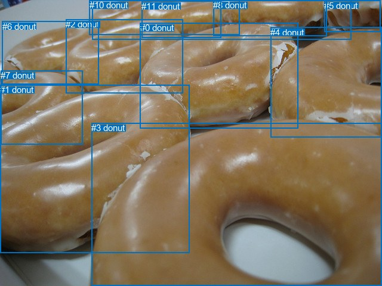
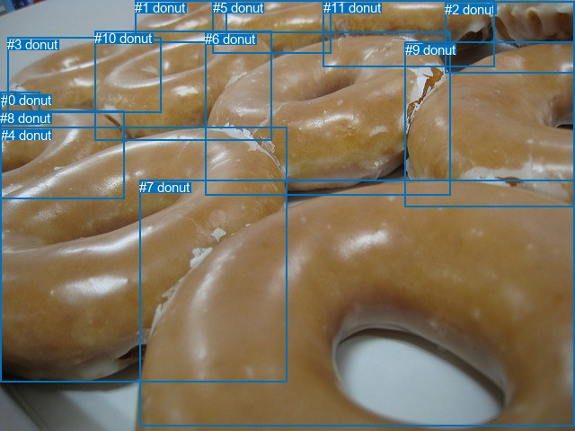

# 图片 2106：2416215.jpg

随机样本序号：205。图片 SHA256：`68cf3d08920d93d449224cdfbbdc5bd1ca85f877e037b8649bb5d2745c442b9f`。

红色框表示人，蓝色框表示其他物体。两个模式分别保留自身框编号，可依据位置比较对应对象。

## 自动检测框与输出

人的框编号：`[]`。状态：`no_person`。

### 自动检测全部物体框

| 编号 | 类别 | 是否为人 | 检测分数 | 像素坐标 xyxy |
|---|---|---|---|---|
| 0 | donut | False | 0.9993 | 234.7, 38.5, 499.5, 215.7 |
| 1 | donut | False | 0.9991 | 0.0, 142.3, 317.5, 424.2 |
| 2 | donut | False | 0.9978 | 110.4, 32.4, 306.2, 156.8 |
| 3 | donut | False | 0.9975 | 153.4, 206.1, 639.8, 480.0 |
| 4 | donut | False | 0.9972 | 453.3, 45.7, 639.6, 231.0 |
| 5 | donut | False | 0.9760 | 543.1, 0.6, 637.8, 53.9 |
| 6 | donut | False | 0.9750 | 3.6, 35.6, 165.8, 141.2 |
| 7 | donut | False | 0.9606 | 1.1, 118.4, 138.0, 242.3 |
| 8 | donut | False | 0.9579 | 357.3, 0.5, 547.6, 60.5 |
| 9 | donut | False | 0.9098 | 155.0, 0.9, 588.8, 66.9 |
| 10 | donut | False | 0.8553 | 149.9, 0.4, 401.6, 58.8 |
| 11 | donut | False | 0.3725 | 237.5, 1.7, 370.9, 63.1 |

### 自动检测 Top50 人相关候选

评分物体对：0；人相关物体对：0；输出关系：0。

| 排名 | 主语编号与类别 | 关系 | 宾语编号与类别 | 类型 | 人与人 | 排序分数 | 原始融合 logit |
|---|---|---|---|---|---|---|---|

### 自动检测逐条人相关 GT 核验

本图没有人相关 GT，R@50 无分母；预测候选继续展示。

## 真实框与输出

人的框编号：`[]`。

### 真实框全部物体框

| 编号 | 类别 | 是否为人 | 检测分数 | 像素坐标 xyxy |
|---|---|---|---|---|
| 0 | donut | False | GT | 1.0, 103.0, 44.0, 139.0 |
| 1 | donut | False | GT | 150.0, 0.0, 252.0, 47.0 |
| 2 | donut | False | GT | 495.0, 2.0, 640.0, 81.0 |
| 3 | donut | False | GT | 8.0, 41.0, 179.0, 126.0 |
| 4 | donut | False | GT | 1.0, 142.0, 320.0, 426.0 |
| 5 | donut | False | GT | 237.0, 0.0, 368.0, 59.0 |
| 6 | donut | False | GT | 228.0, 35.0, 502.0, 218.0 |
| 7 | donut | False | GT | 155.0, 200.0, 640.0, 474.0 |
| 8 | donut | False | GT | 0.0, 123.0, 139.0, 222.0 |
| 9 | donut | False | GT | 451.0, 47.0, 640.0, 231.0 |
| 10 | donut | False | GT | 105.0, 34.0, 302.0, 156.0 |
| 11 | donut | False | GT | 360.0, 0.0, 551.0, 74.0 |

### 真实框 Top50 人相关候选

评分物体对：0；人相关物体对：0；输出关系：0。

| 排名 | 主语编号与类别 | 关系 | 宾语编号与类别 | 类型 | 人与人 | 排序分数 | 原始融合 logit |
|---|---|---|---|---|---|---|---|

### 真实框逐条人相关 GT 核验

本图没有人相关 GT，R@50 无分母；预测候选继续展示。

## 全部人相关 GT

| 主语编号与类别 | 关系 | 宾语编号与类别 |
|---|---|---|

原始记录、全部人相关物体对的两项预测与分项分数见 [逐图证据 JSON](../evidence/cases/2106.json)。全部56类 logits 保留于本机 HOR/output/random500/logits/。

<!-- HOR_COMPLETE_RESULTS -->

## 六组条件的完整输出对照

以下保留同一图片三种框与候选模式、两种谓词输出规则的全部 Top50。框编号各自在所属模式内解释。

### 自动检测框完整枚举：空间与语义各保留一个谓词

| 排名 | 主语编号与类别 | 谓词 | 宾语编号与类别 | 分组 | 排序分数 | predicate logit | pair logit |
|---|---|---|---|---|---|---|---|

没有人相关 GT，本条件的召回率无分母。

### 自动检测框完整枚举：每对只保留一个谓词

| 排名 | 主语编号与类别 | 谓词 | 宾语编号与类别 | 分组 | 排序分数 | predicate logit | pair logit |
|---|---|---|---|---|---|---|---|

没有人相关 GT，本条件的召回率无分母。

### 真实框完整枚举：空间与语义各保留一个谓词

| 排名 | 主语编号与类别 | 谓词 | 宾语编号与类别 | 分组 | 排序分数 | predicate logit | pair logit |
|---|---|---|---|---|---|---|---|

没有人相关 GT，本条件的召回率无分母。

### 真实框完整枚举：每对只保留一个谓词

| 排名 | 主语编号与类别 | 谓词 | 宾语编号与类别 | 分组 | 排序分数 | predicate logit | pair logit |
|---|---|---|---|---|---|---|---|

没有人相关 GT，本条件的召回率无分母。

### 真实框400候选：空间与语义各保留一个谓词

| 排名 | 主语编号与类别 | 谓词 | 宾语编号与类别 | 分组 | 排序分数 | predicate logit | pair logit |
|---|---|---|---|---|---|---|---|

没有人相关 GT，本条件的召回率无分母。

### 真实框400候选：每对只保留一个谓词

| 排名 | 主语编号与类别 | 谓词 | 宾语编号与类别 | 分组 | 排序分数 | predicate logit | pair logit |
|---|---|---|---|---|---|---|---|

没有人相关 GT，本条件的召回率无分母。
