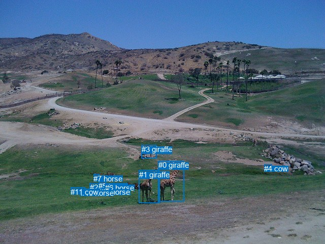
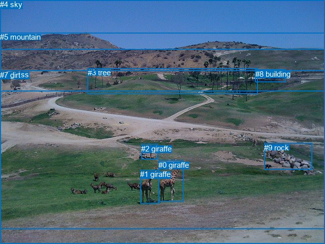

# 图片 2107：2416221.jpg

随机样本序号：62。图片 SHA256：`66564413907f3a47d7af44b01b59d9c8042b327097f1916adf01ee3f47cf430c`。

红色框表示人，蓝色框表示其他物体。两个模式分别保留自身框编号，可依据位置比较对应对象。

## 自动检测框与输出

人的框编号：`[]`。状态：`no_person`。

### 自动检测全部物体框

| 编号 | 类别 | 是否为人 | 检测分数 | 像素坐标 xyxy |
|---|---|---|---|---|
| 0 | giraffe | False | 0.9990 | 311.7, 316.3, 362.4, 397.0 |
| 1 | giraffe | False | 0.9889 | 273.7, 334.7, 314.8, 399.3 |
| 2 | horse | False | 0.9481 | 176.7, 360.2, 198.8, 379.9 |
| 3 | giraffe | False | 0.8481 | 278.9, 285.2, 308.5, 311.6 |
| 4 | cow | False | 0.8465 | 520.5, 323.2, 535.2, 334.5 |
| 5 | horse | False | 0.8144 | 194.4, 357.1, 208.5, 370.3 |
| 6 | horse | False | 0.7960 | 207.1, 360.5, 230.3, 375.0 |
| 7 | horse | False | 0.7327 | 184.4, 342.9, 195.7, 357.0 |
| 8 | horse | False | 0.6348 | 140.2, 368.6, 167.4, 382.5 |
| 9 | horse | False | 0.5607 | 199.2, 369.3, 217.8, 381.9 |
| 10 | horse | False | 0.4886 | 159.0, 371.3, 172.7, 382.3 |
| 11 | cow | False | 0.4256 | 139.1, 368.7, 161.2, 381.8 |

### 自动检测 Top50 人相关候选

评分物体对：0；人相关物体对：0；输出关系：0。

| 排名 | 主语编号与类别 | 关系 | 宾语编号与类别 | 类型 | 人与人 | 排序分数 | 原始融合 logit |
|---|---|---|---|---|---|---|---|

### 自动检测逐条人相关 GT 核验

本图没有人相关 GT，R@50 无分母；预测候选继续展示。

## 真实框与输出

人的框编号：`[]`。

### 真实框全部物体框

| 编号 | 类别 | 是否为人 | 检测分数 | 像素坐标 xyxy |
|---|---|---|---|---|
| 0 | giraffe | False | GT | 312.0, 316.0, 361.0, 397.0 |
| 1 | giraffe | False | GT | 276.0, 334.0, 314.0, 400.0 |
| 2 | giraffe | False | GT | 278.0, 284.0, 311.0, 314.0 |
| 3 | tree | False | GT | 173.0, 134.0, 507.0, 184.0 |
| 4 | sky | False | GT | 0.0, 0.0, 640.0, 97.0 |
| 5 | mountain | False | GT | 0.0, 64.0, 640.0, 179.0 |
| 6 | grass | False | GT | 0.0, 138.0, 640.0, 450.0 |
| 7 | dirt | False | GT | 0.0, 139.0, 640.0, 480.0 |
| 8 | building | False | GT | 503.0, 137.0, 562.0, 162.0 |
| 9 | rock | False | GT | 520.0, 282.0, 614.0, 333.0 |

### 真实框 Top50 人相关候选

评分物体对：0；人相关物体对：0；输出关系：0。

| 排名 | 主语编号与类别 | 关系 | 宾语编号与类别 | 类型 | 人与人 | 排序分数 | 原始融合 logit |
|---|---|---|---|---|---|---|---|

### 真实框逐条人相关 GT 核验

本图没有人相关 GT，R@50 无分母；预测候选继续展示。

## 全部人相关 GT

| 主语编号与类别 | 关系 | 宾语编号与类别 |
|---|---|---|

原始记录、全部人相关物体对的两项预测与分项分数见 [逐图证据 JSON](../evidence/cases/2107.json)。全部56类 logits 保留于本机 HOR/output/random500/logits/。

<!-- HOR_COMPLETE_RESULTS -->

## 六组条件的完整输出对照

以下保留同一图片三种框与候选模式、两种谓词输出规则的全部 Top50。框编号各自在所属模式内解释。

### 自动检测框完整枚举：空间与语义各保留一个谓词

| 排名 | 主语编号与类别 | 谓词 | 宾语编号与类别 | 分组 | 排序分数 | predicate logit | pair logit |
|---|---|---|---|---|---|---|---|

没有人相关 GT，本条件的召回率无分母。

### 自动检测框完整枚举：每对只保留一个谓词

| 排名 | 主语编号与类别 | 谓词 | 宾语编号与类别 | 分组 | 排序分数 | predicate logit | pair logit |
|---|---|---|---|---|---|---|---|

没有人相关 GT，本条件的召回率无分母。

### 真实框完整枚举：空间与语义各保留一个谓词

| 排名 | 主语编号与类别 | 谓词 | 宾语编号与类别 | 分组 | 排序分数 | predicate logit | pair logit |
|---|---|---|---|---|---|---|---|

没有人相关 GT，本条件的召回率无分母。

### 真实框完整枚举：每对只保留一个谓词

| 排名 | 主语编号与类别 | 谓词 | 宾语编号与类别 | 分组 | 排序分数 | predicate logit | pair logit |
|---|---|---|---|---|---|---|---|

没有人相关 GT，本条件的召回率无分母。

### 真实框400候选：空间与语义各保留一个谓词

| 排名 | 主语编号与类别 | 谓词 | 宾语编号与类别 | 分组 | 排序分数 | predicate logit | pair logit |
|---|---|---|---|---|---|---|---|

没有人相关 GT，本条件的召回率无分母。

### 真实框400候选：每对只保留一个谓词

| 排名 | 主语编号与类别 | 谓词 | 宾语编号与类别 | 分组 | 排序分数 | predicate logit | pair logit |
|---|---|---|---|---|---|---|---|

没有人相关 GT，本条件的召回率无分母。
