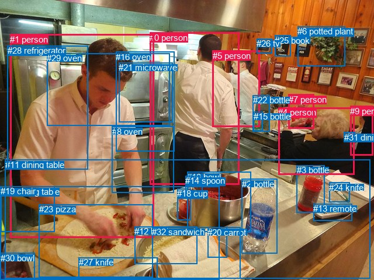
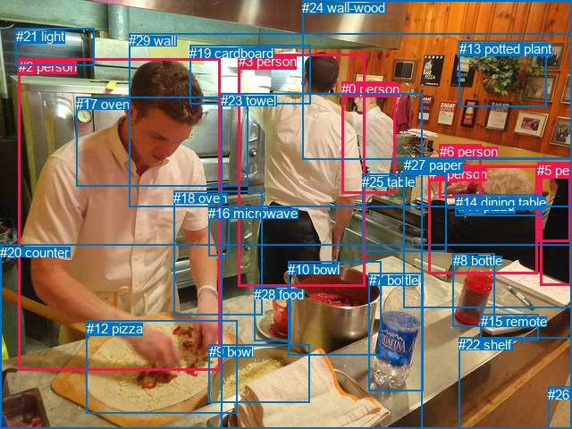

# 图片 2111：2416290.jpg

随机样本序号：328。图片 SHA256：`6c3d9706def19f9785f3546456e085fa1f398c289720478c77e15e0110e62b0b`。

红色框表示人，蓝色框表示其他物体。两个模式分别保留自身框编号，可依据位置比较对应对象。

## 自动检测框与输出

人的框编号：`[0, 1, 4, 5, 7, 9]`。状态：`ok`。

### 自动检测全部物体框

| 编号 | 类别 | 是否为人 | 检测分数 | 像素坐标 xyxy |
|---|---|---|---|---|
| 0 | person | True | 0.9998 | 256.4, 55.6, 409.5, 316.9 |
| 1 | person | True | 0.9987 | 17.0, 58.7, 263.6, 407.2 |
| 2 | bottle | False | 0.9966 | 413.7, 306.7, 474.8, 435.0 |
| 3 | bottle | False | 0.9962 | 507.7, 283.4, 555.3, 364.7 |
| 4 | person | True | 0.9929 | 476.4, 184.3, 606.4, 299.9 |
| 5 | person | True | 0.9923 | 364.0, 86.7, 444.4, 217.9 |
| 6 | potted plant | False | 0.9902 | 509.4, 45.2, 590.2, 113.2 |
| 7 | person | True | 0.9860 | 493.8, 161.7, 537.2, 220.7 |
| 8 | oven | False | 0.9545 | 191.8, 216.9, 297.7, 330.1 |
| 9 | person | True | 0.9323 | 599.2, 181.6, 638.3, 266.2 |
| 10 | bowl | False | 0.9316 | 320.3, 294.6, 429.0, 397.5 |
| 11 | dining table | False | 0.9145 | 8.8, 274.0, 633.2, 477.2 |
| 12 | bowl | False | 0.9088 | 230.4, 388.4, 337.5, 452.8 |
| 13 | remote | False | 0.8784 | 536.2, 349.3, 602.9, 378.3 |
| 14 | spoon | False | 0.7642 | 317.3, 301.1, 346.6, 331.3 |
| 15 | bottle | False | 0.7284 | 433.8, 191.2, 449.2, 224.2 |
| 16 | oven | False | 0.6595 | 198.1, 88.7, 298.0, 259.0 |
| 17 | dining table | False | 0.6336 | 0.6, 319.6, 375.8, 480.0 |
| 18 | cup | False | 0.6239 | 303.0, 323.1, 326.5, 377.8 |
| 19 | chair | False | 0.6089 | 1.4, 319.0, 93.5, 397.2 |
| 20 | carrot | False | 0.6084 | 355.3, 389.8, 388.8, 441.1 |
| 21 | microwave | False | 0.5923 | 203.2, 107.4, 295.9, 209.7 |
| 22 | bottle | False | 0.5870 | 432.7, 163.1, 461.2, 225.9 |
| 23 | pizza | False | 0.5743 | 67.0, 350.4, 261.7, 475.0 |
| 24 | knife | False | 0.5559 | 563.5, 312.9, 598.2, 346.5 |
| 25 | book | False | 0.5323 | 470.0, 60.5, 497.2, 96.0 |
| 26 | tv | False | 0.5267 | 439.2, 66.1, 465.8, 91.2 |
| 27 | knife | False | 0.5251 | 134.9, 441.4, 269.4, 480.0 |
| 28 | refrigerator | False | 0.5104 | 12.9, 78.3, 150.2, 290.5 |
| 29 | oven | False | 0.5057 | 80.4, 91.4, 290.8, 215.5 |
| 30 | bowl | False | 0.4428 | 0.6, 433.5, 59.7, 480.0 |
| 31 | dining table | False | 0.4386 | 588.8, 226.5, 607.8, 242.1 |
| 32 | sandwich | False | 0.3832 | 260.3, 389.1, 411.3, 477.7 |

### 自动检测 Top50 人相关候选

评分物体对：1056；人相关物体对：354；输出关系：50。

| 排名 | 主语编号与类别 | 关系 | 宾语编号与类别 | 类型 | 人与人 | 排序分数 | 原始融合 logit |
|---|---|---|---|---|---|---|---|
| 1 | #4 person | holding | #31 dining table | semantic | False | 0.97838 | 3.8124 |
| 2 | #9 person | holding | #31 dining table | semantic | False | 0.97627 | 3.7169 |
| 3 | #1 person | cooking | #23 pizza | semantic | False | 0.97254 | 3.5670 |
| 4 | #1 person | holding | #19 chair | semantic | False | 0.97180 | 3.5399 |
| 5 | #1 person | wearing | #28 refrigerator | semantic | False | 0.95552 | 3.0671 |
| 6 | #9 person | on | #31 dining table | spatial | False | 0.92650 | 2.5342 |
| 7 | #1 person | cooking | #17 dining table | semantic | False | 0.92155 | 2.4636 |
| 8 | #4 person | sitting on | #11 dining table | semantic | False | 0.92079 | 2.4531 |
| 9 | #4 person | on | #31 dining table | spatial | False | 0.91847 | 2.4217 |
| 10 | #7 person | talking to | #4 person | semantic | True | 0.89618 | 2.1555 |
| 11 | #1 person | in | #28 refrigerator | spatial | False | 0.85371 | 1.7640 |
| 12 | #0 person | cooking | #23 pizza | semantic | False | 0.84980 | 1.7330 |
| 13 | #4 person | looking at | #7 person | semantic | True | 0.84911 | 1.7276 |
| 14 | #1 person | in | #17 dining table | spatial | False | 0.83527 | 1.6235 |
| 15 | #4 person | on | #11 dining table | spatial | False | 0.81853 | 1.5064 |
| 16 | #7 person | in | #31 dining table | spatial | False | 0.80231 | 1.4008 |
| 17 | #1 person | in | #11 dining table | spatial | False | 0.79595 | 1.3611 |
| 18 | #0 person | talking to | #5 person | semantic | True | 0.79230 | 1.3388 |
| 19 | #0 person | standing on | #11 dining table | semantic | False | 0.78773 | 1.3113 |
| 20 | #9 person | looking at | #4 person | semantic | True | 0.75668 | 1.1346 |
| 21 | #5 person | talking to | #0 person | semantic | True | 0.74987 | 1.0979 |
| 22 | #1 person | standing on | #11 dining table | semantic | False | 0.74212 | 1.0570 |
| 23 | #1 person | holding | #27 knife | semantic | False | 0.73087 | 0.9990 |
| 24 | #1 person | on | #23 pizza | spatial | False | 0.72344 | 0.9616 |
| 25 | #7 person | wearing | #31 dining table | semantic | False | 0.71132 | 0.9018 |
| 26 | #4 person | talking to | #9 person | semantic | True | 0.68849 | 0.7931 |
| 27 | #1 person | on | #19 chair | spatial | False | 0.66499 | 0.6856 |
| 28 | #4 person | in | #9 person | spatial | True | 0.59015 | 0.3646 |
| 29 | #0 person | looking at | #1 person | semantic | True | 0.56342 | 0.2551 |
| 30 | #19 chair | holding | #1 person | semantic | False | 0.54255 | 0.1706 |
| 31 | #4 person | beside | #7 person | spatial | True | 0.52313 | 0.0926 |
| 32 | #9 person | beside | #4 person | spatial | True | 0.51257 | 0.0503 |
| 33 | #7 person | beside | #4 person | spatial | True | 0.48838 | -0.0465 |
| 34 | #0 person | beside | #5 person | spatial | True | 0.48589 | -0.0564 |
| 35 | #0 person | in | #11 dining table | spatial | False | 0.48017 | -0.0794 |
| 36 | #0 person | in front of | #16 oven | spatial | False | 0.45886 | -0.1649 |
| 37 | #31 dining table | on | #9 person | spatial | False | 0.45636 | -0.1750 |
| 38 | #19 chair | on | #1 person | spatial | False | 0.44629 | -0.2157 |
| 39 | #5 person | standing on | #11 dining table | semantic | False | 0.42251 | -0.3125 |
| 40 | #9 person | leaning on | #11 dining table | spatial | False | 0.40306 | -0.3927 |
| 41 | #9 person | standing on | #11 dining table | semantic | False | 0.39707 | -0.4177 |
| 42 | #0 person | standing on | #16 oven | semantic | False | 0.38618 | -0.4634 |
| 43 | #5 person | talking to | #7 person | semantic | True | 0.37491 | -0.5112 |
| 44 | #9 person | looking at | #7 person | semantic | True | 0.36000 | -0.5753 |
| 45 | #5 person | beside | #0 person | spatial | True | 0.34831 | -0.6265 |
| 46 | #0 person | on | #23 pizza | spatial | False | 0.33902 | -0.6677 |
| 47 | #1 person | cooking | #12 bowl | semantic | False | 0.30826 | -0.8083 |
| 48 | #0 person | cooking | #17 dining table | semantic | False | 0.29696 | -0.8618 |
| 49 | #7 person | on | #11 dining table | spatial | False | 0.28735 | -0.9083 |
| 50 | #7 person | looking at | #5 person | semantic | True | 0.26605 | -1.0148 |

### 自动检测逐条人相关 GT 核验

R@50：12.50%；命中 1/8。

| GT 主语编号 | GT 关系 | GT 宾语编号 | 结果阶段 | 匹配预测主语编号 | 匹配预测宾语编号 |
|---|---|---|---|---|---|
| 0 | wearing | 24 | endpoint_missing_or_wrong_class | [5] | [] |
| 2 | holding | 12 | wrong_predicate | [1] | [23] |
| 2 | cooking | 12 | hit50 | [1] | [23] |
| 2 | wearing | 24 | endpoint_missing_or_wrong_class | [1] | [] |
| 3 | picking | 19 | endpoint_missing_or_wrong_class | [0] | [] |
| 3 | wearing | 23 | endpoint_missing_or_wrong_class | [0] | [] |
| 6 | looking at | 1 | wrong_predicate | [7] | [4] |
| 6 | eating | 11 | endpoint_missing_or_wrong_class | [7] | [] |

## 真实框与输出

人的框编号：`[0, 1, 2, 3, 4, 5, 6]`。

### 真实框全部物体框

| 编号 | 类别 | 是否为人 | 检测分数 | 像素坐标 xyxy |
|---|---|---|---|---|
| 0 | person | True | GT | 382.0, 91.0, 443.0, 216.0 |
| 1 | person | True | GT | 480.0, 186.0, 602.0, 307.0 |
| 2 | person | True | GT | 21.0, 66.0, 247.0, 414.0 |
| 3 | person | True | GT | 267.0, 60.0, 408.0, 320.0 |
| 4 | person | True | GT | 604.0, 182.0, 640.0, 319.0 |
| 5 | person | True | GT | 601.0, 182.0, 639.0, 270.0 |
| 6 | person | True | GT | 492.0, 161.0, 539.0, 221.0 |
| 7 | bottle | False | GT | 413.0, 305.0, 474.0, 437.0 |
| 8 | bottle | False | GT | 507.0, 283.0, 554.0, 365.0 |
| 9 | bowl | False | GT | 234.0, 385.0, 347.0, 450.0 |
| 10 | bowl | False | GT | 322.0, 293.0, 426.0, 398.0 |
| 11 | pizza | False | GT | 513.0, 222.0, 530.0, 227.0 |
| 12 | pizza | False | GT | 97.0, 359.0, 266.0, 463.0 |
| 13 | potted plant | False | GT | 514.0, 46.0, 612.0, 119.0 |
| 14 | dining table | False | GT | 510.0, 218.0, 607.0, 242.0 |
| 15 | remote | False | GT | 538.0, 351.0, 603.0, 380.0 |
| 16 | microwave | False | GT | 233.0, 230.0, 256.0, 286.0 |
| 17 | oven | False | GT | 85.0, 108.0, 278.0, 208.0 |
| 18 | oven | False | GT | 194.0, 213.0, 293.0, 352.0 |
| 19 | cardboard | False | GT | 212.0, 51.0, 347.0, 117.0 |
| 20 | counter | False | GT | 0.0, 274.0, 640.0, 480.0 |
| 21 | light | False | GT | 18.0, 32.0, 106.0, 73.0 |
| 22 | shelf | False | GT | 513.0, 377.0, 640.0, 480.0 |
| 23 | towel | False | GT | 247.0, 104.0, 472.0, 480.0 |
| 24 | wall-wood | False | GT | 338.0, 0.0, 640.0, 178.0 |
| 25 | table | False | GT | 405.0, 195.0, 499.0, 282.0 |
| 26 | floor | False | GT | 613.0, 433.0, 640.0, 480.0 |
| 27 | paper | False | GT | 452.0, 176.0, 640.0, 344.0 |
| 28 | food | False | GT | 284.0, 321.0, 326.0, 382.0 |
| 29 | wall | False | GT | 144.0, 37.0, 640.0, 231.0 |

### 真实框 Top50 人相关候选

评分物体对：870；人相关物体对：364；输出关系：50。

| 排名 | 主语编号与类别 | 关系 | 宾语编号与类别 | 类型 | 人与人 | 排序分数 | 原始融合 logit |
|---|---|---|---|---|---|---|---|
| 1 | #1 person | holding | #11 pizza | semantic | False | 0.98010 | 3.8969 |
| 2 | #2 person | cooking | #12 pizza | semantic | False | 0.97606 | 3.7078 |
| 3 | #4 person | wearing | #5 person | semantic | True | 0.97201 | 3.5476 |
| 4 | #4 person | in | #5 person | spatial | True | 0.94633 | 2.8697 |
| 5 | #1 person | on | #11 pizza | spatial | False | 0.92913 | 2.5733 |
| 6 | #1 person | in | #14 dining table | spatial | False | 0.92862 | 2.5656 |
| 7 | #3 person | in | #23 towel | spatial | False | 0.91353 | 2.3575 |
| 8 | #3 person | wearing | #23 towel | semantic | False | 0.91179 | 2.3357 |
| 9 | #6 person | in | #14 dining table | spatial | False | 0.87940 | 1.9868 |
| 10 | #27 paper | wearing | #5 person | semantic | False | 0.87091 | 1.9090 |
| 11 | #2 person | in | #20 counter | spatial | False | 0.86825 | 1.8856 |
| 12 | #0 person | in | #29 wall | spatial | False | 0.85954 | 1.8114 |
| 13 | #1 person | wearing | #14 dining table | semantic | False | 0.84769 | 1.7166 |
| 14 | #6 person | sitting on | #14 dining table | semantic | False | 0.83354 | 1.6110 |
| 15 | #3 person | cooking | #12 pizza | semantic | False | 0.83032 | 1.5879 |
| 16 | #5 person | in | #4 person | spatial | True | 0.80187 | 1.3980 |
| 17 | #27 paper | in | #5 person | spatial | False | 0.79810 | 1.3745 |
| 18 | #27 paper | wearing | #4 person | semantic | False | 0.78689 | 1.3063 |
| 19 | #1 person | sitting on | #20 counter | semantic | False | 0.78018 | 1.2667 |
| 20 | #2 person | on | #12 pizza | spatial | False | 0.77721 | 1.2495 |
| 21 | #1 person | on | #20 counter | spatial | False | 0.73770 | 1.0340 |
| 22 | #0 person | standing on | #29 wall | semantic | False | 0.73293 | 1.0096 |
| 23 | #5 person | wearing | #4 person | semantic | True | 0.72630 | 0.9759 |
| 24 | #6 person | talking to | #1 person | semantic | True | 0.72527 | 0.9707 |
| 25 | #2 person | standing on | #20 counter | semantic | False | 0.72100 | 0.9494 |
| 26 | #3 person | standing on | #20 counter | semantic | False | 0.70059 | 0.8501 |
| 27 | #27 paper | in | #4 person | spatial | False | 0.68284 | 0.7668 |
| 28 | #6 person | leaning on | #25 table | spatial | False | 0.68032 | 0.7552 |
| 29 | #6 person | in | #11 pizza | spatial | False | 0.66910 | 0.7041 |
| 30 | #1 person | in | #27 paper | spatial | False | 0.66853 | 0.7015 |
| 31 | #0 person | standing on | #25 table | semantic | False | 0.66433 | 0.6826 |
| 32 | #2 person | in | #23 towel | spatial | False | 0.64162 | 0.5824 |
| 33 | #1 person | looking at | #6 person | semantic | True | 0.63347 | 0.5471 |
| 34 | #3 person | talking to | #0 person | semantic | True | 0.63100 | 0.5365 |
| 35 | #2 person | wearing | #23 towel | semantic | False | 0.61404 | 0.4643 |
| 36 | #1 person | sitting on | #25 table | semantic | False | 0.60150 | 0.4117 |
| 37 | #6 person | sitting on | #25 table | semantic | False | 0.59568 | 0.3875 |
| 38 | #3 person | in | #20 counter | spatial | False | 0.58899 | 0.3598 |
| 39 | #0 person | leaning on | #24 wall-wood | spatial | False | 0.57462 | 0.3007 |
| 40 | #1 person | leaning on | #25 table | spatial | False | 0.57047 | 0.2838 |
| 41 | #27 paper | in | #1 person | spatial | False | 0.56503 | 0.2616 |
| 42 | #27 paper | looking at | #6 person | semantic | False | 0.55855 | 0.2353 |
| 43 | #0 person | talking to | #3 person | semantic | True | 0.54595 | 0.1843 |
| 44 | #3 person | cooking | #10 bowl | semantic | False | 0.53861 | 0.1548 |
| 45 | #0 person | leaning on | #25 table | spatial | False | 0.53308 | 0.1325 |
| 46 | #5 person | on | #14 dining table | spatial | False | 0.52253 | 0.0902 |
| 47 | #3 person | in | #29 wall | spatial | False | 0.51329 | 0.0532 |
| 48 | #3 person | looking at | #2 person | semantic | True | 0.50981 | 0.0393 |
| 49 | #1 person | sitting on | #27 paper | semantic | False | 0.50322 | 0.0129 |
| 50 | #6 person | wearing | #11 pizza | semantic | False | 0.49345 | -0.0262 |

### 真实框逐条人相关 GT 核验

R@50：25.00%；命中 2/8。

| GT 主语编号 | GT 关系 | GT 宾语编号 | 结果阶段 | 匹配预测主语编号 | 匹配预测宾语编号 |
|---|---|---|---|---|---|
| 0 | wearing | 24 | wrong_predicate | [0] | [24] |
| 2 | holding | 12 | wrong_predicate | [2] | [12] |
| 2 | cooking | 12 | hit50 | [2] | [12] |
| 2 | wearing | 24 | wrong_predicate | [2] | [24] |
| 3 | picking | 19 | wrong_predicate | [3] | [19] |
| 3 | wearing | 23 | hit50 | [3] | [23] |
| 6 | looking at | 1 | wrong_predicate | [6] | [1] |
| 6 | eating | 11 | wrong_predicate | [6] | [11] |

## 全部人相关 GT

| 主语编号与类别 | 关系 | 宾语编号与类别 |
|---|---|---|
| #0 person | wearing | #24 wall-wood |
| #2 person | holding | #12 pizza |
| #2 person | cooking | #12 pizza |
| #2 person | wearing | #24 wall-wood |
| #3 person | picking | #19 cardboard |
| #3 person | wearing | #23 towel |
| #6 person | looking at | #1 person |
| #6 person | eating | #11 pizza |

原始记录、全部人相关物体对的两项预测与分项分数见 [逐图证据 JSON](../evidence/cases/2111.json)。全部56类 logits 保留于本机 HOR/output/random500/logits/。

<!-- HOR_COMPLETE_RESULTS -->

## 六组条件的完整输出对照

以下保留同一图片三种框与候选模式、两种谓词输出规则的全部 Top50。框编号各自在所属模式内解释。

### 自动检测框完整枚举：空间与语义各保留一个谓词

| 排名 | 主语编号与类别 | 谓词 | 宾语编号与类别 | 分组 | 排序分数 | predicate logit | pair logit |
|---|---|---|---|---|---|---|---|
| 1 | #4 person | holding | #31 dining table | semantic | 0.9783822 | 3.4735589 | 0.3388251 |
| 2 | #9 person | holding | #31 dining table | semantic | 0.9762673 | 3.4370093 | 0.2798741 |
| 3 | #1 person | cooking | #23 pizza | semantic | 0.9725357 | 3.4864106 | 0.0806116 |
| 4 | #1 person | holding | #19 chair | semantic | 0.9718029 | 3.6112304 | -0.0712948 |
| 5 | #1 person | wearing | #28 refrigerator | semantic | 0.9555154 | 3.6128964 | -0.5457891 |
| 6 | #9 person | on | #31 dining table | spatial | 0.9265035 | 2.2543063 | 0.2798741 |
| 7 | #1 person | cooking | #17 dining table | semantic | 0.9215471 | 2.7042313 | -0.2406764 |
| 8 | #4 person | sitting on | #11 dining table | semantic | 0.9207890 | 2.4828448 | -0.0297289 |
| 9 | #4 person | on | #31 dining table | spatial | 0.9184699 | 2.0829115 | 0.3388251 |
| 10 | #7 person | talking to | #4 person | semantic | 0.8961775 | 3.0936217 | -0.9381659 |
| 11 | #1 person | in | #28 refrigerator | spatial | 0.8537087 | 2.3097796 | -0.5457891 |
| 12 | #0 person | cooking | #23 pizza | semantic | 0.8498002 | 2.6133938 | -0.8803592 |
| 13 | #4 person | looking at | #7 person | semantic | 0.8491089 | 1.9841905 | -0.2565616 |
| 14 | #1 person | in | #17 dining table | spatial | 0.8352747 | 1.8641582 | -0.2406764 |
| 15 | #4 person | on | #11 dining table | spatial | 0.8185334 | 1.5361710 | -0.0297289 |
| 16 | #7 person | in | #31 dining table | spatial | 0.8023090 | 1.3189945 | 0.0817940 |
| 17 | #1 person | in | #11 dining table | spatial | 0.7959450 | 1.7294259 | -0.3682849 |
| 18 | #0 person | talking to | #5 person | semantic | 0.7922965 | 2.2835336 | -0.9447093 |
| 19 | #0 person | standing on | #11 dining table | semantic | 0.7877323 | 1.9823728 | -0.6710624 |
| 20 | #9 person | looking at | #4 person | semantic | 0.7566778 | 2.1849589 | -1.0504079 |
| 21 | #5 person | talking to | #0 person | semantic | 0.7498663 | 2.2525673 | -1.1546681 |
| 22 | #1 person | standing on | #11 dining table | semantic | 0.7421250 | 1.4253273 | -0.3682849 |
| 23 | #1 person | holding | #27 knife | semantic | 0.7308664 | 1.3307323 | -0.3317096 |
| 24 | #1 person | on | #23 pizza | spatial | 0.7234440 | 0.8809986 | 0.0806116 |
| 25 | #7 person | wearing | #31 dining table | semantic | 0.7113153 | 0.8199868 | 0.0817940 |
| 26 | #4 person | talking to | #9 person | semantic | 0.6884936 | 1.1804118 | -0.3873256 |
| 27 | #1 person | on | #19 chair | spatial | 0.6649881 | 0.7568979 | -0.0712948 |
| 28 | #4 person | in | #9 person | spatial | 0.5901461 | 0.7518950 | -0.3873256 |
| 29 | #0 person | looking at | #1 person | semantic | 0.5634224 | 1.4528990 | -1.1978354 |
| 30 | #19 chair | holding | #1 person | semantic | 0.5425512 | 0.6781058 | -0.5074886 |
| 31 | #4 person | beside | #7 person | spatial | 0.5231334 | 0.3491611 | -0.2565616 |
| 32 | #9 person | beside | #4 person | spatial | 0.5125681 | 1.1006908 | -1.0504079 |
| 33 | #7 person | beside | #4 person | spatial | 0.4883785 | 0.8916717 | -0.9381659 |
| 34 | #0 person | beside | #5 person | spatial | 0.4858914 | 0.8882599 | -0.9447093 |
| 35 | #0 person | in | #11 dining table | spatial | 0.4801711 | 0.5917053 | -0.6710624 |
| 36 | #0 person | in front of | #16 oven | spatial | 0.4588583 | 1.1257401 | -1.2906795 |
| 37 | #31 dining table | on | #9 person | spatial | 0.4563562 | 0.7042160 | -0.8792365 |
| 38 | #19 chair | on | #1 person | spatial | 0.4462862 | 0.2918010 | -0.5074886 |
| 39 | #5 person | standing on | #11 dining table | semantic | 0.4225140 | 0.3782473 | -0.6907091 |
| 40 | #9 person | leaning on | #11 dining table | spatial | 0.4030562 | 0.0746088 | -0.4673557 |
| 41 | #9 person | standing on | #11 dining table | semantic | 0.3970744 | 0.0496855 | -0.4673557 |
| 42 | #0 person | standing on | #16 oven | semantic | 0.3861782 | 0.8272738 | -1.2906795 |
| 43 | #5 person | talking to | #7 person | semantic | 0.3749116 | 0.0631590 | -0.5743617 |
| 44 | #9 person | looking at | #7 person | semantic | 0.3600041 | 0.3088427 | -0.8841891 |
| 45 | #5 person | beside | #0 person | spatial | 0.3483130 | 0.5282054 | -1.1546681 |
| 46 | #0 person | on | #23 pizza | spatial | 0.3390163 | 0.2126780 | -0.8803592 |
| 47 | #1 person | cooking | #12 bowl | semantic | 0.3082598 | 0.0868726 | -0.8951402 |
| 48 | #0 person | cooking | #17 dining table | semantic | 0.2969620 | -0.0039439 | -0.8578628 |
| 49 | #7 person | on | #11 dining table | spatial | 0.2873515 | -0.4234958 | -0.4847863 |
| 50 | #7 person | looking at | #5 person | semantic | 0.2660500 | 0.0903592 | -1.1051160 |

GT 命中：1/8，R@50=12.50%。

| GT主语 | GT谓词 | GT宾语 | 结果阶段 | 匹配主语框 | 匹配宾语框 |
|---|---|---|---|---|---|
| 0 | wearing | 24 | endpoint_missing_or_wrong_class | [5] | [] |
| 2 | holding | 12 | wrong_predicate | [1] | [23] |
| 2 | cooking | 12 | hit50 | [1] | [23] |
| 2 | wearing | 24 | endpoint_missing_or_wrong_class | [1] | [] |
| 3 | picking | 19 | endpoint_missing_or_wrong_class | [0] | [] |
| 3 | wearing | 23 | endpoint_missing_or_wrong_class | [0] | [] |
| 6 | looking at | 1 | wrong_predicate | [7] | [4] |
| 6 | eating | 11 | endpoint_missing_or_wrong_class | [7] | [] |

### 自动检测框完整枚举：每对只保留一个谓词

| 排名 | 主语编号与类别 | 谓词 | 宾语编号与类别 | 分组 | 排序分数 | predicate logit | pair logit |
|---|---|---|---|---|---|---|---|
| 1 | #4 person | holding | #31 dining table | single | 0.9783822 | 3.4735589 | 0.3388251 |
| 2 | #9 person | holding | #31 dining table | single | 0.9762673 | 3.4370093 | 0.2798741 |
| 3 | #1 person | cooking | #23 pizza | single | 0.9725357 | 3.4864106 | 0.0806116 |
| 4 | #1 person | holding | #19 chair | single | 0.9718029 | 3.6112304 | -0.0712948 |
| 5 | #1 person | wearing | #28 refrigerator | single | 0.9555154 | 3.6128964 | -0.5457891 |
| 6 | #1 person | cooking | #17 dining table | single | 0.9215471 | 2.7042313 | -0.2406764 |
| 7 | #4 person | sitting on | #11 dining table | single | 0.9207890 | 2.4828448 | -0.0297289 |
| 8 | #7 person | talking to | #4 person | single | 0.8961775 | 3.0936217 | -0.9381659 |
| 9 | #0 person | cooking | #23 pizza | single | 0.8498002 | 2.6133938 | -0.8803592 |
| 10 | #4 person | looking at | #7 person | single | 0.8491089 | 1.9841905 | -0.2565616 |
| 11 | #7 person | in | #31 dining table | single | 0.8023090 | 1.3189945 | 0.0817940 |
| 12 | #1 person | in | #11 dining table | single | 0.7959450 | 1.7294259 | -0.3682849 |
| 13 | #0 person | talking to | #5 person | single | 0.7922965 | 2.2835336 | -0.9447093 |
| 14 | #0 person | standing on | #11 dining table | single | 0.7877323 | 1.9823728 | -0.6710624 |
| 15 | #9 person | looking at | #4 person | single | 0.7566778 | 2.1849589 | -1.0504079 |
| 16 | #5 person | talking to | #0 person | single | 0.7498663 | 2.2525673 | -1.1546681 |
| 17 | #1 person | holding | #27 knife | single | 0.7308664 | 1.3307323 | -0.3317096 |
| 18 | #4 person | talking to | #9 person | single | 0.6884936 | 1.1804118 | -0.3873256 |
| 19 | #0 person | looking at | #1 person | single | 0.5634224 | 1.4528990 | -1.1978354 |
| 20 | #19 chair | holding | #1 person | single | 0.5425512 | 0.6781058 | -0.5074886 |
| 21 | #0 person | in front of | #16 oven | single | 0.4588583 | 1.1257401 | -1.2906795 |
| 22 | #31 dining table | on | #9 person | single | 0.4563562 | 0.7042160 | -0.8792365 |
| 23 | #5 person | standing on | #11 dining table | single | 0.4225140 | 0.3782473 | -0.6907091 |
| 24 | #9 person | leaning on | #11 dining table | single | 0.4030562 | 0.0746088 | -0.4673557 |
| 25 | #5 person | talking to | #7 person | single | 0.3749116 | 0.0631590 | -0.5743617 |
| 26 | #9 person | looking at | #7 person | single | 0.3600041 | 0.3088427 | -0.8841891 |
| 27 | #1 person | cooking | #12 bowl | single | 0.3082598 | 0.0868726 | -0.8951402 |
| 28 | #0 person | cooking | #17 dining table | single | 0.2969620 | -0.0039439 | -0.8578628 |
| 29 | #7 person | on | #11 dining table | single | 0.2873515 | -0.4234958 | -0.4847863 |
| 30 | #7 person | looking at | #5 person | single | 0.2660500 | 0.0903592 | -1.1051160 |
| 31 | #0 person | cooking | #10 bowl | single | 0.2345926 | -0.1548595 | -1.0276984 |
| 32 | #5 person | looking at | #22 bottle | single | 0.2333040 | -1.0101171 | -0.1796309 |
| 33 | #0 person | in front of | #29 oven | single | 0.2218453 | 0.1336474 | -1.3885922 |
| 34 | #4 person | holding | #24 knife | single | 0.2190934 | -0.6232562 | -0.6477013 |
| 35 | #0 person | holding | #14 spoon | single | 0.2085207 | -0.2323060 | -1.1015595 |
| 36 | #0 person | in front of | #21 microwave | single | 0.2011980 | -0.0780249 | -1.3007989 |
| 37 | #31 dining table | on | #4 person | single | 0.1951302 | -0.4143157 | -1.0026977 |
| 38 | #7 person | looking at | #9 person | single | 0.1839610 | -0.7523041 | -0.7374345 |
| 39 | #9 person | holding | #24 knife | single | 0.1794073 | -0.5771065 | -0.9432619 |
| 40 | #4 person | looking at | #1 person | single | 0.1621102 | -0.6665626 | -0.9760475 |
| 41 | #5 person | looking at | #1 person | single | 0.1598829 | -0.2245412 | -1.4345583 |
| 42 | #6 potted plant | hanging from | #9 person | single | 0.1527743 | -0.9207838 | -0.7922218 |
| 43 | #5 person | cooking | #23 pizza | single | 0.1416500 | -0.0342288 | -1.7674237 |
| 44 | #4 person | looking at | #0 person | single | 0.1410577 | -0.3540368 | -1.4524958 |
| 45 | #9 person | looking at | #1 person | single | 0.1229199 | -0.5138407 | -1.4512249 |
| 46 | #5 person | looking at | #4 person | single | 0.1192895 | -0.5044274 | -1.4947484 |
| 47 | #7 person | looking at | #22 bottle | single | 0.1187206 | -1.6187515 | -0.3858507 |
| 48 | #1 person | looking at | #0 person | single | 0.1136169 | -0.4858408 | -1.5684762 |
| 49 | #5 person | looking at | #26 tv | single | 0.1114893 | -1.1179316 | -0.9576869 |
| 50 | #0 person | holding | #19 chair | single | 0.1091382 | -0.8228827 | -1.2766917 |

GT 命中：1/8，R@50=12.50%。

| GT主语 | GT谓词 | GT宾语 | 结果阶段 | 匹配主语框 | 匹配宾语框 |
|---|---|---|---|---|---|
| 0 | wearing | 24 | endpoint_missing_or_wrong_class | [5] | [] |
| 2 | holding | 12 | wrong_predicate | [1] | [23] |
| 2 | cooking | 12 | hit50 | [1] | [23] |
| 2 | wearing | 24 | endpoint_missing_or_wrong_class | [1] | [] |
| 3 | picking | 19 | endpoint_missing_or_wrong_class | [0] | [] |
| 3 | wearing | 23 | endpoint_missing_or_wrong_class | [0] | [] |
| 6 | looking at | 1 | wrong_predicate | [7] | [4] |
| 6 | eating | 11 | endpoint_missing_or_wrong_class | [7] | [] |

### 真实框完整枚举：空间与语义各保留一个谓词

| 排名 | 主语编号与类别 | 谓词 | 宾语编号与类别 | 分组 | 排序分数 | predicate logit | pair logit |
|---|---|---|---|---|---|---|---|
| 1 | #1 person | holding | #11 pizza | semantic | 0.9801002 | 3.4096637 | 0.4872786 |
| 2 | #2 person | cooking | #12 pizza | semantic | 0.9760568 | 3.4866376 | 0.2211975 |
| 3 | #4 person | wearing | #5 person | semantic | 0.9720129 | 3.8111930 | -0.2635680 |
| 4 | #4 person | in | #5 person | spatial | 0.9463304 | 3.1333127 | -0.2635680 |
| 5 | #1 person | on | #11 pizza | spatial | 0.9291264 | 2.0860686 | 0.4872786 |
| 6 | #1 person | in | #14 dining table | spatial | 0.9286160 | 2.1217051 | 0.4439156 |
| 7 | #3 person | in | #23 towel | spatial | 0.9135270 | 2.5372353 | -0.1797546 |
| 8 | #3 person | wearing | #23 towel | semantic | 0.9117925 | 2.5154753 | -0.1797546 |
| 9 | #6 person | in | #14 dining table | spatial | 0.8794004 | 1.9347625 | 0.0520014 |
| 10 | #27 paper | wearing | #5 person | semantic | 0.8709084 | 2.2858753 | -0.3768609 |
| 11 | #2 person | in | #20 counter | spatial | 0.8682510 | 2.1509261 | -0.2653436 |
| 12 | #0 person | in | #29 wall | spatial | 0.8595369 | 2.4164252 | -0.6049756 |
| 13 | #1 person | wearing | #14 dining table | semantic | 0.8476941 | 1.2727132 | 0.4439156 |
| 14 | #6 person | sitting on | #14 dining table | semantic | 0.8335434 | 1.5589495 | 0.0520014 |
| 15 | #3 person | cooking | #12 pizza | semantic | 0.8303176 | 2.5232964 | -0.9354166 |
| 16 | #5 person | in | #4 person | spatial | 0.8018731 | 1.8159356 | -0.4178927 |
| 17 | #27 paper | in | #5 person | spatial | 0.7980998 | 1.7513213 | -0.3768609 |
| 18 | #27 paper | wearing | #4 person | semantic | 0.7868880 | 1.7860594 | -0.4797912 |
| 19 | #1 person | sitting on | #20 counter | semantic | 0.7801758 | 1.1618342 | 0.1048572 |
| 20 | #2 person | on | #12 pizza | spatial | 0.7772126 | 1.0282984 | 0.2211975 |
| 21 | #1 person | on | #20 counter | spatial | 0.7376999 | 0.9291906 | 0.1048572 |
| 22 | #0 person | standing on | #29 wall | semantic | 0.7329329 | 1.6145296 | -0.6049756 |
| 23 | #5 person | wearing | #4 person | semantic | 0.7263014 | 1.3938303 | -0.4178927 |
| 24 | #6 person | talking to | #1 person | semantic | 0.7252679 | 1.8909717 | -0.9202271 |
| 25 | #2 person | standing on | #20 counter | semantic | 0.7210035 | 1.2147884 | -0.2653436 |
| 26 | #3 person | standing on | #20 counter | semantic | 0.7005861 | 1.3864627 | -0.5363724 |
| 27 | #27 paper | in | #4 person | spatial | 0.6828367 | 1.2466302 | -0.4797912 |
| 28 | #6 person | leaning on | #25 table | spatial | 0.6803154 | 0.8705101 | -0.1152888 |
| 29 | #6 person | in | #11 pizza | spatial | 0.6691007 | 0.3788610 | 0.3252595 |
| 30 | #1 person | in | #27 paper | spatial | 0.6685268 | 1.6818504 | -0.9803206 |
| 31 | #0 person | standing on | #25 table | semantic | 0.6643257 | 0.9911880 | -0.3085571 |
| 32 | #2 person | in | #23 towel | spatial | 0.6416177 | 1.2654295 | -0.6830374 |
| 33 | #1 person | looking at | #6 person | semantic | 0.6334733 | 0.8532081 | -0.3060615 |
| 34 | #3 person | talking to | #0 person | semantic | 0.6309960 | 1.2322159 | -0.6957238 |
| 35 | #2 person | wearing | #23 towel | semantic | 0.6140434 | 1.1473780 | -0.6830374 |
| 36 | #1 person | sitting on | #25 table | semantic | 0.6014985 | 0.8277946 | -0.4160815 |
| 37 | #6 person | sitting on | #25 table | semantic | 0.5956755 | 0.5027671 | -0.1152888 |
| 38 | #3 person | in | #20 counter | spatial | 0.5889887 | 0.8961587 | -0.5363724 |
| 39 | #0 person | leaning on | #24 wall-wood | spatial | 0.5746208 | 1.2436504 | -0.9429212 |
| 40 | #1 person | leaning on | #25 table | spatial | 0.5704700 | 0.6998506 | -0.4160815 |
| 41 | #27 paper | in | #1 person | spatial | 0.5650276 | 1.2061377 | -0.9445455 |
| 42 | #27 paper | looking at | #6 person | semantic | 0.5585452 | 0.6140471 | -0.3787872 |
| 43 | #0 person | talking to | #3 person | semantic | 0.5459482 | 1.3513303 | -1.1670175 |
| 44 | #3 person | cooking | #10 bowl | semantic | 0.5386128 | 1.1387410 | -0.9839817 |
| 45 | #0 person | leaning on | #25 table | spatial | 0.5330811 | 0.4410748 | -0.3085571 |
| 46 | #5 person | on | #14 dining table | spatial | 0.5225343 | 0.4912605 | -0.4010623 |
| 47 | #3 person | in | #29 wall | spatial | 0.5132945 | 1.2149811 | -1.1617907 |
| 48 | #3 person | looking at | #2 person | semantic | 0.5098125 | 1.2422600 | -1.2030051 |
| 49 | #1 person | sitting on | #27 paper | semantic | 0.5032179 | 0.9931922 | -0.9803206 |
| 50 | #6 person | wearing | #11 pizza | semantic | 0.4934496 | -0.3514624 | 0.3252595 |

GT 命中：2/8，R@50=25.00%。

| GT主语 | GT谓词 | GT宾语 | 结果阶段 | 匹配主语框 | 匹配宾语框 |
|---|---|---|---|---|---|
| 0 | wearing | 24 | wrong_predicate | [0] | [24] |
| 2 | holding | 12 | wrong_predicate | [2] | [12] |
| 2 | cooking | 12 | hit50 | [2] | [12] |
| 2 | wearing | 24 | wrong_predicate | [2] | [24] |
| 3 | picking | 19 | wrong_predicate | [3] | [19] |
| 3 | wearing | 23 | hit50 | [3] | [23] |
| 6 | looking at | 1 | wrong_predicate | [6] | [1] |
| 6 | eating | 11 | wrong_predicate | [6] | [11] |

### 真实框完整枚举：每对只保留一个谓词

| 排名 | 主语编号与类别 | 谓词 | 宾语编号与类别 | 分组 | 排序分数 | predicate logit | pair logit |
|---|---|---|---|---|---|---|---|
| 1 | #1 person | holding | #11 pizza | single | 0.9801002 | 3.4096637 | 0.4872786 |
| 2 | #2 person | cooking | #12 pizza | single | 0.9760568 | 3.4866376 | 0.2211975 |
| 3 | #4 person | wearing | #5 person | single | 0.9720129 | 3.8111930 | -0.2635680 |
| 4 | #1 person | in | #14 dining table | single | 0.9286160 | 2.1217051 | 0.4439156 |
| 5 | #3 person | in | #23 towel | single | 0.9135270 | 2.5372353 | -0.1797546 |
| 6 | #6 person | in | #14 dining table | single | 0.8794004 | 1.9347625 | 0.0520014 |
| 7 | #27 paper | wearing | #5 person | single | 0.8709084 | 2.2858753 | -0.3768609 |
| 8 | #2 person | in | #20 counter | single | 0.8682510 | 2.1509261 | -0.2653436 |
| 9 | #0 person | in | #29 wall | single | 0.8595369 | 2.4164252 | -0.6049756 |
| 10 | #3 person | cooking | #12 pizza | single | 0.8303176 | 2.5232964 | -0.9354166 |
| 11 | #5 person | in | #4 person | single | 0.8018731 | 1.8159356 | -0.4178927 |
| 12 | #27 paper | wearing | #4 person | single | 0.7868880 | 1.7860594 | -0.4797912 |
| 13 | #1 person | sitting on | #20 counter | single | 0.7801758 | 1.1618342 | 0.1048572 |
| 14 | #6 person | talking to | #1 person | single | 0.7252679 | 1.8909717 | -0.9202271 |
| 15 | #3 person | standing on | #20 counter | single | 0.7005861 | 1.3864627 | -0.5363724 |
| 16 | #6 person | leaning on | #25 table | single | 0.6803154 | 0.8705101 | -0.1152888 |
| 17 | #6 person | in | #11 pizza | single | 0.6691007 | 0.3788610 | 0.3252595 |
| 18 | #1 person | in | #27 paper | single | 0.6685268 | 1.6818504 | -0.9803206 |
| 19 | #0 person | standing on | #25 table | single | 0.6643257 | 0.9911880 | -0.3085571 |
| 20 | #2 person | in | #23 towel | single | 0.6416177 | 1.2654295 | -0.6830374 |
| 21 | #1 person | looking at | #6 person | single | 0.6334733 | 0.8532081 | -0.3060615 |
| 22 | #3 person | talking to | #0 person | single | 0.6309960 | 1.2322159 | -0.6957238 |
| 23 | #1 person | sitting on | #25 table | single | 0.6014985 | 0.8277946 | -0.4160815 |
| 24 | #0 person | leaning on | #24 wall-wood | single | 0.5746208 | 1.2436504 | -0.9429212 |
| 25 | #27 paper | in | #1 person | single | 0.5650276 | 1.2061377 | -0.9445455 |
| 26 | #27 paper | looking at | #6 person | single | 0.5585452 | 0.6140471 | -0.3787872 |
| 27 | #0 person | talking to | #3 person | single | 0.5459482 | 1.3513303 | -1.1670175 |
| 28 | #3 person | cooking | #10 bowl | single | 0.5386128 | 1.1387410 | -0.9839817 |
| 29 | #5 person | on | #14 dining table | single | 0.5225343 | 0.4912605 | -0.4010623 |
| 30 | #3 person | in | #29 wall | single | 0.5132945 | 1.2149811 | -1.1617907 |
| 31 | #3 person | looking at | #2 person | single | 0.5098125 | 1.2422600 | -1.2030051 |
| 32 | #2 person | cooking | #9 bowl | single | 0.4793315 | 0.8390632 | -0.9217843 |
| 33 | #6 person | talking to | #27 paper | single | 0.4681393 | 0.8441563 | -0.9717722 |
| 34 | #14 dining table | on | #1 person | single | 0.4640958 | 0.6939054 | -0.8377699 |
| 35 | #0 person | wearing | #23 towel | single | 0.4276794 | 0.5822635 | -0.8735890 |
| 36 | #6 person | in | #29 wall | single | 0.3950351 | 0.3664560 | -0.7926521 |
| 37 | #23 towel | looking at | #2 person | single | 0.3499627 | 0.6503053 | -1.2695086 |
| 38 | #0 person | talking to | #6 person | single | 0.2884732 | -0.2384415 | -0.6643695 |
| 39 | #4 person | on | #14 dining table | single | 0.2590860 | -0.6450534 | -0.4056714 |
| 40 | #1 person | wearing | #5 person | single | 0.2535985 | -0.7131634 | -0.3663476 |
| 41 | #5 person | looking at | #1 person | single | 0.2345289 | -0.1058111 | -1.0771015 |
| 42 | #3 person | in | #19 cardboard | single | 0.2135061 | -0.0601439 | -1.2437758 |
| 43 | #3 person | standing on | #25 table | single | 0.2114081 | -0.3634248 | -0.9530339 |
| 44 | #6 person | looking at | #0 person | single | 0.1992935 | -0.4189258 | -0.9717898 |
| 45 | #6 person | on | #20 counter | single | 0.1907942 | -1.0415108 | -0.4033467 |
| 46 | #3 person | in | #18 oven | single | 0.1824615 | -0.6316543 | -0.8681043 |
| 47 | #2 person | in | #17 oven | single | 0.1802708 | -0.3139257 | -1.2005882 |
| 48 | #5 person | looking at | #27 paper | single | 0.1792058 | -0.4627228 | -1.0590147 |
| 49 | #21 light | over | #2 person | single | 0.1764646 | -0.3109961 | -1.2294903 |
| 50 | #4 person | looking at | #1 person | single | 0.1745908 | -0.4411731 | -1.1122613 |

GT 命中：1/8，R@50=12.50%。

| GT主语 | GT谓词 | GT宾语 | 结果阶段 | 匹配主语框 | 匹配宾语框 |
|---|---|---|---|---|---|
| 0 | wearing | 24 | wrong_predicate | [0] | [24] |
| 2 | holding | 12 | wrong_predicate | [2] | [12] |
| 2 | cooking | 12 | hit50 | [2] | [12] |
| 2 | wearing | 24 | wrong_predicate | [2] | [24] |
| 3 | picking | 19 | wrong_predicate | [3] | [19] |
| 3 | wearing | 23 | wrong_predicate | [3] | [23] |
| 6 | looking at | 1 | wrong_predicate | [6] | [1] |
| 6 | eating | 11 | wrong_predicate | [6] | [11] |

### 真实框400候选：空间与语义各保留一个谓词

| 排名 | 主语编号与类别 | 谓词 | 宾语编号与类别 | 分组 | 排序分数 | predicate logit | pair logit |
|---|---|---|---|---|---|---|---|
| 1 | #1 person | holding | #11 pizza | semantic | 0.9806890 | 3.4403033 | 0.4872786 |
| 2 | #2 person | cooking | #12 pizza | semantic | 0.9746085 | 3.4264207 | 0.2211975 |
| 3 | #4 person | wearing | #5 person | semantic | 0.9655061 | 3.5954385 | -0.2635680 |
| 4 | #4 person | in | #5 person | spatial | 0.9279163 | 2.8186803 | -0.2635680 |
| 5 | #3 person | wearing | #23 towel | semantic | 0.9245114 | 2.6850381 | -0.1797546 |
| 6 | #1 person | on | #14 dining table | spatial | 0.9204358 | 2.0043678 | 0.4439156 |
| 7 | #3 person | in | #23 towel | spatial | 0.9181309 | 2.5969729 | -0.1797546 |
| 8 | #1 person | on | #11 pizza | spatial | 0.9106134 | 1.8338695 | 0.4872786 |
| 9 | #6 person | leaning on | #14 dining table | spatial | 0.8849172 | 1.9878411 | 0.0520014 |
| 10 | #3 person | cooking | #12 pizza | semantic | 0.8817404 | 2.9444323 | -0.9354166 |
| 11 | #6 person | sitting on | #14 dining table | semantic | 0.8660836 | 1.8147645 | 0.0520014 |
| 12 | #0 person | in | #29 wall | spatial | 0.8478238 | 2.3226094 | -0.6049756 |
| 13 | #1 person | holding | #14 dining table | semantic | 0.8378200 | 1.1981807 | 0.4439156 |
| 14 | #2 person | in | #20 counter | spatial | 0.8211656 | 1.7896080 | -0.2653436 |
| 15 | #27 paper | wearing | #5 person | semantic | 0.8007268 | 1.7677040 | -0.3768609 |
| 16 | #3 person | standing on | #20 counter | semantic | 0.7933806 | 1.8817968 | -0.5363724 |
| 17 | #2 person | standing on | #20 counter | semantic | 0.7899151 | 1.5897574 | -0.2653436 |
| 18 | #0 person | standing on | #29 wall | semantic | 0.7710550 | 1.8192534 | -0.6049756 |
| 19 | #0 person | standing on | #25 table | semantic | 0.7295452 | 1.3008738 | -0.3085571 |
| 20 | #2 person | on | #12 pizza | spatial | 0.7257052 | 0.7517428 | 0.2211975 |
| 21 | #2 person | cooking | #9 bowl | semantic | 0.7191262 | 1.8619156 | -0.9217843 |
| 22 | #6 person | leaning on | #25 table | spatial | 0.7057014 | 0.9898863 | -0.1152888 |
| 23 | #3 person | cooking | #10 bowl | semantic | 0.6998664 | 1.8306432 | -0.9839817 |
| 24 | #27 paper | wearing | #4 person | semantic | 0.6940114 | 1.2987318 | -0.4797912 |
| 25 | #27 paper | in | #5 person | spatial | 0.6832768 | 1.1457324 | -0.3768609 |
| 26 | #6 person | talking to | #1 person | semantic | 0.6820280 | 1.6833344 | -0.9202271 |
| 27 | #2 person | in | #23 towel | spatial | 0.6687003 | 1.3853498 | -0.6830374 |
| 28 | #1 person | in | #27 paper | spatial | 0.6488822 | 1.5944500 | -0.9803206 |
| 29 | #5 person | on | #4 person | spatial | 0.6460755 | 1.0197253 | -0.4178927 |
| 30 | #0 person | leaning on | #24 wall-wood | spatial | 0.6391778 | 1.5147185 | -0.9429212 |
| 31 | #1 person | sitting on | #25 table | semantic | 0.6334736 | 0.9632292 | -0.4160815 |
| 32 | #2 person | wearing | #23 towel | semantic | 0.6324818 | 1.2259159 | -0.6830374 |
| 33 | #1 person | leaning on | #25 table | spatial | 0.6213770 | 0.9114785 | -0.4160815 |
| 34 | #6 person | sitting on | #25 table | semantic | 0.5927779 | 0.4907498 | -0.1152888 |
| 35 | #0 person | leaning on | #25 table | spatial | 0.5921242 | 0.6813107 | -0.3085571 |
| 36 | #3 person | looking at | #2 person | semantic | 0.5857548 | 1.5494480 | -1.2030051 |
| 37 | #6 person | in | #29 wall | spatial | 0.5832826 | 1.1289158 | -0.7926521 |
| 38 | #5 person | wearing | #4 person | semantic | 0.5807044 | 0.7435584 | -0.4178927 |
| 39 | #1 person | sitting on | #20 counter | semantic | 0.5805020 | 0.2199774 | 0.1048572 |
| 40 | #3 person | talking to | #0 person | semantic | 0.5738955 | 0.9934864 | -0.6957238 |
| 41 | #0 person | talking to | #3 person | semantic | 0.5460413 | 1.3517056 | -1.1670175 |
| 42 | #3 person | in | #29 wall | spatial | 0.5424013 | 1.3318043 | -1.1617907 |
| 43 | #1 person | looking at | #6 person | semantic | 0.5406219 | 0.4689078 | -0.3060615 |
| 44 | #27 paper | in | #4 person | spatial | 0.5211059 | 0.5642653 | -0.4797912 |
| 45 | #1 person | sitting on | #27 paper | semantic | 0.5130031 | 1.0323443 | -0.9803206 |
| 46 | #27 paper | in | #1 person | spatial | 0.5075371 | 0.9746962 | -0.9445455 |
| 47 | #3 person | in | #20 counter | spatial | 0.5054805 | 0.5582952 | -0.5363724 |
| 48 | #23 towel | on | #2 person | spatial | 0.5043253 | 1.2868104 | -1.2695086 |
| 49 | #23 towel | looking at | #2 person | semantic | 0.5035268 | 1.2836161 | -1.2695086 |
| 50 | #3 person | cooking | #9 bowl | semantic | 0.5013243 | 1.3799772 | -1.3746800 |

GT 命中：2/8，R@50=25.00%。

| GT主语 | GT谓词 | GT宾语 | 结果阶段 | 匹配主语框 | 匹配宾语框 |
|---|---|---|---|---|---|
| 0 | wearing | 24 | wrong_predicate | [0] | [24] |
| 2 | holding | 12 | wrong_predicate | [2] | [12] |
| 2 | cooking | 12 | hit50 | [2] | [12] |
| 2 | wearing | 24 | wrong_predicate | [2] | [24] |
| 3 | picking | 19 | wrong_predicate | [3] | [19] |
| 3 | wearing | 23 | hit50 | [3] | [23] |
| 6 | looking at | 1 | wrong_predicate | [6] | [1] |
| 6 | eating | 11 | pair_not_selected | [6] | [11] |

### 真实框400候选：每对只保留一个谓词

| 排名 | 主语编号与类别 | 谓词 | 宾语编号与类别 | 分组 | 排序分数 | predicate logit | pair logit |
|---|---|---|---|---|---|---|---|
| 1 | #1 person | holding | #11 pizza | single | 0.9806890 | 3.4403033 | 0.4872786 |
| 2 | #2 person | cooking | #12 pizza | single | 0.9746085 | 3.4264207 | 0.2211975 |
| 3 | #4 person | wearing | #5 person | single | 0.9655061 | 3.5954385 | -0.2635680 |
| 4 | #3 person | wearing | #23 towel | single | 0.9245114 | 2.6850381 | -0.1797546 |
| 5 | #1 person | on | #14 dining table | single | 0.9204358 | 2.0043678 | 0.4439156 |
| 6 | #6 person | leaning on | #14 dining table | single | 0.8849172 | 1.9878411 | 0.0520014 |
| 7 | #3 person | cooking | #12 pizza | single | 0.8817404 | 2.9444323 | -0.9354166 |
| 8 | #0 person | in | #29 wall | single | 0.8478238 | 2.3226094 | -0.6049756 |
| 9 | #2 person | in | #20 counter | single | 0.8211656 | 1.7896080 | -0.2653436 |
| 10 | #27 paper | wearing | #5 person | single | 0.8007268 | 1.7677040 | -0.3768609 |
| 11 | #3 person | standing on | #20 counter | single | 0.7933806 | 1.8817968 | -0.5363724 |
| 12 | #0 person | standing on | #25 table | single | 0.7295452 | 1.3008738 | -0.3085571 |
| 13 | #2 person | cooking | #9 bowl | single | 0.7191262 | 1.8619156 | -0.9217843 |
| 14 | #6 person | leaning on | #25 table | single | 0.7057014 | 0.9898863 | -0.1152888 |
| 15 | #3 person | cooking | #10 bowl | single | 0.6998664 | 1.8306432 | -0.9839817 |
| 16 | #27 paper | wearing | #4 person | single | 0.6940114 | 1.2987318 | -0.4797912 |
| 17 | #6 person | talking to | #1 person | single | 0.6820280 | 1.6833344 | -0.9202271 |
| 18 | #2 person | in | #23 towel | single | 0.6687003 | 1.3853498 | -0.6830374 |
| 19 | #1 person | in | #27 paper | single | 0.6488822 | 1.5944500 | -0.9803206 |
| 20 | #5 person | on | #4 person | single | 0.6460755 | 1.0197253 | -0.4178927 |
| 21 | #0 person | leaning on | #24 wall-wood | single | 0.6391778 | 1.5147185 | -0.9429212 |
| 22 | #1 person | sitting on | #25 table | single | 0.6334736 | 0.9632292 | -0.4160815 |
| 23 | #3 person | looking at | #2 person | single | 0.5857548 | 1.5494480 | -1.2030051 |
| 24 | #6 person | in | #29 wall | single | 0.5832826 | 1.1289158 | -0.7926521 |
| 25 | #1 person | sitting on | #20 counter | single | 0.5805020 | 0.2199774 | 0.1048572 |
| 26 | #3 person | talking to | #0 person | single | 0.5738955 | 0.9934864 | -0.6957238 |
| 27 | #0 person | talking to | #3 person | single | 0.5460413 | 1.3517056 | -1.1670175 |
| 28 | #3 person | in | #29 wall | single | 0.5424013 | 1.3318043 | -1.1617907 |
| 29 | #1 person | looking at | #6 person | single | 0.5406219 | 0.4689078 | -0.3060615 |
| 30 | #27 paper | in | #1 person | single | 0.5075371 | 0.9746962 | -0.9445455 |
| 31 | #23 towel | on | #2 person | single | 0.5043253 | 1.2868104 | -1.2695086 |
| 32 | #3 person | cooking | #9 bowl | single | 0.5013243 | 1.3799772 | -1.3746800 |
| 33 | #0 person | wearing | #23 towel | single | 0.4664879 | 0.7393394 | -0.8735890 |
| 34 | #27 paper | looking at | #6 person | single | 0.4626352 | 0.2290492 | -0.3787872 |
| 35 | #6 person | talking to | #27 paper | single | 0.4389979 | 0.7265420 | -0.9717722 |
| 36 | #27 paper | looking at | #2 person | single | 0.4210718 | 0.6803966 | -0.9987717 |
| 37 | #14 dining table | on | #1 person | single | 0.3241423 | 0.1029701 | -0.8377699 |
| 38 | #5 person | on | #14 dining table | single | 0.3185641 | -0.3593163 | -0.4010623 |
| 39 | #1 person | looking at | #2 person | single | 0.2936227 | 0.1191216 | -0.9969755 |
| 40 | #3 person | cooking | #28 food | single | 0.2841812 | 0.2665730 | -1.1903877 |
| 41 | #0 person | talking to | #6 person | single | 0.2647013 | -0.3573055 | -0.6643695 |
| 42 | #3 person | standing on | #25 table | single | 0.2516744 | -0.1366682 | -0.9530339 |
| 43 | #2 person | cooking | #10 bowl | single | 0.2367379 | 0.0264225 | -1.1970705 |
| 44 | #0 person | looking at | #2 person | single | 0.2215212 | 0.3191929 | -1.5760165 |
| 45 | #6 person | leaning on | #24 wall-wood | single | 0.1853273 | -0.4859443 | -0.9947188 |
| 46 | #6 person | looking at | #0 person | single | 0.1818136 | -0.5323181 | -0.9717898 |
| 47 | #2 person | cooking | #28 food | single | 0.1804315 | -0.1239653 | -1.3894615 |
| 48 | #3 person | cooking | #19 cardboard | single | 0.1796180 | -0.2751617 | -1.2437758 |
| 49 | #27 paper | looking at | #3 person | single | 0.1670747 | -0.0854816 | -1.5210216 |
| 50 | #21 light | over | #2 person | single | 0.1565683 | -0.4544964 | -1.2294903 |

GT 命中：2/8，R@50=25.00%。

| GT主语 | GT谓词 | GT宾语 | 结果阶段 | 匹配主语框 | 匹配宾语框 |
|---|---|---|---|---|---|
| 0 | wearing | 24 | wrong_predicate | [0] | [24] |
| 2 | holding | 12 | wrong_predicate | [2] | [12] |
| 2 | cooking | 12 | hit50 | [2] | [12] |
| 2 | wearing | 24 | wrong_predicate | [2] | [24] |
| 3 | picking | 19 | wrong_predicate | [3] | [19] |
| 3 | wearing | 23 | hit50 | [3] | [23] |
| 6 | looking at | 1 | wrong_predicate | [6] | [1] |
| 6 | eating | 11 | pair_not_selected | [6] | [11] |
