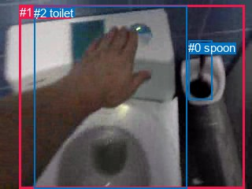
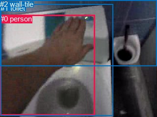

# 图片 2118：2416492.jpg

随机样本序号：441。图片 SHA256：`c09150263ab0bae804e489b1e36a62aeaceb3a46671543db3e2af3e2de056f9f`。

红色框表示人，蓝色框表示其他物体。两个模式分别保留自身框编号，可依据位置比较对应对象。

## 自动检测框与输出

人的框编号：`[1]`。状态：`ok`。

### 自动检测全部物体框

| 编号 | 类别 | 是否为人 | 检测分数 | 像素坐标 xyxy |
|---|---|---|---|---|
| 0 | spoon | False | 0.7920 | 239.3, 51.8, 269.2, 126.2 |
| 1 | person | True | 0.7468 | 24.7, 6.9, 310.5, 240.0 |
| 2 | toilet | False | 0.3553 | 43.0, 7.9, 238.0, 240.0 |

### 自动检测 Top50 人相关候选

评分物体对：6；人相关物体对：4；输出关系：8。

| 排名 | 主语编号与类别 | 关系 | 宾语编号与类别 | 类型 | 人与人 | 排序分数 | 原始融合 logit |
|---|---|---|---|---|---|---|---|
| 1 | #0 spoon | in | #1 person | spatial | False | 0.98818 | 4.4256 |
| 2 | #2 toilet | in | #1 person | spatial | False | 0.96887 | 3.4380 |
| 3 | #1 person | beside | #2 toilet | spatial | False | 0.81258 | 1.4668 |
| 4 | #2 toilet | lying on | #1 person | semantic | False | 0.68890 | 0.7950 |
| 5 | #1 person | holding | #2 toilet | semantic | False | 0.49869 | -0.0053 |
| 6 | #1 person | in | #0 spoon | spatial | False | 0.43144 | -0.2760 |
| 7 | #0 spoon | standing on | #1 person | semantic | False | 0.39542 | -0.4246 |
| 8 | #1 person | holding | #0 spoon | semantic | False | 0.17598 | -1.5438 |

### 自动检测逐条人相关 GT 核验

R@50：0.00%；命中 0/3。

| GT 主语编号 | GT 关系 | GT 宾语编号 | 结果阶段 | 匹配预测主语编号 | 匹配预测宾语编号 |
|---|---|---|---|---|---|
| 0 | beside | 1 | endpoint_missing_or_wrong_class | [] | [2] |
| 0 | cleaning | 1 | endpoint_missing_or_wrong_class | [] | [2] |
| 0 | touching | 1 | endpoint_missing_or_wrong_class | [] | [2] |

## 真实框与输出

人的框编号：`[0]`。

### 真实框全部物体框

| 编号 | 类别 | 是否为人 | 检测分数 | 像素坐标 xyxy |
|---|---|---|---|---|
| 0 | person | True | GT | 0.0, 30.0, 194.0, 236.0 |
| 1 | toilet | False | GT | 1.0, 8.0, 230.0, 237.0 |
| 2 | wall-tile | False | GT | 0.0, 0.0, 320.0, 136.0 |

### 真实框 Top50 人相关候选

评分物体对：6；人相关物体对：4；输出关系：8。

| 排名 | 主语编号与类别 | 关系 | 宾语编号与类别 | 类型 | 人与人 | 排序分数 | 原始融合 logit |
|---|---|---|---|---|---|---|---|
| 1 | #0 person | in | #1 toilet | spatial | False | 0.98171 | 3.9832 |
| 2 | #0 person | touching | #1 toilet | semantic | False | 0.95981 | 3.1731 |
| 3 | #0 person | in front of | #2 wall-tile | spatial | False | 0.91269 | 2.3469 |
| 4 | #0 person | touching | #2 wall-tile | semantic | False | 0.79340 | 1.3456 |
| 5 | #1 toilet | beside | #0 person | spatial | False | 0.58649 | 0.3495 |
| 6 | #1 toilet | holding | #0 person | semantic | False | 0.43153 | -0.2756 |
| 7 | #2 wall-tile | beside | #0 person | spatial | False | 0.10387 | -2.1549 |
| 8 | #2 wall-tile | looking at | #0 person | semantic | False | 0.02020 | -3.8816 |

### 真实框逐条人相关 GT 核验

R@50：33.33%；命中 1/3。

| GT 主语编号 | GT 关系 | GT 宾语编号 | 结果阶段 | 匹配预测主语编号 | 匹配预测宾语编号 |
|---|---|---|---|---|---|
| 0 | beside | 1 | wrong_predicate | [0] | [1] |
| 0 | cleaning | 1 | wrong_predicate | [0] | [1] |
| 0 | touching | 1 | hit50 | [0] | [1] |

## 全部人相关 GT

| 主语编号与类别 | 关系 | 宾语编号与类别 |
|---|---|---|
| #0 person | beside | #1 toilet |
| #0 person | cleaning | #1 toilet |
| #0 person | touching | #1 toilet |

原始记录、全部人相关物体对的两项预测与分项分数见 [逐图证据 JSON](../evidence/cases/2118.json)。全部56类 logits 保留于本机 HOR/output/random500/logits/。

<!-- HOR_COMPLETE_RESULTS -->

## 六组条件的完整输出对照

以下保留同一图片三种框与候选模式、两种谓词输出规则的全部 Top50。框编号各自在所属模式内解释。

### 自动检测框完整枚举：空间与语义各保留一个谓词

| 排名 | 主语编号与类别 | 谓词 | 宾语编号与类别 | 分组 | 排序分数 | predicate logit | pair logit |
|---|---|---|---|---|---|---|---|
| 1 | #0 spoon | in | #1 person | spatial | 0.9881750 | 4.5020089 | -0.0763612 |
| 2 | #2 toilet | in | #1 person | spatial | 0.9688720 | 3.7200818 | -0.2820574 |
| 3 | #1 person | beside | #2 toilet | spatial | 0.8125772 | 2.3353572 | -0.8685133 |
| 4 | #2 toilet | lying on | #1 person | semantic | 0.6889012 | 1.0770450 | -0.2820574 |
| 5 | #1 person | holding | #2 toilet | semantic | 0.4986853 | 0.8632545 | -0.8685133 |
| 6 | #1 person | in | #0 spoon | spatial | 0.4314368 | 0.6509976 | -0.9269893 |
| 7 | #0 spoon | standing on | #1 person | semantic | 0.3954187 | -0.3482299 | -0.0763612 |
| 8 | #1 person | holding | #0 spoon | semantic | 0.1759843 | -0.6168056 | -0.9269893 |

GT 命中：0/3，R@50=0.00%。

| GT主语 | GT谓词 | GT宾语 | 结果阶段 | 匹配主语框 | 匹配宾语框 |
|---|---|---|---|---|---|
| 0 | beside | 1 | endpoint_missing_or_wrong_class | [] | [2] |
| 0 | cleaning | 1 | endpoint_missing_or_wrong_class | [] | [2] |
| 0 | touching | 1 | endpoint_missing_or_wrong_class | [] | [2] |

### 自动检测框完整枚举：每对只保留一个谓词

| 排名 | 主语编号与类别 | 谓词 | 宾语编号与类别 | 分组 | 排序分数 | predicate logit | pair logit |
|---|---|---|---|---|---|---|---|
| 1 | #0 spoon | in | #1 person | single | 0.9881750 | 4.5020089 | -0.0763612 |
| 2 | #2 toilet | in | #1 person | single | 0.9688720 | 3.7200818 | -0.2820574 |
| 3 | #1 person | beside | #2 toilet | single | 0.8125772 | 2.3353572 | -0.8685133 |
| 4 | #1 person | in | #0 spoon | single | 0.4314368 | 0.6509976 | -0.9269893 |

GT 命中：0/3，R@50=0.00%。

| GT主语 | GT谓词 | GT宾语 | 结果阶段 | 匹配主语框 | 匹配宾语框 |
|---|---|---|---|---|---|
| 0 | beside | 1 | endpoint_missing_or_wrong_class | [] | [2] |
| 0 | cleaning | 1 | endpoint_missing_or_wrong_class | [] | [2] |
| 0 | touching | 1 | endpoint_missing_or_wrong_class | [] | [2] |

### 真实框完整枚举：空间与语义各保留一个谓词

| 排名 | 主语编号与类别 | 谓词 | 宾语编号与类别 | 分组 | 排序分数 | predicate logit | pair logit |
|---|---|---|---|---|---|---|---|
| 1 | #0 person | in | #1 toilet | spatial | 0.9817148 | 3.7170072 | 0.2662020 |
| 2 | #0 person | touching | #1 toilet | semantic | 0.9598085 | 2.9068751 | 0.2662020 |
| 3 | #0 person | in front of | #2 wall-tile | spatial | 0.9126880 | 3.2991967 | -0.9522916 |
| 4 | #0 person | touching | #2 wall-tile | semantic | 0.7934040 | 2.2978592 | -0.9522916 |
| 5 | #1 toilet | beside | #0 person | spatial | 0.5864883 | 1.3121967 | -0.9627297 |
| 6 | #1 toilet | holding | #0 person | semantic | 0.4315252 | 0.6870985 | -0.9627297 |
| 7 | #2 wall-tile | beside | #0 person | spatial | 0.1038727 | -1.0264957 | -1.1284212 |
| 8 | #2 wall-tile | looking at | #0 person | semantic | 0.0202019 | -2.7531476 | -1.1284212 |

GT 命中：1/3，R@50=33.33%。

| GT主语 | GT谓词 | GT宾语 | 结果阶段 | 匹配主语框 | 匹配宾语框 |
|---|---|---|---|---|---|
| 0 | beside | 1 | wrong_predicate | [0] | [1] |
| 0 | cleaning | 1 | wrong_predicate | [0] | [1] |
| 0 | touching | 1 | hit50 | [0] | [1] |

### 真实框完整枚举：每对只保留一个谓词

| 排名 | 主语编号与类别 | 谓词 | 宾语编号与类别 | 分组 | 排序分数 | predicate logit | pair logit |
|---|---|---|---|---|---|---|---|
| 1 | #0 person | in | #1 toilet | single | 0.9817148 | 3.7170072 | 0.2662020 |
| 2 | #0 person | in front of | #2 wall-tile | single | 0.9126880 | 3.2991967 | -0.9522916 |
| 3 | #1 toilet | beside | #0 person | single | 0.5864883 | 1.3121967 | -0.9627297 |
| 4 | #2 wall-tile | beside | #0 person | single | 0.1038727 | -1.0264957 | -1.1284212 |

GT 命中：0/3，R@50=0.00%。

| GT主语 | GT谓词 | GT宾语 | 结果阶段 | 匹配主语框 | 匹配宾语框 |
|---|---|---|---|---|---|
| 0 | beside | 1 | wrong_predicate | [0] | [1] |
| 0 | cleaning | 1 | wrong_predicate | [0] | [1] |
| 0 | touching | 1 | wrong_predicate | [0] | [1] |

### 真实框400候选：空间与语义各保留一个谓词

| 排名 | 主语编号与类别 | 谓词 | 宾语编号与类别 | 分组 | 排序分数 | predicate logit | pair logit |
|---|---|---|---|---|---|---|---|
| 1 | #0 person | in | #1 toilet | spatial | 0.9817148 | 3.7170072 | 0.2662020 |
| 2 | #0 person | touching | #1 toilet | semantic | 0.9598085 | 2.9068751 | 0.2662020 |
| 3 | #0 person | in front of | #2 wall-tile | spatial | 0.9127001 | 3.2993493 | -0.9522916 |
| 4 | #0 person | touching | #2 wall-tile | semantic | 0.7933995 | 2.2978315 | -0.9522916 |
| 5 | #1 toilet | beside | #0 person | spatial | 0.5864883 | 1.3121967 | -0.9627297 |
| 6 | #1 toilet | holding | #0 person | semantic | 0.4322501 | 0.6900530 | -0.9627297 |
| 7 | #2 wall-tile | beside | #0 person | spatial | 0.1011088 | -1.0565438 | -1.1284212 |
| 8 | #2 wall-tile | looking at | #0 person | semantic | 0.0200570 | -2.7604964 | -1.1284212 |

GT 命中：1/3，R@50=33.33%。

| GT主语 | GT谓词 | GT宾语 | 结果阶段 | 匹配主语框 | 匹配宾语框 |
|---|---|---|---|---|---|
| 0 | beside | 1 | wrong_predicate | [0] | [1] |
| 0 | cleaning | 1 | wrong_predicate | [0] | [1] |
| 0 | touching | 1 | hit50 | [0] | [1] |

### 真实框400候选：每对只保留一个谓词

| 排名 | 主语编号与类别 | 谓词 | 宾语编号与类别 | 分组 | 排序分数 | predicate logit | pair logit |
|---|---|---|---|---|---|---|---|
| 1 | #0 person | in | #1 toilet | single | 0.9817148 | 3.7170072 | 0.2662020 |
| 2 | #0 person | in front of | #2 wall-tile | single | 0.9127001 | 3.2993493 | -0.9522916 |
| 3 | #1 toilet | beside | #0 person | single | 0.5864883 | 1.3121967 | -0.9627297 |
| 4 | #2 wall-tile | beside | #0 person | single | 0.1011088 | -1.0565438 | -1.1284212 |

GT 命中：0/3，R@50=0.00%。

| GT主语 | GT谓词 | GT宾语 | 结果阶段 | 匹配主语框 | 匹配宾语框 |
|---|---|---|---|---|---|
| 0 | beside | 1 | wrong_predicate | [0] | [1] |
| 0 | cleaning | 1 | wrong_predicate | [0] | [1] |
| 0 | touching | 1 | wrong_predicate | [0] | [1] |
