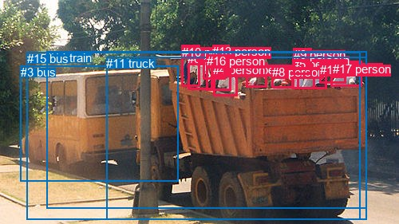
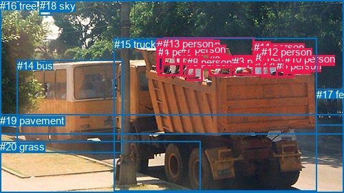

# 图片 2125：2416928.jpg

随机样本序号：165。图片 SHA256：`c14231ca76f4b7df706f9695aba6034ecd3e540b741ac5246e84fe4362a7d12e`。

红色框表示人，蓝色框表示其他物体。两个模式分别保留自身框编号，可依据位置比较对应对象。

## 自动检测框与输出

人的框编号：`[0, 1, 2, 4, 5, 6, 7, 8, 9, 10, 12, 13, 16, 17]`。状态：`ok`。

### 自动检测全部物体框

| 编号 | 类别 | 是否为人 | 检测分数 | 像素坐标 xyxy |
|---|---|---|---|---|
| 0 | person | True | 0.9957 | 414.6, 76.9, 453.3, 108.9 |
| 1 | person | True | 0.9645 | 372.9, 67.3, 409.8, 111.1 |
| 2 | person | True | 0.9623 | 308.3, 79.0, 334.6, 109.8 |
| 3 | bus | False | 0.9473 | 26.0, 82.4, 223.8, 227.8 |
| 4 | person | True | 0.9460 | 267.1, 79.0, 297.9, 120.5 |
| 5 | person | True | 0.9431 | 366.7, 72.0, 394.6, 111.0 |
| 6 | person | True | 0.9425 | 235.0, 64.7, 266.2, 112.1 |
| 7 | person | True | 0.9169 | 254.6, 60.9, 282.5, 100.0 |
| 8 | person | True | 0.9150 | 340.6, 81.9, 367.6, 110.7 |
| 9 | person | True | 0.9042 | 367.9, 60.1, 390.4, 93.8 |
| 10 | person | True | 0.9026 | 227.8, 56.8, 250.9, 108.1 |
| 11 | truck | False | 0.8761 | 133.1, 71.2, 459.4, 275.3 |
| 12 | person | True | 0.8351 | 400.8, 78.8, 433.4, 104.8 |
| 13 | person | True | 0.6456 | 266.2, 56.3, 287.4, 80.8 |
| 14 | train | False | 0.5373 | 58.9, 64.2, 459.4, 261.1 |
| 15 | bus | False | 0.5115 | 33.7, 65.3, 451.4, 275.4 |
| 16 | person | True | 0.4884 | 258.6, 68.3, 289.5, 113.8 |
| 17 | person | True | 0.3732 | 416.6, 78.1, 433.2, 97.2 |

### 自动检测 Top50 人相关候选

评分物体对：306；人相关物体对：294；输出关系：50。

| 排名 | 主语编号与类别 | 关系 | 宾语编号与类别 | 类型 | 人与人 | 排序分数 | 原始融合 logit |
|---|---|---|---|---|---|---|---|
| 1 | #0 person | wearing | #17 person | semantic | True | 0.98681 | 4.3152 |
| 2 | #10 person | riding | #11 truck | semantic | False | 0.98420 | 4.1317 |
| 3 | #10 person | riding | #15 bus | semantic | False | 0.98143 | 3.9675 |
| 4 | #12 person | wearing | #17 person | semantic | True | 0.98107 | 3.9479 |
| 5 | #4 person | riding | #11 truck | semantic | False | 0.98088 | 3.9375 |
| 6 | #2 person | riding | #11 truck | semantic | False | 0.98073 | 3.9297 |
| 7 | #10 person | riding | #14 train | semantic | False | 0.98070 | 3.9283 |
| 8 | #16 person | riding | #11 truck | semantic | False | 0.98050 | 3.9174 |
| 9 | #16 person | riding | #15 bus | semantic | False | 0.97862 | 3.8235 |
| 10 | #7 person | riding | #11 truck | semantic | False | 0.97831 | 3.8088 |
| 11 | #16 person | riding | #14 train | semantic | False | 0.97819 | 3.8035 |
| 12 | #1 person | riding | #11 truck | semantic | False | 0.97794 | 3.7916 |
| 13 | #2 person | riding | #15 bus | semantic | False | 0.97765 | 3.7782 |
| 14 | #6 person | riding | #11 truck | semantic | False | 0.97757 | 3.7745 |
| 15 | #4 person | riding | #15 bus | semantic | False | 0.97703 | 3.7505 |
| 16 | #6 person | riding | #14 train | semantic | False | 0.97676 | 3.7382 |
| 17 | #2 person | riding | #14 train | semantic | False | 0.97669 | 3.7351 |
| 18 | #7 person | riding | #14 train | semantic | False | 0.97662 | 3.7323 |
| 19 | #4 person | riding | #14 train | semantic | False | 0.97662 | 3.7320 |
| 20 | #6 person | riding | #15 bus | semantic | False | 0.97624 | 3.7159 |
| 21 | #7 person | riding | #15 bus | semantic | False | 0.97552 | 3.6851 |
| 22 | #0 person | riding | #11 truck | semantic | False | 0.97140 | 3.5254 |
| 23 | #8 person | riding | #11 truck | semantic | False | 0.97015 | 3.4811 |
| 24 | #1 person | riding | #14 train | semantic | False | 0.96790 | 3.4064 |
| 25 | #5 person | riding | #11 truck | semantic | False | 0.96592 | 3.3443 |
| 26 | #12 person | riding | #11 truck | semantic | False | 0.96470 | 3.3078 |
| 27 | #1 person | riding | #15 bus | semantic | False | 0.96423 | 3.2944 |
| 28 | #8 person | riding | #14 train | semantic | False | 0.96356 | 3.2749 |
| 29 | #8 person | riding | #15 bus | semantic | False | 0.96089 | 3.2015 |
| 30 | #5 person | wearing | #9 person | semantic | True | 0.95857 | 3.1414 |
| 31 | #0 person | riding | #14 train | semantic | False | 0.95703 | 3.1033 |
| 32 | #0 person | riding | #15 bus | semantic | False | 0.95674 | 3.0964 |
| 33 | #5 person | riding | #14 train | semantic | False | 0.95402 | 3.0324 |
| 34 | #5 person | riding | #15 bus | semantic | False | 0.94566 | 2.8566 |
| 35 | #4 person | on | #11 truck | spatial | False | 0.94398 | 2.8245 |
| 36 | #12 person | riding | #14 train | semantic | False | 0.94205 | 2.7885 |
| 37 | #2 person | on | #11 truck | spatial | False | 0.94040 | 2.7587 |
| 38 | #12 person | riding | #15 bus | semantic | False | 0.93835 | 2.7227 |
| 39 | #10 person | on | #15 bus | spatial | False | 0.93685 | 2.6971 |
| 40 | #10 person | on | #11 truck | spatial | False | 0.93655 | 2.6919 |
| 41 | #4 person | on | #15 bus | spatial | False | 0.93626 | 2.6870 |
| 42 | #16 person | on | #11 truck | spatial | False | 0.93392 | 2.6485 |
| 43 | #7 person | wearing | #13 person | semantic | True | 0.93197 | 2.6174 |
| 44 | #6 person | on | #15 bus | spatial | False | 0.93066 | 2.5968 |
| 45 | #6 person | on | #11 truck | spatial | False | 0.93052 | 2.5947 |
| 46 | #16 person | on | #15 bus | spatial | False | 0.92975 | 2.5829 |
| 47 | #4 person | on | #14 train | spatial | False | 0.92868 | 2.5665 |
| 48 | #10 person | on | #14 train | spatial | False | 0.92612 | 2.5286 |
| 49 | #9 person | riding | #11 truck | semantic | False | 0.92262 | 2.4785 |
| 50 | #2 person | on | #15 bus | spatial | False | 0.92247 | 2.4764 |

### 自动检测逐条人相关 GT 核验

R@50：0.00%；命中 0/3。

| GT 主语编号 | GT 关系 | GT 宾语编号 | 结果阶段 | 匹配预测主语编号 | 匹配预测宾语编号 |
|---|---|---|---|---|---|
| 9 | leaning on | 15 | endpoint_missing_or_wrong_class | [] | [11] |
| 10 | wearing | 16 | endpoint_missing_or_wrong_class | [0] | [] |
| 13 | standing on | 15 | endpoint_missing_or_wrong_class | [] | [11] |

## 真实框与输出

人的框编号：`[0, 1, 2, 3, 4, 5, 6, 7, 8, 9, 10, 11, 12, 13]`。

### 真实框全部物体框

| 编号 | 类别 | 是否为人 | 检测分数 | 像素坐标 xyxy |
|---|---|---|---|---|
| 0 | person | True | GT | 304.0, 79.0, 337.0, 110.0 |
| 1 | person | True | GT | 228.0, 57.0, 238.0, 104.0 |
| 2 | person | True | GT | 255.0, 56.0, 287.0, 94.0 |
| 3 | person | True | GT | 339.0, 81.0, 369.0, 110.0 |
| 4 | person | True | GT | 230.0, 67.0, 264.0, 110.0 |
| 5 | person | True | GT | 402.0, 87.0, 428.0, 112.0 |
| 6 | person | True | GT | 368.0, 75.0, 391.0, 111.0 |
| 7 | person | True | GT | 263.0, 63.0, 283.0, 112.0 |
| 8 | person | True | GT | 272.0, 82.0, 295.0, 117.0 |
| 9 | person | True | GT | 422.0, 79.0, 432.0, 91.0 |
| 10 | person | True | GT | 414.0, 77.0, 452.0, 107.0 |
| 11 | person | True | GT | 369.0, 60.0, 393.0, 91.0 |
| 12 | person | True | GT | 380.0, 67.0, 414.0, 112.0 |
| 13 | person | True | GT | 237.0, 55.0, 369.0, 95.0 |
| 14 | bus | False | GT | 25.0, 87.0, 179.0, 222.0 |
| 15 | truck | False | GT | 166.0, 56.0, 461.0, 278.0 |
| 16 | tree | False | GT | 0.0, 0.0, 500.0, 196.0 |
| 17 | fence | False | GT | 460.0, 129.0, 500.0, 182.0 |
| 18 | sky | False | GT | 58.0, 0.0, 74.0, 22.0 |
| 19 | pavement | False | GT | 0.0, 167.0, 500.0, 281.0 |
| 20 | grass | False | GT | 0.0, 205.0, 292.0, 281.0 |

### 真实框 Top50 人相关候选

评分物体对：420；人相关物体对：378；输出关系：50。

| 排名 | 主语编号与类别 | 关系 | 宾语编号与类别 | 类型 | 人与人 | 排序分数 | 原始融合 logit |
|---|---|---|---|---|---|---|---|
| 1 | #10 person | wearing | #9 person | semantic | True | 0.98900 | 4.4984 |
| 2 | #1 person | riding | #15 truck | semantic | False | 0.97859 | 3.8223 |
| 3 | #7 person | riding | #15 truck | semantic | False | 0.97504 | 3.6654 |
| 4 | #12 person | riding | #15 truck | semantic | False | 0.97075 | 3.5022 |
| 5 | #4 person | riding | #15 truck | semantic | False | 0.96112 | 3.2075 |
| 6 | #8 person | riding | #15 truck | semantic | False | 0.96013 | 3.1815 |
| 7 | #7 person | wearing | #2 person | semantic | True | 0.95958 | 3.1671 |
| 8 | #2 person | riding | #15 truck | semantic | False | 0.95896 | 3.1513 |
| 9 | #8 person | on | #15 truck | spatial | False | 0.95702 | 3.1031 |
| 10 | #1 person | on | #15 truck | spatial | False | 0.95370 | 3.0251 |
| 11 | #0 person | sitting on | #15 truck | semantic | False | 0.95340 | 3.0184 |
| 12 | #7 person | on | #15 truck | spatial | False | 0.95300 | 3.0096 |
| 13 | #10 person | riding | #15 truck | semantic | False | 0.95130 | 2.9722 |
| 14 | #4 person | on | #15 truck | spatial | False | 0.95120 | 2.9701 |
| 15 | #0 person | on | #15 truck | spatial | False | 0.94825 | 2.9083 |
| 16 | #12 person | on | #15 truck | spatial | False | 0.94731 | 2.8893 |
| 17 | #5 person | riding | #15 truck | semantic | False | 0.94374 | 2.8198 |
| 18 | #3 person | sitting on | #15 truck | semantic | False | 0.94214 | 2.7902 |
| 19 | #5 person | on | #15 truck | spatial | False | 0.93899 | 2.7338 |
| 20 | #6 person | riding | #15 truck | semantic | False | 0.93574 | 2.6784 |
| 21 | #13 person | on | #15 truck | spatial | False | 0.93526 | 2.6704 |
| 22 | #3 person | on | #15 truck | spatial | False | 0.92979 | 2.5835 |
| 23 | #10 person | on | #15 truck | spatial | False | 0.92587 | 2.5250 |
| 24 | #6 person | on | #15 truck | spatial | False | 0.92561 | 2.5211 |
| 25 | #2 person | on | #15 truck | spatial | False | 0.92068 | 2.4516 |
| 26 | #6 person | wearing | #11 person | semantic | True | 0.91757 | 2.4098 |
| 27 | #9 person | on | #10 person | spatial | True | 0.91681 | 2.3998 |
| 28 | #13 person | riding | #15 truck | semantic | False | 0.91494 | 2.3755 |
| 29 | #7 person | leaning on | #13 person | spatial | True | 0.90904 | 2.3019 |
| 30 | #11 person | riding | #15 truck | semantic | False | 0.89728 | 2.1673 |
| 31 | #7 person | standing on | #13 person | semantic | True | 0.89477 | 2.1404 |
| 32 | #5 person | wearing | #9 person | semantic | True | 0.87718 | 1.9660 |
| 33 | #4 person | leaning on | #13 person | spatial | True | 0.86107 | 1.8242 |
| 34 | #0 person | sitting on | #13 person | semantic | True | 0.85513 | 1.7754 |
| 35 | #13 person | pulling | #14 bus | semantic | False | 0.85361 | 1.7632 |
| 36 | #11 person | on | #15 truck | spatial | False | 0.85014 | 1.7357 |
| 37 | #13 person | on back of | #14 bus | spatial | False | 0.83965 | 1.6556 |
| 38 | #7 person | in | #2 person | spatial | True | 0.83582 | 1.6275 |
| 39 | #8 person | leaning on | #13 person | spatial | True | 0.82497 | 1.5504 |
| 40 | #2 person | on | #13 person | spatial | True | 0.82356 | 1.5407 |
| 41 | #10 person | in | #9 person | spatial | True | 0.81837 | 1.5053 |
| 42 | #12 person | wearing | #11 person | semantic | True | 0.81272 | 1.4678 |
| 43 | #15 truck | carrying | #13 person | semantic | False | 0.81097 | 1.4563 |
| 44 | #8 person | sitting on | #13 person | semantic | True | 0.79830 | 1.3757 |
| 45 | #2 person | standing on | #13 person | semantic | True | 0.79736 | 1.3699 |
| 46 | #4 person | standing on | #13 person | semantic | True | 0.78383 | 1.2881 |
| 47 | #0 person | leaning on | #13 person | spatial | True | 0.77885 | 1.2589 |
| 48 | #3 person | sitting on | #13 person | semantic | True | 0.77785 | 1.2532 |
| 49 | #1 person | standing on | #14 bus | semantic | False | 0.76134 | 1.1600 |
| 50 | #1 person | on | #14 bus | spatial | False | 0.74208 | 1.0568 |

### 真实框逐条人相关 GT 核验

R@50：0.00%；命中 0/3。

| GT 主语编号 | GT 关系 | GT 宾语编号 | 结果阶段 | 匹配预测主语编号 | 匹配预测宾语编号 |
|---|---|---|---|---|---|
| 9 | leaning on | 15 | wrong_predicate | [9] | [15] |
| 10 | wearing | 16 | wrong_predicate | [10] | [16] |
| 13 | standing on | 15 | wrong_predicate | [13] | [15] |

## 全部人相关 GT

| 主语编号与类别 | 关系 | 宾语编号与类别 |
|---|---|---|
| #9 person | leaning on | #15 truck |
| #10 person | wearing | #16 tree |
| #13 person | standing on | #15 truck |

原始记录、全部人相关物体对的两项预测与分项分数见 [逐图证据 JSON](../evidence/cases/2125.json)。全部56类 logits 保留于本机 HOR/output/random500/logits/。

<!-- HOR_COMPLETE_RESULTS -->

## 六组条件的完整输出对照

以下保留同一图片三种框与候选模式、两种谓词输出规则的全部 Top50。框编号各自在所属模式内解释。

### 自动检测框完整枚举：空间与语义各保留一个谓词

| 排名 | 主语编号与类别 | 谓词 | 宾语编号与类别 | 分组 | 排序分数 | predicate logit | pair logit |
|---|---|---|---|---|---|---|---|
| 1 | #0 person | wearing | #17 person | semantic | 0.9868129 | 4.2002711 | 0.1149708 |
| 2 | #10 person | riding | #11 truck | semantic | 0.9841986 | 3.8363624 | 0.2953649 |
| 3 | #10 person | riding | #15 bus | semantic | 0.9814311 | 3.7764239 | 0.1911037 |
| 4 | #12 person | wearing | #17 person | semantic | 0.9810708 | 4.0799050 | -0.1319716 |
| 5 | #4 person | riding | #11 truck | semantic | 0.9808758 | 3.6029630 | 0.3345299 |
| 6 | #2 person | riding | #11 truck | semantic | 0.9807292 | 3.7211289 | 0.2085726 |
| 7 | #10 person | riding | #14 train | semantic | 0.9807029 | 3.8346524 | 0.0936601 |
| 8 | #16 person | riding | #11 truck | semantic | 0.9804953 | 3.7203965 | 0.1970048 |
| 9 | #16 person | riding | #15 bus | semantic | 0.9786165 | 3.7798457 | 0.0436770 |
| 10 | #7 person | riding | #11 truck | semantic | 0.9783067 | 3.9562402 | -0.1474194 |
| 11 | #16 person | riding | #14 train | semantic | 0.9781933 | 3.8380733 | -0.0345831 |
| 12 | #1 person | riding | #11 truck | semantic | 0.9779387 | 3.8987441 | -0.1071264 |
| 13 | #2 person | riding | #15 bus | semantic | 0.9776474 | 3.7206407 | 0.0575691 |
| 14 | #6 person | riding | #11 truck | semantic | 0.9775671 | 3.5980773 | 0.1764616 |
| 15 | #4 person | riding | #15 bus | semantic | 0.9770340 | 3.6027188 | 0.1477871 |
| 16 | #6 person | riding | #14 train | semantic | 0.9767572 | 3.7759356 | -0.0376890 |
| 17 | #2 person | riding | #14 train | semantic | 0.9766850 | 3.7199063 | 0.0151641 |
| 18 | #7 person | riding | #14 train | semantic | 0.9766223 | 4.0744042 | -0.3420850 |
| 19 | #4 person | riding | #14 train | semantic | 0.9766161 | 3.6611915 | 0.0708554 |
| 20 | #6 person | riding | #15 bus | semantic | 0.9762449 | 3.6577706 | 0.0581469 |
| 21 | #7 person | riding | #15 bus | semantic | 0.9755201 | 3.9557500 | -0.2706273 |
| 22 | #0 person | riding | #11 truck | semantic | 0.9714013 | 3.5990539 | -0.0736759 |
| 23 | #8 person | riding | #11 truck | semantic | 0.9701462 | 3.6014981 | -0.1203639 |
| 24 | #1 person | riding | #14 train | semantic | 0.9679030 | 3.7776465 | -0.3712765 |
| 25 | #5 person | riding | #11 truck | semantic | 0.9659185 | 3.5990539 | -0.2547284 |
| 26 | #12 person | riding | #11 truck | semantic | 0.9646954 | 3.4813771 | -0.1735780 |
| 27 | #1 person | riding | #15 bus | semantic | 0.9642349 | 3.5988097 | -0.3044471 |
| 28 | #8 person | riding | #14 train | semantic | 0.9635581 | 3.6000314 | -0.3251174 |
| 29 | #8 person | riding | #15 bus | semantic | 0.9608889 | 3.4806437 | -0.2791932 |
| 30 | #5 person | wearing | #9 person | semantic | 0.9585692 | 3.3328137 | -0.1913963 |
| 31 | #0 person | riding | #14 train | semantic | 0.9570275 | 3.3585677 | -0.2552972 |
| 32 | #0 person | riding | #15 bus | semantic | 0.9567432 | 3.2991185 | -0.2027364 |
| 33 | #5 person | riding | #14 train | semantic | 0.9540182 | 3.5371604 | -0.5047213 |
| 34 | #5 person | riding | #15 bus | semantic | 0.9456592 | 3.2986302 | -0.4420242 |
| 35 | #4 person | on | #11 truck | spatial | 0.9439838 | 2.4899383 | 0.3345299 |
| 36 | #12 person | riding | #14 train | semantic | 0.9420519 | 3.1811972 | -0.3926830 |
| 37 | #2 person | on | #11 truck | spatial | 0.9404024 | 2.5501208 | 0.2085726 |
| 38 | #12 person | riding | #15 bus | semantic | 0.9383524 | 3.0615654 | -0.3388733 |
| 39 | #10 person | on | #15 bus | spatial | 0.9368545 | 2.5059834 | 0.1911037 |
| 40 | #10 person | on | #11 truck | spatial | 0.9365454 | 2.3965082 | 0.2953649 |
| 41 | #4 person | on | #15 bus | spatial | 0.9362563 | 2.5392313 | 0.1477871 |
| 42 | #16 person | on | #11 truck | spatial | 0.9339210 | 2.4515352 | 0.1970048 |
| 43 | #7 person | wearing | #13 person | semantic | 0.9319701 | 3.0171585 | -0.3998049 |
| 44 | #6 person | on | #15 bus | spatial | 0.9306552 | 2.5386519 | 0.0581469 |
| 45 | #6 person | on | #11 truck | spatial | 0.9305229 | 2.4182873 | 0.1764616 |
| 46 | #16 person | on | #15 bus | spatial | 0.9297535 | 2.5392313 | 0.0436770 |
| 47 | #4 person | on | #14 train | spatial | 0.9286760 | 2.4956727 | 0.0708554 |
| 48 | #10 person | on | #14 train | spatial | 0.9261206 | 2.4349113 | 0.0936601 |
| 49 | #9 person | riding | #11 truck | semantic | 0.9226196 | 3.3585677 | -0.8800836 |
| 50 | #2 person | on | #15 bus | spatial | 0.9224732 | 2.4188662 | 0.0575691 |

GT 命中：0/3，R@50=0.00%。

| GT主语 | GT谓词 | GT宾语 | 结果阶段 | 匹配主语框 | 匹配宾语框 |
|---|---|---|---|---|---|
| 9 | leaning on | 15 | endpoint_missing_or_wrong_class | [] | [11] |
| 10 | wearing | 16 | endpoint_missing_or_wrong_class | [0] | [] |
| 13 | standing on | 15 | endpoint_missing_or_wrong_class | [] | [11] |

### 自动检测框完整枚举：每对只保留一个谓词

| 排名 | 主语编号与类别 | 谓词 | 宾语编号与类别 | 分组 | 排序分数 | predicate logit | pair logit |
|---|---|---|---|---|---|---|---|
| 1 | #0 person | wearing | #17 person | single | 0.9868129 | 4.2002711 | 0.1149708 |
| 2 | #10 person | riding | #11 truck | single | 0.9841986 | 3.8363624 | 0.2953649 |
| 3 | #10 person | riding | #15 bus | single | 0.9814311 | 3.7764239 | 0.1911037 |
| 4 | #12 person | wearing | #17 person | single | 0.9810708 | 4.0799050 | -0.1319716 |
| 5 | #4 person | riding | #11 truck | single | 0.9808758 | 3.6029630 | 0.3345299 |
| 6 | #2 person | riding | #11 truck | single | 0.9807292 | 3.7211289 | 0.2085726 |
| 7 | #10 person | riding | #14 train | single | 0.9807029 | 3.8346524 | 0.0936601 |
| 8 | #16 person | riding | #11 truck | single | 0.9804953 | 3.7203965 | 0.1970048 |
| 9 | #16 person | riding | #15 bus | single | 0.9786165 | 3.7798457 | 0.0436770 |
| 10 | #7 person | riding | #11 truck | single | 0.9783067 | 3.9562402 | -0.1474194 |
| 11 | #16 person | riding | #14 train | single | 0.9781933 | 3.8380733 | -0.0345831 |
| 12 | #1 person | riding | #11 truck | single | 0.9779387 | 3.8987441 | -0.1071264 |
| 13 | #2 person | riding | #15 bus | single | 0.9776474 | 3.7206407 | 0.0575691 |
| 14 | #6 person | riding | #11 truck | single | 0.9775671 | 3.5980773 | 0.1764616 |
| 15 | #4 person | riding | #15 bus | single | 0.9770340 | 3.6027188 | 0.1477871 |
| 16 | #6 person | riding | #14 train | single | 0.9767572 | 3.7759356 | -0.0376890 |
| 17 | #2 person | riding | #14 train | single | 0.9766850 | 3.7199063 | 0.0151641 |
| 18 | #7 person | riding | #14 train | single | 0.9766223 | 4.0744042 | -0.3420850 |
| 19 | #4 person | riding | #14 train | single | 0.9766161 | 3.6611915 | 0.0708554 |
| 20 | #6 person | riding | #15 bus | single | 0.9762449 | 3.6577706 | 0.0581469 |
| 21 | #7 person | riding | #15 bus | single | 0.9755201 | 3.9557500 | -0.2706273 |
| 22 | #0 person | riding | #11 truck | single | 0.9714013 | 3.5990539 | -0.0736759 |
| 23 | #8 person | riding | #11 truck | single | 0.9701462 | 3.6014981 | -0.1203639 |
| 24 | #1 person | riding | #14 train | single | 0.9679030 | 3.7776465 | -0.3712765 |
| 25 | #5 person | riding | #11 truck | single | 0.9659185 | 3.5990539 | -0.2547284 |
| 26 | #12 person | riding | #11 truck | single | 0.9646954 | 3.4813771 | -0.1735780 |
| 27 | #1 person | riding | #15 bus | single | 0.9642349 | 3.5988097 | -0.3044471 |
| 28 | #8 person | riding | #14 train | single | 0.9635581 | 3.6000314 | -0.3251174 |
| 29 | #8 person | riding | #15 bus | single | 0.9608889 | 3.4806437 | -0.2791932 |
| 30 | #5 person | wearing | #9 person | single | 0.9585692 | 3.3328137 | -0.1913963 |
| 31 | #0 person | riding | #14 train | single | 0.9570275 | 3.3585677 | -0.2552972 |
| 32 | #0 person | riding | #15 bus | single | 0.9567432 | 3.2991185 | -0.2027364 |
| 33 | #5 person | riding | #14 train | single | 0.9540182 | 3.5371604 | -0.5047213 |
| 34 | #5 person | riding | #15 bus | single | 0.9456592 | 3.2986302 | -0.4420242 |
| 35 | #12 person | riding | #14 train | single | 0.9420519 | 3.1811972 | -0.3926830 |
| 36 | #12 person | riding | #15 bus | single | 0.9383524 | 3.0615654 | -0.3388733 |
| 37 | #7 person | wearing | #13 person | single | 0.9319701 | 3.0171585 | -0.3998049 |
| 38 | #9 person | riding | #11 truck | single | 0.9226196 | 3.3585677 | -0.8800836 |
| 39 | #13 person | riding | #14 train | single | 0.9126185 | 3.4789338 | -1.1328990 |
| 40 | #1 person | wearing | #9 person | single | 0.9087782 | 2.2832322 | 0.0155752 |
| 41 | #13 person | riding | #15 bus | single | 0.9009765 | 3.2998524 | -1.0917298 |
| 42 | #13 person | riding | #11 truck | single | 0.8928975 | 3.1207705 | -1.0000848 |
| 43 | #9 person | riding | #14 train | single | 0.8829293 | 3.0586329 | -1.0381656 |
| 44 | #17 person | on | #0 person | single | 0.8729419 | 2.3529496 | -0.4257257 |
| 45 | #17 person | on | #12 person | single | 0.8699932 | 2.3747287 | -0.4738300 |
| 46 | #16 person | wearing | #13 person | single | 0.8570575 | 2.0431814 | -0.2521189 |
| 47 | #9 person | riding | #15 bus | single | 0.8406260 | 2.6691575 | -1.0062642 |
| 48 | #16 person | wearing | #7 person | single | 0.8329425 | 2.0498013 | -0.4431748 |
| 49 | #0 person | wearing | #12 person | single | 0.8307146 | 1.7847748 | -0.1940748 |
| 50 | #9 person | wearing | #5 person | single | 0.8261747 | 2.1390319 | -0.5802765 |

GT 命中：0/3，R@50=0.00%。

| GT主语 | GT谓词 | GT宾语 | 结果阶段 | 匹配主语框 | 匹配宾语框 |
|---|---|---|---|---|---|
| 9 | leaning on | 15 | endpoint_missing_or_wrong_class | [] | [11] |
| 10 | wearing | 16 | endpoint_missing_or_wrong_class | [0] | [] |
| 13 | standing on | 15 | endpoint_missing_or_wrong_class | [] | [11] |

### 真实框完整枚举：空间与语义各保留一个谓词

| 排名 | 主语编号与类别 | 谓词 | 宾语编号与类别 | 分组 | 排序分数 | predicate logit | pair logit |
|---|---|---|---|---|---|---|---|
| 1 | #10 person | wearing | #9 person | semantic | 0.9889954 | 4.2956605 | 0.2027233 |
| 2 | #1 person | riding | #15 truck | semantic | 0.9785919 | 3.7199063 | 0.1024370 |
| 3 | #7 person | riding | #15 truck | semantic | 0.9750444 | 3.6002755 | 0.0651090 |
| 4 | #12 person | riding | #15 truck | semantic | 0.9707500 | 3.5413156 | -0.0391260 |
| 5 | #4 person | riding | #15 truck | semantic | 0.9611172 | 3.1819301 | 0.0256143 |
| 6 | #8 person | riding | #15 truck | semantic | 0.9601309 | 3.0067587 | 0.1747109 |
| 7 | #7 person | wearing | #2 person | semantic | 0.9595765 | 3.5367608 | -0.3696816 |
| 8 | #2 person | riding | #15 truck | semantic | 0.9589616 | 3.6000314 | -0.4486882 |
| 9 | #8 person | on | #15 truck | spatial | 0.9570217 | 2.9284191 | 0.1747109 |
| 10 | #1 person | on | #15 truck | spatial | 0.9536962 | 2.9226847 | 0.1024370 |
| 11 | #0 person | sitting on | #15 truck | semantic | 0.9533986 | 2.8740473 | 0.1443539 |
| 12 | #7 person | on | #15 truck | spatial | 0.9530048 | 2.9444637 | 0.0651090 |
| 13 | #10 person | riding | #15 truck | semantic | 0.9513032 | 3.0632758 | -0.0910558 |
| 14 | #4 person | on | #15 truck | spatial | 0.9512039 | 2.9444637 | 0.0256143 |
| 15 | #0 person | on | #15 truck | spatial | 0.9482537 | 2.7639165 | 0.1443539 |
| 16 | #12 person | on | #15 truck | spatial | 0.9473146 | 2.9284191 | -0.0391260 |
| 17 | #5 person | riding | #15 truck | semantic | 0.9437385 | 2.8281660 | -0.0083288 |
| 18 | #3 person | sitting on | #15 truck | semantic | 0.9421439 | 2.9763541 | -0.1861553 |
| 19 | #5 person | on | #15 truck | spatial | 0.9389924 | 2.7421374 | -0.0083288 |
| 20 | #6 person | riding | #15 truck | semantic | 0.9357370 | 3.0632758 | -0.3849247 |
| 21 | #13 person | on | #15 truck | spatial | 0.9352579 | 2.8831229 | -0.2127127 |
| 22 | #3 person | on | #15 truck | spatial | 0.9297919 | 2.7696514 | -0.1861553 |
| 23 | #10 person | on | #15 truck | spatial | 0.9258747 | 2.6160378 | -0.0910558 |
| 24 | #6 person | on | #15 truck | spatial | 0.9256103 | 2.9060607 | -0.3849247 |
| 25 | #2 person | on | #15 truck | spatial | 0.9206812 | 2.9003267 | -0.4486882 |
| 26 | #6 person | wearing | #11 person | semantic | 0.9175698 | 2.7602553 | -0.3504786 |
| 27 | #9 person | on | #10 person | spatial | 0.9168147 | 2.8619232 | -0.4620880 |
| 28 | #13 person | riding | #15 truck | semantic | 0.9149365 | 2.5881691 | -0.2127127 |
| 29 | #7 person | leaning on | #13 person | spatial | 0.9090356 | 2.6035099 | -0.3015940 |
| 30 | #11 person | riding | #15 truck | semantic | 0.8972775 | 3.0625434 | -0.8952096 |
| 31 | #7 person | standing on | #13 person | semantic | 0.8947687 | 2.4419990 | -0.3015940 |
| 32 | #5 person | wearing | #9 person | semantic | 0.8771841 | 1.9792404 | -0.0132102 |
| 33 | #4 person | leaning on | #13 person | spatial | 0.8610655 | 2.2838101 | -0.4596419 |
| 34 | #0 person | sitting on | #13 person | semantic | 0.8551338 | 1.9652371 | -0.1897899 |
| 35 | #13 person | pulling | #14 bus | semantic | 0.8536130 | 2.6444631 | -0.8812393 |
| 36 | #11 person | on | #15 truck | spatial | 0.8501420 | 2.6309247 | -0.8952096 |
| 37 | #13 person | on back of | #14 bus | spatial | 0.8396469 | 2.5368428 | -0.8812393 |
| 38 | #7 person | in | #2 person | spatial | 0.8358226 | 1.9971509 | -0.3696816 |
| 39 | #8 person | leaning on | #13 person | spatial | 0.8249693 | 1.8931851 | -0.3428001 |
| 40 | #2 person | on | #13 person | spatial | 0.8235633 | 2.0829682 | -0.5422903 |
| 41 | #10 person | in | #9 person | spatial | 0.8183677 | 1.3026037 | 0.2027233 |
| 42 | #12 person | wearing | #11 person | semantic | 0.8127234 | 1.3847871 | 0.0830171 |
| 43 | #15 truck | carrying | #13 person | semantic | 0.8109671 | 2.1281290 | -0.6718225 |
| 44 | #8 person | sitting on | #13 person | semantic | 0.7982993 | 1.7184987 | -0.3428001 |
| 45 | #2 person | standing on | #13 person | semantic | 0.7973635 | 1.9121866 | -0.5422903 |
| 46 | #4 person | standing on | #13 person | semantic | 0.7838279 | 1.7477565 | -0.4596419 |
| 47 | #0 person | leaning on | #13 person | spatial | 0.7788451 | 1.4487386 | -0.1897899 |
| 48 | #3 person | sitting on | #13 person | semantic | 0.7778503 | 1.7034450 | -0.4502627 |
| 49 | #1 person | standing on | #14 bus | semantic | 0.7613382 | 1.7775497 | -0.6175195 |
| 50 | #1 person | on | #14 bus | spatial | 0.7420782 | 1.6743178 | -0.6175195 |

GT 命中：0/3，R@50=0.00%。

| GT主语 | GT谓词 | GT宾语 | 结果阶段 | 匹配主语框 | 匹配宾语框 |
|---|---|---|---|---|---|
| 9 | leaning on | 15 | wrong_predicate | [9] | [15] |
| 10 | wearing | 16 | wrong_predicate | [10] | [16] |
| 13 | standing on | 15 | wrong_predicate | [13] | [15] |

### 真实框完整枚举：每对只保留一个谓词

| 排名 | 主语编号与类别 | 谓词 | 宾语编号与类别 | 分组 | 排序分数 | predicate logit | pair logit |
|---|---|---|---|---|---|---|---|
| 1 | #10 person | wearing | #9 person | single | 0.9889954 | 4.2956605 | 0.2027233 |
| 2 | #1 person | riding | #15 truck | single | 0.9785919 | 3.7199063 | 0.1024370 |
| 3 | #7 person | riding | #15 truck | single | 0.9750444 | 3.6002755 | 0.0651090 |
| 4 | #12 person | riding | #15 truck | single | 0.9707500 | 3.5413156 | -0.0391260 |
| 5 | #4 person | riding | #15 truck | single | 0.9611172 | 3.1819301 | 0.0256143 |
| 6 | #8 person | riding | #15 truck | single | 0.9601309 | 3.0067587 | 0.1747109 |
| 7 | #7 person | wearing | #2 person | single | 0.9595765 | 3.5367608 | -0.3696816 |
| 8 | #2 person | riding | #15 truck | single | 0.9589616 | 3.6000314 | -0.4486882 |
| 9 | #0 person | sitting on | #15 truck | single | 0.9533986 | 2.8740473 | 0.1443539 |
| 10 | #10 person | riding | #15 truck | single | 0.9513032 | 3.0632758 | -0.0910558 |
| 11 | #5 person | riding | #15 truck | single | 0.9437385 | 2.8281660 | -0.0083288 |
| 12 | #3 person | sitting on | #15 truck | single | 0.9421439 | 2.9763541 | -0.1861553 |
| 13 | #6 person | riding | #15 truck | single | 0.9357370 | 3.0632758 | -0.3849247 |
| 14 | #13 person | on | #15 truck | single | 0.9352579 | 2.8831229 | -0.2127127 |
| 15 | #6 person | wearing | #11 person | single | 0.9175698 | 2.7602553 | -0.3504786 |
| 16 | #9 person | on | #10 person | single | 0.9168147 | 2.8619232 | -0.4620880 |
| 17 | #7 person | leaning on | #13 person | single | 0.9090356 | 2.6035099 | -0.3015940 |
| 18 | #11 person | riding | #15 truck | single | 0.8972775 | 3.0625434 | -0.8952096 |
| 19 | #5 person | wearing | #9 person | single | 0.8771841 | 1.9792404 | -0.0132102 |
| 20 | #4 person | leaning on | #13 person | single | 0.8610655 | 2.2838101 | -0.4596419 |
| 21 | #0 person | sitting on | #13 person | single | 0.8551338 | 1.9652371 | -0.1897899 |
| 22 | #13 person | pulling | #14 bus | single | 0.8536130 | 2.6444631 | -0.8812393 |
| 23 | #8 person | leaning on | #13 person | single | 0.8249693 | 1.8931851 | -0.3428001 |
| 24 | #2 person | on | #13 person | single | 0.8235633 | 2.0829682 | -0.5422903 |
| 25 | #12 person | wearing | #11 person | single | 0.8127234 | 1.3847871 | 0.0830171 |
| 26 | #15 truck | carrying | #13 person | single | 0.8109671 | 2.1281290 | -0.6718225 |
| 27 | #3 person | sitting on | #13 person | single | 0.7778503 | 1.7034450 | -0.4502627 |
| 28 | #1 person | standing on | #14 bus | single | 0.7613382 | 1.7775497 | -0.6175195 |
| 29 | #2 person | on | #7 person | single | 0.7313510 | 1.7711658 | -0.7696778 |
| 30 | #7 person | on | #14 bus | single | 0.7181039 | 1.7456794 | -0.8106039 |
| 31 | #13 person | in | #16 tree | single | 0.6999837 | 1.9694877 | -1.1222671 |
| 32 | #1 person | standing on | #13 person | single | 0.6761999 | 1.2346768 | -0.4983144 |
| 33 | #4 person | standing on | #14 bus | single | 0.6213506 | 1.2059155 | -0.7106303 |
| 34 | #9 person | on | #15 truck | single | 0.6144795 | 1.4487638 | -0.9825827 |
| 35 | #8 person | sitting on | #14 bus | single | 0.6081109 | 1.1949463 | -0.7555679 |
| 36 | #11 person | wearing | #6 person | single | 0.6002916 | 1.0234003 | -0.6167201 |
| 37 | #15 truck | carrying | #5 person | single | 0.5865991 | 1.4418559 | -1.0919322 |
| 38 | #0 person | sitting on | #14 bus | single | 0.5755566 | 1.1076608 | -0.8031020 |
| 39 | #9 person | on | #5 person | single | 0.5196651 | 0.7962270 | -0.7175259 |
| 40 | #14 bus | pulling | #13 person | single | 0.5063753 | 1.4105978 | -1.3850954 |
| 41 | #2 person | on | #14 bus | single | 0.4996569 | 1.2636404 | -1.2650130 |
| 42 | #15 truck | carrying | #12 person | single | 0.4952653 | 1.1572537 | -1.1761930 |
| 43 | #10 person | wearing | #5 person | single | 0.4933758 | 0.3973517 | -0.4238501 |
| 44 | #13 person | on | #19 pavement | single | 0.4793734 | 0.8048286 | -0.8873820 |
| 45 | #15 truck | carrying | #7 person | single | 0.4737238 | 0.9351645 | -1.0403662 |
| 46 | #15 truck | carrying | #3 person | single | 0.4571598 | 0.9755411 | -1.1473230 |
| 47 | #15 truck | carrying | #10 person | single | 0.4535058 | 0.9419551 | -1.1284707 |
| 48 | #15 truck | carrying | #4 person | single | 0.4450304 | 0.8344054 | -1.0551760 |
| 49 | #15 truck | carrying | #8 person | single | 0.4316479 | 0.7350116 | -1.0101423 |
| 50 | #3 person | sitting on | #14 bus | single | 0.4267776 | 0.7164903 | -1.0115011 |

GT 命中：0/3，R@50=0.00%。

| GT主语 | GT谓词 | GT宾语 | 结果阶段 | 匹配主语框 | 匹配宾语框 |
|---|---|---|---|---|---|
| 9 | leaning on | 15 | wrong_predicate | [9] | [15] |
| 10 | wearing | 16 | wrong_predicate | [10] | [16] |
| 13 | standing on | 15 | wrong_predicate | [13] | [15] |

### 真实框400候选：空间与语义各保留一个谓词

| 排名 | 主语编号与类别 | 谓词 | 宾语编号与类别 | 分组 | 排序分数 | predicate logit | pair logit |
|---|---|---|---|---|---|---|---|
| 1 | #10 person | wearing | #9 person | semantic | 0.9889954 | 4.2956605 | 0.2027233 |
| 2 | #1 person | riding | #15 truck | semantic | 0.9773049 | 3.6602139 | 0.1024370 |
| 3 | #7 person | riding | #15 truck | semantic | 0.9735500 | 3.5405812 | 0.0651090 |
| 4 | #12 person | riding | #15 truck | semantic | 0.9690065 | 3.4816213 | -0.0391260 |
| 5 | #7 person | wearing | #2 person | semantic | 0.9614143 | 3.5852065 | -0.3696816 |
| 6 | #8 person | riding | #15 truck | semantic | 0.9589726 | 2.9769115 | 0.1747109 |
| 7 | #2 person | riding | #15 truck | semantic | 0.9589616 | 3.6000314 | -0.4486882 |
| 8 | #4 person | riding | #15 truck | semantic | 0.9588336 | 3.1224804 | 0.0256143 |
| 9 | #8 person | on | #15 truck | spatial | 0.9570217 | 2.9284191 | 0.1747109 |
| 10 | #0 person | sitting on | #15 truck | semantic | 0.9543254 | 2.8951092 | 0.1443539 |
| 11 | #7 person | on | #15 truck | spatial | 0.9530048 | 2.9444637 | 0.0651090 |
| 12 | #1 person | on | #15 truck | spatial | 0.9519705 | 2.8842812 | 0.1024370 |
| 13 | #10 person | riding | #15 truck | semantic | 0.9513032 | 3.0632758 | -0.0910558 |
| 14 | #4 person | on | #15 truck | spatial | 0.9488643 | 2.8951707 | 0.0256143 |
| 15 | #0 person | on | #15 truck | spatial | 0.9482537 | 2.7639165 | 0.1443539 |
| 16 | #12 person | on | #15 truck | spatial | 0.9467685 | 2.9175291 | -0.0391260 |
| 17 | #5 person | riding | #15 truck | semantic | 0.9437385 | 2.8281660 | -0.0083288 |
| 18 | #3 person | sitting on | #15 truck | semantic | 0.9421439 | 2.9763541 | -0.1861553 |
| 19 | #5 person | on | #15 truck | spatial | 0.9383656 | 2.7312474 | -0.0083288 |
| 20 | #13 person | on | #15 truck | spatial | 0.9345953 | 2.8722329 | -0.2127127 |
| 21 | #6 person | riding | #15 truck | semantic | 0.9320682 | 3.0038261 | -0.3849247 |
| 22 | #3 person | on | #15 truck | spatial | 0.9297919 | 2.7696514 | -0.1861553 |
| 23 | #6 person | on | #15 truck | spatial | 0.9256103 | 2.9060607 | -0.3849247 |
| 24 | #10 person | on | #15 truck | spatial | 0.9224198 | 2.5667453 | -0.0910558 |
| 25 | #2 person | on | #15 truck | spatial | 0.9206812 | 2.9003267 | -0.4486882 |
| 26 | #9 person | on | #10 person | spatial | 0.9196971 | 2.9003267 | -0.4620880 |
| 27 | #13 person | riding | #15 truck | semantic | 0.9149365 | 2.5881691 | -0.2127127 |
| 28 | #6 person | wearing | #11 person | semantic | 0.9129020 | 2.7000728 | -0.3504786 |
| 29 | #7 person | leaning on | #13 person | spatial | 0.9114934 | 2.6336012 | -0.3015940 |
| 30 | #11 person | riding | #15 truck | semantic | 0.8972775 | 3.0625434 | -0.8952096 |
| 31 | #7 person | standing on | #13 person | semantic | 0.8947687 | 2.4419990 | -0.3015940 |
| 32 | #5 person | wearing | #9 person | semantic | 0.8788358 | 1.9946618 | -0.0132102 |
| 33 | #4 person | leaning on | #13 person | spatial | 0.8646264 | 2.3139014 | -0.4596419 |
| 34 | #0 person | sitting on | #13 person | semantic | 0.8573565 | 1.9832950 | -0.1897899 |
| 35 | #13 person | pulling | #14 bus | semantic | 0.8573325 | 2.6745486 | -0.8812393 |
| 36 | #11 person | on | #15 truck | spatial | 0.8437530 | 2.5816317 | -0.8952096 |
| 37 | #13 person | on back of | #14 bus | spatial | 0.8394566 | 2.5354304 | -0.8812393 |
| 38 | #7 person | in | #2 person | spatial | 0.8325788 | 1.9736972 | -0.3696816 |
| 39 | #8 person | leaning on | #13 person | spatial | 0.8292720 | 1.9232769 | -0.3428001 |
| 40 | #2 person | on | #13 person | spatial | 0.8251401 | 2.0938582 | -0.5422903 |
| 41 | #12 person | wearing | #11 person | semantic | 0.8155012 | 1.4031425 | 0.0830171 |
| 42 | #10 person | in | #9 person | spatial | 0.8143541 | 1.2758312 | 0.2027233 |
| 43 | #15 truck | carrying | #13 person | semantic | 0.8061289 | 2.0968728 | -0.6718225 |
| 44 | #8 person | sitting on | #13 person | semantic | 0.8045249 | 1.7576189 | -0.3428001 |
| 45 | #2 person | standing on | #13 person | semantic | 0.7985474 | 1.9195304 | -0.5422903 |
| 46 | #4 person | standing on | #13 person | semantic | 0.7888830 | 1.7778478 | -0.4596419 |
| 47 | #3 person | sitting on | #13 person | semantic | 0.7814685 | 1.7245073 | -0.4502627 |
| 48 | #0 person | leaning on | #13 person | spatial | 0.7790154 | 1.4497275 | -0.1897899 |
| 49 | #1 person | standing on | #14 bus | semantic | 0.7708061 | 1.8303881 | -0.6175195 |
| 50 | #1 person | on | #14 bus | spatial | 0.7451922 | 1.6906519 | -0.6175195 |

GT 命中：0/3，R@50=0.00%。

| GT主语 | GT谓词 | GT宾语 | 结果阶段 | 匹配主语框 | 匹配宾语框 |
|---|---|---|---|---|---|
| 9 | leaning on | 15 | wrong_predicate | [9] | [15] |
| 10 | wearing | 16 | wrong_predicate | [10] | [16] |
| 13 | standing on | 15 | wrong_predicate | [13] | [15] |

### 真实框400候选：每对只保留一个谓词

| 排名 | 主语编号与类别 | 谓词 | 宾语编号与类别 | 分组 | 排序分数 | predicate logit | pair logit |
|---|---|---|---|---|---|---|---|
| 1 | #10 person | wearing | #9 person | single | 0.9889954 | 4.2956605 | 0.2027233 |
| 2 | #1 person | riding | #15 truck | single | 0.9773049 | 3.6602139 | 0.1024370 |
| 3 | #7 person | riding | #15 truck | single | 0.9735500 | 3.5405812 | 0.0651090 |
| 4 | #12 person | riding | #15 truck | single | 0.9690065 | 3.4816213 | -0.0391260 |
| 5 | #7 person | wearing | #2 person | single | 0.9614143 | 3.5852065 | -0.3696816 |
| 6 | #8 person | riding | #15 truck | single | 0.9589726 | 2.9769115 | 0.1747109 |
| 7 | #2 person | riding | #15 truck | single | 0.9589616 | 3.6000314 | -0.4486882 |
| 8 | #4 person | riding | #15 truck | single | 0.9588336 | 3.1224804 | 0.0256143 |
| 9 | #0 person | sitting on | #15 truck | single | 0.9543254 | 2.8951092 | 0.1443539 |
| 10 | #10 person | riding | #15 truck | single | 0.9513032 | 3.0632758 | -0.0910558 |
| 11 | #5 person | riding | #15 truck | single | 0.9437385 | 2.8281660 | -0.0083288 |
| 12 | #3 person | sitting on | #15 truck | single | 0.9421439 | 2.9763541 | -0.1861553 |
| 13 | #13 person | on | #15 truck | single | 0.9345953 | 2.8722329 | -0.2127127 |
| 14 | #6 person | riding | #15 truck | single | 0.9320682 | 3.0038261 | -0.3849247 |
| 15 | #9 person | on | #10 person | single | 0.9196971 | 2.9003267 | -0.4620880 |
| 16 | #6 person | wearing | #11 person | single | 0.9129020 | 2.7000728 | -0.3504786 |
| 17 | #7 person | leaning on | #13 person | single | 0.9114934 | 2.6336012 | -0.3015940 |
| 18 | #11 person | riding | #15 truck | single | 0.8972775 | 3.0625434 | -0.8952096 |
| 19 | #5 person | wearing | #9 person | single | 0.8788358 | 1.9946618 | -0.0132102 |
| 20 | #4 person | leaning on | #13 person | single | 0.8646264 | 2.3139014 | -0.4596419 |
| 21 | #0 person | sitting on | #13 person | single | 0.8573565 | 1.9832950 | -0.1897899 |
| 22 | #13 person | pulling | #14 bus | single | 0.8573325 | 2.6745486 | -0.8812393 |
| 23 | #8 person | leaning on | #13 person | single | 0.8292720 | 1.9232769 | -0.3428001 |
| 24 | #2 person | on | #13 person | single | 0.8251401 | 2.0938582 | -0.5422903 |
| 25 | #12 person | wearing | #11 person | single | 0.8155012 | 1.4031425 | 0.0830171 |
| 26 | #15 truck | carrying | #13 person | single | 0.8061289 | 2.0968728 | -0.6718225 |
| 27 | #3 person | sitting on | #13 person | single | 0.7814685 | 1.7245073 | -0.4502627 |
| 28 | #1 person | standing on | #14 bus | single | 0.7708061 | 1.8303881 | -0.6175195 |
| 29 | #2 person | on | #7 person | single | 0.7388292 | 1.8095698 | -0.7696778 |
| 30 | #7 person | on | #14 bus | single | 0.7203031 | 1.7565694 | -0.8106039 |
| 31 | #13 person | in | #16 tree | single | 0.6936268 | 1.9393969 | -1.1222671 |
| 32 | #1 person | standing on | #13 person | single | 0.6811603 | 1.2574239 | -0.4983144 |
| 33 | #4 person | standing on | #14 bus | single | 0.6319937 | 1.2514095 | -0.7106303 |
| 34 | #8 person | sitting on | #14 bus | single | 0.6265908 | 1.2731867 | -0.7555679 |
| 35 | #11 person | wearing | #6 person | single | 0.6246756 | 1.1261616 | -0.6167201 |
| 36 | #9 person | on | #15 truck | single | 0.5941992 | 1.3639350 | -0.9825827 |
| 37 | #0 person | sitting on | #14 bus | single | 0.5901877 | 1.1678433 | -0.8031020 |
| 38 | #15 truck | carrying | #5 person | single | 0.5716475 | 1.3805084 | -1.0919322 |
| 39 | #9 person | on | #5 person | single | 0.5230980 | 0.8099837 | -0.7175259 |
| 40 | #2 person | on | #14 bus | single | 0.5085401 | 1.2991767 | -1.2650130 |
| 41 | #10 person | wearing | #5 person | single | 0.5018197 | 0.4311290 | -0.4238501 |
| 42 | #13 person | on | #19 pavement | single | 0.4957685 | 0.8704557 | -0.8873820 |
| 43 | #14 bus | pulling | #13 person | single | 0.4838152 | 1.3203335 | -1.3850954 |
| 44 | #15 truck | carrying | #12 person | single | 0.4730143 | 1.0681453 | -1.1761930 |
| 45 | #15 truck | carrying | #7 person | single | 0.4587480 | 0.8749819 | -1.0403662 |
| 46 | #3 person | sitting on | #14 bus | single | 0.4564491 | 0.8368549 | -1.0115011 |
| 47 | #15 truck | carrying | #3 person | single | 0.4416931 | 0.9130292 | -1.1473230 |
| 48 | #15 truck | carrying | #4 person | single | 0.4299345 | 0.7730575 | -1.0551760 |
| 49 | #15 truck | carrying | #10 person | single | 0.4244455 | 0.8239202 | -1.1284707 |
| 50 | #15 truck | carrying | #8 person | single | 0.4169483 | 0.6748285 | -1.0101423 |

GT 命中：0/3，R@50=0.00%。

| GT主语 | GT谓词 | GT宾语 | 结果阶段 | 匹配主语框 | 匹配宾语框 |
|---|---|---|---|---|---|
| 9 | leaning on | 15 | wrong_predicate | [9] | [15] |
| 10 | wearing | 16 | wrong_predicate | [10] | [16] |
| 13 | standing on | 15 | wrong_predicate | [13] | [15] |
