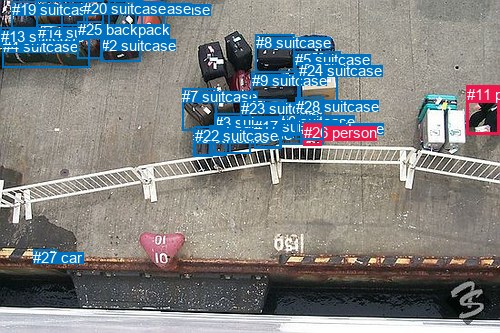
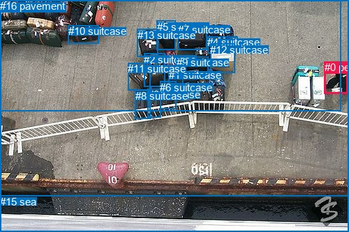

# 图片 2126：2416964.jpg

随机样本序号：226。图片 SHA256：`57cf8aeaa73b52951118851955fb8f2a8a7f3eaef4725648122f76e54d22e245`。

红色框表示人，蓝色框表示其他物体。两个模式分别保留自身框编号，可依据位置比较对应对象。

## 自动检测框与输出

人的框编号：`[11, 26]`。状态：`ok`。

### 自动检测全部物体框

| 编号 | 类别 | 是否为人 | 检测分数 | 像素坐标 xyxy |
|---|---|---|---|---|
| 0 | suitcase | False | 0.9630 | 193.5, 129.4, 212.4, 156.3 |
| 1 | suitcase | False | 0.9362 | 135.3, 1.1, 164.6, 48.5 |
| 2 | suitcase | False | 0.7651 | 100.7, 36.9, 140.9, 61.4 |
| 3 | suitcase | False | 0.7460 | 214.9, 114.0, 250.7, 153.1 |
| 4 | suitcase | False | 0.7163 | 2.6, 38.3, 89.7, 67.9 |
| 5 | suitcase | False | 0.7033 | 295.5, 51.0, 340.4, 77.0 |
| 6 | suitcase | False | 0.6986 | 279.7, 112.7, 302.3, 144.0 |
| 7 | suitcase | False | 0.6702 | 182.2, 88.5, 216.0, 130.0 |
| 8 | suitcase | False | 0.6630 | 255.7, 34.3, 294.9, 72.4 |
| 9 | suitcase | False | 0.6602 | 251.8, 71.7, 298.1, 105.6 |
| 10 | suitcase | False | 0.6485 | 108.3, 0.4, 142.4, 39.9 |
| 11 | person | True | 0.6173 | 466.7, 85.7, 500.0, 134.8 |
| 12 | suitcase | False | 0.6088 | 209.4, 125.6, 230.8, 153.5 |
| 13 | suitcase | False | 0.5255 | 0.6, 27.6, 40.3, 46.9 |
| 14 | suitcase | False | 0.5186 | 37.7, 24.3, 78.5, 42.7 |
| 15 | backpack | False | 0.5182 | 254.6, 118.2, 281.2, 148.4 |
| 16 | suitcase | False | 0.5062 | 61.1, 0.1, 84.9, 29.4 |
| 17 | suitcase | False | 0.5030 | 254.0, 117.5, 280.8, 147.7 |
| 18 | suitcase | False | 0.5011 | 36.3, 0.2, 87.1, 29.7 |
| 19 | suitcase | False | 0.4873 | 11.5, 1.4, 37.6, 29.1 |
| 20 | suitcase | False | 0.4593 | 83.4, 0.0, 103.2, 25.4 |
| 21 | suitcase | False | 0.4566 | 301.0, 120.1, 323.0, 144.5 |
| 22 | suitcase | False | 0.4460 | 194.8, 126.6, 226.5, 156.0 |
| 23 | suitcase | False | 0.4288 | 240.6, 100.0, 286.4, 126.3 |
| 24 | suitcase | False | 0.4276 | 299.3, 62.2, 337.1, 102.7 |
| 25 | backpack | False | 0.4165 | 77.6, 21.4, 102.7, 58.8 |
| 26 | person | True | 0.3984 | 303.6, 124.0, 321.4, 145.2 |
| 27 | car | False | 0.3982 | 33.2, 249.2, 56.8, 262.3 |
| 28 | suitcase | False | 0.3955 | 296.0, 97.8, 323.5, 140.0 |

### 自动检测 Top50 人相关候选

评分物体对：812；人相关物体对：110；输出关系：50。

| 排名 | 主语编号与类别 | 关系 | 宾语编号与类别 | 类型 | 人与人 | 排序分数 | 原始融合 logit |
|---|---|---|---|---|---|---|---|
| 1 | #28 suitcase | holding | #26 person | semantic | False | 0.86663 | 1.8715 |
| 2 | #28 suitcase | on | #26 person | spatial | False | 0.67290 | 0.7213 |
| 3 | #21 suitcase | holding | #26 person | semantic | False | 0.61057 | 0.4497 |
| 4 | #11 person | pushing | #5 suitcase | semantic | False | 0.54317 | 0.1731 |
| 5 | #11 person | pushing | #24 suitcase | semantic | False | 0.52296 | 0.0919 |
| 6 | #11 person | walking on | #27 car | semantic | False | 0.51422 | 0.0569 |
| 7 | #11 person | carrying | #13 suitcase | semantic | False | 0.49375 | -0.0250 |
| 8 | #11 person | carrying | #4 suitcase | semantic | False | 0.45283 | -0.1892 |
| 9 | #11 person | carrying | #14 suitcase | semantic | False | 0.45158 | -0.1943 |
| 10 | #21 suitcase | beside | #26 person | spatial | False | 0.42111 | -0.3182 |
| 11 | #11 person | carrying | #2 suitcase | semantic | False | 0.41237 | -0.3542 |
| 12 | #11 person | carrying | #19 suitcase | semantic | False | 0.36120 | -0.5702 |
| 13 | #11 person | carrying | #20 suitcase | semantic | False | 0.34385 | -0.6462 |
| 14 | #11 person | carrying | #8 suitcase | semantic | False | 0.32756 | -0.7192 |
| 15 | #11 person | carrying | #18 suitcase | semantic | False | 0.32555 | -0.7284 |
| 16 | #11 person | carrying | #25 backpack | semantic | False | 0.32501 | -0.7309 |
| 17 | #11 person | carrying | #16 suitcase | semantic | False | 0.32400 | -0.7355 |
| 18 | #11 person | carrying | #0 suitcase | semantic | False | 0.30093 | -0.8429 |
| 19 | #11 person | carrying | #26 person | semantic | True | 0.29681 | -0.8625 |
| 20 | #11 person | carrying | #21 suitcase | semantic | False | 0.29514 | -0.8705 |
| 21 | #11 person | carrying | #22 suitcase | semantic | False | 0.29079 | -0.8915 |
| 22 | #11 person | carrying | #6 suitcase | semantic | False | 0.28013 | -0.9438 |
| 23 | #26 person | in | #28 suitcase | spatial | False | 0.27074 | -0.9909 |
| 24 | #11 person | carrying | #3 suitcase | semantic | False | 0.27021 | -0.9936 |
| 25 | #11 person | carrying | #12 suitcase | semantic | False | 0.26939 | -0.9977 |
| 26 | #11 person | pushing | #9 suitcase | semantic | False | 0.26200 | -1.0356 |
| 27 | #11 person | carrying | #28 suitcase | semantic | False | 0.25506 | -1.0718 |
| 28 | #11 person | carrying | #7 suitcase | semantic | False | 0.25015 | -1.0978 |
| 29 | #11 person | carrying | #10 suitcase | semantic | False | 0.24963 | -1.1006 |
| 30 | #11 person | carrying | #23 suitcase | semantic | False | 0.24954 | -1.1011 |
| 31 | #11 person | carrying | #17 suitcase | semantic | False | 0.24158 | -1.1441 |
| 32 | #11 person | carrying | #15 backpack | semantic | False | 0.23928 | -1.1566 |
| 33 | #26 person | beside | #21 suitcase | spatial | False | 0.21015 | -1.3240 |
| 34 | #6 suitcase | beside | #26 person | spatial | False | 0.18341 | -1.4934 |
| 35 | #26 person | beside | #24 suitcase | spatial | False | 0.18083 | -1.5107 |
| 36 | #26 person | beside | #6 suitcase | spatial | False | 0.16163 | -1.6462 |
| 37 | #26 person | holding | #28 suitcase | semantic | False | 0.14741 | -1.7551 |
| 38 | #24 suitcase | holding | #26 person | semantic | False | 0.13067 | -1.8951 |
| 39 | #24 suitcase | beside | #26 person | spatial | False | 0.12484 | -1.9474 |
| 40 | #11 person | on | #24 suitcase | spatial | False | 0.11997 | -1.9927 |
| 41 | #11 person | on | #5 suitcase | spatial | False | 0.11795 | -2.0120 |
| 42 | #11 person | carrying | #1 suitcase | semantic | False | 0.10484 | -2.1445 |
| 43 | #26 person | sitting on | #21 suitcase | semantic | False | 0.10385 | -2.1552 |
| 44 | #26 person | lying on | #24 suitcase | semantic | False | 0.09791 | -2.2207 |
| 45 | #11 person | on | #27 car | spatial | False | 0.07346 | -2.5347 |
| 46 | #26 person | in | #5 suitcase | spatial | False | 0.06066 | -2.7400 |
| 47 | #11 person | on | #4 suitcase | spatial | False | 0.05481 | -2.8476 |
| 48 | #11 person | in | #28 suitcase | spatial | False | 0.04507 | -3.0535 |
| 49 | #6 suitcase | lying on | #26 person | semantic | False | 0.04272 | -3.1094 |
| 50 | #11 person | on | #2 suitcase | spatial | False | 0.03931 | -3.1963 |

### 自动检测逐条人相关 GT 核验

R@50：0.00%；命中 0/1。

| GT 主语编号 | GT 关系 | GT 宾语编号 | 结果阶段 | 匹配预测主语编号 | 匹配预测宾语编号 |
|---|---|---|---|---|---|
| 0 | picking | 14 | endpoint_missing_or_wrong_class | [11] | [] |

## 真实框与输出

人的框编号：`[0]`。

### 真实框全部物体框

| 编号 | 类别 | 是否为人 | 检测分数 | 像素坐标 xyxy |
|---|---|---|---|---|
| 0 | person | True | GT | 465.0, 88.0, 499.0, 134.0 |
| 1 | suitcase | False | GT | 242.0, 99.0, 263.0, 125.0 |
| 2 | suitcase | False | GT | 206.0, 77.0, 236.0, 125.0 |
| 3 | suitcase | False | GT | 212.0, 127.0, 231.0, 168.0 |
| 4 | suitcase | False | GT | 297.0, 52.0, 340.0, 76.0 |
| 5 | suitcase | False | GT | 225.0, 30.0, 252.0, 72.0 |
| 6 | suitcase | False | GT | 229.0, 117.0, 252.0, 157.0 |
| 7 | suitcase | False | GT | 255.0, 34.0, 296.0, 72.0 |
| 8 | suitcase | False | GT | 194.0, 129.0, 216.0, 171.0 |
| 9 | suitcase | False | GT | 253.0, 81.0, 299.0, 107.0 |
| 10 | suitcase | False | GT | 98.0, 36.0, 142.0, 62.0 |
| 11 | suitcase | False | GT | 183.0, 90.0, 215.0, 129.0 |
| 12 | suitcase | False | GT | 301.0, 63.0, 336.0, 104.0 |
| 13 | suitcase | False | GT | 197.0, 42.0, 227.0, 82.0 |
| 14 | suitcase | False | GT | 0.0, 0.0, 488.0, 159.0 |
| 15 | sea | False | GT | 0.0, 281.0, 500.0, 333.0 |
| 16 | pavement | False | GT | 0.0, 0.0, 500.0, 333.0 |

### 真实框 Top50 人相关候选

评分物体对：272；人相关物体对：32；输出关系：50。

| 排名 | 主语编号与类别 | 关系 | 宾语编号与类别 | 类型 | 人与人 | 排序分数 | 原始融合 logit |
|---|---|---|---|---|---|---|---|
| 1 | #0 person | walking on | #16 pavement | semantic | False | 0.98629 | 4.2759 |
| 2 | #0 person | walking on | #14 suitcase | semantic | False | 0.96598 | 3.3463 |
| 3 | #0 person | beside | #16 pavement | spatial | False | 0.95356 | 3.0221 |
| 4 | #0 person | beside | #14 suitcase | spatial | False | 0.92994 | 2.5858 |
| 5 | #16 pavement | carrying | #0 person | semantic | False | 0.91975 | 2.4389 |
| 6 | #16 pavement | beside | #0 person | spatial | False | 0.68347 | 0.7698 |
| 7 | #0 person | walking on | #15 sea | semantic | False | 0.63363 | 0.5478 |
| 8 | #0 person | beside | #15 sea | spatial | False | 0.34017 | -0.6625 |
| 9 | #14 suitcase | beside | #0 person | spatial | False | 0.33819 | -0.6714 |
| 10 | #0 person | pushing | #4 suitcase | semantic | False | 0.17387 | -1.5584 |
| 11 | #0 person | pushing | #12 suitcase | semantic | False | 0.09781 | -2.2218 |
| 12 | #0 person | pushing | #7 suitcase | semantic | False | 0.08872 | -2.3294 |
| 13 | #14 suitcase | holding | #0 person | semantic | False | 0.07749 | -2.4769 |
| 14 | #0 person | pulling | #9 suitcase | semantic | False | 0.07741 | -2.4781 |
| 15 | #0 person | pulling | #10 suitcase | semantic | False | 0.06045 | -2.7436 |
| 16 | #0 person | pulling | #5 suitcase | semantic | False | 0.03895 | -3.2056 |
| 17 | #0 person | pulling | #11 suitcase | semantic | False | 0.03713 | -3.2555 |
| 18 | #0 person | pulling | #1 suitcase | semantic | False | 0.03660 | -3.2704 |
| 19 | #0 person | carrying | #13 suitcase | semantic | False | 0.03632 | -3.2783 |
| 20 | #0 person | pulling | #2 suitcase | semantic | False | 0.03358 | -3.3596 |
| 21 | #0 person | pulling | #6 suitcase | semantic | False | 0.03042 | -3.4617 |
| 22 | #0 person | carrying | #8 suitcase | semantic | False | 0.02642 | -3.6069 |
| 23 | #0 person | carrying | #3 suitcase | semantic | False | 0.02472 | -3.6752 |
| 24 | #15 sea | in front of | #0 person | spatial | False | 0.01667 | -4.0770 |
| 25 | #0 person | beside | #12 suitcase | spatial | False | 0.00772 | -4.8560 |
| 26 | #10 suitcase | carrying | #0 person | semantic | False | 0.00750 | -4.8852 |
| 27 | #15 sea | crossing | #0 person | semantic | False | 0.00717 | -4.9300 |
| 28 | #12 suitcase | holding | #0 person | semantic | False | 0.00511 | -5.2724 |
| 29 | #4 suitcase | holding | #0 person | semantic | False | 0.00487 | -5.3201 |
| 30 | #0 person | beside | #4 suitcase | spatial | False | 0.00413 | -5.4848 |
| 31 | #12 suitcase | in front of | #0 person | spatial | False | 0.00402 | -5.5115 |
| 32 | #3 suitcase | in front of | #0 person | spatial | False | 0.00347 | -5.6610 |
| 33 | #3 suitcase | holding | #0 person | semantic | False | 0.00336 | -5.6936 |
| 34 | #8 suitcase | in front of | #0 person | spatial | False | 0.00316 | -5.7550 |
| 35 | #0 person | leaning on | #7 suitcase | spatial | False | 0.00303 | -5.7956 |
| 36 | #9 suitcase | carrying | #0 person | semantic | False | 0.00257 | -5.9603 |
| 37 | #6 suitcase | carrying | #0 person | semantic | False | 0.00252 | -5.9814 |
| 38 | #1 suitcase | carrying | #0 person | semantic | False | 0.00244 | -6.0122 |
| 39 | #8 suitcase | holding | #0 person | semantic | False | 0.00241 | -6.0249 |
| 40 | #7 suitcase | holding | #0 person | semantic | False | 0.00239 | -6.0322 |
| 41 | #13 suitcase | carrying | #0 person | semantic | False | 0.00236 | -6.0458 |
| 42 | #0 person | leaning on | #10 suitcase | spatial | False | 0.00232 | -6.0626 |
| 43 | #6 suitcase | in front of | #0 person | spatial | False | 0.00231 | -6.0690 |
| 44 | #0 person | leaning on | #8 suitcase | spatial | False | 0.00225 | -6.0938 |
| 45 | #0 person | leaning on | #3 suitcase | spatial | False | 0.00220 | -6.1182 |
| 46 | #1 suitcase | in front of | #0 person | spatial | False | 0.00218 | -6.1241 |
| 47 | #5 suitcase | holding | #0 person | semantic | False | 0.00198 | -6.2203 |
| 48 | #4 suitcase | in front of | #0 person | spatial | False | 0.00194 | -6.2455 |
| 49 | #9 suitcase | in front of | #0 person | spatial | False | 0.00184 | -6.2974 |
| 50 | #0 person | leaning on | #11 suitcase | spatial | False | 0.00177 | -6.3351 |

### 真实框逐条人相关 GT 核验

R@50：0.00%；命中 0/1。

| GT 主语编号 | GT 关系 | GT 宾语编号 | 结果阶段 | 匹配预测主语编号 | 匹配预测宾语编号 |
|---|---|---|---|---|---|
| 0 | picking | 14 | wrong_predicate | [0] | [14] |

## 全部人相关 GT

| 主语编号与类别 | 关系 | 宾语编号与类别 |
|---|---|---|
| #0 person | picking | #14 suitcase |

原始记录、全部人相关物体对的两项预测与分项分数见 [逐图证据 JSON](../evidence/cases/2126.json)。全部56类 logits 保留于本机 HOR/output/random500/logits/。

<!-- HOR_COMPLETE_RESULTS -->

## 六组条件的完整输出对照

以下保留同一图片三种框与候选模式、两种谓词输出规则的全部 Top50。框编号各自在所属模式内解释。

### 自动检测框完整枚举：空间与语义各保留一个谓词

| 排名 | 主语编号与类别 | 谓词 | 宾语编号与类别 | 分组 | 排序分数 | predicate logit | pair logit |
|---|---|---|---|---|---|---|---|
| 1 | #28 suitcase | holding | #26 person | semantic | 0.8666334 | 2.4427705 | -0.5712563 |
| 2 | #28 suitcase | on | #26 person | spatial | 0.6728970 | 1.2925735 | -0.5712563 |
| 3 | #21 suitcase | holding | #26 person | semantic | 0.6105723 | 1.0513573 | -0.6016386 |
| 4 | #11 person | pushing | #5 suitcase | semantic | 0.5431732 | 1.3503132 | -1.1771894 |
| 5 | #11 person | pushing | #24 suitcase | semantic | 0.5229606 | 1.2000031 | -1.1080960 |
| 6 | #11 person | walking on | #27 car | semantic | 0.5142239 | 1.1706204 | -1.1137096 |
| 7 | #11 person | carrying | #13 suitcase | semantic | 0.4937542 | 1.0811434 | -1.1061280 |
| 8 | #11 person | carrying | #4 suitcase | semantic | 0.4528299 | 0.7988715 | -0.9881150 |
| 9 | #11 person | carrying | #14 suitcase | semantic | 0.4515850 | 0.9392247 | -1.1334937 |
| 10 | #21 suitcase | beside | #26 person | spatial | 0.4211118 | 0.2834277 | -0.6016386 |
| 11 | #11 person | carrying | #2 suitcase | semantic | 0.4123682 | 0.8297458 | -1.1839297 |
| 12 | #11 person | carrying | #19 suitcase | semantic | 0.3611991 | 0.4259262 | -0.9960897 |
| 13 | #11 person | carrying | #20 suitcase | semantic | 0.3438545 | 0.4237957 | -1.0699598 |
| 14 | #11 person | carrying | #8 suitcase | semantic | 0.3275621 | 0.5620193 | -1.2812513 |
| 15 | #11 person | carrying | #18 suitcase | semantic | 0.3255495 | 0.3867140 | -1.1150978 |
| 16 | #11 person | carrying | #25 backpack | semantic | 0.3250063 | 0.4226308 | -1.1534896 |
| 17 | #11 person | carrying | #16 suitcase | semantic | 0.3239998 | 0.3572054 | -1.0926558 |
| 18 | #11 person | carrying | #0 suitcase | semantic | 0.3009333 | 0.4016776 | -1.2445353 |
| 19 | #11 person | carrying | #26 person | semantic | 0.2968078 | 0.5150523 | -1.3775978 |
| 20 | #11 person | carrying | #21 suitcase | semantic | 0.2951402 | 0.5115571 | -1.3821056 |
| 21 | #11 person | carrying | #22 suitcase | semantic | 0.2907950 | 0.3836193 | -1.2751456 |
| 22 | #11 person | carrying | #6 suitcase | semantic | 0.2801333 | 0.5358229 | -1.4796236 |
| 23 | #26 person | in | #28 suitcase | spatial | 0.2707435 | -0.3755546 | -0.6152989 |
| 24 | #11 person | carrying | #3 suitcase | semantic | 0.2702063 | 0.4315686 | -1.4251448 |
| 25 | #11 person | carrying | #12 suitcase | semantic | 0.2693862 | 0.3286791 | -1.3264180 |
| 26 | #11 person | pushing | #9 suitcase | semantic | 0.2620049 | 0.4776554 | -1.5132297 |
| 27 | #11 person | carrying | #28 suitcase | semantic | 0.2550586 | 0.2217121 | -1.2935245 |
| 28 | #11 person | carrying | #7 suitcase | semantic | 0.2501475 | 0.2015243 | -1.2993499 |
| 29 | #11 person | carrying | #10 suitcase | semantic | 0.2496342 | -0.0588293 | -1.0417349 |
| 30 | #11 person | carrying | #23 suitcase | semantic | 0.2495396 | 0.5334930 | -1.6345623 |
| 31 | #11 person | carrying | #17 suitcase | semantic | 0.2415758 | 0.4350638 | -1.5791235 |
| 32 | #11 person | carrying | #15 backpack | semantic | 0.2392783 | 0.4356465 | -1.5922871 |
| 33 | #26 person | beside | #21 suitcase | spatial | 0.2101456 | -0.7410336 | -0.5830144 |
| 34 | #6 suitcase | beside | #26 person | spatial | 0.1834115 | -0.7688694 | -0.7245339 |
| 35 | #26 person | beside | #24 suitcase | spatial | 0.1808314 | -1.2063279 | -0.3043970 |
| 36 | #26 person | beside | #6 suitcase | spatial | 0.1616275 | -1.0133584 | -0.6328101 |
| 37 | #26 person | holding | #28 suitcase | semantic | 0.1474053 | -1.1397998 | -0.6152989 |
| 38 | #24 suitcase | holding | #26 person | semantic | 0.1306685 | -1.3482177 | -0.5468431 |
| 39 | #24 suitcase | beside | #26 person | spatial | 0.1248370 | -1.4005582 | -0.5468431 |
| 40 | #11 person | on | #24 suitcase | spatial | 0.1199663 | -0.8846533 | -1.1080960 |
| 41 | #11 person | on | #5 suitcase | spatial | 0.1179518 | -0.8347814 | -1.1771894 |
| 42 | #11 person | carrying | #1 suitcase | semantic | 0.1048437 | -1.1741352 | -0.9703923 |
| 43 | #26 person | sitting on | #21 suitcase | semantic | 0.1038485 | -1.5721624 | -0.5830144 |
| 44 | #26 person | lying on | #24 suitcase | semantic | 0.0979077 | -1.9162951 | -0.3043970 |
| 45 | #11 person | on | #27 car | spatial | 0.0734627 | -1.4209671 | -1.1137096 |
| 46 | #26 person | in | #5 suitcase | spatial | 0.0606565 | -2.2652936 | -0.4746605 |
| 47 | #11 person | on | #4 suitcase | spatial | 0.0548067 | -1.8594620 | -0.9881150 |
| 48 | #11 person | in | #28 suitcase | spatial | 0.0450675 | -1.7599549 | -1.2935245 |
| 49 | #6 suitcase | lying on | #26 person | semantic | 0.0427221 | -2.3848429 | -0.7245339 |
| 50 | #11 person | on | #2 suitcase | spatial | 0.0393059 | -2.0123513 | -1.1839297 |

GT 命中：0/1，R@50=0.00%。

| GT主语 | GT谓词 | GT宾语 | 结果阶段 | 匹配主语框 | 匹配宾语框 |
|---|---|---|---|---|---|
| 0 | picking | 14 | endpoint_missing_or_wrong_class | [11] | [] |

### 自动检测框完整枚举：每对只保留一个谓词

| 排名 | 主语编号与类别 | 谓词 | 宾语编号与类别 | 分组 | 排序分数 | predicate logit | pair logit |
|---|---|---|---|---|---|---|---|
| 1 | #28 suitcase | holding | #26 person | single | 0.8666334 | 2.4427705 | -0.5712563 |
| 2 | #21 suitcase | holding | #26 person | single | 0.6105723 | 1.0513573 | -0.6016386 |
| 3 | #11 person | pushing | #5 suitcase | single | 0.5431732 | 1.3503132 | -1.1771894 |
| 4 | #11 person | pushing | #24 suitcase | single | 0.5229606 | 1.2000031 | -1.1080960 |
| 5 | #11 person | walking on | #27 car | single | 0.5142239 | 1.1706204 | -1.1137096 |
| 6 | #11 person | carrying | #13 suitcase | single | 0.4937542 | 1.0811434 | -1.1061280 |
| 7 | #11 person | carrying | #4 suitcase | single | 0.4528299 | 0.7988715 | -0.9881150 |
| 8 | #11 person | carrying | #14 suitcase | single | 0.4515850 | 0.9392247 | -1.1334937 |
| 9 | #11 person | carrying | #2 suitcase | single | 0.4123682 | 0.8297458 | -1.1839297 |
| 10 | #11 person | carrying | #19 suitcase | single | 0.3611991 | 0.4259262 | -0.9960897 |
| 11 | #11 person | carrying | #20 suitcase | single | 0.3438545 | 0.4237957 | -1.0699598 |
| 12 | #11 person | carrying | #8 suitcase | single | 0.3275621 | 0.5620193 | -1.2812513 |
| 13 | #11 person | carrying | #18 suitcase | single | 0.3255495 | 0.3867140 | -1.1150978 |
| 14 | #11 person | carrying | #25 backpack | single | 0.3250063 | 0.4226308 | -1.1534896 |
| 15 | #11 person | carrying | #16 suitcase | single | 0.3239998 | 0.3572054 | -1.0926558 |
| 16 | #11 person | carrying | #0 suitcase | single | 0.3009333 | 0.4016776 | -1.2445353 |
| 17 | #11 person | carrying | #26 person | single | 0.2968078 | 0.5150523 | -1.3775978 |
| 18 | #11 person | carrying | #21 suitcase | single | 0.2951402 | 0.5115571 | -1.3821056 |
| 19 | #11 person | carrying | #22 suitcase | single | 0.2907950 | 0.3836193 | -1.2751456 |
| 20 | #11 person | carrying | #6 suitcase | single | 0.2801333 | 0.5358229 | -1.4796236 |
| 21 | #26 person | in | #28 suitcase | single | 0.2707435 | -0.3755546 | -0.6152989 |
| 22 | #11 person | carrying | #3 suitcase | single | 0.2702063 | 0.4315686 | -1.4251448 |
| 23 | #11 person | carrying | #12 suitcase | single | 0.2693862 | 0.3286791 | -1.3264180 |
| 24 | #11 person | pushing | #9 suitcase | single | 0.2620049 | 0.4776554 | -1.5132297 |
| 25 | #11 person | carrying | #28 suitcase | single | 0.2550586 | 0.2217121 | -1.2935245 |
| 26 | #11 person | carrying | #7 suitcase | single | 0.2501475 | 0.2015243 | -1.2993499 |
| 27 | #11 person | carrying | #10 suitcase | single | 0.2496342 | -0.0588293 | -1.0417349 |
| 28 | #11 person | carrying | #23 suitcase | single | 0.2495396 | 0.5334930 | -1.6345623 |
| 29 | #11 person | carrying | #17 suitcase | single | 0.2415758 | 0.4350638 | -1.5791235 |
| 30 | #11 person | carrying | #15 backpack | single | 0.2392783 | 0.4356465 | -1.5922871 |
| 31 | #26 person | beside | #21 suitcase | single | 0.2101456 | -0.7410336 | -0.5830144 |
| 32 | #6 suitcase | beside | #26 person | single | 0.1834115 | -0.7688694 | -0.7245339 |
| 33 | #26 person | beside | #24 suitcase | single | 0.1808314 | -1.2063279 | -0.3043970 |
| 34 | #26 person | beside | #6 suitcase | single | 0.1616275 | -1.0133584 | -0.6328101 |
| 35 | #24 suitcase | holding | #26 person | single | 0.1306685 | -1.3482177 | -0.5468431 |
| 36 | #11 person | carrying | #1 suitcase | single | 0.1048437 | -1.1741352 | -0.9703923 |
| 37 | #26 person | in | #5 suitcase | single | 0.0606565 | -2.2652936 | -0.4746605 |
| 38 | #15 backpack | on | #26 person | single | 0.0351913 | -2.3516202 | -0.9595115 |
| 39 | #17 suitcase | on | #26 person | single | 0.0335085 | -2.3971612 | -0.9647119 |
| 40 | #26 person | beside | #15 backpack | single | 0.0308357 | -2.6653991 | -0.7823626 |
| 41 | #26 person | beside | #17 suitcase | single | 0.0307562 | -2.6653991 | -0.7850256 |
| 42 | #26 person | beside | #9 suitcase | single | 0.0287331 | -2.8240433 | -0.6965093 |
| 43 | #5 suitcase | holding | #26 person | single | 0.0264753 | -2.9525502 | -0.6521620 |
| 44 | #26 person | on | #23 suitcase | single | 0.0250486 | -2.8539805 | -0.8075898 |
| 45 | #9 suitcase | beside | #26 person | single | 0.0226888 | -2.9195845 | -0.8433508 |
| 46 | #23 suitcase | on | #26 person | single | 0.0205736 | -2.8686061 | -0.9943544 |
| 47 | #26 person | beside | #8 suitcase | single | 0.0175190 | -3.3804998 | -0.6462930 |
| 48 | #26 person | on | #4 suitcase | single | 0.0160865 | -2.5477538 | -1.5658041 |
| 49 | #3 suitcase | on | #26 person | single | 0.0132206 | -3.0702231 | -1.2424445 |
| 50 | #8 suitcase | holding | #26 person | single | 0.0124001 | -3.6424656 | -0.7351072 |

GT 命中：0/1，R@50=0.00%。

| GT主语 | GT谓词 | GT宾语 | 结果阶段 | 匹配主语框 | 匹配宾语框 |
|---|---|---|---|---|---|
| 0 | picking | 14 | endpoint_missing_or_wrong_class | [11] | [] |

### 真实框完整枚举：空间与语义各保留一个谓词

| 排名 | 主语编号与类别 | 谓词 | 宾语编号与类别 | 分组 | 排序分数 | predicate logit | pair logit |
|---|---|---|---|---|---|---|---|
| 1 | #0 person | walking on | #16 pavement | semantic | 0.9862905 | 4.1255422 | 0.1503219 |
| 2 | #0 person | walking on | #14 suitcase | semantic | 0.9659849 | 3.5417514 | -0.1954086 |
| 3 | #0 person | beside | #16 pavement | spatial | 0.9535634 | 2.8717957 | 0.1503219 |
| 4 | #0 person | beside | #14 suitcase | spatial | 0.9299399 | 2.7811747 | -0.1954086 |
| 5 | #16 pavement | carrying | #0 person | semantic | 0.9197468 | 3.1212883 | -0.6823774 |
| 6 | #16 pavement | beside | #0 person | spatial | 0.6834734 | 1.4521580 | -0.6823774 |
| 7 | #0 person | walking on | #15 sea | semantic | 0.6336328 | 1.0095711 | -0.4617375 |
| 8 | #0 person | beside | #15 sea | spatial | 0.3401724 | -0.2007885 | -0.4617375 |
| 9 | #14 suitcase | beside | #0 person | spatial | 0.3381872 | -0.0172534 | -0.6541296 |
| 10 | #0 person | pushing | #4 suitcase | semantic | 0.1738742 | -0.3652973 | -1.1931176 |
| 11 | #0 person | pushing | #12 suitcase | semantic | 0.0978074 | -1.0870283 | -1.1347991 |
| 12 | #0 person | pushing | #7 suitcase | semantic | 0.0887208 | -1.0422194 | -1.2871361 |
| 13 | #14 suitcase | holding | #0 person | semantic | 0.0774913 | -1.8228014 | -0.6541296 |
| 14 | #0 person | pulling | #9 suitcase | semantic | 0.0774061 | -0.9068868 | -1.5712364 |
| 15 | #0 person | pulling | #10 suitcase | semantic | 0.0604466 | -1.5537076 | -1.1899366 |
| 16 | #0 person | pulling | #5 suitcase | semantic | 0.0389549 | -1.8395779 | -1.3660388 |
| 17 | #0 person | pulling | #11 suitcase | semantic | 0.0371285 | -1.9297969 | -1.3257383 |
| 18 | #0 person | pulling | #1 suitcase | semantic | 0.0366001 | -1.5988476 | -1.6715685 |
| 19 | #0 person | carrying | #13 suitcase | semantic | 0.0363243 | -1.9485695 | -1.3296974 |
| 20 | #0 person | pulling | #2 suitcase | semantic | 0.0335815 | -1.9298291 | -1.4297940 |
| 21 | #0 person | pulling | #6 suitcase | semantic | 0.0304216 | -1.9599588 | -1.5017484 |
| 22 | #0 person | carrying | #8 suitcase | semantic | 0.0264178 | -2.3809977 | -1.2259471 |
| 23 | #0 person | carrying | #3 suitcase | semantic | 0.0247178 | -2.4018686 | -1.2733366 |
| 24 | #15 sea | in front of | #0 person | spatial | 0.0166749 | -3.0675707 | -1.0094651 |
| 25 | #0 person | beside | #12 suitcase | spatial | 0.0077217 | -3.7211714 | -1.1347991 |
| 26 | #10 suitcase | carrying | #0 person | semantic | 0.0075007 | -3.3272042 | -1.5580240 |
| 27 | #15 sea | crossing | #0 person | semantic | 0.0071747 | -3.9205220 | -1.0094651 |
| 28 | #12 suitcase | holding | #0 person | semantic | 0.0051053 | -3.9857702 | -1.2865903 |
| 29 | #4 suitcase | holding | #0 person | semantic | 0.0048687 | -4.0097113 | -1.3103424 |
| 30 | #0 person | beside | #4 suitcase | spatial | 0.0041322 | -4.2916908 | -1.1931176 |
| 31 | #12 suitcase | in front of | #0 person | spatial | 0.0040237 | -4.2249389 | -1.2865903 |
| 32 | #3 suitcase | in front of | #0 person | spatial | 0.0034669 | -4.0784559 | -1.5825700 |
| 33 | #3 suitcase | holding | #0 person | semantic | 0.0033561 | -4.1110435 | -1.5825700 |
| 34 | #8 suitcase | in front of | #0 person | spatial | 0.0031568 | -4.2215247 | -1.5335163 |
| 35 | #0 person | leaning on | #7 suitcase | spatial | 0.0030318 | -4.5084310 | -1.2871361 |
| 36 | #9 suitcase | carrying | #0 person | semantic | 0.0025726 | -4.0882916 | -1.8719740 |
| 37 | #6 suitcase | carrying | #0 person | semantic | 0.0025189 | -4.1137185 | -1.8676881 |
| 38 | #1 suitcase | carrying | #0 person | semantic | 0.0024427 | -3.9603539 | -2.0518398 |
| 39 | #8 suitcase | holding | #0 person | semantic | 0.0024119 | -4.4914093 | -1.5335163 |
| 40 | #7 suitcase | holding | #0 person | semantic | 0.0023946 | -4.4045019 | -1.6276489 |
| 41 | #13 suitcase | carrying | #0 person | semantic | 0.0023622 | -4.2598352 | -1.7859591 |
| 42 | #0 person | leaning on | #10 suitcase | spatial | 0.0023230 | -4.8726358 | -1.1899366 |
| 43 | #6 suitcase | in front of | #0 person | spatial | 0.0023082 | -4.2012801 | -1.8676881 |
| 44 | #0 person | leaning on | #8 suitcase | spatial | 0.0022518 | -4.8678355 | -1.2259471 |
| 45 | #0 person | leaning on | #3 suitcase | spatial | 0.0021975 | -4.8448825 | -1.2733366 |
| 46 | #1 suitcase | in front of | #0 person | spatial | 0.0021846 | -4.0723023 | -2.0518398 |
| 47 | #5 suitcase | holding | #0 person | semantic | 0.0019847 | -4.3950214 | -1.8252584 |
| 48 | #4 suitcase | in front of | #0 person | spatial | 0.0019354 | -4.9351597 | -1.3103424 |
| 49 | #9 suitcase | in front of | #0 person | spatial | 0.0018377 | -4.4254198 | -1.8719740 |
| 50 | #0 person | leaning on | #11 suitcase | spatial | 0.0017699 | -5.0093346 | -1.3257383 |

GT 命中：0/1，R@50=0.00%。

| GT主语 | GT谓词 | GT宾语 | 结果阶段 | 匹配主语框 | 匹配宾语框 |
|---|---|---|---|---|---|
| 0 | picking | 14 | wrong_predicate | [0] | [14] |

### 真实框完整枚举：每对只保留一个谓词

| 排名 | 主语编号与类别 | 谓词 | 宾语编号与类别 | 分组 | 排序分数 | predicate logit | pair logit |
|---|---|---|---|---|---|---|---|
| 1 | #0 person | walking on | #16 pavement | single | 0.9862905 | 4.1255422 | 0.1503219 |
| 2 | #0 person | walking on | #14 suitcase | single | 0.9659849 | 3.5417514 | -0.1954086 |
| 3 | #16 pavement | carrying | #0 person | single | 0.9197468 | 3.1212883 | -0.6823774 |
| 4 | #0 person | walking on | #15 sea | single | 0.6336328 | 1.0095711 | -0.4617375 |
| 5 | #14 suitcase | beside | #0 person | single | 0.3381872 | -0.0172534 | -0.6541296 |
| 6 | #0 person | pushing | #4 suitcase | single | 0.1738742 | -0.3652973 | -1.1931176 |
| 7 | #0 person | pushing | #12 suitcase | single | 0.0978074 | -1.0870283 | -1.1347991 |
| 8 | #0 person | pushing | #7 suitcase | single | 0.0887208 | -1.0422194 | -1.2871361 |
| 9 | #0 person | pulling | #9 suitcase | single | 0.0774061 | -0.9068868 | -1.5712364 |
| 10 | #0 person | pulling | #10 suitcase | single | 0.0604466 | -1.5537076 | -1.1899366 |
| 11 | #0 person | pulling | #5 suitcase | single | 0.0389549 | -1.8395779 | -1.3660388 |
| 12 | #0 person | pulling | #11 suitcase | single | 0.0371285 | -1.9297969 | -1.3257383 |
| 13 | #0 person | pulling | #1 suitcase | single | 0.0366001 | -1.5988476 | -1.6715685 |
| 14 | #0 person | carrying | #13 suitcase | single | 0.0363243 | -1.9485695 | -1.3296974 |
| 15 | #0 person | pulling | #2 suitcase | single | 0.0335815 | -1.9298291 | -1.4297940 |
| 16 | #0 person | pulling | #6 suitcase | single | 0.0304216 | -1.9599588 | -1.5017484 |
| 17 | #0 person | carrying | #8 suitcase | single | 0.0264178 | -2.3809977 | -1.2259471 |
| 18 | #0 person | carrying | #3 suitcase | single | 0.0247178 | -2.4018686 | -1.2733366 |
| 19 | #15 sea | in front of | #0 person | single | 0.0166749 | -3.0675707 | -1.0094651 |
| 20 | #10 suitcase | carrying | #0 person | single | 0.0075007 | -3.3272042 | -1.5580240 |
| 21 | #12 suitcase | holding | #0 person | single | 0.0051053 | -3.9857702 | -1.2865903 |
| 22 | #4 suitcase | holding | #0 person | single | 0.0048687 | -4.0097113 | -1.3103424 |
| 23 | #3 suitcase | in front of | #0 person | single | 0.0034669 | -4.0784559 | -1.5825700 |
| 24 | #8 suitcase | in front of | #0 person | single | 0.0031568 | -4.2215247 | -1.5335163 |
| 25 | #9 suitcase | carrying | #0 person | single | 0.0025726 | -4.0882916 | -1.8719740 |
| 26 | #6 suitcase | carrying | #0 person | single | 0.0025189 | -4.1137185 | -1.8676881 |
| 27 | #1 suitcase | carrying | #0 person | single | 0.0024427 | -3.9603539 | -2.0518398 |
| 28 | #7 suitcase | holding | #0 person | single | 0.0023946 | -4.4045019 | -1.6276489 |
| 29 | #13 suitcase | carrying | #0 person | single | 0.0023622 | -4.2598352 | -1.7859591 |
| 30 | #5 suitcase | holding | #0 person | single | 0.0019847 | -4.3950214 | -1.8252584 |
| 31 | #11 suitcase | carrying | #0 person | single | 0.0017582 | -4.6087351 | -1.7329668 |
| 32 | #2 suitcase | carrying | #0 person | single | 0.0015798 | -4.6361127 | -1.8127750 |

GT 命中：0/1，R@50=0.00%。

| GT主语 | GT谓词 | GT宾语 | 结果阶段 | 匹配主语框 | 匹配宾语框 |
|---|---|---|---|---|---|
| 0 | picking | 14 | wrong_predicate | [0] | [14] |

### 真实框400候选：空间与语义各保留一个谓词

| 排名 | 主语编号与类别 | 谓词 | 宾语编号与类别 | 分组 | 排序分数 | predicate logit | pair logit |
|---|---|---|---|---|---|---|---|
| 1 | #0 person | walking on | #16 pavement | semantic | 0.9862905 | 4.1255422 | 0.1503219 |
| 2 | #0 person | walking on | #14 suitcase | semantic | 0.9659849 | 3.5417514 | -0.1954086 |
| 3 | #0 person | beside | #16 pavement | spatial | 0.9535634 | 2.8717957 | 0.1503219 |
| 4 | #0 person | beside | #14 suitcase | spatial | 0.9299399 | 2.7811747 | -0.1954086 |
| 5 | #16 pavement | carrying | #0 person | semantic | 0.9197897 | 3.1218705 | -0.6823774 |
| 6 | #16 pavement | beside | #0 person | spatial | 0.6834673 | 1.4521294 | -0.6823774 |
| 7 | #0 person | walking on | #15 sea | semantic | 0.6336328 | 1.0095711 | -0.4617375 |
| 8 | #0 person | beside | #15 sea | spatial | 0.3469321 | -0.1708145 | -0.4617375 |
| 9 | #14 suitcase | beside | #0 person | spatial | 0.3382131 | -0.0171380 | -0.6541296 |
| 10 | #0 person | pulling | #4 suitcase | semantic | 0.1696097 | -0.3952780 | -1.1931176 |
| 11 | #0 person | pushing | #12 suitcase | semantic | 0.1004942 | -1.0569460 | -1.1347991 |
| 12 | #0 person | pushing | #7 suitcase | semantic | 0.0851398 | -1.0873401 | -1.2871361 |
| 13 | #14 suitcase | holding | #0 person | semantic | 0.0784669 | -1.8092327 | -0.6541296 |
| 14 | #0 person | pulling | #9 suitcase | semantic | 0.0763387 | -0.9219291 | -1.5712364 |
| 15 | #0 person | pulling | #10 suitcase | semantic | 0.0604466 | -1.5537076 | -1.1899366 |
| 16 | #0 person | pulling | #5 suitcase | semantic | 0.0389548 | -1.8395810 | -1.3660388 |
| 17 | #0 person | pulling | #11 suitcase | semantic | 0.0365944 | -1.9448395 | -1.3257383 |
| 18 | #0 person | pulling | #1 suitcase | semantic | 0.0360736 | -1.6138837 | -1.6715685 |
| 19 | #0 person | pulling | #13 suitcase | semantic | 0.0359282 | -1.9599459 | -1.3296974 |
| 20 | #0 person | pulling | #2 suitcase | semantic | 0.0335813 | -1.9298325 | -1.4297940 |
| 21 | #0 person | pulling | #6 suitcase | semantic | 0.0313218 | -1.9298706 | -1.5017484 |
| 22 | #0 person | carrying | #8 suitcase | semantic | 0.0260631 | -2.3948781 | -1.2259471 |
| 23 | #0 person | carrying | #3 suitcase | semantic | 0.0243576 | -2.4169142 | -1.2733366 |
| 24 | #15 sea | in front of | #0 person | spatial | 0.0165545 | -3.0749402 | -1.0094651 |
| 25 | #0 person | beside | #12 suitcase | spatial | 0.0078965 | -3.6986032 | -1.1347991 |
| 26 | #10 suitcase | carrying | #0 person | semantic | 0.0075061 | -3.3264761 | -1.5580240 |
| 27 | #15 sea | crossing | #0 person | semantic | 0.0071216 | -3.9280093 | -1.0094651 |
| 28 | #12 suitcase | holding | #0 person | semantic | 0.0051053 | -3.9857702 | -1.2865903 |
| 29 | #4 suitcase | holding | #0 person | semantic | 0.0049421 | -3.9946656 | -1.3103424 |
| 30 | #0 person | beside | #4 suitcase | spatial | 0.0041865 | -4.2785764 | -1.1931176 |
| 31 | #12 suitcase | in front of | #0 person | spatial | 0.0040682 | -4.2138844 | -1.2865903 |
| 32 | #3 suitcase | in front of | #0 person | spatial | 0.0034017 | -4.0974927 | -1.5825700 |
| 33 | #3 suitcase | holding | #0 person | semantic | 0.0032569 | -4.1411347 | -1.5825700 |
| 34 | #8 suitcase | in front of | #0 person | spatial | 0.0031781 | -4.2147675 | -1.5335163 |
| 35 | #0 person | leaning on | #7 suitcase | spatial | 0.0029854 | -4.5238919 | -1.2871361 |
| 36 | #9 suitcase | carrying | #0 person | semantic | 0.0025927 | -4.0804777 | -1.8719740 |
| 37 | #6 suitcase | carrying | #0 person | semantic | 0.0025063 | -4.1187544 | -1.8676881 |
| 38 | #1 suitcase | carrying | #0 person | semantic | 0.0024345 | -3.9637513 | -2.0518398 |
| 39 | #8 suitcase | holding | #0 person | semantic | 0.0024046 | -4.4944324 | -1.5335163 |
| 40 | #7 suitcase | holding | #0 person | semantic | 0.0023551 | -4.4211617 | -1.6276489 |
| 41 | #13 suitcase | carrying | #0 person | semantic | 0.0023036 | -4.2849998 | -1.7859591 |
| 42 | #0 person | leaning on | #10 suitcase | spatial | 0.0022745 | -4.8938003 | -1.1899366 |
| 43 | #6 suitcase | in front of | #0 person | spatial | 0.0022413 | -4.2307587 | -1.8676881 |
| 44 | #0 person | leaning on | #8 suitcase | spatial | 0.0022273 | -4.8787885 | -1.2259471 |
| 45 | #1 suitcase | in front of | #0 person | spatial | 0.0022007 | -4.0649328 | -2.0518398 |
| 46 | #0 person | leaning on | #3 suitcase | spatial | 0.0021851 | -4.8505864 | -1.2733366 |
| 47 | #5 suitcase | holding | #0 person | semantic | 0.0019847 | -4.3950214 | -1.8252584 |
| 48 | #4 suitcase | in front of | #0 person | spatial | 0.0019713 | -4.9167356 | -1.3103424 |
| 49 | #9 suitcase | in front of | #0 person | spatial | 0.0018926 | -4.3959413 | -1.8719740 |
| 50 | #11 suitcase | carrying | #0 person | semantic | 0.0017817 | -4.5954342 | -1.7329668 |

GT 命中：0/1，R@50=0.00%。

| GT主语 | GT谓词 | GT宾语 | 结果阶段 | 匹配主语框 | 匹配宾语框 |
|---|---|---|---|---|---|
| 0 | picking | 14 | wrong_predicate | [0] | [14] |

### 真实框400候选：每对只保留一个谓词

| 排名 | 主语编号与类别 | 谓词 | 宾语编号与类别 | 分组 | 排序分数 | predicate logit | pair logit |
|---|---|---|---|---|---|---|---|
| 1 | #0 person | walking on | #16 pavement | single | 0.9862905 | 4.1255422 | 0.1503219 |
| 2 | #0 person | walking on | #14 suitcase | single | 0.9659849 | 3.5417514 | -0.1954086 |
| 3 | #16 pavement | carrying | #0 person | single | 0.9197897 | 3.1218705 | -0.6823774 |
| 4 | #0 person | walking on | #15 sea | single | 0.6336328 | 1.0095711 | -0.4617375 |
| 5 | #14 suitcase | beside | #0 person | single | 0.3382131 | -0.0171380 | -0.6541296 |
| 6 | #0 person | pulling | #4 suitcase | single | 0.1696097 | -0.3952780 | -1.1931176 |
| 7 | #0 person | pushing | #12 suitcase | single | 0.1004942 | -1.0569460 | -1.1347991 |
| 8 | #0 person | pushing | #7 suitcase | single | 0.0851398 | -1.0873401 | -1.2871361 |
| 9 | #0 person | pulling | #9 suitcase | single | 0.0763387 | -0.9219291 | -1.5712364 |
| 10 | #0 person | pulling | #10 suitcase | single | 0.0604466 | -1.5537076 | -1.1899366 |
| 11 | #0 person | pulling | #5 suitcase | single | 0.0389548 | -1.8395810 | -1.3660388 |
| 12 | #0 person | pulling | #11 suitcase | single | 0.0365944 | -1.9448395 | -1.3257383 |
| 13 | #0 person | pulling | #1 suitcase | single | 0.0360736 | -1.6138837 | -1.6715685 |
| 14 | #0 person | pulling | #13 suitcase | single | 0.0359282 | -1.9599459 | -1.3296974 |
| 15 | #0 person | pulling | #2 suitcase | single | 0.0335813 | -1.9298325 | -1.4297940 |
| 16 | #0 person | pulling | #6 suitcase | single | 0.0313218 | -1.9298706 | -1.5017484 |
| 17 | #0 person | carrying | #8 suitcase | single | 0.0260631 | -2.3948781 | -1.2259471 |
| 18 | #0 person | carrying | #3 suitcase | single | 0.0243576 | -2.4169142 | -1.2733366 |
| 19 | #15 sea | in front of | #0 person | single | 0.0165545 | -3.0749402 | -1.0094651 |
| 20 | #10 suitcase | carrying | #0 person | single | 0.0075061 | -3.3264761 | -1.5580240 |
| 21 | #12 suitcase | holding | #0 person | single | 0.0051053 | -3.9857702 | -1.2865903 |
| 22 | #4 suitcase | holding | #0 person | single | 0.0049421 | -3.9946656 | -1.3103424 |
| 23 | #3 suitcase | in front of | #0 person | single | 0.0034017 | -4.0974927 | -1.5825700 |
| 24 | #8 suitcase | in front of | #0 person | single | 0.0031781 | -4.2147675 | -1.5335163 |
| 25 | #9 suitcase | carrying | #0 person | single | 0.0025927 | -4.0804777 | -1.8719740 |
| 26 | #6 suitcase | carrying | #0 person | single | 0.0025063 | -4.1187544 | -1.8676881 |
| 27 | #1 suitcase | carrying | #0 person | single | 0.0024345 | -3.9637513 | -2.0518398 |
| 28 | #7 suitcase | holding | #0 person | single | 0.0023551 | -4.4211617 | -1.6276489 |
| 29 | #13 suitcase | carrying | #0 person | single | 0.0023036 | -4.2849998 | -1.7859591 |
| 30 | #5 suitcase | holding | #0 person | single | 0.0019847 | -4.3950214 | -1.8252584 |
| 31 | #11 suitcase | carrying | #0 person | single | 0.0017817 | -4.5954342 | -1.7329668 |
| 32 | #2 suitcase | carrying | #0 person | single | 0.0015899 | -4.6297488 | -1.8127750 |

GT 命中：0/1，R@50=0.00%。

| GT主语 | GT谓词 | GT宾语 | 结果阶段 | 匹配主语框 | 匹配宾语框 |
|---|---|---|---|---|---|
| 0 | picking | 14 | wrong_predicate | [0] | [14] |
