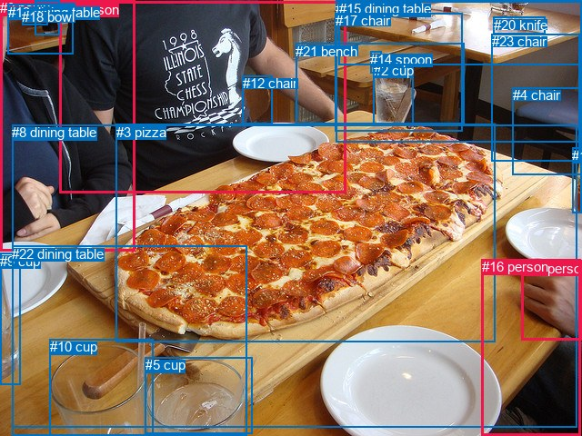
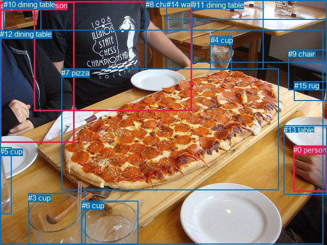

# 图片 2133：2417455.jpg

随机样本序号：368。图片 SHA256：`7c37589fa891eb9aff54fd6a8ff01b7a195ec67896d5763685cac594859e263a`。

红色框表示人，蓝色框表示其他物体。两个模式分别保留自身框编号，可依据位置比较对应对象。

## 自动检测框与输出

人的框编号：`[0, 1, 11, 16]`。状态：`ok`。

### 自动检测全部物体框

| 编号 | 类别 | 是否为人 | 检测分数 | 像素坐标 xyxy |
|---|---|---|---|---|
| 0 | person | True | 0.9985 | 0.0, 0.0, 148.2, 276.1 |
| 1 | person | True | 0.9975 | 65.6, 1.7, 380.6, 212.7 |
| 2 | cup | False | 0.9970 | 410.7, 69.0, 454.5, 138.3 |
| 3 | pizza | False | 0.9862 | 127.6, 136.6, 544.7, 376.1 |
| 4 | chair | False | 0.9821 | 563.8, 96.2, 639.5, 192.6 |
| 5 | cup | False | 0.9794 | 159.8, 393.2, 277.8, 477.8 |
| 6 | cup | False | 0.9787 | 39.0, 0.6, 65.3, 38.9 |
| 7 | dining table | False | 0.9781 | 369.0, 0.8, 640.0, 156.7 |
| 8 | dining table | False | 0.9746 | 13.5, 137.4, 634.6, 470.7 |
| 9 | cup | False | 0.9743 | 0.0, 278.9, 22.9, 423.2 |
| 10 | cup | False | 0.9741 | 54.6, 373.5, 168.3, 479.5 |
| 11 | person | True | 0.9560 | 573.6, 286.7, 639.9, 374.6 |
| 12 | chair | False | 0.9096 | 266.9, 83.3, 299.0, 136.9 |
| 13 | dining table | False | 0.8906 | 8.8, 4.9, 80.2, 59.5 |
| 14 | spoon | False | 0.8146 | 407.2, 56.5, 419.1, 80.3 |
| 15 | dining table | False | 0.6403 | 372.8, 1.0, 639.3, 71.1 |
| 16 | person | True | 0.6392 | 529.8, 285.3, 639.0, 480.0 |
| 17 | chair | False | 0.6296 | 368.8, 14.5, 508.6, 144.3 |
| 18 | bowl | False | 0.5843 | 24.1, 10.4, 52.9, 27.9 |
| 19 | cup | False | 0.5457 | 629.3, 162.5, 639.6, 234.0 |
| 20 | knife | False | 0.5057 | 542.7, 18.9, 599.8, 37.4 |
| 21 | bench | False | 0.4254 | 325.3, 47.6, 510.4, 136.2 |
| 22 | dining table | False | 0.4113 | 13.1, 270.8, 271.9, 480.0 |
| 23 | chair | False | 0.3555 | 540.6, 37.1, 637.8, 177.5 |

### 自动检测 Top50 人相关候选

评分物体对：552；人相关物体对：172；输出关系：50。

| 排名 | 主语编号与类别 | 关系 | 宾语编号与类别 | 类型 | 人与人 | 排序分数 | 原始融合 logit |
|---|---|---|---|---|---|---|---|
| 1 | #1 person | wearing | #12 chair | semantic | False | 0.95291 | 3.0076 |
| 2 | #0 person | sitting on | #8 dining table | semantic | False | 0.94148 | 2.7781 |
| 3 | #11 person | touching | #3 pizza | semantic | False | 0.92156 | 2.4638 |
| 4 | #1 person | sitting on | #8 dining table | semantic | False | 0.90386 | 2.2408 |
| 5 | #0 person | wearing | #13 dining table | semantic | False | 0.90296 | 2.2306 |
| 6 | #0 person | wearing | #18 bowl | semantic | False | 0.89617 | 2.1553 |
| 7 | #11 person | on | #16 person | spatial | True | 0.88877 | 2.0782 |
| 8 | #0 person | in | #8 dining table | spatial | False | 0.88853 | 2.0758 |
| 9 | #0 person | eating | #3 pizza | semantic | False | 0.87852 | 1.9785 |
| 10 | #1 person | eating | #3 pizza | semantic | False | 0.87389 | 1.9358 |
| 11 | #0 person | in | #13 dining table | spatial | False | 0.87158 | 1.9150 |
| 12 | #11 person | touching | #8 dining table | semantic | False | 0.86499 | 1.8573 |
| 13 | #16 person | on | #8 dining table | spatial | False | 0.85093 | 1.7419 |
| 14 | #1 person | on | #8 dining table | spatial | False | 0.84418 | 1.6897 |
| 15 | #16 person | sitting on | #8 dining table | semantic | False | 0.84232 | 1.6756 |
| 16 | #16 person | in | #11 person | spatial | True | 0.82580 | 1.5561 |
| 17 | #1 person | in | #12 chair | spatial | False | 0.80280 | 1.4039 |
| 18 | #12 chair | attached to | #1 person | spatial | False | 0.79914 | 1.3810 |
| 19 | #11 person | on | #8 dining table | spatial | False | 0.78274 | 1.2817 |
| 20 | #16 person | picking | #3 pizza | semantic | False | 0.77266 | 1.2234 |
| 21 | #0 person | beside | #1 person | spatial | True | 0.76091 | 1.1577 |
| 22 | #16 person | wearing | #11 person | semantic | True | 0.69359 | 0.8170 |
| 23 | #0 person | wearing | #1 person | semantic | True | 0.64468 | 0.5957 |
| 24 | #0 person | in | #18 bowl | spatial | False | 0.56209 | 0.2497 |
| 25 | #0 person | beside | #3 pizza | spatial | False | 0.54174 | 0.1673 |
| 26 | #11 person | holding | #16 person | semantic | True | 0.43845 | -0.2475 |
| 27 | #16 person | beside | #3 pizza | spatial | False | 0.43313 | -0.2691 |
| 28 | #0 person | sitting on | #22 dining table | semantic | False | 0.43204 | -0.2735 |
| 29 | #0 person | in | #22 dining table | spatial | False | 0.42261 | -0.3121 |
| 30 | #11 person | on | #3 pizza | spatial | False | 0.42094 | -0.3189 |
| 31 | #1 person | wearing | #13 dining table | semantic | False | 0.38644 | -0.4623 |
| 32 | #1 person | in | #13 dining table | spatial | False | 0.38510 | -0.4680 |
| 33 | #1 person | beside | #3 pizza | spatial | False | 0.36451 | -0.5558 |
| 34 | #0 person | holding | #6 cup | semantic | False | 0.35512 | -0.5966 |
| 35 | #1 person | beside | #0 person | spatial | True | 0.30171 | -0.8392 |
| 36 | #12 chair | holding | #1 person | semantic | False | 0.26600 | -1.0150 |
| 37 | #1 person | sitting on | #21 bench | semantic | False | 0.24015 | -1.1518 |
| 38 | #1 person | sitting on | #7 dining table | semantic | False | 0.21600 | -1.2891 |
| 39 | #0 person | sitting on | #21 bench | semantic | False | 0.21514 | -1.2942 |
| 40 | #1 person | in | #7 dining table | spatial | False | 0.20984 | -1.3259 |
| 41 | #1 person | in | #21 bench | spatial | False | 0.20439 | -1.3591 |
| 42 | #19 cup | on | #11 person | spatial | False | 0.15478 | -1.6976 |
| 43 | #0 person | sitting on | #12 chair | semantic | False | 0.14857 | -1.7459 |
| 44 | #0 person | in | #6 cup | spatial | False | 0.13970 | -1.8178 |
| 45 | #1 person | in | #15 dining table | spatial | False | 0.13277 | -1.8766 |
| 46 | #1 person | talking to | #0 person | semantic | True | 0.12653 | -1.9320 |
| 47 | #0 person | sitting on | #7 dining table | semantic | False | 0.12108 | -1.9823 |
| 48 | #1 person | sitting on | #17 chair | semantic | False | 0.11691 | -2.0220 |
| 49 | #1 person | sitting on | #15 dining table | semantic | False | 0.11579 | -2.0330 |
| 50 | #1 person | in | #17 chair | spatial | False | 0.10483 | -2.1446 |

### 自动检测逐条人相关 GT 核验

本图没有人相关 GT，R@50 无分母；预测候选继续展示。

## 真实框与输出

人的框编号：`[0, 1, 2]`。

### 真实框全部物体框

| 编号 | 类别 | 是否为人 | 检测分数 | 像素坐标 xyxy |
|---|---|---|---|---|
| 0 | person | True | GT | 574.0, 285.0, 640.0, 375.0 |
| 1 | person | True | GT | 1.0, 4.0, 146.0, 280.0 |
| 2 | person | True | GT | 67.0, 2.0, 376.0, 218.0 |
| 3 | cup | False | GT | 55.0, 379.0, 167.0, 480.0 |
| 4 | cup | False | GT | 412.0, 70.0, 454.0, 136.0 |
| 5 | cup | False | GT | 0.0, 288.0, 23.0, 419.0 |
| 6 | cup | False | GT | 160.0, 394.0, 271.0, 480.0 |
| 7 | pizza | False | GT | 120.0, 134.0, 546.0, 372.0 |
| 8 | chair | False | GT | 285.0, 0.0, 515.0, 136.0 |
| 9 | chair | False | GT | 564.0, 97.0, 640.0, 176.0 |
| 10 | dining table | False | GT | 7.0, 0.0, 80.0, 59.0 |
| 11 | dining table | False | GT | 376.0, 1.0, 640.0, 123.0 |
| 12 | dining table | False | GT | 0.0, 58.0, 633.0, 478.0 |
| 13 | table | False | GT | 555.0, 246.0, 640.0, 382.0 |
| 14 | wall | False | GT | 326.0, 0.0, 640.0, 39.0 |
| 15 | rug | False | GT | 576.0, 159.0, 640.0, 197.0 |

### 真实框 Top50 人相关候选

评分物体对：240；人相关物体对：84；输出关系：50。

| 排名 | 主语编号与类别 | 关系 | 宾语编号与类别 | 类型 | 人与人 | 排序分数 | 原始融合 logit |
|---|---|---|---|---|---|---|---|
| 1 | #0 person | on | #13 table | spatial | False | 0.96683 | 3.3724 |
| 2 | #1 person | sitting on | #12 dining table | semantic | False | 0.96600 | 3.3467 |
| 3 | #0 person | touching | #13 table | semantic | False | 0.95279 | 3.0047 |
| 4 | #2 person | sitting on | #12 dining table | semantic | False | 0.94405 | 2.8257 |
| 5 | #1 person | in | #12 dining table | spatial | False | 0.93874 | 2.7295 |
| 6 | #1 person | wearing | #10 dining table | semantic | False | 0.92955 | 2.5798 |
| 7 | #2 person | on | #12 dining table | spatial | False | 0.92519 | 2.5151 |
| 8 | #1 person | eating | #7 pizza | semantic | False | 0.88737 | 2.0642 |
| 9 | #1 person | in | #10 dining table | spatial | False | 0.88468 | 2.0375 |
| 10 | #2 person | eating | #7 pizza | semantic | False | 0.88333 | 2.0243 |
| 11 | #0 person | touching | #7 pizza | semantic | False | 0.85952 | 1.8113 |
| 12 | #13 table | in | #0 person | spatial | False | 0.85351 | 1.7624 |
| 13 | #13 table | holding | #0 person | semantic | False | 0.78317 | 1.2842 |
| 14 | #1 person | beside | #2 person | spatial | True | 0.70634 | 0.8777 |
| 15 | #1 person | beside | #7 pizza | spatial | False | 0.62701 | 0.5194 |
| 16 | #0 person | on | #12 dining table | spatial | False | 0.62294 | 0.5020 |
| 17 | #0 person | touching | #12 dining table | semantic | False | 0.60603 | 0.4307 |
| 18 | #1 person | wearing | #2 person | semantic | True | 0.60150 | 0.4117 |
| 19 | #2 person | wearing | #10 dining table | semantic | False | 0.51239 | 0.0496 |
| 20 | #10 dining table | beside | #1 person | spatial | False | 0.43337 | -0.2681 |
| 21 | #2 person | on | #7 pizza | spatial | False | 0.43049 | -0.2799 |
| 22 | #0 person | beside | #7 pizza | spatial | False | 0.41633 | -0.3379 |
| 23 | #2 person | in | #10 dining table | spatial | False | 0.38443 | -0.4708 |
| 24 | #2 person | sitting on | #11 dining table | semantic | False | 0.25411 | -1.0768 |
| 25 | #10 dining table | holding | #1 person | semantic | False | 0.24111 | -1.1466 |
| 26 | #2 person | beside | #1 person | spatial | True | 0.23393 | -1.1863 |
| 27 | #1 person | sitting on | #11 dining table | semantic | False | 0.22061 | -1.2621 |
| 28 | #2 person | in | #11 dining table | spatial | False | 0.19365 | -1.4265 |
| 29 | #2 person | wearing | #1 person | semantic | True | 0.10721 | -2.1196 |
| 30 | #2 person | in | #8 chair | spatial | False | 0.10504 | -2.1424 |
| 31 | #1 person | in | #11 dining table | spatial | False | 0.09144 | -2.2962 |
| 32 | #2 person | sitting on | #8 chair | semantic | False | 0.08576 | -2.3666 |
| 33 | #1 person | sitting on | #9 chair | semantic | False | 0.07043 | -2.5801 |
| 34 | #1 person | sitting on | #8 chair | semantic | False | 0.05282 | -2.8865 |
| 35 | #1 person | sitting on | #15 rug | semantic | False | 0.05167 | -2.9099 |
| 36 | #10 dining table | beside | #2 person | spatial | False | 0.04328 | -3.0958 |
| 37 | #2 person | sitting on | #9 chair | semantic | False | 0.03033 | -3.4649 |
| 38 | #7 pizza | in front of | #2 person | spatial | False | 0.02922 | -3.5033 |
| 39 | #1 person | in | #8 chair | spatial | False | 0.02909 | -3.5079 |
| 40 | #2 person | sitting on | #15 rug | semantic | False | 0.02881 | -3.5177 |
| 41 | #5 cup | in | #1 person | spatial | False | 0.02818 | -3.5405 |
| 42 | #1 person | in | #9 chair | spatial | False | 0.02384 | -3.7123 |
| 43 | #1 person | in | #15 rug | spatial | False | 0.02351 | -3.7264 |
| 44 | #2 person | in | #14 wall | spatial | False | 0.02310 | -3.7446 |
| 45 | #7 pizza | beside | #1 person | spatial | False | 0.01980 | -3.9022 |
| 46 | #12 dining table | in | #2 person | spatial | False | 0.01933 | -3.9268 |
| 47 | #2 person | in | #15 rug | spatial | False | 0.01851 | -3.9706 |
| 48 | #2 person | in | #9 chair | spatial | False | 0.01797 | -4.0006 |
| 49 | #9 chair | beside | #2 person | spatial | False | 0.01693 | -4.0616 |
| 50 | #0 person | holding | #6 cup | semantic | False | 0.01474 | -4.2024 |

### 真实框逐条人相关 GT 核验

本图没有人相关 GT，R@50 无分母；预测候选继续展示。

## 全部人相关 GT

| 主语编号与类别 | 关系 | 宾语编号与类别 |
|---|---|---|

原始记录、全部人相关物体对的两项预测与分项分数见 [逐图证据 JSON](../evidence/cases/2133.json)。全部56类 logits 保留于本机 HOR/output/random500/logits/。

<!-- HOR_COMPLETE_RESULTS -->

## 六组条件的完整输出对照

以下保留同一图片三种框与候选模式、两种谓词输出规则的全部 Top50。框编号各自在所属模式内解释。

### 自动检测框完整枚举：空间与语义各保留一个谓词

| 排名 | 主语编号与类别 | 谓词 | 宾语编号与类别 | 分组 | 排序分数 | predicate logit | pair logit |
|---|---|---|---|---|---|---|---|
| 1 | #1 person | wearing | #12 chair | semantic | 0.9529147 | 3.0109258 | -0.0033612 |
| 2 | #0 person | sitting on | #8 dining table | semantic | 0.9414827 | 3.0094337 | -0.2313008 |
| 3 | #11 person | touching | #3 pizza | semantic | 0.9215644 | 2.9074454 | -0.4436509 |
| 4 | #1 person | sitting on | #8 dining table | semantic | 0.9038561 | 2.7596593 | -0.5188349 |
| 5 | #0 person | wearing | #13 dining table | semantic | 0.9029621 | 2.4229460 | -0.1923676 |
| 6 | #0 person | wearing | #18 bowl | semantic | 0.8961672 | 2.3790097 | -0.2236646 |
| 7 | #11 person | on | #16 person | spatial | 0.8887654 | 2.2566233 | -0.1784313 |
| 8 | #0 person | in | #8 dining table | spatial | 0.8885335 | 2.3071499 | -0.2313008 |
| 9 | #0 person | eating | #3 pizza | semantic | 0.8785204 | 2.7861381 | -0.8076456 |
| 10 | #1 person | eating | #3 pizza | semantic | 0.8738921 | 2.8965263 | -0.9607074 |
| 11 | #0 person | in | #13 dining table | spatial | 0.8715764 | 2.1073370 | -0.1923676 |
| 12 | #11 person | touching | #8 dining table | semantic | 0.8649868 | 2.5777950 | -0.7204529 |
| 13 | #16 person | on | #8 dining table | spatial | 0.8509304 | 2.1488853 | -0.4069684 |
| 14 | #1 person | on | #8 dining table | spatial | 0.8441786 | 2.2084885 | -0.5188349 |
| 15 | #16 person | sitting on | #8 dining table | semantic | 0.8423250 | 2.0825977 | -0.4069684 |
| 16 | #16 person | in | #11 person | spatial | 0.8257961 | 1.5495257 | 0.0065958 |
| 17 | #1 person | in | #12 chair | spatial | 0.8028027 | 1.4072652 | -0.0033612 |
| 18 | #12 chair | attached to | #1 person | spatial | 0.7991441 | 1.9079366 | -0.5269831 |
| 19 | #11 person | on | #8 dining table | spatial | 0.7827411 | 2.0021648 | -0.7204529 |
| 20 | #16 person | picking | #3 pizza | semantic | 0.7726586 | 2.0117269 | -0.7883422 |
| 21 | #0 person | beside | #1 person | spatial | 0.7609060 | 1.5823245 | -0.4246717 |
| 22 | #16 person | wearing | #11 person | semantic | 0.6935899 | 0.8103604 | 0.0065958 |
| 23 | #0 person | wearing | #1 person | semantic | 0.6446768 | 1.0203929 | -0.4246717 |
| 24 | #0 person | in | #18 bowl | spatial | 0.5620926 | 0.4733238 | -0.2236646 |
| 25 | #0 person | beside | #3 pizza | spatial | 0.5417355 | 0.9749770 | -0.8076456 |
| 26 | #11 person | holding | #16 person | semantic | 0.4384496 | -0.0690255 | -0.1784313 |
| 27 | #16 person | beside | #3 pizza | spatial | 0.4331281 | 0.5192423 | -0.7883422 |
| 28 | #0 person | sitting on | #22 dining table | semantic | 0.4320388 | 0.7856860 | -1.0592239 |
| 29 | #0 person | in | #22 dining table | spatial | 0.4226111 | 0.7471600 | -1.0592239 |
| 30 | #11 person | on | #3 pizza | spatial | 0.4209364 | 0.1247206 | -0.4436509 |
| 31 | #1 person | wearing | #13 dining table | semantic | 0.3864402 | 0.5520267 | -1.0143275 |
| 32 | #1 person | in | #13 dining table | spatial | 0.3850964 | 0.5463557 | -1.0143275 |
| 33 | #1 person | beside | #3 pizza | spatial | 0.3645095 | 0.4048629 | -0.9607074 |
| 34 | #0 person | holding | #6 cup | semantic | 0.3551186 | 0.0981884 | -0.6948029 |
| 35 | #1 person | beside | #0 person | spatial | 0.3017061 | 0.4109631 | -1.2501496 |
| 36 | #12 chair | holding | #1 person | semantic | 0.2660004 | -0.4880276 | -0.5269831 |
| 37 | #1 person | sitting on | #21 bench | semantic | 0.2401537 | 0.0062695 | -1.1581063 |
| 38 | #1 person | sitting on | #7 dining table | semantic | 0.2159998 | -0.1111069 | -1.1780252 |
| 39 | #0 person | sitting on | #21 bench | semantic | 0.2151396 | -0.1020298 | -1.1921889 |
| 40 | #1 person | in | #7 dining table | spatial | 0.2098429 | -0.1478472 | -1.1780252 |
| 41 | #1 person | in | #21 bench | spatial | 0.2043942 | -0.2009473 | -1.1581063 |
| 42 | #19 cup | on | #11 person | spatial | 0.1547762 | -0.5473075 | -1.1503140 |
| 43 | #0 person | sitting on | #12 chair | semantic | 0.1485669 | -0.9069350 | -0.8389509 |
| 44 | #0 person | in | #6 cup | spatial | 0.1397038 | -1.1229494 | -0.6948029 |
| 45 | #1 person | in | #15 dining table | spatial | 0.1327741 | -0.6483903 | -1.2282597 |
| 46 | #1 person | talking to | #0 person | semantic | 0.1265273 | -0.6818695 | -1.2501496 |
| 47 | #0 person | sitting on | #7 dining table | semantic | 0.1210781 | -0.7610648 | -1.2211956 |
| 48 | #1 person | sitting on | #17 chair | semantic | 0.1169088 | -0.7219446 | -1.3000896 |
| 49 | #1 person | sitting on | #15 dining table | semantic | 0.1157864 | -0.8046920 | -1.2282597 |
| 50 | #1 person | in | #17 chair | spatial | 0.1048342 | -0.8445394 | -1.3000896 |

没有人相关 GT，本条件的召回率无分母。

### 自动检测框完整枚举：每对只保留一个谓词

| 排名 | 主语编号与类别 | 谓词 | 宾语编号与类别 | 分组 | 排序分数 | predicate logit | pair logit |
|---|---|---|---|---|---|---|---|
| 1 | #1 person | wearing | #12 chair | single | 0.9529147 | 3.0109258 | -0.0033612 |
| 2 | #0 person | sitting on | #8 dining table | single | 0.9414827 | 3.0094337 | -0.2313008 |
| 3 | #11 person | touching | #3 pizza | single | 0.9215644 | 2.9074454 | -0.4436509 |
| 4 | #1 person | sitting on | #8 dining table | single | 0.9038561 | 2.7596593 | -0.5188349 |
| 5 | #0 person | wearing | #13 dining table | single | 0.9029621 | 2.4229460 | -0.1923676 |
| 6 | #0 person | wearing | #18 bowl | single | 0.8961672 | 2.3790097 | -0.2236646 |
| 7 | #11 person | on | #16 person | single | 0.8887654 | 2.2566233 | -0.1784313 |
| 8 | #0 person | eating | #3 pizza | single | 0.8785204 | 2.7861381 | -0.8076456 |
| 9 | #1 person | eating | #3 pizza | single | 0.8738921 | 2.8965263 | -0.9607074 |
| 10 | #11 person | touching | #8 dining table | single | 0.8649868 | 2.5777950 | -0.7204529 |
| 11 | #16 person | on | #8 dining table | single | 0.8509304 | 2.1488853 | -0.4069684 |
| 12 | #16 person | in | #11 person | single | 0.8257961 | 1.5495257 | 0.0065958 |
| 13 | #12 chair | attached to | #1 person | single | 0.7991441 | 1.9079366 | -0.5269831 |
| 14 | #16 person | picking | #3 pizza | single | 0.7726586 | 2.0117269 | -0.7883422 |
| 15 | #0 person | beside | #1 person | single | 0.7609060 | 1.5823245 | -0.4246717 |
| 16 | #0 person | sitting on | #22 dining table | single | 0.4320388 | 0.7856860 | -1.0592239 |
| 17 | #1 person | wearing | #13 dining table | single | 0.3864402 | 0.5520267 | -1.0143275 |
| 18 | #0 person | holding | #6 cup | single | 0.3551186 | 0.0981884 | -0.6948029 |
| 19 | #1 person | beside | #0 person | single | 0.3017061 | 0.4109631 | -1.2501496 |
| 20 | #1 person | sitting on | #21 bench | single | 0.2401537 | 0.0062695 | -1.1581063 |
| 21 | #1 person | sitting on | #7 dining table | single | 0.2159998 | -0.1111069 | -1.1780252 |
| 22 | #0 person | sitting on | #21 bench | single | 0.2151396 | -0.1020298 | -1.1921889 |
| 23 | #19 cup | on | #11 person | single | 0.1547762 | -0.5473075 | -1.1503140 |
| 24 | #0 person | sitting on | #12 chair | single | 0.1485669 | -0.9069350 | -0.8389509 |
| 25 | #1 person | in | #15 dining table | single | 0.1327741 | -0.6483903 | -1.2282597 |
| 26 | #0 person | sitting on | #7 dining table | single | 0.1210781 | -0.7610648 | -1.2211956 |
| 27 | #1 person | sitting on | #17 chair | single | 0.1169088 | -0.7219446 | -1.3000896 |
| 28 | #0 person | sitting on | #15 dining table | single | 0.1005725 | -0.8904591 | -1.3004200 |
| 29 | #0 person | sitting on | #17 chair | single | 0.0969499 | -0.9506254 | -1.2809582 |
| 30 | #1 person | sitting on | #22 dining table | single | 0.0935975 | -0.7565107 | -1.5139687 |
| 31 | #11 person | holding | #19 cup | single | 0.0794655 | -1.3748105 | -1.0748218 |
| 32 | #19 cup | on | #16 person | single | 0.0759640 | -1.3513145 | -1.1471775 |
| 33 | #16 person | beside | #7 dining table | single | 0.0595710 | -1.3581212 | -1.4010463 |
| 34 | #0 person | sitting on | #4 chair | single | 0.0561433 | -1.7555304 | -1.0665375 |
| 35 | #16 person | holding | #19 cup | single | 0.0495991 | -2.1027346 | -0.8501768 |
| 36 | #13 dining table | in | #0 person | single | 0.0476307 | -1.9584823 | -1.0369940 |
| 37 | #11 person | holding | #5 cup | single | 0.0422888 | -1.8550830 | -1.2649407 |
| 38 | #1 person | in | #23 chair | single | 0.0384374 | -2.1419439 | -1.0775857 |
| 39 | #18 bowl | on | #0 person | single | 0.0382925 | -2.4827921 | -0.7406653 |
| 40 | #0 person | sitting on | #23 chair | single | 0.0381908 | -2.1399648 | -1.0862563 |
| 41 | #1 person | in | #11 person | single | 0.0328263 | -2.1686053 | -1.2145416 |
| 42 | #16 person | sitting on | #21 bench | single | 0.0324132 | -1.4892476 | -1.9069929 |
| 43 | #16 person | on | #15 dining table | single | 0.0317144 | -1.8187423 | -1.6000142 |
| 44 | #1 person | sitting on | #4 chair | single | 0.0309164 | -2.3024783 | -1.1425844 |
| 45 | #16 person | sitting on | #4 chair | single | 0.0290281 | -2.4951072 | -1.0149258 |
| 46 | #16 person | in | #22 dining table | single | 0.0283928 | -2.2850947 | -1.2477207 |
| 47 | #3 pizza | in front of | #1 person | single | 0.0274905 | -1.8497300 | -1.7163090 |
| 48 | #16 person | in | #23 chair | single | 0.0274233 | -2.3800128 | -1.1885428 |
| 49 | #1 person | wearing | #18 bowl | single | 0.0271199 | -2.4936993 | -1.0862920 |
| 50 | #16 person | looking at | #1 person | single | 0.0261689 | -2.4172590 | -1.1994078 |

没有人相关 GT，本条件的召回率无分母。

### 真实框完整枚举：空间与语义各保留一个谓词

| 排名 | 主语编号与类别 | 谓词 | 宾语编号与类别 | 分组 | 排序分数 | predicate logit | pair logit |
|---|---|---|---|---|---|---|---|
| 1 | #0 person | on | #13 table | spatial | 0.9668303 | 3.0682468 | 0.3041395 |
| 2 | #1 person | sitting on | #12 dining table | semantic | 0.9659963 | 3.2020302 | 0.1446637 |
| 3 | #0 person | touching | #13 table | semantic | 0.9527871 | 2.7005830 | 0.3041395 |
| 4 | #2 person | sitting on | #12 dining table | semantic | 0.9440489 | 2.9793582 | -0.1536589 |
| 5 | #1 person | in | #12 dining table | spatial | 0.9387447 | 2.5848308 | 0.1446637 |
| 6 | #1 person | wearing | #10 dining table | semantic | 0.9295481 | 2.7495852 | -0.1698176 |
| 7 | #2 person | on | #12 dining table | spatial | 0.9251928 | 2.6687484 | -0.1536589 |
| 8 | #1 person | eating | #7 pizza | semantic | 0.8873709 | 2.9103651 | -0.8462025 |
| 9 | #1 person | in | #10 dining table | spatial | 0.8846812 | 2.2073445 | -0.1698176 |
| 10 | #2 person | eating | #7 pizza | semantic | 0.8833294 | 2.9547777 | -0.9304343 |
| 11 | #0 person | touching | #7 pizza | semantic | 0.8595229 | 2.2763128 | -0.4649792 |
| 12 | #13 table | in | #0 person | spatial | 0.8535051 | 1.8977909 | -0.1354293 |
| 13 | #13 table | holding | #0 person | semantic | 0.7831704 | 1.4196677 | -0.1354293 |
| 14 | #1 person | beside | #2 person | spatial | 0.7063407 | 1.3726106 | -0.4949331 |
| 15 | #1 person | beside | #7 pizza | spatial | 0.6270100 | 1.3656135 | -0.8462025 |
| 16 | #0 person | on | #12 dining table | spatial | 0.6229379 | 1.2662182 | -0.7641815 |
| 17 | #0 person | touching | #12 dining table | semantic | 0.6060320 | 1.1948447 | -0.7641815 |
| 18 | #1 person | wearing | #2 person | semantic | 0.6014990 | 0.9066482 | -0.4949331 |
| 19 | #2 person | wearing | #10 dining table | semantic | 0.5123862 | 1.1025438 | -1.0529888 |
| 20 | #10 dining table | beside | #1 person | spatial | 0.4333683 | 0.6496115 | -0.9177331 |
| 21 | #2 person | on | #7 pizza | spatial | 0.4304893 | 0.6505795 | -0.9304343 |
| 22 | #0 person | beside | #7 pizza | spatial | 0.4163287 | 0.1271162 | -0.4649792 |
| 23 | #2 person | in | #10 dining table | spatial | 0.3844282 | 0.5821943 | -1.0529888 |
| 24 | #2 person | sitting on | #11 dining table | semantic | 0.2541133 | 0.0574231 | -1.1342165 |
| 25 | #10 dining table | holding | #1 person | semantic | 0.2411058 | -0.2288933 | -0.9177331 |
| 26 | #2 person | beside | #1 person | spatial | 0.2339276 | 0.0207601 | -1.2070252 |
| 27 | #1 person | sitting on | #11 dining table | semantic | 0.2206150 | -0.0629258 | -1.1991603 |
| 28 | #2 person | in | #11 dining table | spatial | 0.1936462 | -0.2922735 | -1.1342165 |
| 29 | #2 person | wearing | #1 person | semantic | 0.1072051 | -0.9125881 | -1.2070252 |
| 30 | #2 person | in | #8 chair | spatial | 0.1050404 | -0.7490652 | -1.3933685 |
| 31 | #1 person | in | #11 dining table | spatial | 0.0914350 | -1.0970774 | -1.1991603 |
| 32 | #2 person | sitting on | #8 chair | semantic | 0.0857573 | -0.9732058 | -1.3933685 |
| 33 | #1 person | sitting on | #9 chair | semantic | 0.0704295 | -1.4786687 | -1.1014413 |
| 34 | #1 person | sitting on | #8 chair | semantic | 0.0528243 | -1.2650573 | -1.6214550 |
| 35 | #1 person | sitting on | #15 rug | semantic | 0.0516672 | -2.1805551 | -0.7293273 |
| 36 | #10 dining table | beside | #2 person | spatial | 0.0432809 | -1.6991179 | -1.3966808 |
| 37 | #2 person | sitting on | #9 chair | semantic | 0.0303290 | -2.3370843 | -1.1277671 |
| 38 | #7 pizza | in front of | #2 person | spatial | 0.0292191 | -1.8159628 | -1.6873152 |
| 39 | #1 person | in | #8 chair | spatial | 0.0290890 | -1.8864212 | -1.6214550 |
| 40 | #2 person | sitting on | #15 rug | semantic | 0.0288115 | -2.7741344 | -0.7436107 |
| 41 | #5 cup | in | #1 person | spatial | 0.0281813 | -2.3877380 | -1.1527715 |
| 42 | #1 person | in | #9 chair | spatial | 0.0238382 | -2.6108978 | -1.1014413 |
| 43 | #1 person | in | #15 rug | spatial | 0.0235124 | -2.9971061 | -0.7293273 |
| 44 | #2 person | in | #14 wall | spatial | 0.0230986 | -2.2265816 | -1.5180303 |
| 45 | #7 pizza | beside | #1 person | spatial | 0.0197984 | -2.1071787 | -1.7949791 |
| 46 | #12 dining table | in | #2 person | spatial | 0.0193255 | -2.1416354 | -1.7851822 |
| 47 | #2 person | in | #15 rug | spatial | 0.0185127 | -3.2269993 | -0.7436107 |
| 48 | #2 person | in | #9 chair | spatial | 0.0179749 | -2.8728759 | -1.1277671 |
| 49 | #9 chair | beside | #2 person | spatial | 0.0169302 | -2.8454261 | -1.2161579 |
| 50 | #0 person | holding | #6 cup | semantic | 0.0147396 | -2.9428840 | -1.2594857 |

没有人相关 GT，本条件的召回率无分母。

### 真实框完整枚举：每对只保留一个谓词

| 排名 | 主语编号与类别 | 谓词 | 宾语编号与类别 | 分组 | 排序分数 | predicate logit | pair logit |
|---|---|---|---|---|---|---|---|
| 1 | #0 person | on | #13 table | single | 0.9668303 | 3.0682468 | 0.3041395 |
| 2 | #1 person | sitting on | #12 dining table | single | 0.9659963 | 3.2020302 | 0.1446637 |
| 3 | #2 person | sitting on | #12 dining table | single | 0.9440489 | 2.9793582 | -0.1536589 |
| 4 | #1 person | wearing | #10 dining table | single | 0.9295481 | 2.7495852 | -0.1698176 |
| 5 | #1 person | eating | #7 pizza | single | 0.8873709 | 2.9103651 | -0.8462025 |
| 6 | #2 person | eating | #7 pizza | single | 0.8833294 | 2.9547777 | -0.9304343 |
| 7 | #0 person | touching | #7 pizza | single | 0.8595229 | 2.2763128 | -0.4649792 |
| 8 | #13 table | in | #0 person | single | 0.8535051 | 1.8977909 | -0.1354293 |
| 9 | #1 person | beside | #2 person | single | 0.7063407 | 1.3726106 | -0.4949331 |
| 10 | #0 person | on | #12 dining table | single | 0.6229379 | 1.2662182 | -0.7641815 |
| 11 | #2 person | wearing | #10 dining table | single | 0.5123862 | 1.1025438 | -1.0529888 |
| 12 | #10 dining table | beside | #1 person | single | 0.4333683 | 0.6496115 | -0.9177331 |
| 13 | #2 person | sitting on | #11 dining table | single | 0.2541133 | 0.0574231 | -1.1342165 |
| 14 | #2 person | beside | #1 person | single | 0.2339276 | 0.0207601 | -1.2070252 |
| 15 | #1 person | sitting on | #11 dining table | single | 0.2206150 | -0.0629258 | -1.1991603 |
| 16 | #2 person | in | #8 chair | single | 0.1050404 | -0.7490652 | -1.3933685 |
| 17 | #1 person | sitting on | #9 chair | single | 0.0704295 | -1.4786687 | -1.1014413 |
| 18 | #1 person | sitting on | #8 chair | single | 0.0528243 | -1.2650573 | -1.6214550 |
| 19 | #1 person | sitting on | #15 rug | single | 0.0516672 | -2.1805551 | -0.7293273 |
| 20 | #10 dining table | beside | #2 person | single | 0.0432809 | -1.6991179 | -1.3966808 |
| 21 | #2 person | sitting on | #9 chair | single | 0.0303290 | -2.3370843 | -1.1277671 |
| 22 | #7 pizza | in front of | #2 person | single | 0.0292191 | -1.8159628 | -1.6873152 |
| 23 | #2 person | sitting on | #15 rug | single | 0.0288115 | -2.7741344 | -0.7436107 |
| 24 | #5 cup | in | #1 person | single | 0.0281813 | -2.3877380 | -1.1527715 |
| 25 | #2 person | in | #14 wall | single | 0.0230986 | -2.2265816 | -1.5180303 |
| 26 | #7 pizza | beside | #1 person | single | 0.0197984 | -2.1071787 | -1.7949791 |
| 27 | #12 dining table | in | #2 person | single | 0.0193255 | -2.1416354 | -1.7851822 |
| 28 | #9 chair | beside | #2 person | single | 0.0169302 | -2.8454261 | -1.2161579 |
| 29 | #0 person | holding | #6 cup | single | 0.0147396 | -2.9428840 | -1.2594857 |
| 30 | #0 person | in | #2 person | single | 0.0141602 | -2.7537251 | -1.4893312 |
| 31 | #2 person | in | #0 person | single | 0.0136115 | -3.0834033 | -1.1997344 |
| 32 | #8 chair | beside | #2 person | single | 0.0136099 | -2.8447900 | -1.4384677 |
| 33 | #13 table | in | #2 person | single | 0.0123776 | -2.7623558 | -1.6170577 |
| 34 | #1 person | sitting on | #14 wall | single | 0.0121366 | -2.6109335 | -1.7883871 |
| 35 | #6 cup | in | #0 person | single | 0.0118797 | -2.6266823 | -1.7942884 |
| 36 | #1 person | in | #13 table | single | 0.0107822 | -3.5179558 | -1.0010638 |
| 37 | #0 person | on | #11 dining table | single | 0.0107716 | -2.8004124 | -1.7196006 |
| 38 | #0 person | in | #1 person | single | 0.0107286 | -3.2334142 | -1.2906373 |
| 39 | #2 person | in | #13 table | single | 0.0105357 | -3.3044436 | -1.2379503 |
| 40 | #12 dining table | in | #1 person | single | 0.0105207 | -2.7483120 | -1.7955236 |
| 41 | #1 person | in | #0 person | single | 0.0104633 | -3.5177331 | -1.0316284 |
| 42 | #13 table | in | #1 person | single | 0.0103400 | -3.0796394 | -1.4816983 |
| 43 | #15 rug | in | #0 person | single | 0.0092837 | -3.2840860 | -1.3860843 |
| 44 | #1 person | holding | #5 cup | single | 0.0084131 | -3.3512468 | -1.4182663 |
| 45 | #7 pizza | in | #0 person | single | 0.0078417 | -3.5538044 | -1.2866279 |
| 46 | #0 person | on | #15 rug | single | 0.0075173 | -3.5111508 | -1.3718491 |
| 47 | #4 cup | beside | #2 person | single | 0.0074631 | -3.3117247 | -1.5785719 |
| 48 | #0 person | holding | #3 cup | single | 0.0071306 | -3.5897086 | -1.3465004 |
| 49 | #15 rug | in | #2 person | single | 0.0070851 | -3.6266041 | -1.3160481 |
| 50 | #9 chair | beside | #1 person | single | 0.0064099 | -3.6425552 | -1.4009317 |

没有人相关 GT，本条件的召回率无分母。

### 真实框400候选：空间与语义各保留一个谓词

| 排名 | 主语编号与类别 | 谓词 | 宾语编号与类别 | 分组 | 排序分数 | predicate logit | pair logit |
|---|---|---|---|---|---|---|---|
| 1 | #0 person | on | #13 table | spatial | 0.9668303 | 3.0682468 | 0.3041395 |
| 2 | #1 person | sitting on | #12 dining table | semantic | 0.9659963 | 3.2020302 | 0.1446637 |
| 3 | #0 person | touching | #13 table | semantic | 0.9527871 | 2.7005830 | 0.3041395 |
| 4 | #2 person | sitting on | #12 dining table | semantic | 0.9440489 | 2.9793582 | -0.1536589 |
| 5 | #1 person | in | #12 dining table | spatial | 0.9387447 | 2.5848308 | 0.1446637 |
| 6 | #1 person | wearing | #10 dining table | semantic | 0.9299314 | 2.7554531 | -0.1698176 |
| 7 | #2 person | on | #12 dining table | spatial | 0.9244357 | 2.6578593 | -0.1536589 |
| 8 | #1 person | eating | #7 pizza | semantic | 0.8873709 | 2.9103651 | -0.8462025 |
| 9 | #1 person | in | #10 dining table | spatial | 0.8846812 | 2.2073445 | -0.1698176 |
| 10 | #2 person | eating | #7 pizza | semantic | 0.8833294 | 2.9547777 | -0.9304343 |
| 11 | #0 person | touching | #7 pizza | semantic | 0.8595186 | 2.2762771 | -0.4649792 |
| 12 | #13 table | in | #0 person | spatial | 0.8535051 | 1.8977909 | -0.1354293 |
| 13 | #13 table | holding | #0 person | semantic | 0.7831704 | 1.4196677 | -0.1354293 |
| 14 | #1 person | beside | #2 person | spatial | 0.6937413 | 1.3126020 | -0.4949331 |
| 15 | #1 person | beside | #7 pizza | spatial | 0.6270100 | 1.3656135 | -0.8462025 |
| 16 | #0 person | on | #12 dining table | spatial | 0.6216581 | 1.2607737 | -0.7641815 |
| 17 | #0 person | touching | #12 dining table | semantic | 0.6060320 | 1.1948447 | -0.7641815 |
| 18 | #1 person | wearing | #2 person | semantic | 0.5942646 | 0.8765564 | -0.4949331 |
| 19 | #2 person | wearing | #10 dining table | semantic | 0.5063326 | 1.0783205 | -1.0529888 |
| 20 | #2 person | on | #7 pizza | spatial | 0.4304893 | 0.6505795 | -0.9304343 |
| 21 | #10 dining table | beside | #1 person | spatial | 0.4259944 | 0.6195202 | -0.9177331 |
| 22 | #0 person | beside | #7 pizza | spatial | 0.4163181 | 0.1270728 | -0.4649792 |
| 23 | #2 person | in | #10 dining table | spatial | 0.3844282 | 0.5821943 | -1.0529888 |
| 24 | #2 person | sitting on | #11 dining table | semantic | 0.2541133 | 0.0574231 | -1.1342165 |
| 25 | #10 dining table | holding | #1 person | semantic | 0.2405657 | -0.2318473 | -0.9177331 |
| 26 | #2 person | beside | #1 person | spatial | 0.2339379 | 0.0208178 | -1.2070252 |
| 27 | #1 person | sitting on | #11 dining table | semantic | 0.2170148 | -0.0839877 | -1.1991603 |
| 28 | #2 person | in | #11 dining table | spatial | 0.1942948 | -0.2881250 | -1.1342165 |
| 29 | #2 person | wearing | #1 person | semantic | 0.1095457 | -0.8883646 | -1.2070252 |
| 30 | #2 person | in | #8 chair | spatial | 0.1023212 | -0.7783267 | -1.3933685 |
| 31 | #1 person | in | #11 dining table | spatial | 0.0908680 | -1.1039224 | -1.1991603 |
| 32 | #2 person | sitting on | #8 chair | semantic | 0.0834273 | -1.0032971 | -1.3933685 |
| 33 | #1 person | sitting on | #9 chair | semantic | 0.0698407 | -1.4876976 | -1.1014413 |
| 34 | #1 person | sitting on | #8 chair | semantic | 0.0538116 | -1.2454972 | -1.6214550 |
| 35 | #1 person | sitting on | #15 rug | semantic | 0.0523721 | -2.1662607 | -0.7293273 |
| 36 | #10 dining table | beside | #2 person | spatial | 0.0432782 | -1.6991832 | -1.3966808 |
| 37 | #2 person | sitting on | #9 chair | semantic | 0.0306403 | -2.3265531 | -1.1277671 |
| 38 | #7 pizza | in front of | #2 person | spatial | 0.0292104 | -1.8162692 | -1.6873152 |
| 39 | #1 person | in | #8 chair | spatial | 0.0291359 | -1.8847618 | -1.6214550 |
| 40 | #2 person | sitting on | #15 rug | semantic | 0.0286855 | -2.7786489 | -0.7436107 |
| 41 | #5 cup | in | #1 person | spatial | 0.0273881 | -2.4171033 | -1.1527715 |
| 42 | #2 person | in | #14 wall | spatial | 0.0237105 | -2.1998096 | -1.5180303 |
| 43 | #1 person | in | #9 chair | spatial | 0.0232231 | -2.6376703 | -1.1014413 |
| 44 | #1 person | in | #15 rug | spatial | 0.0229055 | -3.0238786 | -0.7293273 |
| 45 | #7 pizza | beside | #1 person | spatial | 0.0197978 | -2.1072075 | -1.7949791 |
| 46 | #12 dining table | in | #2 person | spatial | 0.0193255 | -2.1416354 | -1.7851822 |
| 47 | #2 person | in | #15 rug | spatial | 0.0183009 | -3.2387264 | -0.7436107 |
| 48 | #2 person | in | #9 chair | spatial | 0.0179749 | -2.8728759 | -1.1277671 |
| 49 | #9 chair | beside | #2 person | spatial | 0.0168054 | -2.8529489 | -1.2161579 |
| 50 | #0 person | in | #2 person | spatial | 0.0142066 | -2.7504063 | -1.4893312 |

没有人相关 GT，本条件的召回率无分母。

### 真实框400候选：每对只保留一个谓词

| 排名 | 主语编号与类别 | 谓词 | 宾语编号与类别 | 分组 | 排序分数 | predicate logit | pair logit |
|---|---|---|---|---|---|---|---|
| 1 | #0 person | on | #13 table | single | 0.9668303 | 3.0682468 | 0.3041395 |
| 2 | #1 person | sitting on | #12 dining table | single | 0.9659963 | 3.2020302 | 0.1446637 |
| 3 | #2 person | sitting on | #12 dining table | single | 0.9440489 | 2.9793582 | -0.1536589 |
| 4 | #1 person | wearing | #10 dining table | single | 0.9299314 | 2.7554531 | -0.1698176 |
| 5 | #1 person | eating | #7 pizza | single | 0.8873709 | 2.9103651 | -0.8462025 |
| 6 | #2 person | eating | #7 pizza | single | 0.8833294 | 2.9547777 | -0.9304343 |
| 7 | #0 person | touching | #7 pizza | single | 0.8595186 | 2.2762771 | -0.4649792 |
| 8 | #13 table | in | #0 person | single | 0.8535051 | 1.8977909 | -0.1354293 |
| 9 | #1 person | beside | #2 person | single | 0.6937413 | 1.3126020 | -0.4949331 |
| 10 | #0 person | on | #12 dining table | single | 0.6216581 | 1.2607737 | -0.7641815 |
| 11 | #2 person | wearing | #10 dining table | single | 0.5063326 | 1.0783205 | -1.0529888 |
| 12 | #10 dining table | beside | #1 person | single | 0.4259944 | 0.6195202 | -0.9177331 |
| 13 | #2 person | sitting on | #11 dining table | single | 0.2541133 | 0.0574231 | -1.1342165 |
| 14 | #2 person | beside | #1 person | single | 0.2339379 | 0.0208178 | -1.2070252 |
| 15 | #1 person | sitting on | #11 dining table | single | 0.2170148 | -0.0839877 | -1.1991603 |
| 16 | #2 person | in | #8 chair | single | 0.1023212 | -0.7783267 | -1.3933685 |
| 17 | #1 person | sitting on | #9 chair | single | 0.0698407 | -1.4876976 | -1.1014413 |
| 18 | #1 person | sitting on | #8 chair | single | 0.0538116 | -1.2454972 | -1.6214550 |
| 19 | #1 person | sitting on | #15 rug | single | 0.0523721 | -2.1662607 | -0.7293273 |
| 20 | #10 dining table | beside | #2 person | single | 0.0432782 | -1.6991832 | -1.3966808 |
| 21 | #2 person | sitting on | #9 chair | single | 0.0306403 | -2.3265531 | -1.1277671 |
| 22 | #7 pizza | in front of | #2 person | single | 0.0292104 | -1.8162692 | -1.6873152 |
| 23 | #2 person | sitting on | #15 rug | single | 0.0286855 | -2.7786489 | -0.7436107 |
| 24 | #5 cup | in | #1 person | single | 0.0273881 | -2.4171033 | -1.1527715 |
| 25 | #2 person | in | #14 wall | single | 0.0237105 | -2.1998096 | -1.5180303 |
| 26 | #7 pizza | beside | #1 person | single | 0.0197978 | -2.1072075 | -1.7949791 |
| 27 | #12 dining table | in | #2 person | single | 0.0193255 | -2.1416354 | -1.7851822 |
| 28 | #9 chair | beside | #2 person | single | 0.0168054 | -2.8529489 | -1.2161579 |
| 29 | #0 person | in | #2 person | single | 0.0142066 | -2.7504063 | -1.4893312 |
| 30 | #0 person | holding | #6 cup | single | 0.0138667 | -3.0048180 | -1.2594857 |
| 31 | #8 chair | beside | #2 person | single | 0.0136099 | -2.8447900 | -1.4384677 |
| 32 | #2 person | in | #0 person | single | 0.0134329 | -3.0967896 | -1.1997344 |
| 33 | #13 table | in | #2 person | single | 0.0120348 | -2.7907877 | -1.6170577 |
| 34 | #1 person | sitting on | #14 wall | single | 0.0119043 | -2.6304936 | -1.7883871 |
| 35 | #6 cup | in | #0 person | single | 0.0116996 | -2.6421425 | -1.7942884 |
| 36 | #0 person | on | #11 dining table | single | 0.0109566 | -2.7831974 | -1.7196006 |
| 37 | #0 person | in | #1 person | single | 0.0106935 | -3.2367330 | -1.2906373 |
| 38 | #1 person | in | #13 table | single | 0.0106229 | -3.5330014 | -1.0010638 |
| 39 | #1 person | in | #0 person | single | 0.0105507 | -3.5093250 | -1.0316284 |
| 40 | #2 person | in | #13 table | single | 0.0103971 | -3.3178296 | -1.2379503 |
| 41 | #12 dining table | in | #1 person | single | 0.0103822 | -2.7616982 | -1.7955236 |
| 42 | #13 table | in | #1 person | single | 0.0101872 | -3.0946851 | -1.4816983 |
| 43 | #15 rug | in | #0 person | single | 0.0093296 | -3.2791078 | -1.3860843 |
| 44 | #1 person | holding | #5 cup | single | 0.0083129 | -3.3633380 | -1.4182663 |
| 45 | #7 pizza | in | #0 person | single | 0.0078417 | -3.5538044 | -1.2866279 |
| 46 | #0 person | on | #15 rug | single | 0.0076510 | -3.4933829 | -1.3718491 |
| 47 | #4 cup | beside | #2 person | single | 0.0074078 | -3.3192186 | -1.5785719 |
| 48 | #0 person | holding | #3 cup | single | 0.0072814 | -3.5686173 | -1.3465004 |
| 49 | #15 rug | in | #2 person | single | 0.0069510 | -3.6458538 | -1.3160481 |
| 50 | #9 chair | beside | #1 person | single | 0.0065064 | -3.6275096 | -1.4009317 |

没有人相关 GT，本条件的召回率无分母。
