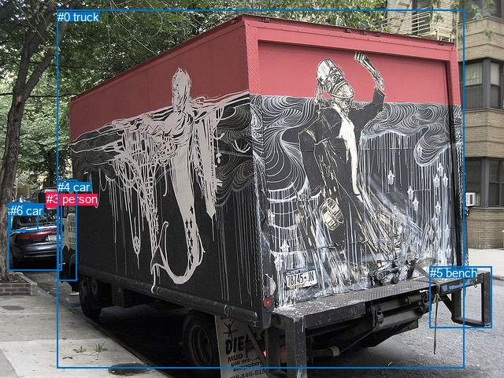
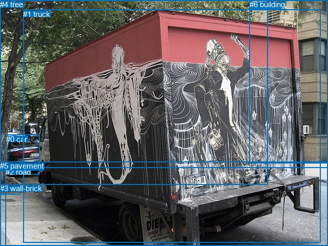

# 图片 2138：2417877.jpg

随机样本序号：147。图片 SHA256：`3aa389e1258ce12da6b3aab20489a1c2fd6e9da8495badaaef394a09730691cb`。

红色框表示人，蓝色框表示其他物体。两个模式分别保留自身框编号，可依据位置比较对应对象。

## 自动检测框与输出

人的框编号：`[3]`。状态：`ok`。

### 自动检测全部物体框

| 编号 | 类别 | 是否为人 | 检测分数 | 像素坐标 xyxy |
|---|---|---|---|---|
| 0 | truck | False | 0.9986 | 72.6, 12.9, 589.8, 467.5 |
| 1 | car | False | 0.9973 | 10.4, 258.5, 78.6, 343.0 |
| 2 | car | False | 0.7716 | 13.7, 257.0, 40.8, 272.8 |
| 3 | person | True | 0.6271 | 58.6, 243.7, 72.2, 263.6 |
| 4 | car | False | 0.6259 | 73.1, 228.5, 97.6, 356.7 |
| 5 | bench | False | 0.4827 | 545.7, 338.4, 624.8, 416.4 |
| 6 | car | False | 0.4699 | 12.7, 259.5, 48.6, 293.6 |

### 自动检测 Top50 人相关候选

评分物体对：42；人相关物体对：12；输出关系：24。

| 排名 | 主语编号与类别 | 关系 | 宾语编号与类别 | 类型 | 人与人 | 排序分数 | 原始融合 logit |
|---|---|---|---|---|---|---|---|
| 1 | #3 person | parked on | #1 car | semantic | False | 0.88947 | 2.0854 |
| 2 | #3 person | parked on | #0 truck | semantic | False | 0.88629 | 2.0534 |
| 3 | #3 person | on | #1 car | spatial | False | 0.88395 | 2.0303 |
| 4 | #3 person | on | #4 car | spatial | False | 0.80382 | 1.4103 |
| 5 | #3 person | on back of | #0 truck | spatial | False | 0.76345 | 1.1717 |
| 6 | #3 person | parked on | #4 car | semantic | False | 0.71945 | 0.9417 |
| 7 | #0 truck | beside | #3 person | spatial | False | 0.57713 | 0.3110 |
| 8 | #3 person | parked on | #6 car | semantic | False | 0.48126 | -0.0750 |
| 9 | #3 person | parked on | #2 car | semantic | False | 0.46300 | -0.1483 |
| 10 | #1 car | parked on | #3 person | semantic | False | 0.40299 | -0.3930 |
| 11 | #3 person | on | #6 car | spatial | False | 0.40037 | -0.4039 |
| 12 | #0 truck | parked on | #3 person | semantic | False | 0.33208 | -0.6988 |
| 13 | #2 car | parked on | #3 person | semantic | False | 0.30634 | -0.8173 |
| 14 | #1 car | in | #3 person | spatial | False | 0.29662 | -0.8634 |
| 15 | #3 person | on | #2 car | spatial | False | 0.28788 | -0.9057 |
| 16 | #2 car | on | #3 person | spatial | False | 0.21206 | -1.3126 |
| 17 | #6 car | parked on | #3 person | semantic | False | 0.21031 | -1.3231 |
| 18 | #6 car | on | #3 person | spatial | False | 0.11763 | -2.0151 |
| 19 | #4 car | parked on | #3 person | semantic | False | 0.07880 | -2.4588 |
| 20 | #4 car | on | #3 person | spatial | False | 0.07791 | -2.4711 |
| 21 | #5 bench | on | #3 person | spatial | False | 0.01290 | -4.3372 |
| 22 | #3 person | on | #5 bench | spatial | False | 0.01032 | -4.5632 |
| 23 | #5 bench | holding | #3 person | semantic | False | 0.00550 | -5.1983 |
| 24 | #3 person | parked on | #5 bench | semantic | False | 0.00331 | -5.7064 |

### 自动检测逐条人相关 GT 核验

本图没有人相关 GT，R@50 无分母；预测候选继续展示。

## 真实框与输出

人的框编号：`[]`。

### 真实框全部物体框

| 编号 | 类别 | 是否为人 | 检测分数 | 像素坐标 xyxy |
|---|---|---|---|---|
| 0 | car | False | GT | 12.0, 263.0, 78.0, 341.0 |
| 1 | truck | False | GT | 45.0, 19.0, 626.0, 474.0 |
| 2 | road | False | GT | 11.0, 327.0, 640.0, 480.0 |
| 3 | wall-brick | False | GT | 0.0, 359.0, 39.0, 379.0 |
| 4 | tree | False | GT | 0.0, 0.0, 522.0, 360.0 |
| 5 | pavement | False | GT | 0.0, 315.0, 640.0, 480.0 |
| 6 | building | False | GT | 487.0, 0.0, 640.0, 318.0 |

### 真实框 Top50 人相关候选

评分物体对：0；人相关物体对：0；输出关系：0。

| 排名 | 主语编号与类别 | 关系 | 宾语编号与类别 | 类型 | 人与人 | 排序分数 | 原始融合 logit |
|---|---|---|---|---|---|---|---|

### 真实框逐条人相关 GT 核验

本图没有人相关 GT，R@50 无分母；预测候选继续展示。

## 全部人相关 GT

| 主语编号与类别 | 关系 | 宾语编号与类别 |
|---|---|---|

原始记录、全部人相关物体对的两项预测与分项分数见 [逐图证据 JSON](../evidence/cases/2138.json)。全部56类 logits 保留于本机 HOR/output/random500/logits/。

<!-- HOR_COMPLETE_RESULTS -->

## 六组条件的完整输出对照

以下保留同一图片三种框与候选模式、两种谓词输出规则的全部 Top50。框编号各自在所属模式内解释。

### 自动检测框完整枚举：空间与语义各保留一个谓词

| 排名 | 主语编号与类别 | 谓词 | 宾语编号与类别 | 分组 | 排序分数 | predicate logit | pair logit |
|---|---|---|---|---|---|---|---|
| 1 | #3 person | parked on | #1 car | semantic | 0.8894736 | 2.2506647 | -0.1652892 |
| 2 | #3 person | parked on | #0 truck | semantic | 0.8862915 | 2.0700865 | -0.0166789 |
| 3 | #3 person | on | #1 car | spatial | 0.8839459 | 2.1956291 | -0.1652892 |
| 4 | #3 person | on | #4 car | spatial | 0.8038194 | 1.4559460 | -0.0456072 |
| 5 | #3 person | on back of | #0 truck | spatial | 0.7634534 | 1.1883860 | -0.0166789 |
| 6 | #3 person | parked on | #4 car | semantic | 0.7194455 | 0.9873199 | -0.0456072 |
| 7 | #0 truck | beside | #3 person | spatial | 0.5771312 | 1.1541080 | -0.8431003 |
| 8 | #3 person | parked on | #6 car | semantic | 0.4812552 | 0.2343221 | -0.3093365 |
| 9 | #3 person | parked on | #2 car | semantic | 0.4629972 | 0.1136594 | -0.2619414 |
| 10 | #1 car | parked on | #3 person | semantic | 0.4029909 | -0.0656300 | -0.3273885 |
| 11 | #3 person | on | #6 car | spatial | 0.4003650 | -0.0946078 | -0.3093365 |
| 12 | #0 truck | parked on | #3 person | semantic | 0.3320816 | 0.1443152 | -0.8431003 |
| 13 | #2 car | parked on | #3 person | semantic | 0.3063391 | -0.6076989 | -0.2095916 |
| 14 | #1 car | in | #3 person | spatial | 0.2966239 | -0.5360384 | -0.3273885 |
| 15 | #3 person | on | #2 car | spatial | 0.2878762 | -0.6437798 | -0.2619414 |
| 16 | #2 car | on | #3 person | spatial | 0.2120588 | -1.1029680 | -0.2095916 |
| 17 | #6 car | parked on | #3 person | semantic | 0.2103100 | -1.0889189 | -0.2341388 |
| 18 | #6 car | on | #3 person | spatial | 0.1176310 | -1.7809188 | -0.2341388 |
| 19 | #4 car | parked on | #3 person | semantic | 0.0787959 | -1.9002810 | -0.5585397 |
| 20 | #4 car | on | #3 person | spatial | 0.0779068 | -1.9125931 | -0.5585397 |
| 21 | #5 bench | on | #3 person | spatial | 0.0129039 | -2.7137041 | -1.6235299 |
| 22 | #3 person | on | #5 bench | spatial | 0.0103207 | -2.7417245 | -1.8215003 |
| 23 | #5 bench | holding | #3 person | semantic | 0.0054956 | -3.5747604 | -1.6235299 |
| 24 | #3 person | parked on | #5 bench | semantic | 0.0033137 | -3.8848815 | -1.8215003 |

没有人相关 GT，本条件的召回率无分母。

### 自动检测框完整枚举：每对只保留一个谓词

| 排名 | 主语编号与类别 | 谓词 | 宾语编号与类别 | 分组 | 排序分数 | predicate logit | pair logit |
|---|---|---|---|---|---|---|---|
| 1 | #3 person | parked on | #1 car | single | 0.8894736 | 2.2506647 | -0.1652892 |
| 2 | #3 person | parked on | #0 truck | single | 0.8862915 | 2.0700865 | -0.0166789 |
| 3 | #3 person | on | #4 car | single | 0.8038194 | 1.4559460 | -0.0456072 |
| 4 | #0 truck | beside | #3 person | single | 0.5771312 | 1.1541080 | -0.8431003 |
| 5 | #3 person | parked on | #6 car | single | 0.4812552 | 0.2343221 | -0.3093365 |
| 6 | #3 person | parked on | #2 car | single | 0.4629972 | 0.1136594 | -0.2619414 |
| 7 | #1 car | parked on | #3 person | single | 0.4029909 | -0.0656300 | -0.3273885 |
| 8 | #2 car | parked on | #3 person | single | 0.3063391 | -0.6076989 | -0.2095916 |
| 9 | #6 car | parked on | #3 person | single | 0.2103100 | -1.0889189 | -0.2341388 |
| 10 | #4 car | parked on | #3 person | single | 0.0787959 | -1.9002810 | -0.5585397 |
| 11 | #5 bench | on | #3 person | single | 0.0129039 | -2.7137041 | -1.6235299 |
| 12 | #3 person | on | #5 bench | single | 0.0103207 | -2.7417245 | -1.8215003 |

没有人相关 GT，本条件的召回率无分母。

### 真实框完整枚举：空间与语义各保留一个谓词

| 排名 | 主语编号与类别 | 谓词 | 宾语编号与类别 | 分组 | 排序分数 | predicate logit | pair logit |
|---|---|---|---|---|---|---|---|

没有人相关 GT，本条件的召回率无分母。

### 真实框完整枚举：每对只保留一个谓词

| 排名 | 主语编号与类别 | 谓词 | 宾语编号与类别 | 分组 | 排序分数 | predicate logit | pair logit |
|---|---|---|---|---|---|---|---|

没有人相关 GT，本条件的召回率无分母。

### 真实框400候选：空间与语义各保留一个谓词

| 排名 | 主语编号与类别 | 谓词 | 宾语编号与类别 | 分组 | 排序分数 | predicate logit | pair logit |
|---|---|---|---|---|---|---|---|

没有人相关 GT，本条件的召回率无分母。

### 真实框400候选：每对只保留一个谓词

| 排名 | 主语编号与类别 | 谓词 | 宾语编号与类别 | 分组 | 排序分数 | predicate logit | pair logit |
|---|---|---|---|---|---|---|---|

没有人相关 GT，本条件的召回率无分母。
