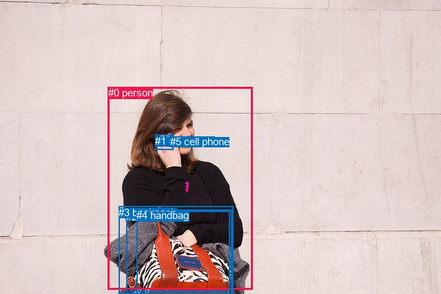
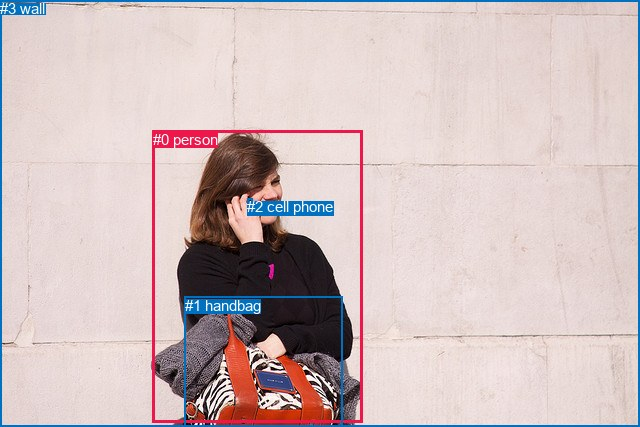

# 图片 2144：285721.jpg

随机样本序号：228。图片 SHA256：`08359f1eb5dd2c5779b22aded4d4425934ee7d78574bc3a9a6d887b4a1716e2e`。

红色框表示人，蓝色框表示其他物体。两个模式分别保留自身框编号，可依据位置比较对应对象。

## 自动检测框与输出

人的框编号：`[0]`。状态：`ok`。

### 自动检测全部物体框

| 编号 | 类别 | 是否为人 | 检测分数 | 像素坐标 xyxy |
|---|---|---|---|---|
| 0 | person | True | 0.9978 | 156.6, 126.3, 366.6, 420.4 |
| 1 | cell phone | False | 0.8343 | 225.5, 195.7, 251.6, 217.9 |
| 2 | suitcase | False | 0.4909 | 183.3, 306.3, 333.7, 423.4 |
| 3 | backpack | False | 0.4460 | 172.2, 299.8, 338.2, 427.0 |
| 4 | handbag | False | 0.3943 | 198.1, 304.2, 336.2, 426.5 |
| 5 | cell phone | False | 0.3586 | 246.6, 196.8, 252.1, 210.4 |

### 自动检测 Top50 人相关候选

评分物体对：30；人相关物体对：10；输出关系：20。

| 排名 | 主语编号与类别 | 关系 | 宾语编号与类别 | 类型 | 人与人 | 排序分数 | 原始融合 logit |
|---|---|---|---|---|---|---|---|
| 1 | #0 person | talking to | #1 cell phone | semantic | False | 0.98496 | 4.1817 |
| 2 | #0 person | holding | #3 backpack | semantic | False | 0.98457 | 4.1556 |
| 3 | #0 person | holding | #4 handbag | semantic | False | 0.98373 | 4.1018 |
| 4 | #0 person | talking to | #5 cell phone | semantic | False | 0.98337 | 4.0798 |
| 5 | #0 person | holding | #2 suitcase | semantic | False | 0.98284 | 4.0479 |
| 6 | #0 person | on | #5 cell phone | spatial | False | 0.94026 | 2.7562 |
| 7 | #0 person | on | #1 cell phone | spatial | False | 0.93865 | 2.7279 |
| 8 | #0 person | in | #3 backpack | spatial | False | 0.77396 | 1.2308 |
| 9 | #0 person | in | #2 suitcase | spatial | False | 0.76922 | 1.2039 |
| 10 | #0 person | in | #4 handbag | spatial | False | 0.75846 | 1.1442 |
| 11 | #1 cell phone | on | #0 person | spatial | False | 0.66340 | 0.6785 |
| 12 | #5 cell phone | on | #0 person | spatial | False | 0.64931 | 0.6160 |
| 13 | #2 suitcase | on | #0 person | spatial | False | 0.47091 | -0.1165 |
| 14 | #3 backpack | on | #0 person | spatial | False | 0.45511 | -0.1800 |
| 15 | #3 backpack | carrying | #0 person | semantic | False | 0.45214 | -0.1920 |
| 16 | #4 handbag | on | #0 person | spatial | False | 0.45100 | -0.1966 |
| 17 | #4 handbag | carrying | #0 person | semantic | False | 0.36223 | -0.5657 |
| 18 | #2 suitcase | carrying | #0 person | semantic | False | 0.35919 | -0.5789 |
| 19 | #1 cell phone | holding | #0 person | semantic | False | 0.20472 | -1.3571 |
| 20 | #5 cell phone | holding | #0 person | semantic | False | 0.13710 | -1.8396 |

### 自动检测逐条人相关 GT 核验

R@50：20.00%；命中 1/5。

| GT 主语编号 | GT 关系 | GT 宾语编号 | 结果阶段 | 匹配预测主语编号 | 匹配预测宾语编号 |
|---|---|---|---|---|---|
| 0 | holding | 2 | wrong_predicate | [0] | [5] |
| 0 | carrying | 2 | wrong_predicate | [0] | [5] |
| 0 | talking to | 2 | hit50 | [0] | [5] |
| 0 | in front of | 3 | endpoint_missing_or_wrong_class | [0] | [] |
| 0 | leaning on | 3 | endpoint_missing_or_wrong_class | [0] | [] |

## 真实框与输出

人的框编号：`[0]`。

### 真实框全部物体框

| 编号 | 类别 | 是否为人 | 检测分数 | 像素坐标 xyxy |
|---|---|---|---|---|
| 0 | person | True | GT | 153.0, 131.0, 363.0, 423.0 |
| 1 | handbag | False | GT | 185.0, 297.0, 343.0, 427.0 |
| 2 | cell phone | False | GT | 247.0, 198.0, 252.0, 211.0 |
| 3 | wall | False | GT | 0.0, 0.0, 640.0, 427.0 |

### 真实框 Top50 人相关候选

评分物体对：12；人相关物体对：6；输出关系：12。

| 排名 | 主语编号与类别 | 关系 | 宾语编号与类别 | 类型 | 人与人 | 排序分数 | 原始融合 logit |
|---|---|---|---|---|---|---|---|
| 1 | #0 person | talking to | #2 cell phone | semantic | False | 0.98729 | 4.3525 |
| 2 | #0 person | holding | #1 handbag | semantic | False | 0.98683 | 4.3167 |
| 3 | #0 person | on | #2 cell phone | spatial | False | 0.96148 | 3.2174 |
| 4 | #3 wall | beside | #0 person | spatial | False | 0.91057 | 2.3207 |
| 5 | #0 person | standing on | #3 wall | semantic | False | 0.90346 | 2.2362 |
| 6 | #0 person | in front of | #3 wall | spatial | False | 0.87968 | 1.9894 |
| 7 | #2 cell phone | on | #0 person | spatial | False | 0.85380 | 1.7648 |
| 8 | #0 person | in | #1 handbag | spatial | False | 0.84466 | 1.6933 |
| 9 | #1 handbag | on | #0 person | spatial | False | 0.83862 | 1.6480 |
| 10 | #1 handbag | carrying | #0 person | semantic | False | 0.74404 | 1.0671 |
| 11 | #3 wall | looking at | #0 person | semantic | False | 0.52510 | 0.1005 |
| 12 | #2 cell phone | holding | #0 person | semantic | False | 0.37701 | -0.5023 |

### 真实框逐条人相关 GT 核验

R@50：40.00%；命中 2/5。

| GT 主语编号 | GT 关系 | GT 宾语编号 | 结果阶段 | 匹配预测主语编号 | 匹配预测宾语编号 |
|---|---|---|---|---|---|
| 0 | holding | 2 | wrong_predicate | [0] | [2] |
| 0 | carrying | 2 | wrong_predicate | [0] | [2] |
| 0 | talking to | 2 | hit50 | [0] | [2] |
| 0 | in front of | 3 | hit50 | [0] | [3] |
| 0 | leaning on | 3 | wrong_predicate | [0] | [3] |

## 全部人相关 GT

| 主语编号与类别 | 关系 | 宾语编号与类别 |
|---|---|---|
| #0 person | holding | #2 cell phone |
| #0 person | carrying | #2 cell phone |
| #0 person | talking to | #2 cell phone |
| #0 person | in front of | #3 wall |
| #0 person | leaning on | #3 wall |

原始记录、全部人相关物体对的两项预测与分项分数见 [逐图证据 JSON](../evidence/cases/2144.json)。全部56类 logits 保留于本机 HOR/output/random500/logits/。

<!-- HOR_COMPLETE_RESULTS -->

## 六组条件的完整输出对照

以下保留同一图片三种框与候选模式、两种谓词输出规则的全部 Top50。框编号各自在所属模式内解释。

### 自动检测框完整枚举：空间与语义各保留一个谓词

| 排名 | 主语编号与类别 | 谓词 | 宾语编号与类别 | 分组 | 排序分数 | predicate logit | pair logit |
|---|---|---|---|---|---|---|---|
| 1 | #0 person | talking to | #1 cell phone | semantic | 0.9849569 | 3.9883561 | 0.1933209 |
| 2 | #0 person | holding | #3 backpack | semantic | 0.9845663 | 3.9110446 | 0.2445987 |
| 3 | #0 person | holding | #4 handbag | semantic | 0.9837256 | 3.9169526 | 0.1848049 |
| 4 | #0 person | talking to | #5 cell phone | semantic | 0.9833699 | 3.8094335 | 0.2703421 |
| 5 | #0 person | holding | #2 suitcase | semantic | 0.9828409 | 3.8567700 | 0.1911496 |
| 6 | #0 person | on | #5 cell phone | spatial | 0.9402640 | 2.4858847 | 0.2703421 |
| 7 | #0 person | on | #1 cell phone | spatial | 0.9386541 | 2.5345984 | 0.1933209 |
| 8 | #0 person | in | #3 backpack | spatial | 0.7739601 | 0.9862103 | 0.2445987 |
| 9 | #0 person | in | #2 suitcase | spatial | 0.7692196 | 1.0127606 | 0.1911496 |
| 10 | #0 person | in | #4 handbag | spatial | 0.7584578 | 0.9594378 | 0.1848049 |
| 11 | #1 cell phone | on | #0 person | spatial | 0.6633976 | 0.9105682 | -0.2320963 |
| 12 | #5 cell phone | on | #0 person | spatial | 0.6493139 | 0.8142700 | -0.1982453 |
| 13 | #2 suitcase | on | #0 person | spatial | 0.4709150 | 0.3296533 | -0.4461249 |
| 14 | #3 backpack | on | #0 person | spatial | 0.4551108 | 0.3072948 | -0.4873363 |
| 15 | #3 backpack | carrying | #0 person | semantic | 0.4521361 | 0.2952929 | -0.4873363 |
| 16 | #4 handbag | on | #0 person | spatial | 0.4509993 | 0.2611594 | -0.4577935 |
| 17 | #4 handbag | carrying | #0 person | semantic | 0.3622250 | -0.1079264 | -0.4577935 |
| 18 | #2 suitcase | carrying | #0 person | semantic | 0.3591858 | -0.1327748 | -0.4461249 |
| 19 | #1 cell phone | holding | #0 person | semantic | 0.2047185 | -1.1249638 | -0.2320963 |
| 20 | #5 cell phone | holding | #0 person | semantic | 0.1371020 | -1.6413257 | -0.1982453 |

GT 命中：1/5，R@50=20.00%。

| GT主语 | GT谓词 | GT宾语 | 结果阶段 | 匹配主语框 | 匹配宾语框 |
|---|---|---|---|---|---|
| 0 | holding | 2 | wrong_predicate | [0] | [5] |
| 0 | carrying | 2 | wrong_predicate | [0] | [5] |
| 0 | talking to | 2 | hit50 | [0] | [5] |
| 0 | in front of | 3 | endpoint_missing_or_wrong_class | [0] | [] |
| 0 | leaning on | 3 | endpoint_missing_or_wrong_class | [0] | [] |

### 自动检测框完整枚举：每对只保留一个谓词

| 排名 | 主语编号与类别 | 谓词 | 宾语编号与类别 | 分组 | 排序分数 | predicate logit | pair logit |
|---|---|---|---|---|---|---|---|
| 1 | #0 person | talking to | #1 cell phone | single | 0.9849569 | 3.9883561 | 0.1933209 |
| 2 | #0 person | holding | #3 backpack | single | 0.9845663 | 3.9110446 | 0.2445987 |
| 3 | #0 person | holding | #4 handbag | single | 0.9837256 | 3.9169526 | 0.1848049 |
| 4 | #0 person | talking to | #5 cell phone | single | 0.9833699 | 3.8094335 | 0.2703421 |
| 5 | #0 person | holding | #2 suitcase | single | 0.9828409 | 3.8567700 | 0.1911496 |
| 6 | #1 cell phone | on | #0 person | single | 0.6633976 | 0.9105682 | -0.2320963 |
| 7 | #5 cell phone | on | #0 person | single | 0.6493139 | 0.8142700 | -0.1982453 |
| 8 | #2 suitcase | on | #0 person | single | 0.4709150 | 0.3296533 | -0.4461249 |
| 9 | #3 backpack | on | #0 person | single | 0.4551108 | 0.3072948 | -0.4873363 |
| 10 | #4 handbag | on | #0 person | single | 0.4509993 | 0.2611594 | -0.4577935 |

GT 命中：1/5，R@50=20.00%。

| GT主语 | GT谓词 | GT宾语 | 结果阶段 | 匹配主语框 | 匹配宾语框 |
|---|---|---|---|---|---|
| 0 | holding | 2 | wrong_predicate | [0] | [5] |
| 0 | carrying | 2 | wrong_predicate | [0] | [5] |
| 0 | talking to | 2 | hit50 | [0] | [5] |
| 0 | in front of | 3 | endpoint_missing_or_wrong_class | [0] | [] |
| 0 | leaning on | 3 | endpoint_missing_or_wrong_class | [0] | [] |

### 真实框完整枚举：空间与语义各保留一个谓词

| 排名 | 主语编号与类别 | 谓词 | 宾语编号与类别 | 分组 | 排序分数 | predicate logit | pair logit |
|---|---|---|---|---|---|---|---|
| 1 | #0 person | talking to | #2 cell phone | semantic | 0.9872895 | 3.9878554 | 0.3646826 |
| 2 | #0 person | holding | #1 handbag | semantic | 0.9868317 | 4.0173965 | 0.2992895 |
| 3 | #0 person | on | #2 cell phone | spatial | 0.9614837 | 2.8527141 | 0.3646826 |
| 4 | #3 wall | beside | #0 person | spatial | 0.9105750 | 2.2124481 | 0.1082269 |
| 5 | #0 person | standing on | #3 wall | semantic | 0.9034567 | 2.1497416 | 0.0864949 |
| 6 | #0 person | in front of | #3 wall | spatial | 0.8796802 | 1.9029098 | 0.0864949 |
| 7 | #2 cell phone | on | #0 person | spatial | 0.8538036 | 1.9580274 | -0.1932766 |
| 8 | #0 person | in | #1 handbag | spatial | 0.8446550 | 1.3939905 | 0.2992895 |
| 9 | #1 handbag | on | #0 person | spatial | 0.8386177 | 2.1305237 | -0.4825448 |
| 10 | #1 handbag | carrying | #0 person | semantic | 0.7440374 | 1.5496049 | -0.4825448 |
| 11 | #3 wall | looking at | #0 person | semantic | 0.5251016 | -0.0077362 | 0.1082269 |
| 12 | #2 cell phone | holding | #0 person | semantic | 0.3770066 | -0.3089967 | -0.1932766 |

GT 命中：2/5，R@50=40.00%。

| GT主语 | GT谓词 | GT宾语 | 结果阶段 | 匹配主语框 | 匹配宾语框 |
|---|---|---|---|---|---|
| 0 | holding | 2 | wrong_predicate | [0] | [2] |
| 0 | carrying | 2 | wrong_predicate | [0] | [2] |
| 0 | talking to | 2 | hit50 | [0] | [2] |
| 0 | in front of | 3 | hit50 | [0] | [3] |
| 0 | leaning on | 3 | wrong_predicate | [0] | [3] |

### 真实框完整枚举：每对只保留一个谓词

| 排名 | 主语编号与类别 | 谓词 | 宾语编号与类别 | 分组 | 排序分数 | predicate logit | pair logit |
|---|---|---|---|---|---|---|---|
| 1 | #0 person | talking to | #2 cell phone | single | 0.9872895 | 3.9878554 | 0.3646826 |
| 2 | #0 person | holding | #1 handbag | single | 0.9868317 | 4.0173965 | 0.2992895 |
| 3 | #3 wall | beside | #0 person | single | 0.9105750 | 2.2124481 | 0.1082269 |
| 4 | #0 person | standing on | #3 wall | single | 0.9034567 | 2.1497416 | 0.0864949 |
| 5 | #2 cell phone | on | #0 person | single | 0.8538036 | 1.9580274 | -0.1932766 |
| 6 | #1 handbag | on | #0 person | single | 0.8386177 | 2.1305237 | -0.4825448 |

GT 命中：1/5，R@50=20.00%。

| GT主语 | GT谓词 | GT宾语 | 结果阶段 | 匹配主语框 | 匹配宾语框 |
|---|---|---|---|---|---|
| 0 | holding | 2 | wrong_predicate | [0] | [2] |
| 0 | carrying | 2 | wrong_predicate | [0] | [2] |
| 0 | talking to | 2 | hit50 | [0] | [2] |
| 0 | in front of | 3 | wrong_predicate | [0] | [3] |
| 0 | leaning on | 3 | wrong_predicate | [0] | [3] |

### 真实框400候选：空间与语义各保留一个谓词

| 排名 | 主语编号与类别 | 谓词 | 宾语编号与类别 | 分组 | 排序分数 | predicate logit | pair logit |
|---|---|---|---|---|---|---|---|
| 1 | #0 person | talking to | #2 cell phone | semantic | 0.9872895 | 3.9878554 | 0.3646826 |
| 2 | #0 person | holding | #1 handbag | semantic | 0.9868317 | 4.0173965 | 0.2992895 |
| 3 | #0 person | on | #2 cell phone | spatial | 0.9614837 | 2.8527141 | 0.3646826 |
| 4 | #3 wall | beside | #0 person | spatial | 0.9105843 | 2.2125635 | 0.1082269 |
| 5 | #0 person | standing on | #3 wall | semantic | 0.9034567 | 2.1497416 | 0.0864949 |
| 6 | #0 person | in front of | #3 wall | spatial | 0.8827655 | 1.9323883 | 0.0864949 |
| 7 | #2 cell phone | on | #0 person | spatial | 0.8538036 | 1.9580274 | -0.1932766 |
| 8 | #0 person | in | #1 handbag | spatial | 0.8450900 | 1.3973088 | 0.2992895 |
| 9 | #1 handbag | on | #0 person | spatial | 0.8386177 | 2.1305237 | -0.4825448 |
| 10 | #1 handbag | carrying | #0 person | semantic | 0.7440374 | 1.5496049 | -0.4825448 |
| 11 | #3 wall | looking at | #0 person | semantic | 0.5249277 | -0.0084333 | 0.1082269 |
| 12 | #2 cell phone | holding | #0 person | semantic | 0.3770066 | -0.3089967 | -0.1932766 |

GT 命中：2/5，R@50=40.00%。

| GT主语 | GT谓词 | GT宾语 | 结果阶段 | 匹配主语框 | 匹配宾语框 |
|---|---|---|---|---|---|
| 0 | holding | 2 | wrong_predicate | [0] | [2] |
| 0 | carrying | 2 | wrong_predicate | [0] | [2] |
| 0 | talking to | 2 | hit50 | [0] | [2] |
| 0 | in front of | 3 | hit50 | [0] | [3] |
| 0 | leaning on | 3 | wrong_predicate | [0] | [3] |

### 真实框400候选：每对只保留一个谓词

| 排名 | 主语编号与类别 | 谓词 | 宾语编号与类别 | 分组 | 排序分数 | predicate logit | pair logit |
|---|---|---|---|---|---|---|---|
| 1 | #0 person | talking to | #2 cell phone | single | 0.9872895 | 3.9878554 | 0.3646826 |
| 2 | #0 person | holding | #1 handbag | single | 0.9868317 | 4.0173965 | 0.2992895 |
| 3 | #3 wall | beside | #0 person | single | 0.9105843 | 2.2125635 | 0.1082269 |
| 4 | #0 person | standing on | #3 wall | single | 0.9034567 | 2.1497416 | 0.0864949 |
| 5 | #2 cell phone | on | #0 person | single | 0.8538036 | 1.9580274 | -0.1932766 |
| 6 | #1 handbag | on | #0 person | single | 0.8386177 | 2.1305237 | -0.4825448 |

GT 命中：1/5，R@50=20.00%。

| GT主语 | GT谓词 | GT宾语 | 结果阶段 | 匹配主语框 | 匹配宾语框 |
|---|---|---|---|---|---|
| 0 | holding | 2 | wrong_predicate | [0] | [2] |
| 0 | carrying | 2 | wrong_predicate | [0] | [2] |
| 0 | talking to | 2 | hit50 | [0] | [2] |
| 0 | in front of | 3 | wrong_predicate | [0] | [3] |
| 0 | leaning on | 3 | wrong_predicate | [0] | [3] |
