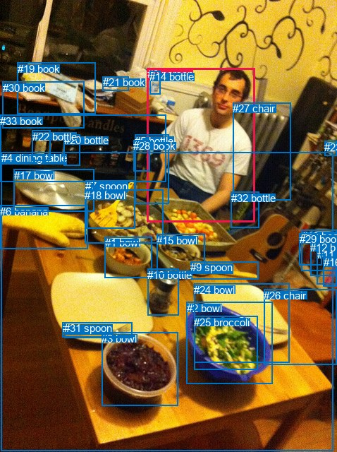
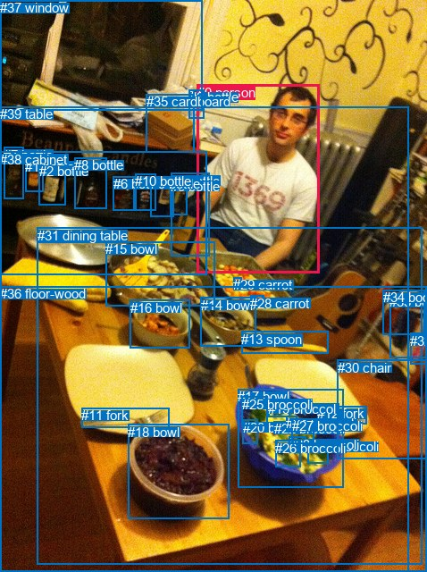

# 图片 2157：498133.jpg

随机样本序号：488。图片 SHA256：`916af45e543c1d1aac91807328a1d0437b28dcab1652fe89666cb43e8c188301`。

红色框表示人，蓝色框表示其他物体。两个模式分别保留自身框编号，可依据位置比较对应对象。

## 自动检测框与输出

人的框编号：`[0]`。状态：`ok`。

### 自动检测全部物体框

| 编号 | 类别 | 是否为人 | 检测分数 | 像素坐标 xyxy |
|---|---|---|---|---|
| 0 | person | True | 0.9987 | 208.7, 96.2, 361.2, 314.6 |
| 1 | bowl | False | 0.9880 | 148.8, 335.1, 215.2, 393.0 |
| 2 | bowl | False | 0.9865 | 264.5, 427.5, 386.5, 543.2 |
| 3 | bowl | False | 0.9781 | 144.1, 471.0, 252.9, 574.0 |
| 4 | dining table | False | 0.9691 | 1.5, 215.0, 473.0, 638.3 |
| 5 | bottle | False | 0.9601 | 191.0, 190.6, 239.4, 288.3 |
| 6 | banana | False | 0.9544 | 0.1, 290.9, 124.5, 352.3 |
| 7 | spoon | False | 0.9320 | 121.5, 255.4, 191.8, 323.7 |
| 8 | fork | False | 0.8943 | 89.0, 456.5, 187.1, 478.0 |
| 9 | spoon | False | 0.8862 | 270.2, 370.4, 366.7, 395.6 |
| 10 | bottle | False | 0.8861 | 209.3, 380.8, 253.1, 446.2 |
| 11 | book | False | 0.8574 | 449.7, 351.6, 477.2, 402.4 |
| 12 | book | False | 0.8554 | 440.1, 341.7, 476.8, 391.0 |
| 13 | book | False | 0.8497 | 427.5, 325.7, 477.4, 383.2 |
| 14 | bottle | False | 0.8191 | 212.2, 100.5, 227.0, 133.4 |
| 15 | bowl | False | 0.7979 | 222.5, 331.7, 291.0, 387.2 |
| 16 | book | False | 0.7451 | 458.9, 363.1, 477.9, 406.0 |
| 17 | bowl | False | 0.6637 | 19.6, 239.9, 133.7, 299.5 |
| 18 | bowl | False | 0.6580 | 120.2, 268.3, 231.7, 344.5 |
| 19 | book | False | 0.5935 | 24.7, 88.6, 135.1, 161.5 |
| 20 | bottle | False | 0.5925 | 90.9, 190.2, 113.3, 234.3 |
| 21 | book | False | 0.5775 | 146.0, 108.0, 182.5, 128.8 |
| 22 | bottle | False | 0.5694 | 45.9, 184.6, 72.0, 227.3 |
| 23 | book | False | 0.5483 | 460.4, 199.5, 477.7, 220.7 |
| 24 | bowl | False | 0.5473 | 275.3, 401.9, 410.9, 513.4 |
| 25 | broccoli | False | 0.5245 | 275.0, 447.6, 365.2, 523.2 |
| 26 | chair | False | 0.4713 | 374.3, 409.8, 478.0, 516.3 |
| 27 | chair | False | 0.4467 | 330.3, 145.1, 413.0, 283.6 |
| 28 | book | False | 0.4445 | 189.3, 198.0, 212.9, 242.4 |
| 29 | book | False | 0.4161 | 425.0, 330.1, 456.6, 375.5 |
| 30 | book | False | 0.4013 | 3.6, 115.8, 119.3, 181.9 |
| 31 | spoon | False | 0.3974 | 91.1, 456.2, 187.1, 478.1 |
| 32 | bottle | False | 0.3829 | 328.0, 271.7, 367.6, 322.9 |
| 33 | book | False | 0.3750 | 0.0, 162.7, 235.7, 257.3 |

### 自动检测 Top50 人相关候选

评分物体对：1122；人相关物体对：66；输出关系：50。

| 排名 | 主语编号与类别 | 关系 | 宾语编号与类别 | 类型 | 人与人 | 排序分数 | 原始融合 logit |
|---|---|---|---|---|---|---|---|
| 1 | #0 person | holding | #5 bottle | semantic | False | 0.99427 | 5.1560 |
| 2 | #0 person | holding | #28 book | semantic | False | 0.97864 | 3.8248 |
| 3 | #27 chair | beside | #0 person | spatial | False | 0.95861 | 3.1424 |
| 4 | #0 person | beside | #27 chair | spatial | False | 0.95489 | 3.0525 |
| 5 | #0 person | sitting on | #4 dining table | semantic | False | 0.92732 | 2.5462 |
| 6 | #0 person | standing on | #27 chair | semantic | False | 0.90538 | 2.2585 |
| 7 | #0 person | beside | #4 dining table | spatial | False | 0.88570 | 2.0476 |
| 8 | #0 person | on | #5 bottle | spatial | False | 0.80024 | 1.3878 |
| 9 | #0 person | eating | #18 bowl | semantic | False | 0.76641 | 1.1881 |
| 10 | #27 chair | standing on | #0 person | semantic | False | 0.63310 | 0.5455 |
| 11 | #5 bottle | holding | #0 person | semantic | False | 0.62670 | 0.5181 |
| 12 | #0 person | holding | #32 bottle | semantic | False | 0.59079 | 0.3672 |
| 13 | #0 person | on | #28 book | spatial | False | 0.52801 | 0.1122 |
| 14 | #5 bottle | on | #0 person | spatial | False | 0.51833 | 0.0734 |
| 15 | #32 bottle | beside | #0 person | spatial | False | 0.48585 | -0.0566 |
| 16 | #0 person | standing on | #33 book | semantic | False | 0.46160 | -0.1539 |
| 17 | #0 person | sitting on | #26 chair | semantic | False | 0.45931 | -0.1631 |
| 18 | #0 person | eating | #7 spoon | semantic | False | 0.40932 | -0.3668 |
| 19 | #0 person | beside | #33 book | spatial | False | 0.39255 | -0.4366 |
| 20 | #4 dining table | in front of | #0 person | spatial | False | 0.26227 | -1.0342 |
| 21 | #28 book | beside | #0 person | spatial | False | 0.23952 | -1.1553 |
| 22 | #0 person | in | #18 bowl | spatial | False | 0.23840 | -1.1615 |
| 23 | #0 person | standing on | #30 book | semantic | False | 0.23437 | -1.1838 |
| 24 | #0 person | wearing | #14 bottle | semantic | False | 0.21058 | -1.3214 |
| 25 | #0 person | beside | #26 chair | spatial | False | 0.14770 | -1.7528 |
| 26 | #28 book | holding | #0 person | semantic | False | 0.14062 | -1.8101 |
| 27 | #32 bottle | looking at | #0 person | semantic | False | 0.13043 | -1.8972 |
| 28 | #0 person | in | #32 bottle | spatial | False | 0.11891 | -2.0028 |
| 29 | #18 bowl | in front of | #0 person | spatial | False | 0.09996 | -2.1976 |
| 30 | #0 person | in | #30 book | spatial | False | 0.08467 | -2.3805 |
| 31 | #0 person | eating | #15 bowl | semantic | False | 0.08010 | -2.4410 |
| 32 | #24 bowl | in front of | #0 person | spatial | False | 0.07268 | -2.5462 |
| 33 | #0 person | holding | #9 spoon | semantic | False | 0.06801 | -2.6177 |
| 34 | #14 bottle | beside | #0 person | spatial | False | 0.06688 | -2.6357 |
| 35 | #15 bowl | in front of | #0 person | spatial | False | 0.06550 | -2.6580 |
| 36 | #26 chair | in front of | #0 person | spatial | False | 0.06430 | -2.6778 |
| 37 | #0 person | eating | #25 broccoli | semantic | False | 0.05569 | -2.8306 |
| 38 | #17 bowl | in front of | #0 person | spatial | False | 0.04843 | -2.9779 |
| 39 | #9 spoon | in front of | #0 person | spatial | False | 0.04076 | -3.1584 |
| 40 | #33 book | beside | #0 person | spatial | False | 0.03991 | -3.1805 |
| 41 | #2 bowl | in front of | #0 person | spatial | False | 0.03982 | -3.1828 |
| 42 | #0 person | eating | #1 bowl | semantic | False | 0.03848 | -3.2185 |
| 43 | #0 person | eating | #2 bowl | semantic | False | 0.03837 | -3.2213 |
| 44 | #6 banana | in front of | #0 person | spatial | False | 0.03745 | -3.2465 |
| 45 | #0 person | on | #7 spoon | spatial | False | 0.03369 | -3.3562 |
| 46 | #3 bowl | in front of | #0 person | spatial | False | 0.02987 | -3.4806 |
| 47 | #0 person | wearing | #24 bowl | semantic | False | 0.02848 | -3.5298 |
| 48 | #0 person | on | #14 bottle | spatial | False | 0.02658 | -3.6005 |
| 49 | #0 person | in | #9 spoon | spatial | False | 0.02560 | -3.6392 |
| 50 | #1 bowl | in front of | #0 person | spatial | False | 0.02550 | -3.6433 |

### 自动检测逐条人相关 GT 核验

R@50：100.00%；命中 1/1。

| GT 主语编号 | GT 关系 | GT 宾语编号 | 结果阶段 | 匹配预测主语编号 | 匹配预测宾语编号 |
|---|---|---|---|---|---|
| 31 | in front of | 0 | hit50 | [4] | [0] |

## 真实框与输出

人的框编号：`[0]`。

### 真实框全部物体框

| 编号 | 类别 | 是否为人 | 检测分数 | 像素坐标 xyxy |
|---|---|---|---|---|
| 0 | person | True | GT | 221.0, 95.0, 358.0, 306.0 |
| 1 | bottle | False | GT | 28.0, 178.0, 48.0, 215.0 |
| 2 | bottle | False | GT | 44.0, 183.0, 74.0, 230.0 |
| 3 | bottle | False | GT | 212.0, 100.0, 229.0, 132.0 |
| 4 | bottle | False | GT | 191.0, 194.0, 234.0, 287.0 |
| 5 | bottle | False | GT | 191.0, 200.0, 210.0, 241.0 |
| 6 | bottle | False | GT | 127.0, 197.0, 151.0, 235.0 |
| 7 | bottle | False | GT | 4.0, 165.0, 26.0, 223.0 |
| 8 | bottle | False | GT | 83.0, 176.0, 120.0, 233.0 |
| 9 | bottle | False | GT | 169.0, 197.0, 195.0, 242.0 |
| 10 | bottle | False | GT | 151.0, 194.0, 174.0, 235.0 |
| 11 | fork | False | GT | 91.0, 456.0, 189.0, 478.0 |
| 12 | fork | False | GT | 355.0, 454.0, 410.0, 474.0 |
| 13 | spoon | False | GT | 270.0, 371.0, 367.0, 396.0 |
| 14 | bowl | False | GT | 225.0, 333.0, 287.0, 388.0 |
| 15 | bowl | False | GT | 118.0, 270.0, 240.0, 342.0 |
| 16 | bowl | False | GT | 146.0, 336.0, 213.0, 389.0 |
| 17 | bowl | False | GT | 266.0, 435.0, 384.0, 545.0 |
| 18 | bowl | False | GT | 143.0, 475.0, 256.0, 581.0 |
| 19 | broccoli | False | GT | 300.0, 449.0, 324.0, 467.0 |
| 20 | broccoli | False | GT | 272.0, 470.0, 289.0, 497.0 |
| 21 | broccoli | False | GT | 345.0, 491.0, 368.0, 519.0 |
| 22 | broccoli | False | GT | 307.0, 471.0, 321.0, 482.0 |
| 23 | broccoli | False | GT | 323.0, 489.0, 342.0, 502.0 |
| 24 | broccoli | False | GT | 320.0, 465.0, 332.0, 483.0 |
| 25 | broccoli | False | GT | 271.0, 444.0, 300.0, 477.0 |
| 26 | broccoli | False | GT | 308.0, 493.0, 336.0, 522.0 |
| 27 | broccoli | False | GT | 327.0, 468.0, 352.0, 496.0 |
| 28 | carrot | False | GT | 280.0, 331.0, 295.0, 341.0 |
| 29 | carrot | False | GT | 261.0, 310.0, 270.0, 319.0 |
| 30 | chair | False | GT | 378.0, 403.0, 478.0, 514.0 |
| 31 | dining table | False | GT | 42.0, 255.0, 473.0, 632.0 |
| 32 | book | False | GT | 459.0, 373.0, 478.0, 407.0 |
| 33 | book | False | GT | 436.0, 329.0, 478.0, 401.0 |
| 34 | book | False | GT | 429.0, 324.0, 476.0, 374.0 |
| 35 | cardboard | False | GT | 164.0, 105.0, 218.0, 170.0 |
| 36 | floor-wood | False | GT | 0.0, 320.0, 478.0, 640.0 |
| 37 | window | False | GT | 0.0, 0.0, 226.0, 124.0 |
| 38 | cabinet | False | GT | 0.0, 170.0, 232.0, 308.0 |
| 39 | table | False | GT | 0.0, 119.0, 458.0, 640.0 |

### 真实框 Top50 人相关候选

评分物体对：1560；人相关物体对：78；输出关系：50。

| 排名 | 主语编号与类别 | 关系 | 宾语编号与类别 | 类型 | 人与人 | 排序分数 | 原始融合 logit |
|---|---|---|---|---|---|---|---|
| 1 | #0 person | holding | #4 bottle | semantic | False | 0.99321 | 4.9851 |
| 2 | #0 person | in | #39 table | spatial | False | 0.95301 | 3.0096 |
| 3 | #0 person | sitting on | #39 table | semantic | False | 0.92574 | 2.5230 |
| 4 | #0 person | sitting on | #36 floor-wood | semantic | False | 0.90602 | 2.2660 |
| 5 | #0 person | sitting on | #31 dining table | semantic | False | 0.90299 | 2.2309 |
| 6 | #0 person | beside | #31 dining table | spatial | False | 0.85662 | 1.7875 |
| 7 | #0 person | in | #36 floor-wood | spatial | False | 0.79425 | 1.3508 |
| 8 | #0 person | on | #4 bottle | spatial | False | 0.75548 | 1.1281 |
| 9 | #0 person | holding | #5 bottle | semantic | False | 0.70032 | 0.8488 |
| 10 | #0 person | eating | #15 bowl | semantic | False | 0.63999 | 0.5753 |
| 11 | #0 person | looking at | #37 window | semantic | False | 0.54402 | 0.1766 |
| 12 | #4 bottle | holding | #0 person | semantic | False | 0.47736 | -0.0906 |
| 13 | #0 person | sitting on | #30 chair | semantic | False | 0.42560 | -0.2998 |
| 14 | #37 window | beside | #0 person | spatial | False | 0.39943 | -0.4078 |
| 15 | #4 bottle | beside | #0 person | spatial | False | 0.39339 | -0.4331 |
| 16 | #0 person | wearing | #38 cabinet | semantic | False | 0.37974 | -0.4907 |
| 17 | #0 person | in front of | #37 window | spatial | False | 0.37742 | -0.5005 |
| 18 | #0 person | beside | #38 cabinet | spatial | False | 0.29354 | -0.8782 |
| 19 | #37 window | looking at | #0 person | semantic | False | 0.28369 | -0.9262 |
| 20 | #0 person | cooking | #29 carrot | semantic | False | 0.24761 | -1.1114 |
| 21 | #0 person | in | #15 bowl | spatial | False | 0.20835 | -1.3349 |
| 22 | #31 dining table | in front of | #0 person | spatial | False | 0.19972 | -1.3881 |
| 23 | #15 bowl | in front of | #0 person | spatial | False | 0.18376 | -1.4911 |
| 24 | #0 person | cooking | #28 carrot | semantic | False | 0.16785 | -1.6010 |
| 25 | #0 person | beside | #30 chair | spatial | False | 0.15675 | -1.6826 |
| 26 | #0 person | on | #5 bottle | spatial | False | 0.14430 | -1.7800 |
| 27 | #5 bottle | beside | #0 person | spatial | False | 0.12286 | -1.9657 |
| 28 | #14 bowl | in front of | #0 person | spatial | False | 0.09719 | -2.2288 |
| 29 | #30 chair | in front of | #0 person | spatial | False | 0.08594 | -2.3643 |
| 30 | #36 floor-wood | in front of | #0 person | spatial | False | 0.08493 | -2.3772 |
| 31 | #33 book | beside | #0 person | spatial | False | 0.06558 | -2.6566 |
| 32 | #39 table | in front of | #0 person | spatial | False | 0.06320 | -2.6962 |
| 33 | #0 person | wearing | #3 bottle | semantic | False | 0.06204 | -2.7160 |
| 34 | #0 person | holding | #13 spoon | semantic | False | 0.06133 | -2.7281 |
| 35 | #9 bottle | beside | #0 person | spatial | False | 0.05726 | -2.8011 |
| 36 | #3 bottle | beside | #0 person | spatial | False | 0.05686 | -2.8086 |
| 37 | #0 person | eating | #14 bowl | semantic | False | 0.05610 | -2.8228 |
| 38 | #35 cardboard | beside | #0 person | spatial | False | 0.05598 | -2.8251 |
| 39 | #13 spoon | in front of | #0 person | spatial | False | 0.05557 | -2.8329 |
| 40 | #5 bottle | holding | #0 person | semantic | False | 0.04945 | -2.9560 |
| 41 | #34 book | beside | #0 person | spatial | False | 0.04778 | -2.9923 |
| 42 | #17 bowl | in front of | #0 person | spatial | False | 0.04590 | -3.0343 |
| 43 | #38 cabinet | in front of | #0 person | spatial | False | 0.04539 | -3.0461 |
| 44 | #0 person | eating | #17 bowl | semantic | False | 0.03608 | -3.2851 |
| 45 | #10 bottle | beside | #0 person | spatial | False | 0.03244 | -3.3955 |
| 46 | #18 bowl | in front of | #0 person | spatial | False | 0.03108 | -3.4397 |
| 47 | #16 bowl | in front of | #0 person | spatial | False | 0.02969 | -3.4869 |
| 48 | #0 person | holding | #34 book | semantic | False | 0.02705 | -3.5828 |
| 49 | #0 person | wearing | #35 cardboard | semantic | False | 0.02566 | -3.6368 |
| 50 | #0 person | in | #13 spoon | spatial | False | 0.02520 | -3.6555 |

### 真实框逐条人相关 GT 核验

R@50：100.00%；命中 1/1。

| GT 主语编号 | GT 关系 | GT 宾语编号 | 结果阶段 | 匹配预测主语编号 | 匹配预测宾语编号 |
|---|---|---|---|---|---|
| 31 | in front of | 0 | hit50 | [31] | [0] |

## 全部人相关 GT

| 主语编号与类别 | 关系 | 宾语编号与类别 |
|---|---|---|
| #31 dining table | in front of | #0 person |

原始记录、全部人相关物体对的两项预测与分项分数见 [逐图证据 JSON](../evidence/cases/2157.json)。全部56类 logits 保留于本机 HOR/output/random500/logits/。

<!-- HOR_COMPLETE_RESULTS -->

## 六组条件的完整输出对照

以下保留同一图片三种框与候选模式、两种谓词输出规则的全部 Top50。框编号各自在所属模式内解释。

### 自动检测框完整枚举：空间与语义各保留一个谓词

| 排名 | 主语编号与类别 | 谓词 | 宾语编号与类别 | 分组 | 排序分数 | predicate logit | pair logit |
|---|---|---|---|---|---|---|---|
| 1 | #0 person | holding | #5 bottle | semantic | 0.9942682 | 4.6122146 | 0.5437605 |
| 2 | #0 person | holding | #28 book | semantic | 0.9786432 | 3.7353082 | 0.0894938 |
| 3 | #27 chair | beside | #0 person | spatial | 0.9586093 | 3.1143765 | 0.0280501 |
| 4 | #0 person | beside | #27 chair | spatial | 0.9548900 | 3.1740961 | -0.1216057 |
| 5 | #0 person | sitting on | #4 dining table | semantic | 0.9273176 | 2.2872119 | 0.2589855 |
| 6 | #0 person | standing on | #27 chair | semantic | 0.9053782 | 2.3800702 | -0.1216057 |
| 7 | #0 person | beside | #4 dining table | spatial | 0.8857003 | 1.7885685 | 0.2589855 |
| 8 | #0 person | on | #5 bottle | spatial | 0.8002369 | 0.8440151 | 0.5437605 |
| 9 | #0 person | eating | #18 bowl | semantic | 0.7664095 | 1.6655207 | -0.4773739 |
| 10 | #27 chair | standing on | #0 person | semantic | 0.6330956 | 0.5174699 | 0.0280501 |
| 11 | #5 bottle | holding | #0 person | semantic | 0.6266963 | 1.1379981 | -0.6199284 |
| 12 | #0 person | holding | #32 bottle | semantic | 0.5907881 | 1.2505183 | -0.8832943 |
| 13 | #0 person | on | #28 book | spatial | 0.5280091 | 0.0226603 | 0.0894938 |
| 14 | #5 bottle | on | #0 person | spatial | 0.5183342 | 0.6932979 | -0.6199284 |
| 15 | #32 bottle | beside | #0 person | spatial | 0.4858545 | 0.7383819 | -0.7949790 |
| 16 | #0 person | standing on | #33 book | semantic | 0.4615968 | 0.8672504 | -1.0211663 |
| 17 | #0 person | sitting on | #26 chair | semantic | 0.4593131 | 0.7586150 | -0.9217231 |
| 18 | #0 person | eating | #7 spoon | semantic | 0.4093210 | 0.0978789 | -0.4646522 |
| 19 | #0 person | beside | #33 book | spatial | 0.3925526 | 0.5845714 | -1.0211663 |
| 20 | #4 dining table | in front of | #0 person | spatial | 0.2622685 | 0.1221657 | -1.1563766 |
| 21 | #28 book | beside | #0 person | spatial | 0.2395168 | -0.5229063 | -0.6324239 |
| 22 | #0 person | in | #18 bowl | spatial | 0.2383983 | -0.6841068 | -0.4773739 |
| 23 | #0 person | standing on | #30 book | semantic | 0.2343716 | -0.1661544 | -1.0176349 |
| 24 | #0 person | wearing | #14 bottle | semantic | 0.2105815 | -0.0215979 | -1.2998259 |
| 25 | #0 person | beside | #26 chair | spatial | 0.1476963 | -0.8310616 | -0.9217231 |
| 26 | #28 book | holding | #0 person | semantic | 0.1406206 | -1.1777210 | -0.6324239 |
| 27 | #32 bottle | looking at | #0 person | semantic | 0.1304294 | -1.1021886 | -0.7949790 |
| 28 | #0 person | in | #32 bottle | spatial | 0.1189067 | -1.1195297 | -0.8832943 |
| 29 | #18 bowl | in front of | #0 person | spatial | 0.0999618 | -1.0858440 | -1.1118048 |
| 30 | #0 person | in | #30 book | spatial | 0.0846683 | -1.3629105 | -1.0176349 |
| 31 | #0 person | eating | #15 bowl | semantic | 0.0800970 | -1.9135683 | -0.5274613 |
| 32 | #24 bowl | in front of | #0 person | spatial | 0.0726839 | -1.1619198 | -1.3842545 |
| 33 | #0 person | holding | #9 spoon | semantic | 0.0680109 | -1.7425675 | -0.8750853 |
| 34 | #14 bottle | beside | #0 person | spatial | 0.0668764 | -1.4784138 | -1.1572779 |
| 35 | #15 bowl | in front of | #0 person | spatial | 0.0654999 | -1.5063584 | -1.1516050 |
| 36 | #26 chair | in front of | #0 person | spatial | 0.0642991 | -1.2872682 | -1.3904829 |
| 37 | #0 person | eating | #25 broccoli | semantic | 0.0556949 | -1.4415221 | -1.3890381 |
| 38 | #17 bowl | in front of | #0 person | spatial | 0.0484326 | -1.5268440 | -1.4510925 |
| 39 | #9 spoon | in front of | #0 person | spatial | 0.0407612 | -1.8537123 | -1.3046978 |
| 40 | #33 book | beside | #0 person | spatial | 0.0399055 | -2.1842570 | -0.9962592 |
| 41 | #2 bowl | in front of | #0 person | spatial | 0.0398176 | -1.8849113 | -1.2979035 |
| 42 | #0 person | eating | #1 bowl | semantic | 0.0384771 | -2.1542981 | -1.0641572 |
| 43 | #0 person | eating | #2 bowl | semantic | 0.0383729 | -1.9477630 | -1.2735133 |
| 44 | #6 banana | in front of | #0 person | spatial | 0.0374542 | -1.4112272 | -1.8352352 |
| 45 | #0 person | on | #7 spoon | spatial | 0.0336927 | -2.8915496 | -0.4646522 |
| 46 | #3 bowl | in front of | #0 person | spatial | 0.0298707 | -2.2131224 | -1.2674296 |
| 47 | #0 person | wearing | #24 bowl | semantic | 0.0284761 | -2.0888505 | -1.4409508 |
| 48 | #0 person | on | #14 bottle | spatial | 0.0265839 | -2.3006794 | -1.2998259 |
| 49 | #0 person | in | #9 spoon | spatial | 0.0255997 | -2.7641568 | -0.8750853 |
| 50 | #1 bowl | in front of | #0 person | spatial | 0.0254994 | -2.3347485 | -1.3085210 |

GT 命中：1/1，R@50=100.00%。

| GT主语 | GT谓词 | GT宾语 | 结果阶段 | 匹配主语框 | 匹配宾语框 |
|---|---|---|---|---|---|
| 31 | in front of | 0 | hit50 | [4] | [0] |

### 自动检测框完整枚举：每对只保留一个谓词

| 排名 | 主语编号与类别 | 谓词 | 宾语编号与类别 | 分组 | 排序分数 | predicate logit | pair logit |
|---|---|---|---|---|---|---|---|
| 1 | #0 person | holding | #5 bottle | single | 0.9942682 | 4.6122146 | 0.5437605 |
| 2 | #0 person | holding | #28 book | single | 0.9786432 | 3.7353082 | 0.0894938 |
| 3 | #27 chair | beside | #0 person | single | 0.9586093 | 3.1143765 | 0.0280501 |
| 4 | #0 person | beside | #27 chair | single | 0.9548900 | 3.1740961 | -0.1216057 |
| 5 | #0 person | sitting on | #4 dining table | single | 0.9273176 | 2.2872119 | 0.2589855 |
| 6 | #0 person | eating | #18 bowl | single | 0.7664095 | 1.6655207 | -0.4773739 |
| 7 | #5 bottle | holding | #0 person | single | 0.6266963 | 1.1379981 | -0.6199284 |
| 8 | #0 person | holding | #32 bottle | single | 0.5907881 | 1.2505183 | -0.8832943 |
| 9 | #32 bottle | beside | #0 person | single | 0.4858545 | 0.7383819 | -0.7949790 |
| 10 | #0 person | standing on | #33 book | single | 0.4615968 | 0.8672504 | -1.0211663 |
| 11 | #0 person | sitting on | #26 chair | single | 0.4593131 | 0.7586150 | -0.9217231 |
| 12 | #0 person | eating | #7 spoon | single | 0.4093210 | 0.0978789 | -0.4646522 |
| 13 | #4 dining table | in front of | #0 person | single | 0.2622685 | 0.1221657 | -1.1563766 |
| 14 | #28 book | beside | #0 person | single | 0.2395168 | -0.5229063 | -0.6324239 |
| 15 | #0 person | standing on | #30 book | single | 0.2343716 | -0.1661544 | -1.0176349 |
| 16 | #0 person | wearing | #14 bottle | single | 0.2105815 | -0.0215979 | -1.2998259 |
| 17 | #18 bowl | in front of | #0 person | single | 0.0999618 | -1.0858440 | -1.1118048 |
| 18 | #0 person | eating | #15 bowl | single | 0.0800970 | -1.9135683 | -0.5274613 |
| 19 | #24 bowl | in front of | #0 person | single | 0.0726839 | -1.1619198 | -1.3842545 |
| 20 | #0 person | holding | #9 spoon | single | 0.0680109 | -1.7425675 | -0.8750853 |
| 21 | #14 bottle | beside | #0 person | single | 0.0668764 | -1.4784138 | -1.1572779 |
| 22 | #15 bowl | in front of | #0 person | single | 0.0654999 | -1.5063584 | -1.1516050 |
| 23 | #26 chair | in front of | #0 person | single | 0.0642991 | -1.2872682 | -1.3904829 |
| 24 | #0 person | eating | #25 broccoli | single | 0.0556949 | -1.4415221 | -1.3890381 |
| 25 | #17 bowl | in front of | #0 person | single | 0.0484326 | -1.5268440 | -1.4510925 |
| 26 | #9 spoon | in front of | #0 person | single | 0.0407612 | -1.8537123 | -1.3046978 |
| 27 | #33 book | beside | #0 person | single | 0.0399055 | -2.1842570 | -0.9962592 |
| 28 | #2 bowl | in front of | #0 person | single | 0.0398176 | -1.8849113 | -1.2979035 |
| 29 | #0 person | eating | #1 bowl | single | 0.0384771 | -2.1542981 | -1.0641572 |
| 30 | #0 person | eating | #2 bowl | single | 0.0383729 | -1.9477630 | -1.2735133 |
| 31 | #6 banana | in front of | #0 person | single | 0.0374542 | -1.4112272 | -1.8352352 |
| 32 | #3 bowl | in front of | #0 person | single | 0.0298707 | -2.2131224 | -1.2674296 |
| 33 | #0 person | wearing | #24 bowl | single | 0.0284761 | -2.0888505 | -1.4409508 |
| 34 | #1 bowl | in front of | #0 person | single | 0.0254994 | -2.3347485 | -1.3085210 |
| 35 | #13 book | beside | #0 person | single | 0.0229016 | -2.5887833 | -1.1645973 |
| 36 | #7 spoon | in front of | #0 person | single | 0.0216308 | -2.4102829 | -1.4014839 |
| 37 | #0 person | wearing | #21 book | single | 0.0184160 | -2.4657543 | -1.5101960 |
| 38 | #0 person | looking at | #17 bowl | single | 0.0164385 | -2.5302262 | -1.5613294 |
| 39 | #0 person | wearing | #6 banana | single | 0.0161403 | -2.9172263 | -1.1929392 |
| 40 | #23 book | beside | #0 person | single | 0.0156001 | -2.9347746 | -1.2099814 |
| 41 | #12 book | beside | #0 person | single | 0.0149474 | -2.9871740 | -1.2009852 |
| 42 | #29 book | beside | #0 person | single | 0.0143051 | -3.0551975 | -1.1775309 |
| 43 | #0 person | holding | #29 book | single | 0.0140734 | -2.8673418 | -1.3819556 |
| 44 | #11 book | in front of | #0 person | single | 0.0136298 | -3.1007431 | -1.1810269 |
| 45 | #0 person | holding | #13 book | single | 0.0135648 | -2.8971584 | -1.3894620 |
| 46 | #0 person | wearing | #23 book | single | 0.0132969 | -2.7870469 | -1.5197916 |
| 47 | #0 person | looking at | #3 bowl | single | 0.0132543 | -3.0054002 | -1.3046879 |
| 48 | #25 broccoli | in front of | #0 person | single | 0.0126504 | -2.6906004 | -1.6667337 |
| 49 | #30 book | in front of | #0 person | single | 0.0121017 | -3.1277709 | -1.2744619 |
| 50 | #16 book | in front of | #0 person | single | 0.0116862 | -3.2493615 | -1.1882267 |

GT 命中：1/1，R@50=100.00%。

| GT主语 | GT谓词 | GT宾语 | 结果阶段 | 匹配主语框 | 匹配宾语框 |
|---|---|---|---|---|---|
| 31 | in front of | 0 | hit50 | [4] | [0] |

### 真实框完整枚举：空间与语义各保留一个谓词

| 排名 | 主语编号与类别 | 谓词 | 宾语编号与类别 | 分组 | 排序分数 | predicate logit | pair logit |
|---|---|---|---|---|---|---|---|
| 1 | #0 person | holding | #4 bottle | semantic | 0.9932070 | 4.5095763 | 0.4754878 |
| 2 | #0 person | in | #39 table | spatial | 0.9530065 | 2.6775126 | 0.3320991 |
| 3 | #0 person | sitting on | #39 table | semantic | 0.9257394 | 2.1909137 | 0.3320991 |
| 4 | #0 person | sitting on | #36 floor-wood | semantic | 0.9060231 | 2.3052702 | -0.0392538 |
| 5 | #0 person | sitting on | #31 dining table | semantic | 0.9029874 | 2.1126728 | 0.1181939 |
| 6 | #0 person | beside | #31 dining table | spatial | 0.8566200 | 1.6693020 | 0.1181939 |
| 7 | #0 person | in | #36 floor-wood | spatial | 0.7942523 | 1.3900042 | -0.0392538 |
| 8 | #0 person | on | #4 bottle | spatial | 0.7554818 | 0.6525779 | 0.4754878 |
| 9 | #0 person | holding | #5 bottle | semantic | 0.7003211 | 0.8537636 | -0.0049363 |
| 10 | #0 person | eating | #15 bowl | semantic | 0.6399937 | 1.0889587 | -0.5136218 |
| 11 | #0 person | looking at | #37 window | semantic | 0.5440245 | 1.2986078 | -1.1220524 |
| 12 | #4 bottle | holding | #0 person | semantic | 0.4773596 | 0.5732703 | -0.6638937 |
| 13 | #0 person | sitting on | #30 chair | semantic | 0.4256013 | 0.6141515 | -0.9139723 |
| 14 | #37 window | beside | #0 person | spatial | 0.3994333 | 0.6416168 | -1.0494437 |
| 15 | #4 bottle | beside | #0 person | spatial | 0.3933927 | 0.2308207 | -0.6638937 |
| 16 | #0 person | wearing | #38 cabinet | semantic | 0.3797397 | 0.4925961 | -0.9832494 |
| 17 | #0 person | in front of | #37 window | spatial | 0.3774216 | 0.6215458 | -1.1220524 |
| 18 | #0 person | beside | #38 cabinet | spatial | 0.2935447 | 0.1050196 | -0.9832494 |
| 19 | #37 window | looking at | #0 person | semantic | 0.2836867 | 0.1231966 | -1.0494437 |
| 20 | #0 person | cooking | #29 carrot | semantic | 0.2476086 | -0.8913689 | -0.2200384 |
| 21 | #0 person | in | #15 bowl | spatial | 0.2083483 | -0.8212886 | -0.5136218 |
| 22 | #31 dining table | in front of | #0 person | spatial | 0.1997192 | -0.1165733 | -1.2714767 |
| 23 | #15 bowl | in front of | #0 person | spatial | 0.1837578 | -0.3926735 | -1.0984194 |
| 24 | #0 person | cooking | #28 carrot | semantic | 0.1678484 | -1.2824070 | -0.3185461 |
| 25 | #0 person | beside | #30 chair | spatial | 0.1567530 | -0.7686164 | -0.9139723 |
| 26 | #0 person | on | #5 bottle | spatial | 0.1443009 | -1.7750819 | -0.0049363 |
| 27 | #5 bottle | beside | #0 person | spatial | 0.1228552 | -1.3084378 | -0.6572281 |
| 28 | #14 bowl | in front of | #0 person | spatial | 0.0971906 | -1.0380487 | -1.1907891 |
| 29 | #30 chair | in front of | #0 person | spatial | 0.0859393 | -0.9688592 | -1.3953966 |
| 30 | #36 floor-wood | in front of | #0 person | spatial | 0.0849283 | -1.1526945 | -1.2245003 |
| 31 | #33 book | beside | #0 person | spatial | 0.0655850 | -1.5495057 | -1.1070681 |
| 32 | #39 table | in front of | #0 person | spatial | 0.0631983 | -1.5079694 | -1.1882252 |
| 33 | #0 person | wearing | #3 bottle | semantic | 0.0620351 | -1.4173009 | -1.2987120 |
| 34 | #0 person | holding | #13 spoon | semantic | 0.0613348 | -1.8447430 | -0.8833683 |
| 35 | #9 bottle | beside | #0 person | spatial | 0.0572650 | -1.7774036 | -1.0236923 |
| 36 | #3 bottle | beside | #0 person | spatial | 0.0568612 | -1.6592503 | -1.1493509 |
| 37 | #0 person | eating | #14 bowl | semantic | 0.0561041 | -2.2475491 | -0.5752570 |
| 38 | #35 cardboard | beside | #0 person | spatial | 0.0559835 | -1.7329173 | -1.0921689 |
| 39 | #13 spoon | in front of | #0 person | spatial | 0.0555716 | -1.5161991 | -1.3167076 |
| 40 | #5 bottle | holding | #0 person | semantic | 0.0494525 | -2.2987971 | -0.6572281 |
| 41 | #34 book | beside | #0 person | spatial | 0.0477757 | -1.8657765 | -1.1265078 |
| 42 | #17 bowl | in front of | #0 person | spatial | 0.0459009 | -1.6457896 | -1.3884935 |
| 43 | #38 cabinet | in front of | #0 person | spatial | 0.0453853 | -2.0321975 | -1.0139210 |
| 44 | #0 person | eating | #17 bowl | semantic | 0.0360846 | -1.9710960 | -1.3140424 |
| 45 | #10 bottle | beside | #0 person | spatial | 0.0324374 | -2.2738657 | -1.1216012 |
| 46 | #18 bowl | in front of | #0 person | spatial | 0.0310765 | -2.1509490 | -1.2887840 |
| 47 | #16 bowl | in front of | #0 person | spatial | 0.0296875 | -2.1053114 | -1.3815818 |
| 48 | #0 person | holding | #34 book | semantic | 0.0270469 | -2.2486322 | -1.3341308 |
| 49 | #0 person | wearing | #35 cardboard | semantic | 0.0256598 | -2.0158889 | -1.6209450 |
| 50 | #0 person | in | #13 spoon | spatial | 0.0251975 | -2.7721200 | -0.8833683 |

GT 命中：1/1，R@50=100.00%。

| GT主语 | GT谓词 | GT宾语 | 结果阶段 | 匹配主语框 | 匹配宾语框 |
|---|---|---|---|---|---|
| 31 | in front of | 0 | hit50 | [31] | [0] |

### 真实框完整枚举：每对只保留一个谓词

| 排名 | 主语编号与类别 | 谓词 | 宾语编号与类别 | 分组 | 排序分数 | predicate logit | pair logit |
|---|---|---|---|---|---|---|---|
| 1 | #0 person | holding | #4 bottle | single | 0.9932070 | 4.5095763 | 0.4754878 |
| 2 | #0 person | in | #39 table | single | 0.9530065 | 2.6775126 | 0.3320991 |
| 3 | #0 person | sitting on | #36 floor-wood | single | 0.9060231 | 2.3052702 | -0.0392538 |
| 4 | #0 person | sitting on | #31 dining table | single | 0.9029874 | 2.1126728 | 0.1181939 |
| 5 | #0 person | holding | #5 bottle | single | 0.7003211 | 0.8537636 | -0.0049363 |
| 6 | #0 person | eating | #15 bowl | single | 0.6399937 | 1.0889587 | -0.5136218 |
| 7 | #0 person | looking at | #37 window | single | 0.5440245 | 1.2986078 | -1.1220524 |
| 8 | #4 bottle | holding | #0 person | single | 0.4773596 | 0.5732703 | -0.6638937 |
| 9 | #0 person | sitting on | #30 chair | single | 0.4256013 | 0.6141515 | -0.9139723 |
| 10 | #37 window | beside | #0 person | single | 0.3994333 | 0.6416168 | -1.0494437 |
| 11 | #0 person | wearing | #38 cabinet | single | 0.3797397 | 0.4925961 | -0.9832494 |
| 12 | #0 person | cooking | #29 carrot | single | 0.2476086 | -0.8913689 | -0.2200384 |
| 13 | #31 dining table | in front of | #0 person | single | 0.1997192 | -0.1165733 | -1.2714767 |
| 14 | #15 bowl | in front of | #0 person | single | 0.1837578 | -0.3926735 | -1.0984194 |
| 15 | #0 person | cooking | #28 carrot | single | 0.1678484 | -1.2824070 | -0.3185461 |
| 16 | #5 bottle | beside | #0 person | single | 0.1228552 | -1.3084378 | -0.6572281 |
| 17 | #14 bowl | in front of | #0 person | single | 0.0971906 | -1.0380487 | -1.1907891 |
| 18 | #30 chair | in front of | #0 person | single | 0.0859393 | -0.9688592 | -1.3953966 |
| 19 | #36 floor-wood | in front of | #0 person | single | 0.0849283 | -1.1526945 | -1.2245003 |
| 20 | #33 book | beside | #0 person | single | 0.0655850 | -1.5495057 | -1.1070681 |
| 21 | #39 table | in front of | #0 person | single | 0.0631983 | -1.5079694 | -1.1882252 |
| 22 | #0 person | wearing | #3 bottle | single | 0.0620351 | -1.4173009 | -1.2987120 |
| 23 | #0 person | holding | #13 spoon | single | 0.0613348 | -1.8447430 | -0.8833683 |
| 24 | #9 bottle | beside | #0 person | single | 0.0572650 | -1.7774036 | -1.0236923 |
| 25 | #3 bottle | beside | #0 person | single | 0.0568612 | -1.6592503 | -1.1493509 |
| 26 | #0 person | eating | #14 bowl | single | 0.0561041 | -2.2475491 | -0.5752570 |
| 27 | #35 cardboard | beside | #0 person | single | 0.0559835 | -1.7329173 | -1.0921689 |
| 28 | #13 spoon | in front of | #0 person | single | 0.0555716 | -1.5161991 | -1.3167076 |
| 29 | #34 book | beside | #0 person | single | 0.0477757 | -1.8657765 | -1.1265078 |
| 30 | #17 bowl | in front of | #0 person | single | 0.0459009 | -1.6457896 | -1.3884935 |
| 31 | #38 cabinet | in front of | #0 person | single | 0.0453853 | -2.0321975 | -1.0139210 |
| 32 | #0 person | eating | #17 bowl | single | 0.0360846 | -1.9710960 | -1.3140424 |
| 33 | #10 bottle | beside | #0 person | single | 0.0324374 | -2.2738657 | -1.1216012 |
| 34 | #18 bowl | in front of | #0 person | single | 0.0310765 | -2.1509490 | -1.2887840 |
| 35 | #16 bowl | in front of | #0 person | single | 0.0296875 | -2.1053114 | -1.3815818 |
| 36 | #0 person | holding | #34 book | single | 0.0270469 | -2.2486322 | -1.3341308 |
| 37 | #0 person | wearing | #35 cardboard | single | 0.0256598 | -2.0158889 | -1.6209450 |
| 38 | #6 bottle | beside | #0 person | single | 0.0244777 | -2.5147693 | -1.1704426 |
| 39 | #0 person | holding | #33 book | single | 0.0236044 | -2.3182287 | -1.4042046 |
| 40 | #29 carrot | in | #0 person | single | 0.0230634 | -2.5030591 | -1.2431173 |
| 41 | #32 book | beside | #0 person | single | 0.0207571 | -2.6763968 | -1.1774927 |
| 42 | #8 bottle | beside | #0 person | single | 0.0183186 | -2.6959820 | -1.2853668 |
| 43 | #0 person | holding | #12 fork | single | 0.0173108 | -2.6997490 | -1.3392118 |
| 44 | #0 person | eating | #19 broccoli | single | 0.0153536 | -2.8188004 | -1.3421346 |
| 45 | #0 person | eating | #27 broccoli | single | 0.0151488 | -2.7838011 | -1.3907676 |
| 46 | #0 person | eating | #24 broccoli | single | 0.0150146 | -2.8154211 | -1.3681860 |
| 47 | #0 person | eating | #22 broccoli | single | 0.0147954 | -2.8528342 | -1.3456981 |
| 48 | #28 carrot | in front of | #0 person | single | 0.0147752 | -2.8878727 | -1.3120487 |
| 49 | #0 person | holding | #9 bottle | single | 0.0137174 | -2.9236169 | -1.3516591 |
| 50 | #0 person | eating | #26 broccoli | single | 0.0132053 | -2.8865056 | -1.4273353 |

GT 命中：1/1，R@50=100.00%。

| GT主语 | GT谓词 | GT宾语 | 结果阶段 | 匹配主语框 | 匹配宾语框 |
|---|---|---|---|---|---|
| 31 | in front of | 0 | hit50 | [31] | [0] |

### 真实框400候选：空间与语义各保留一个谓词

| 排名 | 主语编号与类别 | 谓词 | 宾语编号与类别 | 分组 | 排序分数 | predicate logit | pair logit |
|---|---|---|---|---|---|---|---|
| 1 | #0 person | holding | #4 bottle | semantic | 0.9933256 | 4.5273013 | 0.4754878 |
| 2 | #0 person | sitting on | #39 table | semantic | 0.9309422 | 2.2691536 | 0.3320991 |
| 3 | #0 person | in | #39 table | spatial | 0.9216102 | 2.1323290 | 0.3320991 |
| 4 | #0 person | sitting on | #31 dining table | semantic | 0.9078821 | 2.1698513 | 0.1181939 |
| 5 | #0 person | sitting on | #36 floor-wood | semantic | 0.9052529 | 2.2962570 | -0.0392538 |
| 6 | #0 person | beside | #31 dining table | spatial | 0.8018091 | 1.2794456 | 0.1181939 |
| 7 | #0 person | sitting on | #30 chair | semantic | 0.7959582 | 2.2751942 | -0.9139723 |
| 8 | #0 person | on | #4 bottle | spatial | 0.7216524 | 0.4771852 | 0.4754878 |
| 9 | #0 person | in | #36 floor-wood | spatial | 0.6918718 | 0.8481383 | -0.0392538 |
| 10 | #0 person | cooking | #15 bowl | semantic | 0.6848755 | 1.2898912 | -0.5136218 |
| 11 | #0 person | eating | #17 bowl | semantic | 0.6212112 | 1.8087349 | -1.3140424 |
| 12 | #18 bowl | in front of | #0 person | spatial | 0.5351760 | 1.4297209 | -1.2887840 |
| 13 | #0 person | looking at | #37 window | semantic | 0.5081800 | 1.1547751 | -1.1220524 |
| 14 | #0 person | eating | #18 bowl | semantic | 0.4680375 | 1.2207489 | -1.3487732 |
| 15 | #37 window | beside | #0 person | spatial | 0.4063627 | 0.6704216 | -1.0494437 |
| 16 | #0 person | beside | #30 chair | spatial | 0.3476033 | 0.2843814 | -0.9139723 |
| 17 | #17 bowl | in front of | #0 person | spatial | 0.3324180 | 0.6912246 | -1.3884935 |
| 18 | #0 person | in front of | #37 window | spatial | 0.3238061 | 0.3857174 | -1.1220524 |
| 19 | #0 person | standing on | #38 cabinet | semantic | 0.3171305 | 0.2162590 | -0.9832494 |
| 20 | #37 window | looking at | #0 person | semantic | 0.2657056 | 0.0329227 | -1.0494437 |
| 21 | #4 bottle | holding | #0 person | semantic | 0.2447816 | -0.4627471 | -0.6638937 |
| 22 | #14 bowl | in front of | #0 person | spatial | 0.2413549 | 0.0455236 | -1.1907891 |
| 23 | #0 person | beside | #38 cabinet | spatial | 0.2404063 | -0.1672039 | -0.9832494 |
| 24 | #4 bottle | beside | #0 person | spatial | 0.2131846 | -0.6419415 | -0.6638937 |
| 25 | #0 person | cooking | #14 bowl | semantic | 0.2040156 | -0.7861259 | -0.5752570 |
| 26 | #30 chair | in front of | #0 person | spatial | 0.1885630 | -0.0639777 | -1.3953966 |
| 27 | #15 bowl | in front of | #0 person | spatial | 0.1850708 | -0.3839431 | -1.0984194 |
| 28 | #0 person | in | #15 bowl | spatial | 0.1497300 | -1.2230985 | -0.5136218 |
| 29 | #31 dining table | in front of | #0 person | spatial | 0.1483049 | -0.4764814 | -1.2714767 |
| 30 | #0 person | in | #17 bowl | spatial | 0.1240328 | -0.6407404 | -1.3140424 |
| 31 | #36 floor-wood | in front of | #0 person | spatial | 0.0959675 | -1.0183558 | -1.2245003 |
| 32 | #0 person | wearing | #3 bottle | semantic | 0.0885274 | -1.0330372 | -1.2987120 |
| 33 | #0 person | in | #18 bowl | spatial | 0.0784922 | -1.1142380 | -1.3487732 |
| 34 | #18 bowl | holding | #0 person | semantic | 0.0680042 | -1.3289752 | -1.2887840 |
| 35 | #35 cardboard | beside | #0 person | spatial | 0.0551394 | -1.7490039 | -1.0921689 |
| 36 | #3 bottle | beside | #0 person | spatial | 0.0514006 | -1.7659864 | -1.1493509 |
| 37 | #38 cabinet | beside | #0 person | spatial | 0.0507577 | -1.9146791 | -1.0139210 |
| 38 | #5 bottle | beside | #0 person | spatial | 0.0499790 | -2.2876537 | -0.6572281 |
| 39 | #0 person | in | #14 bowl | spatial | 0.0468586 | -2.4373727 | -0.5752570 |
| 40 | #9 bottle | beside | #0 person | spatial | 0.0393942 | -2.1702523 | -1.0236923 |
| 41 | #39 table | in front of | #0 person | spatial | 0.0383904 | -2.0325749 | -1.1882252 |
| 42 | #8 bottle | beside | #0 person | spatial | 0.0343449 | -2.0509863 | -1.2853668 |
| 43 | #10 bottle | beside | #0 person | spatial | 0.0310008 | -2.3206508 | -1.1216012 |
| 44 | #0 person | wearing | #35 cardboard | semantic | 0.0251421 | -2.0368023 | -1.6209450 |
| 45 | #5 bottle | holding | #0 person | semantic | 0.0131798 | -3.6585746 | -0.6572281 |
| 46 | #0 person | on | #3 bottle | spatial | 0.0118638 | -3.1236126 | -1.2987120 |
| 47 | #17 bowl | standing on | #0 person | semantic | 0.0084393 | -3.3778884 | -1.3884935 |
| 48 | #15 bowl | sitting on | #0 person | semantic | 0.0083113 | -3.6833758 | -1.0984194 |
| 49 | #38 cabinet | looking at | #0 person | semantic | 0.0074133 | -3.8831172 | -1.0139210 |
| 50 | #10 bottle | looking at | #0 person | semantic | 0.0072268 | -3.8011045 | -1.1216012 |

GT 命中：1/1，R@50=100.00%。

| GT主语 | GT谓词 | GT宾语 | 结果阶段 | 匹配主语框 | 匹配宾语框 |
|---|---|---|---|---|---|
| 31 | in front of | 0 | hit50 | [31] | [0] |

### 真实框400候选：每对只保留一个谓词

| 排名 | 主语编号与类别 | 谓词 | 宾语编号与类别 | 分组 | 排序分数 | predicate logit | pair logit |
|---|---|---|---|---|---|---|---|
| 1 | #0 person | holding | #4 bottle | single | 0.9933256 | 4.5273013 | 0.4754878 |
| 2 | #0 person | sitting on | #39 table | single | 0.9309422 | 2.2691536 | 0.3320991 |
| 3 | #0 person | sitting on | #31 dining table | single | 0.9078821 | 2.1698513 | 0.1181939 |
| 4 | #0 person | sitting on | #36 floor-wood | single | 0.9052529 | 2.2962570 | -0.0392538 |
| 5 | #0 person | sitting on | #30 chair | single | 0.7959582 | 2.2751942 | -0.9139723 |
| 6 | #0 person | cooking | #15 bowl | single | 0.6848755 | 1.2898912 | -0.5136218 |
| 7 | #0 person | eating | #17 bowl | single | 0.6212112 | 1.8087349 | -1.3140424 |
| 8 | #18 bowl | in front of | #0 person | single | 0.5351760 | 1.4297209 | -1.2887840 |
| 9 | #0 person | looking at | #37 window | single | 0.5081800 | 1.1547751 | -1.1220524 |
| 10 | #0 person | eating | #18 bowl | single | 0.4680375 | 1.2207489 | -1.3487732 |
| 11 | #37 window | beside | #0 person | single | 0.4063627 | 0.6704216 | -1.0494437 |
| 12 | #17 bowl | in front of | #0 person | single | 0.3324180 | 0.6912246 | -1.3884935 |
| 13 | #0 person | standing on | #38 cabinet | single | 0.3171305 | 0.2162590 | -0.9832494 |
| 14 | #4 bottle | holding | #0 person | single | 0.2447816 | -0.4627471 | -0.6638937 |
| 15 | #14 bowl | in front of | #0 person | single | 0.2413549 | 0.0455236 | -1.1907891 |
| 16 | #0 person | cooking | #14 bowl | single | 0.2040156 | -0.7861259 | -0.5752570 |
| 17 | #30 chair | in front of | #0 person | single | 0.1885630 | -0.0639777 | -1.3953966 |
| 18 | #15 bowl | in front of | #0 person | single | 0.1850708 | -0.3839431 | -1.0984194 |
| 19 | #31 dining table | in front of | #0 person | single | 0.1483049 | -0.4764814 | -1.2714767 |
| 20 | #36 floor-wood | in front of | #0 person | single | 0.0959675 | -1.0183558 | -1.2245003 |
| 21 | #0 person | wearing | #3 bottle | single | 0.0885274 | -1.0330372 | -1.2987120 |
| 22 | #35 cardboard | beside | #0 person | single | 0.0551394 | -1.7490039 | -1.0921689 |
| 23 | #3 bottle | beside | #0 person | single | 0.0514006 | -1.7659864 | -1.1493509 |
| 24 | #38 cabinet | beside | #0 person | single | 0.0507577 | -1.9146791 | -1.0139210 |
| 25 | #5 bottle | beside | #0 person | single | 0.0499790 | -2.2876537 | -0.6572281 |
| 26 | #9 bottle | beside | #0 person | single | 0.0393942 | -2.1702523 | -1.0236923 |
| 27 | #39 table | in front of | #0 person | single | 0.0383904 | -2.0325749 | -1.1882252 |
| 28 | #8 bottle | beside | #0 person | single | 0.0343449 | -2.0509863 | -1.2853668 |
| 29 | #10 bottle | beside | #0 person | single | 0.0310008 | -2.3206508 | -1.1216012 |
| 30 | #0 person | wearing | #35 cardboard | single | 0.0251421 | -2.0368023 | -1.6209450 |
| 31 | #0 person | eating | #16 bowl | single | 0.0046335 | -4.2827921 | -1.0870036 |
| 32 | #0 person | wearing | #13 spoon | single | 0.0036839 | -4.7167292 | -0.8833683 |

GT 命中：1/1，R@50=100.00%。

| GT主语 | GT谓词 | GT宾语 | 结果阶段 | 匹配主语框 | 匹配宾语框 |
|---|---|---|---|---|---|
| 31 | in front of | 0 | hit50 | [31] | [0] |
