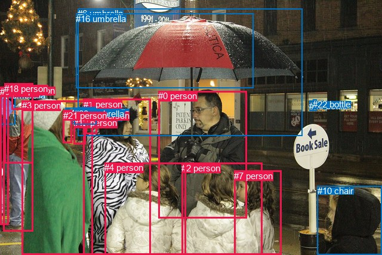
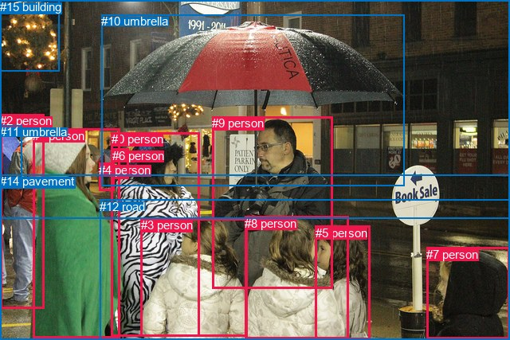

# 图片 2159：498242.jpg

随机样本序号：60。图片 SHA256：`4ce2042f89dc1e28f164973a31a1a3862468c668081ba1ff745d862f32cfe2b7`。

红色框表示人，蓝色框表示其他物体。两个模式分别保留自身框编号，可依据位置比较对应对象。

## 自动检测框与输出

人的框编号：`[0, 1, 2, 3, 4, 5, 7, 9, 12, 14, 17, 18, 21]`。状态：`ok`。

### 自动检测全部物体框

| 编号 | 类别 | 是否为人 | 检测分数 | 像素坐标 xyxy |
|---|---|---|---|---|
| 0 | person | True | 0.9988 | 265.4, 152.5, 413.8, 365.7 |
| 1 | person | True | 0.9977 | 139.8, 165.9, 253.0, 427.0 |
| 2 | person | True | 0.9954 | 304.5, 272.7, 439.9, 427.0 |
| 3 | person | True | 0.9942 | 36.9, 168.5, 156.0, 427.0 |
| 4 | person | True | 0.9933 | 175.3, 272.1, 311.9, 427.0 |
| 5 | person | True | 0.9904 | 5.7, 146.3, 55.7, 387.9 |
| 6 | umbrella | False | 0.9832 | 130.2, 14.4, 506.8, 227.2 |
| 7 | person | True | 0.9824 | 392.4, 286.0, 471.2, 426.2 |
| 8 | umbrella | False | 0.9342 | 0.1, 150.6, 25.8, 208.4 |
| 9 | person | True | 0.9200 | 0.0, 145.0, 14.5, 377.0 |
| 10 | chair | False | 0.8983 | 532.0, 311.1, 640.0, 426.7 |
| 11 | umbrella | False | 0.8602 | 120.8, 188.1, 146.0, 207.7 |
| 12 | person | True | 0.8440 | 123.4, 197.0, 143.4, 241.1 |
| 13 | umbrella | False | 0.8422 | 132.8, 179.9, 160.2, 191.3 |
| 14 | person | True | 0.7528 | 143.6, 184.8, 162.1, 224.7 |
| 15 | umbrella | False | 0.6495 | 109.9, 180.9, 129.1, 201.1 |
| 16 | umbrella | False | 0.5971 | 127.4, 22.5, 424.0, 147.6 |
| 17 | person | True | 0.5511 | 19.1, 142.6, 55.1, 183.6 |
| 18 | person | True | 0.4810 | 7.2, 139.9, 55.5, 273.8 |
| 19 | bottle | False | 0.4204 | 518.3, 168.7, 524.9, 185.9 |
| 20 | umbrella | False | 0.4202 | 124.2, 181.9, 161.5, 208.9 |
| 21 | person | True | 0.4088 | 105.7, 184.8, 120.8, 239.7 |
| 22 | bottle | False | 0.3627 | 524.0, 166.2, 530.5, 185.8 |

### 自动检测 Top50 人相关候选

评分物体对：506；人相关物体对：416；输出关系：50。

| 排名 | 主语编号与类别 | 关系 | 宾语编号与类别 | 类型 | 人与人 | 排序分数 | 原始融合 logit |
|---|---|---|---|---|---|---|---|
| 1 | #5 person | wearing | #18 person | semantic | True | 0.97292 | 3.5815 |
| 2 | #5 person | wearing | #17 person | semantic | True | 0.97064 | 3.4983 |
| 3 | #18 person | wearing | #17 person | semantic | True | 0.96574 | 3.3389 |
| 4 | #0 person | holding | #16 umbrella | semantic | False | 0.96527 | 3.3249 |
| 5 | #9 person | wearing | #8 umbrella | semantic | False | 0.96193 | 3.2296 |
| 6 | #0 person | holding | #6 umbrella | semantic | False | 0.96190 | 3.2286 |
| 7 | #18 person | wearing | #8 umbrella | semantic | False | 0.94789 | 2.9009 |
| 8 | #5 person | wearing | #8 umbrella | semantic | False | 0.94408 | 2.8264 |
| 9 | #5 person | in | #18 person | spatial | True | 0.94202 | 2.7880 |
| 10 | #14 person | wearing | #13 umbrella | semantic | False | 0.94026 | 2.7561 |
| 11 | #3 person | talking to | #21 person | semantic | True | 0.91708 | 2.4034 |
| 12 | #3 person | wearing | #15 umbrella | semantic | False | 0.91603 | 2.3895 |
| 13 | #21 person | wearing | #15 umbrella | semantic | False | 0.91541 | 2.3816 |
| 14 | #18 person | in | #17 person | spatial | True | 0.89772 | 2.1721 |
| 15 | #5 person | in | #17 person | spatial | True | 0.89652 | 2.1592 |
| 16 | #9 person | in | #8 umbrella | spatial | False | 0.86708 | 1.8754 |
| 17 | #14 person | in | #13 umbrella | spatial | False | 0.85894 | 1.8065 |
| 18 | #21 person | in | #15 umbrella | spatial | False | 0.83934 | 1.6533 |
| 19 | #14 person | wearing | #20 umbrella | semantic | False | 0.83680 | 1.6346 |
| 20 | #18 person | in | #8 umbrella | spatial | False | 0.81897 | 1.5094 |
| 21 | #5 person | in | #8 umbrella | spatial | False | 0.81391 | 1.4756 |
| 22 | #1 person | wearing | #13 umbrella | semantic | False | 0.81167 | 1.4609 |
| 23 | #14 person | in | #20 umbrella | spatial | False | 0.78953 | 1.3221 |
| 24 | #3 person | wearing | #13 umbrella | semantic | False | 0.76927 | 1.2042 |
| 25 | #3 person | wearing | #11 umbrella | semantic | False | 0.76108 | 1.1586 |
| 26 | #9 person | holding | #18 person | semantic | True | 0.69950 | 0.8449 |
| 27 | #3 person | in | #15 umbrella | spatial | False | 0.69490 | 0.8231 |
| 28 | #9 person | wearing | #17 person | semantic | True | 0.69369 | 0.8174 |
| 29 | #7 person | looking at | #0 person | semantic | True | 0.68920 | 0.7964 |
| 30 | #17 person | on | #18 person | spatial | True | 0.68538 | 0.7786 |
| 31 | #3 person | in | #21 person | spatial | True | 0.66937 | 0.7053 |
| 32 | #1 person | in | #4 person | spatial | True | 0.66328 | 0.6779 |
| 33 | #3 person | wearing | #12 person | semantic | True | 0.65652 | 0.6478 |
| 34 | #7 person | looking at | #2 person | semantic | True | 0.65647 | 0.6476 |
| 35 | #14 person | holding | #11 umbrella | semantic | False | 0.64297 | 0.5883 |
| 36 | #17 person | wearing | #8 umbrella | semantic | False | 0.64178 | 0.5831 |
| 37 | #1 person | holding | #4 person | semantic | True | 0.63268 | 0.5437 |
| 38 | #18 person | on | #5 person | spatial | True | 0.63208 | 0.5412 |
| 39 | #0 person | in | #6 umbrella | spatial | False | 0.62073 | 0.4927 |
| 40 | #1 person | holding | #6 umbrella | semantic | False | 0.60998 | 0.4472 |
| 41 | #1 person | holding | #16 umbrella | semantic | False | 0.60231 | 0.4151 |
| 42 | #5 person | holding | #9 person | semantic | True | 0.60036 | 0.4070 |
| 43 | #12 person | carrying | #11 umbrella | semantic | False | 0.59217 | 0.3730 |
| 44 | #2 person | looking at | #0 person | semantic | True | 0.59056 | 0.3663 |
| 45 | #7 person | beside | #2 person | spatial | True | 0.58466 | 0.3419 |
| 46 | #3 person | wearing | #20 umbrella | semantic | False | 0.57927 | 0.3198 |
| 47 | #3 person | wearing | #18 person | semantic | True | 0.56363 | 0.2559 |
| 48 | #5 person | beside | #9 person | spatial | True | 0.56350 | 0.2554 |
| 49 | #12 person | in | #11 umbrella | spatial | False | 0.55316 | 0.2134 |
| 50 | #1 person | wearing | #14 person | semantic | True | 0.54749 | 0.1905 |

### 自动检测逐条人相关 GT 核验

R@50：8.33%；命中 1/12。

| GT 主语编号 | GT 关系 | GT 宾语编号 | 结果阶段 | 匹配预测主语编号 | 匹配预测宾语编号 |
|---|---|---|---|---|---|
| 0 | beside | 9 | rank_below50 | [1] | [0] |
| 0 | looking at | 9 | rank_below50 | [1] | [0] |
| 1 | beside | 0 | rank_below50 | [3] | [1] |
| 1 | looking at | 9 | rank_below50 | [3] | [0] |
| 2 | standing on | 14 | endpoint_missing_or_wrong_class | [5] | [] |
| 3 | looking at | 1 | wrong_predicate | [4] | [3] |
| 3 | beside | 8 | wrong_predicate | [4] | [2] |
| 6 | beside | 4 | wrong_predicate | [14] | [12] |
| 8 | beside | 5 | wrong_predicate | [2] | [7] |
| 8 | attached to | 5 | wrong_predicate | [2] | [7] |
| 9 | looking at | 0 | wrong_predicate | [0] | [1] |
| 9 | holding | 10 | hit50 | [0] | [6] |

## 真实框与输出

人的框编号：`[0, 1, 2, 3, 4, 5, 6, 7, 8, 9]`。

### 真实框全部物体框

| 编号 | 类别 | 是否为人 | 检测分数 | 像素坐标 xyxy |
|---|---|---|---|---|
| 0 | person | True | GT | 140.0, 166.0, 251.0, 422.0 |
| 1 | person | True | GT | 41.0, 162.0, 150.0, 425.0 |
| 2 | person | True | GT | 0.0, 143.0, 55.0, 387.0 |
| 3 | person | True | GT | 177.0, 274.0, 311.0, 422.0 |
| 4 | person | True | GT | 124.0, 205.0, 143.0, 240.0 |
| 5 | person | True | GT | 396.0, 284.0, 465.0, 427.0 |
| 6 | person | True | GT | 141.0, 187.0, 162.0, 225.0 |
| 7 | person | True | GT | 535.0, 311.0, 639.0, 426.0 |
| 8 | person | True | GT | 307.0, 272.0, 437.0, 426.0 |
| 9 | person | True | GT | 266.0, 146.0, 417.0, 363.0 |
| 10 | umbrella | False | GT | 127.0, 18.0, 508.0, 234.0 |
| 11 | umbrella | False | GT | 0.0, 157.0, 28.0, 223.0 |
| 12 | road | False | GT | 125.0, 251.0, 640.0, 427.0 |
| 13 | tree | False | GT | 0.0, 0.0, 74.0, 89.0 |
| 14 | pavement | False | GT | 0.0, 219.0, 640.0, 427.0 |
| 15 | building | False | GT | 0.0, 0.0, 640.0, 274.0 |

### 真实框 Top50 人相关候选

评分物体对：240；人相关物体对：210；输出关系：50。

| 排名 | 主语编号与类别 | 关系 | 宾语编号与类别 | 类型 | 人与人 | 排序分数 | 原始融合 logit |
|---|---|---|---|---|---|---|---|
| 1 | #2 person | wearing | #11 umbrella | semantic | False | 0.98824 | 4.4314 |
| 2 | #2 person | standing on | #14 pavement | semantic | False | 0.97459 | 3.6470 |
| 3 | #9 person | holding | #10 umbrella | semantic | False | 0.96774 | 3.4010 |
| 4 | #9 person | standing on | #14 pavement | semantic | False | 0.96502 | 3.3174 |
| 5 | #0 person | walking on | #14 pavement | semantic | False | 0.94250 | 2.7968 |
| 6 | #2 person | in | #11 umbrella | spatial | False | 0.94194 | 2.7864 |
| 7 | #1 person | walking on | #14 pavement | semantic | False | 0.94119 | 2.7729 |
| 8 | #1 person | wearing | #4 person | semantic | True | 0.92683 | 2.5390 |
| 9 | #7 person | in | #12 road | spatial | False | 0.92550 | 2.5196 |
| 10 | #7 person | standing on | #14 pavement | semantic | False | 0.91630 | 2.3931 |
| 11 | #9 person | on | #14 pavement | spatial | False | 0.91002 | 2.3139 |
| 12 | #6 person | walking on | #14 pavement | semantic | False | 0.89264 | 2.1180 |
| 13 | #5 person | standing on | #14 pavement | semantic | False | 0.88457 | 2.0364 |
| 14 | #7 person | on | #14 pavement | spatial | False | 0.86532 | 1.8602 |
| 15 | #6 person | wearing | #4 person | semantic | True | 0.86419 | 1.8506 |
| 16 | #0 person | on | #14 pavement | spatial | False | 0.85974 | 1.8131 |
| 17 | #7 person | standing on | #12 road | semantic | False | 0.84551 | 1.6998 |
| 18 | #8 person | in | #12 road | spatial | False | 0.84274 | 1.6788 |
| 19 | #8 person | standing on | #14 pavement | semantic | False | 0.83882 | 1.6495 |
| 20 | #0 person | wearing | #6 person | semantic | True | 0.83881 | 1.6494 |
| 21 | #9 person | looking at | #12 road | semantic | False | 0.83220 | 1.6013 |
| 22 | #5 person | in | #12 road | spatial | False | 0.82971 | 1.5836 |
| 23 | #3 person | walking on | #14 pavement | semantic | False | 0.82003 | 1.5166 |
| 24 | #10 umbrella | over | #9 person | spatial | False | 0.81081 | 1.4553 |
| 25 | #11 umbrella | on | #2 person | spatial | False | 0.80734 | 1.4328 |
| 26 | #2 person | on | #14 pavement | spatial | False | 0.80397 | 1.4113 |
| 27 | #9 person | beside | #12 road | spatial | False | 0.78877 | 1.3175 |
| 28 | #3 person | on | #14 pavement | spatial | False | 0.78776 | 1.3115 |
| 29 | #0 person | beside | #3 person | spatial | True | 0.78450 | 1.2921 |
| 30 | #1 person | on | #14 pavement | spatial | False | 0.77166 | 1.2177 |
| 31 | #6 person | on | #4 person | spatial | True | 0.75430 | 1.1217 |
| 32 | #3 person | in | #12 road | spatial | False | 0.75373 | 1.1186 |
| 33 | #8 person | on | #14 pavement | spatial | False | 0.74355 | 1.0645 |
| 34 | #1 person | beside | #2 person | spatial | True | 0.74107 | 1.0515 |
| 35 | #9 person | in front of | #15 building | spatial | False | 0.72948 | 0.9920 |
| 36 | #0 person | holding | #10 umbrella | semantic | False | 0.70781 | 0.8848 |
| 37 | #9 person | looking at | #8 person | semantic | True | 0.70660 | 0.8789 |
| 38 | #5 person | on | #14 pavement | spatial | False | 0.69802 | 0.8379 |
| 39 | #1 person | in | #4 person | spatial | True | 0.69279 | 0.8132 |
| 40 | #9 person | beside | #8 person | spatial | True | 0.67430 | 0.7277 |
| 41 | #9 person | beside | #3 person | spatial | True | 0.67093 | 0.7124 |
| 42 | #0 person | in | #6 person | spatial | True | 0.66235 | 0.6738 |
| 43 | #0 person | wearing | #4 person | semantic | True | 0.66035 | 0.6649 |
| 44 | #9 person | talking to | #0 person | semantic | True | 0.65631 | 0.6469 |
| 45 | #0 person | holding | #3 person | semantic | True | 0.64160 | 0.5823 |
| 46 | #5 person | standing on | #12 road | semantic | False | 0.63926 | 0.5722 |
| 47 | #2 person | beside | #1 person | spatial | True | 0.63304 | 0.5453 |
| 48 | #1 person | wearing | #6 person | semantic | True | 0.63222 | 0.5418 |
| 49 | #5 person | beside | #8 person | spatial | True | 0.61988 | 0.4890 |
| 50 | #13 tree | over | #2 person | spatial | False | 0.61048 | 0.4493 |

### 真实框逐条人相关 GT 核验

R@50：16.67%；命中 2/12。

| GT 主语编号 | GT 关系 | GT 宾语编号 | 结果阶段 | 匹配预测主语编号 | 匹配预测宾语编号 |
|---|---|---|---|---|---|
| 0 | beside | 9 | rank_below50 | [0] | [9] |
| 0 | looking at | 9 | rank_below50 | [0] | [9] |
| 1 | beside | 0 | rank_below50 | [1] | [0] |
| 1 | looking at | 9 | rank_below50 | [1] | [9] |
| 2 | standing on | 14 | hit50 | [2] | [14] |
| 3 | looking at | 1 | wrong_predicate | [3] | [1] |
| 3 | beside | 8 | rank_below50 | [3] | [8] |
| 6 | beside | 4 | wrong_predicate | [6] | [4] |
| 8 | beside | 5 | rank_below50 | [8] | [5] |
| 8 | attached to | 5 | wrong_predicate | [8] | [5] |
| 9 | looking at | 0 | wrong_predicate | [9] | [0] |
| 9 | holding | 10 | hit50 | [9] | [10] |

## 全部人相关 GT

| 主语编号与类别 | 关系 | 宾语编号与类别 |
|---|---|---|
| #0 person | beside | #9 person |
| #0 person | looking at | #9 person |
| #1 person | beside | #0 person |
| #1 person | looking at | #9 person |
| #2 person | standing on | #14 pavement |
| #3 person | looking at | #1 person |
| #3 person | beside | #8 person |
| #6 person | beside | #4 person |
| #8 person | beside | #5 person |
| #8 person | attached to | #5 person |
| #9 person | looking at | #0 person |
| #9 person | holding | #10 umbrella |

原始记录、全部人相关物体对的两项预测与分项分数见 [逐图证据 JSON](../evidence/cases/2159.json)。全部56类 logits 保留于本机 HOR/output/random500/logits/。

<!-- HOR_COMPLETE_RESULTS -->

## 六组条件的完整输出对照

以下保留同一图片三种框与候选模式、两种谓词输出规则的全部 Top50。框编号各自在所属模式内解释。

### 自动检测框完整枚举：空间与语义各保留一个谓词

| 排名 | 主语编号与类别 | 谓词 | 宾语编号与类别 | 分组 | 排序分数 | predicate logit | pair logit |
|---|---|---|---|---|---|---|---|
| 1 | #5 person | wearing | #18 person | semantic | 0.9729197 | 3.5865645 | -0.0050698 |
| 2 | #5 person | wearing | #17 person | semantic | 0.9706399 | 2.9523926 | 0.5459260 |
| 3 | #18 person | wearing | #17 person | semantic | 0.9657389 | 3.0844936 | 0.2543893 |
| 4 | #0 person | holding | #16 umbrella | semantic | 0.9652730 | 3.1290903 | 0.1958003 |
| 5 | #9 person | wearing | #8 umbrella | semantic | 0.9619341 | 2.9964747 | 0.2331517 |
| 6 | #0 person | holding | #6 umbrella | semantic | 0.9618975 | 3.1800714 | 0.0485551 |
| 7 | #18 person | wearing | #8 umbrella | semantic | 0.9478922 | 2.7835813 | 0.1173441 |
| 8 | #5 person | wearing | #8 umbrella | semantic | 0.9440842 | 2.4283543 | 0.3980135 |
| 9 | #5 person | in | #18 person | spatial | 0.9420213 | 2.7930207 | -0.0050698 |
| 10 | #14 person | wearing | #13 umbrella | semantic | 0.9402574 | 2.8524923 | -0.0963848 |
| 11 | #3 person | talking to | #21 person | semantic | 0.9170827 | 2.5738168 | -0.1704626 |
| 12 | #3 person | wearing | #15 umbrella | semantic | 0.9160262 | 2.7336311 | -0.3440903 |
| 13 | #21 person | wearing | #15 umbrella | semantic | 0.9154121 | 2.8422604 | -0.4606783 |
| 14 | #18 person | in | #17 person | spatial | 0.8977153 | 1.9177032 | 0.2543893 |
| 15 | #5 person | in | #17 person | spatial | 0.8965231 | 1.6132493 | 0.5459260 |
| 16 | #9 person | in | #8 umbrella | spatial | 0.8670818 | 1.6422477 | 0.2331517 |
| 17 | #14 person | in | #13 umbrella | spatial | 0.8589390 | 1.9028907 | -0.0963848 |
| 18 | #21 person | in | #15 umbrella | spatial | 0.8393359 | 2.1139741 | -0.4606783 |
| 19 | #14 person | wearing | #20 umbrella | semantic | 0.8368022 | 1.7383642 | -0.1037390 |
| 20 | #18 person | in | #8 umbrella | spatial | 0.8189650 | 1.3920069 | 0.1173441 |
| 21 | #5 person | in | #8 umbrella | spatial | 0.8139086 | 1.0775971 | 0.3980135 |
| 22 | #1 person | wearing | #13 umbrella | semantic | 0.8116735 | 1.8925796 | -0.4316589 |
| 23 | #14 person | in | #20 umbrella | spatial | 0.7895347 | 1.4258623 | -0.1037390 |
| 24 | #3 person | wearing | #13 umbrella | semantic | 0.7692730 | 1.9930859 | -0.7888753 |
| 25 | #3 person | wearing | #11 umbrella | semantic | 0.7610775 | 1.7809434 | -0.6223478 |
| 26 | #9 person | holding | #18 person | semantic | 0.6994997 | 0.9778414 | -0.1329244 |
| 27 | #3 person | in | #15 umbrella | spatial | 0.6948967 | 1.1672029 | -0.3440903 |
| 28 | #9 person | wearing | #17 person | semantic | 0.6936874 | 0.4598627 | 0.3575525 |
| 29 | #7 person | looking at | #0 person | semantic | 0.6891999 | 1.9356213 | -1.1392398 |
| 30 | #17 person | on | #18 person | spatial | 0.6853781 | 1.1638966 | -0.3852975 |
| 31 | #3 person | in | #21 person | spatial | 0.6693705 | 0.8758016 | -0.1704626 |
| 32 | #1 person | in | #4 person | spatial | 0.6632791 | 1.1253748 | -0.4474332 |
| 33 | #3 person | wearing | #12 person | semantic | 0.6565207 | 1.1746082 | -0.5267808 |
| 34 | #7 person | looking at | #2 person | semantic | 0.6564669 | 1.3232284 | -0.6756395 |
| 35 | #14 person | holding | #11 umbrella | semantic | 0.6429721 | 0.6664190 | -0.0781315 |
| 36 | #17 person | wearing | #8 umbrella | semantic | 0.6417791 | 0.8199868 | -0.2368927 |
| 37 | #1 person | holding | #4 person | semantic | 0.6326823 | 0.9911747 | -0.4474332 |
| 38 | #18 person | on | #5 person | spatial | 0.6320799 | 1.2699256 | -0.7287756 |
| 39 | #0 person | in | #6 umbrella | spatial | 0.6207324 | 0.4441028 | 0.0485551 |
| 40 | #1 person | holding | #6 umbrella | semantic | 0.6099764 | 0.8754110 | -0.4281983 |
| 41 | #1 person | holding | #16 umbrella | semantic | 0.6023057 | 0.6403799 | -0.2252984 |
| 42 | #5 person | holding | #9 person | semantic | 0.6003636 | 0.6167464 | -0.2097661 |
| 43 | #12 person | carrying | #11 umbrella | semantic | 0.5921742 | 0.8652964 | -0.4923358 |
| 44 | #2 person | looking at | #0 person | semantic | 0.5905612 | 1.3971167 | -1.0308309 |
| 45 | #7 person | beside | #2 person | spatial | 0.5846636 | 1.0175877 | -0.6756395 |
| 46 | #3 person | wearing | #20 umbrella | semantic | 0.5792749 | 1.0300927 | -0.7102951 |
| 47 | #3 person | wearing | #18 person | semantic | 0.5636308 | 0.7687521 | -0.5128413 |
| 48 | #5 person | beside | #9 person | spatial | 0.5634967 | 0.4651318 | -0.2097661 |
| 49 | #12 person | in | #11 umbrella | spatial | 0.5531586 | 0.7057772 | -0.4923358 |
| 50 | #1 person | wearing | #14 person | semantic | 0.5474913 | 0.5662370 | -0.3756976 |

GT 命中：1/12，R@50=8.33%。

| GT主语 | GT谓词 | GT宾语 | 结果阶段 | 匹配主语框 | 匹配宾语框 |
|---|---|---|---|---|---|
| 0 | beside | 9 | rank_below50 | [1] | [0] |
| 0 | looking at | 9 | rank_below50 | [1] | [0] |
| 1 | beside | 0 | rank_below50 | [3] | [1] |
| 1 | looking at | 9 | rank_below50 | [3] | [0] |
| 2 | standing on | 14 | endpoint_missing_or_wrong_class | [5] | [] |
| 3 | looking at | 1 | wrong_predicate | [4] | [3] |
| 3 | beside | 8 | wrong_predicate | [4] | [2] |
| 6 | beside | 4 | wrong_predicate | [14] | [12] |
| 8 | beside | 5 | wrong_predicate | [2] | [7] |
| 8 | attached to | 5 | wrong_predicate | [2] | [7] |
| 9 | looking at | 0 | wrong_predicate | [0] | [1] |
| 9 | holding | 10 | hit50 | [0] | [6] |

### 自动检测框完整枚举：每对只保留一个谓词

| 排名 | 主语编号与类别 | 谓词 | 宾语编号与类别 | 分组 | 排序分数 | predicate logit | pair logit |
|---|---|---|---|---|---|---|---|
| 1 | #5 person | wearing | #18 person | single | 0.9729197 | 3.5865645 | -0.0050698 |
| 2 | #5 person | wearing | #17 person | single | 0.9706399 | 2.9523926 | 0.5459260 |
| 3 | #18 person | wearing | #17 person | single | 0.9657389 | 3.0844936 | 0.2543893 |
| 4 | #0 person | holding | #16 umbrella | single | 0.9652730 | 3.1290903 | 0.1958003 |
| 5 | #9 person | wearing | #8 umbrella | single | 0.9619341 | 2.9964747 | 0.2331517 |
| 6 | #0 person | holding | #6 umbrella | single | 0.9618975 | 3.1800714 | 0.0485551 |
| 7 | #18 person | wearing | #8 umbrella | single | 0.9478922 | 2.7835813 | 0.1173441 |
| 8 | #5 person | wearing | #8 umbrella | single | 0.9440842 | 2.4283543 | 0.3980135 |
| 9 | #14 person | wearing | #13 umbrella | single | 0.9402574 | 2.8524923 | -0.0963848 |
| 10 | #3 person | talking to | #21 person | single | 0.9170827 | 2.5738168 | -0.1704626 |
| 11 | #3 person | wearing | #15 umbrella | single | 0.9160262 | 2.7336311 | -0.3440903 |
| 12 | #21 person | wearing | #15 umbrella | single | 0.9154121 | 2.8422604 | -0.4606783 |
| 13 | #14 person | wearing | #20 umbrella | single | 0.8368022 | 1.7383642 | -0.1037390 |
| 14 | #1 person | wearing | #13 umbrella | single | 0.8116735 | 1.8925796 | -0.4316589 |
| 15 | #3 person | wearing | #13 umbrella | single | 0.7692730 | 1.9930859 | -0.7888753 |
| 16 | #3 person | wearing | #11 umbrella | single | 0.7610775 | 1.7809434 | -0.6223478 |
| 17 | #9 person | holding | #18 person | single | 0.6994997 | 0.9778414 | -0.1329244 |
| 18 | #9 person | wearing | #17 person | single | 0.6936874 | 0.4598627 | 0.3575525 |
| 19 | #7 person | looking at | #0 person | single | 0.6891999 | 1.9356213 | -1.1392398 |
| 20 | #17 person | on | #18 person | single | 0.6853781 | 1.1638966 | -0.3852975 |
| 21 | #1 person | in | #4 person | single | 0.6632791 | 1.1253748 | -0.4474332 |
| 22 | #3 person | wearing | #12 person | single | 0.6565207 | 1.1746082 | -0.5267808 |
| 23 | #7 person | looking at | #2 person | single | 0.6564669 | 1.3232284 | -0.6756395 |
| 24 | #14 person | holding | #11 umbrella | single | 0.6429721 | 0.6664190 | -0.0781315 |
| 25 | #17 person | wearing | #8 umbrella | single | 0.6417791 | 0.8199868 | -0.2368927 |
| 26 | #18 person | on | #5 person | single | 0.6320799 | 1.2699256 | -0.7287756 |
| 27 | #1 person | holding | #6 umbrella | single | 0.6099764 | 0.8754110 | -0.4281983 |
| 28 | #1 person | holding | #16 umbrella | single | 0.6023057 | 0.6403799 | -0.2252984 |
| 29 | #5 person | holding | #9 person | single | 0.6003636 | 0.6167464 | -0.2097661 |
| 30 | #12 person | carrying | #11 umbrella | single | 0.5921742 | 0.8652964 | -0.4923358 |
| 31 | #2 person | looking at | #0 person | single | 0.5905612 | 1.3971167 | -1.0308309 |
| 32 | #3 person | wearing | #20 umbrella | single | 0.5792749 | 1.0300927 | -0.7102951 |
| 33 | #3 person | wearing | #18 person | single | 0.5636308 | 0.7687521 | -0.5128413 |
| 34 | #1 person | wearing | #14 person | single | 0.5474913 | 0.5662370 | -0.3756976 |
| 35 | #6 umbrella | over | #0 person | single | 0.5431783 | 0.7278814 | -0.5547371 |
| 36 | #8 umbrella | wearing | #17 person | single | 0.5223584 | 0.2056746 | -0.1161813 |
| 37 | #3 person | wearing | #17 person | single | 0.5156729 | 0.1523304 | -0.0896182 |
| 38 | #0 person | looking at | #2 person | single | 0.5081896 | 0.7685785 | -0.7358171 |
| 39 | #0 person | looking at | #4 person | single | 0.5023640 | 0.7122312 | -0.7027750 |
| 40 | #1 person | looking at | #0 person | single | 0.5019310 | 0.9889135 | -0.9811898 |
| 41 | #20 umbrella | walking on | #12 person | single | 0.4986903 | 0.0422053 | -0.0474442 |
| 42 | #9 person | looking at | #5 person | single | 0.4630704 | 0.4490137 | -0.5970013 |
| 43 | #3 person | beside | #5 person | single | 0.4613370 | 0.7328591 | -0.8878204 |
| 44 | #1 person | wearing | #20 umbrella | single | 0.4572920 | 0.3057203 | -0.4769696 |
| 45 | #3 person | beside | #1 person | single | 0.4519624 | 0.9811931 | -1.1739380 |
| 46 | #4 person | looking at | #0 person | single | 0.4469095 | 0.9910049 | -1.2041703 |
| 47 | #8 umbrella | wearing | #18 person | single | 0.4395516 | 0.2253876 | -0.4683696 |
| 48 | #18 person | wearing | #9 person | single | 0.4347452 | 0.2775931 | -0.5401098 |
| 49 | #15 umbrella | on | #21 person | single | 0.4284391 | -0.0646896 | -0.2235329 |
| 50 | #16 umbrella | over | #0 person | single | 0.4252419 | 0.4580665 | -0.7593576 |

GT 命中：3/12，R@50=25.00%。

| GT主语 | GT谓词 | GT宾语 | 结果阶段 | 匹配主语框 | 匹配宾语框 |
|---|---|---|---|---|---|
| 0 | beside | 9 | wrong_predicate | [1] | [0] |
| 0 | looking at | 9 | hit50 | [1] | [0] |
| 1 | beside | 0 | hit50 | [3] | [1] |
| 1 | looking at | 9 | rank_below50 | [3] | [0] |
| 2 | standing on | 14 | endpoint_missing_or_wrong_class | [5] | [] |
| 3 | looking at | 1 | wrong_predicate | [4] | [3] |
| 3 | beside | 8 | wrong_predicate | [4] | [2] |
| 6 | beside | 4 | wrong_predicate | [14] | [12] |
| 8 | beside | 5 | wrong_predicate | [2] | [7] |
| 8 | attached to | 5 | wrong_predicate | [2] | [7] |
| 9 | looking at | 0 | wrong_predicate | [0] | [1] |
| 9 | holding | 10 | hit50 | [0] | [6] |

### 真实框完整枚举：空间与语义各保留一个谓词

| 排名 | 主语编号与类别 | 谓词 | 宾语编号与类别 | 分组 | 排序分数 | predicate logit | pair logit |
|---|---|---|---|---|---|---|---|
| 1 | #2 person | wearing | #11 umbrella | semantic | 0.9882422 | 3.9432940 | 0.4881141 |
| 2 | #2 person | standing on | #14 pavement | semantic | 0.9745920 | 3.6517625 | -0.0048047 |
| 3 | #9 person | holding | #10 umbrella | semantic | 0.9677354 | 3.3971667 | 0.0038203 |
| 4 | #9 person | standing on | #14 pavement | semantic | 0.9650196 | 3.6797099 | -0.3623489 |
| 5 | #0 person | walking on | #14 pavement | semantic | 0.9425046 | 2.9640946 | -0.1672590 |
| 6 | #2 person | in | #11 umbrella | spatial | 0.9419366 | 2.2982864 | 0.4881141 |
| 7 | #1 person | walking on | #14 pavement | semantic | 0.9411923 | 3.1085443 | -0.3356693 |
| 8 | #1 person | wearing | #4 person | semantic | 0.9268288 | 3.0330405 | -0.4940736 |
| 9 | #7 person | in | #12 road | spatial | 0.9255034 | 3.2474856 | -0.7279012 |
| 10 | #7 person | standing on | #14 pavement | semantic | 0.9162993 | 2.7316771 | -0.3385817 |
| 11 | #9 person | on | #14 pavement | spatial | 0.9100194 | 2.6762204 | -0.3623489 |
| 12 | #6 person | walking on | #14 pavement | semantic | 0.8926418 | 2.5036387 | -0.3856235 |
| 13 | #5 person | standing on | #14 pavement | semantic | 0.8845674 | 2.4724879 | -0.4360756 |
| 14 | #7 person | on | #14 pavement | spatial | 0.8653173 | 2.1987572 | -0.3385817 |
| 15 | #6 person | wearing | #4 person | semantic | 0.8641918 | 1.7749295 | 0.0756214 |
| 16 | #0 person | on | #14 pavement | spatial | 0.8597394 | 1.9803858 | -0.1672590 |
| 17 | #7 person | standing on | #12 road | semantic | 0.8455095 | 2.4277081 | -0.7279012 |
| 18 | #8 person | in | #12 road | spatial | 0.8427432 | 2.3575778 | -0.6787959 |
| 19 | #8 person | standing on | #14 pavement | semantic | 0.8388192 | 2.1495428 | -0.5000746 |
| 20 | #0 person | wearing | #6 person | semantic | 0.8388088 | 2.0826073 | -0.4332160 |
| 21 | #9 person | looking at | #12 road | semantic | 0.8322016 | 1.9539909 | -0.3526796 |
| 22 | #5 person | in | #12 road | spatial | 0.8297116 | 2.2177458 | -0.6341612 |
| 23 | #3 person | walking on | #14 pavement | semantic | 0.8200321 | 1.8628025 | -0.3462377 |
| 24 | #10 umbrella | over | #9 person | spatial | 0.8108085 | 1.9638915 | -0.5086191 |
| 25 | #11 umbrella | on | #2 person | spatial | 0.8073381 | 2.3191223 | -0.8863169 |
| 26 | #2 person | on | #14 pavement | spatial | 0.8039694 | 1.4160953 | -0.0048047 |
| 27 | #9 person | beside | #12 road | spatial | 0.7887735 | 1.6702275 | -0.3526796 |
| 28 | #3 person | on | #14 pavement | spatial | 0.7877568 | 1.6576943 | -0.3462377 |
| 29 | #0 person | beside | #3 person | spatial | 0.7845030 | 1.7382741 | -0.4461707 |
| 30 | #1 person | on | #14 pavement | spatial | 0.7716593 | 1.5533738 | -0.3356693 |
| 31 | #6 person | on | #4 person | spatial | 0.7543043 | 1.0460806 | 0.0756214 |
| 32 | #3 person | in | #12 road | spatial | 0.7537301 | 2.0531240 | -0.9345176 |
| 33 | #8 person | on | #14 pavement | spatial | 0.7435455 | 1.5645533 | -0.5000746 |
| 34 | #1 person | beside | #2 person | spatial | 0.7410691 | 1.9345145 | -0.8829817 |
| 35 | #9 person | in front of | #15 building | spatial | 0.7294843 | 1.7902031 | -0.7981955 |
| 36 | #0 person | holding | #10 umbrella | semantic | 0.7078110 | 1.3173680 | -0.4325918 |
| 37 | #9 person | looking at | #8 person | semantic | 0.7065953 | 1.5540886 | -0.6751835 |
| 38 | #5 person | on | #14 pavement | spatial | 0.6980177 | 1.2739515 | -0.4360756 |
| 39 | #1 person | in | #4 person | spatial | 0.6927877 | 1.3072581 | -0.4940736 |
| 40 | #9 person | beside | #8 person | spatial | 0.6742986 | 1.4028754 | -0.6751835 |
| 41 | #9 person | beside | #3 person | spatial | 0.6709299 | 1.3689675 | -0.6565736 |
| 42 | #0 person | in | #6 person | spatial | 0.6623546 | 1.1070209 | -0.4332160 |
| 43 | #0 person | wearing | #4 person | semantic | 0.6603515 | 1.0749264 | -0.4100657 |
| 44 | #9 person | talking to | #0 person | semantic | 0.6563101 | 1.7758589 | -1.1289655 |
| 45 | #0 person | holding | #3 person | semantic | 0.6415989 | 1.0284815 | -0.4461707 |
| 46 | #5 person | standing on | #12 road | semantic | 0.6392595 | 1.2063127 | -0.6341612 |
| 47 | #2 person | beside | #1 person | spatial | 0.6330373 | 1.3671746 | -0.8219054 |
| 48 | #1 person | wearing | #6 person | semantic | 0.6322204 | 1.2921124 | -0.7503580 |
| 49 | #5 person | beside | #8 person | spatial | 0.6198782 | 1.1981349 | -0.7091038 |
| 50 | #13 tree | over | #2 person | spatial | 0.6104760 | 1.0861363 | -0.6368228 |

GT 命中：2/12，R@50=16.67%。

| GT主语 | GT谓词 | GT宾语 | 结果阶段 | 匹配主语框 | 匹配宾语框 |
|---|---|---|---|---|---|
| 0 | beside | 9 | rank_below50 | [0] | [9] |
| 0 | looking at | 9 | rank_below50 | [0] | [9] |
| 1 | beside | 0 | rank_below50 | [1] | [0] |
| 1 | looking at | 9 | rank_below50 | [1] | [9] |
| 2 | standing on | 14 | hit50 | [2] | [14] |
| 3 | looking at | 1 | wrong_predicate | [3] | [1] |
| 3 | beside | 8 | rank_below50 | [3] | [8] |
| 6 | beside | 4 | wrong_predicate | [6] | [4] |
| 8 | beside | 5 | rank_below50 | [8] | [5] |
| 8 | attached to | 5 | wrong_predicate | [8] | [5] |
| 9 | looking at | 0 | wrong_predicate | [9] | [0] |
| 9 | holding | 10 | hit50 | [9] | [10] |

### 真实框完整枚举：每对只保留一个谓词

| 排名 | 主语编号与类别 | 谓词 | 宾语编号与类别 | 分组 | 排序分数 | predicate logit | pair logit |
|---|---|---|---|---|---|---|---|
| 1 | #2 person | wearing | #11 umbrella | single | 0.9882422 | 3.9432940 | 0.4881141 |
| 2 | #2 person | standing on | #14 pavement | single | 0.9745920 | 3.6517625 | -0.0048047 |
| 3 | #9 person | holding | #10 umbrella | single | 0.9677354 | 3.3971667 | 0.0038203 |
| 4 | #9 person | standing on | #14 pavement | single | 0.9650196 | 3.6797099 | -0.3623489 |
| 5 | #0 person | walking on | #14 pavement | single | 0.9425046 | 2.9640946 | -0.1672590 |
| 6 | #1 person | walking on | #14 pavement | single | 0.9411923 | 3.1085443 | -0.3356693 |
| 7 | #1 person | wearing | #4 person | single | 0.9268288 | 3.0330405 | -0.4940736 |
| 8 | #7 person | in | #12 road | single | 0.9255034 | 3.2474856 | -0.7279012 |
| 9 | #7 person | standing on | #14 pavement | single | 0.9162993 | 2.7316771 | -0.3385817 |
| 10 | #6 person | walking on | #14 pavement | single | 0.8926418 | 2.5036387 | -0.3856235 |
| 11 | #5 person | standing on | #14 pavement | single | 0.8845674 | 2.4724879 | -0.4360756 |
| 12 | #6 person | wearing | #4 person | single | 0.8641918 | 1.7749295 | 0.0756214 |
| 13 | #8 person | in | #12 road | single | 0.8427432 | 2.3575778 | -0.6787959 |
| 14 | #8 person | standing on | #14 pavement | single | 0.8388192 | 2.1495428 | -0.5000746 |
| 15 | #0 person | wearing | #6 person | single | 0.8388088 | 2.0826073 | -0.4332160 |
| 16 | #9 person | looking at | #12 road | single | 0.8322016 | 1.9539909 | -0.3526796 |
| 17 | #5 person | in | #12 road | single | 0.8297116 | 2.2177458 | -0.6341612 |
| 18 | #3 person | walking on | #14 pavement | single | 0.8200321 | 1.8628025 | -0.3462377 |
| 19 | #10 umbrella | over | #9 person | single | 0.8108085 | 1.9638915 | -0.5086191 |
| 20 | #11 umbrella | on | #2 person | single | 0.8073381 | 2.3191223 | -0.8863169 |
| 21 | #0 person | beside | #3 person | single | 0.7845030 | 1.7382741 | -0.4461707 |
| 22 | #3 person | in | #12 road | single | 0.7537301 | 2.0531240 | -0.9345176 |
| 23 | #1 person | beside | #2 person | single | 0.7410691 | 1.9345145 | -0.8829817 |
| 24 | #9 person | in front of | #15 building | single | 0.7294843 | 1.7902031 | -0.7981955 |
| 25 | #0 person | holding | #10 umbrella | single | 0.7078110 | 1.3173680 | -0.4325918 |
| 26 | #9 person | looking at | #8 person | single | 0.7065953 | 1.5540886 | -0.6751835 |
| 27 | #9 person | beside | #3 person | single | 0.6709299 | 1.3689675 | -0.6565736 |
| 28 | #0 person | wearing | #4 person | single | 0.6603515 | 1.0749264 | -0.4100657 |
| 29 | #9 person | talking to | #0 person | single | 0.6563101 | 1.7758589 | -1.1289655 |
| 30 | #2 person | beside | #1 person | single | 0.6330373 | 1.3671746 | -0.8219054 |
| 31 | #1 person | wearing | #6 person | single | 0.6322204 | 1.2921124 | -0.7503580 |
| 32 | #5 person | beside | #8 person | single | 0.6198782 | 1.1981349 | -0.7091038 |
| 33 | #13 tree | over | #2 person | single | 0.6104760 | 1.0861363 | -0.6368228 |
| 34 | #1 person | wearing | #11 umbrella | single | 0.6100684 | 0.6544013 | -0.2068014 |
| 35 | #0 person | in | #12 road | single | 0.6098924 | 1.0638771 | -0.6170172 |
| 36 | #1 person | beside | #0 person | single | 0.6062788 | 1.5820351 | -1.1503384 |
| 37 | #0 person | looking at | #9 person | single | 0.6011400 | 1.4004946 | -0.9902772 |
| 38 | #6 person | walking on | #15 building | single | 0.5795840 | 1.1525426 | -0.8314766 |
| 39 | #2 person | walking on | #15 building | single | 0.5285082 | 0.9720650 | -0.8579080 |
| 40 | #8 person | looking at | #9 person | single | 0.5114769 | 1.1146822 | -1.0687666 |
| 41 | #5 person | looking at | #9 person | single | 0.4921800 | 1.1188660 | -1.1501483 |
| 42 | #0 person | beside | #1 person | single | 0.4588087 | 0.7690511 | -0.9341908 |
| 43 | #12 road | looking at | #9 person | single | 0.4487415 | 0.7501006 | -0.9558575 |
| 44 | #3 person | beside | #0 person | single | 0.4224643 | 0.8949099 | -1.2075752 |
| 45 | #6 person | beside | #0 person | single | 0.4061316 | 0.7940826 | -1.1740630 |
| 46 | #1 person | looking at | #9 person | single | 0.3878003 | 0.9063749 | -1.3629428 |
| 47 | #4 person | walking on | #14 pavement | single | 0.3833003 | 0.0422192 | -0.5177827 |
| 48 | #12 road | looking at | #8 person | single | 0.3593260 | 0.1746192 | -0.7529099 |
| 49 | #3 person | looking at | #9 person | single | 0.3502202 | 0.6499567 | -1.2680283 |
| 50 | #8 person | beside | #5 person | single | 0.3436559 | 0.2985201 | -0.9455643 |

GT 命中：6/12，R@50=50.00%。

| GT主语 | GT谓词 | GT宾语 | 结果阶段 | 匹配主语框 | 匹配宾语框 |
|---|---|---|---|---|---|
| 0 | beside | 9 | wrong_predicate | [0] | [9] |
| 0 | looking at | 9 | hit50 | [0] | [9] |
| 1 | beside | 0 | hit50 | [1] | [0] |
| 1 | looking at | 9 | hit50 | [1] | [9] |
| 2 | standing on | 14 | hit50 | [2] | [14] |
| 3 | looking at | 1 | wrong_predicate | [3] | [1] |
| 3 | beside | 8 | rank_below50 | [3] | [8] |
| 6 | beside | 4 | wrong_predicate | [6] | [4] |
| 8 | beside | 5 | hit50 | [8] | [5] |
| 8 | attached to | 5 | wrong_predicate | [8] | [5] |
| 9 | looking at | 0 | wrong_predicate | [9] | [0] |
| 9 | holding | 10 | hit50 | [9] | [10] |

### 真实框400候选：空间与语义各保留一个谓词

| 排名 | 主语编号与类别 | 谓词 | 宾语编号与类别 | 分组 | 排序分数 | predicate logit | pair logit |
|---|---|---|---|---|---|---|---|
| 1 | #2 person | wearing | #11 umbrella | semantic | 0.9882422 | 3.9432940 | 0.4881141 |
| 2 | #2 person | standing on | #14 pavement | semantic | 0.9747733 | 3.6591067 | -0.0048047 |
| 3 | #9 person | holding | #10 umbrella | semantic | 0.9677354 | 3.3971667 | 0.0038203 |
| 4 | #9 person | standing on | #14 pavement | semantic | 0.9650196 | 3.6797099 | -0.3623489 |
| 5 | #0 person | walking on | #14 pavement | semantic | 0.9425046 | 2.9640946 | -0.1672590 |
| 6 | #2 person | in | #11 umbrella | spatial | 0.9419366 | 2.2982864 | 0.4881141 |
| 7 | #1 person | walking on | #14 pavement | semantic | 0.9411923 | 3.1085443 | -0.3356693 |
| 8 | #1 person | wearing | #4 person | semantic | 0.9268288 | 3.0330405 | -0.4940736 |
| 9 | #7 person | in | #12 road | spatial | 0.9259597 | 3.2541232 | -0.7279012 |
| 10 | #7 person | standing on | #14 pavement | semantic | 0.9185784 | 2.7617683 | -0.3385817 |
| 11 | #9 person | on | #14 pavement | spatial | 0.9100194 | 2.6762204 | -0.3623489 |
| 12 | #6 person | walking on | #14 pavement | semantic | 0.8900189 | 2.4765577 | -0.3856235 |
| 13 | #5 person | standing on | #14 pavement | semantic | 0.8868698 | 2.4952350 | -0.4360756 |
| 14 | #7 person | on | #14 pavement | spatial | 0.8709594 | 2.2480502 | -0.3385817 |
| 15 | #6 person | wearing | #4 person | semantic | 0.8635016 | 1.7690616 | 0.0756214 |
| 16 | #0 person | on | #14 pavement | spatial | 0.8590815 | 1.9749413 | -0.1672590 |
| 17 | #7 person | standing on | #12 road | semantic | 0.8455095 | 2.4277081 | -0.7279012 |
| 18 | #8 person | in | #12 road | spatial | 0.8436208 | 2.3642154 | -0.6787959 |
| 19 | #8 person | standing on | #14 pavement | semantic | 0.8388192 | 2.1495428 | -0.5000746 |
| 20 | #0 person | wearing | #6 person | semantic | 0.8388088 | 2.0826073 | -0.4332160 |
| 21 | #9 person | looking at | #12 road | semantic | 0.8321041 | 1.9532933 | -0.3526796 |
| 22 | #5 person | in | #12 road | spatial | 0.8301799 | 2.2210646 | -0.6341612 |
| 23 | #3 person | walking on | #14 pavement | semantic | 0.8239942 | 1.8898835 | -0.3462377 |
| 24 | #10 umbrella | over | #9 person | spatial | 0.8099960 | 1.9586034 | -0.5086191 |
| 25 | #2 person | on | #14 pavement | spatial | 0.8078247 | 1.4407415 | -0.0048047 |
| 26 | #11 umbrella | on | #2 person | spatial | 0.8073381 | 2.3191223 | -0.8863169 |
| 27 | #9 person | beside | #12 road | spatial | 0.7887831 | 1.6702852 | -0.3526796 |
| 28 | #3 person | on | #14 pavement | spatial | 0.7886657 | 1.6631389 | -0.3462377 |
| 29 | #0 person | beside | #3 person | spatial | 0.7844835 | 1.7381587 | -0.4461707 |
| 30 | #1 person | on | #14 pavement | spatial | 0.7716593 | 1.5533738 | -0.3356693 |
| 31 | #3 person | in | #12 road | spatial | 0.7537301 | 2.0531240 | -0.9345176 |
| 32 | #6 person | on | #4 person | spatial | 0.7507284 | 1.0268793 | 0.0756214 |
| 33 | #8 person | on | #14 pavement | spatial | 0.7435455 | 1.5645533 | -0.5000746 |
| 34 | #1 person | beside | #2 person | spatial | 0.7352589 | 1.9044518 | -0.8829817 |
| 35 | #9 person | in front of | #15 building | spatial | 0.7294239 | 1.7898970 | -0.7981955 |
| 36 | #0 person | holding | #10 umbrella | semantic | 0.7078110 | 1.3173680 | -0.4325918 |
| 37 | #5 person | on | #14 pavement | spatial | 0.7020496 | 1.2931523 | -0.4360756 |
| 38 | #9 person | looking at | #8 person | semantic | 0.7003915 | 1.5243464 | -0.6751835 |
| 39 | #1 person | in | #4 person | spatial | 0.6927877 | 1.3072581 | -0.4940736 |
| 40 | #9 person | beside | #8 person | spatial | 0.6742986 | 1.4028754 | -0.6751835 |
| 41 | #9 person | beside | #3 person | spatial | 0.6709172 | 1.3689098 | -0.6565736 |
| 42 | #0 person | wearing | #4 person | semantic | 0.6657632 | 1.0991497 | -0.4100657 |
| 43 | #0 person | in | #6 person | spatial | 0.6630964 | 1.1103396 | -0.4332160 |
| 44 | #9 person | talking to | #0 person | semantic | 0.6563383 | 1.7759843 | -1.1289655 |
| 45 | #5 person | standing on | #12 road | semantic | 0.6444883 | 1.2290597 | -0.6341612 |
| 46 | #0 person | holding | #3 person | semantic | 0.6402392 | 1.0225730 | -0.4461707 |
| 47 | #2 person | beside | #1 person | spatial | 0.6330509 | 1.3672328 | -0.8219054 |
| 48 | #1 person | wearing | #6 person | semantic | 0.6308549 | 1.2862444 | -0.7503580 |
| 49 | #0 person | in | #12 road | spatial | 0.6178116 | 1.0972872 | -0.6170172 |
| 50 | #1 person | beside | #0 person | spatial | 0.6134244 | 1.6120682 | -1.1503384 |

GT 命中：3/12，R@50=25.00%。

| GT主语 | GT谓词 | GT宾语 | 结果阶段 | 匹配主语框 | 匹配宾语框 |
|---|---|---|---|---|---|
| 0 | beside | 9 | rank_below50 | [0] | [9] |
| 0 | looking at | 9 | rank_below50 | [0] | [9] |
| 1 | beside | 0 | hit50 | [1] | [0] |
| 1 | looking at | 9 | rank_below50 | [1] | [9] |
| 2 | standing on | 14 | hit50 | [2] | [14] |
| 3 | looking at | 1 | wrong_predicate | [3] | [1] |
| 3 | beside | 8 | rank_below50 | [3] | [8] |
| 6 | beside | 4 | wrong_predicate | [6] | [4] |
| 8 | beside | 5 | rank_below50 | [8] | [5] |
| 8 | attached to | 5 | wrong_predicate | [8] | [5] |
| 9 | looking at | 0 | wrong_predicate | [9] | [0] |
| 9 | holding | 10 | hit50 | [9] | [10] |

### 真实框400候选：每对只保留一个谓词

| 排名 | 主语编号与类别 | 谓词 | 宾语编号与类别 | 分组 | 排序分数 | predicate logit | pair logit |
|---|---|---|---|---|---|---|---|
| 1 | #2 person | wearing | #11 umbrella | single | 0.9882422 | 3.9432940 | 0.4881141 |
| 2 | #2 person | standing on | #14 pavement | single | 0.9747733 | 3.6591067 | -0.0048047 |
| 3 | #9 person | holding | #10 umbrella | single | 0.9677354 | 3.3971667 | 0.0038203 |
| 4 | #9 person | standing on | #14 pavement | single | 0.9650196 | 3.6797099 | -0.3623489 |
| 5 | #0 person | walking on | #14 pavement | single | 0.9425046 | 2.9640946 | -0.1672590 |
| 6 | #1 person | walking on | #14 pavement | single | 0.9411923 | 3.1085443 | -0.3356693 |
| 7 | #1 person | wearing | #4 person | single | 0.9268288 | 3.0330405 | -0.4940736 |
| 8 | #7 person | in | #12 road | single | 0.9259597 | 3.2541232 | -0.7279012 |
| 9 | #7 person | standing on | #14 pavement | single | 0.9185784 | 2.7617683 | -0.3385817 |
| 10 | #6 person | walking on | #14 pavement | single | 0.8900189 | 2.4765577 | -0.3856235 |
| 11 | #5 person | standing on | #14 pavement | single | 0.8868698 | 2.4952350 | -0.4360756 |
| 12 | #6 person | wearing | #4 person | single | 0.8635016 | 1.7690616 | 0.0756214 |
| 13 | #8 person | in | #12 road | single | 0.8436208 | 2.3642154 | -0.6787959 |
| 14 | #8 person | standing on | #14 pavement | single | 0.8388192 | 2.1495428 | -0.5000746 |
| 15 | #0 person | wearing | #6 person | single | 0.8388088 | 2.0826073 | -0.4332160 |
| 16 | #9 person | looking at | #12 road | single | 0.8321041 | 1.9532933 | -0.3526796 |
| 17 | #5 person | in | #12 road | single | 0.8301799 | 2.2210646 | -0.6341612 |
| 18 | #3 person | walking on | #14 pavement | single | 0.8239942 | 1.8898835 | -0.3462377 |
| 19 | #10 umbrella | over | #9 person | single | 0.8099960 | 1.9586034 | -0.5086191 |
| 20 | #11 umbrella | on | #2 person | single | 0.8073381 | 2.3191223 | -0.8863169 |
| 21 | #0 person | beside | #3 person | single | 0.7844835 | 1.7381587 | -0.4461707 |
| 22 | #3 person | in | #12 road | single | 0.7537301 | 2.0531240 | -0.9345176 |
| 23 | #1 person | beside | #2 person | single | 0.7352589 | 1.9044518 | -0.8829817 |
| 24 | #9 person | in front of | #15 building | single | 0.7294239 | 1.7898970 | -0.7981955 |
| 25 | #0 person | holding | #10 umbrella | single | 0.7078110 | 1.3173680 | -0.4325918 |
| 26 | #9 person | looking at | #8 person | single | 0.7003915 | 1.5243464 | -0.6751835 |
| 27 | #9 person | beside | #3 person | single | 0.6709172 | 1.3689098 | -0.6565736 |
| 28 | #0 person | wearing | #4 person | single | 0.6657632 | 1.0991497 | -0.4100657 |
| 29 | #9 person | talking to | #0 person | single | 0.6563383 | 1.7759843 | -1.1289655 |
| 30 | #2 person | beside | #1 person | single | 0.6330509 | 1.3672328 | -0.8219054 |
| 31 | #1 person | wearing | #6 person | single | 0.6308549 | 1.2862444 | -0.7503580 |
| 32 | #0 person | in | #12 road | single | 0.6178116 | 1.0972872 | -0.6170172 |
| 33 | #1 person | beside | #0 person | single | 0.6134244 | 1.6120682 | -1.1503384 |
| 34 | #5 person | beside | #8 person | single | 0.6127902 | 1.1681595 | -0.7091038 |
| 35 | #1 person | wearing | #11 umbrella | single | 0.6100684 | 0.6544013 | -0.2068014 |
| 36 | #13 tree | over | #2 person | single | 0.6092176 | 1.0808477 | -0.6368228 |
| 37 | #0 person | looking at | #9 person | single | 0.6010565 | 1.4001460 | -0.9902772 |
| 38 | #6 person | walking on | #15 building | single | 0.5729716 | 1.1254621 | -0.8314766 |
| 39 | #2 person | walking on | #15 building | single | 0.5352509 | 0.9991460 | -0.8579080 |
| 40 | #8 person | looking at | #9 person | single | 0.5040432 | 1.0849395 | -1.0687666 |
| 41 | #5 person | looking at | #9 person | single | 0.4846613 | 1.0887742 | -1.1501483 |
| 42 | #0 person | beside | #1 person | single | 0.4662603 | 0.7990265 | -0.9341908 |
| 43 | #12 road | looking at | #9 person | single | 0.4562394 | 0.7803659 | -0.9558575 |
| 44 | #3 person | beside | #0 person | single | 0.4224643 | 0.8949099 | -1.2075752 |
| 45 | #6 person | beside | #0 person | single | 0.3989296 | 0.7641358 | -1.1740630 |
| 46 | #1 person | looking at | #9 person | single | 0.3877176 | 0.9060264 | -1.3629428 |
| 47 | #4 person | walking on | #14 pavement | single | 0.3702300 | -0.0134478 | -0.5177827 |
| 48 | #12 road | looking at | #8 person | single | 0.3524682 | 0.1447024 | -0.7529099 |
| 49 | #8 person | beside | #5 person | single | 0.3436299 | 0.2984047 | -0.9455643 |
| 50 | #3 person | looking at | #9 person | single | 0.3434824 | 0.6202145 | -1.2680283 |

GT 命中：6/12，R@50=50.00%。

| GT主语 | GT谓词 | GT宾语 | 结果阶段 | 匹配主语框 | 匹配宾语框 |
|---|---|---|---|---|---|
| 0 | beside | 9 | wrong_predicate | [0] | [9] |
| 0 | looking at | 9 | hit50 | [0] | [9] |
| 1 | beside | 0 | hit50 | [1] | [0] |
| 1 | looking at | 9 | hit50 | [1] | [9] |
| 2 | standing on | 14 | hit50 | [2] | [14] |
| 3 | looking at | 1 | wrong_predicate | [3] | [1] |
| 3 | beside | 8 | rank_below50 | [3] | [8] |
| 6 | beside | 4 | wrong_predicate | [6] | [4] |
| 8 | beside | 5 | hit50 | [8] | [5] |
| 8 | attached to | 5 | wrong_predicate | [8] | [5] |
| 9 | looking at | 0 | wrong_predicate | [9] | [0] |
| 9 | holding | 10 | hit50 | [9] | [10] |
