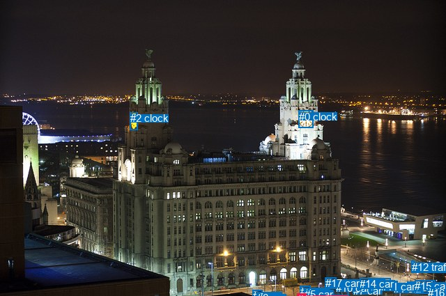
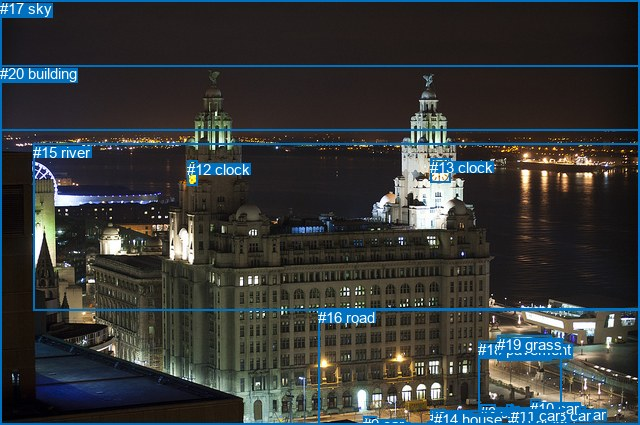

# 图片 2160：498255.jpg

随机样本序号：187。图片 SHA256：`905f640f424be3ccb20aa010e1efcf880bee51109abb7dffe614a018362a0c79`。

红色框表示人，蓝色框表示其他物体。两个模式分别保留自身框编号，可依据位置比较对应对象。

## 自动检测框与输出

人的框编号：`[13]`。状态：`ok`。

### 自动检测全部物体框

| 编号 | 类别 | 是否为人 | 检测分数 | 像素坐标 xyxy |
|---|---|---|---|---|
| 0 | clock | False | 0.9989 | 429.0, 158.7, 449.6, 183.1 |
| 1 | car | False | 0.9931 | 565.0, 406.4, 586.2, 417.0 |
| 2 | clock | False | 0.9886 | 186.8, 161.1, 197.9, 186.2 |
| 3 | car | False | 0.9084 | 430.9, 410.2, 445.0, 415.5 |
| 4 | car | False | 0.7867 | 362.5, 416.1, 376.6, 423.7 |
| 5 | car | False | 0.7623 | 436.5, 413.5, 500.3, 425.0 |
| 6 | car | False | 0.7506 | 368.6, 419.4, 388.0, 424.7 |
| 7 | car | False | 0.7448 | 506.8, 408.9, 527.4, 419.3 |
| 8 | car | False | 0.7335 | 528.4, 400.7, 552.2, 412.8 |
| 9 | car | False | 0.6948 | 584.5, 404.2, 594.5, 409.8 |
| 10 | car | False | 0.6588 | 482.2, 404.9, 496.0, 410.0 |
| 11 | car | False | 0.5636 | 547.2, 403.3, 563.8, 413.0 |
| 12 | traffic light | False | 0.5497 | 590.9, 374.8, 594.6, 382.6 |
| 13 | person | True | 0.5462 | 426.8, 421.4, 439.9, 425.0 |
| 14 | car | False | 0.4201 | 516.3, 399.3, 560.5, 414.5 |
| 15 | car | False | 0.4078 | 595.2, 402.2, 624.6, 421.5 |
| 16 | car | False | 0.3779 | 614.5, 412.0, 624.5, 419.5 |
| 17 | car | False | 0.3695 | 466.7, 398.4, 482.0, 405.9 |

### 自动检测 Top50 人相关候选

评分物体对：306；人相关物体对：34；输出关系：50。

| 排名 | 主语编号与类别 | 关系 | 宾语编号与类别 | 类型 | 人与人 | 排序分数 | 原始融合 logit |
|---|---|---|---|---|---|---|---|
| 1 | #3 car | on | #13 person | spatial | False | 0.89663 | 2.1604 |
| 2 | #13 person | on | #5 car | spatial | False | 0.77545 | 1.2393 |
| 3 | #5 car | on | #13 person | spatial | False | 0.75353 | 1.1175 |
| 4 | #17 car | on | #13 person | spatial | False | 0.69344 | 0.8163 |
| 5 | #12 traffic light | on | #13 person | spatial | False | 0.69281 | 0.8133 |
| 6 | #2 clock | on | #13 person | spatial | False | 0.48763 | -0.0495 |
| 7 | #10 car | on | #13 person | spatial | False | 0.46364 | -0.1457 |
| 8 | #4 car | on | #13 person | spatial | False | 0.45057 | -0.1984 |
| 9 | #6 car | on | #13 person | spatial | False | 0.43280 | -0.2704 |
| 10 | #13 person | on | #3 car | spatial | False | 0.41924 | -0.3259 |
| 11 | #9 car | on | #13 person | spatial | False | 0.41345 | -0.3497 |
| 12 | #14 car | on | #13 person | spatial | False | 0.35550 | -0.5949 |
| 13 | #1 car | on | #13 person | spatial | False | 0.34042 | -0.6614 |
| 14 | #0 clock | on | #13 person | spatial | False | 0.31294 | -0.7864 |
| 15 | #11 car | on | #13 person | spatial | False | 0.28500 | -0.9198 |
| 16 | #13 person | on | #12 traffic light | spatial | False | 0.28314 | -0.9289 |
| 17 | #15 car | on | #13 person | spatial | False | 0.27098 | -0.9897 |
| 18 | #8 car | on | #13 person | spatial | False | 0.27019 | -0.9936 |
| 19 | #13 person | on | #17 car | spatial | False | 0.26421 | -1.0242 |
| 20 | #7 car | on | #13 person | spatial | False | 0.24738 | -1.1126 |
| 21 | #13 person | on | #16 car | spatial | False | 0.22484 | -1.2377 |
| 22 | #13 person | on | #14 car | spatial | False | 0.22034 | -1.2637 |
| 23 | #3 car | holding | #13 person | semantic | False | 0.21742 | -1.2808 |
| 24 | #13 person | on | #10 car | spatial | False | 0.20964 | -1.3271 |
| 25 | #13 person | on | #15 car | spatial | False | 0.20742 | -1.3405 |
| 26 | #13 person | on | #8 car | spatial | False | 0.20128 | -1.3783 |
| 27 | #16 car | on | #13 person | spatial | False | 0.19223 | -1.4356 |
| 28 | #13 person | on | #9 car | spatial | False | 0.18918 | -1.4554 |
| 29 | #13 person | on | #11 car | spatial | False | 0.18471 | -1.4848 |
| 30 | #13 person | on | #6 car | spatial | False | 0.18292 | -1.4967 |
| 31 | #5 car | holding | #13 person | semantic | False | 0.18088 | -1.5104 |
| 32 | #13 person | on | #1 car | spatial | False | 0.17812 | -1.5292 |
| 33 | #13 person | on | #7 car | spatial | False | 0.17769 | -1.5321 |
| 34 | #12 traffic light | standing on | #13 person | semantic | False | 0.17172 | -1.5735 |
| 35 | #13 person | on | #4 car | spatial | False | 0.12980 | -1.9028 |
| 36 | #13 person | standing on | #5 car | semantic | False | 0.11004 | -2.0903 |
| 37 | #17 car | holding | #13 person | semantic | False | 0.10126 | -2.1833 |
| 38 | #13 person | on | #2 clock | spatial | False | 0.09989 | -2.1984 |
| 39 | #10 car | holding | #13 person | semantic | False | 0.05535 | -2.8371 |
| 40 | #9 car | standing on | #13 person | semantic | False | 0.05374 | -2.8683 |
| 41 | #4 car | standing on | #13 person | semantic | False | 0.05036 | -2.9370 |
| 42 | #13 person | holding | #3 car | semantic | False | 0.04764 | -2.9952 |
| 43 | #2 clock | standing on | #13 person | semantic | False | 0.04379 | -3.0836 |
| 44 | #14 car | holding | #13 person | semantic | False | 0.04126 | -3.1457 |
| 45 | #6 car | holding | #13 person | semantic | False | 0.03990 | -3.1806 |
| 46 | #15 car | holding | #13 person | semantic | False | 0.03593 | -3.2896 |
| 47 | #13 person | on | #0 clock | spatial | False | 0.03426 | -3.3391 |
| 48 | #16 car | holding | #13 person | semantic | False | 0.03288 | -3.3815 |
| 49 | #1 car | standing on | #13 person | semantic | False | 0.03279 | -3.3842 |
| 50 | #8 car | holding | #13 person | semantic | False | 0.03215 | -3.4046 |

### 自动检测逐条人相关 GT 核验

本图没有人相关 GT，R@50 无分母；预测候选继续展示。

## 真实框与输出

人的框编号：`[]`。

### 真实框全部物体框

| 编号 | 类别 | 是否为人 | 检测分数 | 像素坐标 xyxy |
|---|---|---|---|---|
| 0 | car | False | GT | 506.0, 404.0, 513.0, 410.0 |
| 1 | car | False | GT | 528.0, 410.0, 544.0, 419.0 |
| 2 | car | False | GT | 430.0, 409.0, 445.0, 415.0 |
| 3 | car | False | GT | 480.0, 404.0, 496.0, 410.0 |
| 4 | car | False | GT | 428.0, 422.0, 439.0, 425.0 |
| 5 | car | False | GT | 369.0, 419.0, 387.0, 425.0 |
| 6 | car | False | GT | 508.0, 411.0, 522.0, 419.0 |
| 7 | car | False | GT | 565.0, 406.0, 586.0, 417.0 |
| 8 | car | False | GT | 550.0, 407.0, 566.0, 413.0 |
| 9 | car | False | GT | 363.0, 416.0, 376.0, 424.0 |
| 10 | car | False | GT | 530.0, 400.0, 540.0, 406.0 |
| 11 | car | False | GT | 511.0, 407.0, 520.0, 411.0 |
| 12 | clock | False | GT | 187.0, 161.0, 197.0, 186.0 |
| 13 | clock | False | GT | 430.0, 159.0, 450.0, 183.0 |
| 14 | house | False | GT | 434.0, 411.0, 498.0, 425.0 |
| 15 | river | False | GT | 33.0, 144.0, 640.0, 311.0 |
| 16 | road | False | GT | 318.0, 309.0, 640.0, 425.0 |
| 17 | sky | False | GT | 0.0, 0.0, 640.0, 131.0 |
| 18 | pavement | False | GT | 478.0, 341.0, 562.0, 411.0 |
| 19 | grass | False | GT | 497.0, 336.0, 551.0, 361.0 |
| 20 | building | False | GT | 0.0, 65.0, 640.0, 425.0 |

### 真实框 Top50 人相关候选

评分物体对：0；人相关物体对：0；输出关系：0。

| 排名 | 主语编号与类别 | 关系 | 宾语编号与类别 | 类型 | 人与人 | 排序分数 | 原始融合 logit |
|---|---|---|---|---|---|---|---|

### 真实框逐条人相关 GT 核验

本图没有人相关 GT，R@50 无分母；预测候选继续展示。

## 全部人相关 GT

| 主语编号与类别 | 关系 | 宾语编号与类别 |
|---|---|---|

原始记录、全部人相关物体对的两项预测与分项分数见 [逐图证据 JSON](../evidence/cases/2160.json)。全部56类 logits 保留于本机 HOR/output/random500/logits/。

<!-- HOR_COMPLETE_RESULTS -->

## 六组条件的完整输出对照

以下保留同一图片三种框与候选模式、两种谓词输出规则的全部 Top50。框编号各自在所属模式内解释。

### 自动检测框完整枚举：空间与语义各保留一个谓词

| 排名 | 主语编号与类别 | 谓词 | 宾语编号与类别 | 分组 | 排序分数 | predicate logit | pair logit |
|---|---|---|---|---|---|---|---|
| 1 | #3 car | on | #13 person | spatial | 0.8966334 | 2.3409014 | -0.1805363 |
| 2 | #13 person | on | #5 car | spatial | 0.7754505 | 1.5854635 | -0.3461154 |
| 3 | #5 car | on | #13 person | spatial | 0.7535261 | 1.3607788 | -0.2432715 |
| 4 | #17 car | on | #13 person | spatial | 0.6934419 | 1.0618930 | -0.2456330 |
| 5 | #12 traffic light | on | #13 person | spatial | 0.6928095 | 1.2820024 | -0.4687153 |
| 6 | #2 clock | on | #13 person | spatial | 0.4876304 | 1.3863220 | -1.4358107 |
| 7 | #10 car | on | #13 person | spatial | 0.4636361 | 0.0912399 | -0.2369528 |
| 8 | #4 car | on | #13 person | spatial | 0.4505700 | -0.0765643 | -0.1218037 |
| 9 | #6 car | on | #13 person | spatial | 0.4328048 | -0.1367464 | -0.1336703 |
| 10 | #13 person | on | #3 car | spatial | 0.4192388 | 0.0353441 | -0.3612432 |
| 11 | #9 car | on | #13 person | spatial | 0.4134543 | 0.0972643 | -0.4469678 |
| 12 | #14 car | on | #13 person | spatial | 0.3555036 | -0.2293081 | -0.3656254 |
| 13 | #1 car | on | #13 person | spatial | 0.3404216 | -0.2841043 | -0.3773118 |
| 14 | #0 clock | on | #13 person | spatial | 0.3129439 | 0.5132418 | -1.2996339 |
| 15 | #11 car | on | #13 person | spatial | 0.2850006 | -0.5884628 | -0.3313274 |
| 16 | #13 person | on | #12 traffic light | spatial | 0.2831398 | 0.0418024 | -0.9707425 |
| 17 | #15 car | on | #13 person | spatial | 0.2709760 | -0.4015436 | -0.5881329 |
| 18 | #8 car | on | #13 person | spatial | 0.2701940 | -0.6692085 | -0.3244302 |
| 19 | #13 person | on | #17 car | spatial | 0.2642126 | -0.5302210 | -0.4939663 |
| 20 | #7 car | on | #13 person | spatial | 0.2473777 | -0.7821300 | -0.3305176 |
| 21 | #13 person | on | #16 car | spatial | 0.2248355 | -0.6291618 | -0.6085442 |
| 22 | #13 person | on | #14 car | spatial | 0.2203436 | -0.6566248 | -0.6070405 |
| 23 | #3 car | holding | #13 person | semantic | 0.2174195 | -1.1002321 | -0.1805363 |
| 24 | #13 person | on | #10 car | spatial | 0.2096407 | -0.8867979 | -0.4402944 |
| 25 | #13 person | on | #15 car | spatial | 0.2074233 | -0.6299872 | -0.7105407 |
| 26 | #13 person | on | #8 car | spatial | 0.2012845 | -0.7252634 | -0.6530219 |
| 27 | #16 car | on | #13 person | spatial | 0.1922311 | -0.7438717 | -0.6917056 |
| 28 | #13 person | on | #9 car | spatial | 0.1891755 | -0.6277928 | -0.8275837 |
| 29 | #13 person | on | #11 car | spatial | 0.1847067 | -0.7673597 | -0.7174191 |
| 30 | #13 person | on | #6 car | spatial | 0.1829195 | -1.0134764 | -0.4832151 |
| 31 | #5 car | holding | #13 person | semantic | 0.1808769 | -1.2671461 | -0.2432715 |
| 32 | #13 person | on | #1 car | spatial | 0.1781151 | -0.7692566 | -0.7599138 |
| 33 | #13 person | on | #7 car | spatial | 0.1776882 | -1.0281672 | -0.5039223 |
| 34 | #12 traffic light | standing on | #13 person | semantic | 0.1717161 | -1.1047983 | -0.4687153 |
| 35 | #13 person | on | #4 car | spatial | 0.1297970 | -1.3635368 | -0.5392176 |
| 36 | #13 person | standing on | #5 car | semantic | 0.1100400 | -1.7442174 | -0.3461154 |
| 37 | #17 car | holding | #13 person | semantic | 0.1012629 | -1.9376371 | -0.2456330 |
| 38 | #13 person | on | #2 clock | spatial | 0.0998909 | -0.1334734 | -2.0649638 |
| 39 | #10 car | holding | #13 person | semantic | 0.0553535 | -2.6001184 | -0.2369528 |
| 40 | #9 car | standing on | #13 person | semantic | 0.0537439 | -2.4213152 | -0.4469678 |
| 41 | #4 car | standing on | #13 person | semantic | 0.0503564 | -2.8151565 | -0.1218037 |
| 42 | #13 person | holding | #3 car | semantic | 0.0476421 | -2.6339800 | -0.3612432 |
| 43 | #2 clock | standing on | #13 person | semantic | 0.0437900 | -1.6477611 | -1.4358107 |
| 44 | #14 car | holding | #13 person | semantic | 0.0412598 | -2.7801070 | -0.3656254 |
| 45 | #6 car | holding | #13 person | semantic | 0.0399023 | -3.0469313 | -0.1336703 |
| 46 | #15 car | holding | #13 person | semantic | 0.0359292 | -2.7014804 | -0.5881329 |
| 47 | #13 person | on | #0 clock | spatial | 0.0342554 | -1.7484379 | -1.5906181 |
| 48 | #16 car | holding | #13 person | semantic | 0.0328795 | -2.6897681 | -0.6917056 |
| 49 | #1 car | standing on | #13 person | semantic | 0.0327915 | -3.0069342 | -0.3773118 |
| 50 | #8 car | holding | #13 person | semantic | 0.0321512 | -3.0801961 | -0.3244302 |

没有人相关 GT，本条件的召回率无分母。

### 自动检测框完整枚举：每对只保留一个谓词

| 排名 | 主语编号与类别 | 谓词 | 宾语编号与类别 | 分组 | 排序分数 | predicate logit | pair logit |
|---|---|---|---|---|---|---|---|
| 1 | #3 car | on | #13 person | single | 0.8966334 | 2.3409014 | -0.1805363 |
| 2 | #13 person | on | #5 car | single | 0.7754505 | 1.5854635 | -0.3461154 |
| 3 | #5 car | on | #13 person | single | 0.7535261 | 1.3607788 | -0.2432715 |
| 4 | #17 car | on | #13 person | single | 0.6934419 | 1.0618930 | -0.2456330 |
| 5 | #12 traffic light | on | #13 person | single | 0.6928095 | 1.2820024 | -0.4687153 |
| 6 | #2 clock | on | #13 person | single | 0.4876304 | 1.3863220 | -1.4358107 |
| 7 | #10 car | on | #13 person | single | 0.4636361 | 0.0912399 | -0.2369528 |
| 8 | #4 car | on | #13 person | single | 0.4505700 | -0.0765643 | -0.1218037 |
| 9 | #6 car | on | #13 person | single | 0.4328048 | -0.1367464 | -0.1336703 |
| 10 | #13 person | on | #3 car | single | 0.4192388 | 0.0353441 | -0.3612432 |
| 11 | #9 car | on | #13 person | single | 0.4134543 | 0.0972643 | -0.4469678 |
| 12 | #14 car | on | #13 person | single | 0.3555036 | -0.2293081 | -0.3656254 |
| 13 | #1 car | on | #13 person | single | 0.3404216 | -0.2841043 | -0.3773118 |
| 14 | #0 clock | on | #13 person | single | 0.3129439 | 0.5132418 | -1.2996339 |
| 15 | #11 car | on | #13 person | single | 0.2850006 | -0.5884628 | -0.3313274 |
| 16 | #13 person | on | #12 traffic light | single | 0.2831398 | 0.0418024 | -0.9707425 |
| 17 | #15 car | on | #13 person | single | 0.2709760 | -0.4015436 | -0.5881329 |
| 18 | #8 car | on | #13 person | single | 0.2701940 | -0.6692085 | -0.3244302 |
| 19 | #13 person | on | #17 car | single | 0.2642126 | -0.5302210 | -0.4939663 |
| 20 | #7 car | on | #13 person | single | 0.2473777 | -0.7821300 | -0.3305176 |
| 21 | #13 person | on | #16 car | single | 0.2248355 | -0.6291618 | -0.6085442 |
| 22 | #13 person | on | #14 car | single | 0.2203436 | -0.6566248 | -0.6070405 |
| 23 | #13 person | on | #10 car | single | 0.2096407 | -0.8867979 | -0.4402944 |
| 24 | #13 person | on | #15 car | single | 0.2074233 | -0.6299872 | -0.7105407 |
| 25 | #13 person | on | #8 car | single | 0.2012845 | -0.7252634 | -0.6530219 |
| 26 | #16 car | on | #13 person | single | 0.1922311 | -0.7438717 | -0.6917056 |
| 27 | #13 person | on | #9 car | single | 0.1891755 | -0.6277928 | -0.8275837 |
| 28 | #13 person | on | #11 car | single | 0.1847067 | -0.7673597 | -0.7174191 |
| 29 | #13 person | on | #6 car | single | 0.1829195 | -1.0134764 | -0.4832151 |
| 30 | #13 person | on | #1 car | single | 0.1781151 | -0.7692566 | -0.7599138 |
| 31 | #13 person | on | #7 car | single | 0.1776882 | -1.0281672 | -0.5039223 |
| 32 | #13 person | on | #4 car | single | 0.1297970 | -1.3635368 | -0.5392176 |
| 33 | #13 person | on | #2 clock | single | 0.0998909 | -0.1334734 | -2.0649638 |
| 34 | #13 person | on | #0 clock | single | 0.0342554 | -1.7484379 | -1.5906181 |

没有人相关 GT，本条件的召回率无分母。

### 真实框完整枚举：空间与语义各保留一个谓词

| 排名 | 主语编号与类别 | 谓词 | 宾语编号与类别 | 分组 | 排序分数 | predicate logit | pair logit |
|---|---|---|---|---|---|---|---|

没有人相关 GT，本条件的召回率无分母。

### 真实框完整枚举：每对只保留一个谓词

| 排名 | 主语编号与类别 | 谓词 | 宾语编号与类别 | 分组 | 排序分数 | predicate logit | pair logit |
|---|---|---|---|---|---|---|---|

没有人相关 GT，本条件的召回率无分母。

### 真实框400候选：空间与语义各保留一个谓词

| 排名 | 主语编号与类别 | 谓词 | 宾语编号与类别 | 分组 | 排序分数 | predicate logit | pair logit |
|---|---|---|---|---|---|---|---|

没有人相关 GT，本条件的召回率无分母。

### 真实框400候选：每对只保留一个谓词

| 排名 | 主语编号与类别 | 谓词 | 宾语编号与类别 | 分组 | 排序分数 | predicate logit | pair logit |
|---|---|---|---|---|---|---|---|

没有人相关 GT，本条件的召回率无分母。
