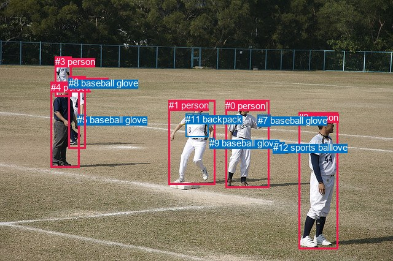
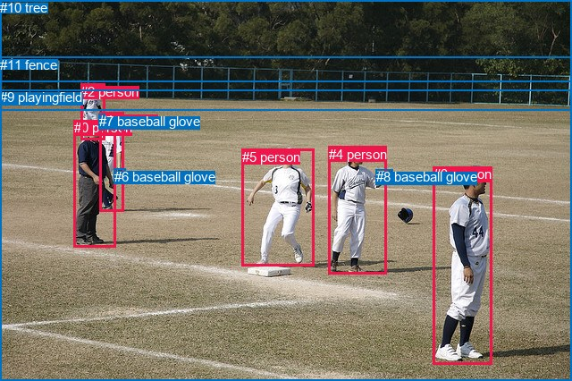

# 图片 2161：498294.jpg

随机样本序号：490。图片 SHA256：`3e1e27b0ffcd3d5673c69ba4914fa68ab44c23716e2435111ea5298648e68a70`。

红色框表示人，蓝色框表示其他物体。两个模式分别保留自身框编号，可依据位置比较对应对象。

## 自动检测框与输出

人的框编号：`[0, 1, 2, 3, 4, 6]`。状态：`ok`。

### 自动检测全部物体框

| 编号 | 类别 | 是否为人 | 检测分数 | 像素坐标 xyxy |
|---|---|---|---|---|
| 0 | person | True | 0.9995 | 367.3, 163.9, 438.0, 306.2 |
| 1 | person | True | 0.9995 | 274.9, 163.1, 350.3, 301.1 |
| 2 | person | True | 0.9990 | 486.3, 183.2, 550.8, 406.3 |
| 3 | person | True | 0.9983 | 89.5, 92.3, 116.4, 157.6 |
| 4 | person | True | 0.9964 | 83.0, 133.7, 129.9, 273.4 |
| 5 | baseball glove | False | 0.9963 | 126.2, 187.2, 140.2, 204.8 |
| 6 | person | True | 0.9862 | 111.8, 124.6, 139.5, 242.3 |
| 7 | baseball glove | False | 0.9801 | 419.9, 188.0, 440.7, 206.4 |
| 8 | baseball glove | False | 0.7900 | 111.7, 127.2, 118.0, 135.5 |
| 9 | baseball glove | False | 0.7224 | 341.2, 225.2, 349.5, 238.3 |
| 10 | baseball glove | False | 0.7182 | 444.6, 232.4, 463.2, 250.4 |
| 11 | backpack | False | 0.6143 | 302.1, 185.6, 339.9, 223.4 |
| 12 | sports ball | False | 0.3778 | 445.0, 232.4, 462.6, 250.0 |

### 自动检测 Top50 人相关候选

评分物体对：156；人相关物体对：114；输出关系：50。

| 排名 | 主语编号与类别 | 关系 | 宾语编号与类别 | 类型 | 人与人 | 排序分数 | 原始融合 logit |
|---|---|---|---|---|---|---|---|
| 1 | #6 person | wearing | #8 baseball glove | semantic | False | 0.98557 | 4.2238 |
| 2 | #1 person | wearing | #11 backpack | semantic | False | 0.98485 | 4.1742 |
| 3 | #4 person | holding | #5 baseball glove | semantic | False | 0.98016 | 3.9003 |
| 4 | #6 person | holding | #5 baseball glove | semantic | False | 0.97850 | 3.8178 |
| 5 | #0 person | holding | #7 baseball glove | semantic | False | 0.97818 | 3.8030 |
| 6 | #1 person | wearing | #9 baseball glove | semantic | False | 0.97466 | 3.6495 |
| 7 | #3 person | wearing | #8 baseball glove | semantic | False | 0.97398 | 3.6227 |
| 8 | #0 person | catching | #10 baseball glove | semantic | False | 0.96505 | 3.3182 |
| 9 | #0 person | catching | #12 sports ball | semantic | False | 0.96476 | 3.3097 |
| 10 | #2 person | catching | #10 baseball glove | semantic | False | 0.95351 | 3.0209 |
| 11 | #2 person | catching | #12 sports ball | semantic | False | 0.95289 | 3.0070 |
| 12 | #1 person | in | #11 backpack | spatial | False | 0.93647 | 2.6906 |
| 13 | #1 person | playing | #10 baseball glove | semantic | False | 0.91356 | 2.3579 |
| 14 | #1 person | playing | #12 sports ball | semantic | False | 0.91268 | 2.3468 |
| 15 | #4 person | wearing | #8 baseball glove | semantic | False | 0.89228 | 2.1142 |
| 16 | #6 person | in | #8 baseball glove | spatial | False | 0.85969 | 1.8127 |
| 17 | #2 person | holding | #7 baseball glove | semantic | False | 0.83068 | 1.5905 |
| 18 | #3 person | in | #8 baseball glove | spatial | False | 0.83041 | 1.5885 |
| 19 | #4 person | holding | #6 person | semantic | True | 0.82295 | 1.5364 |
| 20 | #3 person | holding | #5 baseball glove | semantic | False | 0.80923 | 1.4450 |
| 21 | #1 person | in | #9 baseball glove | spatial | False | 0.79741 | 1.3702 |
| 22 | #0 person | in | #7 baseball glove | spatial | False | 0.79399 | 1.3491 |
| 23 | #6 person | in | #5 baseball glove | spatial | False | 0.77950 | 1.2627 |
| 24 | #0 person | wearing | #11 backpack | semantic | False | 0.75664 | 1.1343 |
| 25 | #2 person | looking at | #1 person | semantic | True | 0.74054 | 1.0488 |
| 26 | #6 person | looking at | #1 person | semantic | True | 0.64043 | 0.5772 |
| 27 | #4 person | in | #5 baseball glove | spatial | False | 0.63729 | 0.5636 |
| 28 | #4 person | in | #8 baseball glove | spatial | False | 0.61620 | 0.4734 |
| 29 | #4 person | beside | #6 person | spatial | True | 0.59681 | 0.3922 |
| 30 | #0 person | looking at | #1 person | semantic | True | 0.59064 | 0.3666 |
| 31 | #4 person | looking at | #1 person | semantic | True | 0.57497 | 0.3022 |
| 32 | #8 baseball glove | on | #3 person | spatial | False | 0.56137 | 0.2467 |
| 33 | #4 person | catching | #10 baseball glove | semantic | False | 0.56110 | 0.2456 |
| 34 | #4 person | catching | #12 sports ball | semantic | False | 0.55921 | 0.2380 |
| 35 | #11 backpack | on | #1 person | spatial | False | 0.55431 | 0.2181 |
| 36 | #2 person | looking at | #0 person | semantic | True | 0.54588 | 0.1840 |
| 37 | #0 person | in | #11 backpack | spatial | False | 0.54398 | 0.1764 |
| 38 | #6 person | wearing | #11 backpack | semantic | False | 0.52743 | 0.1098 |
| 39 | #2 person | wearing | #11 backpack | semantic | False | 0.51726 | 0.0691 |
| 40 | #6 person | catching | #12 sports ball | semantic | False | 0.51466 | 0.0586 |
| 41 | #6 person | catching | #10 baseball glove | semantic | False | 0.50907 | 0.0363 |
| 42 | #1 person | holding | #7 baseball glove | semantic | False | 0.50786 | 0.0314 |
| 43 | #5 baseball glove | on | #6 person | spatial | False | 0.50219 | 0.0088 |
| 44 | #2 person | beside | #10 baseball glove | spatial | False | 0.49847 | -0.0061 |
| 45 | #2 person | beside | #12 sports ball | spatial | False | 0.49631 | -0.0148 |
| 46 | #6 person | talking to | #4 person | semantic | True | 0.46953 | -0.1220 |
| 47 | #0 person | beside | #1 person | spatial | True | 0.46093 | -0.1566 |
| 48 | #2 person | in | #7 baseball glove | spatial | False | 0.45042 | -0.1990 |
| 49 | #0 person | holding | #9 baseball glove | semantic | False | 0.43772 | -0.2504 |
| 50 | #3 person | looking at | #1 person | semantic | True | 0.43531 | -0.2602 |

### 自动检测逐条人相关 GT 核验

R@50：16.67%；命中 1/6。

| GT 主语编号 | GT 关系 | GT 宾语编号 | 结果阶段 | 匹配预测主语编号 | 匹配预测宾语编号 |
|---|---|---|---|---|---|
| 0 | in front of | 1 | wrong_predicate | [4] | [6] |
| 1 | wearing | 6 | wrong_predicate | [6] | [5] |
| 2 | wearing | 7 | hit50 | [3] | [8] |
| 3 | standing on | 9 | endpoint_missing_or_wrong_class | [2] | [] |
| 4 | wearing | 8 | wrong_predicate | [0] | [7] |
| 5 | running on | 9 | endpoint_missing_or_wrong_class | [1] | [] |

## 真实框与输出

人的框编号：`[0, 1, 2, 3, 4, 5]`。

### 真实框全部物体框

| 编号 | 类别 | 是否为人 | 检测分数 | 像素坐标 xyxy |
|---|---|---|---|---|
| 0 | person | True | GT | 83.0, 134.0, 130.0, 276.0 |
| 1 | person | True | GT | 111.0, 126.0, 139.0, 237.0 |
| 2 | person | True | GT | 90.0, 94.0, 117.0, 157.0 |
| 3 | person | True | GT | 485.0, 186.0, 551.0, 407.0 |
| 4 | person | True | GT | 368.0, 164.0, 432.0, 306.0 |
| 5 | person | True | GT | 271.0, 167.0, 352.0, 298.0 |
| 6 | baseball glove | False | GT | 128.0, 189.0, 141.0, 203.0 |
| 7 | baseball glove | False | GT | 111.0, 127.0, 118.0, 136.0 |
| 8 | baseball glove | False | GT | 421.0, 189.0, 440.0, 206.0 |
| 9 | playingfield | False | GT | 0.0, 100.0, 640.0, 426.0 |
| 10 | tree | False | GT | 0.0, 0.0, 640.0, 91.0 |
| 11 | fence | False | GT | 0.0, 64.0, 640.0, 124.0 |

### 真实框 Top50 人相关候选

评分物体对：132；人相关物体对：102；输出关系：50。

| 排名 | 主语编号与类别 | 关系 | 宾语编号与类别 | 类型 | 人与人 | 排序分数 | 原始融合 logit |
|---|---|---|---|---|---|---|---|
| 1 | #1 person | wearing | #7 baseball glove | semantic | False | 0.98634 | 4.2796 |
| 2 | #4 person | holding | #8 baseball glove | semantic | False | 0.98590 | 4.2474 |
| 3 | #0 person | holding | #6 baseball glove | semantic | False | 0.97699 | 3.7487 |
| 4 | #2 person | wearing | #7 baseball glove | semantic | False | 0.97395 | 3.6214 |
| 5 | #1 person | holding | #6 baseball glove | semantic | False | 0.97335 | 3.5980 |
| 6 | #3 person | standing on | #9 playingfield | semantic | False | 0.96698 | 3.3769 |
| 7 | #0 person | standing on | #9 playingfield | semantic | False | 0.96563 | 3.3357 |
| 8 | #5 person | on | #9 playingfield | spatial | False | 0.96385 | 3.2831 |
| 9 | #4 person | on | #9 playingfield | spatial | False | 0.95200 | 2.9873 |
| 10 | #4 person | standing on | #9 playingfield | semantic | False | 0.95111 | 2.9680 |
| 11 | #3 person | on | #9 playingfield | spatial | False | 0.94837 | 2.9106 |
| 12 | #0 person | on | #9 playingfield | spatial | False | 0.94741 | 2.8912 |
| 13 | #1 person | standing on | #9 playingfield | semantic | False | 0.94699 | 2.8829 |
| 14 | #2 person | standing on | #9 playingfield | semantic | False | 0.94519 | 2.8475 |
| 15 | #5 person | standing on | #9 playingfield | semantic | False | 0.94399 | 2.8246 |
| 16 | #1 person | on | #9 playingfield | spatial | False | 0.92893 | 2.5703 |
| 17 | #0 person | holding | #1 person | semantic | True | 0.91126 | 2.3291 |
| 18 | #2 person | on | #9 playingfield | spatial | False | 0.88275 | 2.0187 |
| 19 | #1 person | in | #7 baseball glove | spatial | False | 0.84493 | 1.6954 |
| 20 | #0 person | wearing | #7 baseball glove | semantic | False | 0.80617 | 1.4253 |
| 21 | #2 person | in | #7 baseball glove | spatial | False | 0.79257 | 1.3405 |
| 22 | #1 person | in | #6 baseball glove | spatial | False | 0.77232 | 1.2215 |
| 23 | #3 person | looking at | #5 person | semantic | True | 0.77068 | 1.2122 |
| 24 | #3 person | holding | #8 baseball glove | semantic | False | 0.76957 | 1.2059 |
| 25 | #4 person | looking at | #5 person | semantic | True | 0.72736 | 0.9813 |
| 26 | #0 person | beside | #1 person | spatial | True | 0.71951 | 0.9420 |
| 27 | #4 person | in | #8 baseball glove | spatial | False | 0.70312 | 0.8622 |
| 28 | #1 person | beside | #0 person | spatial | True | 0.66711 | 0.6951 |
| 29 | #5 person | playing | #4 person | semantic | True | 0.65765 | 0.6529 |
| 30 | #7 baseball glove | on | #2 person | spatial | False | 0.65047 | 0.6211 |
| 31 | #1 person | talking to | #0 person | semantic | True | 0.64513 | 0.5977 |
| 32 | #3 person | looking at | #4 person | semantic | True | 0.62262 | 0.5007 |
| 33 | #0 person | looking at | #5 person | semantic | True | 0.61279 | 0.4590 |
| 34 | #1 person | looking at | #5 person | semantic | True | 0.61061 | 0.4499 |
| 35 | #4 person | looking at | #3 person | semantic | True | 0.59707 | 0.3933 |
| 36 | #2 person | looking at | #0 person | semantic | True | 0.56595 | 0.2654 |
| 37 | #0 person | in | #6 baseball glove | spatial | False | 0.55989 | 0.2407 |
| 38 | #7 baseball glove | on | #1 person | spatial | False | 0.55882 | 0.2364 |
| 39 | #6 baseball glove | on | #1 person | spatial | False | 0.55588 | 0.2244 |
| 40 | #5 person | throwing | #6 baseball glove | semantic | False | 0.54204 | 0.1686 |
| 41 | #5 person | throwing | #8 baseball glove | semantic | False | 0.52112 | 0.0845 |
| 42 | #2 person | standing on | #11 fence | semantic | False | 0.51166 | 0.0467 |
| 43 | #4 person | beside | #5 person | spatial | True | 0.50355 | 0.0142 |
| 44 | #2 person | looking at | #5 person | semantic | True | 0.42795 | -0.2902 |
| 45 | #6 baseball glove | holding | #1 person | semantic | False | 0.37866 | -0.4953 |
| 46 | #0 person | in | #7 baseball glove | spatial | False | 0.35651 | -0.5906 |
| 47 | #2 person | beside | #11 fence | spatial | False | 0.34737 | -0.6306 |
| 48 | #3 person | beside | #4 person | spatial | True | 0.34509 | -0.6407 |
| 49 | #0 person | holding | #2 person | semantic | True | 0.33816 | -0.6715 |
| 50 | #5 person | beside | #4 person | spatial | True | 0.33220 | -0.6983 |

### 真实框逐条人相关 GT 核验

R@50：33.33%；命中 2/6。

| GT 主语编号 | GT 关系 | GT 宾语编号 | 结果阶段 | 匹配预测主语编号 | 匹配预测宾语编号 |
|---|---|---|---|---|---|
| 0 | in front of | 1 | wrong_predicate | [0] | [1] |
| 1 | wearing | 6 | wrong_predicate | [1] | [6] |
| 2 | wearing | 7 | hit50 | [2] | [7] |
| 3 | standing on | 9 | hit50 | [3] | [9] |
| 4 | wearing | 8 | wrong_predicate | [4] | [8] |
| 5 | running on | 9 | wrong_predicate | [5] | [9] |

## 全部人相关 GT

| 主语编号与类别 | 关系 | 宾语编号与类别 |
|---|---|---|
| #0 person | in front of | #1 person |
| #1 person | wearing | #6 baseball glove |
| #2 person | wearing | #7 baseball glove |
| #3 person | standing on | #9 playingfield |
| #4 person | wearing | #8 baseball glove |
| #5 person | running on | #9 playingfield |

原始记录、全部人相关物体对的两项预测与分项分数见 [逐图证据 JSON](../evidence/cases/2161.json)。全部56类 logits 保留于本机 HOR/output/random500/logits/。

<!-- HOR_COMPLETE_RESULTS -->

## 六组条件的完整输出对照

以下保留同一图片三种框与候选模式、两种谓词输出规则的全部 Top50。框编号各自在所属模式内解释。

### 自动检测框完整枚举：空间与语义各保留一个谓词

| 排名 | 主语编号与类别 | 谓词 | 宾语编号与类别 | 分组 | 排序分数 | predicate logit | pair logit |
|---|---|---|---|---|---|---|---|
| 1 | #6 person | wearing | #8 baseball glove | semantic | 0.9855689 | 4.0314584 | 0.1923820 |
| 2 | #1 person | wearing | #11 backpack | semantic | 0.9848460 | 3.9815087 | 0.1927133 |
| 3 | #4 person | holding | #5 baseball glove | semantic | 0.9801645 | 4.1263633 | -0.2261119 |
| 4 | #6 person | holding | #5 baseball glove | semantic | 0.9784973 | 4.0307307 | -0.2128933 |
| 5 | #0 person | holding | #7 baseball glove | semantic | 0.9781838 | 3.7959094 | 0.0071349 |
| 6 | #1 person | wearing | #9 baseball glove | semantic | 0.9746557 | 3.5983005 | 0.0512279 |
| 7 | #3 person | wearing | #8 baseball glove | semantic | 0.9739841 | 3.5615888 | 0.0610976 |
| 8 | #0 person | catching | #10 baseball glove | semantic | 0.9650482 | 3.2285776 | 0.0896308 |
| 9 | #0 person | catching | #12 sports ball | semantic | 0.9647616 | 3.2259421 | 0.0838012 |
| 10 | #2 person | catching | #10 baseball glove | semantic | 0.9535096 | 2.9518194 | 0.0690830 |
| 11 | #2 person | catching | #12 sports ball | semantic | 0.9528893 | 2.9465485 | 0.0604477 |
| 12 | #1 person | in | #11 backpack | spatial | 0.9364678 | 2.4978552 | 0.1927133 |
| 13 | #1 person | playing | #10 baseball glove | semantic | 0.9135594 | 2.7650795 | -0.4071882 |
| 14 | #1 person | playing | #12 sports ball | semantic | 0.9126788 | 2.7650795 | -0.4182892 |
| 15 | #4 person | wearing | #8 baseball glove | semantic | 0.8922796 | 2.2610459 | -0.1468049 |
| 16 | #6 person | in | #8 baseball glove | spatial | 0.8596896 | 1.6203322 | 0.1923820 |
| 17 | #2 person | holding | #7 baseball glove | semantic | 0.8306822 | 1.7852850 | -0.1948146 |
| 18 | #3 person | in | #8 baseball glove | spatial | 0.8304057 | 1.5274076 | 0.0610976 |
| 19 | #4 person | holding | #6 person | semantic | 0.8229456 | 2.2736211 | -0.7371880 |
| 20 | #3 person | holding | #5 baseball glove | semantic | 0.8092320 | 2.1606021 | -0.7155744 |
| 21 | #1 person | in | #9 baseball glove | spatial | 0.7974129 | 1.3189750 | 0.0512279 |
| 22 | #0 person | in | #7 baseball glove | spatial | 0.7939854 | 1.3419828 | 0.0071349 |
| 23 | #6 person | in | #5 baseball glove | spatial | 0.7794956 | 1.4756227 | -0.2128933 |
| 24 | #0 person | wearing | #11 backpack | semantic | 0.7566376 | 1.5704503 | -0.4361176 |
| 25 | #2 person | looking at | #1 person | semantic | 0.7405384 | 1.7591491 | -0.7103802 |
| 26 | #6 person | looking at | #1 person | semantic | 0.6404334 | 1.2954698 | -0.7182239 |
| 27 | #4 person | in | #5 baseball glove | spatial | 0.6372862 | 0.7897167 | -0.2261119 |
| 28 | #4 person | in | #8 baseball glove | spatial | 0.6161961 | 0.6202383 | -0.1468049 |
| 29 | #4 person | beside | #6 person | spatial | 0.5968137 | 1.1293941 | -0.7371880 |
| 30 | #0 person | looking at | #1 person | semantic | 0.5906419 | 1.1142249 | -0.7476053 |
| 31 | #4 person | looking at | #1 person | semantic | 0.5749749 | 1.0418396 | -0.7396613 |
| 32 | #8 baseball glove | on | #3 person | spatial | 0.5613680 | 0.6179676 | -0.3712519 |
| 33 | #4 person | catching | #10 baseball glove | semantic | 0.5610973 | 0.6371984 | -0.3915820 |
| 34 | #4 person | catching | #12 sports ball | semantic | 0.5592103 | 0.6345630 | -0.3966053 |
| 35 | #11 backpack | on | #1 person | spatial | 0.5543057 | 0.7286010 | -0.5105182 |
| 36 | #2 person | looking at | #0 person | semantic | 0.5458818 | 1.1632509 | -0.9792058 |
| 37 | #0 person | in | #11 backpack | spatial | 0.5439837 | 0.6125083 | -0.4361176 |
| 38 | #6 person | wearing | #11 backpack | semantic | 0.5274273 | 1.3106136 | -1.2007941 |
| 39 | #2 person | wearing | #11 backpack | semantic | 0.5172564 | 1.3282170 | -1.2591639 |
| 40 | #6 person | catching | #12 sports ball | semantic | 0.5146564 | 0.5324297 | -0.4737873 |
| 41 | #6 person | catching | #10 baseball glove | semantic | 0.5090689 | 0.5036564 | -0.4673768 |
| 42 | #1 person | holding | #7 baseball glove | semantic | 0.5078559 | 0.5947585 | -0.5633323 |
| 43 | #5 baseball glove | on | #6 person | spatial | 0.5021919 | 0.6827259 | -0.6739582 |
| 44 | #2 person | beside | #10 baseball glove | spatial | 0.4984683 | -0.0752096 | 0.0690830 |
| 45 | #2 person | beside | #12 sports ball | spatial | 0.4963095 | -0.0752096 | 0.0604477 |
| 46 | #6 person | talking to | #4 person | semantic | 0.4695259 | 0.6076775 | -0.7297251 |
| 47 | #0 person | beside | #1 person | spatial | 0.4609260 | 0.5909901 | -0.7476053 |
| 48 | #2 person | in | #7 baseball glove | spatial | 0.4504223 | -0.0041504 | -0.1948146 |
| 49 | #0 person | holding | #9 baseball glove | semantic | 0.4377225 | 0.0889463 | -0.3393568 |
| 50 | #3 person | looking at | #1 person | semantic | 0.4353105 | 0.7874050 | -1.0476213 |

GT 命中：1/6，R@50=16.67%。

| GT主语 | GT谓词 | GT宾语 | 结果阶段 | 匹配主语框 | 匹配宾语框 |
|---|---|---|---|---|---|
| 0 | in front of | 1 | wrong_predicate | [4] | [6] |
| 1 | wearing | 6 | wrong_predicate | [6] | [5] |
| 2 | wearing | 7 | hit50 | [3] | [8] |
| 3 | standing on | 9 | endpoint_missing_or_wrong_class | [2] | [] |
| 4 | wearing | 8 | wrong_predicate | [0] | [7] |
| 5 | running on | 9 | endpoint_missing_or_wrong_class | [1] | [] |

### 自动检测框完整枚举：每对只保留一个谓词

| 排名 | 主语编号与类别 | 谓词 | 宾语编号与类别 | 分组 | 排序分数 | predicate logit | pair logit |
|---|---|---|---|---|---|---|---|
| 1 | #6 person | wearing | #8 baseball glove | single | 0.9855689 | 4.0314584 | 0.1923820 |
| 2 | #1 person | wearing | #11 backpack | single | 0.9848460 | 3.9815087 | 0.1927133 |
| 3 | #4 person | holding | #5 baseball glove | single | 0.9801645 | 4.1263633 | -0.2261119 |
| 4 | #6 person | holding | #5 baseball glove | single | 0.9784973 | 4.0307307 | -0.2128933 |
| 5 | #0 person | holding | #7 baseball glove | single | 0.9781838 | 3.7959094 | 0.0071349 |
| 6 | #1 person | wearing | #9 baseball glove | single | 0.9746557 | 3.5983005 | 0.0512279 |
| 7 | #3 person | wearing | #8 baseball glove | single | 0.9739841 | 3.5615888 | 0.0610976 |
| 8 | #0 person | catching | #10 baseball glove | single | 0.9650482 | 3.2285776 | 0.0896308 |
| 9 | #0 person | catching | #12 sports ball | single | 0.9647616 | 3.2259421 | 0.0838012 |
| 10 | #2 person | catching | #10 baseball glove | single | 0.9535096 | 2.9518194 | 0.0690830 |
| 11 | #2 person | catching | #12 sports ball | single | 0.9528893 | 2.9465485 | 0.0604477 |
| 12 | #1 person | playing | #10 baseball glove | single | 0.9135594 | 2.7650795 | -0.4071882 |
| 13 | #1 person | playing | #12 sports ball | single | 0.9126788 | 2.7650795 | -0.4182892 |
| 14 | #4 person | wearing | #8 baseball glove | single | 0.8922796 | 2.2610459 | -0.1468049 |
| 15 | #2 person | holding | #7 baseball glove | single | 0.8306822 | 1.7852850 | -0.1948146 |
| 16 | #4 person | holding | #6 person | single | 0.8229456 | 2.2736211 | -0.7371880 |
| 17 | #3 person | holding | #5 baseball glove | single | 0.8092320 | 2.1606021 | -0.7155744 |
| 18 | #0 person | wearing | #11 backpack | single | 0.7566376 | 1.5704503 | -0.4361176 |
| 19 | #2 person | looking at | #1 person | single | 0.7405384 | 1.7591491 | -0.7103802 |
| 20 | #6 person | looking at | #1 person | single | 0.6404334 | 1.2954698 | -0.7182239 |
| 21 | #0 person | looking at | #1 person | single | 0.5906419 | 1.1142249 | -0.7476053 |
| 22 | #4 person | looking at | #1 person | single | 0.5749749 | 1.0418396 | -0.7396613 |
| 23 | #8 baseball glove | on | #3 person | single | 0.5613680 | 0.6179676 | -0.3712519 |
| 24 | #4 person | catching | #10 baseball glove | single | 0.5610973 | 0.6371984 | -0.3915820 |
| 25 | #4 person | catching | #12 sports ball | single | 0.5592103 | 0.6345630 | -0.3966053 |
| 26 | #11 backpack | on | #1 person | single | 0.5543057 | 0.7286010 | -0.5105182 |
| 27 | #2 person | looking at | #0 person | single | 0.5458818 | 1.1632509 | -0.9792058 |
| 28 | #6 person | wearing | #11 backpack | single | 0.5274273 | 1.3106136 | -1.2007941 |
| 29 | #2 person | wearing | #11 backpack | single | 0.5172564 | 1.3282170 | -1.2591639 |
| 30 | #6 person | catching | #12 sports ball | single | 0.5146564 | 0.5324297 | -0.4737873 |
| 31 | #6 person | catching | #10 baseball glove | single | 0.5090689 | 0.5036564 | -0.4673768 |
| 32 | #1 person | holding | #7 baseball glove | single | 0.5078559 | 0.5947585 | -0.5633323 |
| 33 | #5 baseball glove | on | #6 person | single | 0.5021919 | 0.6827259 | -0.6739582 |
| 34 | #6 person | talking to | #4 person | single | 0.4695259 | 0.6076775 | -0.7297251 |
| 35 | #0 person | holding | #9 baseball glove | single | 0.4377225 | 0.0889463 | -0.3393568 |
| 36 | #3 person | looking at | #1 person | single | 0.4353105 | 0.7874050 | -1.0476213 |
| 37 | #8 baseball glove | on | #6 person | single | 0.4312267 | 0.4978924 | -0.7747403 |
| 38 | #9 baseball glove | on | #1 person | single | 0.4247519 | 0.3583255 | -0.6616217 |
| 39 | #1 person | holding | #5 baseball glove | single | 0.4197634 | 0.6067853 | -0.9305303 |
| 40 | #4 person | holding | #3 person | single | 0.4006604 | 0.0452218 | -0.4479359 |
| 41 | #3 person | looking at | #4 person | single | 0.3965408 | 0.4445472 | -0.8644466 |
| 42 | #0 person | looking at | #2 person | single | 0.3838120 | 0.5211158 | -0.9945152 |
| 43 | #1 person | playing | #0 person | single | 0.3827244 | 0.6358719 | -1.1138723 |
| 44 | #2 person | holding | #5 baseball glove | single | 0.3691340 | 0.3660159 | -0.9019496 |
| 45 | #7 baseball glove | on | #0 person | single | 0.3671365 | 0.2422471 | -0.7867680 |
| 46 | #6 person | holding | #3 person | single | 0.3543997 | -0.3987613 | -0.2009939 |
| 47 | #3 person | looking at | #6 person | single | 0.3187516 | 0.0738645 | -0.8333791 |
| 48 | #3 person | looking at | #12 sports ball | single | 0.3168509 | 0.1733775 | -0.9416593 |
| 49 | #2 person | holding | #9 baseball glove | single | 0.3164739 | 0.3562250 | -1.1262493 |
| 50 | #3 person | looking at | #10 baseball glove | single | 0.3114995 | 0.1436348 | -0.9367532 |

GT 命中：1/6，R@50=16.67%。

| GT主语 | GT谓词 | GT宾语 | 结果阶段 | 匹配主语框 | 匹配宾语框 |
|---|---|---|---|---|---|
| 0 | in front of | 1 | wrong_predicate | [4] | [6] |
| 1 | wearing | 6 | wrong_predicate | [6] | [5] |
| 2 | wearing | 7 | hit50 | [3] | [8] |
| 3 | standing on | 9 | endpoint_missing_or_wrong_class | [2] | [] |
| 4 | wearing | 8 | wrong_predicate | [0] | [7] |
| 5 | running on | 9 | endpoint_missing_or_wrong_class | [1] | [] |

### 真实框完整枚举：空间与语义各保留一个谓词

| 排名 | 主语编号与类别 | 谓词 | 宾语编号与类别 | 分组 | 排序分数 | predicate logit | pair logit |
|---|---|---|---|---|---|---|---|
| 1 | #1 person | wearing | #7 baseball glove | semantic | 0.9863406 | 4.1474595 | 0.1321144 |
| 2 | #4 person | holding | #8 baseball glove | semantic | 0.9859003 | 4.2585454 | -0.0111386 |
| 3 | #0 person | holding | #6 baseball glove | semantic | 0.9769945 | 3.9764562 | -0.2277107 |
| 4 | #2 person | wearing | #7 baseball glove | semantic | 0.9739506 | 3.6071744 | 0.0141881 |
| 5 | #1 person | holding | #6 baseball glove | semantic | 0.9733524 | 3.8088241 | -0.2107746 |
| 6 | #3 person | standing on | #9 playingfield | semantic | 0.9669763 | 3.4371543 | -0.0602072 |
| 7 | #0 person | standing on | #9 playingfield | semantic | 0.9656348 | 3.3769717 | -0.0412322 |
| 8 | #5 person | on | #9 playingfield | spatial | 0.9638458 | 3.2998247 | -0.0166828 |
| 9 | #4 person | on | #9 playingfield | spatial | 0.9519966 | 3.0424709 | -0.0551800 |
| 10 | #4 person | standing on | #9 playingfield | semantic | 0.9511092 | 3.0232201 | -0.0551800 |
| 11 | #3 person | on | #9 playingfield | spatial | 0.9483685 | 2.9708195 | -0.0602072 |
| 12 | #0 person | on | #9 playingfield | spatial | 0.9474090 | 2.9324160 | -0.0412322 |
| 13 | #1 person | standing on | #9 playingfield | semantic | 0.9469934 | 3.0099616 | -0.1270843 |
| 14 | #2 person | standing on | #9 playingfield | semantic | 0.9451897 | 3.0613704 | -0.2138613 |
| 15 | #5 person | standing on | #9 playingfield | semantic | 0.9439887 | 2.8412437 | -0.0166828 |
| 16 | #1 person | on | #9 playingfield | spatial | 0.9289279 | 2.6974206 | -0.1270843 |
| 17 | #0 person | holding | #1 person | semantic | 0.9112550 | 3.0253534 | -0.6962976 |
| 18 | #2 person | on | #9 playingfield | spatial | 0.8827488 | 2.2325845 | -0.2138613 |
| 19 | #1 person | in | #7 baseball glove | spatial | 0.8449278 | 1.5632458 | 0.1321144 |
| 20 | #0 person | wearing | #7 baseball glove | semantic | 0.8061669 | 1.6218314 | -0.1965377 |
| 21 | #2 person | in | #7 baseball glove | spatial | 0.7925668 | 1.3262796 | 0.0141881 |
| 22 | #1 person | in | #6 baseball glove | spatial | 0.7723244 | 1.4322572 | -0.2107746 |
| 23 | #3 person | looking at | #5 person | semantic | 0.7706847 | 1.9701366 | -0.7579550 |
| 24 | #3 person | holding | #8 baseball glove | semantic | 0.7695723 | 1.4004259 | -0.1945284 |
| 25 | #4 person | looking at | #5 person | semantic | 0.7273597 | 1.7090769 | -0.7278095 |
| 26 | #0 person | beside | #1 person | spatial | 0.7195128 | 1.6383438 | -0.6962976 |
| 27 | #4 person | in | #8 baseball glove | spatial | 0.7031231 | 0.8733530 | -0.0111386 |
| 28 | #1 person | beside | #0 person | spatial | 0.6671059 | 1.4281673 | -0.7330431 |
| 29 | #5 person | playing | #4 person | semantic | 0.6576524 | 1.7639723 | -1.1111221 |
| 30 | #7 baseball glove | on | #2 person | spatial | 0.6504685 | 0.9701710 | -0.3490716 |
| 31 | #1 person | talking to | #0 person | semantic | 0.6451299 | 1.3307428 | -0.7330431 |
| 32 | #3 person | looking at | #4 person | semantic | 0.6226197 | 1.4890246 | -0.9883420 |
| 33 | #0 person | looking at | #5 person | semantic | 0.6127865 | 1.2293606 | -0.7703204 |
| 34 | #1 person | looking at | #5 person | semantic | 0.6106100 | 1.2307549 | -0.7808778 |
| 35 | #4 person | looking at | #3 person | semantic | 0.5970739 | 1.3934131 | -1.0001252 |
| 36 | #2 person | looking at | #0 person | semantic | 0.5659519 | 1.1170139 | -0.8516601 |
| 37 | #0 person | in | #6 baseball glove | spatial | 0.5598949 | 0.4684463 | -0.2277107 |
| 38 | #7 baseball glove | on | #1 person | spatial | 0.5588193 | 0.9902415 | -0.7538699 |
| 39 | #6 baseball glove | on | #1 person | spatial | 0.5558770 | 0.8976517 | -0.6732060 |
| 40 | #5 person | throwing | #6 baseball glove | semantic | 0.5420395 | 1.0576954 | -0.8891397 |
| 41 | #5 person | throwing | #8 baseball glove | semantic | 0.5211234 | 0.6103635 | -0.5258196 |
| 42 | #2 person | standing on | #11 fence | semantic | 0.5116644 | 0.3653855 | -0.3187194 |
| 43 | #4 person | beside | #5 person | spatial | 0.5035538 | 0.7420249 | -0.7278095 |
| 44 | #2 person | looking at | #5 person | semantic | 0.4279526 | 0.8444495 | -1.1346587 |
| 45 | #6 baseball glove | holding | #1 person | semantic | 0.3786567 | 0.1779523 | -0.6732060 |
| 46 | #0 person | in | #7 baseball glove | spatial | 0.3565067 | -0.3940210 | -0.1965377 |
| 47 | #2 person | beside | #11 fence | spatial | 0.3473654 | -0.3119206 | -0.3187194 |
| 48 | #3 person | beside | #4 person | spatial | 0.3450918 | 0.3476577 | -0.9883420 |
| 49 | #0 person | holding | #2 person | semantic | 0.3381578 | -0.2350116 | -0.4365028 |
| 50 | #5 person | beside | #4 person | spatial | 0.3322002 | 0.4128714 | -1.1111221 |

GT 命中：2/6，R@50=33.33%。

| GT主语 | GT谓词 | GT宾语 | 结果阶段 | 匹配主语框 | 匹配宾语框 |
|---|---|---|---|---|---|
| 0 | in front of | 1 | wrong_predicate | [0] | [1] |
| 1 | wearing | 6 | wrong_predicate | [1] | [6] |
| 2 | wearing | 7 | hit50 | [2] | [7] |
| 3 | standing on | 9 | hit50 | [3] | [9] |
| 4 | wearing | 8 | wrong_predicate | [4] | [8] |
| 5 | running on | 9 | wrong_predicate | [5] | [9] |

### 真实框完整枚举：每对只保留一个谓词

| 排名 | 主语编号与类别 | 谓词 | 宾语编号与类别 | 分组 | 排序分数 | predicate logit | pair logit |
|---|---|---|---|---|---|---|---|
| 1 | #1 person | wearing | #7 baseball glove | single | 0.9863406 | 4.1474595 | 0.1321144 |
| 2 | #4 person | holding | #8 baseball glove | single | 0.9859003 | 4.2585454 | -0.0111386 |
| 3 | #0 person | holding | #6 baseball glove | single | 0.9769945 | 3.9764562 | -0.2277107 |
| 4 | #2 person | wearing | #7 baseball glove | single | 0.9739506 | 3.6071744 | 0.0141881 |
| 5 | #1 person | holding | #6 baseball glove | single | 0.9733524 | 3.8088241 | -0.2107746 |
| 6 | #3 person | standing on | #9 playingfield | single | 0.9669763 | 3.4371543 | -0.0602072 |
| 7 | #0 person | standing on | #9 playingfield | single | 0.9656348 | 3.3769717 | -0.0412322 |
| 8 | #5 person | on | #9 playingfield | single | 0.9638458 | 3.2998247 | -0.0166828 |
| 9 | #4 person | on | #9 playingfield | single | 0.9519966 | 3.0424709 | -0.0551800 |
| 10 | #1 person | standing on | #9 playingfield | single | 0.9469934 | 3.0099616 | -0.1270843 |
| 11 | #2 person | standing on | #9 playingfield | single | 0.9451897 | 3.0613704 | -0.2138613 |
| 12 | #0 person | holding | #1 person | single | 0.9112550 | 3.0253534 | -0.6962976 |
| 13 | #0 person | wearing | #7 baseball glove | single | 0.8061669 | 1.6218314 | -0.1965377 |
| 14 | #3 person | looking at | #5 person | single | 0.7706847 | 1.9701366 | -0.7579550 |
| 15 | #3 person | holding | #8 baseball glove | single | 0.7695723 | 1.4004259 | -0.1945284 |
| 16 | #4 person | looking at | #5 person | single | 0.7273597 | 1.7090769 | -0.7278095 |
| 17 | #1 person | beside | #0 person | single | 0.6671059 | 1.4281673 | -0.7330431 |
| 18 | #5 person | playing | #4 person | single | 0.6576524 | 1.7639723 | -1.1111221 |
| 19 | #7 baseball glove | on | #2 person | single | 0.6504685 | 0.9701710 | -0.3490716 |
| 20 | #3 person | looking at | #4 person | single | 0.6226197 | 1.4890246 | -0.9883420 |
| 21 | #0 person | looking at | #5 person | single | 0.6127865 | 1.2293606 | -0.7703204 |
| 22 | #1 person | looking at | #5 person | single | 0.6106100 | 1.2307549 | -0.7808778 |
| 23 | #4 person | looking at | #3 person | single | 0.5970739 | 1.3934131 | -1.0001252 |
| 24 | #2 person | looking at | #0 person | single | 0.5659519 | 1.1170139 | -0.8516601 |
| 25 | #7 baseball glove | on | #1 person | single | 0.5588193 | 0.9902415 | -0.7538699 |
| 26 | #6 baseball glove | on | #1 person | single | 0.5558770 | 0.8976517 | -0.6732060 |
| 27 | #5 person | throwing | #6 baseball glove | single | 0.5420395 | 1.0576954 | -0.8891397 |
| 28 | #5 person | throwing | #8 baseball glove | single | 0.5211234 | 0.6103635 | -0.5258196 |
| 29 | #2 person | standing on | #11 fence | single | 0.5116644 | 0.3653855 | -0.3187194 |
| 30 | #2 person | looking at | #5 person | single | 0.4279526 | 0.8444495 | -1.1346587 |
| 31 | #0 person | holding | #2 person | single | 0.3381578 | -0.2350116 | -0.4365028 |
| 32 | #8 baseball glove | on | #4 person | single | 0.3072491 | -0.0088220 | -0.8041899 |
| 33 | #3 person | looking at | #0 person | single | 0.3037761 | 0.2328625 | -1.0622429 |
| 34 | #2 person | holding | #6 baseball glove | single | 0.2921047 | -0.1554961 | -0.7296878 |
| 35 | #2 person | looking at | #1 person | single | 0.2871644 | -0.1313701 | -0.7778261 |
| 36 | #5 person | playing | #3 person | single | 0.2764609 | 0.2737708 | -1.2358558 |
| 37 | #5 person | looking at | #0 person | single | 0.2424976 | 0.0561504 | -1.1951854 |
| 38 | #3 person | holding | #6 baseball glove | single | 0.2413613 | -0.2555408 | -0.8896899 |
| 39 | #1 person | wearing | #2 person | single | 0.2386606 | -0.9722488 | -0.1877881 |
| 40 | #4 person | looking at | #0 person | single | 0.2348083 | 0.0236187 | -1.2049758 |
| 41 | #0 person | looking at | #3 person | single | 0.1860855 | -0.3903375 | -1.0853118 |
| 42 | #6 baseball glove | on | #0 person | single | 0.1834791 | -0.9175832 | -0.5753682 |
| 43 | #0 person | looking at | #4 person | single | 0.1692306 | -0.4004483 | -1.1906416 |
| 44 | #9 playingfield | in | #4 person | single | 0.1630022 | -0.3497643 | -1.2862930 |
| 45 | #1 person | holding | #8 baseball glove | single | 0.1582552 | -0.8881958 | -0.7830722 |
| 46 | #1 person | looking at | #3 person | single | 0.1581887 | -0.4806113 | -1.1911559 |
| 47 | #9 playingfield | in | #5 person | single | 0.1471363 | -0.6008954 | -1.1563447 |
| 48 | #9 playingfield | in | #3 person | single | 0.1351310 | -0.6035466 | -1.2527868 |
| 49 | #0 person | holding | #8 baseball glove | single | 0.1304062 | -1.1531084 | -0.7442636 |
| 50 | #2 person | looking at | #4 person | single | 0.1280822 | -0.5992332 | -1.3187902 |

GT 命中：2/6，R@50=33.33%。

| GT主语 | GT谓词 | GT宾语 | 结果阶段 | 匹配主语框 | 匹配宾语框 |
|---|---|---|---|---|---|
| 0 | in front of | 1 | wrong_predicate | [0] | [1] |
| 1 | wearing | 6 | wrong_predicate | [1] | [6] |
| 2 | wearing | 7 | hit50 | [2] | [7] |
| 3 | standing on | 9 | hit50 | [3] | [9] |
| 4 | wearing | 8 | wrong_predicate | [4] | [8] |
| 5 | running on | 9 | wrong_predicate | [5] | [9] |

### 真实框400候选：空间与语义各保留一个谓词

| 排名 | 主语编号与类别 | 谓词 | 宾语编号与类别 | 分组 | 排序分数 | predicate logit | pair logit |
|---|---|---|---|---|---|---|---|
| 1 | #1 person | wearing | #7 baseball glove | semantic | 0.9863406 | 4.1474595 | 0.1321144 |
| 2 | #4 person | holding | #8 baseball glove | semantic | 0.9859003 | 4.2585454 | -0.0111386 |
| 3 | #0 person | holding | #6 baseball glove | semantic | 0.9769945 | 3.9764562 | -0.2277107 |
| 4 | #1 person | holding | #6 baseball glove | semantic | 0.9733524 | 3.8088241 | -0.2107746 |
| 5 | #2 person | wearing | #7 baseball glove | semantic | 0.9726927 | 3.5587287 | 0.0141881 |
| 6 | #3 person | standing on | #9 playingfield | semantic | 0.9667409 | 3.4298100 | -0.0602072 |
| 7 | #0 person | standing on | #9 playingfield | semantic | 0.9656348 | 3.3769717 | -0.0412322 |
| 8 | #5 person | on | #9 playingfield | spatial | 0.9638458 | 3.2998247 | -0.0166828 |
| 9 | #4 person | on | #9 playingfield | spatial | 0.9524918 | 3.0533600 | -0.0551800 |
| 10 | #4 person | standing on | #9 playingfield | semantic | 0.9511092 | 3.0232201 | -0.0551800 |
| 11 | #3 person | on | #9 playingfield | spatial | 0.9483685 | 2.9708195 | -0.0602072 |
| 12 | #0 person | on | #9 playingfield | spatial | 0.9474090 | 2.9324160 | -0.0412322 |
| 13 | #1 person | standing on | #9 playingfield | semantic | 0.9473609 | 3.0173054 | -0.1270843 |
| 14 | #2 person | standing on | #9 playingfield | semantic | 0.9451897 | 3.0613704 | -0.2138613 |
| 15 | #5 person | standing on | #9 playingfield | semantic | 0.9443757 | 2.8485875 | -0.0166828 |
| 16 | #1 person | on | #9 playingfield | spatial | 0.9289279 | 2.6974206 | -0.1270843 |
| 17 | #0 person | holding | #1 person | semantic | 0.9107760 | 3.0194449 | -0.6962976 |
| 18 | #2 person | on | #9 playingfield | spatial | 0.8821841 | 2.2271395 | -0.2138613 |
| 19 | #1 person | in | #7 baseball glove | spatial | 0.8449278 | 1.5632458 | 0.1321144 |
| 20 | #0 person | wearing | #7 baseball glove | semantic | 0.8061669 | 1.6218314 | -0.1965377 |
| 21 | #2 person | in | #7 baseball glove | spatial | 0.7925668 | 1.3262796 | 0.0141881 |
| 22 | #1 person | in | #6 baseball glove | spatial | 0.7711551 | 1.4256196 | -0.2107746 |
| 23 | #3 person | looking at | #5 person | semantic | 0.7706847 | 1.9701366 | -0.7579550 |
| 24 | #3 person | holding | #8 baseball glove | semantic | 0.7695723 | 1.4004259 | -0.1945284 |
| 25 | #0 person | beside | #1 person | spatial | 0.7255337 | 1.6683769 | -0.6962976 |
| 26 | #4 person | looking at | #5 person | semantic | 0.7214918 | 1.6796832 | -0.7278095 |
| 27 | #4 person | in | #8 baseball glove | spatial | 0.7045068 | 0.8799906 | -0.0111386 |
| 28 | #1 person | beside | #0 person | spatial | 0.6670929 | 1.4281092 | -0.7330431 |
| 29 | #5 person | playing | #4 person | semantic | 0.6638542 | 1.7916398 | -1.1111221 |
| 30 | #1 person | talking to | #0 person | semantic | 0.6451299 | 1.3307428 | -0.7330431 |
| 31 | #7 baseball glove | on | #2 person | spatial | 0.6435965 | 0.9400802 | -0.3490716 |
| 32 | #3 person | looking at | #4 person | semantic | 0.6227017 | 1.4893737 | -0.9883420 |
| 33 | #1 person | looking at | #5 person | semantic | 0.6178227 | 1.2611947 | -0.7808778 |
| 34 | #0 person | looking at | #5 person | semantic | 0.6128691 | 1.2297091 | -0.7703204 |
| 35 | #4 person | looking at | #3 person | semantic | 0.5970739 | 1.3934131 | -1.0001252 |
| 36 | #2 person | looking at | #0 person | semantic | 0.5659519 | 1.1170139 | -0.8516601 |
| 37 | #6 baseball glove | on | #1 person | spatial | 0.5619529 | 0.9222975 | -0.6732060 |
| 38 | #0 person | in | #6 baseball glove | spatial | 0.5598949 | 0.4684463 | -0.2277107 |
| 39 | #7 baseball glove | on | #1 person | spatial | 0.5527346 | 0.9655957 | -0.7538699 |
| 40 | #5 person | throwing | #6 baseball glove | semantic | 0.5345715 | 1.0276470 | -0.8891397 |
| 41 | #5 person | throwing | #8 baseball glove | semantic | 0.5211022 | 0.6102786 | -0.5258196 |
| 42 | #2 person | standing on | #11 fence | semantic | 0.5116644 | 0.3653855 | -0.3187194 |
| 43 | #4 person | beside | #5 person | spatial | 0.5035538 | 0.7420249 | -0.7278095 |
| 44 | #2 person | looking at | #5 person | semantic | 0.4281234 | 0.8451471 | -1.1346587 |
| 45 | #6 baseball glove | holding | #1 person | semantic | 0.3786567 | 0.1779523 | -0.6732060 |
| 46 | #0 person | in | #7 baseball glove | spatial | 0.3572684 | -0.3907022 | -0.1965377 |
| 47 | #2 person | beside | #11 fence | spatial | 0.3473654 | -0.3119206 | -0.3187194 |
| 48 | #3 person | beside | #4 person | spatial | 0.3450788 | 0.3476000 | -0.9883420 |
| 49 | #0 person | holding | #2 person | semantic | 0.3388194 | -0.2320571 | -0.4365028 |
| 50 | #5 person | beside | #4 person | spatial | 0.3322130 | 0.4129291 | -1.1111221 |

GT 命中：2/6，R@50=33.33%。

| GT主语 | GT谓词 | GT宾语 | 结果阶段 | 匹配主语框 | 匹配宾语框 |
|---|---|---|---|---|---|
| 0 | in front of | 1 | wrong_predicate | [0] | [1] |
| 1 | wearing | 6 | wrong_predicate | [1] | [6] |
| 2 | wearing | 7 | hit50 | [2] | [7] |
| 3 | standing on | 9 | hit50 | [3] | [9] |
| 4 | wearing | 8 | wrong_predicate | [4] | [8] |
| 5 | running on | 9 | wrong_predicate | [5] | [9] |

### 真实框400候选：每对只保留一个谓词

| 排名 | 主语编号与类别 | 谓词 | 宾语编号与类别 | 分组 | 排序分数 | predicate logit | pair logit |
|---|---|---|---|---|---|---|---|
| 1 | #1 person | wearing | #7 baseball glove | single | 0.9863406 | 4.1474595 | 0.1321144 |
| 2 | #4 person | holding | #8 baseball glove | single | 0.9859003 | 4.2585454 | -0.0111386 |
| 3 | #0 person | holding | #6 baseball glove | single | 0.9769945 | 3.9764562 | -0.2277107 |
| 4 | #1 person | holding | #6 baseball glove | single | 0.9733524 | 3.8088241 | -0.2107746 |
| 5 | #2 person | wearing | #7 baseball glove | single | 0.9726927 | 3.5587287 | 0.0141881 |
| 6 | #3 person | standing on | #9 playingfield | single | 0.9667409 | 3.4298100 | -0.0602072 |
| 7 | #0 person | standing on | #9 playingfield | single | 0.9656348 | 3.3769717 | -0.0412322 |
| 8 | #5 person | on | #9 playingfield | single | 0.9638458 | 3.2998247 | -0.0166828 |
| 9 | #4 person | on | #9 playingfield | single | 0.9524918 | 3.0533600 | -0.0551800 |
| 10 | #1 person | standing on | #9 playingfield | single | 0.9473609 | 3.0173054 | -0.1270843 |
| 11 | #2 person | standing on | #9 playingfield | single | 0.9451897 | 3.0613704 | -0.2138613 |
| 12 | #0 person | holding | #1 person | single | 0.9107760 | 3.0194449 | -0.6962976 |
| 13 | #0 person | wearing | #7 baseball glove | single | 0.8061669 | 1.6218314 | -0.1965377 |
| 14 | #3 person | looking at | #5 person | single | 0.7706847 | 1.9701366 | -0.7579550 |
| 15 | #3 person | holding | #8 baseball glove | single | 0.7695723 | 1.4004259 | -0.1945284 |
| 16 | #4 person | looking at | #5 person | single | 0.7214918 | 1.6796832 | -0.7278095 |
| 17 | #1 person | beside | #0 person | single | 0.6670929 | 1.4281092 | -0.7330431 |
| 18 | #5 person | playing | #4 person | single | 0.6638542 | 1.7916398 | -1.1111221 |
| 19 | #7 baseball glove | on | #2 person | single | 0.6435965 | 0.9400802 | -0.3490716 |
| 20 | #3 person | looking at | #4 person | single | 0.6227017 | 1.4893737 | -0.9883420 |
| 21 | #1 person | looking at | #5 person | single | 0.6178227 | 1.2611947 | -0.7808778 |
| 22 | #0 person | looking at | #5 person | single | 0.6128691 | 1.2297091 | -0.7703204 |
| 23 | #4 person | looking at | #3 person | single | 0.5970739 | 1.3934131 | -1.0001252 |
| 24 | #2 person | looking at | #0 person | single | 0.5659519 | 1.1170139 | -0.8516601 |
| 25 | #6 baseball glove | on | #1 person | single | 0.5619529 | 0.9222975 | -0.6732060 |
| 26 | #7 baseball glove | on | #1 person | single | 0.5527346 | 0.9655957 | -0.7538699 |
| 27 | #5 person | throwing | #6 baseball glove | single | 0.5345715 | 1.0276470 | -0.8891397 |
| 28 | #5 person | throwing | #8 baseball glove | single | 0.5211022 | 0.6102786 | -0.5258196 |
| 29 | #2 person | standing on | #11 fence | single | 0.5116644 | 0.3653855 | -0.3187194 |
| 30 | #2 person | looking at | #5 person | single | 0.4281234 | 0.8451471 | -1.1346587 |
| 31 | #0 person | holding | #2 person | single | 0.3388194 | -0.2320571 | -0.4365028 |
| 32 | #8 baseball glove | on | #4 person | single | 0.3136908 | 0.0212693 | -0.8041899 |
| 33 | #3 person | looking at | #0 person | single | 0.3039237 | 0.2335601 | -1.0622429 |
| 34 | #2 person | holding | #6 baseball glove | single | 0.2985203 | -0.1246662 | -0.7296878 |
| 35 | #2 person | looking at | #1 person | single | 0.2871644 | -0.1313701 | -0.7778261 |
| 36 | #5 person | playing | #3 person | single | 0.2815388 | 0.2990146 | -1.2358558 |
| 37 | #1 person | wearing | #2 person | single | 0.2441711 | -0.9421575 | -0.1877881 |
| 38 | #3 person | holding | #6 baseball glove | single | 0.2420382 | -0.2518477 | -0.8896899 |
| 39 | #5 person | looking at | #0 person | single | 0.2370130 | 0.0260592 | -1.1951854 |
| 40 | #4 person | looking at | #0 person | single | 0.2348709 | 0.0239673 | -1.2049758 |
| 41 | #0 person | looking at | #3 person | single | 0.1861383 | -0.3899889 | -1.0853118 |
| 42 | #6 baseball glove | on | #0 person | single | 0.1826648 | -0.9230282 | -0.5753682 |
| 43 | #0 person | looking at | #4 person | single | 0.1692797 | -0.4000993 | -1.1906416 |
| 44 | #9 playingfield | in | #4 person | single | 0.1630022 | -0.3497643 | -1.2862930 |
| 45 | #1 person | holding | #8 baseball glove | single | 0.1546254 | -0.9157019 | -0.7830722 |
| 46 | #1 person | looking at | #3 person | single | 0.1542909 | -0.5101795 | -1.1911559 |
| 47 | #9 playingfield | in | #5 person | single | 0.1475533 | -0.5975766 | -1.1563447 |
| 48 | #9 playingfield | in | #3 person | single | 0.1351310 | -0.6035466 | -1.2527868 |
| 49 | #0 person | holding | #8 baseball glove | single | 0.1301395 | -1.1554625 | -0.7442636 |
| 50 | #3 person | looking at | #1 person | single | 0.1268232 | -0.8350608 | -1.0942833 |

GT 命中：2/6，R@50=33.33%。

| GT主语 | GT谓词 | GT宾语 | 结果阶段 | 匹配主语框 | 匹配宾语框 |
|---|---|---|---|---|---|
| 0 | in front of | 1 | wrong_predicate | [0] | [1] |
| 1 | wearing | 6 | wrong_predicate | [1] | [6] |
| 2 | wearing | 7 | hit50 | [2] | [7] |
| 3 | standing on | 9 | hit50 | [3] | [9] |
| 4 | wearing | 8 | wrong_predicate | [4] | [8] |
| 5 | running on | 9 | wrong_predicate | [5] | [9] |
