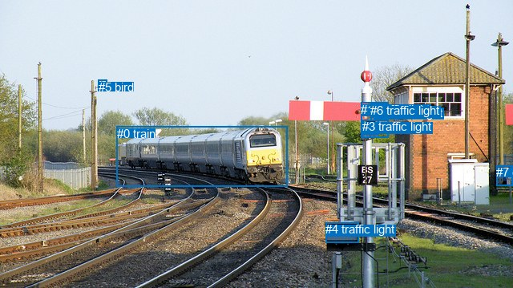
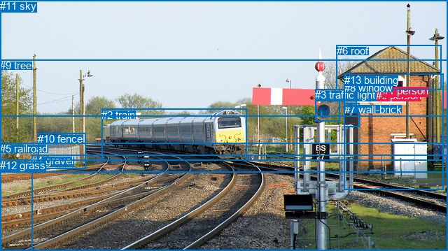

# 图片 2171：713172.jpg

随机样本序号：423。图片 SHA256：`7aa9c205a4031b3be912dda9b3a37a9c29e88f6a684f38c46b2c4fceeb86d0a9`。

红色框表示人，蓝色框表示其他物体。两个模式分别保留自身框编号，可依据位置比较对应对象。

## 自动检测框与输出

人的框编号：`[]`。状态：`no_person`。

### 自动检测全部物体框

| 编号 | 类别 | 是否为人 | 检测分数 | 像素坐标 xyxy |
|---|---|---|---|---|
| 0 | train | False | 0.9983 | 145.8, 157.6, 358.2, 232.0 |
| 1 | traffic light | False | 0.9021 | 450.1, 127.7, 484.3, 171.9 |
| 2 | traffic light | False | 0.7423 | 466.3, 131.8, 479.4, 144.3 |
| 3 | traffic light | False | 0.7300 | 452.2, 149.3, 472.3, 169.0 |
| 4 | traffic light | False | 0.5127 | 406.4, 277.2, 447.2, 302.6 |
| 5 | bird | False | 0.4510 | 122.9, 99.6, 133.9, 110.3 |
| 6 | traffic light | False | 0.4144 | 462.5, 129.3, 482.5, 150.9 |
| 7 | car | False | 0.4017 | 619.0, 206.0, 640.0, 231.3 |

### 自动检测 Top50 人相关候选

评分物体对：0；人相关物体对：0；输出关系：0。

| 排名 | 主语编号与类别 | 关系 | 宾语编号与类别 | 类型 | 人与人 | 排序分数 | 原始融合 logit |
|---|---|---|---|---|---|---|---|

### 自动检测逐条人相关 GT 核验

R@50：0.00%；命中 0/1。

| GT 主语编号 | GT 关系 | GT 宾语编号 | 结果阶段 | 匹配预测主语编号 | 匹配预测宾语编号 |
|---|---|---|---|---|---|
| 0 | in | 13 | endpoint_missing_or_wrong_class | [] | [] |

## 真实框与输出

人的框编号：`[0, 1]`。

### 真实框全部物体框

| 编号 | 类别 | 是否为人 | 检测分数 | 像素坐标 xyxy |
|---|---|---|---|---|
| 0 | person | True | GT | 537.0, 128.0, 544.0, 138.0 |
| 1 | person | True | GT | 547.0, 121.0, 560.0, 139.0 |
| 2 | train | False | GT | 145.0, 156.0, 352.0, 230.0 |
| 3 | traffic light | False | GT | 450.0, 127.0, 485.0, 173.0 |
| 4 | gravel | False | GT | 45.0, 221.0, 640.0, 359.0 |
| 5 | railroad | False | GT | 0.0, 204.0, 640.0, 359.0 |
| 6 | roof | False | GT | 481.0, 64.0, 631.0, 128.0 |
| 7 | wall-brick | False | GT | 492.0, 148.0, 514.0, 182.0 |
| 8 | window | False | GT | 492.0, 117.0, 510.0, 152.0 |
| 9 | tree | False | GT | 0.0, 85.0, 640.0, 246.0 |
| 10 | fence | False | GT | 54.0, 190.0, 122.0, 241.0 |
| 11 | sky | False | GT | 0.0, 0.0, 640.0, 167.0 |
| 12 | grass | False | GT | 0.0, 228.0, 640.0, 359.0 |
| 13 | building | False | GT | 492.0, 106.0, 634.0, 272.0 |

### 真实框 Top50 人相关候选

评分物体对：182；人相关物体对：50；输出关系：50。

| 排名 | 主语编号与类别 | 关系 | 宾语编号与类别 | 类型 | 人与人 | 排序分数 | 原始融合 logit |
|---|---|---|---|---|---|---|---|
| 1 | #0 person | on | #13 building | spatial | False | 0.96367 | 3.2782 |
| 2 | #1 person | on | #13 building | spatial | False | 0.95593 | 3.0768 |
| 3 | #1 person | on | #6 roof | spatial | False | 0.92811 | 2.5579 |
| 4 | #0 person | on | #6 roof | spatial | False | 0.82013 | 1.5173 |
| 5 | #0 person | standing on | #13 building | semantic | False | 0.54549 | 0.1825 |
| 6 | #0 person | looking at | #2 train | semantic | False | 0.52361 | 0.0945 |
| 7 | #0 person | in | #1 person | spatial | True | 0.51027 | 0.0411 |
| 8 | #1 person | looking at | #2 train | semantic | False | 0.48857 | -0.0457 |
| 9 | #1 person | standing on | #13 building | semantic | False | 0.47392 | -0.1044 |
| 10 | #1 person | sitting on | #6 roof | semantic | False | 0.45817 | -0.1677 |
| 11 | #0 person | sitting on | #6 roof | semantic | False | 0.43502 | -0.2614 |
| 12 | #0 person | on | #7 wall-brick | spatial | False | 0.35844 | -0.5821 |
| 13 | #13 building | in | #1 person | spatial | False | 0.34986 | -0.6197 |
| 14 | #13 building | in | #0 person | spatial | False | 0.25591 | -1.0673 |
| 15 | #0 person | on | #2 train | spatial | False | 0.25590 | -1.0674 |
| 16 | #1 person | on | #7 wall-brick | spatial | False | 0.25129 | -1.0917 |
| 17 | #1 person | on | #0 person | spatial | True | 0.21898 | -1.2716 |
| 18 | #1 person | on | #2 train | spatial | False | 0.18454 | -1.4859 |
| 19 | #0 person | sitting on | #1 person | semantic | True | 0.15776 | -1.6750 |
| 20 | #0 person | in | #9 tree | spatial | False | 0.12240 | -1.9699 |
| 21 | #6 roof | in | #1 person | spatial | False | 0.09522 | -2.2515 |
| 22 | #13 building | wearing | #1 person | semantic | False | 0.09423 | -2.2631 |
| 23 | #13 building | holding | #0 person | semantic | False | 0.08751 | -2.3444 |
| 24 | #0 person | standing on | #7 wall-brick | semantic | False | 0.08444 | -2.3835 |
| 25 | #1 person | wearing | #0 person | semantic | True | 0.08011 | -2.4408 |
| 26 | #0 person | beside | #8 window | spatial | False | 0.08011 | -2.4409 |
| 27 | #1 person | in | #9 tree | spatial | False | 0.07207 | -2.5553 |
| 28 | #1 person | beside | #8 window | spatial | False | 0.06521 | -2.6627 |
| 29 | #8 window | on | #1 person | spatial | False | 0.06335 | -2.6937 |
| 30 | #8 window | on | #0 person | spatial | False | 0.06262 | -2.7060 |
| 31 | #1 person | looking at | #7 wall-brick | semantic | False | 0.06133 | -2.7282 |
| 32 | #1 person | looking at | #9 tree | semantic | False | 0.05666 | -2.8124 |
| 33 | #0 person | looking at | #9 tree | semantic | False | 0.04817 | -2.9837 |
| 34 | #7 wall-brick | in | #1 person | spatial | False | 0.04795 | -2.9885 |
| 35 | #1 person | looking at | #5 railroad | semantic | False | 0.04081 | -3.1572 |
| 36 | #7 wall-brick | in | #0 person | spatial | False | 0.03934 | -3.1953 |
| 37 | #6 roof | holding | #1 person | semantic | False | 0.03826 | -3.2242 |
| 38 | #1 person | in | #11 sky | spatial | False | 0.03712 | -3.2558 |
| 39 | #1 person | looking at | #4 gravel | semantic | False | 0.03258 | -3.3911 |
| 40 | #0 person | looking at | #5 railroad | semantic | False | 0.02872 | -3.5212 |
| 41 | #1 person | looking at | #12 grass | semantic | False | 0.02860 | -3.5253 |
| 42 | #0 person | on | #3 traffic light | spatial | False | 0.02701 | -3.5842 |
| 43 | #0 person | in | #11 sky | spatial | False | 0.02627 | -3.6126 |
| 44 | #0 person | looking at | #3 traffic light | semantic | False | 0.02561 | -3.6388 |
| 45 | #7 wall-brick | holding | #1 person | semantic | False | 0.02147 | -3.8192 |
| 46 | #0 person | in | #10 fence | spatial | False | 0.02144 | -3.8209 |
| 47 | #0 person | looking at | #4 gravel | semantic | False | 0.02109 | -3.8374 |
| 48 | #1 person | beside | #3 traffic light | spatial | False | 0.02056 | -3.8634 |
| 49 | #7 wall-brick | holding | #0 person | semantic | False | 0.01938 | -3.9241 |
| 50 | #0 person | looking at | #12 grass | semantic | False | 0.01904 | -3.9417 |

### 真实框逐条人相关 GT 核验

R@50：0.00%；命中 0/1。

| GT 主语编号 | GT 关系 | GT 宾语编号 | 结果阶段 | 匹配预测主语编号 | 匹配预测宾语编号 |
|---|---|---|---|---|---|
| 0 | in | 13 | wrong_predicate | [0] | [13] |

## 全部人相关 GT

| 主语编号与类别 | 关系 | 宾语编号与类别 |
|---|---|---|
| #0 person | in | #13 building |

原始记录、全部人相关物体对的两项预测与分项分数见 [逐图证据 JSON](../evidence/cases/2171.json)。全部56类 logits 保留于本机 HOR/output/random500/logits/。

<!-- HOR_COMPLETE_RESULTS -->

## 六组条件的完整输出对照

以下保留同一图片三种框与候选模式、两种谓词输出规则的全部 Top50。框编号各自在所属模式内解释。

### 自动检测框完整枚举：空间与语义各保留一个谓词

| 排名 | 主语编号与类别 | 谓词 | 宾语编号与类别 | 分组 | 排序分数 | predicate logit | pair logit |
|---|---|---|---|---|---|---|---|

GT 命中：0/1，R@50=0.00%。

| GT主语 | GT谓词 | GT宾语 | 结果阶段 | 匹配主语框 | 匹配宾语框 |
|---|---|---|---|---|---|
| 0 | in | 13 | endpoint_missing_or_wrong_class | [] | [] |

### 自动检测框完整枚举：每对只保留一个谓词

| 排名 | 主语编号与类别 | 谓词 | 宾语编号与类别 | 分组 | 排序分数 | predicate logit | pair logit |
|---|---|---|---|---|---|---|---|

GT 命中：0/1，R@50=0.00%。

| GT主语 | GT谓词 | GT宾语 | 结果阶段 | 匹配主语框 | 匹配宾语框 |
|---|---|---|---|---|---|
| 0 | in | 13 | endpoint_missing_or_wrong_class | [] | [] |

### 真实框完整枚举：空间与语义各保留一个谓词

| 排名 | 主语编号与类别 | 谓词 | 宾语编号与类别 | 分组 | 排序分数 | predicate logit | pair logit |
|---|---|---|---|---|---|---|---|
| 1 | #0 person | on | #13 building | spatial | 0.9636741 | 3.3009830 | -0.0227585 |
| 2 | #1 person | on | #13 building | spatial | 0.9559276 | 3.0929217 | -0.0160737 |
| 3 | #1 person | on | #6 roof | spatial | 0.9281053 | 3.0058045 | -0.4478616 |
| 4 | #0 person | on | #6 roof | spatial | 0.8201339 | 1.9654989 | -0.4482437 |
| 5 | #0 person | standing on | #13 building | semantic | 0.5454949 | 0.2052426 | -0.0227585 |
| 6 | #0 person | looking at | #2 train | semantic | 0.5236108 | 0.8321385 | -0.7376251 |
| 7 | #0 person | in | #1 person | spatial | 0.5102729 | 1.0512500 | -1.0101526 |
| 8 | #1 person | looking at | #2 train | semantic | 0.4885729 | 0.7082872 | -0.7540036 |
| 9 | #1 person | standing on | #13 building | semantic | 0.4739238 | -0.0883260 | -0.0160737 |
| 10 | #1 person | sitting on | #6 roof | semantic | 0.4581684 | 0.2801433 | -0.4478616 |
| 11 | #0 person | sitting on | #6 roof | semantic | 0.4350210 | 0.1868491 | -0.4482437 |
| 12 | #0 person | on | #7 wall-brick | spatial | 0.3584391 | 0.1170158 | -0.6991614 |
| 13 | #13 building | in | #1 person | spatial | 0.3498603 | 0.2272716 | -0.8469250 |
| 14 | #13 building | in | #0 person | spatial | 0.2559142 | -0.1774120 | -0.8899020 |
| 15 | #0 person | on | #2 train | spatial | 0.2558976 | -0.3297763 | -0.7376251 |
| 16 | #1 person | on | #7 wall-brick | spatial | 0.2512933 | -0.3547120 | -0.7370142 |
| 17 | #1 person | on | #0 person | spatial | 0.2189832 | -0.1360793 | -1.1355226 |
| 18 | #1 person | on | #2 train | spatial | 0.1845446 | -0.7318523 | -0.7540036 |
| 19 | #0 person | sitting on | #1 person | semantic | 0.1577631 | -0.6648145 | -1.0101526 |
| 20 | #0 person | in | #9 tree | spatial | 0.1224029 | -0.7235067 | -1.2463627 |
| 21 | #6 roof | in | #1 person | spatial | 0.0952188 | -1.1529396 | -1.0985759 |
| 22 | #13 building | wearing | #1 person | semantic | 0.0942266 | -1.4161620 | -0.8469250 |
| 23 | #13 building | holding | #0 person | semantic | 0.0875093 | -1.4545302 | -0.8899020 |
| 24 | #0 person | standing on | #7 wall-brick | semantic | 0.0844431 | -1.6842928 | -0.6991614 |
| 25 | #1 person | wearing | #0 person | semantic | 0.0801139 | -1.3052776 | -1.1355226 |
| 26 | #0 person | beside | #8 window | spatial | 0.0801084 | -1.2525127 | -1.1883621 |
| 27 | #1 person | in | #9 tree | spatial | 0.0720681 | -1.2786770 | -1.2766705 |
| 28 | #1 person | beside | #8 window | spatial | 0.0652121 | -1.4477012 | -1.2149727 |
| 29 | #8 window | on | #1 person | spatial | 0.0633470 | -1.6803195 | -1.0133659 |
| 30 | #8 window | on | #0 person | spatial | 0.0626176 | -1.6285942 | -1.0774505 |
| 31 | #1 person | looking at | #7 wall-brick | semantic | 0.0613284 | -1.9912090 | -0.7370142 |
| 32 | #1 person | looking at | #9 tree | semantic | 0.0566553 | -1.5357766 | -1.2766705 |
| 33 | #0 person | looking at | #9 tree | semantic | 0.0481671 | -1.7373509 | -1.2463627 |
| 34 | #7 wall-brick | in | #1 person | spatial | 0.0479484 | -1.8730452 | -1.1154475 |
| 35 | #1 person | looking at | #5 railroad | semantic | 0.0408097 | -1.4180810 | -1.7390894 |
| 36 | #7 wall-brick | in | #0 person | spatial | 0.0393414 | -2.0270126 | -1.1683295 |
| 37 | #6 roof | holding | #1 person | semantic | 0.0382647 | -2.1256351 | -1.0985759 |
| 38 | #1 person | in | #11 sky | spatial | 0.0371207 | -1.5639572 | -1.6917971 |
| 39 | #1 person | looking at | #4 gravel | semantic | 0.0325760 | -1.7783043 | -1.6127582 |
| 40 | #0 person | looking at | #5 railroad | semantic | 0.0287163 | -1.7662220 | -1.7549312 |
| 41 | #1 person | looking at | #12 grass | semantic | 0.0286000 | -1.7942216 | -1.7311090 |
| 42 | #0 person | on | #3 traffic light | spatial | 0.0270095 | -2.0755539 | -1.5086319 |
| 43 | #0 person | in | #11 sky | spatial | 0.0262729 | -1.9424756 | -1.6701159 |
| 44 | #0 person | looking at | #3 traffic light | semantic | 0.0256109 | -2.1301603 | -1.5086319 |
| 45 | #7 wall-brick | holding | #1 person | semantic | 0.0214740 | -2.7037587 | -1.1154475 |
| 46 | #0 person | in | #10 fence | spatial | 0.0214392 | -2.6986320 | -1.1222303 |
| 47 | #0 person | looking at | #4 gravel | semantic | 0.0210946 | -2.2154989 | -1.6219171 |
| 48 | #1 person | beside | #3 traffic light | spatial | 0.0205639 | -2.3207376 | -1.5427011 |
| 49 | #7 wall-brick | holding | #0 person | semantic | 0.0193762 | -2.7558146 | -1.1683295 |
| 50 | #0 person | looking at | #12 grass | semantic | 0.0190446 | -2.2013252 | -1.7404200 |

GT 命中：0/1，R@50=0.00%。

| GT主语 | GT谓词 | GT宾语 | 结果阶段 | 匹配主语框 | 匹配宾语框 |
|---|---|---|---|---|---|
| 0 | in | 13 | wrong_predicate | [0] | [13] |

### 真实框完整枚举：每对只保留一个谓词

| 排名 | 主语编号与类别 | 谓词 | 宾语编号与类别 | 分组 | 排序分数 | predicate logit | pair logit |
|---|---|---|---|---|---|---|---|
| 1 | #0 person | on | #13 building | single | 0.9636741 | 3.3009830 | -0.0227585 |
| 2 | #1 person | on | #13 building | single | 0.9559276 | 3.0929217 | -0.0160737 |
| 3 | #1 person | on | #6 roof | single | 0.9281053 | 3.0058045 | -0.4478616 |
| 4 | #0 person | on | #6 roof | single | 0.8201339 | 1.9654989 | -0.4482437 |
| 5 | #0 person | looking at | #2 train | single | 0.5236108 | 0.8321385 | -0.7376251 |
| 6 | #0 person | in | #1 person | single | 0.5102729 | 1.0512500 | -1.0101526 |
| 7 | #1 person | looking at | #2 train | single | 0.4885729 | 0.7082872 | -0.7540036 |
| 8 | #0 person | on | #7 wall-brick | single | 0.3584391 | 0.1170158 | -0.6991614 |
| 9 | #13 building | in | #1 person | single | 0.3498603 | 0.2272716 | -0.8469250 |
| 10 | #13 building | in | #0 person | single | 0.2559142 | -0.1774120 | -0.8899020 |
| 11 | #1 person | on | #7 wall-brick | single | 0.2512933 | -0.3547120 | -0.7370142 |
| 12 | #1 person | on | #0 person | single | 0.2189832 | -0.1360793 | -1.1355226 |
| 13 | #0 person | in | #9 tree | single | 0.1224029 | -0.7235067 | -1.2463627 |
| 14 | #6 roof | in | #1 person | single | 0.0952188 | -1.1529396 | -1.0985759 |
| 15 | #0 person | beside | #8 window | single | 0.0801084 | -1.2525127 | -1.1883621 |
| 16 | #1 person | in | #9 tree | single | 0.0720681 | -1.2786770 | -1.2766705 |
| 17 | #1 person | beside | #8 window | single | 0.0652121 | -1.4477012 | -1.2149727 |
| 18 | #8 window | on | #1 person | single | 0.0633470 | -1.6803195 | -1.0133659 |
| 19 | #8 window | on | #0 person | single | 0.0626176 | -1.6285942 | -1.0774505 |
| 20 | #7 wall-brick | in | #1 person | single | 0.0479484 | -1.8730452 | -1.1154475 |
| 21 | #1 person | looking at | #5 railroad | single | 0.0408097 | -1.4180810 | -1.7390894 |
| 22 | #7 wall-brick | in | #0 person | single | 0.0393414 | -2.0270126 | -1.1683295 |
| 23 | #1 person | in | #11 sky | single | 0.0371207 | -1.5639572 | -1.6917971 |
| 24 | #1 person | looking at | #4 gravel | single | 0.0325760 | -1.7783043 | -1.6127582 |
| 25 | #0 person | looking at | #5 railroad | single | 0.0287163 | -1.7662220 | -1.7549312 |
| 26 | #1 person | looking at | #12 grass | single | 0.0286000 | -1.7942216 | -1.7311090 |
| 27 | #0 person | on | #3 traffic light | single | 0.0270095 | -2.0755539 | -1.5086319 |
| 28 | #0 person | in | #11 sky | single | 0.0262729 | -1.9424756 | -1.6701159 |
| 29 | #0 person | in | #10 fence | single | 0.0214392 | -2.6986320 | -1.1222303 |
| 30 | #0 person | looking at | #4 gravel | single | 0.0210946 | -2.2154989 | -1.6219171 |
| 31 | #1 person | beside | #3 traffic light | single | 0.0205639 | -2.3207376 | -1.5427011 |
| 32 | #0 person | looking at | #12 grass | single | 0.0190446 | -2.2013252 | -1.7404200 |
| 33 | #3 traffic light | in | #1 person | single | 0.0187598 | -2.5057001 | -1.4514004 |
| 34 | #3 traffic light | in | #0 person | single | 0.0163822 | -2.6498525 | -1.4451890 |
| 35 | #6 roof | in | #0 person | single | 0.0138612 | -3.0646141 | -1.2000889 |
| 36 | #1 person | in | #10 fence | single | 0.0123417 | -3.2057614 | -1.1765907 |
| 37 | #2 train | in | #1 person | single | 0.0121120 | -3.1609585 | -1.2404166 |
| 38 | #2 train | in | #0 person | single | 0.0117094 | -3.1592991 | -1.2762877 |
| 39 | #11 sky | over | #1 person | single | 0.0024957 | -4.2608900 | -1.7297994 |
| 40 | #9 tree | in | #1 person | single | 0.0019370 | -4.4306698 | -1.8140312 |
| 41 | #9 tree | in | #0 person | single | 0.0018639 | -4.4343753 | -1.8488170 |
| 42 | #11 sky | over | #0 person | single | 0.0017206 | -4.6025639 | -1.7607853 |
| 43 | #5 railroad | in | #1 person | single | 0.0008927 | -5.0439067 | -1.9764408 |
| 44 | #4 gravel | in | #1 person | single | 0.0008758 | -5.0534759 | -1.9860673 |
| 45 | #12 grass | in | #1 person | single | 0.0008715 | -5.0568767 | -1.9875854 |
| 46 | #4 gravel | in | #0 person | single | 0.0008548 | -5.0454545 | -2.0183101 |
| 47 | #5 railroad | in | #0 person | single | 0.0008479 | -5.0696001 | -2.0023236 |
| 48 | #12 grass | in | #0 person | single | 0.0008307 | -5.0733881 | -2.0190163 |
| 49 | #10 fence | in | #1 person | single | 0.0007578 | -5.3270779 | -1.8572221 |
| 50 | #10 fence | in | #0 person | single | 0.0006547 | -5.4647903 | -1.8658559 |

GT 命中：0/1，R@50=0.00%。

| GT主语 | GT谓词 | GT宾语 | 结果阶段 | 匹配主语框 | 匹配宾语框 |
|---|---|---|---|---|---|
| 0 | in | 13 | wrong_predicate | [0] | [13] |

### 真实框400候选：空间与语义各保留一个谓词

| 排名 | 主语编号与类别 | 谓词 | 宾语编号与类别 | 分组 | 排序分数 | predicate logit | pair logit |
|---|---|---|---|---|---|---|---|
| 1 | #0 person | on | #13 building | spatial | 0.9636741 | 3.3009830 | -0.0227585 |
| 2 | #1 person | on | #13 building | spatial | 0.9575175 | 3.1313248 | -0.0160737 |
| 3 | #1 person | on | #6 roof | spatial | 0.9281053 | 3.0058045 | -0.4478616 |
| 4 | #0 person | on | #6 roof | spatial | 0.8193293 | 1.9600539 | -0.4482437 |
| 5 | #0 person | standing on | #13 building | semantic | 0.5454949 | 0.2052426 | -0.0227585 |
| 6 | #0 person | looking at | #2 train | semantic | 0.5236108 | 0.8321385 | -0.7376251 |
| 7 | #0 person | in | #1 person | spatial | 0.5119314 | 1.0578871 | -1.0101526 |
| 8 | #1 person | looking at | #2 train | semantic | 0.4810572 | 0.6781960 | -0.7540036 |
| 9 | #1 person | standing on | #13 building | semantic | 0.4730085 | -0.0919976 | -0.0160737 |
| 10 | #1 person | sitting on | #6 roof | semantic | 0.4581684 | 0.2801433 | -0.4478616 |
| 11 | #0 person | sitting on | #6 roof | semantic | 0.4328032 | 0.1778202 | -0.4482437 |
| 12 | #0 person | on | #7 wall-brick | spatial | 0.3596923 | 0.1224613 | -0.6991614 |
| 13 | #13 building | in | #1 person | spatial | 0.3498603 | 0.2272716 | -0.8469250 |
| 14 | #13 building | in | #0 person | spatial | 0.2559142 | -0.1774120 | -0.8899020 |
| 15 | #0 person | on | #2 train | spatial | 0.2553796 | -0.3324986 | -0.7376251 |
| 16 | #1 person | on | #7 wall-brick | spatial | 0.2512933 | -0.3547120 | -0.7370142 |
| 17 | #1 person | on | #0 person | spatial | 0.2147970 | -0.1607261 | -1.1355226 |
| 18 | #1 person | on | #2 train | spatial | 0.1837266 | -0.7372971 | -0.7540036 |
| 19 | #0 person | looking at | #1 person | semantic | 0.1608675 | -0.6416354 | -1.0101526 |
| 20 | #0 person | in | #9 tree | spatial | 0.1169376 | -0.7753923 | -1.2463627 |
| 21 | #6 roof | in | #1 person | spatial | 0.0952188 | -1.1529396 | -1.0985759 |
| 22 | #13 building | wearing | #1 person | semantic | 0.0931979 | -1.4282734 | -0.8469250 |
| 23 | #13 building | holding | #0 person | semantic | 0.0864903 | -1.4673600 | -0.8899020 |
| 24 | #0 person | standing on | #7 wall-brick | semantic | 0.0856136 | -1.6692472 | -0.6991614 |
| 25 | #0 person | beside | #8 window | spatial | 0.0790014 | -1.2676303 | -1.1883621 |
| 26 | #1 person | wearing | #0 person | semantic | 0.0781352 | -1.3324349 | -1.1355226 |
| 27 | #1 person | in | #9 tree | spatial | 0.0723738 | -1.2741137 | -1.2766705 |
| 28 | #8 window | on | #1 person | spatial | 0.0649904 | -1.6529510 | -1.0133659 |
| 29 | #1 person | beside | #8 window | spatial | 0.0643010 | -1.4627466 | -1.2149727 |
| 30 | #8 window | on | #0 person | spatial | 0.0626176 | -1.6285942 | -1.0774505 |
| 31 | #1 person | looking at | #7 wall-brick | semantic | 0.0613484 | -1.9908607 | -0.7370142 |
| 32 | #1 person | looking at | #9 tree | semantic | 0.0582851 | -1.5056856 | -1.2766705 |
| 33 | #7 wall-brick | in | #1 person | spatial | 0.0486784 | -1.8571699 | -1.1154475 |
| 34 | #0 person | looking at | #9 tree | semantic | 0.0474662 | -1.7527454 | -1.2463627 |
| 35 | #1 person | looking at | #5 railroad | semantic | 0.0419759 | -1.3886869 | -1.7390894 |
| 36 | #7 wall-brick | in | #0 person | spatial | 0.0398663 | -2.0132113 | -1.1683295 |
| 37 | #6 roof | holding | #1 person | semantic | 0.0387672 | -2.1120665 | -1.0985759 |
| 38 | #1 person | in | #11 sky | spatial | 0.0370910 | -1.5647869 | -1.6917971 |
| 39 | #1 person | looking at | #4 gravel | semantic | 0.0325705 | -1.7784784 | -1.6127582 |
| 40 | #1 person | looking at | #12 grass | semantic | 0.0290063 | -1.7796986 | -1.7311090 |
| 41 | #0 person | looking at | #5 railroad | semantic | 0.0287212 | -1.7660477 | -1.7549312 |
| 42 | #0 person | on | #3 traffic light | spatial | 0.0275734 | -2.0543103 | -1.5086319 |
| 43 | #0 person | looking at | #3 traffic light | semantic | 0.0263727 | -2.1000690 | -1.5086319 |
| 44 | #0 person | in | #11 sky | spatial | 0.0256381 | -1.9675887 | -1.6701159 |
| 45 | #1 person | beside | #3 traffic light | spatial | 0.0218080 | -2.2607284 | -1.5427011 |
| 46 | #7 wall-brick | holding | #1 person | semantic | 0.0217668 | -2.6899133 | -1.1154475 |
| 47 | #0 person | looking at | #4 gravel | semantic | 0.0214039 | -2.2006276 | -1.6219171 |
| 48 | #0 person | in | #10 fence | spatial | 0.0211258 | -2.7136774 | -1.1222303 |
| 49 | #7 wall-brick | holding | #0 person | semantic | 0.0193692 | -2.7561836 | -1.1683295 |
| 50 | #0 person | looking at | #12 grass | semantic | 0.0190446 | -2.2013252 | -1.7404200 |

GT 命中：0/1，R@50=0.00%。

| GT主语 | GT谓词 | GT宾语 | 结果阶段 | 匹配主语框 | 匹配宾语框 |
|---|---|---|---|---|---|
| 0 | in | 13 | wrong_predicate | [0] | [13] |

### 真实框400候选：每对只保留一个谓词

| 排名 | 主语编号与类别 | 谓词 | 宾语编号与类别 | 分组 | 排序分数 | predicate logit | pair logit |
|---|---|---|---|---|---|---|---|
| 1 | #0 person | on | #13 building | single | 0.9636741 | 3.3009830 | -0.0227585 |
| 2 | #1 person | on | #13 building | single | 0.9575175 | 3.1313248 | -0.0160737 |
| 3 | #1 person | on | #6 roof | single | 0.9281053 | 3.0058045 | -0.4478616 |
| 4 | #0 person | on | #6 roof | single | 0.8193293 | 1.9600539 | -0.4482437 |
| 5 | #0 person | looking at | #2 train | single | 0.5236108 | 0.8321385 | -0.7376251 |
| 6 | #0 person | in | #1 person | single | 0.5119314 | 1.0578871 | -1.0101526 |
| 7 | #1 person | looking at | #2 train | single | 0.4810572 | 0.6781960 | -0.7540036 |
| 8 | #0 person | on | #7 wall-brick | single | 0.3596923 | 0.1224613 | -0.6991614 |
| 9 | #13 building | in | #1 person | single | 0.3498603 | 0.2272716 | -0.8469250 |
| 10 | #13 building | in | #0 person | single | 0.2559142 | -0.1774120 | -0.8899020 |
| 11 | #1 person | on | #7 wall-brick | single | 0.2512933 | -0.3547120 | -0.7370142 |
| 12 | #1 person | on | #0 person | single | 0.2147970 | -0.1607261 | -1.1355226 |
| 13 | #0 person | in | #9 tree | single | 0.1169376 | -0.7753923 | -1.2463627 |
| 14 | #6 roof | in | #1 person | single | 0.0952188 | -1.1529396 | -1.0985759 |
| 15 | #0 person | beside | #8 window | single | 0.0790014 | -1.2676303 | -1.1883621 |
| 16 | #1 person | in | #9 tree | single | 0.0723738 | -1.2741137 | -1.2766705 |
| 17 | #8 window | on | #1 person | single | 0.0649904 | -1.6529510 | -1.0133659 |
| 18 | #1 person | beside | #8 window | single | 0.0643010 | -1.4627466 | -1.2149727 |
| 19 | #8 window | on | #0 person | single | 0.0626176 | -1.6285942 | -1.0774505 |
| 20 | #7 wall-brick | in | #1 person | single | 0.0486784 | -1.8571699 | -1.1154475 |
| 21 | #1 person | looking at | #5 railroad | single | 0.0419759 | -1.3886869 | -1.7390894 |
| 22 | #7 wall-brick | in | #0 person | single | 0.0398663 | -2.0132113 | -1.1683295 |
| 23 | #1 person | in | #11 sky | single | 0.0370910 | -1.5647869 | -1.6917971 |
| 24 | #1 person | looking at | #4 gravel | single | 0.0325705 | -1.7784784 | -1.6127582 |
| 25 | #1 person | looking at | #12 grass | single | 0.0290063 | -1.7796986 | -1.7311090 |
| 26 | #0 person | looking at | #5 railroad | single | 0.0287212 | -1.7660477 | -1.7549312 |
| 27 | #0 person | on | #3 traffic light | single | 0.0275734 | -2.0543103 | -1.5086319 |
| 28 | #0 person | in | #11 sky | single | 0.0256381 | -1.9675887 | -1.6701159 |
| 29 | #1 person | beside | #3 traffic light | single | 0.0218080 | -2.2607284 | -1.5427011 |
| 30 | #0 person | looking at | #4 gravel | single | 0.0214039 | -2.2006276 | -1.6219171 |
| 31 | #0 person | in | #10 fence | single | 0.0211258 | -2.7136774 | -1.1222303 |
| 32 | #0 person | looking at | #12 grass | single | 0.0190446 | -2.2013252 | -1.7404200 |
| 33 | #3 traffic light | in | #1 person | single | 0.0187140 | -2.5081892 | -1.4514004 |
| 34 | #3 traffic light | in | #0 person | single | 0.0162208 | -2.6599200 | -1.4451890 |
| 35 | #6 roof | in | #0 person | single | 0.0138329 | -3.0666883 | -1.2000889 |
| 36 | #1 person | in | #10 fence | single | 0.0123013 | -3.2090802 | -1.1765907 |
| 37 | #2 train | in | #1 person | single | 0.0121120 | -3.1609585 | -1.2404166 |
| 38 | #2 train | in | #0 person | single | 0.0115365 | -3.1743450 | -1.2762877 |
| 39 | #11 sky | over | #1 person | single | 0.0024924 | -4.2622123 | -1.7297994 |
| 40 | #9 tree | in | #1 person | single | 0.0020254 | -4.3859200 | -1.8140312 |
| 41 | #9 tree | in | #0 person | single | 0.0018609 | -4.4360347 | -1.8488170 |
| 42 | #11 sky | over | #0 person | single | 0.0017206 | -4.6025639 | -1.7607853 |
| 43 | #5 railroad | in | #1 person | single | 0.0008927 | -5.0439067 | -1.9764408 |
| 44 | #4 gravel | in | #1 person | single | 0.0008719 | -5.0578732 | -1.9860673 |
| 45 | #12 grass | in | #1 person | single | 0.0008715 | -5.0568767 | -1.9875854 |
| 46 | #5 railroad | in | #0 person | single | 0.0008541 | -5.0622711 | -2.0023236 |
| 47 | #12 grass | in | #0 person | single | 0.0008417 | -5.0601954 | -2.0190163 |
| 48 | #4 gravel | in | #0 person | single | 0.0008295 | -5.0755458 | -2.0183101 |
| 49 | #10 fence | in | #1 person | single | 0.0007428 | -5.3470917 | -1.8572221 |
| 50 | #10 fence | in | #0 person | single | 0.0006506 | -5.4710407 | -1.8658559 |

GT 命中：0/1，R@50=0.00%。

| GT主语 | GT谓词 | GT宾语 | 结果阶段 | 匹配主语框 | 匹配宾语框 |
|---|---|---|---|---|---|
| 0 | in | 13 | wrong_predicate | [0] | [13] |
