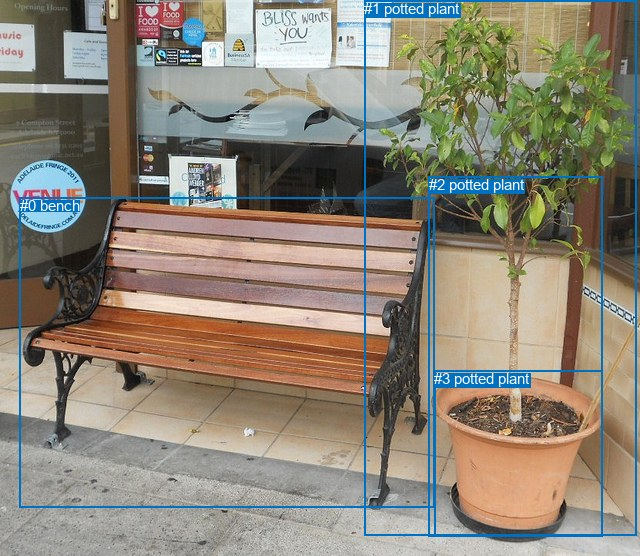
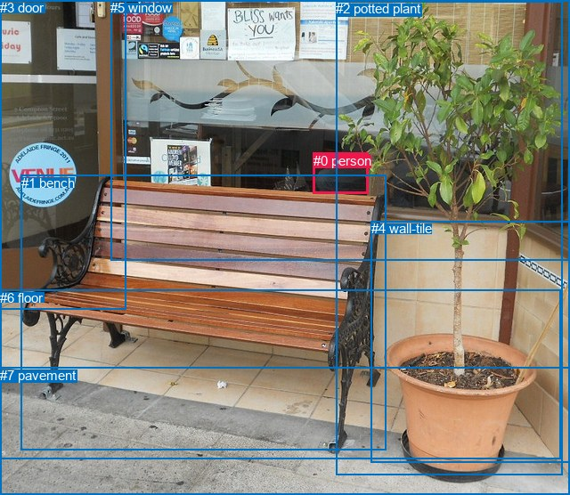

# 图片 2176：713850.jpg

随机样本序号：83。图片 SHA256：`f9da58f51bf97c0a5ec0d59b6bceeac0923938aa8c0bbcfc1a8a05d0205ddb54`。

红色框表示人，蓝色框表示其他物体。两个模式分别保留自身框编号，可依据位置比较对应对象。

## 自动检测框与输出

人的框编号：`[]`。状态：`no_person`。

### 自动检测全部物体框

| 编号 | 类别 | 是否为人 | 检测分数 | 像素坐标 xyxy |
|---|---|---|---|---|
| 0 | bench | False | 0.9987 | 19.9, 197.1, 434.7, 508.0 |
| 1 | potted plant | False | 0.9946 | 364.3, 0.0, 636.2, 535.4 |
| 2 | potted plant | False | 0.8804 | 428.7, 176.2, 602.9, 536.5 |
| 3 | potted plant | False | 0.6375 | 434.4, 370.2, 602.8, 535.7 |

### 自动检测 Top50 人相关候选

评分物体对：0；人相关物体对：0；输出关系：0。

| 排名 | 主语编号与类别 | 关系 | 宾语编号与类别 | 类型 | 人与人 | 排序分数 | 原始融合 logit |
|---|---|---|---|---|---|---|---|

### 自动检测逐条人相关 GT 核验

R@50：0.00%；命中 0/1。

| GT 主语编号 | GT 关系 | GT 宾语编号 | 结果阶段 | 匹配预测主语编号 | 匹配预测宾语编号 |
|---|---|---|---|---|---|
| 0 | in | 5 | endpoint_missing_or_wrong_class | [] | [] |

## 真实框与输出

人的框编号：`[0]`。

### 真实框全部物体框

| 编号 | 类别 | 是否为人 | 检测分数 | 像素坐标 xyxy |
|---|---|---|---|---|
| 0 | person | True | GT | 352.0, 172.0, 414.0, 218.0 |
| 1 | bench | False | GT | 24.0, 197.0, 434.0, 506.0 |
| 2 | potted plant | False | GT | 377.0, 1.0, 631.0, 534.0 |
| 3 | door | False | GT | 0.0, 0.0, 142.0, 347.0 |
| 4 | wall-tile | False | GT | 417.0, 248.0, 640.0, 519.0 |
| 5 | window | False | GT | 124.0, 0.0, 640.0, 292.0 |
| 6 | floor | False | GT | 0.0, 326.0, 629.0, 516.0 |
| 7 | pavement | False | GT | 0.0, 413.0, 640.0, 556.0 |

### 真实框 Top50 人相关候选

评分物体对：56；人相关物体对：14；输出关系：28。

| 排名 | 主语编号与类别 | 关系 | 宾语编号与类别 | 类型 | 人与人 | 排序分数 | 原始融合 logit |
|---|---|---|---|---|---|---|---|
| 1 | #0 person | in | #5 window | spatial | False | 0.93597 | 2.6822 |
| 2 | #0 person | on | #1 bench | spatial | False | 0.79851 | 1.3770 |
| 3 | #0 person | looking at | #5 window | semantic | False | 0.77926 | 1.2614 |
| 4 | #0 person | on | #2 potted plant | spatial | False | 0.75365 | 1.1182 |
| 5 | #0 person | sitting on | #1 bench | semantic | False | 0.58358 | 0.3375 |
| 6 | #0 person | in | #4 wall-tile | spatial | False | 0.51389 | 0.0556 |
| 7 | #0 person | holding | #2 potted plant | semantic | False | 0.44252 | -0.2309 |
| 8 | #0 person | in | #3 door | spatial | False | 0.25588 | -1.0675 |
| 9 | #0 person | looking at | #3 door | semantic | False | 0.24817 | -1.1084 |
| 10 | #2 potted plant | beside | #0 person | spatial | False | 0.13491 | -1.8582 |
| 11 | #0 person | on | #6 floor | spatial | False | 0.13471 | -1.8600 |
| 12 | #5 window | on | #0 person | spatial | False | 0.13053 | -1.8963 |
| 13 | #0 person | walking on | #7 pavement | semantic | False | 0.11086 | -2.0820 |
| 14 | #0 person | sitting on | #4 wall-tile | semantic | False | 0.10903 | -2.1007 |
| 15 | #0 person | on | #7 pavement | spatial | False | 0.09929 | -2.2051 |
| 16 | #5 window | wearing | #0 person | semantic | False | 0.08666 | -2.3551 |
| 17 | #0 person | walking on | #6 floor | semantic | False | 0.08496 | -2.3768 |
| 18 | #1 bench | beside | #0 person | spatial | False | 0.04098 | -3.1529 |
| 19 | #3 door | beside | #0 person | spatial | False | 0.01545 | -4.1544 |
| 20 | #2 potted plant | wearing | #0 person | semantic | False | 0.01446 | -4.2220 |
| 21 | #1 bench | looking at | #0 person | semantic | False | 0.00924 | -4.6748 |
| 22 | #3 door | looking at | #0 person | semantic | False | 0.00790 | -4.8335 |
| 23 | #4 wall-tile | beside | #0 person | spatial | False | 0.00378 | -5.5745 |
| 24 | #7 pavement | beside | #0 person | spatial | False | 0.00258 | -5.9593 |
| 25 | #4 wall-tile | holding | #0 person | semantic | False | 0.00230 | -6.0718 |
| 26 | #6 floor | in | #0 person | spatial | False | 0.00176 | -6.3400 |
| 27 | #6 floor | holding | #0 person | semantic | False | 0.00072 | -7.2404 |
| 28 | #7 pavement | holding | #0 person | semantic | False | 0.00065 | -7.3381 |

### 真实框逐条人相关 GT 核验

R@50：100.00%；命中 1/1。

| GT 主语编号 | GT 关系 | GT 宾语编号 | 结果阶段 | 匹配预测主语编号 | 匹配预测宾语编号 |
|---|---|---|---|---|---|
| 0 | in | 5 | hit50 | [0] | [5] |

## 全部人相关 GT

| 主语编号与类别 | 关系 | 宾语编号与类别 |
|---|---|---|
| #0 person | in | #5 window |

原始记录、全部人相关物体对的两项预测与分项分数见 [逐图证据 JSON](../evidence/cases/2176.json)。全部56类 logits 保留于本机 HOR/output/random500/logits/。

<!-- HOR_COMPLETE_RESULTS -->

## 六组条件的完整输出对照

以下保留同一图片三种框与候选模式、两种谓词输出规则的全部 Top50。框编号各自在所属模式内解释。

### 自动检测框完整枚举：空间与语义各保留一个谓词

| 排名 | 主语编号与类别 | 谓词 | 宾语编号与类别 | 分组 | 排序分数 | predicate logit | pair logit |
|---|---|---|---|---|---|---|---|

GT 命中：0/1，R@50=0.00%。

| GT主语 | GT谓词 | GT宾语 | 结果阶段 | 匹配主语框 | 匹配宾语框 |
|---|---|---|---|---|---|
| 0 | in | 5 | endpoint_missing_or_wrong_class | [] | [] |

### 自动检测框完整枚举：每对只保留一个谓词

| 排名 | 主语编号与类别 | 谓词 | 宾语编号与类别 | 分组 | 排序分数 | predicate logit | pair logit |
|---|---|---|---|---|---|---|---|

GT 命中：0/1，R@50=0.00%。

| GT主语 | GT谓词 | GT宾语 | 结果阶段 | 匹配主语框 | 匹配宾语框 |
|---|---|---|---|---|---|
| 0 | in | 5 | endpoint_missing_or_wrong_class | [] | [] |

### 真实框完整枚举：空间与语义各保留一个谓词

| 排名 | 主语编号与类别 | 谓词 | 宾语编号与类别 | 分组 | 排序分数 | predicate logit | pair logit |
|---|---|---|---|---|---|---|---|
| 1 | #0 person | in | #5 window | spatial | 0.9359701 | 3.1395049 | -0.4572715 |
| 2 | #0 person | on | #1 bench | spatial | 0.7985126 | 1.7078557 | -0.3308321 |
| 3 | #0 person | looking at | #5 window | semantic | 0.7792585 | 1.7186222 | -0.4572715 |
| 4 | #0 person | on | #2 potted plant | spatial | 0.7536520 | 1.5169692 | -0.3987836 |
| 5 | #0 person | sitting on | #1 bench | semantic | 0.5835814 | 0.6683249 | -0.3308321 |
| 6 | #0 person | in | #4 wall-tile | spatial | 0.5138895 | 0.7662835 | -0.7107112 |
| 7 | #0 person | holding | #2 potted plant | semantic | 0.4425248 | 0.1678619 | -0.3987836 |
| 8 | #0 person | in | #3 door | spatial | 0.2558820 | 0.0720801 | -1.1395636 |
| 9 | #0 person | looking at | #3 door | semantic | 0.2481723 | 0.0311799 | -1.1395636 |
| 10 | #2 potted plant | beside | #0 person | spatial | 0.1349094 | -0.7337477 | -1.1244829 |
| 11 | #0 person | on | #6 floor | spatial | 0.1347075 | -0.7964809 | -1.0634809 |
| 12 | #5 window | on | #0 person | spatial | 0.1305254 | -0.6158018 | -1.2805195 |
| 13 | #0 person | walking on | #7 pavement | semantic | 0.1108635 | -1.1598907 | -0.9220607 |
| 14 | #0 person | sitting on | #4 wall-tile | semantic | 0.1090284 | -1.3899930 | -0.7107112 |
| 15 | #0 person | on | #7 pavement | spatial | 0.0992890 | -1.2830887 | -0.9220607 |
| 16 | #5 window | wearing | #0 person | semantic | 0.0866636 | -1.0745502 | -1.2805195 |
| 17 | #0 person | walking on | #6 floor | semantic | 0.0849555 | -1.3133643 | -1.0634809 |
| 18 | #1 bench | beside | #0 person | spatial | 0.0409774 | -1.7724595 | -1.3804343 |
| 19 | #3 door | beside | #0 person | spatial | 0.0154528 | -2.4428952 | -1.7114980 |
| 20 | #2 potted plant | wearing | #0 person | semantic | 0.0144579 | -3.0974712 | -1.1244829 |
| 21 | #1 bench | looking at | #0 person | semantic | 0.0092411 | -3.2943716 | -1.3804343 |
| 22 | #3 door | looking at | #0 person | semantic | 0.0078960 | -3.1219678 | -1.7114980 |
| 23 | #4 wall-tile | beside | #0 person | spatial | 0.0037792 | -3.9680192 | -1.6064343 |
| 24 | #7 pavement | beside | #0 person | spatial | 0.0025751 | -4.0969768 | -1.8623145 |
| 25 | #4 wall-tile | holding | #0 person | semantic | 0.0023017 | -4.4653740 | -1.6064343 |
| 26 | #6 floor | in | #0 person | spatial | 0.0017613 | -4.3541059 | -1.9858614 |
| 27 | #6 floor | holding | #0 person | semantic | 0.0007165 | -5.2545595 | -1.9858614 |
| 28 | #7 pavement | holding | #0 person | semantic | 0.0006498 | -5.4758325 | -1.8623145 |

GT 命中：1/1，R@50=100.00%。

| GT主语 | GT谓词 | GT宾语 | 结果阶段 | 匹配主语框 | 匹配宾语框 |
|---|---|---|---|---|---|
| 0 | in | 5 | hit50 | [0] | [5] |

### 真实框完整枚举：每对只保留一个谓词

| 排名 | 主语编号与类别 | 谓词 | 宾语编号与类别 | 分组 | 排序分数 | predicate logit | pair logit |
|---|---|---|---|---|---|---|---|
| 1 | #0 person | in | #5 window | single | 0.9359701 | 3.1395049 | -0.4572715 |
| 2 | #0 person | on | #1 bench | single | 0.7985126 | 1.7078557 | -0.3308321 |
| 3 | #0 person | on | #2 potted plant | single | 0.7536520 | 1.5169692 | -0.3987836 |
| 4 | #0 person | in | #4 wall-tile | single | 0.5138895 | 0.7662835 | -0.7107112 |
| 5 | #0 person | in | #3 door | single | 0.2558820 | 0.0720801 | -1.1395636 |
| 6 | #2 potted plant | beside | #0 person | single | 0.1349094 | -0.7337477 | -1.1244829 |
| 7 | #0 person | on | #6 floor | single | 0.1347075 | -0.7964809 | -1.0634809 |
| 8 | #5 window | on | #0 person | single | 0.1305254 | -0.6158018 | -1.2805195 |
| 9 | #0 person | walking on | #7 pavement | single | 0.1108635 | -1.1598907 | -0.9220607 |
| 10 | #1 bench | beside | #0 person | single | 0.0409774 | -1.7724595 | -1.3804343 |
| 11 | #3 door | beside | #0 person | single | 0.0154528 | -2.4428952 | -1.7114980 |
| 12 | #4 wall-tile | beside | #0 person | single | 0.0037792 | -3.9680192 | -1.6064343 |
| 13 | #7 pavement | beside | #0 person | single | 0.0025751 | -4.0969768 | -1.8623145 |
| 14 | #6 floor | in | #0 person | single | 0.0017613 | -4.3541059 | -1.9858614 |

GT 命中：1/1，R@50=100.00%。

| GT主语 | GT谓词 | GT宾语 | 结果阶段 | 匹配主语框 | 匹配宾语框 |
|---|---|---|---|---|---|
| 0 | in | 5 | hit50 | [0] | [5] |

### 真实框400候选：空间与语义各保留一个谓词

| 排名 | 主语编号与类别 | 谓词 | 宾语编号与类别 | 分组 | 排序分数 | predicate logit | pair logit |
|---|---|---|---|---|---|---|---|
| 1 | #0 person | in | #5 window | spatial | 0.9363667 | 3.1461425 | -0.4572715 |
| 2 | #0 person | on | #1 bench | spatial | 0.7985126 | 1.7078557 | -0.3308321 |
| 3 | #0 person | looking at | #5 window | semantic | 0.7741608 | 1.6892276 | -0.4572715 |
| 4 | #0 person | on | #2 potted plant | spatial | 0.7480227 | 1.4868779 | -0.3987836 |
| 5 | #0 person | sitting on | #1 bench | semantic | 0.5886905 | 0.6893868 | -0.3308321 |
| 6 | #0 person | in | #4 wall-tile | spatial | 0.5138895 | 0.7662835 | -0.7107112 |
| 7 | #0 person | holding | #2 potted plant | semantic | 0.4358410 | 0.1407251 | -0.3987836 |
| 8 | #0 person | in | #3 door | spatial | 0.2555661 | 0.0704207 | -1.1395636 |
| 9 | #0 person | looking at | #3 door | semantic | 0.2426645 | 0.0014372 | -1.1395636 |
| 10 | #0 person | on | #6 floor | spatial | 0.1319384 | -0.8204465 | -1.0634809 |
| 11 | #2 potted plant | beside | #0 person | spatial | 0.1314392 | -0.7638102 | -1.1244829 |
| 12 | #5 window | on | #0 person | spatial | 0.1277537 | -0.6404486 | -1.2805195 |
| 13 | #0 person | sitting on | #4 wall-tile | semantic | 0.1099086 | -1.3809640 | -0.7107112 |
| 14 | #0 person | walking on | #7 pavement | semantic | 0.1082220 | -1.1869714 | -0.9220607 |
| 15 | #0 person | on | #7 pavement | spatial | 0.0991826 | -1.2842796 | -0.9220607 |
| 16 | #5 window | wearing | #0 person | semantic | 0.0862003 | -1.0804179 | -1.2805195 |
| 17 | #0 person | walking on | #6 floor | semantic | 0.0806152 | -1.3705363 | -1.0634809 |
| 18 | #1 bench | beside | #0 person | spatial | 0.0403891 | -1.7875342 | -1.3804343 |
| 19 | #3 door | beside | #0 person | spatial | 0.0154519 | -2.4429531 | -1.7114980 |
| 20 | #2 potted plant | wearing | #0 person | semantic | 0.0140760 | -3.1246285 | -1.1244829 |
| 21 | #1 bench | looking at | #0 person | semantic | 0.0089697 | -3.3244629 | -1.3804343 |
| 22 | #3 door | looking at | #0 person | semantic | 0.0078421 | -3.1288805 | -1.7114980 |
| 23 | #4 wall-tile | beside | #0 person | spatial | 0.0037230 | -3.9830649 | -1.6064343 |
| 24 | #7 pavement | beside | #0 person | spatial | 0.0025558 | -4.1045284 | -1.8623145 |
| 25 | #4 wall-tile | holding | #0 person | semantic | 0.0022606 | -4.4834423 | -1.6064343 |
| 26 | #6 floor | in | #0 person | spatial | 0.0017554 | -4.3574247 | -1.9858614 |
| 27 | #6 floor | holding | #0 person | semantic | 0.0007186 | -5.2516370 | -1.9858614 |
| 28 | #7 pavement | holding | #0 person | semantic | 0.0006430 | -5.4864125 | -1.8623145 |

GT 命中：1/1，R@50=100.00%。

| GT主语 | GT谓词 | GT宾语 | 结果阶段 | 匹配主语框 | 匹配宾语框 |
|---|---|---|---|---|---|
| 0 | in | 5 | hit50 | [0] | [5] |

### 真实框400候选：每对只保留一个谓词

| 排名 | 主语编号与类别 | 谓词 | 宾语编号与类别 | 分组 | 排序分数 | predicate logit | pair logit |
|---|---|---|---|---|---|---|---|
| 1 | #0 person | in | #5 window | single | 0.9363667 | 3.1461425 | -0.4572715 |
| 2 | #0 person | on | #1 bench | single | 0.7985126 | 1.7078557 | -0.3308321 |
| 3 | #0 person | on | #2 potted plant | single | 0.7480227 | 1.4868779 | -0.3987836 |
| 4 | #0 person | in | #4 wall-tile | single | 0.5138895 | 0.7662835 | -0.7107112 |
| 5 | #0 person | in | #3 door | single | 0.2555661 | 0.0704207 | -1.1395636 |
| 6 | #0 person | on | #6 floor | single | 0.1319384 | -0.8204465 | -1.0634809 |
| 7 | #2 potted plant | beside | #0 person | single | 0.1314392 | -0.7638102 | -1.1244829 |
| 8 | #5 window | on | #0 person | single | 0.1277537 | -0.6404486 | -1.2805195 |
| 9 | #0 person | walking on | #7 pavement | single | 0.1082220 | -1.1869714 | -0.9220607 |
| 10 | #1 bench | beside | #0 person | single | 0.0403891 | -1.7875342 | -1.3804343 |
| 11 | #3 door | beside | #0 person | single | 0.0154519 | -2.4429531 | -1.7114980 |
| 12 | #4 wall-tile | beside | #0 person | single | 0.0037230 | -3.9830649 | -1.6064343 |
| 13 | #7 pavement | beside | #0 person | single | 0.0025558 | -4.1045284 | -1.8623145 |
| 14 | #6 floor | in | #0 person | single | 0.0017554 | -4.3574247 | -1.9858614 |

GT 命中：1/1，R@50=100.00%。

| GT主语 | GT谓词 | GT宾语 | 结果阶段 | 匹配主语框 | 匹配宾语框 |
|---|---|---|---|---|---|
| 0 | in | 5 | hit50 | [0] | [5] |
