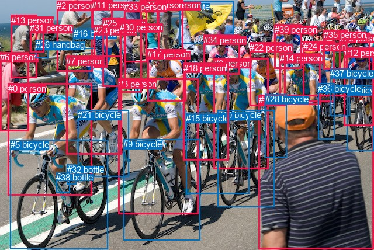

# 人相关关系抽取

图片：`1159713.jpg`。人的框编号：`[0, 1, 2, 3, 6, 7, 8, 11, 12, 13, 14, 17, 18, 20, 22, 23, 24, 25, 27, 29, 30, 31, 33, 34, 35, 39]`。

分数用于排序，Top50 候选需要结合原图判断。

| 排名 | 主语编号与类别 | 关系 | 宾语编号与类别 | 分数 |
|---|---|---|---|---|
| 1 | #0 person | riding | #5 bicycle | 0.99665 |
| 2 | #7 person | riding | #21 bicycle | 0.99661 |
| 3 | #3 person | riding | #9 bicycle | 0.99614 |
| 4 | #12 person | riding | #4 bicycle | 0.99512 |
| 5 | #8 person | riding | #10 bicycle | 0.99467 |
| 6 | #8 person | riding | #15 bicycle | 0.99444 |
| 7 | #24 person | riding | #36 bicycle | 0.99300 |
| 8 | #7 person | riding | #5 bicycle | 0.99277 |
| 9 | #18 person | riding | #15 bicycle | 0.99109 |
| 10 | #24 person | riding | #37 bicycle | 0.99043 |
| 11 | #13 person | holding | #26 handbag | 0.98929 |
| 12 | #25 person | riding | #21 bicycle | 0.98920 |
| 13 | #14 person | riding | #36 bicycle | 0.98893 |
| 14 | #13 person | holding | #31 person | 0.98842 |
| 15 | #22 person | riding | #10 bicycle | 0.98808 |
| 16 | #30 person | riding | #21 bicycle | 0.98785 |
| 17 | #18 person | riding | #10 bicycle | 0.98783 |
| 18 | #29 person | riding | #37 bicycle | 0.98588 |
| 19 | #22 person | riding | #15 bicycle | 0.98554 |
| 20 | #6 person | riding | #5 bicycle | 0.98381 |
| 21 | #24 person | riding | #4 bicycle | 0.98372 |
| 22 | #29 person | riding | #4 bicycle | 0.98306 |
| 23 | #3 person | riding | #15 bicycle | 0.98236 |
| 24 | #7 person | riding | #9 bicycle | 0.98130 |
| 25 | #12 person | riding | #37 bicycle | 0.98060 |
| 26 | #0 person | riding | #21 bicycle | 0.97990 |
| 27 | #35 person | riding | #37 bicycle | 0.97987 |
| 28 | #18 person | riding | #9 bicycle | 0.97962 |
| 29 | #31 person | riding | #26 handbag | 0.97942 |
| 30 | #33 person | riding | #21 bicycle | 0.97688 |
| 31 | #3 person | riding | #21 bicycle | 0.97654 |
| 32 | #22 person | riding | #21 bicycle | 0.97618 |
| 33 | #8 person | riding | #5 bicycle | 0.97544 |
| 34 | #34 person | riding | #15 bicycle | 0.97476 |
| 35 | #20 person | holding | #19 kite | 0.97314 |
| 36 | #25 person | riding | #5 bicycle | 0.97313 |
| 37 | #30 person | riding | #9 bicycle | 0.97245 |
| 38 | #8 person | riding | #21 bicycle | 0.97147 |
| 39 | #2 person | holding | #16 bicycle | 0.97071 |
| 40 | #8 person | riding | #9 bicycle | 0.97025 |
| 41 | #29 person | riding | #36 bicycle | 0.96998 |
| 42 | #22 person | riding | #5 bicycle | 0.96988 |
| 43 | #30 person | riding | #5 bicycle | 0.96960 |
| 44 | #14 person | riding | #15 bicycle | 0.96858 |
| 45 | #0 person | on | #5 bicycle | 0.96839 |
| 46 | #22 person | riding | #9 bicycle | 0.96788 |
| 47 | #18 person | riding | #21 bicycle | 0.96723 |
| 48 | #7 person | on | #21 bicycle | 0.96694 |
| 49 | #14 person | riding | #37 bicycle | 0.96620 |
| 50 | #3 person | riding | #5 bicycle | 0.96588 |
