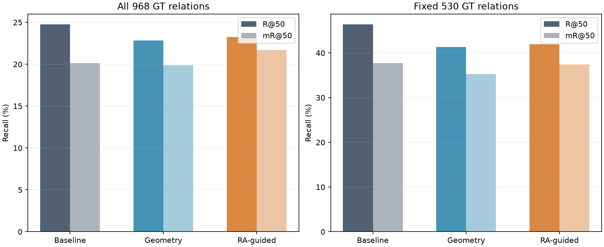
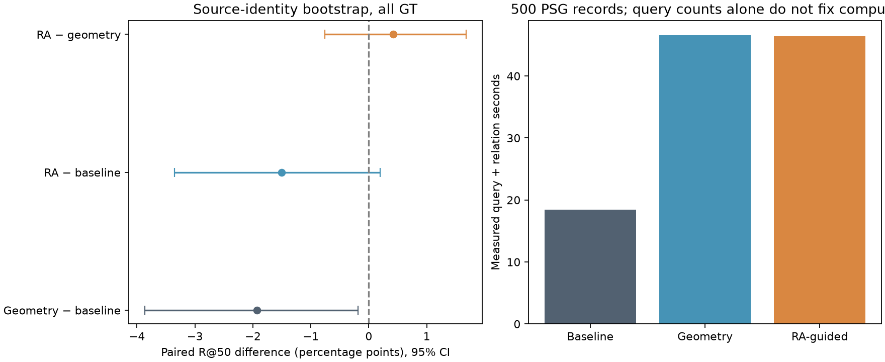

# E：关系引导主动补检测，同查询次数对照

本实验检查：当同一张图片允许两次局部目标检测时，使用RelateAnything已有关系选择观察区域，能否比人物几何规则恢复更多PSG人相关关系。使用固定500条PSG测试记录、499个独立来源身份、官方关系权重及本地Faster R-CNN权重，已经实际执行三组GPU推理。

## 实验设计与预先固定规则

原始方法保留区域实验A的Faster R-CNN thing端点，并重新执行关系推理。几何方法选择检测面积最大的人物，分别在人物高度30%与75%处观察。RA引导方法只读取冻结A方法的Top50预测，按融合logit排序：holding、carrying、wearing查询上身，riding、sitting on查询下身，standing on、walking on、running on查询脚部，其他受支持谓词采用配置指定高度。

每个关系引导查询的中心由人物身体位置与预测对象中心按65%及35%混合。裁剪宽度为人物宽度的1.8倍，高度为人物高度的0.8倍，短边至少96像素，限制在原图边界内。只接受人物作为主语、非人物作为宾语、原始sigmoid≥0.5的候选。该分数没有解释为事件真实概率。优先选择不同的整数裁剪区域；不足时使用固定几何区域。边界裁剪可能让两个预定观察具有相同像素范围，仍真实执行两次查询，并记录重复数量。

原检测结果包含人物的288条记录，两种补检测方法各执行576次真实局部Faster R-CNN调用；剩余212条记录两组均执行零次。完全漏检人物的图片无法通过此策略启动人物局部查询。选择裁剪区域的函数只接收检测端点、预测关系、图像尺寸与配置，不接收PSG标注。

每次局部检测的坐标变换回原图，和原端点按类别进行IoU=0.6的非极大值抑制，再按检测分数保留最多40个端点。三组统一使用官方400个关系候选预算与最多50条输出；补检测可以替换原端点，所以收益和丢失都必须计入。三组执行顺序随样本位置轮换。

本实验的same query budget表示两个主动方法的新增检测调用次数相同。裁剪像素面积、检测器缩放后的输入规模、返回端点及实际运行时间仍可能不同，计算成本单独报告。原始方法复用已有全图检测缓存，三组成本均不包含这一共有的全图检测费用。

## 主结果

R@50先计算包含标注关系的每条PSG记录的召回，再取平均；mR@50先按谓词计算包含该谓词的记录平均召回，再跨谓词平均；pooled_R@50直接使用命中关系总数除以标注总数。评测要求主语和宾语类别一致、各自IoU≥0.5、谓词一致。在每个评测范围内，三组使用同一固定分母；两个范围分别为全部968条标注及原始端点有效的固定530条子集，新增端点没有改变子集。

| 评测范围 | 方法 | 命中/标注 | R@50 | mR@50 | pooled_R@50 | 有标注记录 |
| --- | --- | --- | --- | --- | --- | --- |
| all_968_GT | Baseline | 223/968 | 0.24754298 | 0.20120262 | 0.23037190 | 252 |
| all_968_GT | Geometry crops | 209/968 | 0.22828277 | 0.19867699 | 0.21590909 | 252 |
| all_968_GT | RA-guided crops | 212/968 | 0.23253290 | 0.21675039 | 0.21900826 | 252 |
| fixed_530_GT | Baseline | 223/530 | 0.46387608 | 0.37705970 | 0.42075472 | 214 |
| fixed_530_GT | Geometry crops | 202/530 | 0.41368137 | 0.35234258 | 0.38113208 | 214 |
| fixed_530_GT | RA-guided crops | 203/530 | 0.41971720 | 0.37428563 | 0.38301887 | 214 |



## 配对不确定性与独立来源身份

通过Visual Genome的COCO身份及图片SHA256合并来源；COCO404484对应两条PSG记录，保留不同关系标注，但重抽样时一起出现。全部标注范围包含252条记录、251个来源身份；固定530条范围包含214条记录、214个来源身份。执行20,000次按来源身份的配对自助抽样，三组在每次使用同一身份抽样权重，保持原始PSG记录加权的点估计。置信区间为百分位95%区间，多个比较未进行校正，作为探索性证据解释。

| 范围 | 比较 | 指标 | 差值 | 95%置信区间 | 区间排除零 |
| --- | --- | --- | --- | --- | --- |
| all_968_GT | geometry_minus_baseline | R@50 | -0.01926020 | [-0.03863396, -0.00189699] | 是 |
| all_968_GT | geometry_minus_baseline | mR@50 | -0.00252562 | [-0.01768474, 0.01300531] | 否 |
| all_968_GT | geometry_minus_baseline | pooled_R@50 | -0.01446281 | [-0.03111588, 0.00103199] | 否 |
| all_968_GT | RA_guided_minus_baseline | R@50 | -0.01501008 | [-0.03353024, 0.00195413] | 否 |
| all_968_GT | RA_guided_minus_baseline | mR@50 | 0.01554777 | [-0.01598130, 0.02850779] | 否 |
| all_968_GT | RA_guided_minus_baseline | pooled_R@50 | -0.01136364 | [-0.02716298, 0.00410299] | 否 |
| all_968_GT | RA_guided_minus_geometry | R@50 | 0.00425013 | [-0.00754760, 0.01677072] | 否 |
| all_968_GT | RA_guided_minus_geometry | mR@50 | 0.01807340 | [-0.01233506, 0.02837045] | 否 |
| all_968_GT | RA_guided_minus_geometry | pooled_R@50 | 0.00309917 | [-0.00987191, 0.01686539] | 否 |
| fixed_530_GT | geometry_minus_baseline | R@50 | -0.05019470 | [-0.08154206, -0.02161215] | 是 |
| fixed_530_GT | geometry_minus_baseline | mR@50 | -0.02471712 | [-0.05347538, 0.00118622] | 否 |
| fixed_530_GT | geometry_minus_baseline | pooled_R@50 | -0.03962264 | [-0.06923116, -0.01261261] | 是 |
| fixed_530_GT | RA_guided_minus_baseline | R@50 | -0.04415888 | [-0.07624611, -0.01456386] | 是 |
| fixed_530_GT | RA_guided_minus_baseline | mR@50 | -0.00277407 | [-0.05117505, 0.02140270] | 否 |
| fixed_530_GT | RA_guided_minus_baseline | pooled_R@50 | -0.03773585 | [-0.06458074, -0.01308411] | 是 |
| fixed_530_GT | RA_guided_minus_geometry | R@50 | 0.00603583 | [-0.01616044, 0.02842679] | 否 |
| fixed_530_GT | RA_guided_minus_geometry | mR@50 | 0.02194306 | [-0.01921382, 0.03958651] | 否 |
| fixed_530_GT | RA_guided_minus_geometry | pooled_R@50 | 0.00188679 | [-0.01914914, 0.02457467] | 否 |



## 端点覆盖、来源与原端点替换

| 统计量 | Baseline | Geometry crops | RA-guided crops |
| --- | --- | --- | --- |
| 全部标注人物端点 | 1156 | 1156 | 1156 |
| 匹配的标注人物端点 | 961 | 965 | 967 |
| 人物端点召回 | 0.83131488 | 0.83477509 | 0.83650519 |
| 检出人物记录 | 288 | 288 | 288 |
| 关系涉及的唯一标注端点 | 1129 | 1129 | 1129 |
| 匹配的关系端点 | 798 | 805 | 807 |
| 关系端点召回 | 0.70682019 | 0.71302037 | 0.71479185 |
| 两个端点均可匹配的关系 | 531 | 536 | 542 |
| 存在不同匹配端点的关系 | 530 | 535 | 538 |
| 保留端点总数 | 5722 | 7292 | 7305 |
| 其中裁剪来源端点 | 0 | 2433 | 2387 |
| 合并前裁剪检测数量 | 0 | 3895 | 3809 |
| 未保留的原端点数量 | 0 | 863 | 804 |
| 非极大值抑制删除端点 | 0 | 1780 | 1646 |
| 40端点上限删除端点 | 0 | 545 | 580 |
| 包含重复裁剪的记录 | 0 | 7 | 4 |
| 相对原始方法恢复标注端点 | 0 | 14 | 13 |
| 相对原始方法丢失标注端点 | 0 | 7 | 4 |

原端点被同类别更高分局部检测替代时，来源变化本身不代表标注端点丢失。报告分别保存原端点编号未保留、标注端点恢复及标注端点丢失；完整坐标、检测分数和裁剪来源见[endpoint_coverage.json](endpoint_coverage.json)及[paired_outputs.jsonl](paired_outputs.jsonl)。

## 实际预算与时间成本

| 方法 | 新增检测调用 | 裁剪像素总数 | 检测秒数 | 调用平均秒数 | 调用P90秒数 | 关系前向次数 | 候选对总数 | 关系秒数 | 输出关系数 |
| --- | --- | --- | --- | --- | --- | --- | --- | --- | --- |
| Baseline | 0 | 0 | 0.000000 | 0.000000 | 0.000000 | 288 | 50294 | 18.407188 | 10824 |
| Geometry crops | 576 | 33167876 | 27.059689 | 0.046979 | 0.054085 | 288 | 69102 | 19.545004 | 13214 |
| RA-guided crops | 576 | 28117227 | 26.943534 | 0.046777 | 0.053701 | 288 | 69226 | 19.479309 | 12918 |

实际设备：NVIDIA GeForce RTX 5070 Ti；检测器采用CUDA FP32，关系模型采用CUDA autocast BF16；峰值显存分配0.877304 GiB。本次推理阶段耗时119.803625秒，逐条耗时另含坐标合并与输出文件写入，和分项计时的含义不同。

RA方法的查询来源计数：{"RA_relation_route": 459, "geometry_default": 117}。完整调用中位数、P90、裁剪面积与关系时间见[costs.json](costs.json)。

## 恢复、丢失和失败阶段

| 范围及比较 | 新恢复关系 | 丢失关系 | 净命中变化 |
| --- | --- | --- | --- |
| all_968_GT/geometry_minus_baseline | 19 | 33 | -14 |
| all_968_GT/RA_guided_minus_baseline | 21 | 32 | -11 |
| all_968_GT/RA_guided_minus_geometry | 20 | 17 | 3 |
| fixed_530_GT/geometry_minus_baseline | 12 | 33 | -21 |
| fixed_530_GT/RA_guided_minus_baseline | 12 | 32 | -20 |
| fixed_530_GT/RA_guided_minus_geometry | 16 | 15 | 1 |

恢复与丢失按照每条标注关系的命中状态变化统计；全部阶段迁移、双方对应框和Top50证据见[relation_changes.json](relation_changes.json)。

| 全部968条标注的阶段 | Baseline | Geometry crops | RA-guided crops |
| --- | --- | --- | --- |
| endpoint_missing_or_wrong_class | 437 | 432 | 426 |
| endpoints_collapsed_to_same_box | 1 | 1 | 4 |
| hit50 | 223 | 209 | 212 |
| pair_not_selected | 1 | 5 | 5 |
| rank_below50 | 24 | 34 | 28 |
| wrong_predicate | 282 | 287 | 293 |

恢复与丢失的具体阶段来源：

| 全部968条标注的比较 | 恢复前失败阶段 | 丢失后失败阶段 | 恢复中至少一个正确配对使用裁剪端点 | 恢复中全部正确配对使用裁剪端点 |
| --- | --- | --- | --- | --- |
| geometry_minus_baseline | {"wrong_predicate": 11, "endpoint_missing_or_wrong_class": 7, "rank_below50": 1} | {"endpoint_missing_or_wrong_class": 3, "rank_below50": 16, "wrong_predicate": 14} | 12 | 12 |
| RA_guided_minus_baseline | {"wrong_predicate": 10, "endpoint_missing_or_wrong_class": 9, "rank_below50": 2} | {"wrong_predicate": 14, "rank_below50": 15, "endpoint_missing_or_wrong_class": 2, "pair_not_selected": 1} | 12 | 11 |
| RA_guided_minus_geometry | {"wrong_predicate": 7, "endpoint_missing_or_wrong_class": 6, "rank_below50": 7} | {"wrong_predicate": 7, "rank_below50": 6, "endpoint_missing_or_wrong_class": 4} | 10 | 8 |


endpoint_missing_or_wrong_class表示至少一个标注端点没有类别及IoU匹配；endpoints_collapsed_to_same_box表示两个标注端点只对应同一检测框；pair_not_selected表示两个不同端点存在但候选预算没有选择对应有向配对；wrong_predicate表示已选配对的空间/语义分组赢家都未命中标注谓词；rank_below50表示正确分组赢家存在但没有进入最终输出；hit50表示命中。阶段只解释PSG标注召回，未匹配预测仍可能描述真实但未标注关系。

## 结果解释

Geometry crops相对Baseline：全部标注命中从223变为209，恢复19条、丢失33条；R@50变化-1.9260个百分点，95%区间[-3.8634, -0.1897]个百分点。该探索性区间排除零，解释时仍需考虑预先选择策略和多个比较。

RA-guided crops相对Baseline：全部标注命中从223变为212，恢复21条、丢失32条；R@50变化-1.5010个百分点，95%区间[-3.3530, 0.1954]个百分点。该区间包含零，当前固定样本支持的收益方向仍有不确定性。

RA-guided crops相对Geometry crops：全部标注命中从209变为212，恢复20条、丢失17条；R@50变化0.4250个百分点，95%区间[-0.7548, 1.6771]个百分点。该区间包含零，当前固定样本支持的收益方向仍有不确定性。

关系引导相对几何补检测获得更高的R@50点估计，但两种主动方法的R@50都低于原始baseline。RA相对几何方法的配对区间包含零，当前实验没有建立稳定优势。结论范围限于这组裁剪与预算规则，单次比较不能证明新的主动感知方法成立。

RA补检测把端点缺失阶段从437条变为426条，错误谓词从282条变为293条，名次落在50之后的关系从24条变为28条。RA丢失关系的阶段包括：{"wrong_predicate": 14, "rank_below50": 15, "endpoint_missing_or_wrong_class": 2, "pair_not_selected": 1}。更多可匹配端点与更高最终召回之间没有必然关系；上下文端点变化、候选竞争和最终排名共同影响输出。

两种主动方法的最大候选预算相同，但实际候选总数从baseline的50,294增加到几何方法的69,102与RA方法的69,226。RA的新增检测及关系总时间约为原始关系推理时间的2.52倍，当前策略没有呈现召回与成本同时改善的证据。RA的mR@50点估计高于baseline，置信区间包含零；[per_predicate_comparison.md](per_predicate_comparison.md)展示全部谓词在三组中的标注数量、命中和类别平均召回，便于检查罕见谓词的影响。

## 完整比较与失败案例

[case_studies.md](case_studies.md)包含6个确定性选择案例，每个案例完整展示三组全部端点、实际裁剪规则和全部Top50关系，方便核查对象编号、谓词与分数变化。全量500条记录的三组对应结果保存在[paired_outputs.jsonl](paired_outputs.jsonl)；[evaluation.json](evaluation.json)保存每个有标注记录的全部失败阶段诊断及逐谓词召回。案例与输出均不依赖人工视觉判断，未发布源图片。

## 与原区域实验的关系

内部baseline与冻结A方法：完整Top50字段完全相同的记录500/500；关系身份及排名相同的记录500/500。具体差异保存于[cache_audit.json](cache_audit.json)。主动补检测的所有增量都相对于本实验内部baseline计算，区域补全、解码策略与主动补检测的增益不能直接相加。

## 复算与证据清单

在仓库根目录运行：

```powershell
.venv-eval\Scripts\python.exe HOR\research\scripts\active_detection_study.py --prepare
.venv-eval\Scripts\python.exe HOR\research\scripts\active_detection_study.py --infer
```

首次准备和推理拒绝覆盖已有推理输出；完整重做前将HOR/research/output/active_detection整个目录移动到Git忽略的归档目录。中断后使用--infer --resume继续已有完整记录。已存在全部结果时，默认命令只在CPU验收缓存和复算报告：

```powershell
.venv-eval\Scripts\python.exe HOR\research\scripts\active_detection_study.py
```

配置：[active_detection.json](../../configs/active_detection.json)；运行脚本：[active_detection_study.py](../../scripts/active_detection_study.py)；分析脚本：[active_detection_analysis.py](../../scripts/active_detection_analysis.py)。[prepared_inputs.json](prepared_inputs.json)记录裁剪计划及上游文件签名，[runtime.json](runtime.json)记录实际GPU运行信息，[artifact_manifest.json](artifact_manifest.json)记录配置、脚本、模型、输入、输出与报告证据签名。原始全候选logits在Git忽略的output/active_detection/logits目录供本地检查。

## 适用范围

本实验没有训练、没有VLM轮次生成、没有人工独立完整关系标注，也没有接触部位、深度或三维损害的真实性测量。PSG匹配代理不能解释为所有输出的真实性准确率。两次裁剪仍可能观察同一对象，预测关系的自我确认风险由同预算几何对照与失败证据暴露，未通过循环推理消除。固定500条样本的查询规则和结果共同定义当前实证范围。
