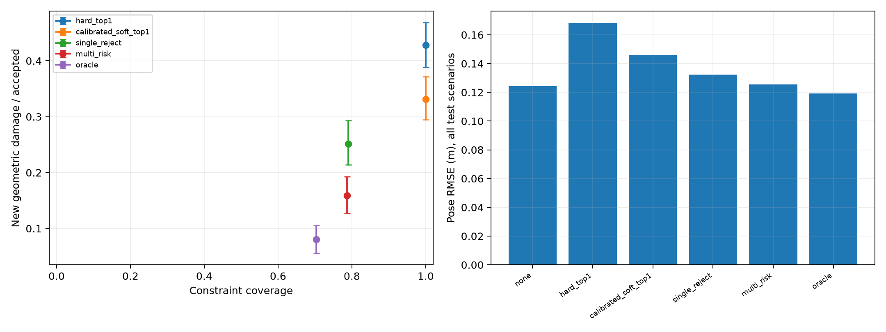
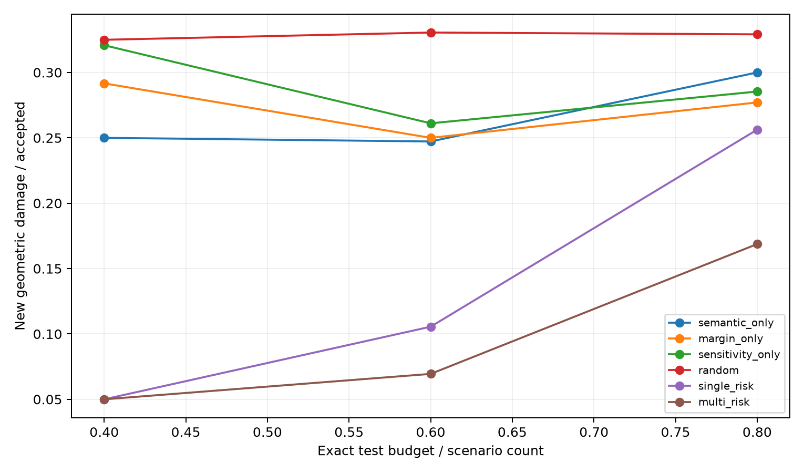
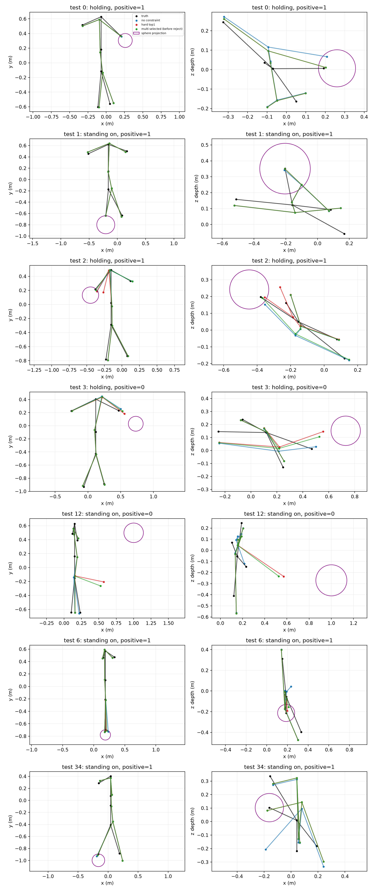

# 受控三维接口与几何损害实验

## 实验范围与完成内容

日期：2026-11-04。本实验在自生成的七个节点骨架、球体表面与正交相机问题上，完整执行关系观测、对应评分、三维二次优化、几何损害评估、验证阈值选择、独立测试和配对置信区间计算。每个长度量均使用米。验证随机种子为 `2026110401`，包含200个场景；测试随机种子为 `2026110402`，包含600个场景。

该实验用于检查指定生成分布中的约束接口行为。人体使用七个节点，球体几何已知；正交二维观测与可见深度由真实三维状态加噪声生成。它提供可复跑的数学机制检验。真实图片中的接触对应、人体表面、网格穿透和公开三维重建后端仍缺少完整实验，本结果不作为指南第八节真实三维核心实验已经完成的证据。

## 生成分布、真实接触和观测

关系类型等概率选取 `holding`、`sitting on`、`standing on`，分别对应手部、髋部和脚部候选。正例概率为0.70。先生成具有身体朝向、身体尺度和肢体方向变化的真实骨架，再放置球体，使正例的真实节点精确位于球面。负例的球体与全部真实节点保持至少0.12米表面间隔，真实对应记为缺失。两个候选均由一个节点和一个球面点组成，顺序随机打乱。

初始骨架在真实节点上加入独立高斯噪声，三个坐标轴的标准差为`[0.05, 0.05, 0.12]`米，再乘以[0.6, 1.6]中的场景系数。二维正交观测的标准差为0.025米，可见深度标准差为0.05米；不可见坐标不进入似然或优化。遮挡标记控制候选部位的观测缺失，它只描述本生成器中的缺失机制。

### 关系证据 p_r 与对应评分 q_c

令关系真值为Y，合成语义传感量z在正负类别下服从共同标准差1.1、均值分别为1.0与-1.0的高斯分布。`p_r=P(Y=1|z)`按贝叶斯公式计算：

```text
logit(p_r) = log(pi/(1-pi)) + (mu_positive-mu_negative)
             * (z-(mu_positive+mu_negative)/2) / sigma_z^2
```

这里的校准依据来自已知生成分布。有限测试样本中的后验与频率见下表，不能据此解释真实RelateAnything分数的校准情况。

| 关系后验区间 | 测试场景数 | 平均后验 | 真实正例比例 | 硬约束新增损害率 |
|---|---|---|---|---|
| [0.00, 0.25] | 104 | 0.0986 | 0.0385 | 0.9423 |
| [0.25, 0.50] | 64 | 0.3724 | 0.3906 | 0.6562 |
| [0.50, 0.75] | 79 | 0.6337 | 0.6709 | 0.3924 |
| [0.75, 1.00] | 353 | 0.9246 | 0.9632 | 0.2436 |

对于候选c，用初始骨架构造假设模板，将该候选节点放到指定球面点，其余节点保持初始位置。所有候选使用完全相同的可观测坐标集合，根据二维和可见深度的高斯残差计算完整观测似然，再用等先验归一化得到`q_c`。候选评分函数只接收初始化、观测、可见性、球面点和噪声参数。它不会读取真实对应或真实姿态；q属于该假设模板模型的评分，当前没有为q提供真实图像上的校准保证。

## 同一三维优化后端

所有策略共享严格凸二次目标。变量X包含七个三维节点；X0为初始骨架，U为可见观测，D为六条骨骼边的差分矩阵，M为可见坐标掩码。对一个指定候选(j,t)，目标由以下项组成：

```text
E(X) = sum_d lambda_prior,d * ||X_d-X0_d||^2
     + sum_visible lambda_observation,d * (X-U)^2
     + lambda_bone * ||D(X-X0)||^2
     + support / sigma_contact^2 * ||X_j-t||^2
```

先验精度取初始噪声方差的倒数，观测精度取对应观测方差的倒数，骨骼向量保持项标准差为0.1米，接触标准差为0.025米。骨骼保持项使用初始骨架的边向量，真实骨长只在独立评测中使用。三个坐标轴分别求解一个7×7正定线性系统，得到全局最小值；无接触约束时仍执行同一后端。

全运行完成13600次线性系统批量求解，最大相对正规方程残差为`6.464e-16`。每次求解均断言结果有限、残差低于1e-10，并独立计算目标值，确认其不高于初始骨架目标值。正例真实接触和两个球面候选也逐场景通过几何断言。

## 独立评测与新增损害定义

每个策略均计算真实姿态节点RMSE（`sqrt(mean_j ||X_j-X_true,j||^2)`）、真实骨长平均绝对误差、节点进入球体的最大深度，以及正例真实节点到真实接触点的欧氏距离。节点穿入深度只检查七个点，不能解释为人体网格穿透。

对每个场景，先运行无接触约束后端，随后定义新增损害：姿态RMSE增加超过0.015米、骨长误差增加超过0.01米，或最大节点穿入深度增加超过0.015米，任意条件满足即计入。对应是否正确单独统计，不进入几何损害标签。拒绝约束时复用无约束后端的完整几何结果，因此新增损害为零，绝对失败仍照常评测。

绝对失败阈值为姿态RMSE>0.12米、骨长误差>0.07米、节点穿入深度>0.025米，或正例真实接触误差>0.08米。所有阈值在配置中固定，只界定本实验的误差容忍范围，不作为物理安全标准。接受集为空时，接受约束新增损害率和置信区间均记为不适用。

## 六种策略、几何代价与敏感性

| 策略 | 约束决策 |
|---|---|
| 无接触约束 | 使用先验、观测和骨骼向量保持项 |
| 最高对应硬约束 | 采用q最高的候选，support=1 |
| 关系后验加权单对应 | 采用q最高的候选，support=p_r |
| 单对应选择性拒绝 | 优化q最高候选，按对应效用选择是否接受 |
| 多候选几何代价选择 | 分别优化两个候选，选择效用最高的完整结果，再决定是否接受 |
| 真实对应参考 | 正例采用真实对应和support=1，负例采用无接触约束后端 |

真实对应参考提供已知对应条件，几何质量仍受观测、初始化和目标函数影响；它不具有几何误差最小的数学保证。多候选策略输出一个完整解，当前实验不评价同时保留多个解的接口。

几何代价C只使用当前可观测数据和优化结果：相对无约束结果的二维重投影RMSE增加量、骨长变化、当前球体节点穿入深度、节点位置变化以及接触目标敏感性。前四项分别除以配置中的0.025、0.02、0.02、0.1米；敏感性除以0.3。敏感性在三个坐标方向分别将接触点扰动±0.005米，通过六次独立求解计算中央差分的姿态RMS导数，再对三个方向取平均。它作为启发式几何量参与决策。

```text
utility(c) = log(p_r) + log(q_c) - 0.25 * C(c)
```

效用函数未读取真实姿态、关系真值、真实对应或评测损害标签。单对应策略仅检查q最高的一个候选；多候选策略检查两个候选。固定覆盖目标为80%，阈值完全由验证集效用确定，测试集沿用相同阈值：

| 策略 | 验证阈值 | 验证覆盖率 | 测试覆盖率 |
|---|---|---|---|
| 单对应选择性拒绝 | -2.720856 | 0.8000 | 0.7900 |
| 多候选几何代价选择 | -2.459327 | 0.8000 | 0.7867 |

## 独立测试结果

表格中的平均误差与绝对失败率覆盖全部600个测试场景，接受约束新增损害率以接受场景为分母。正例接触误差包含被拒绝的正例，避免只展示容易接受的样本。

| 策略 | 接受数/600 | 覆盖率 | 接受约束新增损害率 | 全部场景绝对失败率 | 姿态RMSE/m | 骨长误差/m | 节点穿入深度/m | 正例接触误差/m |
|---|---|---|---|---|---|---|---|---|
| 关系后验加权单对应 | 600/600 | 1.0000 | 0.3317 | 0.5967 | 0.1460 | 0.0662 | 0.0076 | 0.0446 |
| 最高对应硬约束 | 600/600 | 1.0000 | 0.4283 | 0.6550 | 0.1681 | 0.0749 | 0.0078 | 0.0423 |
| 多候选几何代价选择 | 472/600 | 0.7867 | 0.1589 | 0.5133 | 0.1255 | 0.0610 | 0.0033 | 0.0258 |
| 无接触约束 | 0/600 | 0.0000 | 不适用 | 0.6600 | 0.1244 | 0.0631 | 0.0039 | 0.1103 |
| 真实对应参考 | 422/600 | 0.7033 | 0.0806 | 0.4667 | 0.1192 | 0.0598 | 0.0031 | 0.0201 |
| 单对应选择性拒绝 | 474/600 | 0.7900 | 0.2511 | 0.5600 | 0.1323 | 0.0626 | 0.0048 | 0.0404 |

多候选策略在验证阈值下接受472个场景，接受约束新增损害率为15.89%。正例接触误差为0.02579米，无约束结果为0.11030米；全部场景姿态RMSE为0.12554米，无约束结果为0.12437米。接触拟合改善与整体姿态质量需要同时判断，这些量没有被合并成一个总分。



### 配对不确定性

使用2000次按完整场景抽样的bootstrap，所有方法共用同一重采样索引。下表给出相对关系后验加权单对应的差值，负数表示该指标降低；选择性策略的接受集可能不同，因此条件损害率差值仍需结合覆盖率理解。

| 策略减关系后验加权单对应 | 指标 | 配对差值 | 95%区间 |
|---|---|---|---|
| 多候选几何代价选择 | new_damage_accepted | -0.1728 | [-0.2083, -0.1416] |
| 多候选几何代价选择 | pose_rmse | -0.0204 | [-0.0250, -0.0162] |
| 多候选几何代价选择 | positive_contact_error | -0.0188 | [-0.0250, -0.0130] |
| 单对应选择性拒绝 | new_damage_accepted | -0.0806 | [-0.1041, -0.0585] |
| 单对应选择性拒绝 | pose_rmse | -0.0136 | [-0.0178, -0.0100] |
| 单对应选择性拒绝 | positive_contact_error | -0.0042 | [-0.0070, -0.0015] |

完整逐方法区间、同预算比较的配对差值和有效bootstrap次数分别保存在[`bootstrap_intervals.csv`](evidence/bootstrap_intervals.csv)与[`paired_differences.csv`](evidence/paired_differences.csv)。验证阈值实验固定部署决策；同预算实验在每次共享重采样之后重新按无真值分数排序，始终保持规定的接受数量。区间反映给定生成分布内的抽样波动，不包含真实图片域迁移或模型失配的不确定性；随机排序使用一个固定随机种子，其区间也没有纳入额外随机种子的变化。

## 相同测试输出预算的排序比较

额外固定测试集接受数量，分别取80%、60%、40%的场景，比较关系后验、对应间隔、负敏感性、独立随机排序、单对应效用和多候选效用。前五种排序接受后使用同一个关系后验加权最高对应结果；多候选排序使用所选完整候选结果。所有排序均不读取测试标签。这里按整批未标注测试分数分配精确数量，属于已知批次预算的描述性比较，与前面的验证阈值部署实验分别报告。

| 测试预算 | 排序/选择 | 覆盖率 | 接受约束新增损害率 | 全部场景绝对失败率 | 姿态RMSE/m | 正例接触误差/m |
|---|---|---|---|---|---|---|
| 0.4 | margin_only | 0.4000 | 0.2917 | 0.6450 | 0.1316 | 0.0875 |
| 0.4 | multi_risk | 0.4000 | 0.0500 | 0.5533 | 0.1217 | 0.0739 |
| 0.4 | random | 0.4000 | 0.3250 | 0.6367 | 0.1324 | 0.0829 |
| 0.4 | semantic_only | 0.4000 | 0.2500 | 0.5917 | 0.1277 | 0.0734 |
| 0.4 | sensitivity_only | 0.4000 | 0.3208 | 0.6783 | 0.1321 | 0.0984 |
| 0.4 | single_risk | 0.4000 | 0.0500 | 0.5533 | 0.1217 | 0.0739 |
| 0.6 | margin_only | 0.6000 | 0.2500 | 0.6117 | 0.1320 | 0.0673 |
| 0.6 | multi_risk | 0.6000 | 0.0694 | 0.5100 | 0.1209 | 0.0476 |
| 0.6 | random | 0.6000 | 0.3306 | 0.6233 | 0.1376 | 0.0690 |
| 0.6 | semantic_only | 0.6000 | 0.2472 | 0.5517 | 0.1313 | 0.0589 |
| 0.6 | sensitivity_only | 0.6000 | 0.2611 | 0.6333 | 0.1336 | 0.0783 |
| 0.6 | single_risk | 0.6000 | 0.1056 | 0.5167 | 0.1222 | 0.0471 |
| 0.8 | margin_only | 0.8000 | 0.2771 | 0.5950 | 0.1355 | 0.0517 |
| 0.8 | multi_risk | 0.8000 | 0.1688 | 0.5167 | 0.1262 | 0.0253 |
| 0.8 | random | 0.8000 | 0.3292 | 0.6133 | 0.1420 | 0.0560 |
| 0.8 | semantic_only | 0.8000 | 0.3000 | 0.5700 | 0.1397 | 0.0459 |
| 0.8 | sensitivity_only | 0.8000 | 0.2854 | 0.6233 | 0.1384 | 0.0598 |
| 0.8 | single_risk | 0.8000 | 0.2562 | 0.5617 | 0.1332 | 0.0409 |

相同预算下，多候选选择与单对应效用排序的配对差值为：

| 相同覆盖预算 | 多候选减单对应效用排序的指标 | 配对差值 | 95%区间 |
|---|---|---|---|
| 0.4 | new_damage_accepted | 0.0000 | [-0.0042, 0.0000] |
| 0.4 | pose_rmse | 0.0000 | [-0.0000, 0.0000] |
| 0.4 | positive_contact_error | 0.0000 | [0.0000, 0.0006] |
| 0.6 | new_damage_accepted | -0.0361 | [-0.0639, -0.0083] |
| 0.6 | pose_rmse | -0.0013 | [-0.0027, 0.0000] |
| 0.6 | positive_contact_error | 0.0005 | [-0.0038, 0.0034] |
| 0.8 | new_damage_accepted | -0.0875 | [-0.1167, -0.0604] |
| 0.8 | pose_rmse | -0.0070 | [-0.0093, -0.0045] |
| 0.8 | positive_contact_error | -0.0156 | [-0.0207, -0.0105] |

在80%精确输出预算下，多候选与单对应效用排序的新增损害率分别为16.875%与25.625%。两者拥有相同输出数量，计算成本见后文；该比较仅支持给定生成器、目标和阈值的受控结果。



## 分层结果与失败构成

以下按关系正负和观测遮挡分别分层，两个分层维度相互重叠。它们用于解释整体结果，未用于调整阈值或筛选测试样本；细分样本的点估计属于探索性描述。三种关系类型、全部六种方法的完整结果见[`stratified_results.csv`](evidence/stratified_results.csv)。

| 分层 | 策略 | 场景数 | 接受数 | 接受约束新增损害率 | 姿态RMSE/m | 正例接触误差/m |
|---|---|---|---|---|---|---|
| positive | 关系后验加权单对应 | 422 | 422 | 0.1967 | 0.1290 | 0.0446 |
| positive | 最高对应硬约束 | 422 | 422 | 0.2014 | 0.1296 | 0.0423 |
| positive | 多候选几何代价选择 | 422 | 420 | 0.0762 | 0.1186 | 0.0258 |
| positive | 单对应选择性拒绝 | 422 | 397 | 0.1461 | 0.1242 | 0.0404 |
| negative | 关系后验加权单对应 | 178 | 178 | 0.6517 | 0.1861 | 不适用 |
| negative | 最高对应硬约束 | 178 | 178 | 0.9663 | 0.2595 | 不适用 |
| negative | 多候选几何代价选择 | 178 | 52 | 0.8269 | 0.1421 | 不适用 |
| negative | 单对应选择性拒绝 | 178 | 77 | 0.7922 | 0.1516 | 不适用 |
| occluded | 关系后验加权单对应 | 197 | 197 | 0.5076 | 0.1735 | 0.0801 |
| occluded | 最高对应硬约束 | 197 | 197 | 0.5685 | 0.1954 | 0.0788 |
| occluded | 多候选几何代价选择 | 197 | 151 | 0.1589 | 0.1322 | 0.0281 |
| occluded | 单对应选择性拒绝 | 197 | 136 | 0.3897 | 0.1464 | 0.0704 |
| visible | 关系后验加权单对应 | 403 | 403 | 0.2457 | 0.1325 | 0.0265 |
| visible | 最高对应硬约束 | 403 | 403 | 0.3598 | 0.1547 | 0.0237 |
| visible | 多候选几何代价选择 | 403 | 321 | 0.1589 | 0.1223 | 0.0246 |
| visible | 单对应选择性拒绝 | 403 | 338 | 0.1953 | 0.1254 | 0.0252 |

新增损害的三个条件可以同时发生，下面的原因数量不能相加当作总损害数量：

| 策略 | 接受数 | 新增损害场景 | 姿态恶化 | 骨长恶化 | 节点穿入恶化 |
|---|---|---|---|---|---|
| 无接触约束 | 0 | 0 | 0 | 0 | 0 |
| 最高对应硬约束 | 600 | 257 | 230 | 172 | 65 |
| 关系后验加权单对应 | 600 | 199 | 168 | 114 | 58 |
| 单对应选择性拒绝 | 474 | 119 | 98 | 59 | 31 |
| 多候选几何代价选择 | 472 | 75 | 57 | 25 | 13 |
| 真实对应参考 | 422 | 34 | 19 | 2 | 14 |

对应正确仍可能伴随姿态、骨长或节点穿入的恶化。原因是接触目标与初始骨架、噪声观测以及边向量保持项共同参与优化；正确对应只解决目标身份，无法保证其它几何指标均改善。负例上的任何约束接受单独报告为负例约束接受率，几何损害仍通过同一误差增量定义。

附加案例按三条确定规则取最小测试编号：多候选接受但几何受损、正例被拒绝、对应正确但几何受损。规则重复选到同一编号时只展示一次。下表完整列出每个案例的无约束、硬约束和最终多候选结果，全部坐标与投影图共同提供依据。

| 测试编号 | 选择规则 | 策略 | 接受 | 新增损害 | 姿态RMSE/m | 骨长误差/m | 节点穿入/m | 正例接触误差/m |
|---|---|---|---|---|---|---|---|---|
| 12 | accepted_multi_geometry_damage | 无接触约束 | 0 | 0 | 0.1219 | 0.0593 | 0.0000 | 不适用 |
| 12 | accepted_multi_geometry_damage | 最高对应硬约束 | 1 | 1 | 0.2388 | 0.0557 | 0.0000 | 不适用 |
| 12 | accepted_multi_geometry_damage | 多候选几何代价选择 | 1 | 1 | 0.2147 | 0.0586 | 0.0000 | 不适用 |
| 6 | rejected_positive_relation | 无接触约束 | 0 | 0 | 0.1253 | 0.0522 | 0.0000 | 0.2615 |
| 6 | rejected_positive_relation | 最高对应硬约束 | 1 | 0 | 0.0847 | 0.0553 | 0.0138 | 0.0243 |
| 6 | rejected_positive_relation | 多候选几何代价选择 | 0 | 0 | 0.1253 | 0.0522 | 0.0000 | 0.2615 |
| 34 | correct_correspondence_geometry_damage | 无接触约束 | 0 | 0 | 0.2003 | 0.1675 | 0.0000 | 0.3133 |
| 34 | correct_correspondence_geometry_damage | 最高对应硬约束 | 1 | 1 | 0.1617 | 0.1564 | 0.0172 | 0.0330 |
| 34 | correct_correspondence_geometry_damage | 多候选几何代价选择 | 1 | 1 | 0.1617 | 0.1565 | 0.0173 | 0.0337 |

## 计算预算和完整几何案例

下表包含共享无约束求解。单对应几何检查需要一个候选求解和六次扰动求解，多候选几何检查需要两个候选及十二次扰动求解。无接触约束需要一次求解，常规单对应需要两次。时间包含线性求解、目标值计算和残差断言，未包含数据生成、bootstrap和文件写入；完整运行时间见[`run_checks.json`](evidence/run_checks.json)。各方法通过共享缓存计算比较结果，表格按照每种方法实际需要读取的求解结果核算调用和时间，不能解释为分别运行各方法的端到端测速。

| 策略 | 每场景平均线性求解次数 | 每场景平均求解与核验时间/ms | 接受正例对应准确率 | 负例约束接受率 |
|---|---|---|---|---|
| 关系后验加权单对应 | 2.00 | 0.109 | 0.8578 | 1.0000 |
| 最高对应硬约束 | 2.00 | 0.116 | 0.8578 | 1.0000 |
| 多候选几何代价选择 | 15.00 | 0.807 | 0.9905 | 0.2921 |
| 无接触约束 | 1.00 | 0.057 | 不适用 | 0.0000 |
| 真实对应参考 | 1.70 | 0.100 | 1.0000 | 0.0000 |
| 单对应选择性拒绝 | 8.00 | 0.431 | 0.9118 | 0.4326 |

图像先展示固定测试编号0、1、2、3，再展示前述确定规则选出的失败案例。每个案例同时呈现真实骨架、无接触约束结果、硬约束结果、多候选所选结果与球体的XY/XZ投影。多候选曲线展示拒绝决策之前的候选解，全部节点坐标和选择理由保存在[`fixed_cases.json`](evidence/fixed_cases.json)，最终是否接受以逐场景结果表为准。案例只用于解释，全部统计均使用完整测试集。



## 结果解释与适用条件

正例、负例、缺失观测、噪声和关系后验的联系由生成器规定。表格量化这些设定与指定优化器共同产生的结果，不能作为真实关系模型中“语义分数无法预测损害”的独立发现。几何代价和中央差分敏感性均为明确的启发式分析量，它们的实际价值以相同预算结果与配对区间为依据，不预设复杂策略优于简单策略。出现区间覆盖零或复杂策略误差更高时，应保留该结果。

本实验落实了指南第7.4节的数学敏感性测量，以及第8节第二、第三组对照的合成机制检查。真实三维核心实验仍需要独立接触/表面标注、真实图片初始化、统一人体与物体几何、固定公开重建后端，以及真实遮挡条件下的测试。本实验不填补这些证据缺口。

## 可复跑交付与术语

运行命令：

```powershell
.\.venv-eval\Scripts\python.exe HOR\research\scripts\controlled_3d_damage_study.py --config HOR\research\configs\controlled_3d.json
.\.venv-eval\Scripts\python.exe HOR\research\scripts\audit_controlled_3d.py
```

| 文件 | 内容 |
|---|---|
| [`controlled_3d_damage_study.py`](../../scripts/controlled_3d_damage_study.py) | 生成、似然、求解、决策、评测、配对bootstrap及本报告生成 |
| [`audit_controlled_3d.py`](../../scripts/audit_controlled_3d.py) | 独立读取证据，以逐边梯度、原始几何和统计结果核验求解与评测 |
| [`controlled_3d.json`](../../configs/controlled_3d.json) | 全部随机种子、噪声、目标权重、阈值和输出目录 |
| [`scenarios.json`](evidence/scenarios.json) | 全部800个场景的公开输入、真实几何、可见性、真实对应和噪声参数 |
| [`candidate_solutions.csv`](evidence/candidate_solutions.csv) | 每个候选的分数、全部解坐标、几何代价、敏感性和求解残差 |
| [`baseline_solutions.csv`](evidence/baseline_solutions.csv) | 全部验证/测试无接触约束解的坐标、目标值与求解残差 |
| [`sensitivity_probes.csv`](evidence/sensitivity_probes.csv) | 每个候选三轴正负扰动的目标、全部解坐标和求解验证 |
| [`scenario_results.csv`](evidence/scenario_results.csv) | 六种方法的全部验证/测试结果及统一几何指标 |
| [`matched_budget_results.csv`](evidence/matched_budget_results.csv) | 相同测试输出数量的全部逐场景结果 |
| [`stratified_results.csv`](evidence/stratified_results.csv)；[`damage_causes.csv`](evidence/damage_causes.csv) | 正负、遮挡、关系类型分层与重叠损害原因 |
| [`summary.json`](evidence/summary.json)；[`matched_summary.json`](evidence/matched_summary.json) | 表格完整数值 |
| [`validation_thresholds.json`](evidence/validation_thresholds.json) | 验证确定的阈值和冻结配置哈希 |
| [`run_checks.json`](evidence/run_checks.json) | 求解残差、求解数量、耗时、环境、真值数量和共享抽样索引哈希 |
| [`manifest.json`](evidence/manifest.json) | 文件大小与SHA-256；包含脚本、配置和本报告 |

`p_r`表示由合成语义观测得到的关系后验；`q_c`表示指定模板噪声模型下的候选归一化评分；RMSE表示均方根误差；CI表示置信区间；Oracle表示只在参考组提供真实关系与对应；正规方程残差检验线性求解是否满足目标函数的一阶最优条件。球体节点穿入度量只检查七个节点的位置。
