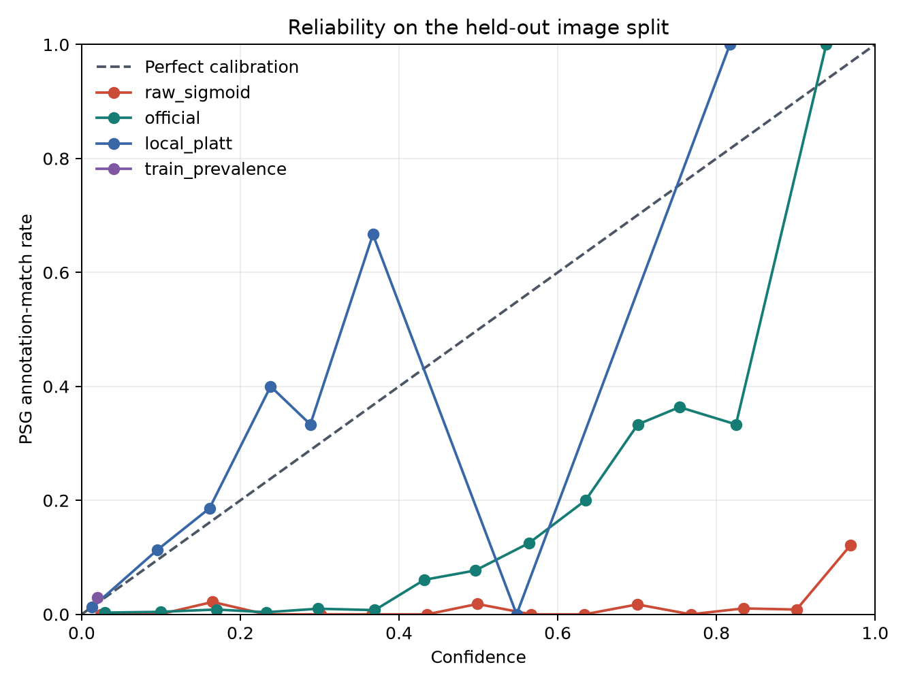
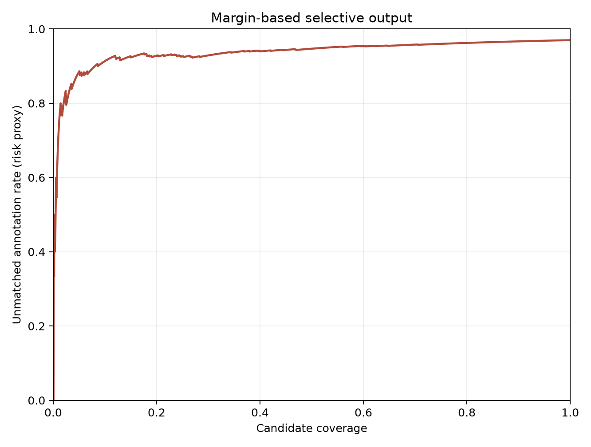

# 解码、校准与选择性输出实验

## 实验问题

在同一500张随机图像、同一检测边界框、同一完整56类谓词 logits 和每张图像最多50条输出的条件下，比较涉及人物的每个有向物体对保留Top1、Top2、Top3、Top5谓词与现用空间/语义各选一项的规则。随后检验官方校准参数在本数据上的标注匹配代理表现，并用按源图像隔离的训练、验证和测试拆分拟合单调 Platt 校准。间隔拒绝实验根据验证图像确定阈值，在测试图像报告覆盖与标注匹配风险代理。

## 数据和评价范围

输入沿用 `HOR/output/random500` 的500张固定随机样本与保存的完整关系 logits，不重新运行视觉模型。样本含968条涉及人的唯一PSG关系。有效检测端点子集要求两个GT端点类别都属于旧检测器词表、各自至少匹配一个同类别检测框，且至少存在一组不同检测编号的有向主体—宾语；该集合固定为530条，余下438条由437条端点缺失或类别不符、1条两个端点只映射到同一检测框组成。

每个解码方法先按物体对内规则选出候选，再按融合 logit 降序及主体编号、宾语编号、谓词编号打破并列，每张图像最多保留50条。R@50为含GT关系的各张图像召回率的宏平均；mR@50先计算每个谓词在包含该类GT的图像上的召回，再对出现的谓词类别等权平均；pooled R@50以关系条数加权。指标分别报告全部968条GT与固定530条有效端点GT。

未匹配PSG标注的预测不能直接认定为视觉错误，PSG中也可能存在未标注关系。下文的匹配比例、校准误差和风险均以“是否匹配现有PSG标注”为目标代理，不能解释为人工准确率、真实精确率或幻觉比例。

## 固定预算解码结果

| 解码方式 | 输出条数 | 全部968条：命中 / R@50 / mR@50 / pooled R@50 | 有效530条：命中 / R@50 / mR@50 / pooled R@50 |
|---|---:|---|---|
| 每对物体 Top1 | 9184 | 180 / 0.2061 / 0.1788 / 0.1860 | 180 / 0.3979 / 0.3461 / 0.3396 |
| 每对物体 Top2 | 10824 | 265 / 0.2957 / 0.2649 / 0.2738 | 265 / 0.5501 / 0.4751 / 0.5000 |
| 每对物体 Top3 | 11634 | 289 / 0.3225 / 0.3096 / 0.2986 | 289 / 0.6003 / 0.5403 / 0.5453 |
| 每对物体 Top5 | 12530 | 315 / 0.3517 / 0.3341 / 0.3254 | 315 / 0.6376 / 0.5831 / 0.5943 |
| 空间与语义各取一项 | 10824 | 220 / 0.2448 / 0.1993 / 0.2273 | 220 / 0.4598 / 0.3736 / 0.4151 |
| 每对物体单赢家 | 9184 | 180 / 0.2061 / 0.1788 / 0.1860 | 180 / 0.3979 / 0.3461 / 0.3396 |

在全部968条GT上，Top5较双赢家多命中95条（315对220），图像宏平均R@50从0.2448升至0.3517，mR@50从0.1993升至0.3341；两者在每张图像上仍受50条上限约束。Top5共有12,530条输出，双赢家共有10,824条，增加1,706条。该结果说明保留每对物体更多谓词可找回部分低排名GT，代价是输出增加；它没有单独检验新增输出是否符合图像内容。

每个谓词类别的GT数、命中数和两类子集召回见 [`per_predicate_recall.csv`](evidence/per_predicate_recall.csv)。逐条候选及其原始分数、物体编号、分组、图像拆分和标注匹配代理标签见 [`selected_candidates.csv`](evidence/selected_candidates.csv)。

重建的空间/语义双赢家和单赢家输出在每张图像、每条记录上与原实验对应字段比较，数量、排序和关系编号完全相同。各方法在每张图像上的输出均不超过50条。530条冻结关系及端点匹配定义见 [`fixed_valid_endpoint_gt.json`](evidence/fixed_valid_endpoint_gt.json)。

## 固定端点的GT边界框oracle比较

本表只在旧检测器词表中、且两个端点都被检测边界框匹配的同一530条GT关系上比较。检测边界框组和GT边界框组使用同一组GT、每张图像50条预算、相同解码规则；差值按源图像身份成对重抽样，置信区间使用1000次bootstrap。GT边界框组将输入端点替换为PSG标注边界框和类别，属于端点oracle诊断，不代表端到端检测结果。

| 解码方式 | 检测边界框：命中 / R@50 / mR@50 / pooled R@50 | GT边界框：命中 / R@50 / mR@50 / pooled R@50 | ΔR@50点估计（95%区间） | ΔmR@50点估计（95%区间） |
|---|---|---|---:|---:|
| 每对物体 Top1 | 180 / 0.3979 / 0.3461 / 0.3396 | 179 / 0.3743 / 0.3274 / 0.3377 | -0.0236 (-0.0522, 0.0033) | -0.0187 (-0.0418, 0.0274) |
| 每对物体 Top2 | 265 / 0.5501 / 0.4751 / 0.5000 | 263 / 0.5376 / 0.4319 / 0.4962 | -0.0125 (-0.0436, 0.0179) | -0.0433 (-0.0758, 0.0105) |
| 每对物体 Top3 | 289 / 0.6003 / 0.5403 / 0.5453 | 292 / 0.5935 / 0.5178 / 0.5509 | -0.0067 (-0.0420, 0.0269) | -0.0225 (-0.0624, 0.0390) |
| 每对物体 Top5 | 315 / 0.6376 / 0.5831 / 0.5943 | 320 / 0.6438 / 0.5836 / 0.6038 | +0.0063 (-0.0223, 0.0348) | +0.0004 (-0.0297, 0.0332) |
| 空间与语义各取一项 | 220 / 0.4598 / 0.3736 / 0.4151 | 223 / 0.4533 / 0.3706 / 0.4208 | -0.0065 (-0.0372, 0.0229) | -0.0031 (-0.0318, 0.0316) |
| 每对物体单赢家 | 180 / 0.3979 / 0.3461 / 0.3396 | 179 / 0.3743 / 0.3274 / 0.3377 | -0.0236 (-0.0522, 0.0033) | -0.0187 (-0.0418, 0.0274) |

六种解码的ΔR@50和ΔmR@50区间均覆盖零，当前样本没有显示GT边界框端点使解码召回稳定上升。该判断只适用于旧检测器词表覆盖且端点可匹配的530条关系；另外438条GT不在这个条件比较的分母内。按源图像与谓词统计的成对差值区间见 [`fixed530_endpoint_oracle_paired_deltas.csv`](evidence/fixed530_endpoint_oracle_paired_deltas.csv)，固定子集上的逐谓词GT边界框命中数见 [`fixed530_gtbox_per_predicate.csv`](evidence/fixed530_gtbox_per_predicate.csv)，对应的GT边界框候选见 [`gt_box_selected_candidates.csv`](evidence/gt_box_selected_candidates.csv)。完整指标和oracle定义见 [`fixed530_endpoint_oracle_metrics.json`](evidence/fixed530_endpoint_oracle_metrics.json)。

## GT谓词排名

对每条GT关系，在其所有可匹配有向检测物体对中，记录GT谓词在全部56类排序及其正确空间/语义分组中的最佳局部排名，并记录双赢家规则下的图像级候选排名。在固定530关系中，GT谓词在全部56类里的最佳排名为第1/2/3名的数量分别是192/101/42，前三名共335条（63.2%）；限制到正确空间或语义组内后，第1/2/3名分别为246/108/34，前三名共388条（73.2%）。这说明组内竞争能把一部分正确谓词排得更靠前，但图像级Top50还要与不同物体对竞争。530条固定子集的逐条排名见 [`gt_predicate_ranks.csv`](evidence/gt_predicate_ranks.csv)，逐谓词排名1、2、3、4–5、6–10、10名之后及无候选计数见 [`per_predicate_rank_histograms.csv`](evidence/per_predicate_rank_histograms.csv)。GT边界框下对应物体对的逐条排名保存在 [`gt_box_oracle_pair_ranks.csv`](evidence/gt_box_oracle_pair_ranks.csv)，可用于分开观察端点质量和谓词排序。

## 校准

图像身份根据 Visual Genome `image_data.json` 的 `image_id → coco_id` 映射确定；缺少COCO ID时使用图像SHA256，相同SHA256也会合并身份组。随机种子 `20261104` 用于分配其余身份组，COCO ID `404484` 固定进入训练集。最终拆分为训练/验证/测试各300/100/100条记录，对应299/100/100个唯一源图像身份；404484组的两条记录都留在训练集。三份拆分之间的COCO ID与SHA256交集均为空。每张图像的身份、分组和互斥核验见 [`calibration_image_splits.json`](evidence/calibration_image_splits.json)。

这两条重复源图像记录的检测结果相同，PSG对象相同而关系标注不同；现有标注证据均保留。为避免同一像素图在Platt拟合中重复加权，训练时只保留该身份组一份预测候选，并对这组现有关系标注匹配代理标签取并集。训练记录数仍为300，Platt拟合使用299个唯一源图像身份；验证集用于选择间隔拒绝阈值，测试集仅报告结果。

拟合斜率 a=0.856405、截距 b=-5.605721。

训练、验证、测试集上的双赢家候选匹配PSG标注比例分别为132/6,662（1.98%）、41/2,376（1.73%）和52/1,736（3.00%）。官方参数来自RelateAnything已人工裁定候选上的拟合；本实验检查它在当前PSG匹配代理上的行为。标签集合、候选集合和标注完整度均不同，因此官方参数原本的人工概率含义不能直接转移到这里。ECE使用15个等宽分箱，按各箱样本数加权；可靠性图与分箱数值使用100个测试源图像身份。

| 测试集分数 | ECE（PSG匹配代理） | Brier（PSG匹配代理） |
|---|---:|---:|
| 原始 sigmoid | 0.60822 | 0.49033 |
| 官方校准 | 0.21461 | 0.08977 |
| 独立图像拆分 Platt | 0.00520 | 0.02520 |
| 训练集正例率常数 | 0.01014 | 0.02916 |



常数基线始终输出训练集去重候选的PSG匹配率，参数不使用验证或测试标签。本次测试候选的PSG匹配率为3.00%，常数也能取得较低的ECE与Brier；本地Platt相对它的收益需要结合两项差值判断。低ECE本身不证明候选辨别能力，也不证明图像关系真实性。

正斜率仿射变换通过排序不变性检查；官方和本地 Platt 概率排序与原始融合 logit 一致，校准只改变置信度值。分箱置信度、样本数和标注匹配比例见 [`calibration_bins.csv`](evidence/calibration_bins.csv)，拟合与拆分统计见 [`calibration_metrics.json`](evidence/calibration_metrics.json)。

## 间隔拒绝

间隔定义为同一物体对、同一谓词组中第一名与第二名融合 logit 的差。对双赢家每条输出分别保存所属组的间隔。验证图像按目标覆盖选择阈值，测试图像不参与阈值选择；表格中的“风险”是输出候选中未匹配PSG关系标注的比例。

| 验证目标覆盖 | 验证实际覆盖 | 间隔阈值 | 测试保留数 / 总数 | 测试保留标注匹配数 / 总数 | 测试丢弃标注匹配数 | 测试覆盖 | 标注匹配率代理（95%图像bootstrap区间） | 标注风险代理 | 测试有效端点GT命中 / 总数（pooled R及区间） |
|---:|---:|---:|---:|---:|---:|---:|---:|---:|---:|
| 90% | 0.900 | 0.12240 | 1614 / 1736 | 52 / 52 | 0 | 0.930 | 0.0322 (0.0229, 0.0424) | 0.9678 | 51 / 112 (0.4554; 0.3611, 0.5514) |
| 75% | 0.750 | 0.37544 | 1351 / 1736 | 52 / 52 | 0 | 0.778 | 0.0385 (0.0275, 0.0501) | 0.9615 | 51 / 112 (0.4554; 0.3611, 0.5514) |
| 50% | 0.500 | 0.86153 | 960 / 1736 | 46 / 52 | 6 | 0.553 | 0.0479 (0.0334, 0.0642) | 0.9521 | 45 / 112 (0.4018; 0.3055, 0.5056) |
| 25% | 0.250 | 1.57377 | 554 / 1736 | 37 / 52 | 15 | 0.319 | 0.0668 (0.0455, 0.0884) | 0.9332 | 36 / 112 (0.3214; 0.2174, 0.4217) |



完整测试风险—覆盖轨迹及各阈值细节见 [`margin_risk_coverage_curve.csv`](evidence/margin_risk_coverage_curve.csv)；在验证图像确定的阈值和测试评估统计见 [`margin_selective_thresholds.csv`](evidence/margin_selective_thresholds.csv)。低覆盖可能主要移除困难候选，因此需要同时看保留数量、被移除的标注匹配候选以及GT召回，不能只看匹配比例变化。

## 不确定性和可复查材料

使用499个唯一源图像身份为重抽样单位进行 1000 次 bootstrap；同身份组内的所有记录在每次抽样中一起保留，输出R@50、mR@50和候选标注匹配比例代理的95%区间。Top1、Top2、Top3和Top5相对双赢家，以及检测边界框相对GT边界框的差值都按同一身份组配对重抽样。区间表见 [`bootstrap_intervals.csv`](evidence/bootstrap_intervals.csv) 和 [`fixed530_endpoint_oracle_paired_deltas.csv`](evidence/fixed530_endpoint_oracle_paired_deltas.csv)。这些区间反映固定500条记录、499个身份样本的抽样变化，不包含人工标注误差。

## 结果边界

该实验隔离了解码选择、已知检测端点覆盖和当前PSG标注的匹配关系。固定530条GT能减少端点缺失对解码方法比较的影响，但检测边界框仍可能有重复实例或定位偏差。GT边界框排名提供一个端点条件参考。标注匹配代理也无法审计PSG未覆盖关系的视觉真实性。

## 复现

运行环境需提供仓库既有 `.venv-eval` 中的 numpy、scipy、matplotlib，以及本地 `HOR/research/data/visual_genome_metadata/image_data.json`。该Visual Genome文件提供 `image_id → coco_id` 来源映射；脚本运行时不下载文件、不调用GPU，只读取已生成的500条记录的原始logits。当前拆分的身份字段和交集核验随报告保存在证据目录。

```powershell
.\.venv-eval\Scripts\python.exe HOR\research\scripts\decode_study.py
```

输出配置：[`decoder_study.json`](../../configs/decoder_study.json)。全部表格、拆分清单与逐候选证据随报告保存在 [`evidence/`](evidence/)；原始可再生成结果位于本机忽略目录 `HOR/research/output/decoder/`。
