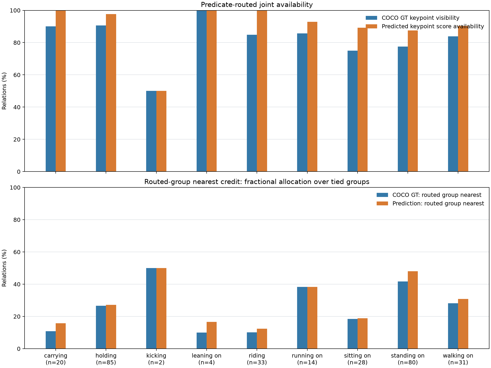

# COCO关键点部位邻近代理实验

## 研究问题

本实验检查固定谓词到身体部位组的映射，与人物关键点到对象GT边界框的二维距离之间是否有关，并比较COCO标注关键点与预训练模型预测关键点。GT（Ground Truth）在此指数据集标注，GT边界框指数据集标注的矩形对象区域。评价对象是二维邻近代理，COCO关键点没有标注人与该对象的真实接触、对象表面区域或关系真假。

谓词路由在实验前固定：`holding`、`carrying`对应手部；`sitting on`、`riding`对应髋部；`standing on`、`walking on`、`running on`、`kicking`对应足部；`leaning on`对应前臂。该映射是待检验的语义假设。

## 数据和关键点预测

HOR的500条固定随机记录映射到499个不同COCO源图像身份。COCO ID `404484`有两条相同像素的PSG记录，本部位分析保留原样本顺序中的第一条，分析499个源图像。现有PSG标注文件保持原样。全部499个源图像通过2%宽高比误差限制，其中220个有至少一项COCO人物关键点标注。

1,155个PSG人物GT边界框中，611个与COCO人物标注达到IoU≥0.5；本实验随后保留路由表覆盖的297条关系。关键点模型在其中293条关系上匹配到人物。匹配采用一对一最大总IoU分配并施加0.5阈值。人物匹配前后、谓词过滤前后的分母分别保存在证据文件中。

预测使用官方torchvision Keypoint R-CNN ResNet-50 FPN COCO_V1。每个关键点保存 `[x,y,v]` 和独立的 `keypoints_scores` 字段；部位可用性使用真实 `keypoints_scores≥0.5`。该分数是关键点热图峰值分数，未经概率校准，阈值0.5也不代表50%正确概率。COCO标注侧仅使用 `v=2` 的可见关键点。模型匹配、分数阈值和COCO标注可见性是三种不同条件。

## 部位组、距离和并列处理

| 部位组 | 原始组关键点 | 每组两个关键点、各组无重叠的对照 |
|---|---|---|
| 手部 | 左、右腕部（9、10） | 左、右腕部（9、10） |
| 前臂 | 左、右肘部和腕部（7–10） | 左、右肘部代表点（7、8） |
| 肩部 | 左、右肩部（5、6） | 左、右肩部（5、6） |
| 髋部 | 左、右髋部（11、12） | 左、右髋部（11、12） |
| 腿部 | 左、右髋部和膝部（11–14） | 左、右膝部代表点（13、14） |
| 足部 | 左、右踝部（15、16） | 左、右踝部（15、16） |

先计算每个可用关键点到对象GT边界框的最短欧氏距离，再以对象GT边界框对角线归一化，部位组取组内最小值。关键点落在对象GT边界框内部时距离为零。原始部位组有2点和4点两种预算，手部属于前臂组、髋部属于腿部组，因此并列具有结构性来源。

所有表格、配对比较和随机路由共享以下定义。距离相差不超过对象GT边界框对角线的`1e-10`视为并列；路由组没有可用点时得分为零。分母包含至少一个部位组可用的关系，只有GT与预测的共同分析使用两侧都可用的共同关系集合。

| 统计量 | 定义 |
|---|---|
| 并列分摊得分（主指标） | 路由组处于k个并列最短组时得到1/k，其他情况为零 |
| 包含并列最短比例 | 路由组属于最短距离集合时得到1 |
| 唯一最短比例 | 路由组单独具有最短距离时得到1 |
| 竞争排名 | 1加上严格更近的可用部位组数；并列最短组均排名第一 |

主指标衡量平均分摊后的邻近一致性。它的分子为得分总和，可以是小数，不能写成整数命中数。全部关系都通过了顺序不变性、得分范围、并列分摊总分等于1、竞争排名第一与包含并列最短一致等核验。

## 逐谓词结果

本表分别使用GT和预测侧可用分母；表内分母已经明确列出。95%区间按COCO源图像进行2,000次bootstrap。预测侧对象区域同样使用PSG对象GT边界框。

| 谓词（路由） | 关系数 | GT路由点可用 / 总数 | GT分摊得分总和 / 可用关系数（比例；95%区间） | 预测路由点可用 / 总数 | 预测分摊得分总和 / 可用关系数（比例；95%区间） |
|---|---:|---:|---|---:|---|
| carrying（手部） | 20 | 18/20 | 2.067/19 (10.88%; 3.86%, 18.89%) | 20/20 | 3.150/20 (15.75%; 8.70%, 23.65%) |
| holding（手部） | 85 | 77/85 | 22.367/84 (26.63%; 21.45%, 31.77%) | 83/85 | 22.883/84 (27.24%; 22.24%, 32.45%) |
| kicking（足部） | 2 | 1/2 | 1.000/2 (50.00%; 0.00%, 100.00%) | 1/2 | 1.000/2 (50.00%; 0.00%, 100.00%) |
| leaning on（前臂） | 4 | 4/4 | 0.400/4 (10.00%; 0.00%, 20.00%) | 4/4 | 0.667/4 (16.67%; 4.17%, 29.17%) |
| riding（髋部） | 33 | 28/33 | 3.367/33 (10.20%; 4.71%, 16.25%) | 33/33 | 4.100/33 (12.42%; 7.71%, 17.32%) |
| running on（足部） | 14 | 12/14 | 5.367/14 (38.33%; 26.39%, 46.25%) | 13/14 | 5.367/14 (38.33%; 29.04%, 46.16%) |
| sitting on（髋部） | 28 | 21/28 | 5.183/28 (18.51%; 12.08%, 25.48%) | 25/28 | 5.267/28 (18.81%; 13.00%, 25.19%) |
| standing on（足部） | 80 | 62/80 | 33.333/80 (41.67%; 33.27%, 51.08%) | 70/80 | 37.467/78 (48.03%; 39.39%, 57.55%) |
| walking on（足部） | 31 | 26/31 | 8.717/31 (28.12%; 19.79%, 37.25%) | 28/31 | 9.250/30 (30.83%; 21.50%, 41.60%) |

| 谓词 | GT包含并列最短 / 唯一最短 | 预测包含并列最短 / 唯一最短 |
|---|---:|---:|
| carrying | 31.58% / 0.00% | 45.00% / 0.00% |
| holding | 58.33% / 0.00% | 61.90% / 0.00% |
| kicking | 50.00% / 50.00% | 50.00% / 50.00% |
| leaning on | 50.00% / 0.00% | 75.00% / 0.00% |
| riding | 36.36% / 0.00% | 48.48% / 0.00% |
| running on | 85.71% / 7.14% | 92.86% / 0.00% |
| sitting on | 60.71% / 0.00% | 67.86% / 0.00% |
| standing on | 77.50% / 28.75% | 89.74% / 34.62% |
| walking on | 83.87% / 6.45% | 93.33% / 10.00% |



## 共同关系上的配对比较

下面三组对照均使用同一条关系、同一对象GT边界框、同一谓词路由和按源图像配对重抽样。原始组允许两侧有不同的可用关键点；共同关键点对照只保留两侧均可用的同一个关键点编号；每组两个关键点的共同可用对照要求六个无重叠部位组的12个关键点在两侧全部可用，每组恰好两个关键点。这项对照同时固定可用组数量和关键点数量，分析集合因此更小。

| 对照 | 共同关系 / 源图像 | GT分摊得分 | 预测分摊得分 | 预测−GT（百分点；95%区间） | GT / 预测路由组可用 |
|---|---:|---:|---:|---:|---:|
| 原始分组与各自关键点 | 291 / 167 | 28.11% | 30.64% | +2.53 (+0.61, +4.54) | 248 / 275 |
| 原始分组、共同关键点支持 | 291 / 167 | 28.24% | 28.71% | +0.46 (-0.46, +1.43) | 246 / 246 |
| 六组各两个关键点、全部共同可用 | 81 / 57 | 47.78% | 47.55% | -0.23 (-2.21, +1.65) | 81 / 81 |

| 对照与统计定义 | GT比例 | 预测比例 | 预测−GT（百分点；95%区间） |
|---|---:|---:|---:|
| 原始分组与各自关键点：包含并列最短 | 64.26% | 72.51% | +8.25 (+4.45, +12.13) |
| 原始分组与各自关键点：唯一最短 | 9.28% | 10.65% | +1.37 (-0.61, +3.31) |
| 原始分组、共同关键点支持：包含并列最短 | 63.92% | 64.60% | +0.69 (-1.01, +2.42) |
| 原始分组、共同关键点支持：唯一最短 | 9.62% | 9.97% | +0.34 (-0.73, +1.52) |
| 六组各两个关键点、全部共同可用：包含并列最短 | 82.72% | 81.48% | -1.23 (-4.11, +0.00) |
| 六组各两个关键点、全部共同可用：唯一最短 | 34.57% | 34.57% | +0.00 (-3.75, +3.70) |

原始组、共同关键点对照及每组两个关键点的共同可用对照各自规定分析分母，不能把一项对照的点估计与另一项直接相减。配对差值仅在各自的同一关系集合内计算。原始组中两侧关键点可用率不同，可能影响得分；两项共同可用对照用于检查该影响。

## 可用性和并列分布

| 条件 | 至少一组可用关系 | 多组并列最短关系 | 平均可用组数 |
|---|---:|---:|---:|
| 原始组 GT | 295 | 202 | 5.149 |
| 原始组 预测 | 293 | 210 | 5.631 |
| 共同关键点支持 GT | 291 | 198 | 5.137 |
| 共同关键点支持 预测 | 291 | 198 | 5.137 |
| 每组两个关键点且全部共同可用 GT | 81 | 42 | 6.000 |
| 每组两个关键点且全部共同可用 预测 | 81 | 41 | 6.000 |

各部位组的可用关系数、平均关键点数量和最小/最大关键点数量保存在统计JSON中。原始组包含两个与四个关键点的部位组，两者使用的关键点数量不同；每组两个关键点的共同可用对照固定每组两个关键点，且各组不共享关键点。

## 随机路由对照

所有随机对照与被比较的固定语义路由使用完全相同的关系分母和三种并列计分规则。均匀对照为每个谓词从六个部位组中随机选择一组，在该谓词所有关系上共享；频数固定对照打乱各自分析集合中出现的谓词的既有部位组分配，保留谓词映射层面的组频数。后者没有固定按关系条数加权的路由频数。

| 条件 | 关系数 | 固定语义路由分摊得分 | 均匀随机路由平均（95%范围） | 固定映射组频数平均（95%范围） |
|---|---:|---:|---:|---:|
| 原始组GT | 295 | 27.73% | 16.79% (8.20%, 27.76%) | 17.60% (8.36%, 29.11%) |
| 共同关键点支持GT | 291 | 28.24% | 16.79% (8.13%, 28.42%) | 17.77% (8.24%, 29.59%) |
| 每组两个关键点且全部共同可用GT | 81 | 47.78% | 16.56% (5.62%, 37.41%) | 23.97% (7.04%, 48.40%) |

| 原始组GT计分定义 | 固定语义路由 | 均匀随机路由平均 |
|---|---:|---:|
| 并列分摊 | 27.73% | 16.79% |
| 包含并列最短 | 63.39% | 45.05% |
| 唯一最短 | 9.15% | 5.35% |

随机分配的范围来自2,000次路由抽样，反映该随机机制的变化，不能与图像bootstrap置信区间混用。原始组受到关键点数量、分组重叠和可用性影响；每组两个关键点的共同可用对照在全部12个关键点共同可用的子集上控制这些因素。结果描述的是当前手工路由与边界框几何代理的关联，不能作为关系视觉真实性或独立接触标注准确率。

## 关键点检测器核验与运行

在499个映射COCO val2017源图像上的关键点评测：AP=0.6607，AP50=0.8807，AP75=0.7290，AR=0.7270。该评测确认输出能够按COCO协议计算，属于COCO数据域检查。

权重SHA256为`fc266e953d2b302cdcbb9ae66f71f6b0d4649928bf02dc573961e361e4918926`。GPU推理耗时31.76秒，500条记录全部处理耗时34.88秒，平均每张图像推理耗时0.0635秒，PyTorch峰值已分配显存790,910,464字节。每张图像的GPU预测保留独立关键点分数字段；后续统计在CPU运行。

## 证据和适用范围

逐关系的人物与对象GT边界框端点、关键点编号距离、可用关键点数量、三种并列得分、对象类别与人物匹配IoU见[原始组关系证据](evidence/relation_part_proximity.csv)。[共同关键点支持证据](evidence/common_joint_support_relations.csv)和[每组两个关键点的共同可用证据](evidence/balanced_two_point_group_relations.csv)保留两项公平对照的完整关系。统计定义、配对差值、随机路由结果及各组关键点数量见[部位统计JSON](evidence/part_evidence_summary.json)。

[图像匹配汇总](evidence/image_matching_summary.csv)、[VG/COCO映射](evidence/vg_coco_image_mapping.csv)、[关键点COCO指标](evidence/keypoint_coco_metrics.json)与[缩放映射](evidence/keypoint_image_mappings.json)提供样本与模型来源。原始图像、COCO标注、模型权重和各张图像的预测保存在Git忽略目录，已有人工审计表不参与这些代理统计。

这些实验只检验二维关键点与对象GT边界框的邻近关系。对象矩形内部出现距离零，不能说明该点接触真实对象表面。手腕、肘部、踝部和膝部是人体部位的代表点，不能表达手指接触或对象功能区域。`kicking`仅2条、`leaning on`仅4条，不能用其点估计选择研究方向。指南所需的独立部位标注参考实验和真实候选准确性实验仍需部位—对象区域、可见性和视觉支持的独立人工标注。

## 复现

```powershell
.\.venv-eval\Scripts\python.exe HOR\research\scripts\predict_coco_keypoints.py
.\.venv-eval\Scripts\python.exe HOR\research\scripts\part_evidence_study.py
```

[模型配置](../../configs/keypoint_prediction.json)与[路由和统计配置](../../configs/part_evidence.json)固定权重、关键点分数阈值、路由和随机种子。
