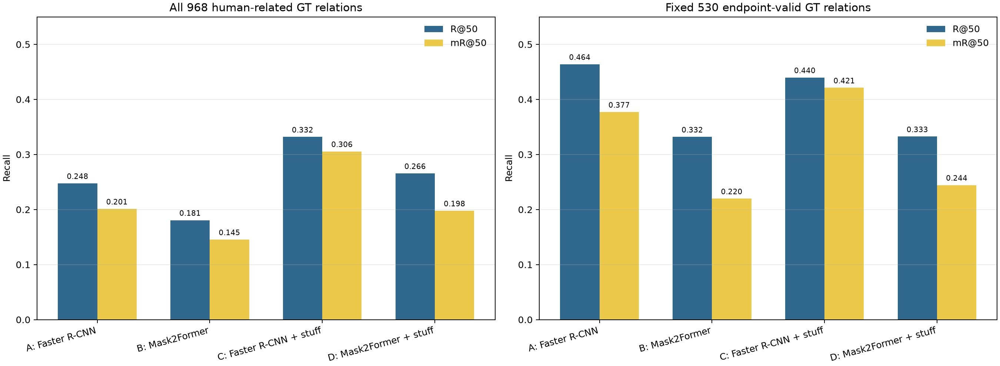
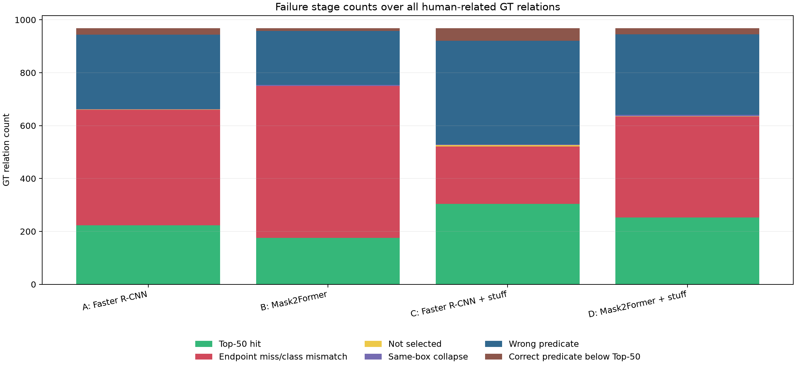

# A组：Thing/Stuff端点对照实验报告

## 研究问题

本实验检验场景区域（stuff）能否补足人—物关系检测中的端点覆盖问题，并单独比较更换thing检测器的效果。所有方法共用同一份固定随机500条图像记录清单、官方RelateAnything关系模型、Top-50关系输出、相同的每张图像端点上限和400关系候选预算。GT边界框和GT关系只用于指标计算、固定530条关系子集构造以及选择编号图示样例；GT边界框未作为模型输入。

四组设计如下：

|组别|Thing端点|Stuff端点|每张图像端点上限|
|---|---|---|---:|
|A|HOR既有Faster R-CNN检测输出|无|40|
|B|官方Mask2Former全景分割输出中的thing实例|无|40|
|C|HOR既有Faster R-CNN检测输出|Mask2Former stuff区域|40|
|D|Mask2Former thing实例|同一Mask2Former stuff区域|40|

A/B只取检测器分数最高的thing端点，最多40个。C/D每张图像至多保留8个分数最高的stuff区域，剩余名额由thing端点按各自检测器分数填充，端点总数不超过40。加入stuff时，端点选择记录保留被替换thing的来源键、边界框坐标、检测分数和对应stuff类别。关系模型对每组均设置`geo_budget=400`及`final_budget=400`，每组输出最多50条空间/语义合并关系。400是候选预算上限；当图像中有效有向物体对不足400时，实际候选数会低于预算，报告同时列出实际数量。

Mask2Former后处理采用未融合的query区域协议：`label_ids_to_fuse`没有传入，其有效集合为空，同一stuff类别可以保留多个通过阈值的查询区域。当前500条记录的1,721个stuff候选中，23条记录出现同类多个区域，共有27个超过每张图像每个类别一个区域的候选。参数加载、12组位置索引一致性、实际特征调用路径以及融合函数的源码范围见[Mask2Former加载与区域后处理审计](mask2former_loading_and_postprocessing_audit.md)；本报告所有主表对应此未融合协议。

## 数据和评测口径

样本来自PSG test的2,179条图像记录，按既有清单中的种子`20261025`无放回固定抽取500条。此清单与HOR随机500实验完全相同。500条记录对应499个不同源图像身份：数据集索引57的`1592560.jpg`与索引1745的`2397343.jpg`对应同一COCO图像ID `404484`，文件SHA256相同，关系标注不同。样本中共有968条人相关PSG GT关系，分布在252条图像记录、251个不同源图像身份中；主表保留全部现有标注记录。

固定530子集由968条关系按A组检测端点构造：subject和object都必须有类别一致、IoU不低于0.5的Faster R-CNN匹配边界框，且两端必须能匹配到不同检测边界框。该筛选只建立配对评测分母。B/C/D仍用自己的检测边界框参与评测；若这些组无法命中固定关系端点，该关系保留在530条的分母内并计为未命中。固定子集共有214条含关系图像记录，对应214个不同源图像身份。

`R@50`为每条含GT关系图像记录的Recall@50再作记录宏平均。`mR@50`先计算每类谓词在含该类GT关系图像记录上的Recall，再对GT中出现的谓词类别作宏平均。`pooled_R@50`是所有GT关系合并后的micro Recall。以下指标均衡量对PSG已标注关系的召回，不衡量候选关系的人工准确率。未被PSG标注的预测不构成本实验的人工误报判定，报告也未把GT未命中解释成图像上必然错误。

### 全部968条人相关GT

|组别|Top-50命中|R@50|mR@50|pooled R@50|
|---|---:|---:|---:|---:|
|A|223/968|0.2475|0.2012|0.2304|
|B|175/968|0.1807|0.1455|0.1808|
|C|304/968|0.3319|0.3055|0.3140|
|D|253/968|0.2656|0.1978|0.2614|

### 固定530条A组端点有效GT

|组别|Top-50命中|R@50|mR@50|pooled R@50|
|---|---:|---:|---:|---:|
|A|223/530|0.4639|0.3771|0.4208|
|B|169/530|0.3319|0.2198|0.3189|
|C|215/530|0.4398|0.4212|0.4057|
|D|166/530|0.3326|0.2444|0.3132|



## 与原HOR解码基线的对应关系

区域A组重新计算关系输出，使用原HOR已经保存的Faster R-CNN检测边界框。CPU审计逐条确认500条记录的源图像SHA256、端点类别、坐标和检测分数相同，原HOR与当前环境的关系权重、文本嵌入、HOR代码、配置、随机种子、PyTorch版本和BF16精度也一致。两项实验采用不同的关系候选预算与张量长度，结果分别保留如下：

|基线|候选策略|关系张量长度|500条记录的候选对总数|GT命中|R@50|mR@50|
|---|---|---|---:|---:|---:|---:|
|原HOR及解码实验的双赢家基线|枚举全部不同端点的有向对象对|端点数平方，包含无效位置|95,198|220/968|0.2448|0.1993|
|本区域实验A组|几何与相关性Top-k，两项预算均为400|400，包含填充位置|50,294|223/968|0.2475|0.2012|

288条需要关系前向的记录中，79条的有效候选集合被400预算缩减；其余209条保留相同有效候选集合，其中205条的关系张量填充长度发生变化，4条端点数为20、两边张量长度均为400。按原检测编号比较50,294个共享候选，它们的`pair_logits`全部逐值相同；两类谓词赢家在6,506个共享候选上发生变化。全部500条记录中，292条的Top-50身份和排序完全相同，208条发生变化。相同候选集合下谓词logits最大绝对差为0.14748，全部共享候选中的最大绝对差为8.25823；这说明候选预算改变关系前向的结果，单纯截断旧Top-50无法得到区域A的输出。

采样器在`targets=None`的推理路径中使用确定性Top-k，没有随机抽样。关系Transformer共同处理候选关系，候选上下文及张量长度变化都进入了本次前向。缓存能够直接验证输入、候选与输出差异；共享视觉特征未保存，本审计没有进一步隔离候选上下文、填充长度和BF16数值路径各自的影响。四条有效候选集合与400张量长度都一致的记录，其共享谓词logits也逐值一致。

223与220的命中差异恰好来自下列三条恢复关系，没有GT命中丢失：

|数据集索引/文件|GT关系|匹配的原检测编号|候选数：原HOR→区域A|原HOR证据|区域A证据|直接变化|
|---|---|---|---:|---|---|---|
|1206 / `2371236.jpg`|person → carrying → handbag|1 → 24|1,332 → 400|语义赢家wearing；carrying在语义组排名第二|语义赢家carrying；进入Top-50第37位|共享候选的谓词竞争变化|
|1609 / `2390707.jpg`|person → looking at → person|9 → 3|756 → 400|looking at为语义赢家，全局排名低于Top-50|looking at仍为语义赢家；进入Top-50第47位|全局关系排名变化|
|104 / `2316313.jpg`|person → in → car|4 → 0|42 → 42|空间赢家on；in在空间组排名第二|空间赢家in；进入Top-50第3位|候选集合相同，关系张量长度49→400，边界分数下赢家变化|

全部逐张图像的Top-50新增/移除身份、候选对交集、logit差异、这三条关系的谓词分数与排名，以及576份NPZ缓存签名见[`baseline_difference_audit.json`](baseline_difference_audit.json)。本区域实验的补全增量使用C−A，即净增81条；解码实验继续使用原HOR基线及其缓存。两项实验的增量需要各自在对应基线上解释，不能跨实验相加。

## 按源图像身份配对自助法区间

以源图像身份为抽样单位，对每组相对A组的R@50差值进行20,000次配对bootstrap，随机种子为`20261104`。身份映射复用[`calibration_image_splits.json`](../decoder/evidence/calibration_image_splits.json)中的COCO ID与图像SHA256分组；脚本逐条验证文件名和SHA256与区域预测一致。同一身份下的所有PSG记录在重采样中一起出现，分母按实际抽中的记录数或关系数累计，原有点估计与968/530条标注均保留。全部关系范围使用251个身份，固定子集使用214个身份。完整身份核验见[`source_identity_audit.json`](source_identity_audit.json)。区间只覆盖当前固定样本上的抽样波动，不代表跨数据集泛化保证。mR@50在主表中给出点估计；这里报告R@50记录宏平均及pooled R@50的差值区间。

|评测分母|比较组|图像记录数|源图像身份数|记录宏R@50差值及95%区间|pooled R@50差值及95%区间|
|---|---|---:|---:|---|---|
|968条关系|B-A|252|251|-0.0669 [-0.0912, -0.0442]|-0.0496 [-0.0720, -0.0274]|
|968条关系|C-A|252|251|+0.0843 [+0.0551, +0.1151]|+0.0837 [+0.0610, +0.1072]|
|968条关系|D-A|252|251|+0.0181 [-0.0181, +0.0541]|+0.0310 [0.0000, +0.0615]|
|固定530条|B-A|214|214|-0.1319 [-0.1724, -0.0941]|-0.1019 [-0.1417, -0.0634]|
|固定530条|C-A|214|214|-0.0241 [-0.0531, +0.0039]|-0.0151 [-0.0378, +0.0057]|
|固定530条|D-A|214|214|-0.1313 [-0.1734, -0.0923]|-0.1075 [-0.1472, -0.0698]|

C相对A在全部968条关系上的R@50提升区间不跨零。C在固定530子集上的R@50区间覆盖零，点估计低于A；因此该子集没有显示稳定的总体R@50提高。D在全部968条上的R@50点估计高于A，但记录宏平均区间覆盖零。完整重采样结果见[`bootstrap_intervals.json`](bootstrap_intervals.json)。

## 端点覆盖与人员检测

所有组使用每张图像40个端点的同一上限，但检测器产生的端点数量不同。表中人员边界框召回按1,156个GT person边界框计算；人员图像召回按262条有人GT的图像记录计算。边界框匹配使用类别一致且IoU≥0.5。人相关唯一端点按每条PSG记录内的GT对象ID去重；同一源图像的两条标注记录分别保留，与主表口径一致。

|组别|输入端点来源|端点总数|每张图像平均值|每张图像中位数|达到40个边界框的记录数|人员边界框召回|有人GT图像检测召回|GT人相关唯一端点召回|
|---|---|---:|---:|---:|---:|---:|---:|---:|
|A|Faster R-CNN thing|5,722|11.44|7.5|23|961/1,156 = 83.13%|253/262 = 96.56%|798/1,129 = 70.68%|
|B|Mask2Former thing|2,850|5.70|3|0|679/1,156 = 58.74%|227/262 = 86.64%|659/1,129 = 58.37%|
|C|Faster R-CNN thing + Mask2Former stuff|7,326|14.65|11|32|956/1,156 = 82.70%|253/262 = 96.56%|955/1,129 = 84.59%|
|D|Mask2Former thing + Mask2Former stuff|4,559|9.12|7|1|679/1,156 = 58.74%|227/262 = 86.64%|817/1,129 = 72.36%|

A/C在262条有人GT图像记录中均有253条检出至少一个可匹配的人体边界框；B/D为227条。A/C在另外32条无person GT的图像记录中出现person检测，B/D为10条。C加入stuff后人员图像召回不变，人员边界框召回从83.13%变成82.70%，差异对应端点名额被stuff占用。

C和D各自选入1,710个stuff端点，覆盖485/500条图像记录，每张图像平均3.42个stuff端点。两组每张图像最多8个stuff名额；模型共生成1,721个超过分数阈值的stuff候选，11个候选因单张图像的名额上限未进入端点集。C选入5,616个thing端点，比A少106个，正好有106个A组thing端点在逐张图像选择时被stuff替代。D选入2,849个thing端点，比B少1个；Mask2Former thing候选通常不足以填满40个端点名额。

C组被stuff端点占据的名额数和替换对象按图像记录写入原始预测文件。完整stuff类别计数见[`endpoint_audit.json`](endpoint_audit.json)；类别前20项图表见[`stuff_endpoint_class_counts.png`](stuff_endpoint_class_counts.png)。

## 关系计算量与显存

Mask2Former检测对每条图像记录运行一次，共500次。Faster R-CNN检测前向次数为0，A/C复用固定500条记录实验已有的检测边界框。关系模型只有在该组至少有人且有其他端点时才运行；合计执行1,064次关系前向。独立profile重新运行后，候选端点、关系Top-50主谓宾身份与原输出按图像记录核验一致。

|组别|关系前向次数|候选有向关系对总量|每次前向平均候选对|
|---|---:|---:|---:|
|A|288|50,294|174.63|
|B|241|20,888|86.67|
|C|288|63,414|220.19|
|D|247|34,176|138.36|

主运行与独立计时的实际时长、逐组分布、PyTorch峰值已分配显存和重复执行核验集中见[运行成本与重复执行证据](runtime_evidence.md)。该附录由`analyze_region_study.py`从当前`runtime.json`和`compute_profile.json`自动生成，并在报告目录保存两份实际JSON副本。生成时同时核验计时记录中的输入SHA256与当前预测、候选和固定图像清单一致，避免沿用其他运行的时长。

硬件为RTX 5070 Ti 16 GB。显存统计采用PyTorch已分配量；当前记录没有对其他进程占用进行单独测量。

执行环境：Python 3.12.11、PyTorch 2.13.0+cu130、torchvision 0.28.0+cu130、Transformers 5.14.1。Mask2Former官方仓库为`facebook/mask2former-swin-tiny-coco-panoptic`，revision `df6b1142ff50c3276559d9d78f35f6a579c75a77`。权重文件SHA256为`8e154c4f946f4fad9aa511a7d706c89c4254cc6eee28fd932e52c32394c5a29f`。CPU实际加载确认最终Swin LayerNorm的两项缺失参数为固定1/0，其输出没有进入Mask2Former消费的`feature_maps`；12项旧位置索引与当前确定性重建结果完全相同。完整参数逐值比较和源码签名见[加载审计](mask2former_loading_and_postprocessing_audit.md)。

## C组净增量拆解

C相对A在全部968条关系上命中数从223增至304，恢复103条、丢失22条，净增81条。对固定530条关系，命中数从223降至215，恢复14条、丢失22条，净少8条。剩余438条GT在A组端点筛选中缺少两个不同的有效匹配边界框：A组命中0条，C组命中89条。这89条新增命中都能通过Mask2Former stuff端点与PSG GT类别一致且IoU≥0.5的匹配成立。

|GT子集|A命中|C命中|C恢复|C丢失|净变化|关系端点与失败阶段证据|
|---|---:|---:|---:|---:|---:|---|
|固定530条A组端点有效GT|223|215|14|22|-8|恢复14条均使用thing端点；丢失22条仍有端点匹配，其中16条关系阶段预测了其他谓词，6条正确谓词低于Top-50|
|其余438条端点无效GT|0|89|89|0|+89|89条恢复均有stuff端点匹配PSG GT；其他349条仍未命中|
|全部968条|223|304|103|22|+81|+89与-8共同形成净增81|

固定530子集上的14条恢复关系，其GT两端在A中已有有效匹配；这些恢复发生在stuff加入后，实际进入Top-50的两端仍是thing端点。其变化属于候选对象集合改变后的配对抽样或关系排序变化，不能算作stuff边界框直接补回GT端点。22条丢失的失败阶段没有“端点缺失/类别错误”记录，故本次证据不支持把它们直接归因为thing边界框被stuff替换；它们的直接评测阶段是错误谓词或正确谓词排名低于50。逐条清单同时保留A、C端点候选及替换列表，便于继续核查。

该拆分分别计算输入补全收益和固定有效端点上的关系排序变化。A组端点无效的438条不等于438条视觉关系都成立；其中89条只表示C的stuff预测与PSG标注边界框达到该实验的类别和IoU匹配条件。

## 各组失败阶段

下表按现有PSG GT解释每条未命中关系所在的评测阶段，阶段仅表示端点匹配与预测排名诊断；人工语义支持率尚未在本实验中评估。

|评测阶段|A|B|C|D|
|---|---:|---:|---:|---:|
|Top-50命中|223|175|304|253|
|端点缺失或类别不符|437|575|217|381|
|端点折叠到同一检测边界框|1|4|3|4|
|有向端点对未进入候选集合|1|0|5|2|
|关系谓词不匹配GT|282|204|392|305|
|正确谓词低于Top-50|24|10|47|23|

C的端点缺失阶段由A的437条降到217条，显示stuff区域修复了一部分原本缺少场景端点的关系。与此同时，C的谓词不匹配数与Top-50排名失败数高于A；加入stuff会扩大关系候选中的竞争对象，关系Top-50仍有明确的谓词识别与排序瓶颈。完整四组失败关系含样本序号、数据集索引、图片名、GT主宾语类别、谓词及可匹配端点来源，逐条见[`failure_cases.md`](failure_cases.md)和[`failure_cases.json`](failure_cases.json)。按谓词的A-D命中数与召回见[`predicate_comparison.csv`](predicate_comparison.csv)。



## 类别映射

Mask2Former模型配置包含133个panoptic类别，类别0–79与PSG的80个thing类别按类别ID和类别名称逐一相同。类别80–132为stuff；其余类别名称与PSG一致，下表列出需要规范化的21个官方名称。所有53个模型stuff类别均映射到PSG词表；没有模型类别因词表外而被静默丢弃。启动时程序逐类别执行映射校验，未映射或ID冲突会中止运行。

|Mask2Former类别名|PSG类别名|
|---|---|
|door-stuff|door|
|mirror-stuff|mirror|
|water-other|water|
|window-other|window|
|tree-merged|tree|
|fence-merged|fence|
|ceiling-merged|ceiling|
|sky-other-merged|sky|
|cabinet-merged|cabinet|
|table-merged|table|
|floor-other-merged|floor|
|pavement-merged|pavement|
|mountain-merged|mountain|
|grass-merged|grass|
|dirt-merged|dirt|
|paper-merged|paper|
|food-other-merged|food|
|building-other-merged|building|
|rock-merged|rock|
|wall-other-merged|wall|
|rug-merged|rug|

分割分数阈值为0.35，mask阈值为0.5，panoptic重叠区域阈值为0.8。stuff区域以对应segment mask的最小外接边界框表示；原始label、类别ID、segment ID、mask像素数、图像坐标、分数和来源键均保留。模型预测来源不会用于读取或推断当前图片的GT类别。

## 编号边界框对照与图像来源

下方四张编号图来自固定清单中第一张有人相关GT关系的图片，数据集索引295、样本序号6、文件`2326503.jpg`。这组样例只用于展示不同来源的编号端点，未参与指标选择。四张编号图在本机[`visuals/`](visuals/)中保留，由Git忽略；克隆仓库后，需按数据使用条件取得原数据，运行本节后的推理与CPU审计命令重新生成。本研究未对图片进行人工视觉准确性审阅。

这四张图共用Visual Genome图像ID `2326503`、COCO图像ID `549055`、Flickr照片ID `6307658471`所指向的底图。[Flickr原始页面](https://www.flickr.com/photos/nomadic_state_of_mind/6307658471/)的文字内容已读取，作者署名为`NomadicStateOfMind`，标题为`DSC09897`。COCO官方元数据的`license=3`和Flickr许可链接均指向CC BY-NC-ND 2.0；已阅读全文的[许可正文](https://creativecommons.org/licenses/by-nc-nd/2.0/legalcode.en)包含署名、非商业及禁止演绎条件。当前没有编号边界框与文字版本的单独传播授权记录，因此四张图仅作为本机实验配图保留。来源记录、Flickr URL、许可字段和核验范围见[`rights_metadata.json`](rights_metadata.json)。COCO收录及数据集代码许可不能代替逐张原图的发布许可；这里仅核验这一张示例底图。

|A|B|
|---|---|
|||
|C|D|
|---|---|
|||

## 结果解释与限制

在当前这500条图像记录及预算设置下，C组为整体最佳结果：R@50从0.2475提高到0.3319，mR@50从0.2012提高到0.3055；按源图像身份配对的bootstrap区间支持全部968条关系上的R@50提高。主要增量来自438条原检测端点无效的GT关系，其中89条由stuff端点恢复。

固定530关系显示另一个边界：加入stuff后总Top-50命中从223降到215，净少8。bootstrap区间覆盖零，故点估计不足以证明C在这组既有有效端点上稳定退化；14条恢复与22条丢失的阶段记录显示，变化发生在关系候选组合、谓词识别和Top-50排名环节。

更换为Mask2Former thing检测器本身没有改善结果。B组每张图像平均thing边界框5.70个，低于A组11.44个；其person边界框召回为58.74%，A组为83.13%，在全部968条上的R@50也低6.69个百分点。D加入stuff后端点召回提高，但主表R@50只比A高1.81个百分点，按源图像身份计算的区间覆盖零，mR@50点估计略低于A。

这些结果支持“thing检测器覆盖”和“stuff区域补全”分别影响当前HOR人相关关系召回。它们不提供关系准确率、人工视觉支持率、跨数据集表现，也不证明关系候选能直接用于三维接触约束。PSG可能遗漏未标注关系；所有召回差异只能针对现有PSG标注解释。

## 文件与重跑命令

主推理脚本[`region_study.py`](../../scripts/region_study.py)按固定清单依次完成Mask2Former检测、四组端点选择、关系模型推理、按图像保存和指标计算。每条图像记录完成后会追加检测与关系结果，可用`--resume`从图像记录检查点继续。完整GPU计时与一致性复核使用[`profile_region_study.py`](../../scripts/profile_region_study.py)，它会重新执行500次检测与各组有效关系前向，不会覆盖原始预测。CPU审计、源图像身份分组的bootstrap、关系清单和图表由[`analyze_region_study.py`](../../scripts/analyze_region_study.py)生成；该脚本也将四张本机编号示例图复制到报告的`visuals/`目录。

```powershell
.venv-eval\Scripts\python.exe HOR\research\scripts\region_study.py --limit 500 --output HOR\research\output\regions --visualization-count 12
.venv-eval\Scripts\python.exe HOR\research\scripts\profile_region_study.py
.venv-eval\Scripts\python.exe HOR\research\scripts\analyze_region_study.py
```

第一条命令用于新输出目录的完整推理；目标目录已有逐张图像结果时，追加`--resume`可从已完成记录继续。仅复算现有结果时直接执行第三条CPU审计命令。

重新运行需要PSG test图片、既有`HOR/output/random500`完整输出（`predictions.jsonl`、`evaluation.json`、`runtime.json`及`logits/detected/`缓存）、`.venv-eval`中的torch/torchvision/transformers、本地RelateAnything和Mask2Former权重，以及本研究已下载的Visual Genome图像元数据和COCO 2017关键点标注。CPU审计读取报告中提供的[`calibration_image_splits.json`](../decoder/evidence/calibration_image_splits.json)核对源图像身份，不重新分配校准数据。HF权重下载源revision和哈希记于[`region_study.json`](../../configs/region_study.json)。按图像记录保存的原始关系预测、每组logits、端点清单与候选缓存位于Git忽略的[`output/regions/`](../../output/regions/)。完整输入、权重、脚本、来源元数据与报告产物SHA256清单见[`artifact_manifest.json`](artifact_manifest.json)。

所有相对A组的新增与丢失GT关系已按组别、评测分母、图片索引、GT主客体类别、谓词、阶段变化及端点证据逐条列在[`recovery_loss_cases.md`](recovery_loss_cases.md)和JSON中。模型原始检测类别、每张图像的边界框编号、边界框坐标、来源实例ID、stuff占用名额及被替换thing清单保存在被忽略的图像预测记录文件中。
