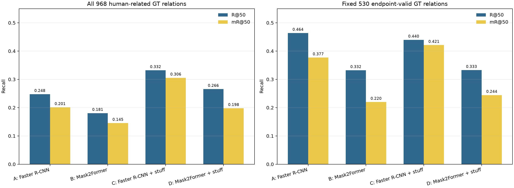
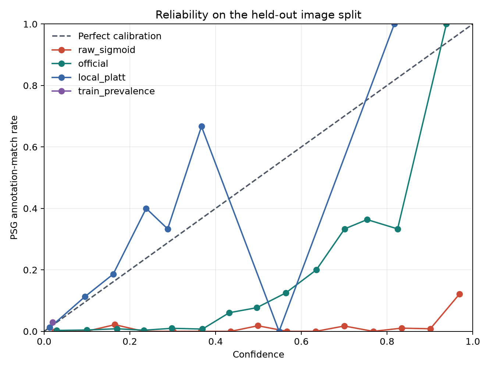
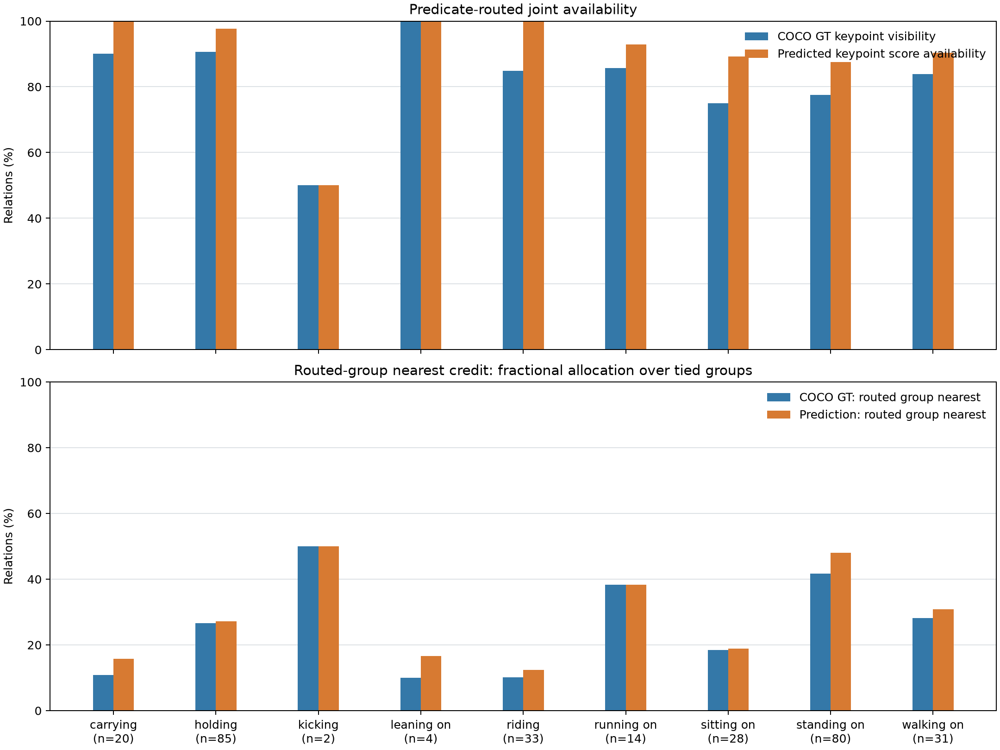

# RelateAnything人—物细粒度关系研究方向：实验迭代与逐项验收

## 报告范围

本报告逐项对照[`研究方向评估_输入.md`](../configs/研究方向评估_输入.md)的研究方向、关键假设、三组核心实验、主张边界、阶段安排和文献核对范围，汇总可在当前工作区执行的实验与尚未具备前置条件的项目。实验输入沿用HOR固定随机500条图像记录，对应499个独立源图像；脚本、配置、证据和图表均归档在`HOR/research/`。原RelateAnything源码、HOR推理管线及既有基线模型输出保持独立。

指南的全部真实实验尚未验收完成。当前已完成区域与解码对照、关键点部位几何代理、同查询次数的主动补检测、受控三维数学实验、文献核对与人工审查准备；独立人工标签、真实三维后端、组合泛化数据与视频数据仍然缺少。受控合成实验使用另外生成的验证/测试场景，不能替代指南要求的真实图像与几何验证。

状态用语区分为：**实测完成**表示已经运行所列模型或评测；**代理实测**表示测量的是替代性几何/标签代理，不能代替人工真值；**流程准备**表示盲审表、标注协议或可运行脚本已经形成，但尚无可报告标注结果；**未执行**表示没有相应实验产物。指南中的推荐路线和研究假设不能据此当作实验结果。

## 目录与复现入口

| 位置 | 内容 |
|---|---|
| [`configs/`](../configs/) | 固定样本、解码、区域、关键点和盲审配置；输入指南副本 |
| [`scripts/`](../scripts/) | 区域对照、解码校准、关键点预测、部位代理、主动补检测、受控三维、盲审导出及独立核验脚本 |
| [`reports/regions/`](regions/thing_stuff_region_study.md) | 四组thing/stuff实验、配对区间、逐条恢复/丢失、失败阶段和编号图 |
| [`reports/decoder/`](decoder/解码校准与选择性输出实验.md) | Top-k、校准、选择性输出、GT边界框oracle、逐谓词排名及身份隔离拆分 |
| [`reports/parts/`](parts/关键点部位邻近代理实验.md) | COCO标注与Keypoint R-CNN预测关键点的部位邻近代理实验 |
| [`reports/controlled_3d/`](controlled_3d/受控三维接口损害实验.md) | 固定骨架与接触目标上的受控三维接口、敏感性和风险—覆盖对照 |
| [`reports/active_detection/`](active_detection/E_主动补检测完整实验报告.md) | 同查询次数的局部几何/关系引导补检测、三组完整输出、配对区间和失败案例 |
| [`reports/human_audit/`](human_audit/ANNOTATION_PROTOCOL.md) | 100张图像、两名独立审查者、先独立关系审查后候选审查的盲审材料 |
| `models/`、`data/`、`output/`、`.work/` | 仅本机保存模型权重、下载数据、缓存和完整原始输出；均由Git忽略 |

实验命令及运行依赖分别写在各实验报告末尾。固定输入和中间输出的SHA-256签名列于区域实验manifest与各报告证据中；大模型、COCO标注及原始预测不进入报告目录。

## 指南逐节覆盖

输入指南副本与用户提供文件的SHA-256均为 `050b8358124f48f73dd2c75a83c422298fb710ecf0c046c0d31d4d2cea0d45a4`。以下覆盖表同时记录已经处理的建议和仍待实证的主张；“已覆盖”只说明相应内容已被检查和记录。

| 指南章节 | 本轮处理 | 验收边界 |
|---|---|---|
| §1 推荐主线与预期 | 以关系证据、实例归属、部位证据和下游风险作为研究问题 | 没有宣称新的算法或论文创新已经成立 |
| §2 现有证据约束 | 保留968条总体关系、530条固定端点关系，分开端点缺失与谓词排序 | 不从召回率推断人工真实性或三维接触 |
| §3 相关工作 | 核对接触、关系、重定向和生成的先例，补查三个邻域 | 文献核对与论文复现分别记录 |
| §4 贡献检验 | 通过四组区域对照、常数校准基线、共同关键点与同输出预算检查简单解释 | 仍未检验RA相对其他提案器的独立必要性 |
| §5–§6 方向A–J | 以下矩阵逐项记录产物和缺失条件 | 未执行方向没有写成已完成实验 |
| §7 三类证据与敏感性 | 在受控数学实验中区分关系后验、对应评分和新增几何损害 | 真实图像仍缺少独立关系和对应标签 |
| §8 三组核心实验 | 对照已完成部分与受控检查分别列出 | 局部视觉人工实验和真实三维核心实验均未全量通过 |
| §9 结果驱动决策 | 记录stuff收益、排序改善、部位可用性混淆和合成下游交换 | 不以个别案例选择研究结论 |
| §10 与PICO/Pi-HOC的区别 | 将可能差异限制在不可靠证据进入固定三维后端的决策 | 仍需同后端实验证明增量 |
| §11 主张边界 | 限定数据集、代理指标、几何模型和输出预算 | 不宣称物理保证、首次或任意组合泛化 |
| §12 阶段目标 | 按实验依赖检查全部阶段，不按日期推迟自动可执行工作 | 人工、真实三维、生成与视频缺少必要输入 |
| §13 文献与证据范围 | 补充不确定性HOI、选择性预测、部位组合泛化核对 | 相关论文的官方结果不作为本项目结果 |

## 方向A–J验收矩阵

| 方向 | 状态 | 已获得证据 | 仍缺少的内容 |
|---|---|---|---|
| A. thing/stuff区域补全 | 实测完成 | A/B/C/D四组共用500条图像记录、关系模型及Top-50预算；C组R@50/mR@50最高；各条关系的恢复、丢失和失败阶段已拆分 | 结果只针对PSG现有标注；不构成新关系识别方法或人工真实性评测 |
| B. 解码、校准与选择性输出 | 实测完成 | Top1/2/3/5、空间/语义双赢家、官方校准、本地Platt、训练正例率常数、间隔拒绝及GT边界框端点对照；拆分按COCO ID和SHA身份分组 | 校准标签是PSG匹配代理；尚无人工视觉准确率、真实误报率 |
| C. 身体部位关系验证 | 代理实测 | COCO GT关键点及Keypoint R-CNN预测点的对象框邻近、部位映射置换和按图配对区间 | 没有独立部位—表面人工标注、局部视觉验证器、完整oracle部位实验或候选视觉准确性对照 |
| D. 二维不确定证据到三维约束 | 受控数学实验实测；真实三维仍未执行 | 200个验证、600个测试场景；共同二次优化、三轴敏感性、六种决策、同输出预算排序与配对区间 | 没有真实人体网格、物体几何、真实接触标注、图像到三维初始化和公开三维后端；受控结果不等价于真实重建 |
| E. 关系引导主动感知 | 实测完成 | 同500条记录、每张有人检测图像各两次查询；原始/几何/RA引导三组；端点覆盖、完整Top50、恢复/丢失与来源身份配对区间 | RA相对几何的R@50差值区间覆盖零，且两种局部策略的召回点估计低于原始方法；尚无人工视觉准确率或其他关系提案器对照 |
| F. 开放词汇组合泛化 | 文献边界已整理；未执行 | 已明确对象未见、谓词未见、已见元素新组合三种划分要求 | 无严格组合拆分、相应标注集或RA与非RA基线 |
| G. 数字人编辑与重定向 | 文献边界已整理；未执行 | 已核对接触保持和跨骨架HOI重定向先例 | 无数字人编辑后端、固定编辑协议或关系保持/几何指标 |
| H. 文本驱动交互生成 | 未执行 | 已记录运动生成、接触和物理合理性方面的先例与额外成本 | 无稳定运动生成后端；当前静态HOR数据不支持有效生成实验 |
| I. 关系可靠性与下游损害评测 | 流程准备 | 随机100张去重图、双审查者盲表、先完整关系标注后候选复核、冻结哈希流程已建立 | 两阶段CSV都没有人工标签；候选复核文件未生成；无标注一致率、准确率或人工召回率 |
| J. 时序关系变化 | 文献边界已整理；未执行 | 已记录视频可消除部分单帧动作状态歧义的研究动机 | 无视频、跨帧身份、时序标注和时序评测 |

## 已执行的实验及结果

### A：thing/stuff区域对照

四组共享固定500条图像记录与RelateAnything关系模型：A为Faster R-CNN thing；B为Mask2Former thing；C为Faster R-CNN thing加Mask2Former stuff；D为Mask2Former thing加stuff。模型只接收预测端点，GT仅用于评分、配对子集和样例选择。

| 组别 | R@50 | mR@50 | Top-50命中/968条GT |
|---|---:|---:|---:|
| A Faster R-CNN thing | 0.2475 | 0.2012 | 223 |
| B Mask2Former thing | 0.1807 | 0.1455 | 175 |
| C Faster R-CNN thing + stuff | 0.3319 | 0.3055 | 304 |
| D Mask2Former thing + stuff | 0.2656 | 0.1978 | 253 |

C相对A恢复103条、丢失22条，全部968条上净增81条；新增主要来自stuff端点。固定530条原thing端点有效GT上，C从223条命中变为215条，净少8条且配对区间覆盖零。结果说明场景区域覆盖能补回一部分PSG标注关系；加入更多端点也扩大了候选竞争，谓词识别和Top-50排序仍造成损失。详见[`thing_stuff_region_study.md`](regions/thing_stuff_region_study.md)、[`recovery_loss_cases.md`](regions/recovery_loss_cases.md)和[`failure_cases.md`](regions/failure_cases.md)。

区域区间按源图像身份聚类重抽样，含关系的252条图片记录对应251个身份，固定530条子集对应214个身份。C−A的R@50差值95%区间在全部关系上为[+0.0551,+0.1151]，固定子集上为[−0.0531,+0.0039]。

区域A的223条命中与解码实验原HOR基线的220条并不相同。两者共享图像、检测端点、权重与谓词文本，但原HOR枚举95,198个候选物体对，区域A固定400预算后只有50,294个；三条恢复关系及共享logits比较保存在[`baseline_difference_audit.json`](regions/baseline_difference_audit.json)。在一个案例中有效候选相同，填充后的关系张量长度仍由49变为400；缓存不能单独分离上下文、填充与BF16计算影响。区域与解码的增量不能直接相加。



### B：解码、校准与选择性输出

全部968条人相关PSG GT上，每对物体保留Top5使R@50/mR@50达到0.3517/0.3341，双赢家为0.2448/0.1993；输出量由10,824增加至12,530条。Top-k提升的是对PSG已标注关系的覆盖，新增候选未因此获得视觉真实性证明。

校准训练、验证、测试记录数为300/100/100；去重后唯一COCO身份数为299/100/100，身份交集为空，重复源ID `404484`固定到训练组。本地Platt模型拟合使用299个唯一身份、6,662条候选和132条匹配代理正例。测试组1736条候选中52条匹配PSG现有标注；原始sigmoid、官方参数、本地Platt的ECE分别为0.60822、0.21461、0.00520，Brier分别为0.49033、0.08977、0.02520。该数值仅描述当前PSG匹配代理，不能转称为人工置信度校准。

训练集正例率常数基线始终输出1.9814%，测试ECE为0.01014、Brier为0.02916。本地Platt相对常数的ECE降低0.00494，Brier降低0.00396。当前测试正例比例为3.00%，常数也能获得较低误差，因此需要结合两项差值理解校准收益，并将校准误差、候选辨别能力和视觉真实性分别评估。

验证集定阈值的间隔拒绝实验在测试集保持约93.0%、77.8%、55.3%、31.9%候选覆盖时，PSG标注匹配率代理分别为3.22%、3.85%、4.79%、6.68%；在52条标注匹配候选中，各阈值分别保留52、52、46、37条，命中的独立GT关系分别为51、51、45、36条。低覆盖同时丢弃了正确标注关系，故不能只报告保留集匹配比例。完整阈值、逐候选证据和按源身份bootstrap见[`解码校准与选择性输出实验.md`](decoder/解码校准与选择性输出实验.md)。独立检查脚本[`audit_decoder.py`](../scripts/audit_decoder.py)从原始边界框与关系标注复算全部64,180条候选标签、六种解码指标、GT边界框对照、校准和阈值选择。



### C：身体部位几何代理

使用固定谓词—部位表、COCO标注关键点和官方Keypoint R-CNN预测关键点，测量关键点到PSG对象GT边界框的归一化二维距离。模型在本HOR样本映射的499张COCO val图像上关键点AP为0.6607；该评测验证模型输出与图像映射能够计算COCO指标。部位可用性读取独立的 `keypoints_scores` 热图峰值分数，以0.5为阈值；该分数没有概率含义。

并列最短距离使用分摊计分：路由组属于k个并列最近部位组时记为1/k，另外报告包含并列和严格唯一最短比例。297条关系进入路由统计，291条共同关系、167个源图像用于原始分组配对：GT/预测平均分摊得分为28.11%/30.64%，差值+2.53个百分点，95%区间为[+0.61,+4.54]。固定两侧共同可用关键点后，得分为28.24%/28.71%，差值+0.46个百分点，区间为[−0.46,+1.43]；进一步把六组均固定为两个不重叠关键点且12点全部共同可用，剩余81条关系、57张图像，得分为47.78%/47.55%，差值−0.23个百分点，区间为[−2.21,+1.65]。

两项共同可用对照的差值区间均覆盖零，说明原始比较必须考虑关键点可用性、组内关键点数量和分组重叠。它们没有形成预测部位优于标注部位的独立证据，也没有验证接触真实性。随机路由使用同一并列计分规则，全部谓词结果、分母和两项公平对照均随报告保存。



逐谓词结果、部位组和数据定义见[`关键点部位邻近代理实验.md`](parts/关键点部位邻近代理实验.md)。该结果不能支持部位验证器准确率、接触判断或三维效果主张。

### D：受控三维接口与几何损害

本轮在自生成的七个节点骨架、球体表面与正交观测上，执行了200个验证、600个独立测试场景。生成器先构造真实几何：正例的真实部位位于球面，负例保留明确间隙，再生成带噪初始化和缺失观测。关系后验来自已知高斯观测模型，对应评分来自相同可见坐标上的模板似然；决策函数不读取真实姿态、真实对应或损害标签。所有方法使用同一严格凸二次目标与线性系统求解，先验、观测和骨骼向量保持项共用；接触项随策略改变。

测试集包含422个正例。新增损害统一定义为相对无接触约束后端，姿态RMSE、骨长误差或节点进入球体的深度超过预先固定的增量阈值，对应选择是否正确另行统计。拒绝约束时仍报告无约束后端的绝对误差与失败率。

| 策略 | 测试约束覆盖率 | 接受约束新增损害率 | 全部场景绝对失败率 | 全部场景姿态RMSE/米 | 正例接触误差/米 |
|---|---:|---:|---:|---:|---:|
| 无接触约束 | 0.0000 | 不适用 | 0.6600 | 0.1244 | 0.1103 |
| 最高对应硬约束 | 1.0000 | 0.4283 | 0.6550 | 0.1681 | 0.0423 |
| 关系后验加权单对应 | 1.0000 | 0.3317 | 0.5967 | 0.1460 | 0.0446 |
| 单对应选择性拒绝 | 0.7900 | 0.2511 | 0.5600 | 0.1323 | 0.0404 |
| 多候选几何代价选择 | 0.7867 | 0.1589 | 0.5133 | 0.1255 | 0.0258 |
| 真实对应参考 | 0.7033 | 0.0806 | 0.4667 | 0.1192 | 0.0201 |

单对应与多候选阈值均由验证集80%覆盖目标确定。另在测试集固定480/360/240条接受数量，与语义、间隔、敏感性、随机排序进行不读取标签的比较。80%输出预算下，多候选与单对应几何排序的新增损害率分别为16.875%与25.625%。多候选策略平均需要15次求解及扰动核查，单对应几何策略为8次，普通单对应为2次；输出预算一致没有消除计算成本差异。完整区间、三轴扰动、完整坐标、固定案例、求解次数与计算时间见[`受控三维接口与几何损害实验.md`](controlled_3d/受控三维接口损害实验.md)。

多候选策略的平均姿态RMSE仍略高于无约束后端，虽然正例接触误差明显较低，说明多种几何目标需要同时检查。语义后验与损害的关系由生成分布和指定优化器共同决定，不能作为真实RA置信度的独立发现。这项数学实验没有完成真实图片、人体表面、网格穿透或公开三维重建后端上的核心验证。

### E：相同局部查询次数的主动补检测

原始方法复用区域A的检测端点；几何方法在面积最大人物的上身与下身各执行一次Faster R-CNN；关系引导方法根据冻结A的Top50预测选择相同数量的局部观察。288条记录检测到人物，两种补检测方法各执行576次查询；没有人物检测的212条记录两组均不查询。裁剪区域只由预测端点、预测关系、图像尺寸和固定规则决定，GT用于后续评分。三组统一为最多40个端点、400个候选物体对、50条输出。

| 方法 | 全部968条命中 | R@50 | mR@50 | 固定530条命中 |
|---|---:|---:|---:|---:|
| 原始检测端点 | 223 | 0.247543 | 0.201203 | 223 |
| 几何裁剪补检测 | 209 | 0.228283 | 0.198677 | 202 |
| RA关系引导裁剪补检测 | 212 | 0.232533 | 0.216750 | 203 |

关系引导相对几何策略的R@50差值为+0.004250，20,000次来源身份配对重抽样的95%区间为[−0.007548,+0.016771]；mR@50差值为+0.018073，区间为[−0.012335,+0.028370]。两项区间均覆盖零，当前结果没有建立关系引导的稳定优势。关系引导相对原始方法恢复21条、丢失32条，净少11条；几何方法恢复19条、丢失33条，净少14条。

关系端点覆盖分别为798/1129、805/1129、807/1129，存在两个不同匹配端点的GT关系分别为530、535、538条。局部检测改善了少量端点覆盖，但更多候选、同类别抑制与40端点限制也改变端点集合，最终谓词预测和Top50竞争仍有损失。这些阶段仅解释PSG标注召回，不能把全部未匹配候选判作视觉误报。

原始方法与冻结区域A的全部500条Top50输出所有字段逐值相同。三方全部输出、完整对象编号与坐标、六个详尽案例、逐关系阶段迁移、逐谓词结果和计算成本见[`E_主动补检测完整实验报告.md`](active_detection/E_主动补检测完整实验报告.md)。独立审计入口为[`audit_active_detection.py`](../scripts/audit_active_detection.py)。同样的查询次数仍允许裁剪面积和实际时间不同，报告分别保存这些成本；当前实验没有比较其他关系提案器。

## 人工真实性审计状态

盲审抽样从499个不同源图像中按固定种子均匀选择100张，每张图像安排两位互不影响的审查者。第一阶段记录完整关系清单、实例编号、主体与宾语边界框、可见性、不确定原因、审查时间与版本；两张表格冻结SHA-256后，第二阶段才可导出打乱顺序且不含分数的候选复核表。当前[`images_blind.csv`](human_audit/images_blind.csv)和[`relations_blind.csv`](human_audit/relations_blind.csv)只有空白标签槽位；`candidate_review.csv`不存在，冻结阶段尚未通过。

因此尚无独立图像关系真值、支持/反驳/未知比例、可判定子集精确率、相对独立关系标注的召回率或标注者一致性。不得将未匹配PSG关系写成视觉误报，也不得把COCO keypoint几何代理作为人工部位真值。完整操作流程和标签定义见[`ANNOTATION_PROTOCOL.md`](human_audit/ANNOTATION_PROTOCOL.md)。

## 指南§7假设的实验状态

| 指南假设 | 推荐表示或比较 | 当前证据 |
|---|---|---|
| 7.1 分开关系证据、部位—表面对应和几何损害 | `p_r`关系图像支持度、`q_c`部位—表面对应分布、`h_c`下游损害；同时保留未知原因 | 受控数学实验中分别构造关系后验、模板似然评分和独立几何损害；真实HOR输入仍只有PSG匹配代理与COCO关键点代理，没有真实部位—表面标签 |
| 7.2 验证RA提案是否有独立必要性 | RA提案+局部验证、无RA局部方法、另一提案器+相同验证 | E已比较RA关系引导与不使用关系的几何裁剪补检测，未建立RA的稳定优势；局部关系验证器与另一关系提案器的完整三路径比较仍未执行 |
| 7.3 显式保存多种对应假设 | 单一对应拒绝、多对应优化、图像一致性与几何质量对照 | 受控数学实验保存两个候选的独立优化结果并选择一个；同时保留多个解的接口与真实图像多解标注仍未完成 |
| 7.4 先测优化敏感性，不先训练风险预测器 | 固定三维状态，对接触目标扰动，观测姿态变化、穿透和重投影 | 受控实验已计算三轴目标扰动下姿态坐标RMS变化的中央差分；骨长变化和穿入分别作为几何代价与评测指标，风险—覆盖结果完整保存；真实数据仍缺少三维初始化、接触标注和统一后端 |

真实图像上的这些主张仍是可证伪假设。当前没有训练三类分数联合预测器，也没有真实三维风险结论；受控数学结果只解释指定生成分布与优化器的行为。

## 指南§8三组核心实验状态

| 核心实验 | 指南要求的主要对照 | 本轮状态 | 缺失条件 |
|---|---|---|---|
| 一：局部证据是否新增信息 | RA原始分数、校准、几何、全局crop、局部部位、部位oracle；相同候选和预算；人工支持率/风险覆盖 | 部分完成。已实测解码与校准、固定端点oracle、区域补全、COCO关键点邻近和主动补检测；各实验保留自己的评价定义 | 人工关系支持标签、局部/全局图像验证器、独立部位oracle标签 |
| 二：语义置信与三维损害是否不同 | 固定三维初始化和优化器；交叉语义分数、对应模糊度、遮挡与敏感性；评测实际有害率 | 受控数学检查已运行；明确的生成分布、三轴扰动与统一几何损害形成可复查机制实例，真实核心实验未验收 | 真实图像到三维初始化、接触标注、姿态/穿透/重投影标签仍缺少 |
| 三：风险接口是否值得 | 相同有效约束覆盖或错误率下比较无约束、硬约束、软约束、拒绝、多对应与oracle | 受控数学检查已运行；验证阈值与同输出预算对照显示多候选几何选择有收益，同时完整报告更多求解成本；真实核心实验未验收 | 真实约束来源、许可完备三维后端、人工/几何评测集和预先固定的真实覆盖目标仍缺少 |

## 指南§9决策规则与当前观测

| 观察结果 | 本轮证据 | 决策含义 |
|---|---|---|
| stuff补全几乎解决主要损失 | C相对A净增81/968；固定530子集净少8且区间覆盖零 | 输入区域覆盖是重要瓶颈，谓词预测仍有损失；继续完善端点检测，并保留关系识别方面的独立评测 |
| GT谓词常在组内第二、第三名 | 固定530关系在正确谓词组内前三名388条（73.2%）；Top5总体召回提高 | 多候选和排序值得作为基线，人工审计仍需衡量输出代价 |
| GT谓词长期远离前列 | GT排名证据已逐谓词保存，但当前总指标不足以把所有失败归因于表示或词表 | 继续按逐谓词排名与失败阶段定位，不据总体数值直接提出训练方向 |
| 受控语义置信度与三维损害 | 600个测试场景中已知生成分布的语义后验越高，硬约束新增损害总体越低；该关系由场景与观测模型共同决定 | 不能把合成传感量的规律当作真实RA分数的实证结论 |
| 选择性接口是否值得 | 测试固定80%输出预算时，多候选几何排序新增损害16.875%，单对应几何排序25.625%；多候选求解成本更高 | 可以保留数学机制结果；真实图片上仍需同时满足输出数量、优化成本和独立几何标签 |
| oracle部位有效、预测部位无效 | 当前COCO几何代理不构成人工部位参考；共同关键点与每组两个关键点对照的GT/预测差值区间覆盖零 | 该判断仍未知；需要独立部位标注与局部验证对照 |
| 关系引导局部观察是否有效 | RA引导与几何策略各576次查询，R@50分别为0.232533和0.228283；差值区间覆盖零，两者点估计均低于原始0.247543 | 当前策略没有建立关系引导的稳定收益，补回端点与最终关系召回需要分别评价 |
| 局部模型有用，RA无增量 | 尚无局部视觉验证器或非RA提案器对照 | 未检验 |
| RA帮助陌生组合 | 尚无对象/谓词/组合拆分 | 未检验 |
| 二维提升但三维未改善 | 受控实验仅测量合成几何接口；真实三维后端仍未运行 | 仍未检验，二维指标不得外推至真实三维 |
| 三维有害率下降、平均误差变化小 | 受控多候选方案降低接触误差与新增损害，平均姿态RMSE仍略高于无约束后端 | 同时检查姿态、接触、骨长和穿入，不能仅报告有利指标 |
| 多解方案是否必要 | 当前只比较独立优化候选后选择一个完整解，没有同时保留多解的输出接口 | 不把候选选择结果当作多解分布已经得到验证 |
| 遮挡下所有方法同样失败 | 盲审尚无人工结果 | 未检验 |
| 评测发现普遍接口失效但算法增益有限 | 当前仅定位到端点覆盖和谓词排序瓶颈 | 未完成人工与跨模型评测，不能形成普遍失效结论 |
| 只有少量示例有效 | 当前编号图只展示框来源；不含人工判定 | 不以示例替代统计结论 |

## 指南§10–§11主张边界

| 可在限定协议内报告 | 当前不支持的主张 |
|---|---|
| 在固定HOR 500条图像记录协议下，报告四组Top-50 PSG关系召回与解码变化 | 全面解决人—物关系理解、降低视觉幻觉或已达到人工准确性 |
| 报告COCO关键点到PSG对象框的几何距离和部位路由统计 | 预测接触、接触力、对象表面区域或姿态可执行性 |
| 报告GT边界框、COCO关键点等条件化代理结果 | 端到端开放组合泛化、跨数据集泛化或三维重建改善 |
| 将RelateAnything作为候选提案来源的研究假设 | RA不可替代，除非相同验证器对照支持这一点 |
| 根据官方项目和论文准确描述已有接触/重定向工作 | 首次把语义、接触与数字人结合，或首次进行接触保持重定向 |

与PICO的边界需要围绕“不完整二维证据如何决定三维约束的采用、拒绝或保留多解”展开；增加接触损失或语言修正本身不足以构成差异。与Pi-HOC的比较应将其接触估计作为强基线，单独验证实例归属、不确定对应和下游错误损害。ReCHOIR与HOI-Retarget已占据接触引导重定向的重要位置，单纯跨骨架或对象尺度接触保持不适合作为本项目的宽泛新颖性主张。

## 指南§12阶段安排

| 阶段 | 指南目标 | 当前验收状态 |
|---|---|---|
| 近期：可靠二维基线 | 原结果复现、完整logits、端点分解、人工准确性审计、thing/stuff对照 | 关系logits、端点对照和解码诊断已完成；盲审流程已备妥，人工准确性审计仍待两名审查者填表 |
| 中期：细粒度证据必要性 | 少数关系先oracle后预测；比较无RA、校准、几何、局部视觉 | 完成COCO关键点几何代理和受控三维接口对照；未完成人工oracle、局部视觉验证或无RA同预算真实图像对照 |
| 后期：数字人严谨下游 | 同一三维后端验证关系到约束的歧义和损害 | 受控合成三维实验已交付；真实人体/物体三维后端、重定向和数字人编辑仍未执行 |

当前环境可使用RTX 5070 Ti完成本报告中的单卡预训练模型推理，受控数学实验在CPU运行。区域模型、关系模型、人体关键点和局部检测均已经实际运行；区域独立计时中的PyTorch峰值分配约0.563 GiB，关键点运行约0.737 GiB，主动补检测约0.877 GiB。精确运行范围与当前计时分别保存在[区域运行成本](regions/runtime_evidence.md)、[关键点运行记录](parts/evidence/keypoint_coco_metrics.json)和[主动补检测记录](active_detection/runtime.json)。这些分配量描述本次模型、分辨率与批次设置，不能外推为大型VLM、真实三维后端或完整训练的显存需求。

环境使用既有隔离目录`.venv-eval`，系统Python保持独立。完整依赖版本、设备、CUDA和Python路径见[`environment_snapshot.json`](environment_snapshot.json)。统一入口[`run_research.ps1`](../scripts/run_research.ps1)默认从本机真实缓存复算，添加`-RerunModels`后重新执行全部新增模型推理；旧区域与主动补检测输出先移动到工作区内的可恢复归档。最终脚本/配置/报告清单和验收结果见[`delivery_manifest.json`](delivery_manifest.json)及[`delivery_verification.json`](delivery_verification.json)，包含原图身份互斥、全部本地链接、文件签名、空白盲表保护及各实验的独立数值审计。

## 指南§13文献证据与已完成邻域核对

输入指南逐项记录了R1–R10的官方来源及本轮阅读范围，范围包括RelateAnything、Pi-HOC、PICO、PaStaNet/HAKE、HarnessHOI、TeHOR、InteractAnything、CHOIS、ReCHOIR和HOI-Retarget。该列表用于研究边界核对，不代表这些论文都已复现，也不等价于穷尽综述。CAGE-SGG的官方页面标明撤回，本报告不使用其性能结论作支持证据。本轮又完成了R11–R19三个邻域的全文或官方材料核对；这些工作同样没有在本仓库复现。

| 邻域 | 代表来源 | 已覆盖能力 | 对本项目的直接约束 | 可保留的窄差异 | 当前证据状态 |
|---|---|---|---|---|---|
| 不确定性HOI与三维接触 | [UA-HOI](https://arxiv.org/abs/2408.07430)、[LEMON](https://arxiv.org/abs/2312.08963)、[PICO](https://arxiv.org/abs/2504.17695)、[InteractVLM](https://arxiv.org/abs/2504.05303)、[Pi-HOC](https://arxiv.org/abs/2604.12923) | 不确定性建模、部位/对象接触、接触对应和接触到三维优化均已有先例 | 不能宣称首次提出不确定性HOI、部位接触或语义到三维接触 | 在固定三维后端中，把校准关系证据、对应多解和几何有害率统一用于采用、保留多解或拒绝决策 | 已完成邻域核对；本项目仅完成受控合成接口实验 |
| 选择性预测与风险覆盖 | [SelectiveNet](https://proceedings.mlr.press/v97/geifman19a.html)及其reject-option/risk-coverage协议 | 拒绝输出、覆盖率与选择性风险的定义已有成熟方法 | 当前margin拒绝属于已有选择性预测基线；PSG匹配率仅衡量现有关系标注的匹配 | 用独立接触错误、穿透、重投影或姿态失败标签定义真实下游风险，并在固定覆盖率比较 | 已完成方法边界核对；当前真实风险标签缺失 |
| 部位—谓词—对象组合泛化 | [VCL](https://arxiv.org/abs/2007.12407)、[OC-Immunity/mPD](https://arxiv.org/abs/2202.09492)、[FineHOI](https://arxiv.org/abs/2609.05959)、Pi-HOC | 谓词—对象组合、部位表征、校准和未见组合评测已有先例 | 不能宣称首次做部位接触或开放组合泛化 | 预先固定未见部位、谓词、对象及其组合拆分，并检验组合证据对三维决策损害是否有增量 | 已完成邻域核对；当前没有严格组合标注集与真实基线 |

三个邻域的文献审计已经完成，对应的真实图像人工实验、真实三维损害实验和严格组合泛化实验仍是实验缺口。补充来源编号依次为R11 LEMON、R12 PICO、R13 InteractVLM、R14 Pi-HOC、R15 UA-HOI、R16 FineHOI、R17 VCL、R18 OC-Immunity/mPD、R19 SelectiveNet。相关论文的结果只用于方法边界核对，没有写成本项目的复现指标。

## 复现命令

区域实验和解码分析的命令见各自报告。关键点代理需先运行官方模型预测，再运行CPU分析：

```powershell
.\.venv-eval\Scripts\python.exe HOR\research\scripts\predict_coco_keypoints.py
.\.venv-eval\Scripts\python.exe HOR\research\scripts\part_evidence_study.py
.\.venv-eval\Scripts\python.exe HOR\research\scripts\controlled_3d_damage_study.py --config HOR\research\configs\controlled_3d.json
```

人工审计只导出空白盲表；只有两位审查者独立完成第一阶段并冻结CSV哈希后，才能生成第二阶段候选表。导出命令见[`人工审计协议`](human_audit/ANNOTATION_PROTOCOL.md)。人工标签不能从当前模型输出批量生成。

## 尚未验收的前置条件

| 工作 | 继续执行所需条件 | 当前处理 |
|---|---|---|
| 100张图像人工关系真实性与部位审计 | 两名独立人工审查者；第一阶段关系清单、可见性和未知标签；之后冻结哈希 | 盲审包已准备，未伪造标签或准确率 |
| 真实三维损害实验 | 可用人体与物体几何、固定三维初始结果、可复跑优化器、接触/有害率标注和统一指标 | 受控合成接口实验已完成；真实实验仍未下载需注册/授权的数据，不接受未核验许可，也不以二维或合成proxy代替 |
| 组合泛化实验 | 预先固定对象/谓词/组合拆分、可靠人工标签及多个提案基线 | 尚未形成数据和划分 |
| 局部视觉与其他关系提案器对照 | 固定候选、预算、独立视觉支持标签，以及全局/局部视觉和其他提案器 | 已有几何代理、校准和主动补检测；核心实验一中的完整视觉验证对照仍未执行 |
| 数字人编辑/重定向 | 已核验许可的三维资产、动作/对象接口和同后端评测 | 缺少人体/对象三维资产、固定编辑后端与编辑标注，尚无真实编辑评测 |
| 文本驱动交互生成 | 稳定的运动生成后端、对象几何、动作条件与接触/运动评测 | 尚无生成后端或真实动作实验 |
| 时序关系变化 | 视频输入、跨帧身份、时序状态标注和额外帧请求协议 | 尚无视频、跟踪或时序评测产物 |

任何一项后续满足前置条件时，应在本报告状态表中单独登记新实验、配置、脚本、原始输出位置及可提交证据，并保留当前失败与未完成边界。

## 术语表

| 术语 | 本报告中的含义 |
|---|---|
| GT | Ground Truth，数据集或人工提供的参考标注；本报告会说明参考标注的来源 |
| RA | RelateAnything，当前使用官方权重的关系候选模型；输入图像和对象区域，输出有方向的关系分数 |
| HOR | 本项目的人相关关系实验目录名；保留人物位于主体或宾语位置的关系，也包含人与人关系 |
| PSG | Panoptic Scene Graph，HOR沿用的全景场景图数据集及其关系标注 |
| COCO / Visual Genome（VG） | 两个图像标注数据集；本报告使用COCO人体关键点和Visual Genome到COCO的源图像身份映射 |
| thing / stuff | thing表示人物、杯子等可区分实例的物体；stuff表示道路、地面、天空等场景区域 |
| 端点 / 实例身份 / 有向物体对 | 一条关系的主体和宾语分别为两个端点；实例身份区分同类别对象；“人物拿杯子”与“杯子拿人物”的方向不同 |
| Top-k / Top50 | 根据分数保留前k项；局部Top5按每对物体保留五个谓词，图像Top50再限制整张图像最多输出50条关系 |
| 候选预算 / 输出预算 | 前者限制模型评分的物体对数量，后者限制最终展示关系数量；本报告的400与50对应不同环节 |
| R@50 | 每张图像最多保留50条预测关系时，先计算每张含GT图像的关系召回率，再对图像取宏平均 |
| mR@50 | 每张图像最多50条预测关系时，先计算各图像内各谓词的召回率，在包含该谓词的图像间取平均，最后对出现过的谓词等权平均 |
| IoU | Intersection over Union，预测框与参考框交集面积除以并集面积 |
| COCOeval | COCO官方评测实现；此处调用其人体关键点评测协议，不代表HOR关系评测 |
| AP / AR | Average Precision / Average Recall，COCO对象或关键点评测汇总指标 |
| ECE | Expected Calibration Error，按分数区间加权的预测置信度与目标事件频率差异 |
| Brier分数 | 概率预测的平方误差均值；数值越小表示对本次所定义标签的概率误差越小 |
| Platt校准 | 对原始logit应用正斜率仿射变换后取sigmoid的二分类概率校准方法 |
| logit / sigmoid | logit是模型输出的实数分数；sigmoid将其压缩到0至1，单独使用这个函数不能保证数值代表正确概率 |
| crop / query | crop表示从原图裁剪的局部区域；主动补检测的query表示一次真实检测调用，Mask2Former的query则表示一个区域预测查询，两者分别计数 |
| NMS | Non-Maximum Suppression，非极大值抑制；同类别检测框重叠过高时保留分数较高者，防止同一对象产生大量重复框 |
| LayerNorm / feature_maps | LayerNorm对特征进行归一化；feature_maps是主干输出的二维特征。加载审计检查实际参与分割预测的特征路径 |
| FP32 / BF16 | 两种浮点数格式，分别使用32位与16位；本次局部检测采用FP32，关系与区域模型采用BF16自动混合精度 |
| CUDA / GiB | CUDA为本次NVIDIA GPU计算环境；GiB为2的30次方字节，报告的峰值显存分配只统计相应PyTorch进程 |
| RMSE / CI | Root Mean Square Error为均方根误差；Confidence Interval为置信区间。姿态RMSE以米表示，差值区间覆盖零表示当前数据尚不能排除零差值 |
| `p_r` / `q_c` / `h_c` | 分别表示关系证据概率、部位与对象表面对应的评分、施加约束后的几何敏感性或损害估计；本轮只有受控数学实验具备明确生成分布 |
| 约束 / 重投影 / 穿入 | 约束规定优化时希望满足的几何关系；重投影把三维点投回图像；穿入表示人体节点或表面进入物体内部。受控实验只度量七个节点的球体穿入 |
| VLM / 关系提案器 | VLM为Vision-Language Model，视觉语言模型；关系提案器负责产生待检查的关系候选。本次没有进行VLM逐轮生成 |
| Bootstrap | 对样本单位有放回重抽样以估计统计量变化；真实图片实验按源图像身份分组，受控数学实验按独立生成的场景配对抽样 |
| oracle对照 | 评测中用参考端点或标注替代某个预测输入的条件化诊断；不能当作部署结果 |
| 代理标签/代理指标 | 与目标问题有关但并非独立目标真值的可计算替代量，例如PSG标注匹配或关键点到框距离 |
| 风险—覆盖 | 输出保留比例与保留结果错误比例之间的关系；解码实验使用PSG匹配代理，受控数学实验使用相对无约束基线的新增几何损害 |
