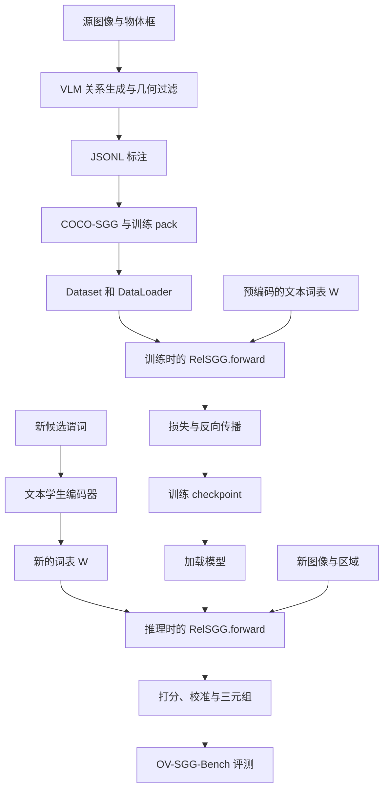

# RelateAnything 复现与论文分享指导

本指南将“跑通项目”推进到“可信地复现实验、理解方法、形成自己的分析并完成论文分享”。它是一份执行计划和验收模板，文中的实验均为待执行建议，不代表已经获得结果。

配套阅读：[项目结构与模型架构](项目结构与模型架构.md)。架构文档回答“模型如何实现”，本指南回答“应该验证什么、怎么组织实验、如何向导师说明”。

## 1. 目标与研究主线

建议围绕下面的问题组织整个复现：

> RelateAnything 更换关系词表就能预测，那么它在多大程度上利用了图像中的交互证据、区域几何，以及关系文本信息？

这是一项待检验的问题，不应预先认定模型只依赖先验，也不应凭几个成功例子认定它已经理解关系。

建议最终完成五项核心交付：

1. 一项官方权重在正式基准上的结果复现。
2. 一次能够验证学习过程的小规模训练。
3. 一张同一样本贯穿数据生成、训练、推理和评测的说明图。
4. 两项控制变量的对照实验。
5. 一份包含失败定位、局限和复现步骤的报告与分享材料。

有余力再增加数据生成审计或完整重训。先让实验可信、解释清楚，再考虑修改网络提出改进。

## 2. 明确“复现”的范围

### 2.1 四种工作不能混为一谈

| 工作 | 使用的初始化与数据 | 可以支持的表述 |
| --- | --- | --- |
| 推理演示 | 发布权重和少量图片 | 已跑通接口，能够输出预测 |
| 官方权重评测 | 发布权重和规范测试集 | 已复现该权重在指定协议下的指标 |
| 小规模训练或微调 | 小数据集，初始化需明确 | 已验证训练流程，或完成指定微调实验 |
| 完整训练复现 | 论文规定的初始化、训练数据和配方 | 已按说明重新训练并评估模型 |

从发布关系模型权重开始微调，不等于从论文规定的 DINOv3 初始化开始复现完整训练。使用官方标注进行训练，也不等于复现了 RA-4M 的生成过程。

### 2.2 开工前填写任务卡

| 项目 | 待填写内容 |
| --- | --- |
| 考核截止日期 | ____ |
| 可用 GPU、显存、时间 | ____ |
| 首选模型 | 建议从官方推荐的 ViT-S/16+ 开始，根据资源调整 |
| 首选基准 | ____，填写论文表号、行名、数据划分和指标 |
| 是否要求完整重训 | ____ |
| 是否需要重新生成标注 | ____ |
| 必交材料 | 报告、代码、日志、幻灯片等 |

如果需要向导师确认，可以使用：

> 我计划先复现官方权重在一个基准上的结果，再验证小规模训练，完成两个对照实验和失败分析。考核是否要求按论文配方完整重训？优先对齐哪张结果表？

## 3. 理解全流程与模型前向的关系



项目流程通过磁盘上的标注、数据包、文本向量和 checkpoint 衔接；架构文档中的图是其中一次模型计算的展开。训练时核心 `forward()` 在收到 `targets` 后还会计算损失，反向传播与优化器更新由训练循环执行。推理时使用 `targets=None`，分数融合、排序等操作位于相应 API/评分逻辑中。

注意三个文本组件的区别：

| 组件 | 职责 |
| --- | --- |
| Gemma VLM | 离线看图并产生训练关系标注 |
| dino.txt 教师与蒸馏流程 | 训练关系文本学生编码器 |
| 文本学生编码器 | 编码训练词表或推理时的新候选短语 |

Gemma 不参与最终关系模型的逐图像前向推理。换词表需要文本编码，但无需为每一帧重新编码不变的词表。

## 4. 阶段一：阅读论文与核对代码

### 4.1 必须能独立回答的问题

- 输入与输出是什么？物体检测器与关系模型如何分工？
- 开放词表为什么可以通过替换文本矩阵实现？它为什么不是自由生成文字？
- 主语、宾语、联合区域、接触区域分别提供什么信息？
- 采样器保留哪些物体对，预算不足可能影响什么？
- 几何编码、关系 Transformer、可变形读取和后续交互如何连接？
- 为什么设置空间与语义双查询？门控由什么决定？
- 关系存在性分数与谓词匹配分数如何组合？
- 未标注关系为什么不能全部当作真实负例？
- 训练时使用物体类别辅助监督，与推理时不输入类别标签是否矛盾？
- 换词表能力、跨数据集迁移、训练未见谓词泛化分别需要什么证据？

### 4.2 推荐阅读路径

| 目的 | 文件 |
| --- | --- |
| 明确任务和接口 | [README.md](README.md)、[docs/quickstart.md](docs/quickstart.md) |
| 核对数据生成 | [datagen/README.md](datagen/README.md)、[datagen/sgg_vllm_generate.py](datagen/sgg_vllm_generate.py) |
| 理解数据包 | [docs/data.md](docs/data.md)、[relsgg/data/dataset.py](relsgg/data/dataset.py) |
| 掌握网络主线 | [relsgg/model/relsgg.py](relsgg/model/relsgg.py)、[relsgg/config.py](relsgg/config.py) |
| 理解开放词表 | [relsgg/model/vocab_head.py](relsgg/model/vocab_head.py)、[relsgg/text/student.py](relsgg/text/student.py) |
| 理解学习与分数 | [docs/objective.md](docs/objective.md)、[relsgg/training/losses.py](relsgg/training/losses.py)、[relsgg/scoring.py](relsgg/scoring.py) |
| 准备正式评测 | [benchmark/SPEC.md](benchmark/SPEC.md)、[docs/evaluation.md](docs/evaluation.md)、[docs/pitfalls.md](docs/pitfalls.md) |

验收标准：能够不照读 README，使用一张图讲清输入、张量变化、输出、监督信号与开放词表机制。论文、文档和源码若有差异，应记录版本和依据，不自行补成一致。

## 5. 阶段二：环境与推理验证

### 5.1 记录可追溯的环境

保存以下信息：

- Git commit 和本地改动补丁。
- Python、PyTorch、CUDA、驱动及主要依赖版本。
- GPU/CPU 型号与显存。
- 权重来源、具体版本或哈希、配置、校准文件。
- 数据集版本、划分、词表、图像路径与缺失样本统计。
- 实际运行命令、随机种子、开始时间与输出目录。

安装方式以 [docs/installation.md](docs/installation.md) 为准。数据生成使用独立环境，避免 vLLM 依赖与训练环境相互覆盖。

### 5.2 先检查接口，再看模型表现

- 跑通官方样例，然后使用自己的图片与人工框。
- 公共 API 的框是原图像素 `xyxy`；内部网络框是归一化 `cxcywh`。
- 确认图像颜色通道约定，以及掩码是否与原图和物体顺序一致。
- 确认主语、宾语索引与展示文字一致。
- 更换候选词表，检查输出谓词能正确映射回字符串。
- 比较空间图、语义图，理解其分类与排序规则。

交付物：一个可重复运行的演示脚本、固定输入、保存的原始输出，以及至少一个成功和一个失败案例。演示成功不替代正式评测。

## 6. 阶段三：正式复现一项基准

### 6.1 一次只对齐一行结果

先选择明确的“模型 × 数据集 × 数据划分 × 指标”，例如指定模型在 PSG 测试集、GT 框和闭集词表协议下的某项指标。最终以论文和仓库对应版本为准，不自行拼接不同表格的设置。

必须核对：

| 条件 | 检查内容 |
| --- | --- |
| 权重 | 模型规格、最终或最佳 checkpoint、EMA 使用情况 |
| 数据 | 划分、样本数、缺失图像、排除列表 |
| 区域 | GT 框、检测框或掩码，是否限制物体数 |
| 词表 | 数据集词表或完整训练词表，顺序和同义匹配规则 |
| 输出约束 | 图约束、每对谓词数量、top-k |
| 评分 | pair_weight、校准参数、检测置信度融合 |
| 指标 | 具体实现、宏平均/微平均、忽略规则 |

参考入口：A1/A3 使用 `benchmark/eval_zeroshot.py`，A2 使用 `eval_haystack.py` 等，A4 使用检测框相关脚本，A6 使用 `eval_spatialsense.py`。执行前查看当前脚本的 `--help`，不要把文档里的省略命令当作完整可执行命令。

### 6.2 结果表模板

| 实验编号 | 模型与协议 | 官方值 | 本地值 | 差值 | 条件差异或解释 | 日志路径 |
| --- | --- | ---: | ---: | ---: | --- | --- |
| B01 | 待填写 | — | — | — | 待核对 | — |

数值未对齐时，优先检查数据数量、权重版本、框来源、词表、图约束和评分参数，再考虑数值精度等因素。不要先改模型去追指标。

验收标准：别人能够根据命令、资源版本和日志复现同一项结果；如果仍有偏差，报告已经排除的原因和尚未解决的问题。

## 7. 阶段四：训练流程验证（受限于算力不做）

推荐由小到大执行：

1. 可视化一个 batch 的框和关系，核验谓词编号对应 `W` 的正确行。
2. 跑一个训练步骤，检查总损失及分项损失是否有限、预期参数是否收到梯度。
3. 在固定小数据集上训练，观察是否能降低损失并提高该训练集上的表现。
4. 保存并重新加载 checkpoint，核对预测与配置是否恢复。
5. 再扩大数据量，或按资源安排完整训练。

小数据验证中若简化增强或正则化，应记录改动；这属于调试实验，不可直接与发布配方的泛化结果比较。不能仅凭总损失下降认定训练正确，还应查看样本预测、关系覆盖和分项损失。

关键文件：

- [train.py](train.py)：组织数据、训练、验证和 checkpoint。
- [relsgg/training/setup.py](relsgg/training/setup.py)：装载文本矩阵、构建优化器等。
- [relsgg/training/engine.py](relsgg/training/engine.py)：前向、反向和参数更新。
- [training/configs/README.md](training/configs/README.md)：解释发布配置记录。
- [docs/training.md](docs/training.md)：正式训练配方和 checkpoint 选择说明。

完整训练应核对初始化、数据混合比例、每卡 batch、梯度累积和 batch-local 对比学习设置。增加梯度累积并不会自动扩大单次对比学习的候选集合。

## 8. 阶段五：两个推荐的对照实验

### 8.1 实验 E01：开放词表对表达变化是否稳定？

**问题：**固定图像和物体对，关系改写后模型还能否保持合理判断？

**设计：**为选定关系构造原始表达、语境中等价的同义表达、相反关系或方向、无关短语。先人工核查其含义；“相反词”在具体图片中不一定构成严格负例。

**固定变量：**模型、图片、区域、预处理、采样预算、评分设置。记录模板化文本编码方式。

**建议记录：**

- 指定物体对上各候选的谓词分数与融合分数。
- 正确候选排名、正负分数差、同义改写后的一致性。
- 原始文本、向量相似度与逐样本结果。

尽量在同一个候选集合中比较各表达，再单独研究替换词表的 top-k 影响。候选增多导致排名变化，不等于固定谓词分数发生变化。分析阶段关闭随机性，保持同一物体对与有效候选一致。

**图表：**固定图片旁展示候选短语的分数条形图；汇总全部预先选定样本的一致性，而非只选成功案例。

**结论边界：**同义词稳定说明一定的表达鲁棒性，不自动证明该短语训练时未见。宣称“未见谓词”前需核查训练词表，若要证明未见语义还需更严格的划分。

### 8.2 实验 E02：关系预测对框误差有多敏感？

**问题：**检测框变差后，空间关系与语义关系如何退化？

**设计：**基于同一组原始框设置由弱到强的平移或缩放扰动。分别改变位置和大小，以免同时改变多个因素。明确扰动相对框尺寸还是图像尺寸计算，记录裁剪与退化框处理规则。

**固定变量：**图像、模型、词表、评分设置、样本集合。对随机扰动保存种子，资源允许时重复多个种子。

**建议指标：**

- 原始候选物体对被采样保留的比例。
- 固定主客体身份下的关系排名或分类表现。
- 分别统计空间与语义关系，并说明分类依据。
- 如使用检测协议，额外报告框匹配导致的影响。

不能把物体对未被选中、谓词判断错误、IoU 匹配失败混为一种原因。若使用固定物体身份评估，它是区域扰动鲁棒性实验，不应直接称为标准 SGDet 结果。

**图表：**横轴扰动强度、纵轴指标，绘制空间/语义两条曲线；另列候选对覆盖率。多次随机试验可报告均值和波动。

### 8.3 可选实验与解释边界

| 实验 | 目的 | 注意事项 |
| --- | --- | --- |
| pair_weight=0 与发布设置对比 | 衡量关系存在性项对当前协议的影响 | 固定其余参数；若比较阈值指标，需明确校准处理，不能在测试集重调阈值 |
| GT 框与检测框对比 | 估计检测环节对整体结果的影响 | 同时报检测覆盖和物体对召回上限 |
| 遮挡、模糊或替换图像 | 探查图像证据依赖 | 可能产生分布外输入，不能仅凭掉点断言视觉推理机制 |
| 禁用模块或分支 | 测试已有模型对该组件的依赖 | 推理干预不同于删除组件后重新训练的架构消融 |

每项实验开始前写下问题、变量、指标、样本选择和支持/不支持假设的判据，避免看到结果后再挑选有利指标。

## 9. 可选亮点：数据生成质量审计

这部分适合结合当前正在阅读的三个 prompt：

- [iter_20.txt](datagen/prompts/iter_20.txt)：语义关系。
- [sgg26b_grow_v1.txt](datagen/prompts/sgg26b_grow_v1.txt)：关系补充。
- [sgg26b_spatial_v3.txt](datagen/prompts/sgg26b_spatial_v3.txt)：空间关系。

### 9.1 有原始输出或可重新生成时

固定同一批图片、物体区域、VLM 版本和解码设置，保存各轮输出与过滤前后记录。用脚本保留增量关系的来源，避免重复关系被重复计数。

| 版本 | 新增关系数 | 可确认正确比例 | 不确定比例 | 独立谓词数 | 每图耗时 |
| --- | ---: | ---: | ---: | ---: | ---: |
| 语义轮 | — | — | — | — | — |
| 加入 grow | — | — | — | — | — |
| 加入空间轮 | — | — | — | — | — |
| 几何过滤之后 | — | — | — | — | — |

人工判断至少分为“可确认正确”“可确认错误”“证据不足”。查看 grow 是否带来有效交互、部位噪声或猜测；查看过滤器删除了哪些错误，又误删了哪些真实关系。条件允许时由第二人独立复核部分样本，并记录分歧。

### 9.2 只有最终标注时

可以统计最终关系质量、关系类型和失败模式，但不能由此估计 grow 的增益或过滤器的因果贡献。没有逐阶段记录的示意内容必须标注“示意”，不能写成实测输出。

不用为入门考核重新生成整个 RA-4M。小批量审计即可形成明确问题，但应报告抽样方式和样本规模，避免外推到整个数据集。

## 10. 做一张“同一样本贯穿全流程”的主图

选择一张同时具有明确交互与空间关系的图片，为物体固定编号。主图展示：

1. 原图、框及主客体方向。
2. VLM 原始关系与清理后的关系，有真实记录才展示实测内容。
3. pack 中的主语索引、宾语索引和谓词编号。
4. Dataset 的 `targets["relations"]` 与词表映射。
5. 采样后对应槽位，以及主语、宾语、联合、接触区域。
6. 语义/空间查询与 `W[p]` 的匹配。
7. 新词表下的候选分数。
8. 评测判定与人工解释。

如该图片不是训练样本，就把训练映射部分标注为教学示意。需要在代码里增加观测时，优先写独立诊断脚本或可关闭的 hook；保存图像 ID、物体索引、候选槽位和分数，避免只保存无法追溯的截图。

解释符号时应具体到：“`W[p]` 是这句关系的文本向量”，“`[K,V]` 的这一格是这对物体对这个谓词的得分”。

## 11. 失败案例：从现象定位到环节

| 现象 | 首先检查 | 能支持的定位 |
| --- | --- | --- |
| 有明显关系却没有输出 | 候选对覆盖、阈值、top-k | 筛选失败或解码过滤 |
| 空间方向相反 | 主客体顺序、坐标转换、反向分数 | 索引错误或方向识别失败 |
| 常见关系高分、具体动作低分 | 谓词分数和 pair 分数分别查看 | 定位融合与谓词匹配的贡献 |
| 预测合理却被判错 | 标注覆盖、同义匹配、图约束 | 可能存在协议或标注限制，需证据 |
| 掩码实验异常 | 区域顺序、尺寸、栅格覆盖 | 输入契约或区域处理问题 |
| 自己图片表现差 | 遮挡、尺寸、场景与词表分布 | 形成可检验的域差异假设 |

每个案例保存：输入、GT、预测、关键中间量、怀疑原因、验证操作、验证后结论。不要把所有错误都归因于漏标，也不要用一张案例推出总体结论。

## 12. 实验组织与记录模板

下面是建议新增的目录结构；本指南本身不创建这些实验或结果。

```text
reproduction/
  README.md                  # 如何重现各实验
  configs/                   # 完整配置、词表和种子
  scripts/                   # 推理、评测、诊断与作图脚本
  manifests/                 # 数据版本、样本 ID、权重信息
  reports/                   # 分析报告
  figures/                   # 可重新生成的汇报图
runs/reproduction/
  B01_baseline/              # 每次实验独立目录
  E01_vocabulary/
  E02_box_perturbation/
```

大型图像、模型和预测文件按仓库约定存放，报告用路径和版本引用。不要把下载资源或密钥写进版本控制。

每次运行记录：

```text
实验编号：
研究问题：
代码 commit / 本地改动：
权重和数据版本：
样本选择 / 数量：
固定变量：
改变的变量：
实际命令：
随机种子：
指标与评估脚本：
输出和日志路径：
主要结果：
异常与局限：
下一步：
```

## 13. 论文分享：20 分钟讲述方案

| 时长 | 内容 | 建议材料 |
| --- | --- | --- |
| 2 分钟 | 任务是什么，固定词表限制在哪里 | 一张图和两组候选关系 |
| 3 分钟 | RA-4M 如何产生，噪声如何处理 | 三轮 prompt 与过滤前后例子 |
| 5 分钟 | 模型如何计算并对齐文本 | 贯穿样本图、架构图、核心评分公式 |
| 3 分钟 | 官方结果复现 | 设置表、结果表、差异说明 |
| 5 分钟 | 自己的对照实验与失败定位 | 两张结果图、两类失败案例 |
| 2 分钟 | 得到的结论、局限与下一步 | 哪些证据支持哪些结论 |

### 13.1 推荐幻灯片顺序

1. 任务定义和核心研究问题。
2. 输入输出示例，明确检测器与关系模型的分工。
3. 数据生成 → 训练 → 推理 → 评测全流程。
4. 三轮标注和几何验证。
5. 单样本模型前向。
6. 文本矩阵与空间/语义打分机制。
7. 训练监督及未标注负例问题。
8. 六轴评测为什么有必要。
9. 本地复现结果与偏差。
10. 谓词改写实验。
11. 框扰动实验。
12. 失败定位、结论和局限。

代码只选能证明关键机制的几行，例如 `set_vocabulary()`、`forward()` 的主路径和分数公式。完整目录、参数、环境、额外结果放附录。演示最好保留离线录屏和固定输出，现场网络与下载不应决定分享能否完成。

### 13.2 容易被追问的问题

- 你复现的是推理指标，还是完整训练？
- 发布模型是否只用 RA-4M？为什么混合数据？
- 不输入物体类别，为什么训练数据里仍有类别？
- 给任意字符串能算分，是否就意味着未见语义也能识别？
- 文本编码器什么时候运行，视频每帧是否重复运行？
- 模型没输出，是采样漏了还是分类错了？
- GT 框与检测框结果为什么不能直接比较？
- 未标注关系是否一定是负例？
- 推理时关掉模块，与重新训练消融有什么区别？
- 你的发现来自总体统计，还是挑出的个例？

回答应回到实际配置、代码和实验记录，尚未验证的部分直接说明未验证。

## 14. 评测解释中的关键边界

- R@K、mR@K、精确性和空间真假判断衡量不同能力，不应只报单一高分。
- 换词表、跨数据集迁移和严格未见谓词泛化需要分别定义并验证。
- A5 的 VLM 裁判也是测量工具，需要报告设置和控制实验，不能当作无误的人工真值。
- 当前仓库主综合分包含 A1、A2、A4、A5、A6；A3 单独报告。不同轴集合的综合分不可直接比较，实际以所复现版本的 `benchmark/SPEC.md` 为准。
- 调参、阈值选择和校准用验证集；保留测试集用于最终报告。
- 探索性小样本实验不能支持整个数据分布上的强结论。

### 最终检查表

- [ ] 清楚标明复现范围与未完成部分。
- [ ] 代码、权重、数据和环境版本可追溯。
- [ ] 至少一个正式指标有官方与本地结果对照。
- [ ] 训练验证能够说明数据与梯度流程正确。
- [ ] 单样本图中的真实结果与示意内容明确区分。
- [ ] 对照实验控制变量、保留原始结果并解释局限。
- [ ] 失败案例有定位证据，不只有截图。
- [ ] 所有图表能由脚本重新生成。
- [ ] 结论区分论文报告、本地复现结果和自己的假设。
- [ ] 分享时能回答“你自己验证了什么，发现了什么”。

复现的价值在于把每一个主张连接到代码、实验条件和可检查的证据。即使没有提出新的网络结构，这样的工作也能体现独立研究能力。


## Addition

1. 使用一张具体图片的场景特征图，把它使用Attention Map的方法可视化 SoftSpatialPool 中某个区域 Query 对各个 Patch 的注意力权重，观察它主要读取了图像中的哪些区域。

2. 代码结构重组织，把所有我们做的复现相关的所有文件重新组织在一个新的文件夹下，在这个新的文件夹下组织script，output等等文件夹，注意，之前做的东西也要归档，保证代码目录干净
